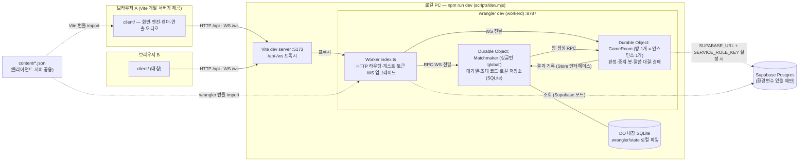
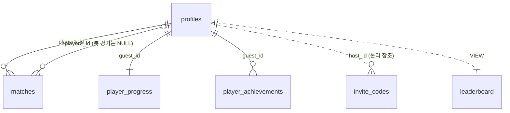
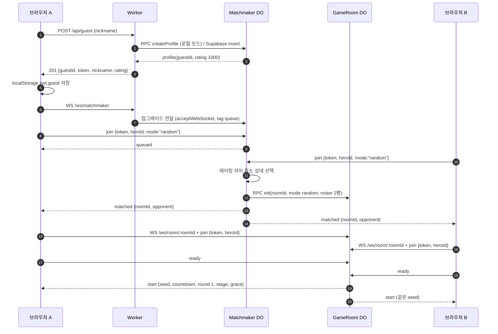
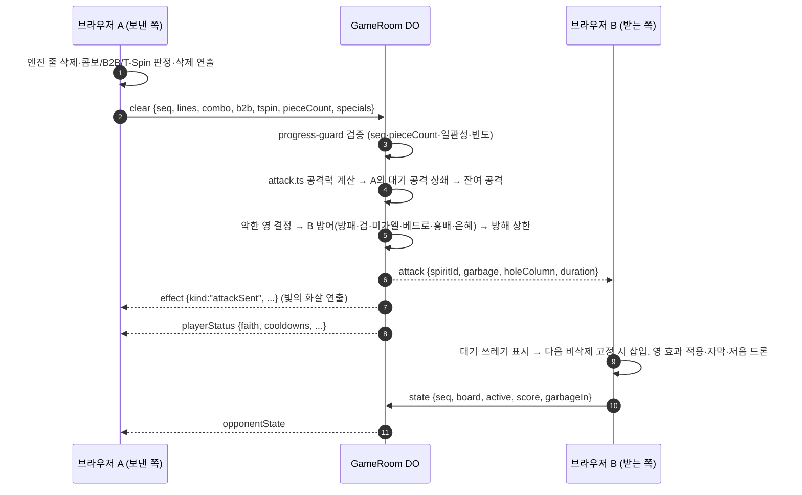
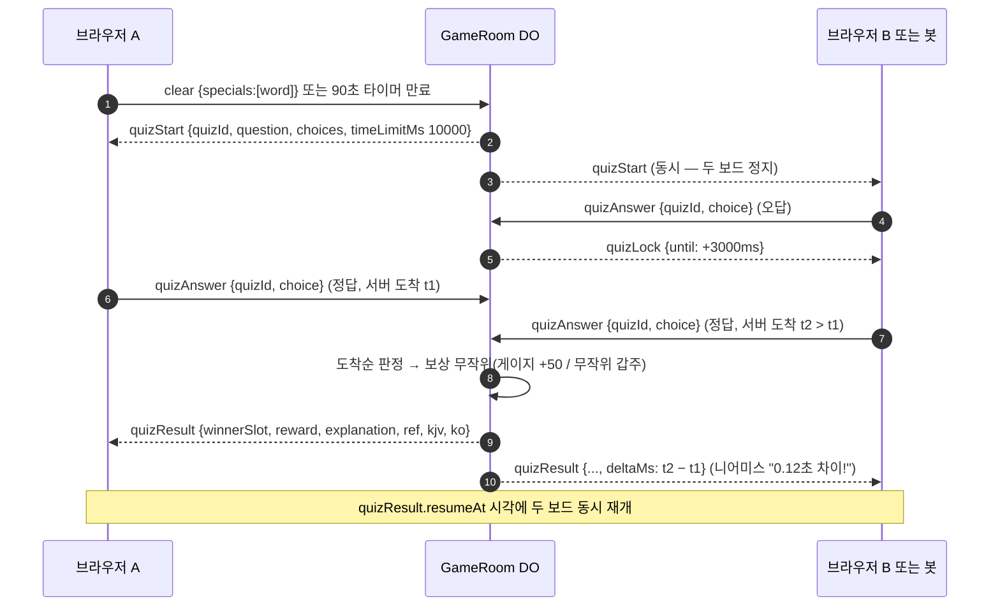
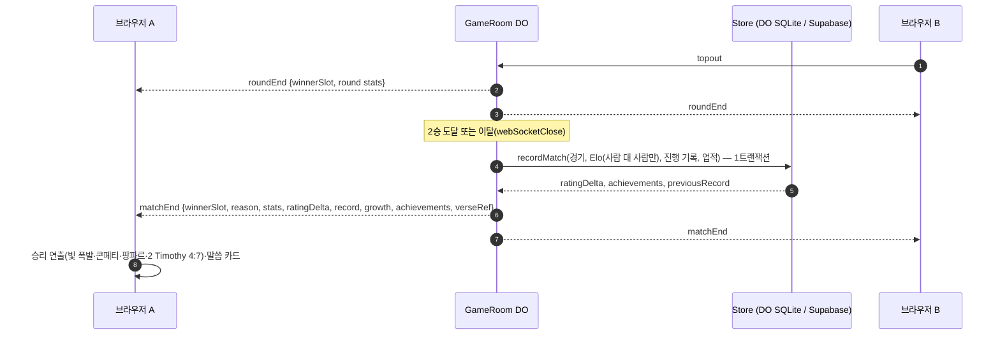

# 🏗️ 시스템 설계서 (Architecture Temple) — 영적 전쟁 테트리스

> *"And God made the firmament."* — Genesis 1:7 (KJV)
>
> **규격:** `statute-율법/02.architecture-foundation-기초/architecture-temple-성전설계-template.md`
> **참조 예시:** `parable-비유/02.architecture-foundation-기초/architecture-temple-성전설계-example.md`
> **근거 산출물 (Phase 1 정경):** [`spec-tablet-명세서.md`](../01.requirement-hearing-들음/spec-tablet-명세서.md) · [`usecase-path-사용사례.md`](../01.requirement-hearing-들음/usecase-path-사용사례.md) · [`rtm-covenant-언약추적.md`](../01.requirement-hearing-들음/rtm-covenant-언약추적.md) · [`requirement-hearing-들음.md`](../01.requirement-hearing-들음/requirement-hearing-들음.md)
> **동반 산출물 (Phase 2):** [`data-ark-법궤.md`](./data-ark-법궤.md) (ERD·DDL·콘텐츠 스키마) · [`api-gate-성문.md`](./api-gate-성문.md) (HTTP·WebSocket 명세)
> **원본 입력 대조:** `hearing-들음/req.md` 서두 "기술 스택" 5줄 (P2-001)

---

## 1. 시스템 개요

| 항목 | 내용 |
|:---|:---|
| 시스템명 | 영적 전쟁 테트리스 (Spiritual Warfare Tetris) — KJV 기반 실시간 2인 대전 테트리스 |
| 버전 | v1.0 (1차 출시 — 로컬 동작판) |
| 아키텍트 | Adam (개발 에이전트, 수석 시스템 아키텍트 역할) |
| 프로젝트 유형 / TIER | 새하늘 새땅 + 참고자료 / TIER-3 — 참고 소스(Express + Socket.IO 뼈대)는 개념만 구원하고 코드·구조는 전부 새로 설계 (spec-tablet §9.16) |
| 실행 모드 | ⚡ 자동 모드 — NICE-TO-HAVE(N-01~N-06) 승격 0건, 모호점은 가장 문자적 해석으로 해소 후 §11에 기록 |
| 아키텍처 양식 | 서버 권한형(Server-Authoritative) 실시간 클라이언트-서버. 브라우저가 자기 보드를 시뮬레이션하고, Durable Object(GameRoom)가 공격·게이지·스킬·말씀 대결·승패를 판정 (spec-tablet §9.5 "대전 해석 A") |
| 하중(Load) 가정 | 로컬 PC 1대, 동시 접속 브라우저 2~4개. 대전 1방당 상향 메시지 최대 15회/초 × 2명 (`state`) + 이벤트성 메시지. 저장은 경기 종료 시 1트랜잭션 |
| 상태 | **Canonized(정경화)** — 심판 관문 판정은 §13 참조 |

---

## 2. 아키텍처 다이어그램

### 2.1 전체 구성도 (로컬 모드 — 이번 실행의 정본)



> req.md 첨부 A §4.1 구성(브라우저 ↔ Worker ↔ Matchmaker/GameRoom ↔ Postgres)을 그대로 따르되, 서두 "인프라: 로컬 PC"가 우선이므로(머리말 우선 규칙) Cloudflare Pages 자리를 Vite 개발 서버가, Supabase 자리를 DO 내장 SQLite가 맡는다. Supabase Auth는 이번 실행 제외(C-008, spec-tablet §9.7 K5)이므로 그리지 않는다.

### 2.2 아키텍처 컴포넌트 목록 (ARCH-ID)

| ARCH-ID | 컴포넌트 | 위치 (`fruit-열매/` 기준) | 책임 (단일) | 근거 REQ |
|:---|:---|:---|:---|:---|
| ARCH-001 | 앱 셸·화면 라우터 | `client/js/main.js`, `client/js/screens/` | 화면 9개 전환과 화면별 DOM 렌더링 | REQ-002~006, FR-013, FR-078 |
| ARCH-002 | 테트리스 엔진 (동형 모듈) | `client/js/engine/` | 보드·7-bag·SRS·드롭·홀드·고스트·줄 삭제·콤보/B2B/T-Spin 판정·특수 칸 굴림·속도 곡선 (DOM·네트워크 무의존) | REQ-001, REQ-012, FR-001~004, FR-010, FR-044~047, FR-055 |
| ARCH-003 | 전투 컨트롤러·입력 | `client/js/battle/` | 엔진 ↔ 네트워크 ↔ 렌더·연출 조정, 키보드·터치 입력, 서버 `effect`/`attack`을 내 보드에 적용 | REQ-001, REQ-007~009, FR-006, FR-011, FR-025, FR-027~030 |
| ARCH-004 | 렌더링 계층 (PixiJS v8) | `client/js/render/` | 보드·블록(유리·발광)·HUD·시차 배경·벡터 엠블럼·영/천사/예수님 빛 실루엣 그리기 | REQ-013, FR-013, FR-048, FR-049, FR-039 |
| ARCH-005 | 연출 계층 (pixi-filters·GSAP·canvas-confetti) | `client/js/fx/` | 파티클 풀, 흔들림, 히트스톱, 충격파·발광 필터, 빛의 화살·상쇄, DOM 오버레이(암전·비네트·자막), 승패 연출, 연출 세기 | REQ-013, FR-051~057, FR-061, NFR-001 |
| ARCH-006 | 오디오 계층 (Tone.js) | `client/js/audio/` | 코드 합성 효과음 17종, 적응형 BGM, 마스터/효과음/음악 음량·음소거 | REQ-013, FR-058~060, C-007 |
| ARCH-007 | 네트워크 클라이언트 | `client/js/net/` | partysocket WS 연결, HTTP fetch, 메시지 타입·필드 한계 상수(`protocol.js` — 서버와 공유) | REQ-001, FR-008, FR-018, FR-019 |
| ARCH-008 | 게스트 세션 | `client/js/auth/guest-session.js` | 닉네임·게스트 ID·토큰의 브라우저 저장·복원·삭제 | REQ-002, FR-012, NFR-008 |
| ARCH-009 | Worker 진입점·HTTP 라우터 | `worker/src/index.ts`, `worker/src/http/`, `worker/src/auth/` | 라우팅, 공통 응답, 게스트 토큰 발급·검증, WS 업그레이드 전달 | REQ-002, REQ-014, REQ-015, FR-012, FR-069, FR-071 |
| ARCH-010 | Matchmaker DO | `worker/src/matchmaker.ts`, `worker/src/matchmaking/` | 랜덤 대기열(Elo 근접), 초대 코드 발급·검증·만료, 봇·연습 방 생성, 로컬 저장소 호스트 | REQ-004~006, FR-018~021, FR-023 |
| ARCH-011 | GameRoom DO | `worker/src/game-room.ts`, `worker/src/room/` (셸·상태·라우터·라운드 흐름) | 방 수명주기, 시드 배포, 라운드·경기(3판 2선승), 이탈 처리, 상대 보드 중계 | REQ-001, FR-005~009 |
| ARCH-012 | 전투 판정 서비스 | `worker/src/attack.ts`, `worker/src/room/` (판정 모듈) | 공격력·악한 영 결정, 상쇄, 방해 상한, 게이지·쿨다운, 위인 스킬·천사·갑주, 예수님 이벤트, 특수 블록 검증, 은혜 보정, 진행 검증 | REQ-003, REQ-007~010, REQ-012, FR-014~017, FR-024~039, FR-045~047, FR-062 |
| ARCH-013 | 말씀 대결 서비스 | `worker/src/room/quiz-duel.ts` | 트리거(말씀 블록·90초), 동시 정지, 출제, 도착순 판정, 3초 잠금, 보상, 니어미스 시간차 | REQ-011, FR-040~043 |
| ARCH-014 | AI 봇 | `worker/src/room/bot/` | 서버 내 봇 보드 시뮬레이션(ARCH-002 재사용), 난이도별 착지·속도, 퀴즈 응답 | REQ-005, FR-021, FR-022 |
| ARCH-015 | 저장소 어댑터 계층 | `worker/src/store/` | `Store` 인터페이스 1개 + DO SQLite 구현 + Supabase 구현 + 환경변수 기반 자동 선택 | REQ-014~016, FR-067, FR-068, FR-072 |
| ARCH-016 | 결과·레이팅 서비스 | `worker/src/results/`, `worker/src/elo.ts` | 경기 결과 기록, Elo 갱신, 진행 기록(누적 판·연속 패배·직전 기록), 업적, 성장 수치 | REQ-013~015, FR-065~068, FR-070 |
| ARCH-017 | 프로토콜 검증·빈도 제한 | `worker/src/protocol/` | 모든 수신 메시지 스키마 검증, 메시지 종류별 토큰 버킷 | NFR-003, FR-032, C-009 |
| ARCH-018 | 공용 게임 콘텐츠 | `content/*.json`, `client/js/content/`, `worker/src/content.ts` | 위인·천사·악한 영·갑주·상성표·구절·퀴즈·밸런스·업적 데이터의 단일 원천 | FR-074, FR-038, FR-043, C-003, C-010 |
| ARCH-019 | 로컬 실행 오케스트레이션 | `package.json`(루트), `scripts/dev.mjs`, `client/vite.config.js`, `worker/wrangler.toml` | 단일 명령으로 Vite + wrangler dev 동시 기동, 프록시, DO SQLite 영속 | REQ-016, FR-073, C-004, C-012 |
| ARCH-020 | 테스트 하네스 | `tests/`, `scripts/check-content.mjs`, `vitest.config.js`, `playwright.config.js` | Vitest 단위, 콘텐츠 검사, Playwright 브라우저 2개 E2E | REQ-017, FR-075~077 |
| ARCH-021 | 보안·비밀 경계 | `worker/.dev.vars`(git 제외), `worker/src/auth/token.ts`, `.gitignore` | 비밀은 Worker 환경변수에만, 토큰은 해시로만 저장, `backup/`·`.dev.vars` 비공개 | NFR-003, NFR-004, NFR-008, C-013 |
| ARCH-022 | 경기 보조 UI 위젯 | `client/js/ui/` | 말씀 대결 패널, 말씀 카드(PNG 저장·공유), 리액션, 안내 토스트 | REQ-011, REQ-013, FR-041, FR-042, FR-063, FR-064 |

---

## 3. 기술 스택

### 3.1 계층별 기술 + 선택 근거

| 계층 | 기술 | 선택 근거 (REQ) |
|:---|:---|:---|
| 빌드·개발 서버 | **Vite** | req.md 서두 프론트 스택 (C-005). `/api`·`/ws` 프록시로 같은 출처 접속 → CORS·쿠키 문제 없음 (FR-073) |
| 클라이언트 언어 | **바닐라 JS (ES Modules)** — 프레임워크 없음 | C-005, A §4.2 "빌드 도구 최소화". 엔진·프로토콜 모듈을 서버가 그대로 import 할 수 있음 (ARCH-002 동형) |
| 렌더링 | **PixiJS v8** (WebGL/WebGPU) | C-005, NFR-001 60fps — GPU 배치 렌더링, 파티클 컨테이너 |
| 그래픽 필터 | **pixi-filters v6** | FR-048(Glow), FR-052(Shockwave), FR-054(비네트), FR-030(바벨론 일렁임 — 변위·블러) |
| 애니메이션 | **GSAP 3** | FR-051 트윈, FR-052 글자 연출, FR-053 흔들림, DOM 오버레이(암전·자막) 타임라인 |
| 사운드 | **Tone.js 15** | FR-058~060, C-007 — 음원 파일 없이 합성 |
| 축하 효과 | **canvas-confetti** | FR-056 금빛 콘페티 |
| 실시간 통신 (클라이언트) | **partysocket** | FR-008 "브라우저 기본 WebSocket(partysocket)" — 로비·매칭 연결 자동 재연결 (경기 복귀는 N-02 보존, OQ #18) |
| 폰트 | **@fontsource/cinzel**, **@fontsource/noto-serif-kr** | FR-050, NFR-005 — 오프라인 번들 |
| 실시간 서버 | **Cloudflare Workers + Durable Objects (TypeScript)**, WebSocket Hibernation API | C-005, A §4.2 — 방 1개 = DO 1개, 대기 중(매칭·초대 대기) 소켓은 Hibernation으로 비용 없이 유지 |
| 로컬 런타임 | **wrangler dev** (workerd, 로그인 불필요) | REQ-016, C-004 |
| DB (로컬, 기본) | **Durable Object 내장 SQLite** (`ctx.storage.sql`) | req.md 서두 "DB: 로컬은 DO 내장 SQLite", FR-072 |
| DB (선택 어댑터) | **Supabase Postgres** via **@supabase/supabase-js** | FR-072 — `SUPABASE_URL` + `SUPABASE_SERVICE_ROLE_KEY` 둘 다 있을 때만 활성 |
| 단위 테스트 | **Vitest** | REQ-017, FR-075 — JS·TS 모두 변환 없이 실행 |
| E2E 테스트 | **Playwright** (브라우저 컨텍스트 2개) | REQ-017, FR-077 |
| 타입 검사 | **TypeScript** (`tsc --noEmit`), `wrangler types`로 Env 타입 생성 | A §4.2 "서버: TypeScript" |

> **P2-001 대조:** req.md 서두 5줄(프론트 9종 / Workers + DO TypeScript, `wrangler dev` / DO SQLite + Supabase 어댑터 / Vitest + Playwright / 로컬 PC)과 위 표가 1:1 일치한다. 추가된 것은 언어 도구(TypeScript 컴파일러 — A §4.2가 지정한 서버 언어)뿐이며, 스택 외 런타임 라이브러리(예: 스키마 검증 라이브러리, 프로세스 병렬 실행 도구)는 **추가하지 않는다** — 메시지 검증(ARCH-017)과 동시 기동(ARCH-019)은 직접 작성한 작은 모듈로 해결한다 (C-005 고정 스택 보존, "최신 기술 다 넣자" 마귀 경고).

### 3.2 계획 의존성 버전 (Phase 4에서 lockfile로 고정)

> NFR-007: "개발 시점 최신 안정판으로 lockfile 고정, 출시 2주 미만 버전 회피". 아래는 2026-10-05 이전에 충분히 오래 배포되어 안정성이 확인된 **기준선(계획) 버전**이다. Phase 4 착수 시 같은 메이저 안에서 출시 2주 이상 지난 최신 안정판으로 올려 `package-lock.json`에 고정하고, 그 결과를 Phase 4 산출물에 기록한다. 메이저 변경은 이 문서의 개정(설계 변경 이력) 없이는 하지 않는다.

| 패키지 | 설치 위치 | 구분 | 계획 버전 | 메이저 고정 근거 |
|:---|:---|:---|:---|:---|
| vite | client | devDependencies | 7.0.0 | Vite 7 — Node 20.19+ 요구, 로컬 Node v24.18.0 충족 |
| pixi.js | client | dependencies | 8.9.2 | req.md "PixiJS v8" |
| pixi-filters | client | dependencies | 6.1.0 | req.md "pixi-filters v6" (PixiJS v8 대응 메이저) |
| gsap | client | dependencies | 3.13.0 | req.md "GSAP 3 (전 플러그인 무료)" — 3.13부터 전 플러그인 무료 배포 |
| tone | client | dependencies | 15.0.4 | req.md "Tone.js 15" |
| canvas-confetti | client | dependencies | 1.9.3 | req.md 지정 |
| partysocket | client | dependencies | 1.1.4 | req.md 지정 |
| @fontsource/cinzel | client | dependencies | 5.2.5 | FR-050 |
| @fontsource/noto-serif-kr | client | dependencies | 5.2.5 | FR-050 |
| wrangler | worker | devDependencies | 4.20.0 | Wrangler 4 — DO SQLite(`new_sqlite_classes`)·DO RPC·`wrangler types` 지원 |
| typescript | worker | devDependencies | 5.8.3 | A §4.2 서버 TypeScript |
| @supabase/supabase-js | worker | dependencies | 2.50.0 | A §5.6 DB 클라이언트 — 키 있을 때만 동적 import |
| vitest | 루트 | devDependencies | 3.2.4 | REQ-017 |
| @playwright/test | 루트 | devDependencies | 1.53.0 | REQ-017 |

> Node.js v24.18.0 / npm 11.16.0 (개발 PC 실측). npm workspaces는 npm 7+ 기본 기능이라 별도 도구가 필요 없다.
>
> **※ 재각 R1 (2026-10-20, Phase 4 — §15):** 개발 PC의 `D:` 드라이브(원격 데스크톱 리디렉션 `\\TSCLIENT\D`)가 디렉터리 접합(junction)·심볼릭 링크를 만들 수 없어 npm workspaces 링크가 `EISDIR`로 실패한다. 따라서 위 표의 "설치 위치" 열은 **소속 계층 표시**로만 남기고, 실제 설치는 전부 `fruit-열매/package.json` 하나(루트)에서 한다. Phase 4 잠금 버전은 `bible-성경/04.development-repentance-회개/devguide-commandment-개발계명.md` §1.2.

---

## 4. 인프라·클라우드 설계

### 4.1 서버 구성 — 하이브리드(로컬 정본 + 클라우드 설계 경로)

| 구성 요소 | 로컬 모드 (이번 실행 — 키 0개) | 운영 모드 (설계만 — 실제 배포는 C-008로 이번 실행 제외) |
|:---|:---|:---|
| 정적 화면 | Vite 개발 서버 `http://localhost:5173` | Cloudflare Pages (`vite build` 산출물) |
| 실시간 서버 | `wrangler dev` (workerd 로컬 런타임) `http://localhost:8787` | Cloudflare Workers + Durable Objects |
| DO 저장 | `worker/.wrangler/state/` 아래 로컬 SQLite 파일 (wrangler dev 기본 영속) | Cloudflare DO SQLite 저장소 (초대 코드 전용) |
| 전적·랭킹·진행 기록 | Matchmaker DO 내장 SQLite (`DoSqliteStore`) | Supabase Postgres (`SupabaseStore`) |
| 로그인 | 게스트 닉네임 + Worker 발급 게스트 토큰 | 같음 (Supabase Auth는 이번 실행 제외 — K5) |
| 비밀 | 없음 | `wrangler secret put SUPABASE_SERVICE_ROLE_KEY` |

### 4.2 실행 모드 전환 규칙 (FR-072 — 저장소 어댑터 자동 전환)

```
worker/src/store/select-store.ts
  if (env.SUPABASE_URL 이 비어 있지 않음 && env.SUPABASE_SERVICE_ROLE_KEY 가 비어 있지 않음)
      → SupabaseStore (Worker·GameRoom이 service role 키로 직접 접속)
  else
      → DoStoreClient (Matchmaker DO 'global' 인스턴스의 RPC 메서드 → DoSqliteStore)
```

- 판정은 Worker 요청마다가 아니라 **isolate 시작 시 1회** 계산해 캐시한다(env는 isolate 수명 동안 불변).
- 두 변수 중 하나만 있으면 로컬 모드로 동작하고 서버 로그에 경고 1줄을 남긴다 (반쪽 설정으로 기동 실패하지 않음 — C-004).
- 두 구현은 같은 `Store` 인터페이스(프로필·경기·랭킹·진행 기록·업적)를 구현한다 (data-ark §1.3).
- 초대 코드(TBL-005)는 저장소 모드와 무관하게 **항상** Matchmaker DO SQLite에 둔다 — 수명 10분짜리 방 배정 상태이지 전적·랭킹 데이터가 아니기 때문이다 (FR-072의 인터페이스 범위 = 프로필·경기·랭킹).
- 저장 모드를 화면에 표시하는 기능은 만들지 않는다 (N-06 보존 — 승격 금지).

### 4.3 DB 서버 및 캐시 전략

| 대상 | 전략 | 근거 |
|:---|:---|:---|
| 로컬 DB 서버 | 별도 DB 프로세스 없음. Matchmaker DO(싱글턴 이름 `global`)의 내장 SQLite가 DB 서버 역할. 쓰기는 `ctx.storage.transactionSync()`로 경기 1건 = 1트랜잭션 | req.md 서두 DB, FR-068 원자적 기록 |
| 운영 DB 서버 | Supabase Postgres. 경기 기록·Elo·진행 기록은 Postgres 함수 `record_match`(data-ark §7.3) 1회 호출로 원자 처리 | FR-068, FR-070 |
| 게임 콘텐츠 | `content/*.json`을 빌드 타임에 번들(Vite 해시 파일명, wrangler 번들). 런타임 조회·캐시 계층 불필요 | FR-074, NFR-005 |
| 랭킹 상위 100 | 로컬 모드: Matchmaker DO 메모리에 결과 캐시, 경기 기록(`recordMatch`) 시 무효화. Supabase 모드: 매 요청 `leaderboard` 뷰 조회 (인덱스 `idx_profiles_rating`) | FR-071, NFR-002 핫패스와 분리 |
| 전적 | 캐시 없음, 요청마다 인덱스 조회 (`Cache-Control: no-store`) | FR-069 최신순 정확성 |
| 대전 중 상태 | GameRoom 메모리(판정 상태) — 핫패스(`clear` → `attack`)에서 저장소 접근 0회 | NFR-002 100ms |
| 대기 중 상태 | Hibernation 대비: 소켓 첨부(`serializeAttachment`)에 게스트 ID·위인·레이팅, 방 명단은 `ctx.storage`(KV)에 보관 → 깨어날 때 복원 | A §4.2 Hibernation API |
| 외부 캐시 서비스 | 쓰지 않음 (Workers KV·Redis 등은 스택 밖 — C-005) | C-005 |

### 4.4 배포 환경 (Local / Staging / Production)

| 환경 | 목적 | 구성 | 이번 실행 |
|:---|:---|:---|:---|
| **Local** | 개발·검증 정본. 완료 기준 판정 환경 | `npm install && npm run dev` → Vite :5173 + wrangler dev :8787, DO SQLite. E2E도 이 환경에서 실행 | ✅ 구현·검증 대상 |
| **Staging** | 키가 생긴 뒤 외부 네트워크 두 기기 대전 검증 (A §6 M6 완료 기준) | `wrangler.toml`의 `[env.staging]` + Pages 프리뷰 + Supabase 개발 프로젝트(`supabase/migrations/0001_init.sql` 적용) | ⛔ 설계만 (C-008 "실제 Cloudflare/Supabase 배포 제외") |
| **Production** | 정식 운영 | `[env.production]` + Pages 프로덕션 + Supabase 운영 프로젝트, 비밀은 `wrangler secret`, 클라이언트 빌드 변수 `VITE_SERVER_ORIGIN`으로 Worker 출처 지정 | ⛔ 설계만 (Phase 7에서 키 확보 후 진행) |

> Phase 4는 로컬 기본 설정만 작성한다. `[env.staging]`·`[env.production]` 블록과 배포 명령은 C-008(제외 범위 구현 금지)에 따라 **작성하지 않으며**, 위 표는 운영 전환 시의 설계 경로로만 정경화한다. 운영 전환 시에도 코드 변경은 0줄이어야 한다 — 모드 전환은 환경변수(§4.2)와 빌드 변수(`VITE_SERVER_ORIGIN`, 로컬은 빈 값 = 같은 출처)로만 일어난다.

### 4.5 클라우드 서비스 선택 근거

| 선택 | 근거 REQ | 대안과 기각 사유 |
|:---|:---|:---|
| Cloudflare Workers + Durable Objects | C-005, A §4.1 "방 1개 = 인스턴스 1개", REQ-007 서버 판정 | Express + Socket.IO(참고 소스) — C-006 금지, Workers에서 동작 불가(A §4.2) |
| DO 내장 SQLite (로컬) | req.md 서두 DB, C-004 키 0개 | D1 — 스택 밖(C-005). 파일 DB 별도 프로세스 — `npm run dev` 한 번 원칙 위반 위험 |
| Supabase Postgres (선택) | FR-072, A §4.4 | 운영 모드에서만. 로컬 필수 의존 금지 (C-004) |
| Cloudflare Pages (운영 설계) | A §4.2 | 이번 실행은 Vite가 대체 (서두 인프라 우선) |
| WebSocket Hibernation API | A §4.2 | 일반 WebSocket 수락 — 대기 소켓이 DO를 계속 깨워 둠 |

### 4.6 포트·프록시·단일 명령 (FR-073)

| 항목 | 값 | 설명 |
|:---|:---|:---|
| 진입 명령 | `fruit-열매/`에서 `npm install && npm run dev` | 루트 `dev` 스크립트 = `node scripts/dev.mjs` |
| `scripts/dev.mjs` | Node `child_process.spawn`으로 `npm run dev -w worker`와 `npm run dev -w client`를 함께 띄우고, 출력에 `[worker]`/`[client]` 접두어, 한쪽이 종료되면 다른 쪽도 종료. `WRANGLER_SEND_METRICS=false`로 첫 실행 질의 차단, `X_LOCAL_OBSERVABILITY=false`로 wrangler 로컬 관측(메시지마다 추적 기록 — 게임 미사용 개발 도구) 끄기(사용자가 지정한 값은 존중 — 광야 BUG-004, NFR-002) — **재각 R1(§15): 루트 스크립트 `npm run dev:worker`·`npm run dev:client`를 띄운다** | 추가 의존성 없음 (§3.1) |
| worker dev | `wrangler dev --port 8787 --ip 127.0.0.1` — **재각 R1: 루트에서 `--config worker/wrangler.toml` 추가** | 로그인 불필요 로컬 런타임 |
| client dev | `vite --port 5173 --strictPort` — **재각 R1: 루트에서 `--config client/vite.config.js` 추가** | 포트 충돌 시 즉시 실패 + 안내 (UC-021 E1) |
| Vite 프록시 | `/api` → `http://127.0.0.1:8787`, `/ws` → `ws://127.0.0.1:8787` (`ws: true`) | 브라우저는 5173 한 출처만 사용 |
| Vite 파일 접근 | `server.fs.allow`에 `fruit-열매/` 루트 포함 | `content/*.json` import 허용 (FR-074) |
| 비밀 파일 | `worker/.dev.vars` (없으면 로컬 모드), 예시 `worker/.dev.vars.example`(빈 값) | NFR-004 |

---

## 5. 폴더 구조 판단

### 5.1 판단 체크리스트

| # | 질문 | 답변 | 결과 |
|:--|:---|:---|:---|
| 1 | CRUD가 포함되어 있는가? | ✅ YES (부분) — 게스트 프로필 생성(C), 전적·랭킹 조회(R). 사용자 수정(U)·삭제(D) 화면은 없음 | **CRUD 강제 분리 규칙 적용** (보수적 판정: C·R만 있어도 HTTP 처리 / 렌더링 / 서비스 / 데이터 분리) |
| 2 | 화면 수는 몇 개인가? (CRUD 각 화면 별도 카운트) | **9개** — 닉네임 입장, 로비, 캐릭터 선택, 매칭 대기·초대 코드, 대전, 결과, 전적, 랭킹, 옵션 (FR-078) | 4개 이상 → 분리 |
| 3 | 한 파일에 HTTP 처리 + 렌더링이 섞이는가? | ✅ YES → 분리 필수 — 클라이언트(브라우저 렌더링)와 서버(HTTP·WS 처리)는 이미 다른 런타임이며, 서버 안에서도 HTTP 핸들러 / 판정 서비스 / 저장소를 분리 | 분리 |
| 4 | 기술 스택 공식 컨벤션은? | Cloudflare Workers: `src/index.ts` 진입 + DO 클래스 파일, `wrangler.toml`. Vite: `index.html` + `src/`(여기서는 A §4.5에 따라 `js/`). npm workspaces: 루트 `package.json`의 `workspaces` | 컨벤션 + A §4.5 구조 준수 (C-012) |
| 5 | 단일 책임 2개 이상 섞일 위험 파일? | A §4.5의 `game.js`(엔진)·`effects.js`(연출)·`audio.js`(오디오)·`game-room.ts`(방)는 각각 10개 안팎 책임 → **폴더로 승격해 모듈 분할** | 300줄 경고·500줄 한계 사전 회피 |

### 5.2 판단 결과

- **채택 구조:** npm workspaces 단일 루트(`fruit-열매/`) — **재각 R1(§15): workspaces 없이 `fruit-열매/package.json` 1개가 모든 의존성·스크립트를 가진다** — + A §4.5의 네 영역(`client/`, `worker/`, `content/`, `supabase/`) + 테스트·스크립트 영역(`tests/`, `scripts/`). 서버는 **HTTP 핸들러(`worker/src/http/`) / 서비스(`worker/src/room/`, `matchmaking/`, `results/`, `attack.ts`) / 데이터(`worker/src/store/`)** 분리, 클라이언트는 **화면 템플릿(`client/js/screens/`) / 엔진(`engine/`) / 조정(`battle/`) / 표현(`render/`, `fx/`, `audio/`, `ui/`) / 통신(`net/`)** 분리.
- **판단 근거:** 체크리스트 #1(CRUD 부분 포함 → 강제 분리), #2(화면 9개 ≥ 4), #3(HTTP·렌더링 혼재 금지), A §4.5 목표 구조(C-012), SKILL-02 줄 수 가이드(책임 2개+ 분리).
- **A §4.5 대비 변경점 (모두 책임 분리를 위한 하위 승격, 영역 추가 없음):** `game.js` → `engine/`, `effects.js` → `fx/`, `audio.js` → `audio/`, `network.js` → `net/`, `auth.js`(Supabase 로그인) → `auth/guest-session.js`(Supabase Auth 제외 — K5), `game-room.ts` → `game-room.ts` 셸 + `room/`, `matchmaker.ts` → 셸 + `matchmaking/`, `style.css` → `styles/`. `client/assets/`(이미지·사운드)는 C-007(녹음 음원·일러스트 미사용)로 **만들지 않는다**. `unlocks` 테이블은 위인 해금 제외(C-008)로 만들지 않는다.
- **동형(isomorphic) 모듈 결정:** 엔진의 정본 위치는 A §4.5가 지정한 클라이언트(`client/js/engine/`)이고, 서버(봇 시뮬레이션 ARCH-014, 진행 검증 보조)는 이를 **읽기 전용으로 import** 한다. 메시지 타입 이름·필드 한계 상수도 `client/js/net/protocol.js` 하나를 양쪽이 import 한다. 별도 `shared/` 영역을 만들지 않는다 (C-012 문자적 해석 — §11 #3).
- **예상 최대 파일 줄 수:** **280줄** (`client/js/engine/game.js` — 낙하 블록 수명주기 상태 기계, `worker/src/protocol/validate.ts` — 메시지 스키마 표). 300줄 초과 예상 파일 **0개** → 단일 책임 예외 근거 기재 대상 없음. 데이터 JSON(`quiz.json`, `verses.json`)은 **1항목 1줄** 형식으로 써서 60문항 이상이어도 500줄 미만을 유지한다 (data-ark §8).

### 5.3 폴더 트리 (상위 2단계 + 핵심 파일)

```
fruit-열매/
├── package.json                # npm workspaces 루트 ["client","worker"] + dev/test/check:content/e2e/typecheck 스크립트 (재각 R1: workspaces 없음 — 모든 의존성·스크립트를 이 파일 하나에, §15)
├── package-lock.json           # Phase 4 생성·고정 (NFR-007)
├── .gitignore                  # node_modules, worker/.dev.vars, worker/.wrangler, dist, test-results, playwright-report, backup/
├── vitest.config.js            # tests/unit/** (JS·TS)
├── playwright.config.js        # webServer: npm run dev, baseURL http://localhost:5173
├── scripts/
│   ├── dev.mjs                 # Vite + wrangler dev 동시 기동 (ARCH-019)
│   └── check-content.mjs       # 콘텐츠 검사 (FR-076)
├── content/                    # 공용 게임 데이터 (ARCH-018) — data-ark §8
│   ├── heroes.json  angels.json  spirits.json  armor.json  counters.json
│   └── verses.json  quiz.json  balance.json  achievements.json
├── client/
│   ├── package.json  vite.config.js  index.html   (재각 R1: client/package.json 없음)
│   ├── styles/                 # base.css, screens.css, overlay.css
│   └── js/
│       ├── main.js             # 부트스트랩·화면 라우터
│       ├── screens/            # 화면 9개 (렌더링 전용)
│       ├── engine/             # 테트리스 엔진 (동형)
│       ├── battle/             # 전투 조정·입력·효과 적용
│       ├── net/                # protocol.js(동형), socket·lobby·room·http 클라이언트
│       ├── auth/               # guest-session.js
│       ├── content/            # content-loader.js
│       ├── render/             # PixiJS 그리기
│       ├── fx/                 # 연출
│       ├── audio/              # Tone.js 합성
│       └── ui/                 # 퀴즈 패널·말씀 카드·리액션·토스트
├── worker/
│   ├── package.json  wrangler.toml  tsconfig.json  .dev.vars.example   (재각 R1: worker/package.json 없음, wrangler types 생성물 worker-configuration.d.ts 추가)
│   └── src/
│       ├── index.ts  env.ts  attack.ts  elo.ts  content.ts  matchmaker.ts  game-room.ts
│       ├── http/  auth/  protocol/
│       ├── matchmaking/  room/  room/bot/
│       ├── results/
│       └── store/
├── supabase/
│   └── migrations/0001_init.sql
└── tests/
    ├── unit/                   # Vitest
    └── e2e/                    # Playwright 브라우저 2개
```

### 5.4 파일 목록 (역할별 분리 + 줄 수 예산)

> 줄 수는 Phase 4 구현 예산(상한 목표)이다. 300줄을 넘기면 SKILL-02 경고 규칙에 따라 책임을 재검토한다.

**HTTP 처리 (서버 — 요청 수신·응답 반환만)**

| 파일 | 책임 | 예산 |
|:---|:---|:---:|
| `worker/src/index.ts` | `fetch` 진입, 경로별 위임 | 80 |
| `worker/src/http/router.ts` | 메서드·경로 매칭 | 60 |
| `worker/src/http/respond.ts` | 공통 응답 형식·에러 직렬화 | 60 |
| `worker/src/http/guest-routes.ts` | API-001·API-002 | 120 |
| `worker/src/http/records-routes.ts` | API-003 | 90 |
| `worker/src/http/ranking-routes.ts` | API-004 | 70 |
| `worker/src/http/ws-routes.ts` | API-005·API-006 업그레이드 전달 | 80 |

**서비스/비즈니스 (서버)**

| 파일 | 책임 | 예산 |
|:---|:---|:---:|
| `worker/src/auth/token.ts` | 게스트 토큰 발급·SHA-256 해시·검증 | 70 |
| `worker/src/auth/nickname.ts` | 닉네임 정규화(NFC·trim)·규칙 검사 | 60 |
| `worker/src/protocol/validate.ts` | 수신 메시지 스키마 검증 | 280 |
| `worker/src/protocol/rate-limit.ts` | 메시지 종류별 토큰 버킷 | 80 |
| `worker/src/matchmaker.ts` | Matchmaker DO 셸 (WS 핸들러·RPC 메서드 노출) | 200 |
| `worker/src/matchmaking/queue.ts` | Elo 근접 대기열 | 140 |
| `worker/src/matchmaking/invite-codes.ts` | 초대 코드 발급·검증·만료 | 120 |
| `worker/src/matchmaking/room-factory.ts` | GameRoom 생성·명단 예약 RPC | 80 |
| `worker/src/game-room.ts` | GameRoom DO 셸 (Hibernation 핸들러·방 타이머 깨우기 — 메모리 타이머 1개, 경기 중 저장소 쓰기 없음: 광야 BUG-005·NFR-002) | 200 |
| `worker/src/room/room-state.ts` | 방·플레이어 상태 타입과 초기화 | 150 |
| `worker/src/room/message-router.ts` | 수신 메시지 → 서비스 분배 | 220 |
| `worker/src/room/round-flow.ts` | `start`/`roundEnd`/`matchEnd`, 이탈 처리 | 250 |
| `worker/src/room/progress-guard.ts` | `seq`·`pieceCount`·콤보·B2B 일관성 검증 (FR-032) | 200 |
| `worker/src/room/faith.ts` | 믿음 게이지·쿨다운 | 150 |
| `worker/src/room/hero-skills.ts` | 위인 스킬 4종 | 150 |
| `worker/src/room/angels.ts` | 천사 5종·봉인 검사 | 150 |
| `worker/src/room/armor.ts` | 갑주 획득·보유·사용 6종 | 200 |
| `worker/src/room/interference.ts` | 악한 영 효과 적용·방해 상한 | 220 |
| `worker/src/room/jesus-event.ts` | 예수님 이벤트 조건·1회 제한 | 90 |
| `worker/src/room/specials.ts` | 특수 칸 검증·효과 (말씀·여리고·만나·갑주 칸) | 180 |
| `worker/src/room/grace.ts` | 은혜 보정 | 60 |
| `worker/src/room/quiz-duel.ts` | 말씀 대결 (ARCH-013) | 250 |
| `worker/src/room/timers.ts` | 방 타이머 스케줄러 | 100 |
| `worker/src/room/representative-verse.ts` | 경기 대표 구절 선정 (FR-063) | 60 |
| `worker/src/room/bot/bot-player.ts` | 봇 보드 진행·입력 속도 | 250 |
| `worker/src/room/bot/bot-planner.ts` | 착지 후보 평가 | 220 |
| `worker/src/room/bot/bot-quiz.ts` | 봇 퀴즈 응답 | 60 |
| `worker/src/attack.ts` | 공격력·악한 영 결정 순수 함수 (FR-075 대상) | 200 |
| `worker/src/elo.ts` | Elo 계산 | 40 |
| `worker/src/results/record-match.ts` | 결과 기록·Elo·진행·업적 오케스트레이션 | 200 |
| `worker/src/results/achievements.ts` | 업적 판정 | 60 |
| `worker/src/results/personal-record.ts` | 개인 기록·성장 수치 | 100 |
| `worker/src/content.ts` | 콘텐츠 import·색인 | 100 |
| `worker/src/env.ts` | Env 타입 | 40 |

**데이터/DB (서버)**

| 파일 | 책임 | 예산 |
|:---|:---|:---:|
| `worker/src/store/store.ts` | `Store` 인터페이스 | 80 |
| `worker/src/store/select-store.ts` | 모드 자동 선택 | 40 |
| `worker/src/store/do-sqlite-schema.ts` | DO SQLite DDL·스키마 버전 | 120 |
| `worker/src/store/do-sqlite-store.ts` | DO SQLite 구현 | 260 |
| `worker/src/store/do-store-client.ts` | Matchmaker RPC 프록시 | 80 |
| `worker/src/store/supabase-store.ts` | Supabase 구현 | 220 |
| `supabase/migrations/0001_init.sql` | Postgres 스키마·함수·RLS | 180 |

**화면 템플릿 (클라이언트 — 렌더링 전용)**

| 파일 | 화면 | 예산 |
|:---|:---|:---:|
| `client/js/screens/entry-screen.js` | 닉네임 입장 | 120 |
| `client/js/screens/lobby-screen.js` | 로비(모드 선택) | 150 |
| `client/js/screens/hero-select-screen.js` | 캐릭터 선택 | 160 |
| `client/js/screens/matching-screen.js` | 매칭 대기·초대 코드 | 160 |
| `client/js/screens/battle-screen.js` | 대전·연습 화면 골격 | 180 |
| `client/js/screens/result-screen.js` | 결과·말씀 카드 | 180 |
| `client/js/screens/records-screen.js` | 전적 | 120 |
| `client/js/screens/ranking-screen.js` | 랭킹 | 110 |
| `client/js/screens/options-screen.js` | 옵션 | 120 |

**엔진·조정·통신·표현 (클라이언트)**

| 파일 | 책임 | 예산 |
|:---|:---|:---:|
| `client/js/main.js` | 부트스트랩·라우터 | 120 |
| `client/js/engine/rng.js` | 시드 PRNG (mulberry32) | 40 |
| `client/js/engine/pieces.js` | 7종 모양·색 코드 | 80 |
| `client/js/engine/bag.js` | 시드 7-bag | 50 |
| `client/js/engine/srs.js` | SRS 회전·벽차기 표 | 120 |
| `client/js/engine/board.js` | 격자·충돌·줄 삭제·쓰레기/납/구멍 조작 | 220 |
| `client/js/engine/scoring.js` | 콤보·B2B·T-Spin·점수 | 150 |
| `client/js/engine/specials.js` | 특수 칸 굴림 (balance.json 확률) | 120 |
| `client/js/engine/gravity.js` | 속도 곡선 (FR-010) | 50 |
| `client/js/engine/danger.js` | 위험선 판정 (FR-055) | 40 |
| `client/js/engine/encode.js` | 보드 압축 문자열 | 60 |
| `client/js/engine/game.js` | 낙하 블록 수명주기 상태 기계 | 280 |
| `client/js/battle/battle-controller.js` | 엔진·네트워크·표현 조정 | 250 |
| `client/js/battle/input-keyboard.js` | 키보드 조작 | 120 |
| `client/js/battle/input-touch.js` | 스와이프·탭·진동 | 140 |
| `client/js/battle/effect-applier.js` | 서버 `effect`/`attack` → 엔진 보드 조작 | 220 |
| `client/js/battle/interference-client.js` | 영 효과의 클라이언트 상태(반전·가짜 고스트 등)·만료 | 200 |
| `client/js/net/protocol.js` | 메시지 타입·필드 한계 상수 (동형) | 220 |
| `client/js/net/socket.js` | partysocket 래퍼·봉투 직렬화 | 120 |
| `client/js/net/lobby-client.js` | Matchmaker 소켓 | 120 |
| `client/js/net/room-client.js` | GameRoom 소켓·`state` 12Hz 송신 | 150 |
| `client/js/net/http-api.js` | HTTP API 호출 | 100 |
| `client/js/auth/guest-session.js` | 게스트 정보 저장소 | 90 |
| `client/js/content/content-loader.js` | 콘텐츠 import·색인 | 60 |
| `client/js/render/pixi-app.js` | Pixi 애플리케이션·레이어 | 120 |
| `client/js/render/board-view.js` | 보드·블록·고스트·특수 칸 | 260 |
| `client/js/render/piece-skin.js` | 유리 질감·하이라이트·발광 텍스처 | 180 |
| `client/js/render/background-parallax.js` | 시차 배경·피격 색조 | 180 |
| `client/js/render/hud-view.js` | 홀드·다음 블록·게이지·갑주·은혜 아이콘 | 240 |
| `client/js/render/emblems.js` | 위인 벡터 엠블럼 4종 | 220 |
| `client/js/render/spirits-art.js` | 악한 영 실루엣·연기 | 220 |
| `client/js/render/angels-art.js` | 천사 빛·날개·불꽃(그룹 네 얼굴·바퀴, 스랍 여섯 날개) | 240 |
| `client/js/render/jesus-light.js` | 얼굴 없는 빛·실루엣 | 120 |
| `client/js/fx/particle-pool.js` | 파티클 오브젝트 풀 | 180 |
| `client/js/fx/screen-shake.js` | 흔들림 | 80 |
| `client/js/fx/hitstop.js` | 히트스톱 | 60 |
| `client/js/fx/filters.js` | pixi-filters 프리셋 | 150 |
| `client/js/fx/projectiles.js` | 빛의 화살·중앙 상쇄 | 180 |
| `client/js/fx/overlay-fx.js` | GSAP DOM 오버레이(암전·비네트·자막) | 220 |
| `client/js/fx/text-pop.js` | TETRIS·콤보·"아깝다!" 글자 | 150 |
| `client/js/fx/victory-fx.js` | 승리 콘페티·패배 붕괴 | 150 |
| `client/js/fx/feedback-sync.js` | 같은 프레임 동시 타격 조합 (FR-061) | 150 |
| `client/js/fx/fx-intensity.js` | 연출 세기 배율 (FR-057) | 60 |
| `client/js/audio/audio-engine.js` | Tone 컨텍스트·버스·음량·음소거·자동재생 해제 | 150 |
| `client/js/audio/sfx-play.js` | 조작 효과음 9종 | 200 |
| `client/js/audio/sfx-battle.js` | 전투 효과음 8종 | 220 |
| `client/js/audio/bgm.js` | 대기실·대전 적응형 BGM | 250 |
| `client/js/ui/quiz-panel.js` | 말씀 대결 패널·잠금·니어미스 | 220 |
| `client/js/ui/verse-card.js` | 말씀 카드 PNG·Web Share | 180 |
| `client/js/ui/reactions.js` | 리액션 3종 | 100 |
| `client/js/ui/toast.js` | 안내·거부 피드백 | 60 |

**설정·스크립트·테스트**

| 파일 | 책임 | 예산 |
|:---|:---|:---:|
| `scripts/dev.mjs` | 동시 기동 | 100 |
| `scripts/check-content.mjs` | 콘텐츠 검사 | 200 |
| `tests/unit/*.test.(js·ts)` | 엔진·attack·Elo·검증·방해 상한·게이지·특수 블록 단위 테스트 (파일당 1대상) | 각 ≤ 250 |
| `tests/e2e/battle-two-browsers.spec.js` | 브라우저 2개 대전 E2E | 250 |

---

## 6. 데이터 아키텍처 (ERD)

> 상세 정의(컬럼·제약·인덱스·DDL·콘텐츠 JSON 스키마)는 [`data-ark-법궤.md`](./data-ark-법궤.md). 아래는 관계 요약이다.



| TBL-ID | 이름 | 저장 위치 | 목적 | 근거 |
|:---|:---|:---|:---|:---|
| TBL-001 | profiles | 저장소 어댑터 (DO SQLite / Supabase) | 게스트 프로필·레이팅 | FR-012, FR-070, NFR-008 |
| TBL-002 | matches | 저장소 어댑터 | 경기 결과 (전적) | FR-068, FR-069 |
| TBL-003 | player_progress | 저장소 어댑터 | 누적 판·연속 패배·직전 기록 | FR-067, FR-047, FR-062, FR-066 |
| TBL-004 | player_achievements | 저장소 어댑터 | 업적 달성 | FR-065 |
| TBL-005 | invite_codes | Matchmaker DO SQLite (항상) | 친구 초대 코드 | FR-019 |
| TBL-006 | leaderboard (VIEW) | 저장소 어댑터 | 레이팅 상위 100 | FR-071 |
| TBL-101~109 | content/*.json 9종 | 저장소 내 정적 파일 | 위인·천사·악한 영·갑주·상성표·구절·퀴즈·밸런스·업적 | FR-074 |
| TBL-201 | 브라우저 localStorage `swt.guest` | 클라이언트 | 닉네임·게스트 ID·토큰 보관 | FR-012 |

---

## 7. API 명세

> 상세 요청/응답·검증·에러는 [`api-gate-성문.md`](./api-gate-성문.md). 아래는 목록 요약이다.

| API-ID | Method / 방향 | Endpoint / 메시지 | 설명 | 관련 REQ |
|:---|:---|:---|:---|:---|
| API-001 | POST | `/api/guest` | 게스트 닉네임 입장 (프로필 생성·토큰 발급) | REQ-002, FR-012 |
| API-002 | GET | `/api/guest/me` | 저장된 토큰 검증·프로필 복원 | REQ-002, FR-012 |
| API-003 | GET | `/api/matches` | 내 전적 최신순 조회 | REQ-014, FR-069 |
| API-004 | GET | `/api/rankings` | 상위 100 + 내 순위 | REQ-015, FR-071 |
| API-005 | GET (Upgrade) | `/ws/matchmaker` | Matchmaker WebSocket | REQ-004~006, FR-018~021, FR-023 |
| API-006 | GET (Upgrade) | `/ws/room/:roomId` | GameRoom WebSocket | REQ-001, FR-008 |
| API-101~103 | C→S (Matchmaker) | `join`, `createRoom`, `cancel` | 매칭·초대·봇·연습 요청, 취소 | FR-018~021, FR-023 |
| API-151~154 | S→C (Matchmaker) | `queued`, `roomCreated`, `matched`, `cancelled` | 대기·초대 코드·짝 성사·대기 종료 | FR-018~020 |
| API-201~210 | C→S (GameRoom) | `join`, `ready`, `state`, `clear`, `skill`, `armor`, `topout`, `quizAnswer`, `reaction`, `quit` | 대전 입력 | FR-005~008, FR-024, FR-034~037, FR-041, FR-064 |
| API-251~262 | S→C (GameRoom) | `joined`, `start`, `opponentState`, `attack`, `effect`, `playerStatus`, `quizStart`, `quizLock`, `quizResult`, `reaction`, `roundEnd`, `matchEnd` | 판정 결과·연출 지시 | FR-005~009, FR-025~043, FR-062~068 |
| API-290 | S→C (공통) | `error` | 거부·오류 통지 | NFR-003 |

---

## 8. 시퀀스 다이어그램

### 8.1 게스트 입장 → 랜덤 매칭 → 라운드 시작 (UC-001, UC-003)



### 8.2 줄 삭제 → 서버 공격 판정 → 상대 반영 (UC-007, UC-008 — NFR-002 핫패스)



### 8.3 말씀 대결 (UC-013)



### 8.4 경기 종료 → 기록 → 결과 화면 (UC-015, UC-016)



---

## 9. 보안 아키텍처 (봉인의 율법 연동)

> 규격: `statute-율법/04.development-repentance-회개/security-seal-봉인.md`. 템플릿 최소 요구(제2·3·7계명)를 넘어 10계명 전부를 매핑한다 (spec-tablet §8 완료 기준 "10계명 위반 0건").

| 봉인 계명 | 위협 | 적용 설계 | 관련 |
|:---|:---|:---|:---|
| 제1계명: 노출하지 말라 | 토큰·닉네임의 로그 노출 | 서버 로그에는 게스트 ID 앞 8자만, 토큰·토큰 해시는 절대 출력하지 않음. 에러 응답에 내부 스택 미포함 (`INTERNAL_ERROR` 고정 문구) | ARCH-009, ARCH-021 |
| 제2계명: 코드에 넣지 말라 | Supabase 키 하드코딩 | `SUPABASE_URL`·`SUPABASE_SERVICE_ROLE_KEY`는 `worker/.dev.vars`(로컬)·`wrangler secret`(운영)에만. `.dev.vars`는 `.gitignore`. 클라이언트 번들에 Supabase 키 **0개**(anon 키도 불필요 — 클라이언트는 Supabase에 직접 접속하지 않음). 빌드 산출물 문자열 검사로 검증 (NFR-004) | ARCH-021, NFR-004 |
| 제3계명: 암호화하라 | 토큰 탈취·DB 유출 | 게스트 토큰 = 256비트 난수(`crypto.getRandomValues`), DB에는 SHA-256 해시만 저장(평문 미저장). 운영 전송은 HTTPS/WSS(Cloudflare 종단). 로컬은 루프백(127.0.0.1) 전용 바인딩 | ARCH-021, TBL-001 |
| 제4계명: 최소만 취하라 | 과잉 수집 | 수집 = 닉네임·게스트 ID·토큰 해시·경기 기록·레이팅·진행 기록뿐. 이메일·실명·IP 저장 없음. 초대 코드는 만료 후 삭제 | NFR-008, TBL-001~005 |
| 제5계명: 동의 없이 취하지 말라 | 고지 없는 저장 | 닉네임 입장 화면에 "닉네임과 경기 기록이 이 게임 서버에 저장됩니다" 한 줄 고지 후 입장 버튼으로 동의 | ARCH-001 (entry-screen) |
| 제6계명: 외부에 넘기지 말라 | 제3자 전송 | 로컬 모드 외부 네트워크 호출 0건(NFR-005 오프라인 자산 포함). Supabase 모드에서만 운영자 소유 DB로 전송. 분석·광고 SDK 없음 | ARCH-015 |
| 제7계명: 접근을 통제하라 | 위조 join, 타인 기록 조작, 클라이언트 판정 | ① 모든 WS `join`·HTTP 조회에 토큰 검증 ② GameRoom은 Matchmaker가 예약한 명단의 게스트만 수락 ③ 경기 결과·레이팅은 서버만 기록(클라이언트 쓰기 API 없음) ④ 공격력·영·게이지·쿨다운·퀴즈 판정은 서버 권한 ⑤ Supabase RLS 활성 + anon 정책 없음(service role만 접근) ⑥ 스키마 검증·빈도 제한 | ARCH-012, ARCH-017, NFR-003 |
| 제8계명: 기록하라 | 접근 추적 불가 | 프로필 생성·토큰 검증 실패·`clear` 거부·경기 기록 실패를 구조화 로그(`console.log` JSON 한 줄: 시각, 이벤트, 게스트 ID 앞 8자, 방 ID)로 남김. wrangler dev 콘솔(로컬)·Workers Logs(운영) | ARCH-009, ARCH-016 |
| 제9계명: 유출을 대비하라 | DB 유출 | 토큰은 해시뿐이라 유출 DB로 사칭 불가. 대응 절차: `profiles.token_hash` 전체 무효화(새 난수 해시로 교체) → 모든 클라이언트 E3 경로(재입장)로 회복 — 절차는 Phase 7 운영 문서에 이관 | TBL-001, UC-001 E3 |
| 제10계명: 탐하지 말라 | 목적 외 활용 | 저장 데이터의 용도 = 입장 식별·전적·랭킹·해금 단계·은혜 보정·성장 수치·업적으로 한정. 집계·분석 기능 없음 | NFR-008 |

**방어 깊이 (Defense in Depth — 빈값·무결성 3중 방어):**

| 층 | 적용 |
|:---|:---|
| 1. 클라이언트 | 닉네임 입력 `required`, `minlength=2`, `maxlength=12`, `pattern`(한글·영문·숫자·밑줄), 공백 trim 후 검사. 초대 코드 입력 6자 대문자 정규화 |
| 2. 서버 | NFC 정규화 + trim + 정규식 + 금지 빈값 → `INVALID_NICKNAME`. 모든 WS 메시지 스키마 검증(타입·범위·길이·열거값) → `INVALID_MESSAGE` |
| 3. DB | 모든 사용자 입력 컬럼 `NOT NULL` + `CHECK(length(trim(col)) > 0)` 및 길이·열거 CHECK (data-ark §6) |

---

## 10. 아키텍처 결정 체인

> *"Which of you, intending to build a tower, sitteth not down first, and counteth the cost"* — Luke 14:28 (KJV)

| # | 결정 사항 | 근거 REQ-ID | 왜 이 선택인가 | 이 결정이 만드는 제약 | Phase 3/4 영향 |
|:--|:--|:--|:--|:--|:--|
| D-01 | 서버 권한형 실시간 구조 (클라이언트 시뮬레이션 + GameRoom 판정) | REQ-001, REQ-007, FR-032 | A §4.3 "공격력과 소환할 악한 영은 서버가 결정, 클라이언트는 지운 줄 정보만" — 대전 해석 A | 클라이언트는 공격·게이지를 스스로 확정할 수 없음. 모든 방어 수단은 서버 왕복 | Phase 3: 거부 피드백(게이지 부족·쿨다운·봉인) 화면 상태 필요. Phase 4: `effect` 수신 후에만 효과 적용 |
| D-02 | Cloudflare Workers + DO 2종(Matchmaker 싱글턴, GameRoom 방별) | C-005, REQ-004, A §4.1 | 스택 고정 + 방 1개 = 인스턴스 1개 | DO 간 통신은 RPC/WS 전달로만. 소켓은 DO 간 이동 불가 → 매칭 소켓과 방 소켓 2단계 연결 | Phase 3: 매칭 대기 → 대전 전환 시 짧은 연결 전환 상태. Phase 4: `matched` 수신 후 방 소켓 개설 |
| D-03 | WebSocket Hibernation API | A §4.2, REQ-004 | 대기열·초대 대기 소켓을 비용 없이 유지 | 대기 상태는 소켓 첨부·`ctx.storage`로 복원 가능해야 함 | Phase 4: 메모리 전역 변수에 대기 명단 단독 보관 금지 |
| D-04 | 로컬 저장소 = Matchmaker DO 내장 SQLite (별도 DO 클래스 없음) | req.md 서두 DB, FR-072, C-004 | A §4.1의 DO 2종을 문자 그대로 유지하면서, 랭킹 근접 매칭에 필요한 레이팅을 같은 인스턴스에서 읽음 | 로컬 모드 저장 처리량 = 싱글턴 1개 (로컬 하중 가정에 충분). 저장 코드는 `store/`로 분리해 Matchmaker 셸과 섞지 않음 | Phase 4: Worker·GameRoom은 `DoStoreClient`(RPC)로 접근 |
| D-05 | `Store` 인터페이스 + 2구현 + 환경변수 자동 선택 | FR-072, REQ-016, C-004 | 키 유무로 코드 변경 없이 전환 | 두 구현이 같은 의미론(원자적 경기 기록·같은 정렬)을 보장해야 함 | Phase 4: 같은 계약 테스트를 두 구현에 적용(Supabase는 키 있을 때만 — K8) |
| D-06 | 게스트 토큰 = Worker 발급 256비트 난수, DB에는 SHA-256 해시 | FR-012, NFR-003, NFR-008 | Supabase Auth 제외(K5) 상태에서 위조 join 차단 | 토큰 분실 = 새 게스트(라운드 3 판정) | Phase 3: 입장 화면 E3(토큰 무효) 흐름. Phase 4: `Authorization: Bearer` + WS `join.token` |
| D-07 | 닉네임 규칙 2~12자, 한글 완성형·영문·숫자·밑줄, 대소문자 무시 유일 | FR-012, NFR-003, A §4.4 nickname unique | 랭킹 동명이인 구분(라운드 2), 길이·문자 제한 명시 요구 | `nickname_key`(소문자) UNIQUE | Phase 3: 입력 규칙 안내 문구. Phase 4: 3중 방어 |
| D-08 | 매칭 소켓 → `matched` → 방 소켓의 2단계 연결 (랜덤·초대·봇·연습 공통) | FR-018, FR-019, FR-021, FR-023 | 모드별 경로를 하나로 통일, GameRoom은 예약 명단만 수락 | 방 소켓 `join` 시 명단·위인 일치 검사 | Phase 4: lobby-client / room-client 분리 |
| D-09 | 초대 코드 6자 `ABCDEFGHJKLMNPQRSTUVWXYZ23456789`(혼동 문자 0·O·1·I 제외), 유효 10분, 방장 이탈 시 즉시 무효 | FR-019, OQ #15 | Phase 1이 Phase 2에 확정 위임. 입력·구두 전달 오류 최소화 | 32^6 ≈ 10억 공간, 충돌 시 재발급 | Phase 3: 코드 표시·입력 칸 6자. Phase 4: TBL-005 |
| D-10 | 연습 모드도 GameRoom(1인 방)으로 실행 | FR-023, FR-032, FR-067 | 게이지·쿨다운 서버 관리 규칙을 모드 공통으로 유지, 누적 판 수를 서버가 기록 | 연습도 서버 연결 필요 | Phase 4: GameRoom mode `practice` — 상대·공격·천사·갑주·말씀 블록 비활성 (OQ #4) |
| D-11 | AI 봇은 GameRoom 안에서 엔진(ARCH-002)을 재사용해 서버 측 실행 | FR-021, FR-022, UC-005 E2 | 봇 공격도 서버 판정, 퀴즈 도착순 경쟁이 서버 시계로 공정 | 엔진은 DOM·브라우저 API 무의존 동형 모듈이어야 함 | Phase 4: 엔진을 순수 모듈로 작성, Vitest로 서버·클라이언트 공통 검증 |
| D-12 | 엔진·프로토콜 상수의 정본 = `client/js/` (A §4.5 위치), 서버는 읽기 전용 import | C-012, FR-001~004, FR-008 | A §4.5 구조를 문자 그대로 지키면서 중복 정의 제거 | worker `tsconfig` `allowJs`, wrangler 번들이 상위 경로 import | Phase 4: 엔진·protocol.js에 `window`·`document` 사용 금지 |
| D-13 | 시드 PRNG = mulberry32(32비트), 라운드마다 새 시드, 같은 방 두 플레이어 같은 시드 | FR-001, FR-005 | 같은 시드 = 같은 블록 순서 (7-bag 분포 테스트 가능) | 특수 칸 굴림은 별도 시드 스트림(시드 ⊕ 상수)으로 분리 | Phase 4: FR-075 7-bag 분포 테스트 |
| D-14 | 특수 칸·갑주 칸 = 시드 결정적 굴림 + 상태 의존 확률, 서버는 같은 굴림값을 재계산해 "최대 확률 이하"인지 검증 | FR-036, FR-044~047, FR-032 | 가변 확률(콤보·위기)과 공정성(같은 시드)·서버 검증을 동시에 충족 | 클라이언트 `clear`에 지운 특수 칸 목록(종류·블록 번호) 동봉 | Phase 4: specials.js(클라이언트) ↔ specials.ts(서버) 같은 수식, balance.json 공유 |
| D-15 | 공격력 표·영 등급표·게이지·쿨다운·확률·방해 시간을 `content/balance.json`에 단일 정의 | FR-024, FR-026, FR-031, FR-033~035, FR-038, FR-074 | Phase 1이 수치 확정을 Phase 2에 위임 — 코드 상수 분산 금지 | 수치 변경 = JSON 수정 + 단위 테스트 갱신 | Phase 4: attack.ts는 balance.json 입력 순수 함수 (data-ark §8.8 수치) |
| D-16 | 상쇄(오프셋)·대기 쓰레기 큐는 서버가 장부 관리 (보낸 수 − 상쇄 − 삽입 보고) | FR-025, NFR-002 | "내가 지우면 받을 공격이 먼저 줄어든다"를 서버가 판정 | 클라이언트 `state.garbageIn`(누적 삽입 줄 수) 보고 필수 | Phase 3: 경고 게이지 표시. Phase 4: effect `offset` 처리 |
| D-17 | 방해 상한 규칙을 서버 `interference.ts` 단일 지점에서 적용 | FR-031, C-011 | 손실 연출 상한(첨부 B §8) — 클라이언트 우회 불가 | 받는 쪽의 활성 효과 목록을 서버가 유지 | Phase 4: Vitest 대상 (6초·동시 2개·비중첩·1.5초) |
| D-18 | 예수님 이벤트: 서버가 (게이지 100 + 최신 `state` 보드가 위험선 진입) 판정, 경기당 1회, 게이지 미소모 | FR-039, C-002, OQ #20 | 시스템 자동 발동 (K6) | 위기 판정은 클라이언트 보고 보드 기준 (서버 권한 범위는 A §4.3 기본선) | Phase 3: 빛·실루엣 연출 화면. Phase 4: jesus-event.ts |
| D-19 | 말씀 대결 도착순 = GameRoom 수신 시각(`Date.now()`) 기준, 10초 마감, 오답 3초 잠금, 보상 50:50 무작위 | FR-040~042, FR-022, OQ #13 | 서버 도착 순서 판정 원문 | 네트워크 지연 차이는 판정에 포함됨(원문 "도착 순서") | Phase 3: 잠금·니어미스 표시 |
| D-20 | 결과 기록은 경기 종료 시 1트랜잭션 (경기·Elo·진행·업적) | FR-068, FR-070, FR-067, FR-065 | 부분 기록 방지, 클라이언트 기록 불가 | 저장 실패 시 결과 화면은 표시 + 안내 (UC-015 E2) | Phase 4: Postgres 함수 `record_match`, DO `transactionSync` |
| D-21 | Elo: 기대승률 1/(1+10^((Rb−Ra)/400)), K=32, 기본 1000, 사람 대 사람 경기만, 이탈 = 패배 | FR-070, OQ #5, OQ #19 | Phase 1 채택 해석 | 봇 경기 `rating_delta` NULL | Phase 3: 결과 화면 레이팅 변화(사람 대 사람만) |
| D-22 | 판 수·연속 패배는 라운드 단위, 해금 단계는 두 플레이어 중 낮은 쪽 | FR-047, FR-062, OQ #1, OQ #12 | "판 = 라운드" 정경 정의 | `start.stage`·`start.grace`를 서버가 매 라운드 계산 | Phase 4: player_progress 갱신은 라운드 종료마다 메모리 누적 → 경기 종료 시 저장 |
| D-23 | 속도 곡선 시간축 = 경기(매치) 시작 시점 (연습은 세션 시작) | FR-010, OQ #1 | "경기 시작 후 ... 2분 뒤부터 가속" 문자적 해석 | 2라운드 이후 시작 속도가 1라운드보다 빠를 수 있음 | Phase 4: `start.matchElapsedMs` 전달 |
| D-24 | 효과음 17종·BGM 모두 Tone.js 합성, 오디오 파일 0개 | FR-058, FR-059, C-007, NFR-005 | 원문 "음원 파일 없이 코드로 합성" | 첫 사용자 입력 전 오디오 시작 불가 (자동재생 정책) | Phase 3: "소리를 켜려면 화면을 누르세요" 안내 (UC-020 E1) |
| D-25 | 그래픽 전부 코드 생성 (Pixi Graphics·필터·텍스처 생성), 이미지 파일 0개 | FR-048, FR-049, FR-013, C-007 | 일러스트 제외, 벡터 엠블럼 대체 | `client/assets/` 없음 | Phase 3: 엠블럼·실루엣 디자인을 도형 명세로 |
| D-26 | 파티클 오브젝트 풀 + 프레임 단위 재사용, 연출 세기 배율 단일 모듈 | NFR-001, FR-057 | 60fps(중급 모바일) | 프레임 루프 내 객체 생성 금지 | Phase 4: particle-pool.js·fx-intensity.js |
| D-27 | 같은 출처 프록시(Vite → wrangler) | FR-073, NFR-004 | CORS·출처 설정 없이 브라우저 2개 대전 | 운영에선 `VITE_SERVER_ORIGIN`으로 대체 | Phase 4: vite.config.js `server.proxy` |
| D-28 | 단일 명령 = 의존성 없는 `scripts/dev.mjs` | FR-073, C-005 | 스택 밖 도구 추가 회피 | Windows·macOS·Linux 공통 `npm` 실행(셸 구문 미사용) | Phase 4: Windows PowerShell 5.1에서도 동작 확인 |
| D-29 | npm workspaces 단일 루트 (`client`, `worker`) — **재각 R1(§15): workspaces 없는 단일 `package.json` 루트** | FR-073, C-012 | 루트에서 `npm install` 한 번 | 루트에 lockfile 1개 | Phase 4: NFR-007 고정 |
| D-30 | 메시지 봉투: C→S `{type, data}`, S→C `{type, success, data}` / `{type:"error", success:false, error}` | FR-008, NFR-003 | 템플릿 공통 응답 형식(Malachi 3:6)을 WS에도 적용 | 프레임 최대 4KB | Phase 4: validate.ts 단일 진입 |
| D-31 | 빈도 제한: 종류별 토큰 버킷 (`state` 20/초, `clear` 10/초 …), 위반 3회/10초 시 연결 종료 4008 | NFR-003, FR-032 | "비정상 빈도 메시지 차단" | 정상 플레이 상한보다 여유 있게 설정 (상태 송신 12Hz) | Phase 4: rate-limit.ts |
| D-32 | 콘텐츠 JSON 1항목 1줄 서식, `verseRef` 외래키로 구절 단일 원천 | FR-074, FR-076, C-003 | 파일 줄 수 한계 + 구절 중복 금지(정규화) | 검사 스크립트가 참조 무결성 검사 | Phase 4: check-content.mjs |
| D-33 | 테스트 3계층 (Vitest 순수 모듈 / 콘텐츠 스크립트 / Playwright 2 컨텍스트) | REQ-017, FR-075~077 | 원문 지정 | E2E는 로컬 모드에서 실행 | Phase 5: 측정(NFR-002) 포함 |
| D-34 | 저장 모드 표시·키 재설정·재접속 복귀·옵션 저장·퀴즈 중복 방지·튜토리얼 미설계 | N-01~N-06, C-008 | 자동 모드 — NICE-TO-HAVE 승격 금지 | 해당 화면·API·컬럼 없음 | Phase 3·4: 구현 금지 |

---

## 11. Phase 1 정경 결정 수용 및 모호점 해소 기록 (⚡ 자동 모드 — 가장 문자적 해석)

| # | 모호점 | 채택 (문자적 해석) | 근거 |
|:--|:---|:---|:---|
| 1 | 로컬 DB를 어느 DO에 둘 것인가 (A §4.1은 DO 2종만 명시) | DO 클래스를 3종으로 늘리지 않고 싱글턴 Matchmaker DO의 내장 SQLite에 둔다 | A §4.1 문자 그대로 DO 2종 (D-04) |
| 2 | Supabase 모드의 RLS "본인 프로필만 수정" | Supabase Auth 제외로 "본인"을 Supabase가 식별할 수 없으므로 RLS 활성 + anon/authenticated 정책 0개(전면 거부), 접근은 Worker service role뿐. 랭킹 공개는 Worker API(API-004)가 담당 | K5, A §4.4 "matches는 Worker만 기록" |
| 3 | 엔진의 위치 (서버 봇도 필요) | A §4.5 `client/js/game.js` 위치(→ `client/js/engine/`)를 정본으로, 서버가 import. `shared/` 영역 신설 안 함 | C-012 (D-12) |
| 4 | `matches.winner uuid` (A §4.4 초안) — 봇 승리는 uuid가 없음 | `winner_slot`(1·2)로 저장해 사람·봇 승자를 모두 표현 (승자 ID는 슬롯으로 유도 — 중복 컬럼 금지) | 정규화, FR-068 |
| 5 | `unlocks` 테이블 (A §4.4) | 만들지 않음 — 위인 해금 제외 | C-008 |
| 6 | 클라이언트 anon 키 (A §4.4 "클라이언트에는 anon 공개 키만") | 클라이언트는 Supabase에 직접 접속하지 않으므로 anon 키도 넣지 않음 ("만" = 상한) | NFR-004 |
| 7 | 군대(Legion) "쓰레기 줄" 효과 | 공격 자체의 쓰레기 줄로 충족 — 추가 쓰레기 없음 | A §2.2 모든 공격은 쓰레기 줄 동반 |
| 8 | 용(Dragon) "쓰레기 줄 6" | 해당 공격의 쓰레기 = max(계산 공격력, 6) | A §3.4 |
| 9 | 미가엘 "용·사탄 계열" | `dragon`과 `angel_of_light`(광명의 천사로 가장한 사탄) 두 영 | A §3.3·§3.4 명칭에 "사탄" 포함 |
| 10 | 의의 흉배 "쓰레기 줄 1회 경감"의 크기 | 다음 받는 공격 1회의 쓰레기 −2줄(최소 0) | 수치 위임 — balance.json |
| 11 | 섬기는 영들 "쓰레기 줄 1줄 제거"의 대상 | 보드 맨 아래 쓰레기 줄 1줄 (없으면 대기 큐 1줄) | 바울 스킬 "맨 아래 쓰레기 줄"과 같은 대상 |
| 12 | 갑주 보유 수 | 종류별 1개(6칸 보유 목록), 같은 종류 중복 획득 시 보유 유지 | FR-036 "보유 목록에 표시" 최소 해석 |
| 13 | "이전 판 대비 성장 수치"의 비교 단위 | 개인 기록은 경기(연습은 세션)가 끝날 때 집계·표시되므로 직전에 끝난 경기/세션의 기록과 비교 (player_progress.last_record) | A §5.5(5) "경기가 끝나면 개인 기록 ... 이전 판 대비" — 표시 시점의 단위 |
| 14 | 대표 구절(말씀 카드) 선정 규칙 | 예수님 이벤트 발생 시 John 16:33 → 아니면 그 경기에서 가장 많이 발동된 천사·위인 스킬·갑주의 근거 구절 → 없으면 내 위인의 근거 구절 | FR-063 "그 경기의 대표 구절" |
| 15 | 업적 정의 위치 | `content/achievements.json`에 원문 1종(골리앗 사냥꾼)만 | OQ #14 |
| 16 | 랭킹 대상 | 모든 프로필 (원문 "레이팅 상위 100명" — 경기 수 조건 없음), 동률은 가입 순 | FR-071 |
| 17 | 운영 배포 설정 파일 | 설계만 기술, `[env.*]` 블록 미작성 | C-008 |

---

## 12. RTM 갱신 요약 (언약추적 갱신 규칙 — Phase 2: ARCH-ID·API-ID·TBL-ID)

- `rtm-covenant-언약추적.md` §1의 116행 전부에 ARCH-ID·API-ID·TBL-ID를 기재했다. 서버 API·테이블이 존재하지 않는 순수 클라이언트 표현 요구사항(예: FR-048 아트 방향)은 빈칸 대신 **"해당 없음(사유)"**을 적어 판단을 기록했다.
- 상태는 116행 모두 ⬜ → 🔄(부분 추적: 설계 연결 완료, 코드·테스트 미연결). ✅는 Phase 5 이후에만 가능하다.
- ARCH-001~022는 각각 1개 이상의 REQ/FR/NFR/C로 역추적된다(§2.2 "근거 REQ" 열). 근거 없는 컴포넌트 0개.

---

## 13. 심판 관문 판정 (Gate Judgment — Phase 2)

> *"For we must all appear before the judgment seat of Christ."* — 2 Corinthians 5:10 (KJV)
> 판정일: 2026-10-19 · 판정 대상: `bible-성경/02.architecture-foundation-기초/` 3개 파일 + RTM Phase 2 열 · 각 항목 개별 판정 후 총평 (제8계명)

### 13.1 범용 심판 (G-001 ~ G-008)

| # | 체크 항목 | 판정 근거 | 판정 |
|:--|:--|:--|:--:|
| G-001 | 템플릿 형식·필수 섹션 | **architecture-temple**: 템플릿 8섹션(시스템 개요 §1, 아키텍처 다이어그램 §2, 기술 스택 §3, 폴더 구조 판단 §5 — 체크리스트·판단 결과·파일 목록, ERD §6, API 명세 §7, 시퀀스 §8 — 4개, 보안 §9) + SKILL-02 추가 요구(인프라 §4, 결정 체인 §10). ID 규칙 ARCH-/API-/TBL-. **data-ark**: 7섹션(개요·ERD·테이블 정의서·공통 코드·인덱스 전략·무결성 규칙·마이그레이션/시드) + 콘텐츠 스키마. **api-gate**: 5섹션(전체 목록·공통 규약·상세 명세·에러 코드·인증/인가) | ✅ |
| G-002 | `bible-성경/` 해당 디렉토리 정경화 | 3개 파일 모두 `bible-성경/02.architecture-foundation-기초/` (언약책 §4) | ✅ |
| G-003 | `statute-율법/` 원본 미수정 | 이번 Phase 쓰기 대상은 `bible-성경/02.../` 3개 신규 파일, `bible-성경/01.../rtm-covenant-언약추적.md`(Phase 2 열 갱신), `fruit-열매/history/2026-10-19.md`(기록)뿐. `statute-율법/`·`parable-비유/`·`book-경전/`·`.skill/`·`hearing-들음/` 수정 0건 (수정 시각 대조 — §13.3) | ✅ |
| G-004 | 이전 Phase 산출물 근거 | 모든 ARCH(§2.2)·결정(§10)·TBL(data-ark)·API(api-gate)에 Phase 1 REQ/FR/NFR/C/UC/OQ 근거 열 존재. Phase 1 인계 항목(게이지 비용·쿨다운, 특수 블록 확률, 초대 코드 형식, 악한 영 등급 후보) 전부 확정 — data-ark §8.8, D-09 | ✅ |
| G-005 | 설계에 없는 임의 내용 없음 | 새 기능 0건. 추가된 메시지(`createRoom`·`cancel`·`queued`·`roomCreated`·`cancelled`·`joined`·`playerStatus`·`quiz*`·`reaction`·`armor`·`quit`)는 각각 FR-019·FR-020·FR-033·FR-037·FR-041·FR-042·FR-064·UC-006 6a를 실현하는 전달 수단이며 api-gate §1에 근거 FR을 명시. 수치 확정은 Phase 1 위임 범위. NICE-TO-HAVE 승격 0건(D-34). 봉인 제5계명 고지 문구는 Phase 1 완료 기준("10계명 위반 0건") 이행 수단 | ✅ |
| G-006 | 플레이스홀더 없음 | 3개 파일 + RTM 대상 중괄호 자리표시자·작업 미완 영문 약어 2종·미확정 한글 표기 검색 결과 0건 (JSON 예시·Mermaid 메시지의 중괄호는 실제 필드 값이며 자리표시자가 아님) — §13.3 | ✅ |
| G-007 | 각 섹션 실질 내용 | 빈 테이블 0건. 테이블 정의서 6개 + 콘텐츠 스키마 9개, API 상세 36건(HTTP 4·WS 엔드포인트 2·WS 메시지 29·공통 error 1) 전부 요청·응답·에러 기재 | ✅ |
| G-008 | 교차 참조 유효성 | 상대 링크 `../01.requirement-hearing-들음/`의 4개 파일, `./data-ark-법궤.md`, `./api-gate-성문.md`, 인용 경로(statute-율법 02 템플릿 3종, parable-비유 02 예시 3종, `statute-율법/04.development-repentance-회개/security-seal-봉인.md`, `statute-율법/01.requirement-hearing-들음/rtm-covenant-언약추적-template.md`, `.skill/tools-도구/census-count-언약계수.py`, `hearing-들음/req.md`) 실제 존재 확인 — §13.3. `fruit-열매/` 아래 경로는 Phase 4가 만들 **계획 경로**로 명시(P2-004에 따라 지금 존재하면 안 됨) | ✅ |

### 13.2 Phase 2 전용 심판 (P2-001 ~ P2-004)

| # | 체크 항목 | 판정 근거 | 판정 |
|:--|:--|:--|:--:|
| P2-001 | 기술 스택 = req.md 스택 | §3.1 대조 — 프론트 9종(Vite·바닐라 JS ESM·PixiJS v8·pixi-filters·GSAP·Tone.js·canvas-confetti·partysocket·@fontsource), 서버 Workers + DO(TypeScript, `wrangler dev`, Hibernation API), DB DO SQLite + Supabase 어댑터(@supabase/supabase-js), 테스트 Vitest + Playwright, 인프라 로컬 PC. Socket.IO·Express 0건(C-006). 스택 외 런타임 라이브러리 0건 | ✅ |
| P2-002 | ERD가 Phase 1 데이터 항목 전부 수용 | data-ark §9 데이터 항목 수용표 — Phase 1의 저장·데이터 항목 21건(게스트 ID·토큰·닉네임·레이팅·경기 9필드·진행 기록 4종·업적·초대 코드·랭킹 뷰·콘텐츠 6종+상성표·브라우저 저장) 전부 TBL에 매핑, 미수용 0건 | ✅ |
| P2-003 | 폴더 구조 판단 근거 명시 | §5.1 체크리스트 5문항, §5.2 채택 구조·판단 근거·A §4.5 대비 변경점·예상 최대 줄 수 280줄, §5.4 역할별 파일 목록·줄 수 예산 | ✅ |
| P2-004 | `fruit-열매/` 소스코드 미생성 | `fruit-열매/` 내용 = `.gitkeep`, `history/README.md`, `history/2026-10-19.md`(기록의 서)뿐 — 소스 파일 0개 (§13.3) | ✅ |

### 13.3 증거 수집 기록

| 검사 | 방법 | 결과 |
|:---|:---|:---|
| 플레이스홀더 | 3개 산출물 + RTM에서 자리표시자 패턴(한글·영문 단어를 감싼 중괄호), 작업 미완 영문 약어 2종, 미확정 한글 표기 정규식 검색 | 0건 |
| 교차 참조 | 문서 내 상대 링크·인용 경로 존재 여부 `Test-Path` | 전부 존재 |
| 읽기 전용 영역 | `statute-율법`·`parable-비유`·`book-경전`·`.skill`·`hearing-들음` 파일의 최종 수정 시각이 Phase 2 시작(2026-10-19 23:36) 이전인지 확인 | 이후 수정 0건 |
| 소스코드 | `fruit-열매/` 재귀 목록 | `.gitkeep`, `history/README.md`, `history/2026-10-19.md` |
| 언약 계수 | 정식 명령 `python .skill/tools-도구/census-count-언약계수.py bible-성경/01.requirement-hearing-들음 --phase 2 --log`는 **실행 불가**(이 PC의 `python`이 Microsoft Store 실행 별칭뿐 — exit 49). 같은 알고리즘의 Node.js 1:1 이식 계수기로 대체 실행 | **✅ IRONCLAD 동등** (exit 0) — 실계수 116 = 기재 116, 🔄 116, ARCH-ID·API-ID·TBL-ID 미기재 0건, spec-tablet ID 116개 전부 등재. 상세 `rtm-covenant-언약추적.md` §6.2. Python 설치 후 정식 재계수 필요 |

### 13.4 최종 판정

| 구분 | ✅ | ❌ |
|:---|:---:|:---:|
| 범용 심판 G-001~G-008 | 8 | 0 |
| Phase 2 전용 P2-001~P2-004 | 4 | 0 |
| 합계 (12항목) | 12 | 0 |

> ## ⚖️ 최종 판정: **IRONCLAD** — 범용 + Phase 전용 전 항목 ✅
> 회개(수정) 이력: §13.5 참조.

### 13.5 회개(수정) 이력

| # | 발견 | 수정 | 재판정 |
|:--|:---|:---|:---:|
| 1 | Phase 1 판정이 인용한 기록의 서 `fruit-열매/history/2026-10-19.md`가 디스크에 존재하지 않음 (Phase 1 G-008 주장과 불일치) | 이번 Phase에서 같은 경로에 기록의 서를 생성하고 Phase 2 기록을 남김. Phase 1 산출물 본문은 수정하지 않고 이 표에 사실로 기록 (제3계명 — 근거 없는 소급 수정 금지) | ✅ |

---

## 14. Phase 3 인계 (언약책 §5 이동의 규례 — TIER-3)

TIER-3이므로 Phase 3(질서)은 **새 세션 또는 새 서브에이전트**로 시작한다. 인계물은 다음 셋뿐이다:

1. `.skill/covenant-book-언약책.md`
2. `.skill/SKILL-03_order-질서.md` + 해당 `statute-율법/`·`parable-비유/` 태깅 대상
3. `bible-성경/01.requirement-hearing-들음/` 4종 + 이 디렉토리의 정경 3종 (`architecture-temple-성전설계.md`, `data-ark-법궤.md`, `api-gate-성문.md`)

Phase 3이 반드시 받아야 할 정경 결정: 화면 9개(FR-078)와 화면 파일 9개(§5.4) 1:1, 서버 거부 피드백 종류(api-gate §4 에러 코드), 연결 전환 상태(D-02·D-08), 오디오 시작 안내(D-24), 코드 생성 그래픽만 사용(D-25), 연출 세기 옵션 항목(FR-057), 봉인 제5계명 입장 고지 문구(§9).

---

## 15. 재각 기록 (Phase 4 — 두 번째 돌판, RTM §5 변경 이력과 1:1)

> *"Hew thee two tables of stone like unto the first."* — Exodus 34:1 (KJV). 기존 본문은 지우지 않고 각 위치에 "재각 R1" 표시를 붙였다 (재각 규칙 2 — 내용 보존).

### R1 (2026-10-20) — npm workspaces → 단일 package.json 루트

| 항목 | 내용 |
|:---|:---|
| 대상 | D-29, §3.2 "설치 위치" 열, §4.6 `scripts/dev.mjs`·worker dev·client dev 행, §5.2 채택 구조, §5.3 폴더 트리(`package.json`, `client/package.json`, `worker/package.json`) |
| 발견 | Phase 4 기반 단계(2단계 — 공통 기반 선완료) `npm install` 실행 중 |
| 증인 1 | `npm install` 오류 로그: `EISDIR: illegal operation on a directory, symlink '...\fruit-열매\worker' -> '...\fruit-열매\node_modules\swt-worker'` (npm workspaces 링크 생성 실패, exit 28) |
| 증인 2 | 독립 재현: Node `fs.symlinkSync(..., 'junction')`이 `C:` 임시 경로에서는 성공하고 `D:\...\fruit-열매\` 안에서는 같은 `EISDIR`로 실패. `net use` 결과 `D:` = `\\TSCLIENT\D`(원격 데스크톱 드라이브 리디렉션 — 재분석 지점(reparse point) 미지원) |
| 변경 | `fruit-열매/package.json` 하나가 클라이언트·서버·테스트 의존성 전부와 스크립트(`dev`, `dev:worker`, `dev:client`, `build`, `build:client`, `build:worker`, `typecheck`, `types:worker`, `test`, `test:e2e`, `check:content`)를 가진다. `client/package.json`·`worker/package.json`은 만들지 않는다. Vite·wrangler는 `--config client/vite.config.js`·`--config worker/wrangler.toml`로 실행한다 (wrangler의 `main`·`.dev.vars`·`.wrangler/state`는 설정 파일 기준 경로라 `worker/` 아래에 그대로 남는다 — data-ark §1.1 물리 위치 불변) |
| 불변 | FR-073 "`npm install && npm run dev` 한 번" · lockfile 1개(D-29 제약) · 폴더 영역(client/·worker/·content/·supabase/·tests/·scripts/ — C-012) · 포트·프록시(§4.6) · 스택(§3.1) |
| 영향받는 하류 | Phase 4 `task-wall-성벽.md` TASK-001~003, `devguide-commandment-개발계명.md` §1·§2 |
| 상태 | 🔄 (개정 완료 — Phase 4 정경화 때 재정경화) |

R1과 함께 `worker/worker-configuration.d.ts`(`wrangler types --include-env=false` 생성물 — §3.1 "wrangler types로 Env 타입 생성"의 런타임 타입 부분)를 기반 산출물로 둔다. `Env` 인터페이스는 `worker/src/env.ts`가 직접 정의한다 (DO 클래스가 지파 작업 전에는 없으므로 생성기의 Env 출력은 쓰지 않는다).