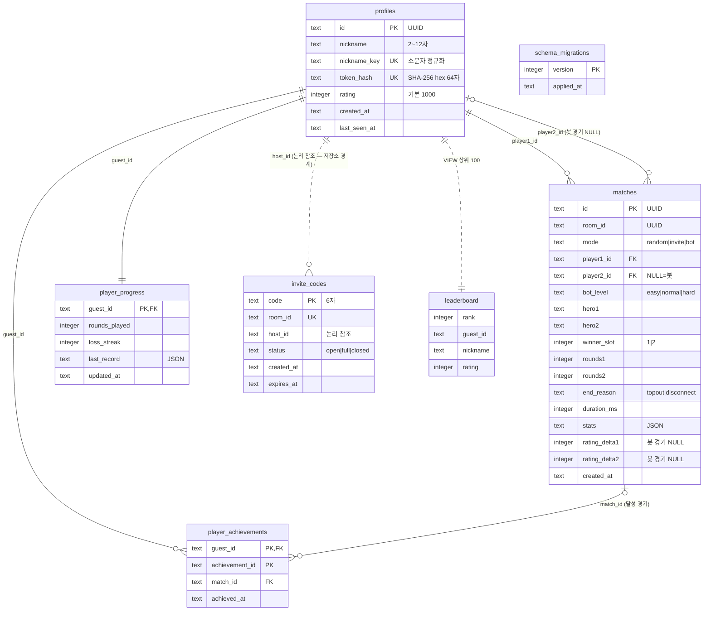

# 🏛️ 데이터 설계서 (Data Ark) — 영적 전쟁 테트리스

> *"And thou shalt make an ark of shittim wood ... And thou shalt put into the ark the testimony which I shall give thee."* — Exodus 25:10,16 (KJV)
>
> **규격:** `statute-율법/02.architecture-foundation-기초/data-ark-법궤-template.md`
> **참조 예시:** `parable-비유/02.architecture-foundation-기초/data-ark-법궤-example.md`
> **근거 산출물:** [`spec-tablet-명세서.md`](../01.requirement-hearing-들음/spec-tablet-명세서.md) · [`usecase-path-사용사례.md`](../01.requirement-hearing-들음/usecase-path-사용사례.md) · [`architecture-temple-성전설계.md`](./architecture-temple-성전설계.md) (D-04·D-05·D-14·D-15·D-20·D-21)
> **API 연결:** [`api-gate-성문.md`](./api-gate-성문.md)

---

## 1. 데이터 아키텍처 개요

### 1.1 저장소 구성

| 항목 | 로컬 모드 (기본 — 키 0개) | Supabase 모드 (환경변수 2개 설정 시) |
|:---|:---|:---|
| DBMS | Durable Object 내장 SQLite (`ctx.storage.sql`) — Matchmaker DO 싱글턴 `global` 인스턴스 | Supabase Postgres (`@supabase/supabase-js`, service role) |
| 물리 위치 | `fruit-열매/worker/.wrangler/state/` 아래 로컬 SQLite 파일 (wrangler dev 기본 영속) | Supabase 프로젝트 `public` 스키마 |
| 대상 테이블 | TBL-001~004, TBL-006(뷰), TBL-005(초대 코드), TBL-007(스키마 버전) | TBL-001~004, TBL-006(뷰). TBL-005는 모드와 무관하게 DO SQLite에 남는다 |
| 트랜잭션 | `ctx.storage.transactionSync(() => ...)` — 경기 1건 = 1트랜잭션 | Postgres 함수 `record_match`(§7.3) 1회 호출 = 1트랜잭션 |
| 스키마 관리 | `worker/src/store/do-sqlite-schema.ts` 버전별 DDL + TBL-007 | `fruit-열매/supabase/migrations/0001_init.sql` |
| 접근 주체 | Worker·GameRoom → `DoStoreClient`(RPC) → Matchmaker DO의 `DoSqliteStore` | Worker·GameRoom → `SupabaseStore` (service role 키 — Worker 전용) |

> 클라이언트(브라우저)는 어떤 DB에도 직접 접속하지 않는다. 브라우저가 저장하는 것은 게스트 정보 1건(TBL-201)뿐이다.

### 1.2 스키마 전략

| 항목 | 내용 |
|:---|:---|
| 스키마 | 단일 논리 스키마를 두 DBMS에 같은 테이블·컬럼 이름으로 구현 (방언 차이는 §6.3 대응표) |
| 정적 콘텐츠 | DB에 넣지 않는다 — `fruit-열매/content/*.json` 9종(TBL-101~109)을 클라이언트·서버가 번들로 import (FR-074, git 버전 관리 — A §4.2) |
| 실시간 대전 상태 | DB에 넣지 않는다 — GameRoom 메모리 (NFR-002 핫패스 저장소 접근 0회) |
| 제외 테이블 | `unlocks` (A §4.4 초안) — 위인 해금 제외(C-008). Supabase `auth.users` 참조 — Supabase Auth 제외(K5) |
| 시간 표기 | 모두 UTC. SQLite `TEXT` ISO-8601(`YYYY-MM-DDTHH:MM:SS.SSSZ`), Postgres `timestamptz` |
| ID | `profiles.id`·`matches.id`·`room_id`는 UUID v4 문자열(36자, `crypto.randomUUID()`) |

### 1.3 저장소 인터페이스 (`worker/src/store/store.ts` — FR-072)

| 메서드 | 입력 | 출력 | 사용처 | 대상 TBL |
|:---|:---|:---|:---|:---|
| `createProfile` | id, nickname, nicknameKey, tokenHash | Profile 또는 `NICKNAME_TAKEN` | API-001 | TBL-001, TBL-003 |
| `getProfileByTokenHash` | tokenHash | Profile 또는 없음 | API-002~006 토큰 검증 | TBL-001 |
| `touchProfile` | guestId | 없음 (`last_seen_at` 갱신) | API-002 | TBL-001 |
| `getPlayers` | guestId 목록 | Profile + Progress 목록 | Matchmaker 매칭, GameRoom `start.stage`·`grace` | TBL-001, TBL-003 |
| `recordMatch` | 경기 결과 + 라운드별 진행 변화 + 업적 후보 + (사람 대 사람) 기대 레이팅·새 레이팅 | 레이팅 변화, 새 업적, 직전 기록 | GameRoom 경기 종료 | TBL-001~004 |
| `recordPractice` | guestId, 진행 라운드 수, 개인 기록 | 직전 기록 | GameRoom 연습 종료 | TBL-003 |
| `listMatches` | guestId, page, size | 경기 목록 + 전체 건수 | API-003 | TBL-002, TBL-001 |
| `getLeaderboard` | 없음 | 상위 100 | API-004 | TBL-006 |
| `getRank` | guestId | 순위, 레이팅 | API-004 | TBL-001 |

### 1.4 네이밍 규칙 (율법 준수)

| 대상 | 규칙 | 적용 예 |
|:---|:---|:---|
| 테이블명 | snake_case, 복수형 | `profiles`, `matches`, `player_achievements`, `invite_codes` (`player_progress`는 불가산 명사 그대로) |
| 컬럼명 | snake_case | `nickname_key`, `duration_ms` |
| FK 컬럼 | 참조 테이블 단수 + `_id` (역할이 둘이면 역할 접두) | `guest_id`(profiles 역할명 "게스트"), `player1_id`, `player2_id`, `match_id`, `host_id` |
| 인덱스 | `idx_테이블_컬럼` | `idx_profiles_rating`, `idx_matches_player1_id_created_at` |
| PK | `id` (단일 PK), 복합 PK는 구성 컬럼 | `player_achievements(guest_id, achievement_id)` |
| 콘텐츠 JSON 키 | camelCase (JS 관례), ID 값은 snake_case | `verseRef`, `"prince_of_persia"` |

---

## 2. ERD (엔티티 관계도)



> `schema_migrations`(TBL-007)는 DO SQLite 전용 관리 테이블로 다른 테이블과 관계가 없다. 정적 콘텐츠(TBL-101~109)의 내부 참조(`verseRef` → verses, `spiritId` → spirits 등)는 §8.9 참조 무결성 표에 정의한다.

---

## 3. 테이블 정의서

### TBL-001: profiles (게스트 프로필)

> **목적:** 게스트 닉네임 입장으로 만들어지는 플레이어 정체성. 토큰 검증, 레이팅(랭킹) 귀속, 전적 귀속의 원천.
> **연결 REQ:** REQ-002, REQ-015, FR-012, FR-070, FR-071, NFR-003, NFR-008

| # | 컬럼명 | 타입 (SQLite / Postgres) | NULL | PK | FK | Default | 설명 |
|:--|:---|:---|:---:|:---:|:---|:---|:---|
| 1 | id | TEXT / uuid | ❌ | ✅ | — | 서버 `crypto.randomUUID()` | 게스트 ID |
| 2 | nickname | TEXT / text | ❌ | — | — | — | 표시 닉네임 (사용자 입력, NFC·trim 정규화 후 저장) |
| 3 | nickname_key | TEXT / text | ❌ | — | — | — | 중복 판정 키 = `nickname`의 소문자 (UNIQUE) |
| 4 | token_hash | TEXT / text | ❌ | — | — | — | 게스트 토큰의 SHA-256 16진수 64자 (평문 토큰 미저장 — 봉인 제3계명) |
| 5 | rating | INTEGER / integer | ❌ | — | — | 1000 | Elo 레이팅 (FR-070) |
| 6 | created_at | TEXT / timestamptz | ❌ | — | — | 현재 UTC | 가입(첫 입장) 일시 — 랭킹 동률 순서 |
| 7 | last_seen_at | TEXT / timestamptz | ❌ | — | — | 현재 UTC | 마지막 토큰 검증 일시 |

**인덱스:**
| 인덱스명 | 컬럼 | 유형 | 사유 |
|:---|:---|:---|:---|
| idx_profiles_nickname_key | nickname_key | UNIQUE BTREE | 닉네임 중복 거부 (FR-012) |
| idx_profiles_token_hash | token_hash | UNIQUE BTREE | 모든 요청의 토큰 검증 조회 |
| idx_profiles_rating | rating DESC, created_at ASC | BTREE | 랭킹 상위 100·내 순위 계산 (FR-071) |

**제약조건:**
- UNIQUE: `nickname_key`, `token_hash`
- CHECK: `length(trim(nickname)) BETWEEN 2 AND 12`, `nickname = trim(nickname)`, `length(trim(nickname_key)) > 0`, `nickname_key = lower(nickname)`, `length(token_hash) = 64`, `rating BETWEEN 0 AND 5000`, `length(id) = 36`(SQLite)
- CHECK (Postgres 추가): `nickname ~ '^[가-힣A-Za-z0-9_]{2,12}$'`, `token_hash ~ '^[0-9a-f]{64}$'` — SQLite에는 정규식 함수가 기본 제공되지 않으므로 같은 규칙을 서버 `auth/nickname.ts`가 2층에서 강제한다

### TBL-002: matches (경기 결과 — 전적)

> **목적:** 대전(사람 대 사람·봇) 경기 1건의 결과. 서버만 기록한다 (클라이언트 쓰기 경로 없음). 연습 모드는 상대가 없는 세션이라 경기 결과가 아니므로 기록하지 않는다 (진행 기록 TBL-003만 갱신).
> **연결 REQ:** REQ-014, REQ-015, FR-009, FR-068, FR-069, FR-070, FR-066

| # | 컬럼명 | 타입 (SQLite / Postgres) | NULL | PK | FK | Default | 설명 |
|:--|:---|:---|:---:|:---:|:---|:---|:---|
| 1 | id | TEXT / uuid | ❌ | ✅ | — | 서버 UUID | 경기 ID |
| 2 | room_id | TEXT / uuid | ❌ | — | — | — | GameRoom ID |
| 3 | mode | TEXT / text | ❌ | — | — | — | CODE-001 중 `random`·`invite`·`bot` |
| 4 | player1_id | TEXT / uuid | ❌ | — | TBL-001.id | — | 슬롯 1 (봇 경기에서는 항상 사람) |
| 5 | player2_id | TEXT / uuid | ✅ | — | TBL-001.id | NULL | 슬롯 2 (봇 경기는 NULL) |
| 6 | bot_level | TEXT / text | ✅ | — | — | NULL | CODE-002 (봇 경기에서만 값) |
| 7 | hero1 | TEXT / text | ❌ | — | — | — | 슬롯 1 위인 (CODE-003) |
| 8 | hero2 | TEXT / text | ❌ | — | — | — | 슬롯 2 위인 (봇은 서버 무작위 배정값) |
| 9 | winner_slot | INTEGER / smallint | ❌ | — | — | — | 경기 승자 슬롯 1·2 (A §4.4 `winner` 대체 — 봇 승리 표현) |
| 10 | rounds1 | INTEGER / smallint | ❌ | — | — | 0 | 슬롯 1 라운드 승수 |
| 11 | rounds2 | INTEGER / smallint | ❌ | — | — | 0 | 슬롯 2 라운드 승수 |
| 12 | end_reason | TEXT / text | ❌ | — | — | — | CODE-008 (`topout`: 2선승, `disconnect`: 이탈 — FR-009) |
| 13 | duration_ms | INTEGER / integer | ❌ | — | — | — | 경기 시간 (첫 `start` ~ `matchEnd`) |
| 14 | stats | TEXT(JSON) / jsonb | ❌ | — | — | — | 통계 (§3 TBL-002 stats 구조) |
| 15 | rating_delta1 | INTEGER / integer | ✅ | — | — | NULL | 슬롯 1 레이팅 변화 (봇 경기 NULL — OQ #5) |
| 16 | rating_delta2 | INTEGER / integer | ✅ | — | — | NULL | 슬롯 2 레이팅 변화 (봇 경기 NULL) |
| 17 | created_at | TEXT / timestamptz | ❌ | — | — | 현재 UTC | 기록 일시 (전적 정렬 키) |

**stats JSON 구조** (서버 생성, `json_valid` / `jsonb`):

| 키 | 타입 | 설명 |
|:---|:---|:---|
| `p1`, `p2` | object | 슬롯별 통계: `maxCombo`(int), `linesCleared`(int), `tetrises`(int), `attackSent`(int, 줄), `attackPerMin`(number, 소수 1자리), `quizCorrect`(int), `quizAnswered`(int), `skillsUsed`(int), `angelsUsed`(int), `armorUsed`(int), `jesusEvent`(bool) |
| `rounds` | array | 라운드별 `{ "round": 1, "winnerSlot": 2, "durationMs": 81234 }` |
| `quizCount` | int | 열린 말씀 대결 수 |
| `verseRef` | string | 대표 구절 (TBL-106 `ref`, FR-063) |

**인덱스:**
| 인덱스명 | 컬럼 | 유형 | 사유 |
|:---|:---|:---|:---|
| idx_matches_player1_id_created_at | player1_id, created_at DESC | BTREE | 내 전적 최신순 (슬롯 1) |
| idx_matches_player2_id_created_at | player2_id, created_at DESC | BTREE | 내 전적 최신순 (슬롯 2) |
| idx_matches_room_id | room_id | UNIQUE BTREE | 같은 방 결과 중복 기록 방지 (재시도 멱등) |

**제약조건:**
- UNIQUE: `room_id` (방 1개 = 경기 1건)
- CHECK: `mode IN ('random','invite','bot')`, `bot_level IN ('easy','normal','hard')`, `hero1`·`hero2 IN ('david','solomon','peter','paul')`, `winner_slot IN (1,2)`, `rounds1`·`rounds2 BETWEEN 0 AND 2`, `end_reason IN ('topout','disconnect')`, `duration_ms BETWEEN 0 AND 86400000`, `json_valid(stats)`(SQLite)
- CHECK (모드 정합): `(mode = 'bot' AND player2_id IS NULL AND bot_level IS NOT NULL AND rating_delta1 IS NULL AND rating_delta2 IS NULL) OR (mode <> 'bot' AND player2_id IS NOT NULL AND bot_level IS NULL AND player2_id <> player1_id)`
- CHECK (승패 정합): `end_reason = 'disconnect' OR (winner_slot = 1 AND rounds1 = 2) OR (winner_slot = 2 AND rounds2 = 2)`

### TBL-003: player_progress (플레이어 진행 기록)

> **목적:** 단계적 해금(누적 판 수), 은혜 보정(연속 패배 판 수), 성장 수치(직전 기록)의 서버 측 원천 — "판 = 라운드" (OQ #1).
> **연결 REQ:** REQ-012, REQ-013, FR-047, FR-062, FR-066, FR-067

| # | 컬럼명 | 타입 (SQLite / Postgres) | NULL | PK | FK | Default | 설명 |
|:--|:---|:---|:---:|:---:|:---|:---|:---|
| 1 | guest_id | TEXT / uuid | ❌ | ✅ | TBL-001.id | — | 플레이어 (프로필 생성 시 함께 생성) |
| 2 | rounds_played | INTEGER / integer | ❌ | — | — | 0 | 끝낸 라운드 누적 (대전·봇·연습 전부 — OQ #12) |
| 3 | loss_streak | INTEGER / integer | ❌ | — | — | 0 | 연속으로 진 라운드 수 (대전·봇 라운드만, 연습 미반영) |
| 4 | last_record | TEXT(JSON) / jsonb | ✅ | — | — | NULL | 직전에 끝난 경기/연습 세션의 개인 기록 `{ "maxCombo": 7, "attackPerMin": 12.4, "quizAccuracy": 0.67, "mode": "random" }` (architecture §11 #13) |
| 5 | updated_at | TEXT / timestamptz | ❌ | — | — | 현재 UTC | 갱신 일시 |

**인덱스:**
| 인덱스명 | 컬럼 | 유형 | 사유 |
|:---|:---|:---|:---|
| (PK) | guest_id | BTREE | 매칭·라운드 시작 시 단건 조회 |

**제약조건:**
- FK: `guest_id → profiles.id` ON DELETE CASCADE
- CHECK: `rounds_played >= 0`, `loss_streak >= 0`, `loss_streak <= rounds_played`, `last_record IS NULL OR json_valid(last_record)`(SQLite)

### TBL-004: player_achievements (업적 달성)

> **목적:** 업적 달성 판정 결과 저장 (정의된 업적은 원문 1종 — OQ #14).
> **연결 REQ:** REQ-013, FR-065, FR-067

| # | 컬럼명 | 타입 (SQLite / Postgres) | NULL | PK | FK | Default | 설명 |
|:--|:---|:---|:---:|:---:|:---|:---|:---|
| 1 | guest_id | TEXT / uuid | ❌ | ✅ | TBL-001.id | — | 달성자 |
| 2 | achievement_id | TEXT / text | ❌ | ✅ | — | — | CODE-014 (TBL-109 `id`) |
| 3 | match_id | TEXT / uuid | ✅ | — | TBL-002.id | NULL | 달성한 경기 |
| 4 | achieved_at | TEXT / timestamptz | ❌ | — | — | 현재 UTC | 달성 일시 |

**인덱스:**
| 인덱스명 | 컬럼 | 유형 | 사유 |
|:---|:---|:---|:---|
| (PK) | guest_id, achievement_id | BTREE | 중복 달성 방지·본인 업적 조회 |

**제약조건:**
- PK: `(guest_id, achievement_id)` — 같은 업적 1회만
- FK: `guest_id → profiles.id` ON DELETE CASCADE, `match_id → matches.id` ON DELETE SET NULL
- CHECK: `achievement_id IN ('goliath_hunter')`

### TBL-005: invite_codes (친구 초대 코드)

> **목적:** 방장이 만든 GameRoom을 친구가 코드로 찾아 들어가기 위한 짧은 수명의 배정 정보 (D-09). 저장 모드와 무관하게 항상 Matchmaker DO SQLite에 둔다.
> **연결 REQ:** REQ-004, FR-019

| # | 컬럼명 | 타입 (SQLite) | NULL | PK | FK | Default | 설명 |
|:--|:---|:---|:---:|:---:|:---|:---|:---|
| 1 | code | TEXT | ❌ | ✅ | — | 서버 발급 | 6자 코드 (사용자가 입력해 조회하는 값) |
| 2 | room_id | TEXT | ❌ | — | — | — | 연결된 GameRoom ID (UNIQUE) |
| 3 | host_id | TEXT | ❌ | — | — (논리 참조 TBL-001.id) | — | 방장 게스트 ID |
| 4 | status | TEXT | ❌ | — | — | 'open' | CODE-011 |
| 5 | created_at | TEXT | ❌ | — | — | 현재 UTC | 발급 일시 |
| 6 | expires_at | TEXT | ❌ | — | — | 발급 + 10분 | 만료 일시 |

**인덱스:**
| 인덱스명 | 컬럼 | 유형 | 사유 |
|:---|:---|:---|:---|
| idx_invite_codes_room_id | room_id | UNIQUE BTREE | 방 종료 시 코드 무효화 |
| idx_invite_codes_expires_at | expires_at | BTREE | 만료 정리 (alarm) |

**제약조건:**
- CHECK: `length(code) = 6 AND code NOT GLOB '*[^A-HJ-NP-Z2-9]*'` (허용 문자 32종 — 0·O·1·I 제외), `length(room_id) = 36`, `length(host_id) = 36`, `status IN ('open','full','closed')`, `expires_at > created_at`
- FK 미선언 사유: Supabase 모드에서는 `profiles`가 Supabase에 있어 DO SQLite에서 외래키를 걸 수 없다 (저장소 경계). 무결성은 발급 시 토큰 검증으로 얻은 게스트 ID만 기록하는 2층(서버) 규칙으로 보장한다.
- 파기: `closed` 또는 만료된 행은 Matchmaker alarm이 즉시 삭제 (봉인 제4계명).

### TBL-006: leaderboard (랭킹 뷰)

> **목적:** 레이팅 상위 100명 조회 (A §4.4 "leaderboard VIEW").
> **연결 REQ:** REQ-015, FR-071

| # | 컬럼명 | 타입 (SQLite / Postgres) | NULL | PK | FK | Default | 설명 |
|:--|:---|:---|:---:|:---:|:---|:---|:---|
| 1 | rank | INTEGER / bigint | ❌ | — | — | `ROW_NUMBER()` | 순위 (레이팅 내림차순, 동률은 `created_at` 오름차순) |
| 2 | guest_id | TEXT / uuid | ❌ | — | TBL-001.id | — | 게스트 ID (내 행 강조용) |
| 3 | nickname | TEXT / text | ❌ | — | — | — | 닉네임 |
| 4 | rating | INTEGER / integer | ❌ | — | — | — | 레이팅 |

**정의:** `SELECT ROW_NUMBER() OVER (ORDER BY rating DESC, created_at ASC) AS rank, id AS guest_id, nickname, rating FROM profiles ORDER BY rating DESC, created_at ASC LIMIT 100`
**내 순위:** `SELECT 1 + COUNT(*) FROM profiles WHERE rating > :r OR (rating = :r AND created_at < :c)` (100위 밖도 계산 — UC-019 3a)

**인덱스:** `idx_profiles_rating` 재사용 (TBL-001).
**제약조건:** 읽기 전용 뷰 — 쓰기 불가.

### TBL-007: schema_migrations (DO SQLite 스키마 버전)

> **목적:** Matchmaker DO가 깨어날 때 적용할 DDL 버전을 판정 (Supabase는 supabase CLI 이력이 같은 역할).
> **연결 REQ:** REQ-016, FR-072

| # | 컬럼명 | 타입 | NULL | PK | FK | Default | 설명 |
|:--|:---|:---|:---:|:---:|:---|:---|:---|
| 1 | version | INTEGER | ❌ | ✅ | — | — | 적용된 스키마 버전 (1부터) |
| 2 | applied_at | TEXT | ❌ | — | — | 현재 UTC | 적용 일시 |

**인덱스:** PK만.
**제약조건:** CHECK `version >= 1`. 사용자 입력 컬럼 없음.

### TBL-201: 브라우저 localStorage `swt.guest` (클라이언트 게스트 정보)

> **목적:** 재방문 시 닉네임을 다시 입력하지 않게 하는 브라우저 저장 (FR-012 "브라우저에 저장").
> **연결 REQ:** REQ-002, FR-012, NFR-008

| # | 키 | 타입 | NULL | PK | FK | Default | 설명 |
|:--|:---|:---|:---:|:---:|:---|:---|:---|
| 1 | guestId | string | ❌ | ✅ | TBL-001.id (서버 검증) | — | 게스트 ID |
| 2 | nickname | string | ❌ | — | — | — | 닉네임 (표시용 사본) |
| 3 | token | string | ❌ | — | — | — | 게스트 토큰 평문 43자(base64url, 256비트) — 이 브라우저에만 존재 |

**제약조건:** 값 전체가 `JSON.parse` 가능하고 3키가 모두 비어 있지 않을 때만 사용, 아니면 삭제 후 입장 화면 (UC-001 E3). 옵션 값(연출 세기·음량)은 저장하지 않는다 (N-04 보존).

---

## 4. 공통 코드 정의

| CODE-ID | 코드 그룹 | 코드 | 값 / 표시 | 설명 |
|:---|:---|:---|:---|:---|
| CODE-001 | 게임 모드 | random | 대전-랜덤 매칭 | FR-018 |
| CODE-001 | 게임 모드 | invite | 대전-친구 초대 코드 | FR-019 |
| CODE-001 | 게임 모드 | bot | AI 봇 대전 | FR-021 |
| CODE-001 | 게임 모드 | practice | 연습 (matches 미기록) | FR-023 |
| CODE-002 | 봇 난이도 | easy / normal / hard | 쉬움 / 보통 / 어려움 | FR-021 |
| CODE-003 | 위인 | david / solomon / peter / paul | 다윗 / 솔로몬 / 베드로 / 바울 | FR-013 |
| CODE-004 | 천사 | michael / gabriel / cherubim / seraphim / ministering_spirits | 미가엘 / 가브리엘 / 그룹 / 스랍 / 섬기는 영들 | FR-035 |
| CODE-005 | 악한 영 (등급) | unclean_spirit(1), deaf_dumb_spirit(1), legion(2), lying_spirit(2), divination_spirit(2), beelzebub(3), prince_of_the_air(3), prince_of_persia(3), abaddon(4), jezebel(4), wickedness(4), babylon(5), angel_of_light(5), dragon(보스) | 14종 | FR-026~030 |
| CODE-006 | 전신갑주 | belt_of_truth / breastplate_of_righteousness / gospel_shoes / shield_of_faith / helmet_of_salvation / sword_of_the_spirit | 진리의 허리띠 / 의의 흉배 / 평안의 복음의 신 / 믿음의 방패 / 구원의 투구 / 성령의 검 | FR-037 |
| CODE-007 | 방해 효과 범주 | vision | 암전·시야 가림·미리보기 숨김·일렁임 | 구원의 투구가 무효화 |
| CODE-007 | 방해 효과 범주 | deception | 가짜 다음 블록·가짜/틀린 고스트·가장 | 진리의 허리띠가 무효화 (미혹), 스랍이 해제 |
| CODE-007 | 방해 효과 범주 | control | 좌우 조작 반전 | 진리의 허리띠가 무효화, 스랍이 해제 |
| CODE-007 | 방해 효과 범주 | speed | 낙하 속도 증가·밀림 | 평안의 복음의 신이 무효화, 스랍이 해제 |
| CODE-007 | 방해 효과 범주 | seal | 천사 소환 봉인 | 6초 상한 예외 (FR-031) |
| CODE-007 | 방해 효과 범주 | board | 구멍·납 블록 (보드 상태) | 납 블록은 스랍이 해제 |
| CODE-008 | 경기 종료 사유 | topout / disconnect | 2선승 / 상대 이탈 | FR-007, FR-009 |
| CODE-009 | 보드 셀 코드 (`state.board`) | `0` | 빈칸 | 200자(10열×20행, 위→아래, 왼→오른) |
| CODE-009 | 보드 셀 코드 | `1`~`7` | I, O, T, S, Z, J, L | 테트로미노 색 |
| CODE-009 | 보드 셀 코드 | `8` / `9` | 쓰레기 / 납 | FR-025, FR-029 |
| CODE-009 | 보드 셀 코드 | `a` / `b` / `c` | 말씀 칸 / 여리고 나팔 칸 / 만나 칸 | FR-044~046 |
| CODE-009 | 보드 셀 코드 | `d`~`i` | 갑주 칸 (CODE-006 순서) | FR-036 |
| CODE-010 | 리액션 | amen / hallelujah / halo | 🙏 아멘 / 🔥 할렐루야 / 😇 | FR-064 (3종 고정, 자유 텍스트 없음 — C-009) |
| CODE-011 | 초대 코드 상태 | open / full / closed | 대기 / 입장 완료 / 무효 | FR-019 |
| CODE-012 | 특수 블록 해금 단계 | 0 / 1 / 2 | 없음(1~3판) / 말씀(4판째) / 말씀+여리고+만나(5판째~) | FR-047, OQ #12 |
| CODE-013 | 효과 종류 (`effect.kind`) | hero / angel / armor / jesus / special / spiritEnd / offset / attackSent / reflect | 연출·적용 지시 종류 | api-gate API-255 |
| CODE-014 | 업적 | goliath_hunter | 골리앗 사냥꾼 | FR-065 |
| CODE-015 | 에러 코드 | api-gate §4 표 | — | NFR-003 |

---

## 5. 인덱스 전략

| 쿼리 패턴 | 빈도 | 사용 인덱스 | 비고 |
|:---|:---|:---|:---|
| 토큰 해시로 프로필 조회 | 매 HTTP 요청·매 WS `join` | `idx_profiles_token_hash` (UNIQUE) | 최빈 쿼리, 단건 |
| 닉네임 중복 확인 + 삽입 | 입장 시 1회 | `idx_profiles_nickname_key` (UNIQUE) | 삽입 충돌을 `NICKNAME_TAKEN`으로 변환 (경쟁 조건 안전) |
| 내 전적 최신순 페이지 | 전적 화면 | `idx_matches_player1_id_created_at`, `idx_matches_player2_id_created_at` | `player1_id = ? UNION ALL player2_id = ?` 후 `created_at DESC` 병합 |
| 랭킹 상위 100 | 랭킹 화면 | `idx_profiles_rating` | 로컬 모드는 결과를 DO 메모리 캐시 (architecture §4.3) |
| 내 순위 | 랭킹 화면 | `idx_profiles_rating` | 범위 COUNT |
| 경기 결과 멱등 기록 | 경기 종료 | `idx_matches_room_id` (UNIQUE) | 재시도 시 중복 삽입 거부 |
| 진행 기록 단건 | 매칭·라운드 시작 | `player_progress` PK | 2건 IN 조회 |
| 초대 코드 조회 | 코드 입장 | `invite_codes` PK | 대문자 정규화 후 조회 |
| 초대 코드 만료 정리 | alarm(1분 주기, 열린 코드가 있을 때만) | `idx_invite_codes_expires_at` | `DELETE WHERE expires_at < now OR status = 'closed'` |

---

## 6. 데이터 무결성 규칙

### 6.1 외래키 (FK)

| FK | 참조 | ON DELETE | 비고 |
|:---|:---|:---|:---|
| matches.player1_id | profiles.id | RESTRICT | 전적 보존 |
| matches.player2_id | profiles.id | RESTRICT | NULL 허용 (봇) |
| player_progress.guest_id | profiles.id | CASCADE | 프로필과 수명 동일 |
| player_achievements.guest_id | profiles.id | CASCADE | |
| player_achievements.match_id | matches.id | SET NULL | |
| invite_codes.host_id | (논리) profiles.id | — | 저장소 경계로 미선언 (TBL-005) |

> DO SQLite는 스키마 적용 직후 `PRAGMA foreign_keys` 상태를 확인하고, 저장소 계층은 FK 대상 존재를 같은 트랜잭션 안에서 다시 조회해 2중으로 보장한다.

### 6.2 사용자 입력 컬럼 CHECK 전수표 (방어 깊이 3층 — "NOT NULL ≠ 빈값 방어")

| 컬럼 | 입력 주체 | NOT NULL | CHECK (빈 문자열·범위 방어) |
|:---|:---|:---:|:---|
| profiles.nickname | 사용자 (API-001) | ✅ | `length(trim(nickname)) BETWEEN 2 AND 12 AND nickname = trim(nickname)` (+ Postgres 정규식) |
| profiles.nickname_key | 서버 유도 (사용자 입력 파생) | ✅ | `length(trim(nickname_key)) > 0 AND nickname_key = lower(nickname)` |
| invite_codes.code | 사용자 입력으로 조회되는 키 | ✅ | `length(code) = 6 AND code NOT GLOB '*[^A-HJ-NP-Z2-9]*'` |
| matches.hero1, hero2 | 사용자 선택 (`join.heroId`) | ✅ | `IN ('david','solomon','peter','paul')` |
| matches.bot_level | 사용자 선택 (`join.botLevel`) | — (봇 경기만) | `IN ('easy','normal','hard')` + 모드 정합 CHECK |
| matches.mode | 사용자 선택 (`join.mode`) | ✅ | `IN ('random','invite','bot')` |
| matches.stats | 서버 집계 (사용자 플레이 파생) | ✅ | `json_valid(stats)` / `jsonb` 타입 |
| player_progress.last_record | 서버 집계 | — | `last_record IS NULL OR json_valid(last_record)` |
| player_achievements.achievement_id | 서버 판정 | ✅ | `IN ('goliath_hunter')` |

> 퀴즈 답(`quizAnswer.choice`)·리액션(`reaction.reactionId`)·스킬 ID 등 다른 사용자 입력은 DB에 저장되지 않으므로 서버 2층(api-gate §2.6 스키마 검증)에서 차단한다.

### 6.3 DBMS 방언 대응

| 개념 | DO SQLite | Supabase Postgres |
|:---|:---|:---|
| UUID | `TEXT CHECK(length=36)` | `uuid` |
| 일시 | `TEXT DEFAULT (strftime('%Y-%m-%dT%H:%M:%fZ','now'))` | `timestamptz DEFAULT now()` |
| JSON | `TEXT CHECK(json_valid(col))` | `jsonb` |
| 글자 수 | `length()` (문자 단위) | `char_length()` |
| 정규식 | 없음 (서버 2층 + GLOB) | `~` |
| 트랜잭션 | `ctx.storage.transactionSync` | 함수 1회 호출 |

---

## 7. 마이그레이션/시드 전략

### 7.1 DO SQLite (로컬 모드 정본)

- Matchmaker DO 생성자에서 `ctx.blockConcurrencyWhile`로 TBL-007의 최대 `version`을 읽고, 그보다 큰 버전의 DDL만 순서대로 적용한다. 이번 실행은 **버전 1** 하나다.
- `wrangler.toml`의 DO 마이그레이션은 `new_sqlite_classes = ["Matchmaker", "GameRoom"]` (태그 `v1`). GameRoom은 방 명단 보관에 KV형 `ctx.storage`만 쓰고 SQL 테이블은 만들지 않는다.
- **시드 데이터: 없음.** 프로필·경기는 모두 플레이로 생긴다. 봇은 프로필이 없다(`player2_id` NULL).

**버전 1 DDL (DO SQLite):**

```sql
CREATE TABLE IF NOT EXISTS schema_migrations (
  version     INTEGER PRIMARY KEY CHECK (version >= 1),
  applied_at  TEXT NOT NULL DEFAULT (strftime('%Y-%m-%dT%H:%M:%fZ','now'))
);

CREATE TABLE IF NOT EXISTS profiles (
  id            TEXT PRIMARY KEY CHECK (length(id) = 36),
  nickname      TEXT NOT NULL CHECK (length(trim(nickname)) BETWEEN 2 AND 12 AND nickname = trim(nickname)),
  nickname_key  TEXT NOT NULL CHECK (length(trim(nickname_key)) > 0 AND nickname_key = lower(nickname)),
  token_hash    TEXT NOT NULL CHECK (length(token_hash) = 64),
  rating        INTEGER NOT NULL DEFAULT 1000 CHECK (rating BETWEEN 0 AND 5000),
  created_at    TEXT NOT NULL DEFAULT (strftime('%Y-%m-%dT%H:%M:%fZ','now')),
  last_seen_at  TEXT NOT NULL DEFAULT (strftime('%Y-%m-%dT%H:%M:%fZ','now'))
);
CREATE UNIQUE INDEX IF NOT EXISTS idx_profiles_nickname_key ON profiles (nickname_key);
CREATE UNIQUE INDEX IF NOT EXISTS idx_profiles_token_hash   ON profiles (token_hash);
CREATE INDEX        IF NOT EXISTS idx_profiles_rating       ON profiles (rating DESC, created_at ASC);

CREATE TABLE IF NOT EXISTS matches (
  id             TEXT PRIMARY KEY CHECK (length(id) = 36),
  room_id        TEXT NOT NULL CHECK (length(room_id) = 36),
  mode           TEXT NOT NULL CHECK (mode IN ('random','invite','bot')),
  player1_id     TEXT NOT NULL REFERENCES profiles(id) ON DELETE RESTRICT,
  player2_id     TEXT REFERENCES profiles(id) ON DELETE RESTRICT,
  bot_level      TEXT CHECK (bot_level IN ('easy','normal','hard')),
  hero1          TEXT NOT NULL CHECK (hero1 IN ('david','solomon','peter','paul')),
  hero2          TEXT NOT NULL CHECK (hero2 IN ('david','solomon','peter','paul')),
  winner_slot    INTEGER NOT NULL CHECK (winner_slot IN (1,2)),
  rounds1        INTEGER NOT NULL DEFAULT 0 CHECK (rounds1 BETWEEN 0 AND 2),
  rounds2        INTEGER NOT NULL DEFAULT 0 CHECK (rounds2 BETWEEN 0 AND 2),
  end_reason     TEXT NOT NULL CHECK (end_reason IN ('topout','disconnect')),
  duration_ms    INTEGER NOT NULL CHECK (duration_ms BETWEEN 0 AND 86400000),
  stats          TEXT NOT NULL CHECK (json_valid(stats)),
  rating_delta1  INTEGER,
  rating_delta2  INTEGER,
  created_at     TEXT NOT NULL DEFAULT (strftime('%Y-%m-%dT%H:%M:%fZ','now')),
  CHECK ((mode = 'bot' AND player2_id IS NULL AND bot_level IS NOT NULL
          AND rating_delta1 IS NULL AND rating_delta2 IS NULL)
      OR (mode <> 'bot' AND player2_id IS NOT NULL AND bot_level IS NULL AND player2_id <> player1_id)),
  CHECK (end_reason = 'disconnect' OR (winner_slot = 1 AND rounds1 = 2) OR (winner_slot = 2 AND rounds2 = 2))
);
CREATE UNIQUE INDEX IF NOT EXISTS idx_matches_room_id ON matches (room_id);
CREATE INDEX IF NOT EXISTS idx_matches_player1_id_created_at ON matches (player1_id, created_at DESC);
CREATE INDEX IF NOT EXISTS idx_matches_player2_id_created_at ON matches (player2_id, created_at DESC);

CREATE TABLE IF NOT EXISTS player_progress (
  guest_id       TEXT PRIMARY KEY REFERENCES profiles(id) ON DELETE CASCADE,
  rounds_played  INTEGER NOT NULL DEFAULT 0 CHECK (rounds_played >= 0),
  loss_streak    INTEGER NOT NULL DEFAULT 0 CHECK (loss_streak >= 0),
  last_record    TEXT CHECK (last_record IS NULL OR json_valid(last_record)),
  updated_at     TEXT NOT NULL DEFAULT (strftime('%Y-%m-%dT%H:%M:%fZ','now')),
  CHECK (loss_streak <= rounds_played)
);

CREATE TABLE IF NOT EXISTS player_achievements (
  guest_id        TEXT NOT NULL REFERENCES profiles(id) ON DELETE CASCADE,
  achievement_id  TEXT NOT NULL CHECK (achievement_id IN ('goliath_hunter')),
  match_id        TEXT REFERENCES matches(id) ON DELETE SET NULL,
  achieved_at     TEXT NOT NULL DEFAULT (strftime('%Y-%m-%dT%H:%M:%fZ','now')),
  PRIMARY KEY (guest_id, achievement_id)
);

CREATE TABLE IF NOT EXISTS invite_codes (
  code        TEXT PRIMARY KEY CHECK (length(code) = 6 AND code NOT GLOB '*[^A-HJ-NP-Z2-9]*'),
  room_id     TEXT NOT NULL CHECK (length(room_id) = 36),
  host_id     TEXT NOT NULL CHECK (length(host_id) = 36),
  status      TEXT NOT NULL DEFAULT 'open' CHECK (status IN ('open','full','closed')),
  created_at  TEXT NOT NULL DEFAULT (strftime('%Y-%m-%dT%H:%M:%fZ','now')),
  expires_at  TEXT NOT NULL,
  CHECK (expires_at > created_at)
);
CREATE UNIQUE INDEX IF NOT EXISTS idx_invite_codes_room_id    ON invite_codes (room_id);
CREATE INDEX        IF NOT EXISTS idx_invite_codes_expires_at ON invite_codes (expires_at);

CREATE VIEW IF NOT EXISTS leaderboard AS
  SELECT ROW_NUMBER() OVER (ORDER BY rating DESC, created_at ASC) AS rank,
         id AS guest_id, nickname, rating
    FROM profiles
   ORDER BY rating DESC, created_at ASC
   LIMIT 100;

INSERT OR IGNORE INTO schema_migrations (version) VALUES (1);
```

### 7.2 Supabase Postgres (선택 어댑터 — `fruit-열매/supabase/migrations/0001_init.sql`)

> 이번 실행에서 실제 Supabase 프로젝트에 적용하지 않는다(C-008). 파일은 Phase 4에서 작성하고, 키가 생기면 `supabase db push`로 적용한다. 내용은 아래 정의를 그대로 따른다.

```sql
CREATE TABLE public.profiles (
  id            uuid PRIMARY KEY,
  nickname      text NOT NULL CHECK (char_length(trim(nickname)) BETWEEN 2 AND 12
                                     AND nickname = trim(nickname)
                                     AND nickname ~ '^[가-힣A-Za-z0-9_]{2,12}$'),
  nickname_key  text NOT NULL UNIQUE CHECK (char_length(trim(nickname_key)) > 0 AND nickname_key = lower(nickname)),
  token_hash    text NOT NULL UNIQUE CHECK (token_hash ~ '^[0-9a-f]{64}$'),
  rating        integer NOT NULL DEFAULT 1000 CHECK (rating BETWEEN 0 AND 5000),
  created_at    timestamptz NOT NULL DEFAULT now(),
  last_seen_at  timestamptz NOT NULL DEFAULT now()
);
CREATE INDEX idx_profiles_rating ON public.profiles (rating DESC, created_at ASC);

CREATE TABLE public.matches (
  id             uuid PRIMARY KEY,
  room_id        uuid NOT NULL UNIQUE,
  mode           text NOT NULL CHECK (mode IN ('random','invite','bot')),
  player1_id     uuid NOT NULL REFERENCES public.profiles(id) ON DELETE RESTRICT,
  player2_id     uuid REFERENCES public.profiles(id) ON DELETE RESTRICT,
  bot_level      text CHECK (bot_level IN ('easy','normal','hard')),
  hero1          text NOT NULL CHECK (hero1 IN ('david','solomon','peter','paul')),
  hero2          text NOT NULL CHECK (hero2 IN ('david','solomon','peter','paul')),
  winner_slot    smallint NOT NULL CHECK (winner_slot IN (1,2)),
  rounds1        smallint NOT NULL DEFAULT 0 CHECK (rounds1 BETWEEN 0 AND 2),
  rounds2        smallint NOT NULL DEFAULT 0 CHECK (rounds2 BETWEEN 0 AND 2),
  end_reason     text NOT NULL CHECK (end_reason IN ('topout','disconnect')),
  duration_ms    integer NOT NULL CHECK (duration_ms BETWEEN 0 AND 86400000),
  stats          jsonb NOT NULL,
  rating_delta1  integer,
  rating_delta2  integer,
  created_at     timestamptz NOT NULL DEFAULT now(),
  CHECK ((mode = 'bot' AND player2_id IS NULL AND bot_level IS NOT NULL
          AND rating_delta1 IS NULL AND rating_delta2 IS NULL)
      OR (mode <> 'bot' AND player2_id IS NOT NULL AND bot_level IS NULL AND player2_id <> player1_id)),
  CHECK (end_reason = 'disconnect' OR (winner_slot = 1 AND rounds1 = 2) OR (winner_slot = 2 AND rounds2 = 2))
);
CREATE INDEX idx_matches_player1_id_created_at ON public.matches (player1_id, created_at DESC);
CREATE INDEX idx_matches_player2_id_created_at ON public.matches (player2_id, created_at DESC);

CREATE TABLE public.player_progress (
  guest_id       uuid PRIMARY KEY REFERENCES public.profiles(id) ON DELETE CASCADE,
  rounds_played  integer NOT NULL DEFAULT 0 CHECK (rounds_played >= 0),
  loss_streak    integer NOT NULL DEFAULT 0 CHECK (loss_streak >= 0),
  last_record    jsonb,
  updated_at     timestamptz NOT NULL DEFAULT now(),
  CHECK (loss_streak <= rounds_played)
);

CREATE TABLE public.player_achievements (
  guest_id        uuid NOT NULL REFERENCES public.profiles(id) ON DELETE CASCADE,
  achievement_id  text NOT NULL CHECK (achievement_id IN ('goliath_hunter')),
  match_id        uuid REFERENCES public.matches(id) ON DELETE SET NULL,
  achieved_at     timestamptz NOT NULL DEFAULT now(),
  PRIMARY KEY (guest_id, achievement_id)
);

CREATE VIEW public.leaderboard AS
  SELECT ROW_NUMBER() OVER (ORDER BY rating DESC, created_at ASC) AS rank,
         id AS guest_id, nickname, rating
    FROM public.profiles
   ORDER BY rating DESC, created_at ASC
   LIMIT 100;

-- RLS: Supabase Auth 미사용(K5) → anon/authenticated 정책 0개 = 전면 거부. service role(Worker)만 접근.
ALTER TABLE public.profiles            ENABLE ROW LEVEL SECURITY;
ALTER TABLE public.matches             ENABLE ROW LEVEL SECURITY;
ALTER TABLE public.player_progress     ENABLE ROW LEVEL SECURITY;
ALTER TABLE public.player_achievements ENABLE ROW LEVEL SECURITY;
REVOKE ALL ON public.leaderboard FROM anon, authenticated;
```

### 7.3 원자적 경기 기록 함수 `public.record_match(p jsonb) RETURNS jsonb` (Supabase)

| 단계 | 처리 | 실패 시 |
|:---|:---|:---|
| 1 | 사람 대 사람이면 두 프로필을 `SELECT ... FOR UPDATE`로 잠그고, 현재 레이팅이 `p.expectedRating1`·`p.expectedRating2`와 같은지 확인 | 다르면 `RAISE EXCEPTION 'RATING_CHANGED'` → Worker가 최신 레이팅으로 `elo.ts` 재계산 후 최대 3회 재시도 (Elo 수식의 단일 원천 = `worker/src/elo.ts`) |
| 2 | `matches` 삽입 (`room_id` UNIQUE — 같은 방 재시도는 기존 행 반환으로 멱등) | 제약 위반 시 전체 롤백 |
| 3 | 사람 대 사람이면 `profiles.rating` = `p.newRating1`·`p.newRating2` | 롤백 |
| 4 | 사람 플레이어별 `player_progress`: `rounds_played += p.roundsDelta`, `loss_streak = p.lossStreak`, `last_record = p.record` — 갱신 전 `last_record`를 결과로 반환 (성장 수치 계산용) | 롤백 |
| 5 | `player_achievements`에 `ON CONFLICT DO NOTHING` 삽입, 실제 삽입된 업적만 반환 | 롤백 |

> DO SQLite 구현(`DoSqliteStore.recordMatch`)은 같은 5단계를 `transactionSync` 안에서 수행한다. 단일 스레드 DO라 1단계 잠금은 불필요하지만, 기대 레이팅 비교는 두 구현의 의미론을 맞추기 위해 동일하게 수행한다.

### 7.4 파기·보존

| 데이터 | 보존 | 파기 |
|:---|:---|:---|
| profiles, matches, player_progress, player_achievements | 전적·랭킹 목적이 유지되는 동안 | 이번 실행에 삭제 기능 없음 (요구사항 없음). 로컬 초기화는 `worker/.wrangler/state` 삭제 |
| invite_codes | 최대 10분 | 만료·`closed` 즉시 삭제 |
| GameRoom 메모리 상태 | 경기 중 | 경기 종료 후 방 소멸 |
| localStorage `swt.guest` | 브라우저 | 토큰 무효 시 클라이언트가 삭제 (UC-001 E3) |

---

## 8. 콘텐츠 데이터 스키마 (`fruit-열매/content/*.json` — FR-074)

> 정적 데이터 파일이며 DB가 아니다. 클라이언트(Vite)와 서버(wrangler)가 같은 파일을 번들한다. **서식 규칙:** 최상위는 배열(또는 객체 1개), 배열 원소는 **1항목 1줄** (D-32 — 파일 줄 수 한계 준수). 모든 텍스트 필드는 빈 문자열 금지 — `scripts/check-content.mjs`가 검사한다 (FR-076).

### TBL-101: heroes.json (위인 4명)

> **목적:** 캐릭터 선택 화면·스킬 판정·엠블럼 생성의 원천. **연결 REQ:** REQ-003, FR-013~017, C-010

| # | 키 | 타입 | 필수 | 규칙 | 설명 |
|:--|:---|:---|:---:|:---|:---|
| 1 | id | string | ✅ | CODE-003 | 위인 ID |
| 2 | nameKo / nameEn | string | ✅ | 1~20자 | 다윗 / David |
| 3 | skill.id | string | ✅ | `hero_` 접두 | `hero_david` 등 (`skill.skillId`로 전송) |
| 4 | skill.nameKo | string | ✅ | 1~20자 | 물맷돌 / 지혜로운 마음 / 이 반석 위에 / 옥문이 열리다 |
| 5 | skill.descKo | string | ✅ | 1~80자 | 효과 설명 (FR-014~017 원문) |
| 6 | skill.cost / skill.cooldownMs | int | ✅ | §8.8 값 | 게이지 비용·쿨다운 |
| 7 | skill.action | object | ✅ | 아래 | `{ "type": "destroyTopBlocks", "count": 3 }`(다윗), `{ "type": "landingHint", "durationMs": 10000 }`(솔로몬), `{ "type": "garbageImmune", "durationMs": 10000 }`(베드로), `{ "type": "removeBottomGarbage", "rows": 3 }`(바울) |
| 8 | passive | object 또는 null | ✅ | | 솔로몬만 `{ "type": "previewCount", "count": 5 }`, 나머지 null (OQ #3) |
| 9 | verseRef | string | ✅ | TBL-106.ref 존재 | 1 Samuel 17:49 / 1 Kings 3:9 / Matthew 16:18 / Acts 16:26 |
| 10 | emblem | object | ✅ | | 벡터 엠블럼 도형 명세 `{ "motif": "sling", "palette": ["gold","blue"] }` (motif: sling·heart·rock·chains — 코드 그리기, C-007) |

### TBL-102: angels.json (천사 5종)

> **목적:** 천사 소환 판정·연출. **연결 REQ:** REQ-008, FR-035, FR-049, C-010

| # | 키 | 타입 | 필수 | 규칙 | 설명 |
|:--|:---|:---|:---:|:---|:---|
| 1 | id | string | ✅ | CODE-004 | 천사 ID (`skill.skillId` = `angel_` + id) |
| 2 | nameKo / nameEn | string | ✅ | 1~20자 | 미가엘 / Michael 등 |
| 3 | cost / cooldownMs | int | ✅ | §8.8 | 게이지 비용·쿨다운 |
| 4 | action | object | ✅ | 아래 | 미가엘 `{ "type": "negateSpirits", "spiritIds": ["dragon","angel_of_light"], "charges": 1 }` · 가브리엘 `{ "type": "revealQueue", "count": 7, "landingHint": true }` · 그룹 `{ "type": "burnIncoming", "rows": 2 }` · 스랍 `{ "type": "cleanseCurses", "categories": ["deception","control","speed","board"] }` · 섬기는 영들 `{ "type": "removeGarbageRow", "rows": 1 }` |
| 5 | art | object | ✅ | | `{ "motif": "sword_wings" }` · `"herald_wings"` · `"four_faces_wheels"`(Ezek 10) · `"six_wings_coal"`(Isa 6:2) · `"small_lights"` |
| 6 | verseRef | string | ✅ | TBL-106 존재 | Jude 1:9 / Luke 1:19 / Genesis 3:24 / Isaiah 6:6-7 / Hebrews 1:14 |

### TBL-103: spirits.json (악한 영 14종)

> **목적:** 서버의 영 결정(등급 후보)·효과 적용과 클라이언트 연출의 공통 원천. **연결 REQ:** REQ-007, FR-026~031, FR-049, C-010, C-011

| # | 키 | 타입 | 필수 | 규칙 | 설명 |
|:--|:---|:---|:---:|:---|:---|
| 1 | id | string | ✅ | CODE-005 | |
| 2 | nameKo / nameKjv | string | ✅ | 1~30자 | 더러운 귀신 / unclean spirit 등 (KJV 표기) |
| 3 | grade | int 또는 "boss" | ✅ | 1~5, boss | 등급 |
| 4 | category | string | ✅ | CODE-007 | 효과 범주 |
| 5 | effect | object | ✅ | §8.8.6 | 효과 종류·지속·매개변수 |
| 6 | verseRef | string | ✅ | TBL-106 존재 | Mark 1:23 / Mark 9:25 / Mark 5:9 / 1 Kings 22:22 / Acts 16:16 / Matthew 12:24 / Ephesians 2:2 / Daniel 10:13 / Revelation 9:11 / Revelation 2:20 / Zechariah 5:7-8 / Revelation 17:5 / 2 Corinthians 11:14 / Revelation 12:9 |
| 7 | art | object | ✅ | | `{ "motif": "smoke_silhouette" }` 등 — 실루엣·연기·반투명, 고어 금지 (C-011) |

### TBL-104: armor.json (전신갑주 6종)

> **목적:** 갑주 획득·사용 판정·연출. **연결 REQ:** REQ-009, FR-036, FR-037

| # | 키 | 타입 | 필수 | 규칙 | 설명 |
|:--|:---|:---|:---:|:---|:---|
| 1 | id | string | ✅ | CODE-006 | |
| 2 | nameKo | string | ✅ | 1~20자 | |
| 3 | cellCode | string | ✅ | `d`~`i` | 보드 셀 코드 (CODE-009) |
| 4 | action | object | ✅ | 아래 | 허리띠 `{ "type": "wardCategories", "categories": ["deception","control"], "charges": 1, "clearActive": true }` · 흉배 `{ "type": "reduceNextGarbage", "rows": 2 }` · 신 `{ "type": "wardCategories", "categories": ["speed"], "charges": 1, "clearActive": true }` · 방패 `{ "type": "blockNextAttack" }` · 투구 `{ "type": "wardCategories", "categories": ["vision"], "charges": 1, "clearActive": true }` · 검 `{ "type": "reflectNextAttack" }` (OQ #8) |
| 5 | verseRef | string | ✅ | TBL-106 존재 | Ephesians 6:14 (허리띠·흉배) / 6:15 / 6:16 / 6:17 (투구·검) |

### TBL-105: counters.json (상성표)

> **목적:** 14종 방해 효과마다 대응 수단 1개 이상 보장 (FR-038, A §3.5). **연결 REQ:** REQ-007~009, FR-038

| # | 키 | 타입 | 필수 | 규칙 | 설명 |
|:--|:---|:---|:---:|:---|:---|
| 1 | spiritId | string | ✅ | TBL-103 존재, 14종 전부 1행씩 | |
| 2 | angels | string[] | ✅ | TBL-102 ID | 대응 천사 |
| 3 | armor | string[] | ✅ | TBL-104 ID | 대응 갑주 |
| 4 | (검사) | — | — | `angels.length + armor.length >= 1` | check-content 규칙 |

**정경 상성표 (방패·검은 모든 공격에 범용 대응 — 표에는 범주 전용 대응을 기재):**

| spiritId | 천사 | 갑주 |
|:---|:---|:---|
| unclean_spirit | — | helmet_of_salvation |
| deaf_dumb_spirit | — | helmet_of_salvation |
| legion | cherubim | helmet_of_salvation |
| lying_spirit | seraphim | belt_of_truth |
| divination_spirit | seraphim | belt_of_truth |
| beelzebub | — | helmet_of_salvation |
| prince_of_the_air | seraphim | gospel_shoes |
| prince_of_persia | — | shield_of_faith, sword_of_the_spirit |
| abaddon | — | shield_of_faith, sword_of_the_spirit |
| jezebel | seraphim | belt_of_truth |
| wickedness | seraphim | breastplate_of_righteousness |
| babylon | — | helmet_of_salvation |
| angel_of_light | michael, seraphim | belt_of_truth |
| dragon | michael | helmet_of_salvation, shield_of_faith |

> wickedness의 흉배: 납 블록과 함께 오는 쓰레기 줄을 경감. 봉인(prince_of_persia) 중에는 천사를 부를 수 없으므로 갑주만 대응한다.

### TBL-106: verses.json (KJV 구절)

> **목적:** 모든 구절의 단일 원천 `{ ref, kjv, ko }` (A §8). **연결 REQ:** C-003, FR-043, FR-054, FR-063, FR-007, FR-039

| # | 키 | 타입 | 필수 | 규칙 | 설명 |
|:--|:---|:---|:---:|:---|:---|
| 1 | ref | string | ✅ | 유일, `^(?:[1-3] )?[A-Z][A-Za-z]+(?: [A-Za-z]+)* \d+:\d+(?:-\d+)?$` | 장·절 출처 (예: `2 Timothy 4:7`) |
| 2 | kjv | string | ✅ | 1~600자 | KJV(1769) 원문 그대로 |
| 3 | ko | string | ✅ | 1~600자 | KJV 직접 번역 (개역개정 미사용 — C-003) |

> 필수 수록 구절: 위인 4·천사 5·악한 영 14·갑주 6(Ephesians 6:14~17)·예수님 이벤트 2(John 16:33, John 1:5)·승리 1(2 Timothy 4:7)·퀴즈 해설 구절 전부. 같은 `ref`는 1번만 (정규화).

### TBL-107: quiz.json (말씀 대결 문항 — 60문항 이상)

> **목적:** 말씀 대결 출제 원천. **연결 REQ:** REQ-011, FR-040~043, FR-022

| # | 키 | 타입 | 필수 | 규칙 | 설명 |
|:--|:---|:---|:---:|:---|:---|
| 1 | id | string | ✅ | `^q\d{3}$`, 유일 | 문항 ID |
| 2 | type | string | ✅ | `person` / `event` / `fill_blank` | 인물·사건·구절 빈칸 채우기 (FR-043) |
| 3 | difficulty | int | ✅ | 1·2·3 | 난이도 3단계 |
| 4 | question | string | ✅ | 1~160자 | 문제 (한국어. `fill_blank`는 KJV 원문 빈칸 `____` 포함) |
| 5 | choices | string[4] | ✅ | 각 1~60자, 중복 없음 | 4지선다 |
| 6 | answer | int | ✅ | 0~3 | 정답 위치 (서버만 사용 — `quizStart`로 보내지 않음) |
| 7 | verseRef | string | ✅ | TBL-106 존재 | 해설 구절 |
| 8 | explanation | string | ✅ | 1~200자 | 정답 해설 (한국어) |

> 배열 길이 ≥ 60 (FR-043), 난이도별 각 15문항 이상, 유형별 각 15문항 이상 — check-content 규칙. 출제는 경기 시드 스트림에서 무작위 (중복 방지는 N-05 보존 — 미구현).

### TBL-108: balance.json (밸런스 수치 — Phase 1이 Phase 2에 위임한 수치의 정본)

> **목적:** 공격력·영 등급·게이지·쿨다운·확률·방해 시간·봇·초대 코드 등 수치를 코드 밖 단일 원천으로 관리 (D-15). **연결 REQ:** FR-010, FR-019, FR-021, FR-024, FR-026, FR-031, FR-033~035, FR-037, FR-041, FR-044~047, FR-055, FR-062, FR-070

| # | 키 | 타입 | 필수 | 설명 |
|:--|:---|:---|:---:|:---|
| 1 | attack | object | ✅ | §8.8.1 |
| 2 | spiritGrades | object | ✅ | §8.8.2 |
| 3 | faith | object | ✅ | §8.8.3 |
| 4 | specials | object | ✅ | §8.8.4 |
| 5 | interference | object | ✅ | §8.8.5 |
| 6 | quiz | object | ✅ | §8.8.7 |
| 7 | gravity / input | object | ✅ | §8.8.8 |
| 8 | grace | object | ✅ | §8.8.9 |
| 9 | bots | object | ✅ | §8.8.10 |
| 10 | invite / elo / match | object | ✅ | §8.8.11 |
| 11 | reactions | object | ✅ | §8.8.11 |

### TBL-109: achievements.json (업적 정의)

> **목적:** 업적 판정 조건의 원천 (원문 정의 1종만 — OQ #14). **연결 REQ:** FR-065

| # | 키 | 타입 | 필수 | 규칙 | 설명 |
|:--|:---|:---|:---:|:---|:---|
| 1 | id | string | ✅ | CODE-014 | `goliath_hunter` |
| 2 | nameKo | string | ✅ | 1~20자 | 골리앗 사냥꾼 |
| 3 | condition | object | ✅ | | `{ "heroId": "david", "tetrisInMatch": 5 }` — 다윗으로 한 경기(매치)에서 테트리스 5회 |
| 4 | verseRef | string | ✅ | TBL-106 존재 | 1 Samuel 17:49 |

### 8.8 밸런스 정본 수치 (balance.json 초기값 — Phase 1 인계 항목 확정)

#### 8.8.1 공격력 (FR-024 — `worker/src/attack.ts` 입력)

| 항목 | 값 |
|:---|:---|
| 줄 수별 기본 공격 | 1줄 0 · 2줄 1 · 3줄 2 · 4줄(테트리스) 4 |
| T-Spin 가산 | T-Spin 1줄 +1 · 2줄 +2 · 3줄 +3 (T-Spin 0줄은 공격·영 없음) |
| 콤보 가산 (`combo` = 연속 삭제 블록 수 − 1) | combo 1~2 → +1 · 3~4 → +2 · 5 이상 → +3 |
| 백투백 가산 | `b2b`이면서 (테트리스 또는 T-Spin) → +1 (B2B 테트리스 = 5, 원문 "4 이상" 충족) |
| 여리고 나팔 칸 | 지운 칸 1개당 +1 (FR-045) |
| 상쇄 순서 | 계산된 공격력으로 보낸 쪽 대기 큐를 먼저 줄이고(FR-025), 남은 값만 상대에게 |
| 쓰레기 줄 구멍 | `holeColumn` = 공격 1회마다 서버 시드 스트림 무작위 0~9, 같은 공격의 줄들은 같은 열 |

#### 8.8.2 악한 영 등급 결정 (FR-026 — Phase 1 인계 "등급별 후보 목록")

| 조건 (위에서부터 첫 일치) | 후보 (균등 무작위) |
|:---|:---|
| 연속 B2B 테트리스 (B2B 테트리스 2회 연속 — OQ #9) | dragon |
| B2B 테트리스 | 4~5등급: abaddon, jezebel, wickedness, babylon, angel_of_light |
| 테트리스 + 가산(T-Spin 또는 combo ≥ 3) | 4등급: abaddon, jezebel, wickedness |
| 테트리스 | prince_of_the_air, abaddon (A §2.2 원문) |
| 그 외: 기본 등급(2줄 1, 3줄 2, T-Spin 1줄 1) + T-Spin +1 + (combo ≥ 3이면 +1), 최대 5 | 1등급: unclean_spirit, deaf_dumb_spirit · 2등급: legion, lying_spirit, divination_spirit · 3등급: beelzebub, prince_of_the_air, prince_of_persia · 4등급: abaddon, jezebel, wickedness · 5등급: babylon, angel_of_light |
| 공격력 0 또는 상쇄 후 잔여 0 | 영 없음 |

> 도달 가능성 검증: 보스 제외 13종 전부 대전에서 소환 가능 (FR-026) — 1·2등급(2·3줄), 3등급(2줄 T-Spin + 콤보, 3줄 T-Spin), 4등급(테트리스), 5등급(B2B 테트리스). Vitest 대상(FR-075).

#### 8.8.3 믿음 게이지·스킬·천사 (FR-033~035 — Phase 1 인계 "게이지 비용과 쿨다운")

| 항목 | 값 |
|:---|:---|
| 게이지 범위 | 0~100 (서버 정수) |
| 충전 | 줄 삭제마다 1줄 +5 · 2줄 +10 · 3줄 +15 · 4줄 +20, T-Spin +5 추가, 만나 칸 +25, 말씀 대결 보상 +50, 상한 100에서 멈춤 |
| 위인 스킬 (비용 / 쿨다운) | 다윗 50 / 20초 · 솔로몬 40 / 20초 (힌트 10초) · 베드로 50 / 25초 (무효 10초) · 바울 60 / 25초 |
| 천사 (비용 / 쿨다운) | 미가엘 80 / 30초 · 가브리엘 30 / 15초 · 그룹 40 / 15초 · 스랍 50 / 20초 · 섬기는 영들 20 / 10초 |
| 쿨다운 단위 | 항목별 독립 (위인 스킬 1개 + 천사 5개) |
| 연습 모드 | 위인 스킬만 사용 가능 (천사·갑주 없음 — OQ #4) |

#### 8.8.4 특수 블록·갑주 칸 (FR-036, FR-044~047 — Phase 1 인계 "특수 블록 확률")

| 항목 | 값 |
|:---|:---|
| 말씀 칸 | 직전 말씀 칸 이후 블록 7~12개 중 균등 무작위 위치에 1개 (대전 전용) |
| 여리고 나팔 칸 | 블록마다 확률 3% + 2% × min(combo, 6), 상한 15% |
| 만나 칸 | 블록마다 확률: 쌓인 높이 12줄 미만 2% · 12줄 이상 6% · 위험선 진입 12% |
| 갑주 칸 | 블록마다 4% (대전 전용), 종류 6종 균등 |
| 우선순위 | 한 블록에 특수 칸 최대 1개 — 말씀 > 여리고 > 만나 > 갑주 |
| 칸 위치 | 블록 4칸 중 시드 스트림 무작위 1칸 |
| 해금 단계 (CODE-012) | 다음 라운드 번호(`rounds_played + 1`) 1~3 → 0단계, 4 → 1단계(말씀), 5 이상 → 2단계(말씀·여리고·만나). 대전은 두 플레이어 중 낮은 단계 (OQ #12). 갑주 칸은 해금과 무관 |
| 여리고 효과 | 지운 칸 중심 3×3 폭파(보드 안 칸만 — UC-014 E1) + 공격력 +1 |
| 시드 스트림 | 특수 칸 굴림 = mulberry32(라운드 시드 XOR 0x5EEDC0DE), 블록 번호마다 굴림 2회(종류·위치) 고정 소비 — 서버가 같은 값을 재계산해 검증 (D-14) |

#### 8.8.5 방해 상한 (FR-031)

| 항목 | 값 |
|:---|:---|
| 시간형 효과 최대 | 6000ms (봉인 제외) |
| 동시 적용 | 최대 2개 (진행 중인 시간형·봉인·납 블록 포함, 즉시형은 적용 순간만 검사) |
| 같은 효과 | 겹치지 않음 (진행 중이면 새 것 미적용) |
| 재적용 금지 | 같은 영 효과 종료 후 1500ms |
| 상한 초과 시 | 영 효과 미적용, 쓰레기 줄은 적용 (OQ #11) |

#### 8.8.6 악한 영 효과 매개변수 (FR-027~030)

| spiritId | 범주 | 효과 (`effect`) | 지속 |
|:---|:---|:---|:---|
| unclean_spirit | vision | `darken`, 불투명도 0.30 | 3000ms |
| deaf_dumb_spirit | vision | `muteSfx` + `hideNext` | 5000ms |
| legion | vision | `shadowSwarm`, 가림 비율 0.40 (쓰레기 줄은 공격 자체 — architecture §11 #7) | 4000ms |
| lying_spirit | deception | `fakeNext` + `fakeGhost` | 6000ms |
| divination_spirit | deception | `wrongGhost`, 열 오프셋 ±2 | 6000ms |
| beelzebub | vision | `flySwarm`, 가림 비율 0.60 | 6000ms |
| prince_of_the_air | speed | `wind`: 중력 ×2, 1000ms마다 바람 방향 1칸 밀림(방향 서버 무작위) | 6000ms |
| prince_of_persia | seal | `angelSeal` | 21000ms (상한 예외) |
| abaddon | board | `locustHoles`: 쌓인 블록 3칸 제거 (열 서버 무작위, 각 열 최상단 블록) | 즉시 |
| jezebel | control | `reverseLR` | 6000ms |
| wickedness | board | `leadRow`: 회색 납 줄 1줄 삽입, 이후 4줄 삭제 시 소멸 | 줄 수 단위 |
| babylon | vision | `drunkenWave` (변위·블러 필터) | 6000ms |
| angel_of_light | deception | `falseAngel`: 1500ms 천사 모습 → `reverseLR` + `darken` 0.30 저주 4500ms | 합계 6000ms |
| dragon | vision | `blackout` 완전 암전, 쓰레기 = max(공격력, 6) (architecture §11 #8) | 4000ms |

#### 8.8.7 말씀 대결 (FR-040~042)

| 항목 | 값 |
|:---|:---|
| 자동 개시 | 라운드 시작 또는 직전 대결 종료 후 90000ms (OQ #21) |
| 제한 시간 | 10000ms (서버 마감, 이후 도착 무시 — UC-013 E3) |
| 오답 잠금 | 3000ms |
| 보상 | 먼저 맞힌 사람에게 게이지 +50 또는 무작위 갑주 1개 — 각 50% (OQ #13). 갑주 보유 6종 전부면 게이지 +50 |
| 니어미스 | 둘 다 정답일 때 늦은 쪽에 `deltaMs` 전달, 화면 "0.12초 차이!" (소수 2자리) |
| 재개 | 결과 표시 3000ms 후 두 보드 동시 재개 (`resumeAt`) |

#### 8.8.8 낙하 속도·입력 (FR-010, FR-011)

| 항목 | 값 |
|:---|:---|
| 중력 (칸/초), t = 경기 시작 후 초 (D-23) | t ≤ 120: 1.0 + 0.025 × t (120초에 4.0) · t > 120: 4.0 × 1.012^(t − 120), 상한 20 |
| 소프트 드롭 | 중력 ×20 |
| 고정 지연 (lock delay) | 500ms, 이동·회전으로 재설정 최대 15회 |
| 자동 반복 (DAS / ARR) | 150ms / 33ms |
| 위험선 (FR-055) | 보드 상단 4줄(20줄 중 17~20번째 줄)에 고정 블록 1칸 이상 |
| 상태 송신 | `state` 12Hz (원문 10~15회/초) |

#### 8.8.9 은혜 보정 (FR-062)

| 항목 | 값 |
|:---|:---|
| 조건 | `loss_streak` ≥ 3 (연속 3판 패배) — 라운드 시작 시 서버 판정 |
| 효과 | 그 라운드에 받는 공격마다 쓰레기 −1(최소 0), 게이지 충전 ×1.15(내림) |
| 해제 | 라운드를 이기면 `loss_streak` = 0 |

#### 8.8.10 AI 봇 (FR-021, FR-022)

| 난이도 | 생각 시간 | 조작 간격 | 착지 실수율 | 퀴즈 정답률 | 퀴즈 응답 시간 |
|:---|:---:|:---:|:---:|:---:|:---:|
| easy | 900ms | 180ms | 30% | 45% | 5000~9000ms |
| normal | 600ms | 110ms | 12% | 65% | 3000~7000ms |
| hard | 350ms | 60ms | 2% | 85% | 1500~4500ms |

> 착지 평가: 후보 위치마다 (지운 줄 × 가중 − 구멍 수 × 가중 − 높이 합 × 가중 − 울퉁불퉁함 × 가중)를 최대화. "실수"는 차선 후보 중 무작위 선택. 봇은 스킬·천사·갑주를 쓰지 않는다 (OQ #6).

#### 8.8.11 초대 코드·Elo·경기·리액션

| 항목 | 값 |
|:---|:---|
| 초대 코드 (D-09) | 6자, 문자 집합 `ABCDEFGHJKLMNPQRSTUVWXYZ23456789`, 유효 600000ms, 충돌 시 재발급 최대 5회 |
| Elo (D-21) | 기본 1000, K = 32, 척도 400, 결과 반올림 정수, 하한 0 |
| 경기 | 3판 2선승, 카운트다운 3000ms, 라운드 사이 결과 표시 3000ms |
| 리액션 (CODE-010) | 3종, 같은 플레이어 1500ms 간격 |

### 8.9 콘텐츠 참조 무결성 (check-content 검사 항목 — FR-076)

| 검사 | 규칙 | 실패 시 |
|:---|:---|:---|
| KJV 출처 | heroes·angels·spirits·armor·achievements의 모든 `verseRef`가 verses.json `ref`에 존재 | 항목 ID 출력, 종료 코드 1 |
| 구절 형식 | verses.json 모든 항목 `ref`·`kjv`·`ko` 비어 있지 않음, `ref` 유일 | 같음 |
| 퀴즈 수 | quiz.json ≥ 60, 난이도별·유형별 ≥ 15, `answer` 0~3, `choices` 4개 유일, `verseRef` 존재 | 같음 |
| 상성표 | spirits.json 14종 전부 counters.json에 1행, 각 행 대응 ≥ 1, 참조 ID 존재 | 같음 |
| 수량 | heroes 4, angels 5, spirits 14(보스 1 포함), armor 6 | 같음 |
| KJV 외 존재 | spirits ID가 CODE-005 목록 밖이면 실패 (C-010 — 예: lilith 금지) | 같음 |
| 밸런스 | 시간형 효과 `durationMs` ≤ 6000 (prince_of_persia 제외), 모든 확률 0~1 | 같음 |

---

## 9. Phase 1 데이터 항목 수용표 (P2-002 — "ERD가 Phase 1 데이터 항목을 전부 수용하는가")

| # | Phase 1 데이터 항목 | 출처 | 수용 TBL·컬럼 | 상태 |
|:--|:---|:---|:---|:---:|
| 1 | 닉네임 (길이·문자·중복 거부) | FR-012, NFR-003 | TBL-001.nickname, nickname_key(UNIQUE) | ✅ |
| 2 | 게스트 ID | FR-012, NFR-008 | TBL-001.id, TBL-201.guestId | ✅ |
| 3 | 게스트 토큰 | FR-012, NFR-003 | TBL-001.token_hash (해시), TBL-201.token (브라우저) | ✅ |
| 4 | 레이팅 기본 1000 | FR-070, A §4.4 | TBL-001.rating | ✅ |
| 5 | 경기: 방 ID | FR-068 | TBL-002.room_id | ✅ |
| 6 | 경기: 두 플레이어 | FR-068 | TBL-002.player1_id, player2_id (+ bot_level) | ✅ |
| 7 | 경기: 승자 | FR-068 | TBL-002.winner_slot | ✅ |
| 8 | 경기: 두 위인 | FR-068 | TBL-002.hero1, hero2 | ✅ |
| 9 | 경기: 경기 시간(ms) | FR-068 | TBL-002.duration_ms | ✅ |
| 10 | 경기: 통계 | FR-068, FR-066 | TBL-002.stats | ✅ |
| 11 | 경기: 일시 (전적 최신순·표시) | FR-069 | TBL-002.created_at | ✅ |
| 12 | 이탈 패배 기록 | FR-009 | TBL-002.end_reason = disconnect | ✅ |
| 13 | 누적 판 수 | FR-067, FR-047 | TBL-003.rounds_played | ✅ |
| 14 | 연속 패배 수 | FR-067, FR-062 | TBL-003.loss_streak | ✅ |
| 15 | 직전 판 개인 기록 | FR-067, FR-066 | TBL-003.last_record | ✅ |
| 16 | 업적 달성 | FR-067, FR-065 | TBL-004 + TBL-109 | ✅ |
| 17 | 레이팅 변화 (결과 화면) | UC-015 8단계 | TBL-002.rating_delta1·2 | ✅ |
| 18 | 친구 초대 코드 (발급·만료·가득 참) | FR-019 | TBL-005 | ✅ |
| 19 | 랭킹 상위 100 + 내 순위 | FR-071 | TBL-006 + 순위 쿼리 | ✅ |
| 20 | 콘텐츠: heroes·angels·spirits·verses·quiz·상성표 | FR-074, FR-038, FR-043, C-003 | TBL-101, 102, 103, 106, 107, 105 (+ armor TBL-104, balance TBL-108, achievements TBL-109) | ✅ |
| 21 | 브라우저 저장 (닉네임·게스트 ID·토큰) | FR-012 | TBL-201 | ✅ |

> 미수용 0건. 의도적 제외: `unlocks`(C-008), 이메일·실명(NFR-008), 옵션 저장(N-04), 저장 모드 표시(N-06).

---

## 10. 정경화 조건

- [x] ERD에 모든 테이블과 관계가 표현됨 (§2 — TBL-001~007, 콘텐츠 참조는 §8.9)
- [x] 모든 테이블에 목적 + 연결 REQ 기재 (§3, §8)
- [x] 모든 컬럼에 타입, NULL, Default 명시 (§3)
- [x] FK 관계 전부 명시적 정의 (§6.1 — 저장소 경계 1건은 미선언 사유와 대체 보장 기재)
- [x] 공통 코드 목록 작성 완료 (§4 — CODE-001~015)
- [x] RTM에 모든 TBL-ID 등재 (`rtm-covenant-언약추적.md` §1 TBL-ID 열)
