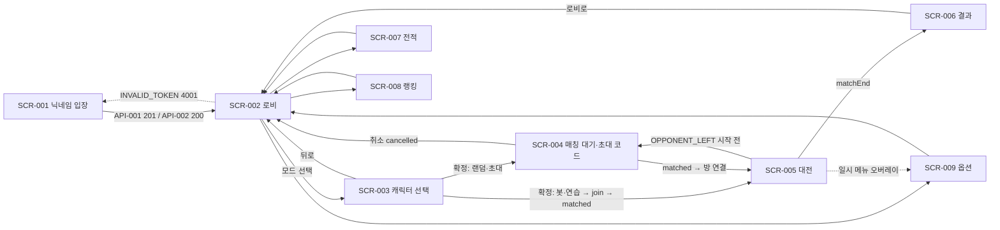

# 🎨 디자인 명세서 (Design Vision) — 영적 전쟁 테트리스

> *"And God made two great lights; the greater light to rule the day, and the lesser light to rule the night: he made the stars also."* — Genesis 1:16 (KJV)
>
> **규격:** `statute-율법/03.design-order-질서/design-vision-디자인명세-template.md`
> **참조 예시:** `parable-비유/03.design-order-질서/design-vision-디자인명세-example.md`
> **동반 산출물 (Phase 3):** [`screen-vision-화면설계.md`](./screen-vision-화면설계.md) — 화면 목록·화면 상세·라우팅 가드·UC-화면 중복 해체 검증
> **근거 산출물 (Phase 1 정경):** [`spec-tablet-명세서.md`](../01.requirement-hearing-들음/spec-tablet-명세서.md) (FR-048~FR-067 연출·사운드·재미) · [`usecase-path-사용사례.md`](../01.requirement-hearing-들음/usecase-path-사용사례.md) (UC-001~UC-022) · [`rtm-covenant-언약추적.md`](../01.requirement-hearing-들음/rtm-covenant-언약추적.md)
> **근거 산출물 (Phase 2 정경):** [`architecture-temple-성전설계.md`](../02.architecture-foundation-기초/architecture-temple-성전설계.md) (ARCH-001·004·005·006·022, D-01~D-34) · [`api-gate-성문.md`](../02.architecture-foundation-기초/api-gate-성문.md) (메시지·에러 문구) · [`data-ark-법궤.md`](../02.architecture-foundation-기초/data-ark-법궤.md) (CODE-001~015, balance.json §8.8)

---

## 1. 디자인 개요

| 항목 | 내용 |
|:---|:---|
| 프로젝트명 | 영적 전쟁 테트리스 (Spiritual Warfare Tetris) — KJV 기반 실시간 2인 대전 테트리스 |
| 버전 | v1.0 (1차 출시 — 로컬 동작판) 디자인 시스템 1판 |
| 디자이너 | Adam (개발 에이전트, 수석 UX 디자이너 역할 — SKILL-03 전신갑주) |
| 작성일 | 2026-10-20 |
| 상태 | **Canonized(정경화)** — 심판 관문 판정은 §9 참조 |
| 프로젝트 유형 / TIER / 실행 모드 | 새하늘 새땅 + 참고자료 / TIER-3 / ⚡ 자동 모드 (NICE-TO-HAVE N-01~N-06 승격 0건, 모호점은 가장 문자적 해석 후 §7 기록) |
| 아트 방향 (FR-048) | "어둠 속에 비치는 빛" — 다크 판타지 배경 + 금빛·흰빛 성스러운 네온. 블록은 성막 재료 색(Exodus 26:1), 유리 질감·하이라이트·은은한 발광 |
| 그래픽·사운드 제작 방식 | 이미지 파일 0개(PixiJS Graphics·필터·생성 텍스처 — D-25), 오디오 파일 0개(Tone.js 합성 — D-24), 폰트는 @fontsource 번들(FR-050, NFR-005) |
| 화면 수 | 9개 (FR-078, architecture §5.4 화면 파일 9개와 1:1) — 목록은 `screen-vision-화면설계.md` §1 |
| 렌더링 분담 | 게임 장면(보드·블록·배경·존재·파티클)은 PixiJS 캔버스(ARCH-004·005), 메뉴·HUD 수치·말씀 대결 패널·자막·토스트는 DOM 오버레이(ARCH-005 overlay-fx, ARCH-022) — 글자는 DOM으로 그려 스크린리더·대비 규칙을 지킨다 |

### 1.1 디자인 원칙

| # | 원칙 | 설계 규칙 | 근거 |
|:--|:---|:---|:---|
| 1 | 어둠 속의 빛 | 배경·면은 남흑색 계열, 상호작용 가능한 것과 "선(善)"의 존재(천사·스킬·말씀)만 금빛·흰빛으로 빛난다. 악한 영은 빛을 빼앗는 방향(어둠·연기·채도 감소)으로만 표현 | FR-048, FR-049, C-011 |
| 2 | 야곱의 우물 (목마를 때 물이 보인다) | 시선 위계: ① 내 보드·낙하 블록 ② 들어올 위협(경고 게이지·영 효과 표시) ③ 쓸 수 있는 자원(믿음 게이지·스킬·천사·갑주 키) ④ 상대 보드 ⑤ 점수·라운드. 쓸 수 있게 된 순간에만 키가 밝아진다 | SKILL-03, FR-033~037 |
| 3 | 게슈탈트 — 근접성 | 내 자원은 내 보드 주변에, 상대 정보는 상대 보드 주변에 모은다. 두 보드 사이 "전장 레인"은 투사체·상쇄 전용 | FR-006, FR-053 |
| 4 | 게슈탈트 — 유사성 | 같은 종류는 같은 모양: 천사 키는 날개형 테두리, 갑주 슬롯은 방패형 테두리, 악한 영 표시는 연기형 테두리 | FR-035, FR-037, FR-049 |
| 5 | 게슈탈트 — 연속성 | 원인→결과가 화면에서 이어진다: 내 줄 삭제 → 빛의 화살 궤적 → 상대 보드 피격. 말씀 칸 삭제 → 빛이 패널로 펼쳐짐 → 말씀 대결 | FR-053, FR-040 |
| 6 | 서버 판정 존중 | 서버 권한 결과(공격·스킬·천사·갑주·게이지)는 `effect`/`attack`/`playerStatus` 수신 후에만 연출한다. 클라이언트 엔진이 판정하는 것(이동·회전·드롭·줄 삭제)은 즉시 연출한다 | D-01, R-10 |
| 7 | 타격감의 동시성 | 한 사건의 시각·청각·히트스톱·흔들림은 같은 프레임에 시작한다 | FR-061, ARCH-005 feedback-sync |
| 8 | 손실 연출의 상한 | 방해 연출은 서버 상한(6초·동시 2개)을 그대로 따르고, 모든 섬광은 초당 3회를 넘지 않는다 | FR-031, FR-057, WCAG 2.3.1 |

---

## 2. 디자인 시스템

### 2.1 색상 토큰 — 배경·면·선

| 토큰 | HEX | 용도 |
|:---|:---|:---|
| `--bg-abyss` | #07080F | 페이지 최하층 배경 (시차 배경 1층 바탕) |
| `--bg-night` | #0E1020 | 화면 본문 바탕 |
| `--bg-panel` | #161A2E | 카드·패널 (DOM, 불투명도 0.88) |
| `--bg-panel-raised` | #1F2440 | 선택·호버된 카드, 모달 |
| `--board-well` | #0A0C18 | 보드 우물(10×20 격자 바탕) |
| `--board-grid` | #1C2138 | 보드 격자선 1px (장식 — 대비 규칙 예외) |
| `--line-subtle` | #2C3254 | 패널 테두리·구분선 |
| `--line-strong` | #6E78AC | 입력 칸·키캡·보드 우물 테두리 (대비 `--bg-panel` 4.05 · `--bg-panel-raised` 3.57 · `--bg-night` 4.44 — WCAG 1.4.11 3:1 이상) |
| `--sky-glow` | #22305E | 시차 배경 2층 "하늘의 빛" 그라데이션 끝색 |
| `--cloud` | #2A2F4A | 시차 배경 3층 구름 (불투명도 0.35) |
| `--hit-tint` | #8B1E2D | 공격 받음 시 배경 색조 (붉고 어둡게 — FR-048) |

### 2.2 색상 토큰 — 글자·빛·상태 (대비 실측)

> 대비비는 WCAG 2.1 상대 휘도 공식으로 실측했다 (Node.js 계산, 소수 둘째 자리). AA 기준: 본문 4.5:1, 큰 글자(24px 이상 또는 굵은 18.66px 이상)·UI 구성요소 3:1.

| 토큰 | HEX | 용도 | 대비 (`--bg-night`) | 대비 (`--bg-panel`) | 대비 (`--bg-panel-raised`) | AA |
|:---|:---|:---|:---:|:---:|:---:|:---:|
| `--text-primary` | #F5F0E1 | 본문·제목 (아이보리) | 16.55 | 15.09 | 13.31 | ✅ |
| `--text-secondary` | #B9B4CC | 보조 설명 | 9.40 | 8.57 | 7.56 | ✅ |
| `--text-muted` | #9591AE | 비활성 라벨·메타 정보 | 6.23 | 5.68 | 5.01 | ✅ |
| `--light-gold` | #F2C14E | 주 강조(Primary)·금빛 네온·포커스 외곽 | 11.24 | 10.25 | 9.04 | ✅ |
| `--light-gold-bright` | #FFE08A | 발광 중심·포커스 링 | 15.50 (`--bg-abyss`) | — | — | ✅ |
| `--light-white` | #FFFFFF | 흰빛 네온·천사·예수님 빛 | 18.86 | 17.19 | 15.17 | ✅ |
| `--text-on-gold` | #1A1405 | 금색 버튼 위 글자 | 10.92 (`--light-gold` 바탕) | — | — | ✅ |
| `--danger` | #FF6B78 | 위험선·공격 받음·오류 문구 | 6.85 | 6.24 | 5.51 | ✅ |
| `--warning` | #FFB547 | 쿨다운·주의 | 10.73 | 9.79 | 8.63 | ✅ |
| `--correct` | #7BE3A5 | 말씀 대결 정답 표시 | 12.01 | 10.95 | 9.66 | ✅ |
| `--info` | #7CC4FF | 안내 토스트·연결 상태 | 10.05 | 9.17 | 8.09 | ✅ |
| `--seal` | #B49BFF | 천사 봉인 표시 (바사 왕국의 군주) | 8.15 | 7.43 | 6.55 | ✅ |
| `--grace` | #FFF4D6 | "은혜" 아이콘 (은은하게 — 불투명도 0.55 표시) | 17.21 | 15.69 | 13.84 | ✅ |
| `--danger-button` | #B3263A | 위험 동작 버튼 바탕 (흰 글자 대비 6.45) | — | — | — | ✅ |

### 2.3 블록 색 — 성막 재료 (Exodus 26:1) + 보드 셀 코드

> 원문: "7종 블록을 성막 재료 색(금, 은, 청색, 자색, 홍색 실 — Exodus 26:1)으로 칠합니다." 재료 색은 5가지, 블록은 7종이다. 재료 밖의 색을 들이지 않기 위해 **청색 실과 홍색 실을 각각 짙은 염색·밝은 염색 2단으로 나누어** 7색을 만든다 (§7 D3-02). 블록은 모양으로도 구별되므로 색만으로 정보를 전하지 않는다 (WCAG 1.4.1).

| 셀 코드 (CODE-009) | 블록 | 재료 | 토큰 | HEX | 대비 (`--board-well`) |
|:---:|:---:|:---|:---|:---|:---:|
| `1` | I | 청색 실 — 밝은 염색 (하늘) | `--block-blue-sky` | #4FB3FF | 8.55 |
| `2` | O | 금 | `--block-gold` | #F4C430 | 11.85 |
| `3` | T | 자색 실 | `--block-purple` | #A35CF0 | 4.96 |
| `4` | S | 은 | `--block-silver` | #C7D0DC | 12.50 |
| `5` | Z | 홍색 실 — 짙은 염색 | `--block-scarlet` | #E5404F | 4.80 |
| `6` | J | 청색 실 — 짙은 염색 | `--block-blue-deep` | #3B5FE0 | 3.61 |
| `7` | L | 홍색 실 — 밝은 염색 (주홍) | `--block-scarlet-light` | #F27A45 | 7.09 |
| `8` | 쓰레기 줄 | (재료 아님 — 잿빛 돌) | `--cell-garbage` | #636A80 | 3.62 |
| `9` | 납 블록 (악 — wickedness) | 납 (Zechariah 5:8 "weight of lead") | `--cell-lead` | #7D838F | 5.11 |
| `a` | 말씀 칸 | 빛 | `--cell-word` | #FFF6D0 | 17.93 |
| `b` | 여리고 나팔 칸 | 양각 나팔 (뿔색) | `--cell-jericho` | #E8C99B | 12.29 |
| `c` | 만나 칸 | 흰 깟씨 빛 | `--cell-manna` | #F4F1E6 | 17.22 |
| `d`~`i` | 갑주 칸 6종 | 은빛 테두리 + 금 문장 | `--cell-armor` | #DCE3EE | 15.08 |

**셀별 표식 (색 외 구별 수단):**

| 셀 | 표식 (코드 그리기) |
|:---|:---|
| 1~7 블록 | 유리 질감(§2.7) — 모양으로 구별 |
| 쓰레기 | 무광 + 왼쪽 위→오른쪽 아래 금 간 선 1개, 발광 없음. 구멍 열(holeColumn)은 빈칸이므로 우물 색 그대로 |
| 납 | 무광 + 가로 빗금 3줄 + 두꺼운 테두리 2px, 발광 없음. 줄 오른쪽 끝에 남은 삭제 수 숫자(4→1) |
| 말씀 칸 | 블록 색 위에 흰 금빛 ✦ 별 문양 + 맥동 발광(1200ms 주기) |
| 여리고 나팔 칸 | 블록 색 위에 굽은 뿔 나팔 실루엣 |
| 만나 칸 | 블록 색 위에 작은 흰 점 5개(깟씨) + 반짝임 |
| 갑주 칸 | 블록 색 위에 방패형 은테 + 갑주별 문장 — 허리띠(가로 띠), 흉배(가슴판), 신(신발), 방패(둥근 방패), 투구(투구), 검(곧은 검) |
| 고스트 | 해당 블록 색 외곽선 2px, 내부 채움 불투명도 0.12 |
| 위험선 | 20줄 중 위 4줄 영역의 아래 경계(17번째 줄 위)에 `--danger` 점선, 평시 불투명도 0.35 |

### 2.4 존재·연출 색

| 토큰 | HEX / 값 | 용도 |
|:---|:---|:---|
| `--spirit-smoke` | #120A16 (불투명도 0.6) | 악한 영 실루엣·연기 (FR-049 반투명) |
| `--spirit-ember` | #B0303F | 악한 영 실루엣의 희미한 잔불 테두리 (고어 금지 — 피·상처 표현 없음, C-011) |
| `--vignette` | rgba(20,0,10,0.75) | 악한 영 등장 비네트 어둠 가장자리 색 |
| `--angel-core` | #FFFFFF | 천사·스킬 빛기둥 중심 |
| `--angel-halo` | #FFE9A8 | 천사 날개·후광 |
| `--seraph-fire` | #FF9A3C | 스랍 숯불·그룹 불꽃 (Isaiah 6:6, Ezekiel 10:2) |
| `--jesus-light` | #FFFDF5 | 예수님 이벤트의 빛 (얼굴 없음 — C-002) |
| `--projectile` | #FFE08A → #FFFFFF | 빛의 화살 꼬리→머리 |
| `--hero-david` | `--block-gold` + `--block-blue-sky` | 다윗 엠블럼 팔레트 (heroes.json `emblem.palette` gold·blue) |
| `--hero-solomon` | `--block-gold` + `--block-purple` | 솔로몬 |
| `--hero-peter` | `--block-silver` + `--block-blue-deep` | 베드로 |
| `--hero-paul` | `--block-scarlet` + `--block-gold` | 바울 |

### 2.5 타이포그래피

| 토큰 | 폰트 (번들) | 굵기 | 크기 / 줄간격 | 용도 |
|:---|:---|:---:|:---|:---|
| `--font-ko` | Noto Serif KR (`@fontsource/noto-serif-kr`) | 400·700 | — | 한글 UI 전체 (FR-050) |
| `--font-en` | Cinzel (`@fontsource/cinzel`) | 400·700 | — | 영어 KJV 구절, 영문 타이틀, 대형 연출 글자, 숫자 표시 (FR-050) |
| `--fs-display` | Cinzel 700 | 700 | 64px / 1.1 (태블릿 48, 모바일 36) | 타이틀 "SPIRITUAL WARFARE TETRIS" |
| `--fs-fx-xl` | Cinzel 700 | 700 | 96px (태블릿 72, 모바일 56) | "TETRIS", 카운트다운 숫자(120px) |
| `--fs-fx-l` | Cinzel 700 | 700 | 32~72px 가변 | "COMBO ×n", "T-SPIN", "BACK-TO-BACK" |
| `--fs-h1` | Noto Serif KR 700 | 700 | 40px / 1.2 (모바일 28) | 화면 제목, "승리"·"패배" |
| `--fs-h2` | Noto Serif KR 700 | 700 | 28px / 1.25 (모바일 22) | 패널 제목, "아깝다!" (40px 예외) |
| `--fs-h3` | Noto Serif KR 700 | 700 | 22px / 1.3 (모바일 18) | 카드 제목 (위인 이름·모드명) |
| `--fs-body` | Noto Serif KR 400 | 400 | 16px / 1.6 | 본문·설명·버튼 |
| `--fs-small` | Noto Serif KR 400 | 400 | 14px / 1.5 | 보조 정보·HUD 라벨 |
| `--fs-micro` | Noto Serif KR 700 | 700 | 12px / 1.4 | 키 표시(키캡 글자)만 — 정보는 아이콘·툴팁과 중복 제공 |
| `--fs-verse-en` | Cinzel 400 | 400 | 18px / 1.6, 자간 0.02em (모바일 15px) | KJV 원문 자막 |
| `--fs-verse-ko` | Noto Serif KR 400 | 400 | 16px / 1.7 (모바일 14px) | KJV 직접 번역 문장 (C-003) |
| `--fs-verse-ref` | Cinzel 700 | 700 | 14px | 출처 장·절 (예: `2 Timothy 4:7`) — 모든 구절 아래 표기 (C-003) |
| `--fs-num` | Cinzel 700 | 700 | 20px (점수), 48px (초대 코드), 56px (니어미스 "0.12초 차이!") | 숫자 |

- 구절 표기 순서 (C-003): KJV 원문(Cinzel) → 한국어 직접 번역(Noto Serif KR) → 출처 장·절(Cinzel 700). KJV 원문 요소에는 `lang="en"`을 붙인다.
- 숫자 자리 흔들림 방지: 점수·타이머는 `font-variant-numeric: tabular-nums`.
- 외부 폰트 요청 0건 (NFR-005, CSP `font-src 'self'` — api-gate §5.4).

### 2.6 간격·그리드·모서리·깊이

| 항목 | 규격 |
|:---|:---|
| 간격 (Spacing) | 4px 기반: `--sp-1` 4 · `--sp-2` 8 · `--sp-3` 12 · `--sp-4` 16 · `--sp-5` 24 · `--sp-6` 32 · `--sp-7` 48 · `--sp-8` 64 |
| 그리드 (Desktop ≥1024) | 12컬럼, 최대 콘텐츠 폭 1200px, 거터 24px, 바깥 여백 32px |
| 그리드 (Tablet 768~1023) | 8컬럼, 거터 16px, 바깥 여백 24px |
| 그리드 (Mobile <768) | 4컬럼, 거터 12px, 바깥 여백 16px |
| 대전 화면 | 그리드 대신 보드 셀 크기 기준 배치 (§5.2) |
| 모서리 반경 | `--r-sm` 4px(키캡·작은 버튼) · `--r-md` 8px(카드·입력) · `--r-lg` 12px(패널·모달) · `--r-pill` 999px(토스트·칩) · 블록 셀 3px(30px 셀 기준, 셀 크기에 비례) |
| 깊이 (Elevation) | 그림자 대신 빛으로 깊이를 낸다: `--glow-sm` 0 0 8px rgba(242,193,78,0.45) · `--glow-md` 0 0 16px rgba(242,193,78,0.55) + 0 0 2px #FFE08A · `--glow-white` 0 0 24px rgba(255,255,255,0.6). 패널 = `--bg-panel` 0.88 + 1px `--line-subtle` + 위쪽 안쪽 1px 하이라이트 rgba(255,255,255,0.06) |
| 최소 터치 영역 | 44×44px (모바일·태블릿 모든 버튼·키) |
| 버튼 높이 | 큰 버튼 52px · 보통 44px · 키캡 버튼 56×56px(데스크톱) / 48×48px(모바일) |

### 2.7 블록 질감·발광(Glow)·필터 규격

> ARCH-004 `piece-skin.js`(생성 텍스처), ARCH-005 `filters.js`(pixi-filters 프리셋). 성능(NFR-001 60fps): 고정 블록은 **텍스처에 구운 발광**만 쓰고, 실시간 필터는 낙하 중 블록·연출 순간에만 건다.

| 요소 | 규격 |
|:---|:---|
| 유리 질감 블록 텍스처 | 셀 크기 정사각형, 모서리 3px(30px 기준 비례). ① 바탕 = 블록 색 ② 왼쪽 위→오른쪽 아래 선형 그라데이션 하이라이트(흰색, 불투명도 0.45 → 0, 셀의 위 45%) ③ 아래 오른쪽 가장자리 1.5px 그림자(블록 색 명도 −25%) ④ 안쪽 테두리 1px(블록 색 명도 +30%) ⑤ 바깥 은은한 발광을 텍스처 바깥 여백 4px에 구움(블록 색, 불투명도 0.35 → 0). 셀 크기별로 1회 생성 후 캐시 |
| 낙하 중 블록 발광 | `GlowFilter` distance 12, outerStrength 1.2, innerStrength 0, color = 블록 색, quality 0.2 — 낙하 블록 컨테이너 1개에만 |
| 고스트 | 텍스처 없음, Graphics 외곽선 2px + 채움 0.12 |
| 보드 테두리 | 우물 둘레 2px `--line-strong` + 바깥 발광 `--light-gold` 0.25. 콤보 중 맥동 강도 상승(§4.5), 위기 시 `--danger` 맥동 |
| 하드 드롭 빛줄기 | 블록 폭 × 낙하 거리 사각형, 세로 그라데이션(블록 색 0.6 → 0), `MotionBlurFilter` velocity (0, 40), 180ms 페이드 |
| 착지 충격파 (하드 드롭) | `ShockwaveFilter` amplitude 18, wavelength 80, speed 600, radius 220, brightness 1.1 — 350ms (중심 = 착지 블록 중심) |
| 테트리스 충격파 | `ShockwaveFilter` amplitude 40, wavelength 160, speed 900, radius 600, brightness 1.3 — 600ms + `AdvancedBloomFilter` threshold 0.5, bloomScale 1.2, brightness 1.2 — 300ms |
| 금빛 섬광 (T-Spin·B2B) | 보드 크기 사각형 `--light-gold-bright`, 불투명도 0 → 0.55 × 섬광 배율 → 0, 160ms |
| 흰 섬광 (줄 삭제) | 삭제되는 줄마다 흰 사각형 불투명도 0.9 × 섬광 배율 → 0, 60ms |
| 붉은 피격 섬광 | 보드 크기 `--danger` 불투명도 0.45 × 섬광 배율 → 0, 140ms |
| 빛기둥 (스킬·천사) | 대상 보드 위에서 아래로 폭 = 보드 폭 × 0.6 사각형 + `GodrayFilter` angle 15, gain 0.6, lacunarity 2.75, alpha 0.8, parallel true — 1200ms |
| 예수님 빛 | 화면 전체 `GodrayFilter` gain 0.8, lacunarity 2.5, center = 화면 위 중앙 (parallel false) + `AdvancedBloomFilter` brightness 1.3 — 4000ms (`effect.durationMs`) |
| 패배 굳음 | `GrayscaleFilter` (보드 컨테이너) 300ms 전환 |
| 바벨론 일렁임 | `DisplacementFilter`(생성 노이즈 텍스처, scale 20, 1.2초 주기 이동) + `KawaseBlurFilter` strength 2 — 6000ms |
| 암전 (용·더러운 귀신) | 보드 위 검은 사각형: 더러운 귀신 불투명도 0.30(3000ms), 용 0.97(4000ms — 우물 테두리 잔불만 보임) |
| 비네트 (영 등장) | DOM 오버레이 radial-gradient(투명 55% → `--vignette` 100%), 불투명도 0 → 0.85(300ms), 유지, 해제 400ms |
| 파티클 | 풀(Particle pool, D-26) 크기 512(데스크톱)·256(모바일). 동시 표시 상한 400·200. 초과 시 가장 오래된 파티클부터 재활용 |

**연출 세기 배율 (FR-057, `fx-intensity.js` 단일 모듈):**

| 옵션 | 값 | 적용 대상 |
|:---|:---|:---|
| 흔들림 | 켜기 = ×1.0 / 끄기 = ×0 | 화면 흔들림 전부(하드 드롭·테트리스·공격 받음·바울 지진·여리고·콤보) — UC-020 4단계 예시 문자 그대로 |
| 섬광 세기 | 기본 ×1.0 / 줄임 ×0.5 / 최소 ×0.2 | 흰·금빛·붉은 섬광 불투명도, 블룸 brightness 초과분, Godray gain, 충격파 brightness 초과분 |
| 공통 안전 상한 (모든 단계) | 화면의 25% 이상을 덮는 섬광은 333ms 안에 2번째가 오면 2번째를 생략 (초당 3회 미만 — WCAG 2.3.1) | 위 섬광 전부 |

### 2.8 모션 토큰 (시간·이징·히트스톱·흔들림)

| 토큰 | 값 | 용도 |
|:---|:---|:---|
| `--dur-instant` | 60ms | 블록 이동 보간 (FR-051) |
| `--dur-fast` | 120ms | 회전 잔상, 홀드 이동, 버튼 눌림 |
| `--dur-base` | 200ms | 토스트 등장, 포커스 이동, 패널 열림 보조 |
| `--dur-screen` | 280ms | 화면 전환 들어오기 (나가기 160ms) |
| `--dur-slow` | 600ms | 테트리스 충격파, 승리 섬광, 획득 비행 |
| `--dur-epic` | 1200ms | 빛기둥, 엠블럼 확대 |
| `--ease-out` | GSAP `power2.out` / CSS cubic-bezier(0.215, 0.61, 0.355, 1) | 기본 등장 |
| `--ease-in` | GSAP `power2.in` / CSS cubic-bezier(0.55, 0.055, 0.675, 0.19) | 투사체 가속, 퇴장 |
| `--ease-pop` | GSAP `back.out(1.7)` / CSS cubic-bezier(0.34, 1.56, 0.64, 1) | 대형 글자·리액션 말풍선 |
| `--ease-impact` | GSAP `expo.out` / CSS cubic-bezier(0.16, 1, 0.3, 1) | 충격파·섬광 감쇠 |
| `--ease-breath` | GSAP `sine.inOut` / CSS cubic-bezier(0.37, 0, 0.63, 1) | 맥동(위기 테두리·말씀 칸·게이지 가득) |

**히트스톱 (FR-052 0.08초, FR-061 0.05~0.1초):** 엔진의 중력·고정 지연 타이머와 블록 연출 트윈을 정지하고, 입력은 버퍼에 쌓아 정지 해제 직후 처리한다. 네트워크 송신(`state` 12Hz)은 멈추지 않는다. 파티클은 정지 중에도 생성만 하고 이동은 해제 후 시작한다.

| 토큰 | 값 | 사건 |
|:---|:---:|:---|
| `HS-COMBO` | 50ms + 10ms × min(콤보 − 1, 5) → 50~100ms | 콤보 1 이상 줄 삭제 (FR-061) |
| `HS-TSPIN` | 70ms | T-Spin 줄 삭제 |
| `HS-TETRIS` | 80ms | 테트리스 (FR-052 원문 0.08초) |
| `HS-B2B` | 90ms | 백투백 테트리스·T-Spin |
| 중첩 규칙 | 한 프레임에 여러 사건이 겹치면 가장 긴 값 1회 (합산 금지) | |

**흔들림 (화면 흔들림 = 게임 레이어 컨테이너의 감쇠 무작위 변위, 30Hz, DOM HUD는 흔들지 않음):**

| 토큰 | 진폭 / 지속 | 사건 |
|:---|:---|:---|
| `SH-1` | 2px / 100ms | 2줄 삭제 |
| `SH-2` | 4px / 120ms | 하드 드롭 착지 (FR-051 "작은 화면 흔들림"), 3줄 삭제 |
| `SH-3` | 6px / 200ms | T-Spin, 여리고 폭파, 아바돈 구멍, 다윗 물맷돌 피격 |
| `SH-COMBO` | (2 + 콤보)px, 상한 8px / 120ms | 콤보 줄 삭제 |
| `SH-HIT` | (6 + 받은 쓰레기 줄)px, 상한 12px / 250ms | 공격 받음 (FR-053) |
| `SH-5` | 12px / 300ms | 테트리스 (FR-052 "강한 흔들림") |
| `SH-6` | 14px / 700ms | 바울 "옥문이 열리다" 지진 (FR-017) |

**화면 전환:** 들어오는 화면 불투명도 0→1 + 위로 12px 이동, 280ms `--ease-out` / 나가는 화면 불투명도 1→0, 160ms. `prefers-reduced-motion: reduce`이면 이동 없이 불투명도만 120ms.

### 2.9 사운드 디자인 — 효과음 17종·BGM·큐 맵 (Tone.js 합성, 오디오 파일 0개)

> FR-058의 17종 목록을 그대로 17개 큐로 만든다 (architecture §5.4: `sfx-play.js` 조작 9종 SFX-01~09, `sfx-battle.js` 전투 8종 SFX-10~17). 원문에 별도 효과음이 지정되지 않은 사건은 17종 중 하나를 **재사용**하거나 무음으로 두고, 새 효과음 종류를 만들지 않는다 (§7 D3-11).

**버스·음량 (FR-060, ARCH-006 `audio-engine.js`):** 마스터 버스 ← (효과음 버스, 음악 버스). 화면 값 0~100 → 0이면 음소거, 그 외 20·log10(값/100) dB. 초기값: 마스터 80, 효과음 80, 음악 60. 음소거 = 마스터 버스 mute, 해제 시 이전 값 복원 (UC-020 3a). 첫 사용자 입력 전에는 `Tone.start()`를 부를 수 없으므로 화면 하단에 "소리를 켜려면 화면을 누르세요" 안내를 띄우고 첫 클릭·키·터치에서 시작한다 (UC-020 E1, D-24).

| 큐 ID | 이름 (FR-058) | 합성 규격 | 길이 | 음량 |
|:---|:---|:---|:---:|:---:|
| SFX-01 | 이동 | `Synth` triangle, G5, 엔벌로프 a 1ms · d 40ms · s 0 · r 20ms | 60ms | −18dB |
| SFX-02 | 회전 | `FMSynth` harmonicity 3, modulationIndex 6, C6 | 70ms | −16dB |
| SFX-03 | 소프트 드롭 | `NoiseSynth` pink, d 30ms (한 칸 내려갈 때마다, 최소 간격 50ms) | 30ms | −26dB |
| SFX-04 | 하드 드롭 | `MembraneSynth` C2 + `NoiseSynth` white 버스트 80ms (착지 충격 포함) | 180ms | −8dB |
| SFX-05 | 착지 | `MembraneSynth` G2, pitchDecay 0.02 | 90ms | −14dB |
| SFX-06 | 홀드 | `Synth` sine, E5 → B5 포르타멘토 50ms | 120ms | −16dB |
| SFX-07 | 1~4줄 삭제 (줄 수마다 다른 음) | `PolySynth`(sine+triangle) + `Reverb` decay 1.8s: 1줄 C5 / 2줄 C5·E5 / 3줄 C5·E5·G5 / 4줄 C5·E5·G5·C6 아르페지오 후 화음 | 300 / 350 / 400 / 700ms | −10dB |
| SFX-08 | 콤보 상승음 | `Synth` square + `Filter` lowpass 3000Hz, D5에서 콤보마다 +1반음(상한 +12) | 120ms | −12dB |
| SFX-09 | T-Spin (B2B 변주 +5반음) | `FMSynth` harmonicity 5.1, modulationIndex 12 종소리, A5 + 리버브 | 500ms | −10dB |
| SFX-10 | 공격 발사 | `NoiseSynth` + `AutoFilter` highpass 400→4000Hz 스윕 + `Synth` sawtooth C4→C6 글라이드 | 250ms | −10dB |
| SFX-11 | 공격 받음 | `MembraneSynth` A1 + `Distortion` 0.4 노이즈, lowpass 1200Hz | 300ms | −6dB |
| SFX-12 | 악한 영 등장 (저음 드론) | `FatOscillator` sawtooth A1, 3중 ±15센트, lowpass 300Hz + `LFO` 0.3Hz, attack 0.4s, 영 효과 지속 동안 유지(최대 6000ms, 봉인 21초·즉시형·줄 단위형은 3000ms 후 1s 페이드) | 3~6s | −14dB |
| SFX-13 | 천사 등장 (합창 화음) | `PolySynth`(AMSynth "아" 패드) D4·F#4·A4·E5, attack 0.3s, release 1.5s + `Chorus` + `Reverb` decay 3s | 1800ms | −12dB |
| SFX-14 | 스킬 발동 (성가 화음) | `PolySynth` sine 오르간 G3·D4·G4·B4 + `FMSynth` 종 C6 1회 | 1200ms | −12dB |
| SFX-15 | 카운트다운 | `Synth` sine A4 100ms × 3틱(1초 간격) + 마지막 A5 300ms | 3300ms | −14dB |
| SFX-16 | 승리 팡파르 | `FMSynth` 금관형 C5·E5·G5·C6 8분음표(120BPM) + C장조 화음 1.5s 유지 | 2600ms | −8dB |
| SFX-17 | 패배 | `Synth` triangle E4·D4·C4·A3 4분음표(70BPM), lowpass 1500Hz | 2200ms | −12dB |

**배경음악 (FR-059, `bgm.js`):**

| ID | 이름 | 규격 | 재생 화면 |
|:---|:---|:---|:---|
| BGM-01 | 대기실 BGM | 72BPM, D 도리안, `PolySynth` 패드(4마디 코드 진행 Dm–C–Bb–C) + 셀레스타형 `Synth` 아르페지오 16분음표, 16마디 반복, −20dB | SCR-001~004, SCR-006~009 |
| BGM-02 | 대전 BGM (적응형) | 100BPM, D 단조, 3층: ① 베이스 펄스 8분음표 ② 타악(`MembraneSynth` 킥 1·3박, `NoiseSynth` 하이햇 8분음표) ③ 현악 패드. −16dB | SCR-005 |
| BGM-02 위기 레이어 | 심장박동 + 긴장 상승 | 위험선 진입 시 2초에 걸쳐 템포 100→124BPM, 심장박동(`MembraneSynth` E1 "쿵-쿵" 2타, 매 박) 추가, 현악 트레몰로 추가. 위험선 이탈 시 3초에 걸쳐 원복 (FR-055, FR-059) — 심장박동은 BGM 레이어로 구현하여 효과음 17종 목록을 보존 (§7 D3-10) | SCR-005 |
| 덕킹 | 음악 버스 일시 감쇠 | 말씀 대결 중 −6dB, 예수님 이벤트 중 −9dB, 승리 팡파르·패배 재생 중 음악 정지 후 3초 뒤 BGM-01 시작 | — |
| 콤보 고조 | FR-061 "음 높이 상승" | 콤보 중 BGM-02 현악 패드 필터 컷오프 +200Hz × 콤보(상한 +1600Hz), 콤보 종료 시 600ms에 걸쳐 원복 | SCR-005 |

**사건 → 사운드 큐 맵 (요약 — 사건별 상세는 §4.5~§4.10):**

| 사건 | 큐 | 비고 |
|:---|:---|:---|
| 이동 / 회전 / 소프트 드롭 / 하드 드롭 / 착지 / 홀드 | SFX-01 / 02 / 03 / 04 / 05 / 06 | 회전 실패·홀드 2회 시도는 무음 (UC-007 E1·E2 "유지·무시") |
| 줄 삭제 1~4줄 | SFX-07 (줄 수별 음) | 테트리스 = 4줄 |
| 콤보 | SFX-08 (+반음) | 줄 삭제음과 같은 프레임 |
| T-Spin / 백투백 | SFX-09 / SFX-09 +5반음 | |
| 공격 발사 / 상쇄 충돌 / 성령의 검 되돌림 | SFX-10 / SFX-10 −7반음 / SFX-10 | 재사용 |
| 공격 받음 | SFX-11 | 쓰레기 0줄이면 생략 |
| 악한 영 등장 | SFX-12 | 귀먹고 말 못하게 하는 귀신은 드론 600ms 후 효과음 버스 5000ms 음소거(FR-027 "효과음·경고음 끄기") |
| 천사 소환 / 예수님 이벤트 | SFX-13 / SFX-13 (4000ms로 유지) | 재사용 |
| 위인 스킬 발동 / 갑주 사용 / 방어 발동 / 갑주 획득 | SFX-14 / SFX-14 / SFX-14 −5반음 / SFX-14 50% 음량·400ms | 재사용 |
| 카운트다운 / 말씀 대결 시작 | SFX-15 / SFX-15 첫 틱 1회 | 재사용 |
| 라운드 승리 / 경기 승리 / 여리고 나팔 폭파 | SFX-16 첫 소절 1200ms / SFX-16 전체 / SFX-16 첫 2음 | 재사용 |
| 라운드 패배 / 경기 패배 | SFX-17 / SFX-17 | |
| 만나 / 말씀 대결 승리 보상 | SFX-08 콤보 1단 음 | 재사용 |
| 위험선 진입 | BGM-02 위기 레이어 | 효과음 아님 |
| 니어미스 "아깝다!", 리액션, 거부 피드백, 영 효과 종료 | 무음 | 원문에 소리 지정 없음 (§7 D3-17) |

### 2.10 벡터 아트 도형 명세 (코드 그리기 — D-25, C-007)

> 모든 그림은 PixiJS `Graphics` 경로(원·다각형·베지어)와 필터로 만든다. 기준 크기는 엠블럼 128×128px(캐릭터 선택)·64px(HUD)·40px(전적·결과 아이콘)이며 비율로 축소한다.

**위인 엠블럼 4종 (`render/emblems.js`, heroes.json `emblem.motif`):** 공통 틀 = 지름 120px 원형 메달, 바깥 고리 4px `--light-gold` + 안쪽 고리 1px 팔레트 2색, 바탕 `--bg-panel-raised`, 바깥 발광 `--glow-md`.

| 위인 | motif | 도형 구성 | 팔레트 |
|:---|:---|:---|:---|
| 다윗 (1 Samuel 17:49) | sling | 아래로 늘어진 물맷돌 끈(2차 베지어 2개, 폭 4px, 금) + 끈 끝 돌(지름 18px 원, 청색 하늘, 하이라이트 점) + 돌이 날아간 궤적 점선 원호 3점 | 금 + 청색(밝은) |
| 솔로몬 (1 Kings 3:9) | heart | 심장형 경로(대칭 베지어 2개, 자색 채움) + 심장 뒤 8방향 빛살(길이 교대 30/20px, 금) | 금 + 자색 |
| 베드로 (Matthew 16:18) | rock | 불규칙 육각 반석(꼭짓점 6개, 은 채움, 아래쪽 명도 −20%) + 반석 윗면에서 위로 뻗는 빛줄기 3개(청색 짙은 → 투명) | 은 + 청색(짙은) |
| 바울 (Acts 16:26) | chains | 사슬 고리 4개(타원 22×14px 외곽선 5px)가 가운데에서 끊어짐(끊긴 단면 2곳에 금빛 불꽃 점) + 메달 아래쪽 지진 균열선(꺾은선 3마디) | 홍색(짙은) + 금 |

**천사 5종 (`render/angels-art.js`, angels.json `art.motif`) — 빛·날개·불꽃 (FR-049):**

| 천사 | motif | 도형 구성 |
|:---|:---|:---|
| 미가엘 (Jude 1:9) | sword_wings | 세로 곧은 검(길이 = 보드 높이 0.4, 흰 중심 + `--angel-halo` 테두리) + 검 뒤 좌우 대칭 날개 2쌍(깃털 7개씩, 베지어) |
| 가브리엘 (Luke 1:19) | herald_wings | 넓게 펼친 날개 1쌍 + 날개 사이 세로 빛 띠(소식 — 위에서 아래로 흐르는 빛 입자) |
| 그룹 (Genesis 3:24, Ezekiel 10) | four_faces_wheels | 네 방향을 향한 얼굴 윤곽 4개(이목구비 없이 측면 실루엣 외곽선만 — 사람·사자·소·독수리 윤곽) + 그 아래 "바퀴 안의 바퀴"(교차 타원 2개, 테두리에 빛 점 12개) + `--seraph-fire` 불꽃 |
| 스랍 (Isaiah 6:2, 6:6-7) | six_wings_coal | 날개 6장(위 2장 얼굴 가림 · 가운데 2장 펼침 · 아래 2장 발 가림) + 부젓가락에 든 숯불(지름 14px 원, `--seraph-fire`, 맥동) |
| 섬기는 영들 (Hebrews 1:14) | small_lights | 작은 빛 구슬 12개(지름 6~10px)가 원을 그리며 내려와 대상 줄로 흩어짐 |

**악한 영 14종 (`render/spirits-art.js`, spirits.json `art.motif`) — 실루엣·연기 반투명, 피·상처·신체 훼손 표현 금지 (C-011):** 공통 = `--spirit-smoke` 채움 불투명도 0.55~0.7, 가장자리 연기 파티클, 눈은 그리지 않거나 `--spirit-ember` 점 2개까지만.

| 영 | 실루엣 | 영 | 실루엣 |
|:---|:---|:---|:---|
| 더러운 귀신 | 형체 없는 연기 덩어리 | 바알세불 | 파리 떼 파티클 구름(점 120개) |
| 귀먹고 말 못하게 하는 귀신 | 두 손으로 귀와 입을 가린 사람 윤곽 | 공중 권세 잡은 자 | 소용돌이 바람 + 큰 날개 윤곽 |
| 군대 | 작은 그림자 사람 윤곽 30개의 떼 | 바사 왕국의 군주 | 왕관 쓴 거대한 그림자 상반신 |
| 거짓말하는 영 | 일그러진 가면 윤곽 | 아바돈/아볼루온 | 황충 떼 + 날개 달린 왕 윤곽 |
| 점치는 귀신 | 연기 속 구슬 1개(희미한 빛) | 이세벨의 영 | 거울에 비친 듯 좌우가 뒤집힌 여인 윤곽 |
| 악 (에바 속의 여인) | 에바(바구니) 위 둥근 납 뚜껑 윤곽 | 큰 음녀 바벨론 | 기울어진 잔 윤곽 + 물결 |
| 광명의 천사로 가장한 사탄 | 처음 1500ms는 흰 날개 윤곽(천사처럼) → 금이 가며 검은 윤곽으로 바뀜 | 루시퍼/용/옛 뱀/사탄 | 화면 위를 가로지르는 거대한 붉은 용 윤곽(`--spirit-ember` 테두리) |

**예수님 이벤트의 빛 (`render/jesus-light.js` — C-002):** 얼굴을 그리지 않는다. 화면 위 중앙에서 내려오는 `--jesus-light` 빛살(Godray) 속에 서 있는 사람 형상의 **바깥 윤곽선만**(높이 = 화면 높이 0.45, 외곽선 3px 흰빛, 내부는 빛으로 채운 그라데이션, 머리 부분도 이목구비 없이 빛으로만 채움). 피해·패배·선택 대상으로 그리지 않으며, 다른 존재와 겹쳐 그리지 않는다.

**아이콘 (코드 그리기, 24px 기준 2px 선):** 대전(교차한 두 검), 친구 대전(두 사람 윤곽), AI 봇(톱니바퀴 안 별), 연습(촛불), 전적(두루마리), 랭킹(월계관), 옵션(톱니바퀴), 뒤로(왼쪽 화살표), 음량(나팔형 스피커), 은혜(작은 빛 별 ✧), 봉인(사슬 걸린 날개), 잠금(자물쇠).

---

## 3. 와이어프레임

> 모든 화면(9개)과 대전 화면의 상태 변형을 그린다. 한글은 고정폭 2칸이라 상자 선이 일부 어긋날 수 있다 — 배치(영역의 위치·순서·포함 관계)가 정본이다. 화면별 컴포넌트·인터랙션·API는 `screen-vision-화면설계.md` §2에 같은 SCR-ID로 있다.

### 3.1 SCR-001 닉네임 입장 (UC-001)

```
┌──────────────────────────────────────────────────────────────────┐
│ (시차 배경: 1층 남흑 하늘 · 2층 하늘의 빛 그라데이션 · 3층 구름 · 4층 빛 입자) │
│                                                                  │
│                  SPIRITUAL WARFARE TETRIS                        │ ← Cinzel 64 금빛 발광
│                      영적 전쟁 테트리스                             │ ← Noto Serif KR 28
│                                                                  │
│            ┌────────────────────────────────────────┐            │
│            │ 닉네임                                  │            │
│            │ ┌────────────────────────────────────┐ │            │
│            │ │ 2~12자 · 한글/영문/숫자/밑줄           │ │ ← 입력 칸  │
│            │ └────────────────────────────────────┘ │            │
│            │ ⚠ 이미 사용 중인 닉네임입니다.            │ ← 오류 영역│
│            │ ⓘ 닉네임과 경기 기록이 이 게임 서버에      │ ← 고지     │
│            │   저장됩니다.                            │ (봉인 제5계명)
│            │          [    입장하기    ]              │ ← 금색 큰 버튼
│            └────────────────────────────────────────┘            │
│                                                                  │
│  🔈 소리를 켜려면 화면을 누르세요                                     │ ← 첫 입력 전만
└──────────────────────────────────────────────────────────────────┘
연결 오류 상태(UC-001 E4): 패널 안 오류 영역에 "서버에 연결할 수 없습니다. 잠시 후 다시 시도하세요" + [다시 시도]
토큰 확인 상태(UC-001 1a): 패널 대신 빛 고리 회전 + "입장 정보를 확인하는 중"
```

### 3.2 SCR-002 로비 — 모드 선택 (UC-002, UC-004 진입, UC-018~020 진입)

```
┌──────────────────────────────────────────────────────────────────┐
│ SPIRITUAL WARFARE TETRIS                       ◈ 다윗의물맷돌 · 1016 │ ← 닉네임·레이팅
├──────────────────────────────────────────────────────────────────┤
│  모드를 고르세요                                                    │
│ ┌─────────────┐ ┌─────────────┐ ┌──────────────┐ ┌─────────────┐ │
│ │ ⚔ 대전       │ │ 👥 친구 대전  │ │ ✶ AI 봇 대전   │ │ 🕯 연습       │ │
│ │ 랜덤 매칭     │ │ 초대 코드     │ │ ◉쉬움 ○보통    │ │ 혼자 위인     │ │
│ │ 비슷한 레이팅  │ │              │ │ ○어려움        │ │ 스킬 익히기   │ │
│ │ 상대와 대전    │ │ [방 만들기]   │ │                │ │              │ │
│ │ [  시작  ]    │ │ [코드로 입장] │ │ [  시작  ]     │ │ [  시작  ]   │ │
│ └─────────────┘ └─────────────┘ └──────────────┘ └─────────────┘ │
│                                                                  │
│          [ 📜 전적 ]        [ 🏆 랭킹 ]        [ ⚙ 옵션 ]             │
└──────────────────────────────────────────────────────────────────┘
모바일: 모드 카드 4개를 세로 1열로 쌓고, 전적·랭킹·옵션은 하단 3등분 버튼 줄
```

### 3.3 SCR-003 캐릭터 선택 (UC-002 3~5, UC-004 4)

```
┌──────────────────────────────────────────────────────────────────┐
│ [← 뒤로]      위인을 고르세요          모드: AI 봇 대전 · 보통          │
├──────────────────────────────────────────────────────────────────┤
│ ┌────────────┐ ┌────────────┐ ┌────────────┐ ┌────────────┐      │
│ │  ( sling ) │ │  ( heart ) │ │  ( rock )  │ │ ( chains ) │ ← 엠블럼 128
│ │   다윗      │ │   솔로몬    │ │   베드로    │ │   바울      │      │
│ │   DAVID    │ │  SOLOMON   │ │   PETER    │ │   PAUL     │      │
│ └────────────┘ └────────────┘ └────────────┘ └────────────┘      │
│      ▲ 선택된 카드: 금빛 테두리 3px + 발광 + 1.04배                     │
│ ┌──────────────────────────────────────────────────────────────┐ │
│ │ 스킬 · 물맷돌                          믿음 50 · 재사용 20초     │ │
│ │ 상대 보드에서 가장 높은 열의 꼭대기 블록 3개 파괴                   │ │
│ │ (솔로몬 선택 시 한 줄 추가: 패시브 — 다음 블록 5개 미리보기)         │ │
│ │ (verses.json KJV 원문 — Cinzel)                                │ │
│ │ (KJV 직접 번역 — Noto Serif KR)                                 │ │
│ │                                         — 1 Samuel 17:49      │ │
│ └──────────────────────────────────────────────────────────────┘ │
│  ⓘ 위인을 선택하세요                               [   확정   ]     │ ← 선택 전 비활성
└──────────────────────────────────────────────────────────────────┘
초대(코드로 입장) 경로: 제목 아래 "확정 후 초대 코드를 입력합니다" 안내 한 줄
콘텐츠 로드 실패(UC-002 E2): 카드 영역 대신 "게임 데이터를 불러오지 못했습니다" + "새로고침해 주세요"
```

### 3.4 SCR-004 매칭 대기·초대 코드 (UC-003, UC-004)

```
상태 A — 랜덤 매칭 대기 (queued)               상태 B — 방장: 초대 코드 표시 (roomCreated)
┌───────────────────────────────────┐        ┌───────────────────────────────────┐
│                                   │        │        친구를 기다리는 중            │
│          상대를 찾는 중              │        │                                   │
│        ◌  (회전하는 빛 고리)          │        │     ┌───┬───┬───┬───┬───┬───┐     │
│                                   │        │     │ K │ 7 │ P │ X │ 4 │ Q │     │ ← Cinzel 48
│   ◈ 다윗의물맷돌 · 다윗 · 1016        │        │     └───┴───┴───┴───┴───┴───┘     │
│        대기 시간 00:12              │        │  이 코드를 친구에게 직접 알려 주세요   │
│                                   │        │       만료까지 09:41                 │
│           [  취소  ]               │        │           [  취소  ]                │
└───────────────────────────────────┘        └───────────────────────────────────┘

상태 C — 친구: 코드 입력                       상태 D — 짝 성사·전장 입장 (matched → 방 연결)
┌───────────────────────────────────┐        ┌───────────────────────────────────┐
│        초대 코드를 입력하세요          │        │    ◈ 다윗의물맷돌    VS   바울의옥문 ◈ │
│     ┌───┬───┬───┬───┬───┬───┐     │        │      (다윗 엠블럼)      (바울 엠블럼)  │
│     │ K │ 7 │ P │   │   │   │     │        │                                   │
│     └───┴───┴───┴───┴───┴───┘     │        │       전장으로 들어가는 중…            │
│  ⚠ 초대 코드를 찾을 수 없습니다.       │        │       (빛 고리 회전)                  │
│     [ 입장 ]      [ 취소 ]          │        │                                   │
└───────────────────────────────────┘        └───────────────────────────────────┘
```

### 3.5 SCR-005 대전 — 데스크톱 HUD (UC-005, UC-007~UC-014, UC-016, UC-017)

```
┌─────────────────────────────────────────────────────────────────────────────────────────┐
│HUD-01 ◈다윗의물맷돌 ●○ ✧        ROUND 2 · 01:36 · 낙하 Lv            ○●  바울의옥문◈ [Ⅱ Esc]│
├──────────────┬──┬────────────────────────┬────────────┬─────────┬──────────────────────┤
│HUD-02 HOLD   │H │HUD-04 내 보드 10×20        │HUD-03 NEXT │HUD-12   │HUD-11 상대 보드 (0.6배)│
│ ┌──────────┐ │U │ ┄┄┄┄┄┄┄ 위험선 ┄┄┄┄┄┄┄┄  │ ┌────────┐ │ 전장     │ ┌──────────────────┐ │
│ │   ▣▣     │ │D │                        │ │ ▣▣▣▣   │ │ 레인     │ │                  │ │
│ │   ▣▣     │ │- │     ▣▣▣                │ │        │ │         │ │  ┄┄ 위험선 ┄┄     │ │
│ └──────────┘ │0 │      ▣  ← 낙하 블록       │ │ ▣      │ │  ➶➶      │ │                  │ │
│HUD-09 전신갑주 │5 │                        │ │ ▣▣▣    │ │ (빛의    │ │                  │ │
│ [Q🎗][W🛡][E👟]│경│     ░░░ ← 고스트        │ │        │ │  화살)   │ │       🙏 ← HUD-13 │ │
│ [R⛨][T⛑][Y🗡]│고│                        │ │ ▣▣     │ │         │ │       받은 리액션  │ │
│HUD-10 영 효과 │게│ ▣▣▣▣▣▣ ▣▣▣             │ │ ▣▣     │ │  ✸      │ │                  │ │
│ ◐ 이세벨 4.2s │이│ ▤▤▤▤ ▤▤▤▤▤ ← 쓰레기      │ └────────┘ │ (상쇄    │ └──────────────────┘ │
│ ⛓ 봉인 18s   │지│ ▤▤▤▤▤▤ ▤▤▤             │HUD-14      │  지점)   │  점수 9,120           │
│              │▓▓│HUD-16 자막: 영 이름·구절    │ 점수 12,480 │         │  (바울 엠블럼 40)      │
│              │▓▓│                        │ COMBO ×3   │         │                      │
├──────────────┴──┴────────────────────────┴────────────┴─────────┴──────────────────────┤
│HUD-06 믿음 ▕██████████████▌░░░░░░░░▏ 64/100   ┆50(스킬 비용 눈금)                          │
│HUD-07 [A ◈ 물맷돌 50]  HUD-08 [1 미가엘 80][2 가브리엘 30][3 그룹 40][4 스랍 50][5 섬기는 영들 20] │
│HUD-13 리액션 [7 🙏][8 🔥][9 😇]                                     HUD-18 토스트 영역          │
└─────────────────────────────────────────────────────────────────────────────────────────┘
HUD-15 은혜: 내 닉네임 오른쪽 ✧ (start.grace = true일 때만, 불투명도 0.55, 설명 문구 없음)
HUD-17 스크린리더 라이브 영역: 화면 밖(시각적으로 숨김) — §6.3
```

**HUD 구성 요소 정의 (화면 상세의 컴포넌트 ID):**

| HUD-ID | 이름 | 위치 (데스크톱) | 내용·데이터 원천 | 근거 |
|:---|:---|:---|:---|:---|
| HUD-01 | 상단 스코어바 | 화면 위 56px | 양측 닉네임(봇은 "AI 봇 · 난이도")·위인 엠블럼 24px·라운드 승수 ●○(start.score/roundEnd.score)·라운드 번호·경기 경과 시간·[Ⅱ] 일시 메뉴 버튼 | FR-007, FR-021 |
| HUD-02 | 홀드 | 내 보드 왼쪽 위 | 홀드 블록 1개(셀 0.7배), 이번 낙하에서 이미 홀드했으면 불투명도 0.4 | FR-003 |
| HUD-03 | 다음 블록 큐 | 내 보드 오른쪽 위 | 기본 3개, 솔로몬 패시브 5개, 가브리엘 7개(공개된 7개를 놓을 때까지 — §7 D3-07). 첫 칸 0.8배, 나머지 0.6배. 귀먹고 말 못하게 하는 귀신 효과 중 연기로 가림(hideNext), 거짓말하는 영 중 가짜 블록 표시(fakeNext) | FR-003, FR-015, FR-035, FR-027 |
| HUD-04 | 내 보드 | 화면 왼쪽 중앙 | 10×20 우물, 낙하 블록·고스트·고정 블록·특수 칸·쓰레기·납·위험선 | FR-001~004, FR-044~046, FR-055 |
| HUD-05 | 경고 게이지 (받을 쓰레기) | 내 보드 왼쪽 세로 12px | 대기 쓰레기 줄 수(`playerStatus.pendingGarbage` + 받은 `attack.garbage` 미삽입분)를 아래부터 붉게 채움(20칸 눈금), 6줄 이상이면 맥동, 숫자 라벨 | FR-053, D-16 |
| HUD-06 | 믿음 게이지 | 보드 아래 가로 막대 | `playerStatus.faith` 0~100, 내 위인 스킬 비용 위치에 눈금, 100이면 금빛 맥동 | FR-033 |
| HUD-07 | 위인 스킬 키 | 하단 왼쪽 | 키캡 A + 위인 엠블럼 + 스킬 이름 + 비용, 쿨다운 원형 스윕·남은 초, 사용 가능 시 발광 | FR-034 |
| HUD-08 | 천사 키 5개 | 하단 가운데 | 키캡 1~5 + 천사 아이콘 + 이름 + 비용, 쿨다운 스윕, 봉인 중 사슬 표식 + 남은 초 | FR-035 |
| HUD-09 | 갑주 슬롯 6개 | 왼쪽 열 | 방패형 슬롯 Q·W·E·R·T·Y (CODE-006 순서), 보유 시 금빛 문장, 미보유 시 윤곽만. 장전된 방어(`wards`)는 슬롯 아래 작은 점 표시 | FR-036, FR-037 |
| HUD-10 | 영 효과 표시 | 왼쪽 열 아래 | 진행 중 영 효과 칩 최대 2개(실루엣 아이콘 + 이름 + 남은 시간 원형) + 봉인 칩(남은 초) + 납 블록 칩(남은 삭제 줄 수) | FR-027~031 |
| HUD-11 | 상대 보드 패널 | 화면 오른쪽 | `opponentState` 보드(셀 0.6배)·상대 점수·위인 엠블럼. 상대 위기 시 상대 보드 테두리도 붉게 맥동 | FR-006 |
| HUD-12 | 전장 레인 | 두 보드 사이 | 빛의 화살 궤적·양측 공격 상쇄 충돌 지점 | FR-053 |
| HUD-13 | 리액션 | 하단 왼쪽(보내기) / 상대 보드 근처(받기) | 키캡 7·8·9 버튼, 받은 리액션 말풍선 | FR-064, UC-017 |
| HUD-14 | 점수·콤보 | NEXT 아래 | 점수(Cinzel 20), 콤보 수, B2B 표시 | FR-004 |
| HUD-15 | 은혜 아이콘 | 내 닉네임 옆 | ✧ 은은하게 (FR-062 "아이콘으로만") | FR-062 |
| HUD-16 | 자막 레이어 | 내 보드 아래쪽 1/4 | 영 이름 + KJV 원문 + 직접 번역 + 출처 (2500ms) | FR-054, C-003 |
| HUD-17 | 라이브 영역 | 화면 밖 | 스크린리더 안내 | §6.3 |
| HUD-18 | 토스트 | 하단 오른쪽 | 거부 피드백·안내 1500ms | api-gate §4.2 |

### 3.6 SCR-005 대전 — 변형·오버레이

```
(a) AI 봇 대전 변형 (UC-005)                      (b) 연습 변형 (UC-006)
HUD-01 오른쪽: "AI 봇 · 보통" + 봇 위인 엠블럼        HUD-01: 닉네임 · 플레이 시간 00:00 · [Ⅱ Esc]
HUD-11: 봇 보드 (서버 봇 opponentState)            HUD-11·12·05·08·09·10·13 숨김 (상대·공격·천사·갑주 없음 — OQ #4)
HUD-13: 보낸 리액션은 내 화면에만 표시 (UC-017 1a)    내 보드를 화면 가운데로, HUD-06·07·02·03·14만 표시
                                                  다윗 스킬: 연습용 표시 연출만 (UC-006 4)

(c) 카운트다운 (start 수신 → startAt)              (d) 라운드 종료 배너 (roundEnd)
┌───────────────────────────────┐                 ┌───────────────────────────────────┐
│        ROUND 2                │                 │      ROUND 1  ·  승리              │
│           3                   │ ← Cinzel 120     │          1 : 0                    │
│   (3 → 2 → 1 → "시작")          │                 │    다음 라운드 3초                   │
└───────────────────────────────┘                 └───────────────────────────────────┘
                                                  진 쪽 보드: 회색으로 굳으며 무너짐 / 이긴 쪽 보드: 빛

(e) 말씀 대결 패널 (quizStart → quizResult, ARCH-022)
┌───────────────────────────────────────────────────────────────┐
│  ✦ 말씀 대결                        ▕██████████░░░░▏ 6.4초     │ ← 10초 타이머 막대
│  (quizStart.question — 문제 문장, Noto Serif KR 22)              │
│  ┌──────────────────────┐  ┌──────────────────────┐          │
│  │ 1  (보기 1)           │  │ 2  (보기 2)           │          │
│  └──────────────────────┘  └──────────────────────┘          │
│  ┌──────────────────────┐  ┌──────────────────────┐          │
│  │ 3  (보기 3)           │  │ 4  (보기 4)           │          │
│  └──────────────────────┘  └──────────────────────┘          │
│  🔒 오답 — 3초 후 다시 고를 수 있습니다 (quizLock)                  │
└───────────────────────────────────────────────────────────────┘
결과 상태 (quizResult, 3초): 정답 보기 ✓ + `--correct` 테두리 / 내가 고른 오답 ✗
  승리: "먼저 맞혔습니다! 믿음 +50" 또는 "전신갑주 획득: 구원의 투구"
  니어미스(늦은 정답자): "0.12초 차이!" (Cinzel 56, 홍색 밝은 색, 맥동)
  아무도 못 맞힘: "아무도 맞히지 못했습니다"
  해설 + KJV 원문 + 직접 번역 + 출처 → "재개까지 3 · 2 · 1"
뒤 배경: 두 보드 채도 50% · 밝기 70% (정지 표시)

(f) 일시 메뉴 (Esc / [Ⅱ] / 브라우저 뒤로)          (g) 예수님 "세상을 이기었노라" (effect jesus, 4000ms)
┌───────────────────────────────┐                 ┌───────────────────────────────────┐
│   일시 메뉴                     │                 │        (위 중앙에서 빛살 Godray)       │
│   [ 계속 ]                      │                 │        (얼굴 없는 빛 실루엣 윤곽)       │
│   [ 옵션 ]  → SCR-009 오버레이    │                 │  "be of good cheer; I have overcome │
│   [ 그만하기 ] ← 연습만            │                 │   the world."  (KJV) + 직접 번역      │
│ 대전·봇: 경기는 멈추지 않습니다      │                 │                     — John 16:33   │
│ 연습: 보드가 멈춥니다              │                 │  "And the light shineth in darkness; │
└───────────────────────────────┘                 │   and the darkness comprehended it  │
                                                  │   not." (KJV) + 직접 번역 — John 1:5  │
                                                  └───────────────────────────────────┘
                                                  보드는 계속 보이고 조작도 계속된다 (연출 층만 위에 얹힘)

(h) 입장·대기 상태 (joined 전후)                   (i) 상대 이탈 (matchEnd reason disconnect)
"전장으로 들어가는 중…" → joined 후 "상대를 기다리는 중"     배너 "상대가 나갔습니다 — 승리" 1500ms → SCR-006
15초 경과 OPPONENT_LEFT → 토스트 "상대가 나갔습니다"        봇 처리 오류(BOT_FAILURE) → 모달 "경기를 계속할 수 없습니다"
  → 같은 모드로 SCR-004 상태 A 자동 복귀 (UC-003 E2)        + [로비로] (전적 미기록)
```

### 3.7 SCR-005 대전 — 태블릿·모바일

```
태블릿 (768~1023, 가로)                              모바일 세로 (<768)
┌──────────────────────────────────────────┐       ┌────────────────────────────┐
│ HUD-01 스코어바 (48px)                     │       │◈나 ●○✧ R2 01:36 ○● 상대◈[Ⅱ]│ ← 44px
├────┬─┬──────────────┬──────┬─────────────┤       ├──────┬─────────────┬───────┤
│HOLD│경│ 내 보드        │ NEXT │ 상대 보드     │       │HOLD  │ 상대 보드 미니  │ NEXT  │
│갑주 │고│ (셀 24px)      │ 점수  │ (셀 14px)    │       │갑주6 │ (셀 7px)      │ (3)   │
│ 3×2│게│              │ 콤보  │ 리액션 말풍선  │       │(2×3) │ 영 효과 칩     │ 점수   │
│영효과│이│              │      │             │       ├─┬────┴─────────────┴───────┤
│    │지│              │      │             │       │경│     내 보드               │
├────┴─┴──────────────┴──────┴─────────────┤       │고│  (셀 = (화면폭−56)/10,     │
│ 믿음 게이지 ████████░░░░                   │       │게│   상한 30px)              │
│ [A 스킬] [1][2][3][4][5] 천사 [7][8][9]    │       │이│  ← 스와이프·탭 조작 영역     │
└──────────────────────────────────────────┘       │지│                          │
                                                   ├─┴──────────────────────────┤
                                                   │ 믿음 ████████░░░ 64           │
                                                   │ [A 스킬][1][2][3][4][5]       │ ← 48px 키
                                                   │ [🙏][🔥][😇]   (갑주 Q~Y는 위)  │
                                                   └────────────────────────────┘
모바일 가로(높이 < 500px): 태블릿 배치를 따르되 셀 = (화면 높이 − 96)/20, 하단 키 줄은 오른쪽 세로 열로 이동
```

### 3.8 SCR-006 결과 — 말씀 카드 (UC-015, UC-016, UC-006 6)

```
┌──────────────────────────────────────────────────────────────────┐
│                   승 리   (빛 폭발 + 금빛 콘페티)                    │ ← 패배: "패배", 콘페티 없음
│        2 : 1  ·  경기 시간 06:52  ·  (상대 이탈 시: "상대가 나갔습니다")  │
│        (2 Timothy 4:7 KJV 원문 + 직접 번역 + 출처 — 승리 화면만)        │
├────────────────────────────────┬─────────────────────────────────┤
│ ┌──────── 말씀 카드 ───────────┐ │ 개인 기록              이전 대비    │
│ │ (금테 카드 3:4, 엠블럼 워터마크) │ │ 최대 콤보       5        ▲ 2      │
│ │ (대표 구절 KJV 원문 — Cinzel)  │ │ 분당 공격       6.3      ▲ 1.4    │
│ │ (직접 번역 — Noto Serif KR)   │ │ 퀴즈 정답률     100%     ▲ 50%p   │
│ │            — Ephesians 6:16 │ │ (첫 기록이면 "첫 기록" 표시)         │
│ │  SPIRITUAL WARFARE TETRIS   │ │ 레이팅 1016 (+16)  ← 사람 대 사람만  │
│ └─────────────────────────────┘ │ 새 업적 🏅 골리앗 사냥꾼 (있을 때만)   │
│ [ 이미지 저장 ]  [ 공유 ]         │ ⚠ 기록 저장에 실패했습니다 (saved=false)│
├────────────────────────────────┴─────────────────────────────────┤
│                           [  로비로  ]                            │
└──────────────────────────────────────────────────────────────────┘
연습 변형: 제목 "연습 종료", 승패·레이팅 없음, 개인 기록에 플레이 시간 추가, 말씀 카드 유지
공유 미지원 브라우저: [공유] 버튼 숨김 (UC-015 9a) / 저장·공유 실패: "카드를 저장하지 못했습니다"
모바일: 세로 1열 — 제목 → 말씀 카드 → 저장·공유 → 개인 기록 → 로비로
```

### 3.9 SCR-007 전적 (UC-018)

```
┌──────────────────────────────────────────────────────────────────┐
│ [← 로비]   전적                                                    │
├──────────────────────────────────────────────────────────────────┤
│ 결과 │ 상대                 │ 위인 (나 vs 상대) │ 라운드 │ 경기 시간 │ 일시          │
│ 승   │ 바울의옥문            │ ◈다윗 vs ◈바울   │ 2:1   │ 06:52   │ 2026-10-19 23:31│
│ 패   │ AI 봇 · 보통          │ ◈베드로 vs ◈솔로몬│ 1:2   │ 04:48   │ 2026-10-19 23:12│
│ …    │                     │                 │       │         │               │
├──────────────────────────────────────────────────────────────────┤
│               [‹ 이전]   1 / 2   [다음 ›]                          │
└──────────────────────────────────────────────────────────────────┘
빈 상태: "아직 경기 기록이 없습니다" (UC-018 4a) / 오류: "전적을 불러오지 못했습니다" + [다시 시도]
모바일: 표 대신 카드 목록 — 1행: 결과 배지·상대 / 2행: 위인 엠블럼 2개·라운드 / 3행: 경기 시간·일시
결과 배지: 승 = 금빛 테두리 + "승" / 패 = 회색 테두리 + "패" (글자로 구별)
```

### 3.10 SCR-008 랭킹 (UC-019)

```
┌──────────────────────────────────────────────────────────────────┐
│ [← 로비]   랭킹 · 레이팅 상위 100                                   │
├──────────────────────────────────────────────────────────────────┤
│  순위 │ 닉네임                         │ 레이팅                      │
│   1  │ 🏆 다윗의물맷돌   ◀ 나            │ 1112   ← 내 행 금빛 강조      │
│   2  │ 바울의옥문                     │ 1048                        │
│  …   │                              │                             │
├──────────────────────────────────────────────────────────────────┤
│  내 순위: 137위 · 다윗의물맷돌 · 984   ← 100위 밖일 때만 아래 고정 (UC-019 3a)│
└──────────────────────────────────────────────────────────────────┘
오류: "랭킹을 불러오지 못했습니다" + [다시 시도] / 로딩: 표 자리 빛 고리
```

### 3.11 SCR-009 옵션 (UC-020)

```
┌────────────────────────────────────────────────┐
│ [← 돌아가기]   옵션                              │
├────────────────────────────────────────────────┤
│ 연출                                            │
│  화면 흔들림            [ 켜기 ● ○ 끄기 ]          │ ← 토글 스위치
│  섬광 세기              [ 기본 | 줄임 | 최소 ]       │ ← 3단 세그먼트
│ 소리                                            │
│  마스터 음량   ──────────●──────  80            │ ← 슬라이더 0~100, 5단위
│  효과음 음량   ──────────●──────  80            │
│  음악 음량     ───────●─────────  60            │
│  음소거                [ 끄기 ○ ● 켜기 ]          │
│ ⓘ 설정은 이번 접속 동안만 유지됩니다.                │ ← N-04 보존(저장 안 함)
└────────────────────────────────────────────────┘
대전 중: 일시 메뉴에서 열리는 모달 오버레이 (같은 컴포넌트), [← 돌아가기] = 일시 메뉴로
```

---

## 4. 인터랙션 디자인

### 4.1 화면 전환 흐름 (FR-078)



| 전환 | 연출 | 소리 |
|:---|:---|:---|
| 일반 화면 간 | §2.8 화면 전환 (280ms 들어오기 / 160ms 나가기) | BGM-01 유지 |
| SCR-004 상태 D → SCR-005 | "VS" 카드가 양옆으로 갈라지며 두 보드가 그 자리에서 떠오름 600ms | BGM-01 → BGM-02 교차 페이드 1000ms |
| SCR-005 → SCR-006 | 승리: 흰 섬광 0.8 × 섬광 배율 200ms → 결과 화면 / 패배: 회색 페이드 400ms | 승리 SFX-16 / 패배 SFX-17, BGM 정지 후 3초 뒤 BGM-01 |
| 오버레이 열기 (모달·패널·일시 메뉴) | 배경 어둡게 rgba(7,8,15,0.6) 200ms + 패널 0.96→1.0 배 200ms `--ease-out` | 없음 |

### 4.2 공통 컴포넌트 동작

| 컴포넌트 | 상태 | 규격 |
|:---|:---|:---|
| 주 버튼 (Primary) | 기본 / 호버 / 누름 / 포커스 / 비활성 / 처리 중 | 바탕 `--light-gold` + 글자 `--text-on-gold` / 바탕 `--light-gold-bright` + `--glow-md` / 0.97배 `--dur-fast` / 포커스 링(§6.2) / 바탕 `--line-subtle` + 글자 `--text-muted`, `aria-disabled` / 글자 대신 빛 고리 + "처리 중" (중복 클릭 차단) |
| 보조 버튼 | 같음 | 바탕 투명 + 1px `--light-gold` 테두리 + 글자 `--light-gold` |
| 위험 동작 버튼 (취소) | 같음 | 바탕 투명 + 1px `--line-strong` + 글자 `--text-primary` (취소는 파괴 동작이 아니므로 붉은색 쓰지 않음) |
| 입력 칸 (닉네임) | 기본 / 포커스 / 오류 | 1px `--line-strong` / 2px `--light-gold` / 2px `--danger` + 아래 오류 문구 `aria-describedby` 연결. `maxlength=12`, `minlength=2`, `pattern`, 입력 중 공백 trim 미리보기 없음(제출 시 검사) |
| 초대 코드 칸 | 6칸 분할 입력 | 한 칸 1자, 입력 시 대문자 변환·다음 칸 이동, 백스페이스 이전 칸, 붙여넣기 6자 분배, 허용 문자 외 입력 무시 (D-09 문자 집합) |
| 카드 선택 (모드·위인) | 라디오 그룹 | 화살표 키 이동, Enter/Space 선택, 선택 카드 금빛 3px 테두리 + 1.04배 + `aria-checked` |
| 모달 | 열림 / 닫힘 | 포커스 가두기, Esc 닫기(말씀 대결 패널은 Esc로 닫히지 않음 — 응답 또는 시간 종료만), 닫으면 연 버튼으로 포커스 복귀 |
| 토스트 | 표시 / 사라짐 | 아래에서 8px 올라오며 200ms, 1500ms 유지(쿨다운·봉인은 남은 초 동안 갱신), 같은 문구 연속 시 1개로 합치고 시간 연장, 동시 최대 2개 |
| 키캡 버튼 (HUD) | 사용 가능 / 비용 부족 / 쿨다운 / 봉인 / 미보유 | 금빛 발광 + 아이콘 100% / 아이콘 40% + 비용 숫자 `--danger` / 원형 스윕 + 남은 초(`--warning`) / 사슬 표식 + 남은 초(`--seal`) / 윤곽만 |
| 슬라이더 (음량) | 기본 / 포커스 | 막대 4px, 손잡이 20px(터치 44px 영역), ←→ 5단위, PageUp/PageDown 20단위, Home/End 0/100 |

### 4.3 키 바인딩 (FR-011 — 기본 키 고정, 재설정 기능 없음: N-01 보존)

| 동작 | 키 (대전·연습) | 비고 |
|:---|:---|:---|
| 왼쪽 / 오른쪽 이동 | ← / → | 누르고 있으면 DAS 150ms 후 ARR 33ms 반복 (balance.json §8.8.8). 이세벨의 영 효과 중 좌우 반전 |
| 소프트 드롭 | ↓ | 중력 ×20 |
| 하드 드롭 | Space | |
| 오른쪽 회전 | ↑ 또는 X | SRS |
| 왼쪽 회전 | Z 또는 Ctrl | SRS |
| 홀드 | C 또는 Shift | 낙하당 1회 |
| 위인 스킬 | A | `skill` hero_ |
| 천사 소환 | 1 미가엘 · 2 가브리엘 · 3 그룹 · 4 스랍 · 5 섬기는 영들 | CODE-004 순서, 연습 모드에서는 비활성 |
| 갑주 사용 | Q 허리띠 · W 흉배 · E 신 · R 방패 · T 투구 · Y 검 | CODE-006 순서 (자판 윗줄 왼쪽부터), 연습 모드 비활성 |
| 리액션 | 7 🙏 아멘 · 8 🔥 할렐루야 · 9 😇 | 사람 대 사람·봇 대전 (봇은 내 화면만) |
| 일시 메뉴 | Esc 또는 P | 대전은 경기를 멈추지 않음, 연습은 멈춤 |
| 말씀 대결 응답 | 1 · 2 · 3 · 4 (또는 클릭·탭) | 말씀 대결 중에는 보드가 멈추고 스킬 입력이 무시되므로(UC-009 E3) 1~4가 천사 키와 겹치지 않는다 |
| 브라우저 기본 동작 차단 | Space·방향키·Ctrl의 스크롤·단축키 기본 동작은 SCR-005에서만 `preventDefault` | |

**메뉴 화면 키보드:** Tab / Shift+Tab 포커스 이동, Enter·Space 실행, 화살표 키 카드 그룹 이동, Esc 뒤로(SCR-003 → SCR-002, SCR-004 → 취소, SCR-007~009 → SCR-002, 모달 닫기).

### 4.4 터치 조작·진동 (FR-011, UC-007 2a)

| 제스처 (내 보드 영역) | 동작 | 판정 기준 |
|:---|:---|:---|
| 가로로 끌기 | 좌우 이동 | 끄는 동안 셀 너비만큼 이동할 때마다 1칸 |
| 짧게 탭 | 오른쪽 회전 | 이동 거리 < 10px, 시간 < 200ms |
| 두 손가락 탭 | 왼쪽 회전 | 두 접점 동시 탭 |
| 아래로 빠르게 쓸기 | 하드 드롭 | 세로 속도 > 1.2px/ms, 거리 > 셀 2칸 |
| 아래로 천천히 끌기 | 소프트 드롭 | 세로 속도 ≤ 1.2px/ms, 끄는 동안 유지 |
| 위로 쓸기 | 홀드 | 위쪽 거리 > 셀 2칸 |
| 화면 버튼 | 스킬 A · 천사 1~5 · 갑주 6 · 리액션 3 · 일시 메뉴 | 48×48px 키캡 (§3.7) |

| 진동 (`navigator.vibrate`, 지원 기기만) | 패턴 |
|:---|:---|
| 착지 | 15ms |
| 하드 드롭 착지 | 25ms (착지 15ms 대신) |
| 공격 보냄 | 20ms |
| 공격 받음 | 40ms · 쉼 30ms · 40ms |
| 진동 미지원 | 아무것도 하지 않음 (시각·청각 피드백만) |

### 4.5 사건별 연출(Juice) 명세 — 조작·줄 삭제 (FR-051, FR-052, FR-061)

> 열 설명: 시각 = PixiJS/DOM 연출, 소리 = §2.9 큐, HS = 히트스톱, SH = 흔들림, 지속 = 연출이 끝나는 시점까지. 모든 수치는 섬광 배율·흔들림 배율(§2.7) 적용 전 기본값.

| EVT-ID | 사건 | 트리거 | 시각 | 소리 | HS | SH | 진동 | 지속 |
|:---|:---|:---|:---|:---|:---:|:---:|:---:|:---:|
| EVT-01 | 이동 | 엔진 이동 성공 | 블록 위치 트윈 60ms `--ease-out` | SFX-01 | — | — | — | 60ms |
| EVT-02 | 회전 | 엔진 회전 성공 (벽차기 포함) | 직전 자세 잔상(불투명도 0.35→0, 120ms) + 새 자세 트윈 80ms | SFX-02 | — | — | — | 120ms |
| EVT-03 | 회전 실패 | 모든 벽차기 후보 막힘 (UC-007 E1) | 연출 없음 (원래 상태 유지) | 무음 | — | — | — | — |
| EVT-04 | 소프트 드롭 | 한 칸 하강 | 연출 없음 (블록 이동만) | SFX-03 (최소 50ms 간격) | — | — | — | 30ms |
| EVT-05 | 하드 드롭 | Space / 아래로 빠르게 쓸기 | 낙하 궤적 빛줄기 180ms + 착지 충격파 350ms (§2.7) | SFX-04 | — | SH-2 | 25ms | 350ms |
| EVT-06 | 착지(고정) | 중력·소프트 드롭 후 고정 | 고정 블록 흰 하이라이트 0.5→0 100ms + 빛 먼지 6개 | SFX-05 | — | — | 15ms | 100ms |
| EVT-07 | 홀드 | C/Shift/위로 쓸기 | 블록이 HUD-02로 날아가 120ms + 홀드 칸 반짝임 | SFX-06 | — | — | — | 120ms |
| EVT-08 | 홀드 재시도 | 같은 낙하에서 2번째 (UC-007 E2) | 연출 없음 (무시) | 무음 | — | — | — | — |
| EVT-09 | 1줄 삭제 | 엔진 줄 삭제 | 줄 흰 섬광 60ms → 블록 조각 파티클 24개/줄 폭발 450ms | SFX-07(1줄) | — | — | — | 510ms |
| EVT-10 | 2줄 삭제 | 〃 | 같음, 파티클 36개/줄 | SFX-07(2줄) | — | SH-1 | — | 510ms |
| EVT-11 | 3줄 삭제 | 〃 | 같음, 파티클 48개/줄 | SFX-07(3줄) | — | SH-2 | — | 510ms |
| EVT-12 | 테트리스 (4줄) | 〃 | 줄 섬광 60ms + 파티클 80개/줄 + 테트리스 충격파 600ms + 블룸 300ms + "TETRIS" `--fs-fx-xl` 금빛 발광: 0.6→1.15→1.0배 300ms `--ease-pop`, 유지 500ms, 페이드 250ms | SFX-07(4줄) | HS-TETRIS 80ms | SH-5 | — (착지 진동만) | 1050ms |
| EVT-13 | 콤보 n (n ≥ 1) | 연속 줄 삭제 (`combo` ≥ 1) | "COMBO ×n" `--fs-fx-l`: 크기 32 + 6n px(상한 72), 색 n1~2 `--text-primary` · n3~4 `--light-gold` · n5~6 `--block-scarlet-light` · n7+ `--light-white` + `--glow-white`, 떨림 진폭 0.5n px(상한 4) · 600ms. 보드 테두리 발광 강도 +15%/콤보(상한 +90%), 배경 빛 밝기 +4%/콤보(상한 +24%) — 콤보 종료 시 600ms에 원복 | SFX-08 (+n−1 반음) + 해당 줄 수 SFX-07 동시 | HS-COMBO | SH-COMBO | — | 600ms |
| EVT-14 | T-Spin | 엔진 T-Spin 판정 + 줄 삭제 | 금빛 섬광 160ms + "T-SPIN SINGLE/DOUBLE/TRIPLE" 금빛 `--fs-fx-l` 700ms | SFX-09 | HS-TSPIN 70ms | SH-3 | — | 700ms |
| EVT-15 | 백투백 (B2B) | `b2b` 참인 테트리스·T-Spin | 금빛 섬광 160ms + "BACK-TO-BACK" 금빛 `--fs-fx-l` (TETRIS·T-SPIN 문구 위에 한 줄) 700ms | SFX-09 +5반음 (B2B 변주) | HS-B2B 90ms | 해당 사건 SH | — | 700ms |
| EVT-16 | 니어미스 "아깝다!" | §7 D3-12 판정 규칙 (콤보 끊김 직후 빈칸 1개짜리 줄 ≥3 / 라운드 패배 시 상대 최고 높이 ≥19줄) | "아깝다!" `--fs-h2` 40px `--block-scarlet-light`, 0.8→1.0배 `--ease-pop`, 900ms + 놓친 줄 외곽선 금빛 맥동 2회 600ms | 무음 | — | — | — | 900ms |
| EVT-17 | 위험선 진입 / 이탈 | 고정 블록이 위 4줄 영역 진입 (FR-055) | 보드 테두리 `--danger` 맥동(주기 800ms, 불투명도 0.35↔0.9) + 위험선 점선 불투명도 0.35→0.8 / 이탈 시 600ms 페이드 | BGM-02 위기 레이어 (심장박동·템포 상승) | — | — | — | 위기 동안 |
| EVT-18 | 카운트다운 | `start` 수신 → `startAt`까지 | "ROUND n" 아래 숫자 3·2·1 (Cinzel 120px, 1.4→1.0배 + 페이드, 1초씩) → "시작" 400ms | SFX-15 | — | — | — | 3000ms |
| EVT-19 | 동시 피드백 규칙 | EVT-09~16이 한 프레임에 겹침 | 시각 효과는 모두 같은 프레임에 시작, 글자는 위에서부터 BACK-TO-BACK → TETRIS/T-SPIN → COMBO 순 세로 쌓기 | 소리 동시 재생(최대 4음) | 가장 긴 HS 1회 | 가장 큰 SH 1회 | 가장 긴 진동 1회 | — |

### 4.6 사건별 연출 — 공격·방어 (FR-053, FR-054, UC-008)

| EVT-ID | 사건 | 트리거 (메시지) | 시각 | 소리 | SH | 진동 | 지속 |
|:---|:---|:---|:---|:---|:---:|:---:|:---:|
| EVT-20 | 공격 발사 | `effect` kind `attackSent` (보낸 쪽) | 내 보드 위에서 빛의 화살 min(쓰레기, 6)개가 HUD-12를 지나 상대 보드로 450ms `--ease-in` 비행(꼬리 `--projectile`), 상대 보드 착탄 시 붉은 섬광(내 화면의 상대 보드) | SFX-10 | — | 20ms | 450ms |
| EVT-21 | 공격 받음 | `attack` (garbage ≥ 1) | 상대 쪽에서 화살 착탄 → 내 보드 붉은 섬광 140ms + HUD-05 경고 게이지 차오름 300ms + 시차 배경 `--hit-tint` 35% 색조 → 1200ms 복원 (FR-048) | SFX-11 | SH-HIT | 40·30·40ms | 1200ms |
| EVT-22 | 상쇄 (양측 공격 충돌) | `effect` kind `offset` | 내 화살이 HUD-12 가운데에서 들어오던 붉은 화살과 부딪혀 흰 원형 섬광(지름 80px, 0.9→0, 220ms) + 파편 20개, 경고 게이지 감소 300ms | SFX-10 −7반음 | — | — | 450ms |
| EVT-23 | 쓰레기 줄 삽입 | 다음 비삭제 고정 시 (api-gate API-254) | 아래에서 줄이 120ms/줄씩 밀어 올림(최대 360ms), 구멍 열은 빈칸으로 또렷이 | (EVT-21에서 이미 재생) | — | — | ≤360ms |
| EVT-24 | 방패 차단 | 믿음의 방패 장전 상태에서 공격 도착 (`playerStatus.wards.shield` 소모, `attack.garbage` 0·`spiritId` null) | 날아오던 화살이 보드 앞 금빛 반원 방패(지름 = 보드 폭)에 부딪혀 산산이 흩어짐 400ms | SFX-14 −5반음 | — | — | 400ms |
| EVT-25 | 성령의 검 되돌림 | `effect` kind `reflect` / `attack.reflected` 참 | 내 보드 앞 곧은 검 실루엣이 화살을 쳐서 반대 방향으로 날려 보냄 450ms (받는 쪽: 되돌아온 화살 착탄 = EVT-21) | SFX-10 | — | — | 450ms |
| EVT-26 | 흉배·은혜 경감 | `attack.garbage`가 원래보다 줄어든 공격 | 착탄 순간 흉배형 빛판이 0.3초 번쩍 / 은혜는 연출 없음(FR-062 "은은하게") | (EVT-21) | — | — | 300ms |

### 4.7 사건별 연출 — 악한 영 14종 (FR-027~FR-030, FR-049, FR-054, C-011)

**공통 등장 (EVT-27, `attack.spiritId` 비어 있지 않음):** 비네트 어둠 300ms → 해당 영 실루엣(§2.10)이 보드 위쪽에서 연기와 함께 400ms 페이드 인 → HUD-16 자막(영 이름 nameKo + KJV 표기 nameKjv / KJV 원문 / 직접 번역 / 출처) 2500ms → HUD-10 칩 추가. 소리 SFX-12. **공통 종료 (EVT-28, `effect` kind `spiritEnd` 또는 지속 만료):** 연기가 흩어지며 400ms 페이드, 칩 제거, 무음.

| 영 (등급) | 효과 연출 (보드에 걸리는 것) | 지속 |
|:---|:---|:---:|
| 더러운 귀신 (1) | 보드 위 검은 막 불투명도 0.30 | 3000ms |
| 귀먹고 말 못하게 하는 귀신 (1) | HUD-03 다음 블록 칸을 연기로 가림 + 효과음 버스 음소거(드론 600ms 후) + HUD-10 칩에 🔇 표식 | 5000ms |
| 군대 (2) | 그림자 사람 윤곽 떼가 보드의 40%를 가로질러 천천히 흐름 | 4000ms |
| 거짓말하는 영 (2) | HUD-03에 가짜 블록 표시 + 가짜 고스트(실제와 다른 위치) — 가짜는 일반 블록과 똑같이 보여야 하므로 표식 없음, HUD-10 칩만 표시 | 6000ms |
| 점치는 귀신 (2) | 고스트를 ±2열 어긋나게 표시 | 6000ms |
| 바알세불 (3) | 파리 떼 파티클 구름이 보드의 60%를 뒤덮고 움직임 | 6000ms |
| 공중 권세 잡은 자 (3) | 바람 줄무늬 파티클(바람 방향) + 1000ms마다 낙하 블록이 1칸 밀릴 때 바람 소용돌이 반짝임, 중력 2배 | 6000ms |
| 바사 왕국의 군주 (3) | 왕관 그림자가 HUD-08 천사 키 5개를 사슬로 감음(`--seal`) + 남은 초 | 21000ms |
| 아바돈/아볼루온 (4) | 황충 떼가 선택된 3개 열의 최상단 블록으로 날아가 갉아 사라지게 함(블록 조각 파티클) | 즉시(900ms 연출) |
| 이세벨의 영 (4) | 보드 둘레에 거울 테두리(은빛 가장자리) + ←→ 키 표시가 HUD에서 뒤집힌 화살표로 바뀜 | 6000ms |
| 악 — 에바 속의 여인 (4) | 회색 납 줄 1줄이 아래에서 밀려 올라옴(납 셀 표식 §2.3) + 줄 끝 남은 삭제 수 | 4줄 삭제까지 |
| 큰 음녀 바벨론 (5) | 화면 일렁임·흐림 (§2.7 Displacement + KawaseBlur) | 6000ms |
| 광명의 천사로 가장한 사탄 (5) | 1500ms 동안 흰 날개 실루엣·부드러운 빛(천사처럼) → 금이 가는 소리 없이 윤곽이 검게 바뀌며 좌우 반전 + 0.30 암막 | 6000ms (1500 + 4500) |
| 루시퍼/용/옛 뱀/사탄 (보스) | 붉은 용 윤곽이 화면 위를 가로지른 뒤 보드 완전 암전(0.97, 우물 테두리 잔불만) + 쓰레기 6줄 이상 | 4000ms |

> 상한 초과(FR-031)로 서버가 영 효과를 적용하지 않은 공격(`spiritId` null)은 영 등장 연출 없이 EVT-21만 보인다. 해당 범주를 막는 갑주가 장전되어 있으면 실루엣이 갑주 빛에 부딪혀 흩어지는 300ms 연출 후 효과 없음.

### 4.8 사건별 연출 — 위인 스킬·천사·갑주·예수님 (FR-014~017, FR-035, FR-037, FR-039, FR-054)

**공통 발동 (EVT-29, `effect` kind `hero`/`angel` 수신):** 대상 보드 위 빛기둥 1200ms(§2.7) + 날개 파티클 40개 + 해당 엠블럼·천사 그림이 보드 위에 1.0→1.2배 800ms + HUD-16 자막(스킬·천사 이름 + 구절) 2500ms. 소리 = 위인 SFX-14, 천사 SFX-13. 상대가 쓴 것도 같은 연출을 상대 보드 쪽(또는 대상이 나면 내 보드)에 보인다.

| 발동 | 고유 연출 | SH | 지속 |
|:---|:---|:---:|:---:|
| 다윗 — 물맷돌 | 내 보드 위에서 돌(지름 = 셀 0.8)이 원호를 그리며 상대 보드 가장 높은 열 꼭대기로 날아가 블록 3개를 깨뜨림(조각 파티클). 빈 보드면 돌이 빈 우물에 떨어져 사라짐(UC-009 5b). 연습: 내 보드 옆 허공을 맞히는 표시 연출만 | SH-3 (맞는 쪽) | 900ms |
| 솔로몬 — 지혜로운 마음 | 최적 착지 위치에 금빛 외곽선 고스트(맥동) + HUD-07에 10초 원형 타이머 | — | 10000ms |
| 베드로 — 이 반석 위에 | 보드 아래 반투명 은빛 반석 띠, 그동안 날아오는 화살은 반석에 부딪혀 부서짐 + 10초 타이머 | — | 10000ms |
| 바울 — 옥문이 열리다 | 지진 + 보드 아래쪽 사슬 끊어지는 금빛 불꽃 + 맨 아래 쓰레기 줄 최대 3줄이 아래로 무너져 사라짐(줄마다 120ms) | SH-6 | 900ms |
| 미가엘 | 검·날개 그림 + 장전 표시(HUD-09 아래 작은 검 점). 용·광명의 천사가 오면 검이 실루엣을 베어 흩어짐 | — | 1500ms |
| 가브리엘 | 날개 그림 + HUD-03이 7칸으로 늘어남 + 착지 힌트 고스트 | — | 공개된 7개를 놓을 때까지 |
| 그룹 | 네 얼굴·바퀴 그림 + `--seraph-fire` 불꽃이 HUD-05 경고 게이지의 붉은 칸 최대 2칸을 태움 | — | 1500ms |
| 스랍 | 여섯 날개 그림 + 숯불이 보드에 닿으며 HUD-10 저주 칩(반전·미혹·속도·납)이 불타 사라짐, 납 줄은 빛으로 녹음 | — | 1500ms |
| 섬기는 영들 | 작은 빛 12개가 내려와 맨 아래 쓰레기 줄 1줄을 빛으로 지움 | — | 1200ms |

| 갑주 | 획득 (EVT-30, 갑주 칸 줄 삭제 후 `playerStatus.armor` 증가) | 사용 (EVT-31, `effect` kind `armor`) |
|:---|:---|:---|
| 공통 | 지운 칸에서 갑주 문장이 HUD-09 해당 슬롯으로 500ms 날아가 슬롯이 금빛으로 채워짐, SFX-14 50%·400ms | 슬롯 문장이 보드 앞으로 커지며(0.5→1.3배 600ms) 해당 모양으로 빛남 + HUD-16 자막 Ephesians 6:14~17 해당 절 2500ms, SFX-14 |
| 진리의 허리띠 | — | 가로 빛 띠가 보드를 감싸며 반전·미혹 칩 제거 |
| 의의 흉배 | — | 가슴판 모양 빛판이 보드 아래에 머무름 (다음 공격 경감 장전) |
| 평안의 복음의 신 | — | 발 모양 빛이 보드 바닥을 밟으며 속도 칩 제거 |
| 믿음의 방패 | — | 금빛 반원 방패가 보드 앞에 반투명으로 머무름 (EVT-24에서 소모) |
| 구원의 투구 | — | 투구 모양 빛이 보드 위에서 암전·가림을 걷어 냄 |
| 성령의 검 | — | 곧은 검이 보드 옆에 세워져 머무름 (EVT-25에서 소모) |

**예수님 "세상을 이기었노라" (EVT-32, `effect` kind `jesus`, 4000ms, C-002):** ① 0~400ms 화면 가장자리부터 어둠이 걷히고 위 중앙에서 빛살 시작 ② 400~1200ms 얼굴 없는 빛 실루엣(§2.10) 페이드 인 ③ 1200~2000ms 내 보드의 저주·암전 연출이 빛 입자 120개로 흩어지고 쓰레기 줄 절반이 아래에서부터 120ms/줄 빛으로 사라짐 ④ 1200~4000ms 구절 2개 차례 표시 — John 16:33 *"be of good cheer; I have overcome the world."* (1200~2600ms), John 1:5 *"And the light shineth in darkness; and the darkness comprehended it not."* (2600~4000ms), 각 KJV 원문 + 직접 번역 + 출처. 소리 SFX-13을 4000ms 유지 + BGM 덕킹 −9dB. 흔들림·히트스톱 없음. 보드 조작은 계속된다. 상대 화면에는 상대 보드 위로 같은 빛이 작게(0.6배) 보인다.

### 4.9 사건별 연출 — 특수 블록·말씀 대결 (FR-040~FR-047, UC-013, UC-014)

| EVT-ID | 사건 | 트리거 | 시각 | 소리 | 지속 |
|:---|:---|:---|:---|:---|:---:|
| EVT-33 | 특수 칸 출현 | 엔진 특수 칸 굴림 (해금 단계 `start.stage`) | 블록이 나올 때 해당 칸 표식(§2.3) 200ms 반짝, 말씀 칸은 고정 후에도 1200ms 주기 맥동 | 무음 | 200ms |
| EVT-34 | 말씀 칸 삭제 → 말씀 대결 | `quizStart` (trigger `wordBlock` / `timer`) | 말씀 칸이 있던 자리에서 빛이 두루마리처럼 펼쳐지며(타이머 개시는 빛이 보드 위에서 내려옴) 패널(§3.6 e) 350ms, 두 보드 채도 50%·밝기 70% | SFX-15 첫 틱 + BGM 덕킹 −6dB | 350ms |
| EVT-35 | 오답 잠금 | `quizLock` | 고른 보기 좌우 6px 흔들림 300ms + `--danger` 테두리 ✗, 보기 4개 잠금(🔒 + 3초 원형 타이머) | 무음 | 3000ms |
| EVT-36 | 말씀 대결 결과 | `quizResult` | 정답 보기 ✓ `--correct` + 승자 보상 비행(믿음 +50 → HUD-06 / 갑주 → HUD-09) 600ms, 니어미스 "0.12초 차이!"(deltaMs/1000, 소수 둘째 자리) `--fs-num` 56px 맥동, 해설·구절, "재개까지 3·2·1" | 승자 SFX-08 / 그 외 무음 | 3000ms (`resumeAt`) |
| EVT-37 | 재개 | `resumeAt` 도달 | 패널 닫힘 200ms, 두 보드 채도·밝기 원복 200ms | BGM 덕킹 해제 | 200ms |
| EVT-38 | 여리고 나팔 폭파 | 여리고 칸이 든 줄 삭제 | 칸 중심 3×3(보드 안만) 블록이 동심원 음파(국소 ShockwaveFilter amplitude 12, radius 120)와 함께 부서짐 + "+1" 금빛 글자 | SFX-16 첫 2음 | 400ms |
| EVT-39 | 만나 | 만나 칸이 든 줄 삭제 | 흰 반짝임 입자 20개가 HUD-06으로 날아가 게이지 +25 채움 600ms | SFX-08 1단 음 | 600ms |
| EVT-40 | 믿음 게이지 변화 | `playerStatus.faith` | 게이지 채움 트윈 300ms, 키 비용 도달 시 해당 키 발광 시작 200ms, 100 도달 시 게이지 금빛 맥동 | 무음 | 300ms |

### 4.10 사건별 연출 — 거부·라운드·경기·기타

| EVT-ID | 사건 | 트리거 | 시각 | 소리 | 지속 |
|:---|:---|:---|:---|:---|:---:|
| EVT-41 | 믿음 부족 | `error` FAITH_INSUFFICIENT | 해당 키캡 좌우 4px 흔들림 200ms + 토스트 "믿음이 부족합니다." | 무음 | 1500ms |
| EVT-42 | 쿨다운 중 | `error` COOLDOWN (`retryAfterMs`) | 키캡 원형 스윕 강조 + 토스트 "아직 다시 쓸 수 없습니다. (n.n초)" 남은 시간 갱신 | 무음 | 남은 시간 |
| EVT-43 | 천사 봉인 | `error` ANGEL_SEALED | 봉인 칩 섬광 1회 + 토스트 "천사 소환이 봉인되었습니다. (n초)" | 무음 | 남은 시간 |
| EVT-44 | 갑주 미보유 | `error` ARMOR_NOT_OWNED | 빈 슬롯 테두리 흔들림 + 토스트 "보유한 갑주가 없습니다." | 무음 | 1500ms |
| EVT-45 | 모드 제한 | `error` NOT_ALLOWED_IN_MODE | 토스트 "이 모드에서는 쓸 수 없습니다." (연습 모드 키는 애초에 숨김이라 거의 발생하지 않음) | 무음 | 1500ms |
| EVT-46 | 리액션 보냄 / 받음 | 7·8·9 키 / `reaction` S→C | 말풍선 0→1배 160ms `--ease-pop`, 20px 떠오름, 1200ms 유지, 300ms 페이드 — 보냄은 내 보드 위, 받음은 상대 보드 근처 (UC-017 3). 같은 플레이어 1500ms 간격 미만 입력은 버튼이 잠깐 흐려짐 | 무음 | 1660ms |
| EVT-47 | 내 Top-out | 엔진 Top-out → `topout` | 보드 즉시 정지, `roundEnd` 수신까지 대기 표시 없음(보통 수십 ms) | — | — |
| EVT-48 | 라운드 승리 / 패배 | `roundEnd` | 승리 보드: 금빛 발광 폭 600ms / 패배 보드: GrayscaleFilter 300ms 후 블록이 아래로 무너져 떨어짐 900ms + 배너(§3.6 d) 1500ms, 다음 라운드 카운트다운(`nextRoundAt`) | 승리 SFX-16 첫 소절 / 패배 SFX-17 | 3000ms |
| EVT-49 | 경기 승리 | `matchEnd` winnerSlot = 나 | SCR-006 진입 시 흰 섬광 200ms + 블룸 600ms + canvas-confetti 2회(각 160개, spread 90, 색 #F4C430·#FFE08A·#FFFFFF, 두 번째는 400ms 뒤 반대쪽) + 2 Timothy 4:7 | SFX-16 | 2600ms |
| EVT-50 | 경기 패배 | `matchEnd` winnerSlot ≠ 나 | 회색 페이드 400ms, 결과 화면 채도 80% | SFX-17 | 2200ms |
| EVT-51 | 상대 이탈 승리 | `matchEnd` reason `disconnect` | 배너 "상대가 나갔습니다 — 승리" 1500ms → EVT-49 | SFX-16 | 4100ms |
| EVT-52 | 은혜 보정 | `start.grace` 참 | HUD-15 ✧ 불투명도 0→0.55 1000ms, 설명 없음 | 무음 | 1000ms |
| EVT-53 | 시작 전 상대 미입장 | `error` OPPONENT_LEFT | 토스트 "상대가 나갔습니다." → SCR-004 상태 A 자동 복귀 | 무음 | 1500ms |
| EVT-54 | 봇 처리 오류 | `error` BOT_FAILURE | 모달 "경기를 계속할 수 없습니다" + [로비로] | 무음 | 사용자 확인까지 |

### 4.11 적응형 BGM 상태 기계 (FR-059)

| 상태 | 진입 조건 | 음악 |
|:---|:---|:---|
| 대기 | SCR-001~004, SCR-006~009 | BGM-01 |
| 전투-평시 | SCR-005 카운트다운 종료 | BGM-02 100BPM |
| 전투-콤보 | 콤보 ≥ 1 | BGM-02 + 패드 필터 상승 (§2.9) |
| 전투-위기 | 내 보드 위험선 진입 (FR-055) | BGM-02 위기 레이어 124BPM + 심장박동 |
| 정지 | 말씀 대결·예수님 이벤트 | 덕킹 (§2.9) |
| 종료 | `matchEnd` | 음악 정지 → 팡파르/패배음 → 3초 뒤 BGM-01 |

### 4.12 성능 예산 (NFR-001 60fps — 중급 모바일)

| 항목 | 예산 |
|:---|:---|
| 프레임 시간 | 16.7ms 이하 (렌더 8ms 목표) |
| 동시 실시간 필터 | 화면 전체 필터 최대 2개 + 국소 필터 최대 2개. 모바일은 Godray·Bloom을 국소(보드 크기)로 제한 |
| 파티클 | §2.7 풀 상한 (데스크톱 400 / 모바일 200 동시) |
| 텍스처 | 블록 스킨은 셀 크기별 1회 생성, 엠블럼·천사·영 그림은 첫 사용 시 RenderTexture로 1회 굽기 |
| DOM 오버레이 | GSAP는 transform·opacity만 애니메이션 (레이아웃 재계산 금지) |

---

## 5. 반응형 디자인

### 5.1 브레이크포인트

| 디바이스 | 최소 너비 | 레이아웃 변경 |
|:---|:---:|:---|
| Mobile | 0px | 4컬럼. 메뉴 화면 1열 세로 쌓기, 하단 고정 버튼 줄. 대전 화면 세로 배치(§3.7): 상대 보드 미니(셀 7px)를 위에, 내 보드를 가운데, 믿음 게이지·키캡 48px을 아래. 터치 조작 활성 |
| Mobile 가로 | 0px & 높이 < 500px | 대전 화면만 태블릿 배치 + 키캡을 오른쪽 세로 열로. 메뉴 화면은 Mobile 규칙 |
| Tablet | 768px | 8컬럼. 모드 카드 2×2, 위인 카드 2×2. 대전 화면 가로 배치(셀 24px 기준), 상대 보드 0.6배. 터치·키보드 모두 활성 |
| Desktop | 1024px | 12컬럼(최대 1200px). 모드 카드 4열, 위인 카드 4열. 대전 화면 §3.5 전체 HUD. 키보드 우선, 마우스로도 키캡 클릭 가능 |

### 5.2 대전 화면 셀 크기 공식

| 구분 | 내 보드 셀 | 상대 보드 셀 | 기준 |
|:---|:---|:---|:---|
| Desktop | clamp(20, floor((화면 높이 − 184) / 20), 32)px | round(내 셀 × 0.6) | 위 56 + 아래 112 + 여백 16 |
| Tablet | clamp(16, floor((화면 높이 − 160) / 20), 28)px | round(내 셀 × 0.6) | 위 48 + 아래 96 + 여백 16 |
| Mobile 세로 | min(30, floor((화면 너비 − 56) / 10), floor((화면 높이 − 300) / 20))px | 7px 고정 (미니) | 좌우 HUD 열 56, 위 미니 보드 영역 + 아래 키 영역 300 |
| Mobile 가로 | clamp(12, floor((화면 높이 − 96) / 20), 24)px | round(내 셀 × 0.6) | |
| 갱신 | 창 크기·방향 변경 시 150ms 디바운스 후 재배치, 블록 텍스처 재생성 | | |

### 5.3 화면별 반응형 요약

| 화면 | Mobile | Tablet | Desktop |
|:---|:---|:---|:---|
| SCR-001 | 타이틀 36px, 패널 전체 폭 | 패널 480px 가운데 | 패널 480px 가운데 |
| SCR-002 | 모드 카드 1열, 하단 3등분 메뉴 | 2×2 | 4열 |
| SCR-003 | 위인 카드 2×2(엠블럼 72px), 상세 패널 아래, 확정 버튼 하단 고정 | 2×2(엠블럼 96px) + 상세 오른쪽 | 4열(엠블럼 128px) + 상세 아래 |
| SCR-004 | 전체 폭, 코드 칸 40px | 가운데 패널 480px | 가운데 패널 480px |
| SCR-005 | §3.7 세로 배치 | §3.7 가로 배치 | §3.5 |
| SCR-006 | 1열 (§3.8 주석) | 2열 (카드·기록) | 2열 |
| SCR-007 | 카드 목록 | 표 (일시 열은 날짜만) | 표 전체 열 |
| SCR-008 | 표 2열(순위+닉네임 한 칸 / 레이팅), 내 순위 하단 고정 | 표 3열 | 표 3열 |
| SCR-009 | 전체 폭 | 가운데 560px | 가운데 560px (대전 중 모달) |

---

## 6. 접근성 (WCAG 2.1 AA)

### 6.1 지각 가능 (Perceivable)

| 기준 | 적용 |
|:---|:---|
| 1.4.3 글자 대비 4.5:1 | §2.2 실측 — 모든 글자 토큰 5.01:1 이상 (`--text-muted` on `--bg-panel-raised` 최저) |
| 1.4.11 비텍스트 대비 3:1 | 블록 7색·쓰레기·납·특수 칸이 우물 바탕 대비 3.61:1 이상 (§2.3), 포커스 링 15.50:1, 입력 칸·키캡 테두리 `--line-strong` 3.57:1 이상(§2.1) |
| 1.4.1 색만으로 정보 전달 금지 | 블록 = 모양, 특수 칸 = 문양, 승/패 = 글자, 정답/오답 = ✓/✗, 위험선 = 점선 + 맥동, 키 상태 = 아이콘 투명도 + 숫자 + 스윕, 영 효과 = 아이콘 + 이름 + 시간 |
| 1.1.1 대체 텍스트 | 캔버스는 `aria-hidden="true"`, 의미 있는 상태는 DOM HUD 수치와 라이브 영역(§6.3)으로 제공. 엠블럼은 `role="img"` + `aria-label="다윗 엠블럼 — 물맷돌"` |
| 3.1.1 / 3.1.2 언어 | `<html lang="ko">`, KJV 원문·영문 타이틀 요소는 `lang="en"` |
| 1.4.4 글자 크기 200% | DOM 글자는 rem 단위, 200% 확대 시 메뉴 화면은 1열로 재배치(Mobile 규칙) |

### 6.2 운용 가능 (Operable)

| 기준 | 적용 |
|:---|:---|
| 2.1.1 키보드 | 모든 화면 키보드만으로 완료 가능 — 메뉴는 Tab/Enter/화살표/Esc(§4.3), 대전은 전용 키, 말씀 대결은 1~4 |
| 2.1.2 키보드 함정 없음 | 모달·말씀 대결 패널만 포커스를 가두며 Esc(모달) 또는 응답·시간 종료(패널)로 빠져나옴 |
| 2.4.3 포커스 순서 | 화면 상세(`screen-vision-화면설계.md` §5)에 화면별 순서 정의 |
| 2.4.7 포커스 표시 | 3px `--light-gold-bright` 외곽선 + 2px 간격 + `--glow-sm`, `:focus-visible`에서만 |
| 2.3.1 섬광 3회 | §2.7 공통 안전 상한 — 화면 25% 이상 섬광은 초당 3회 미만, 섬광 세기 3단계 |
| 2.2.2 움직임 일시정지 | 시차 배경·빛 입자는 장식 — `prefers-reduced-motion: reduce`이면 정지 화면(입자 0, 구름 정지)으로 표시 |
| 2.2.1 시간 조절 | 말씀 대결 10초·대전 진행은 실시간 경쟁 사건이므로 예외(Real-time Exception). 메뉴 화면에는 시간 제한 없음. 초대 코드 10분 만료는 남은 시간 표시 |
| 2.5.5(권장) 터치 영역 | 44×44px 이상 (§2.6) |
| 동작 줄이기 (연출 세기) | 옵션 화면 흔들림·섬광 세기 (FR-057). 첫 접속 초기값: `prefers-reduced-motion: reduce`이면 흔들림 끄기·섬광 줄임, 아니면 흔들림 켜기·섬광 기본 (§7 D3-08) |

### 6.3 이해·견고 (Understandable · Robust)

| 기준 | 적용 |
|:---|:---|
| 3.3.1 오류 식별 | 입력 오류는 칸 옆 문구 + `aria-invalid="true"` + `aria-describedby` (api-gate §4.2 사용자 문구 그대로) |
| 3.3.2 라벨 | 모든 입력·슬라이더·토글에 보이는 라벨 + 연결된 `<label>` |
| 4.1.2 이름·역할·값 | 모드·위인 카드 `role="radio"`(그룹 `role="radiogroup"`), 토글 `role="switch"` + `aria-checked`, 슬라이더 `<input type="range">` + `aria-valuetext="80"`, 말씀 대결 패널 `role="dialog"` + `aria-modal="true"` + 문제 `aria-labelledby` |
| 4.1.3 상태 메시지 (HUD-17) | `aria-live="polite"`: 라운드 시작·종료, 받은 공격("공격 받음 — 쓰레기 4줄, 이세벨의 영"), 스킬·천사·갑주 발동, 거부 사유, 갑주 획득, 레이팅 변화. `aria-live="assertive"`: 말씀 대결 문제·보기, 위험선 진입("위기"), 경기 결과. 같은 안내는 1초 안에 1번만 |
| 화면 제목 | 화면 전환 시 `document.title` = "화면명 — 영적 전쟁 테트리스", 새 화면의 `h1`로 포커스 이동 |

---

## 7. Phase 3 결정 기록 (⚡ 자동 모드 — 가장 문자적 해석)

| # | 모호점 | 채택 (문자적 해석) | 근거 |
|:--|:---|:---|:---|
| D3-01 | SKILL-03의 두 번째 산출물 템플릿 이름(`screen-vision-화면설계-template.md`)이 실제 율법 파일(`screen-vision-환상-template.md`)과 다름 | 산출물 파일명은 SKILL-03 산출물 표대로 `screen-vision-화면설계.md`, 형식은 실제 존재하는 `statute-율법/03.design-order-질서/screen-vision-환상-template.md`의 필수 섹션 전부를 따름 | SKILL-03 📦 산출물 표, 제1계명(율법 수정 금지) |
| D3-02 | 블록 7종 ↔ 성막 재료 5색 | 재료 밖 색을 들이지 않고 청색 실·홍색 실을 짙은/밝은 염색 2단으로 나눠 7색 (I 청·밝음, J 청·짙음, T 자색, S 은, Z 홍·짙음, L 홍·밝음, O 금) | FR-048, req.md A §5.1 "성막 재료 색(금, 은, 청색, 자색, 홍색 실 — Exodus 26:1)" |
| D3-03 | 화면 경로 형식 (Vite 정적 SPA, 서버 라우트 없음) | 해시 경로 9개(`#/entry` 등 — 화면 설계서 §1). 흐름 화면(SCR-003~006)은 메모리 상태 가드 | ARCH-001, api-gate §2.1 (한 출처) |
| D3-04 | 봇·연습 모드의 매칭 화면 경유 여부 | 경유하지 않음 — SCR-003 확정 → `join` → 즉시 `matched` → SCR-005 "전장으로 들어가는 중" 상태. SCR-004는 랜덤·초대 전용 | UC-005 1~3·UC-006 1(대기 단계 없음), D-02 연결 전환 상태 |
| D3-05 | 친구 초대의 "방 만들기"·"코드로 입장" 위치 | 로비의 친구 대전 카드에 두 버튼. `createRoom`은 위인 확정 후 전송(API-102가 heroId 필수), 코드 입력도 위인 확정 후 SCR-004 상태 C | UC-004 1·4 ("로비에서 코드로 입장을 고르고 위인을 선택한 뒤 코드를 입력") |
| D3-06 | 조작 키 | 기본 키 고정(§4.3), 재설정 화면 없음 | OQ #2, N-01 보존 |
| D3-07 | 다음 블록 미리보기 기본 개수, 가브리엘 공개 지속 | 기본 3개(솔로몬 패시브 5개가 "추가 혜택"이 되도록 5 미만), 가브리엘은 "다음 7개 블록 순서 공개"를 문자 그대로 — 그 7개를 다 놓을 때까지 7칸 표시 | FR-015, FR-035, angels.json `revealQueue count 7`(지속 시간 정의 없음) |
| D3-08 | 옵션 값 저장·초기값 | 저장하지 않음(이번 접속 동안만, 화면에 안내). 초기값만 OS `prefers-reduced-motion`을 따름 | N-04 보존, data-ark TBL-201 제약, WCAG 2.3·2.2.2 |
| D3-09 | "섬광 줄이기"의 단계 | 섬광 세기 3단계 기본 100% / 줄임 50% / 최소 20%, 모든 단계에 초당 3회 상한 | FR-057 "흔들림 끄기, 섬광 줄이기 등", UC-020 2 "섬광 세기" |
| D3-10 | 심장박동 효과음이 FR-058 17종 목록에 없음 | 심장박동은 BGM-02 위기 레이어(적응형 음악)의 리듬 성분으로 구현 — 효과음 17종 목록 불변 | FR-055, FR-058 "17종 전부", FR-059 적응형 |
| D3-11 | 원문에 효과음이 따로 지정되지 않은 사건(B2B 전용음, 상쇄, 갑주 획득·사용, 예수님, 여리고, 만나, 말씀 대결) | 17종 중 하나를 음높이·길이 변주로 재사용(§2.9 큐 맵). B2B "전용 효과음"은 SFX-09의 +5반음 변주 | FR-052, FR-058 (새 효과음 종류 추가 = 범위 초과) |
| D3-12 | 니어미스 "테트리스 직전 콤보가 끊기거나 1칸 차이로 지면"의 판정 | ① 콤보 ≥1 상태에서 고정 블록이 줄을 못 지워 콤보가 0이 된 순간, 빈칸이 정확히 1개인 가로줄이 3줄 이상 → 그 줄들 강조 ② 내가 Top-out으로 라운드를 잃은 순간 상대 보드 최고 높이가 19줄 이상(천장까지 1칸 이내) → 상대 보드 최상단 줄 강조. 둘 다 클라이언트 엔진·`opponentState`로 판정(연출 전용, 서버 판정 아님) | FR-061, UC-007 5a |
| D3-13 | 진동 대상·토글 | 착지·하드 드롭·공격 보냄·공격 받음. 별도 진동 토글 없음(옵션 항목은 UC-020 목록만) | FR-011, UC-007 2a "착지·공격 시 진동" |
| D3-14 | 대전 중 브라우저 뒤로 가기·나가기 | 뒤로 가기는 일시 메뉴 열기로 처리(화면 이동 없음). 대전·봇에 "나가기" 버튼 없음 — 이탈은 연결 종료로만 일어남 | FR-009, API-210(대전 `quit` 금지), UC-020 전제 "대전 중 일시 메뉴" |
| D3-15 | 연습 종료 결과 표시 위치 | SCR-006 연습 변형(승패·레이팅 없음, 플레이 시간 추가, 말씀 카드 유지) | OQ #1 "경기 = 매치, 연습은 1세션", UC-006 6, API-262 `mode: practice` |
| D3-16 | 전적 행 표시 항목 | FR-069 목록(상대, 위인, 승패, 시간, 일시) + 승패의 근거인 라운드 승수. 레이팅 변화는 전적 목록에 표시하지 않음 | FR-069, UC-018 4 |
| D3-17 | "아깝다!"·리액션·거부 피드백·영 효과 종료의 소리 | 무음 (원문 지정 없음) | FR-058 목록 |
| D3-18 | 캐릭터 선택 카드의 비용·쿨다운 표시 | heroes.json의 `skill.cost`·`skill.cooldownMs` 값을 그대로 표시 (새 데이터 아님 — 선택의 근거 정보) | FR-013 "스킬 이름·효과", TBL-101 |
| D3-19 | 카운트다운 마지막 글자 | "시작" (Noto Serif KR) — 원문에 문구 지정 없음, 한국어 UI 일관 | FR-058 카운트다운 |
| D3-20 | 대전 중 일시 메뉴의 경기 정지 여부 | 대전·봇은 서버 시계로 진행되므로 정지하지 않음(메뉴만 겹침), 연습만 클라이언트 엔진 정지 | UC-006 6a "일시정지 메뉴", D-10 |
| D3-21 | 오버레이(말씀 대결·일시 메뉴·카운트다운·예수님 연출)의 화면 지위 | 독립 화면이 아니라 SCR-005의 상태 — 화면 수 9개(FR-078) 유지 | FR-078, architecture §5.4 |
| D3-22 | 로비 머리말의 레이팅 표시 | API-002 응답의 nickname·rating 표시 (새 조회 없음) | FR-012, API-002 |

---

## 8. Phase 4 인계 (언약책 §5 — 정경 산출물만)

| Phase 4 대상 (architecture §5.4) | 이 문서의 정본 절 |
|:---|:---|
| `client/styles/base.css`·`screens.css`·`overlay.css` | §2.1~§2.6 토큰, §4.2 컴포넌트 상태, §5, §6 |
| `client/js/screens/*.js` 9개 | §3 와이어프레임 + `screen-vision-화면설계.md` §2·§3 |
| `client/js/render/*` | §2.3 블록·셀 표식, §2.7 질감·필터, §2.10 도형 명세, §3.5 HUD 배치, §5.2 셀 공식 |
| `client/js/fx/*` | §2.7 연출 세기, §2.8 히트스톱·흔들림, §4.5~§4.10 사건표, §4.12 성능 예산 |
| `client/js/audio/*` | §2.9 SFX-01~17·BGM·큐 맵, §4.11 |
| `client/js/battle/input-keyboard.js`·`input-touch.js` | §4.3, §4.4 |
| `client/js/ui/*` | §3.6 e (말씀 대결), §3.8 (말씀 카드), §4.10 (토스트·리액션) |

---

## 9. 심판 관문 판정 (Gate Judgment — Phase 3)

> *"For we must all appear before the judgment seat of Christ."* — 2 Corinthians 5:10 (KJV)
> 판정일: 2026-10-20 · 판정 대상: `bible-성경/03.design-order-질서/` 2개 파일 + RTM Phase 3 확인 절 · 각 항목 개별 판정 후 총평 (제8계명)

### 9.1 범용 심판 (G-001 ~ G-008)

| # | 체크 항목 | 판정 근거 | 판정 |
|:--|:--|:--|:--:|
| G-001 | 템플릿 형식·필수 섹션 | **design-vision** 템플릿 6섹션: 디자인 개요 §1(프로젝트명·버전·디자이너·상태), 디자인 시스템 §2(색상·타이포·간격/그리드), 와이어프레임 §3(9개 화면 전부 — 최소 3개 초과), 인터랙션 §4(버튼·모달·네비게이션 §4.1·4.2), 반응형 §5(Mobile/Tablet/Desktop), 접근성 §6(WCAG 2.1 AA). 검증 규칙(UC-ID 연결·대비 4.5:1·빈 와이어프레임 금지) 충족. **screen-vision** 템플릿 5섹션: 화면 목록 §1, 화면 상세 §2, 라우팅 가드 §3, 반응형 §4, 접근성 §5 + 디자인 시스템 표 + 정경화 조건. SKILL-03 필수 항목(와이어프레임·인터랙션·반응형·접근성·UC-화면 중복 해체) 전부 존재 | ✅ |
| G-002 | `bible-성경/` 정경화 | 2개 파일 모두 `bible-성경/03.design-order-질서/` (언약책 §4) | ✅ |
| G-003 | `statute-율법/` 원본 미수정 | 쓰기 대상 = 이 디렉토리 2개 신규 파일, `bible-성경/01.../rtm-covenant-언약추적.md`(Phase 3 확인 절 추가), `fruit-열매/history/2026-10-20.md`(기록)뿐. 읽기 전용 영역 최종 수정 시각이 Phase 3 시작(2026-10-20 00:09) 이전임을 확인 (§9.3) | ✅ |
| G-004 | 이전 Phase 근거 | 모든 화면이 UC-ID·FR-ID에, 모든 사건 연출이 FR-048~FR-067·API 메시지에, 수치가 balance.json(data-ark §8.8)·api-gate 에러 문구에 연결. architecture §14 인계 항목 7종(화면 9개 1:1, 거부 피드백, 연결 전환 상태, 오디오 시작 안내, 코드 그래픽, 연출 세기 항목, 입장 고지 문구) 전부 반영 — §3.1·§3.4 D·§3.6 h·§4.10·§2.10·§2.7·§3.1 | ✅ |
| G-005 | 설계에 없는 임의 내용 없음 | 새 기능·새 API·새 데이터 0건. NICE-TO-HAVE 승격 0건(키 재설정·옵션 저장·튜토리얼·재접속 복귀·저장 모드 표시·퀴즈 중복 방지 화면 없음, 초대 코드 복사 버튼 없음 — spec S16 기각 존중). 효과음 종류 17개 불변(재사용·변주만 — D3-10·D3-11). 결정 22건은 모두 표현·배치·판정 규칙 해석이며 §7에 근거 기록 | ✅ |
| G-006 | 플레이스홀더 없음 | 2개 파일 + RTM 추가 절에서 자리표시자 패턴(단어를 감싼 중괄호), 작업 미완 영문 약어 2종, 미확정 한글 표기 정규식 검색 결과 0건 (§9.3) | ✅ |
| G-007 | 각 섹션 실질 내용 | 빈 표 0건. 와이어프레임 9개 화면 + 대전 변형 9종, 사건 연출 EVT-01~54, 효과음 17종·BGM 2종, 결정 22건 | ✅ |
| G-008 | 교차 참조 유효성 | 상대 링크(`./screen-vision-화면설계.md`, `../01.requirement-hearing-들음/` 3종, `../02.architecture-foundation-기초/` 3종)와 인용 경로(statute-율법 03 템플릿 2종, parable-비유 03 예시 2종) 실제 존재 확인 (§9.3). `client/…` 경로는 Phase 4 계획 경로(architecture §5.4)로 명시 | ✅ |

### 9.2 Phase 3 전용 심판 (P3-001 ~ P3-005)

| # | 체크 항목 | 판정 근거 | 판정 |
|:--|:--|:--|:--:|
| P3-001 | 디자인 시스템 확정 | 색상(§2.1~2.4 — 배경·글자·상태·블록 7색·특수 칸·존재 색, 대비 실측), 타이포(§2.5 — Cinzel·Noto Serif KR 번들, 크기 체계), 간격·그리드·모서리(§2.6), 발광·필터(§2.7), 모션(§2.8), 사운드(§2.9), 도형(§2.10) | ✅ |
| P3-002 | 모든 화면 와이어프레임 | SCR-001~009 9개 전부(§3.1~§3.4, §3.5~§3.7 대전 데스크톱·변형·태블릿·모바일, §3.8~§3.11) — 빈 화면 0개 | ✅ |
| P3-003 | 모든 화면 → Phase 1 UC 매핑 | `screen-vision-화면설계.md` §1·§6.1 — 9개 화면 전부 UC 1개 이상, UC-001~UC-020 전부 화면 1개 이상, UC-021·UC-022는 개발자 터미널 유스케이스로 화면 없음을 사유와 함께 기록 | ✅ |
| P3-004 | UC-화면 중복 해체 | `screen-vision-화면설계.md` §6.2 — 22개 UC 전수 검증, 같은 화면 공유·기능 접점 12건을 통합 4건·분리 8건으로 처리, 미처리 중복 0건 | ✅ |
| P3-005 | 반응형·접근성 반영 | §5(브레이크포인트 3단 + 모바일 가로, 셀 공식, 화면별 표), §6(WCAG 2.1 AA 지각·운용·이해·견고, 섬광 상한, 키보드 전 화면, 라이브 영역), 화면별 포커스 순서는 화면 설계서 §5 | ✅ |

### 9.3 증거 수집 기록

| 검사 | 방법 | 결과 |
|:---|:---|:---|
| 플레이스홀더 | 2개 산출물 + RTM에서 자리표시자 패턴(한글·영문 단어를 감싼 중괄호), 작업 미완 영문 약어 2종, 미확정 한글 표기 정규식 검색 (PowerShell `Select-String`) | 0건 |
| 교차 참조 | 문서 내 상대 링크·인용 경로 `Test-Path` | 전부 존재 |
| 읽기 전용 영역 | `statute-율법`·`parable-비유`·`book-경전`·`.skill`·`hearing-들음`, Phase 1·2 문서(RTM 제외) 최종 수정 시각 < 2026-10-20 00:09 | 이후 수정 0건 |
| 소스코드 | `fruit-열매/` 재귀 목록 | `.gitkeep`, `history/README.md`, `history/2026-10-19.md`, `history/2026-10-20.md` — 소스 0개 (제5계명) |
| 대비 | WCAG 상대 휘도 공식 Node.js 계산 (프로젝트 밖 임시 스크립트) | §2.2·§2.3 표 수치 |
| 언약 계수 | 정식 명령 `python .skill/tools-도구/census-count-언약계수.py bible-성경/01.requirement-hearing-들음 --phase 3`은 **실행 불가**(이 PC의 `python`은 Microsoft Store 실행 별칭 — exit 49, `py` 없음). 같은 알고리즘의 Node.js 1:1 이식 계수기로 대체 실행 | 결과는 RTM §6.3 |

### 9.4 최종 판정

| 구분 | ✅ | ❌ |
|:---|:---:|:---:|
| 범용 심판 G-001~G-008 | 8 | 0 |
| Phase 3 전용 P3-001~P3-005 | 5 | 0 |
| 합계 (13항목) | 13 | 0 |

> ## ⚖️ 최종 판정: **IRONCLAD** — 범용 + Phase 전용 전 항목 ✅
> 회개(수정) 이력: §9.5 참조.

### 9.5 회개(수정) 이력

| # | 발견 | 수정 | 재판정 |
|:--|:---|:---|:---:|
| 1 | 쓰레기 줄 셀 초안 색 #3B4052가 우물 바탕 대비 1.89:1로 WCAG 1.4.11(비텍스트 3:1) 미달 | #636A80(3.62:1)으로 교체하고 금 간 선 표식을 더함 (§2.3) | ✅ |
| 2 | 1차 심판 중 대비 재계산: 입력 칸 테두리 `--line-strong` 초안 #4A5280이 `--bg-panel` 대비 2.30:1로 WCAG 1.4.11 미달, `--light-white` 대비 수치가 계산값과 어긋남(18.95 기재 → 실측 18.86) | `--line-strong`을 #6E78AC(3.57~4.44:1)로 교체, `--light-white` 행을 실측값 18.86·17.19·15.17로 정정, §6.1 근거 문장 갱신 | ✅ |
| 3 | 1차 작성 시 말씀 대결 패널 와이어프레임에 퀴즈 문제 예문을 임의로 지어 넣음 (quiz.json 콘텐츠는 Phase 4 산출물 — 설계 밖 내용) | 예문을 지우고 "quizStart.question — 문제 문장" 자리 설명으로 교체 (§3.6 e) | ✅ |
| 4 | 1차 작성 시 이 문서 §9.2 P3-004 근거의 건수(공유 9건·통합 3·분리 6)가 화면 설계서 §6.2 실제 표(12건·통합 4·분리 8)와 불일치 | 화면 설계서 표 기준으로 건수 정정 | ✅ |
