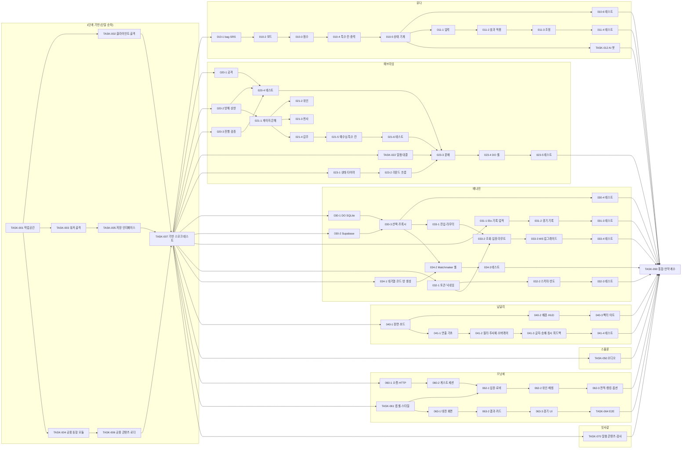

# 🧱 개발 태스크 전략 (Task Wall) — 영적 전쟁 테트리스

> *"So built we the wall; and all the wall was joined together unto the half thereof: for the people had a mind to work."* — Nehemiah 4:6 (KJV)
>
> **규격:** `statute-율법/04.development-repentance-회개/task-wall-성벽-template.md`
> **참조 예시:** `parable-비유/04.development-repentance-회개/task-wall-성벽-example.md`
> **근거 정경:** [`spec-tablet-명세서.md`](../01.requirement-hearing-들음/spec-tablet-명세서.md) (REQ 17 · FR 78 · NFR 8 · C 13) · [`rtm-covenant-언약추적.md`](../01.requirement-hearing-들음/rtm-covenant-언약추적.md) · [`architecture-temple-성전설계.md`](../02.architecture-foundation-기초/architecture-temple-성전설계.md) (ARCH-001~022, §5.4 파일 목록·줄 수 예산, §15 재각 R1) · [`api-gate-성문.md`](../02.architecture-foundation-기초/api-gate-성문.md) · [`data-ark-법궤.md`](../02.architecture-foundation-기초/data-ark-법궤.md) · [`screen-vision-화면설계.md`](../03.design-order-질서/screen-vision-화면설계.md) · [`design-vision-디자인명세.md`](../03.design-order-질서/design-vision-디자인명세.md)
> **동반 산출물:** [`devguide-commandment-개발계명.md`](./devguide-commandment-개발계명.md) — 코딩 규칙·예외 처리·**§7 지파 간 인터페이스 계약**·§8 Phase 4 결정 D4-01~18
> **실행 방식:** TIER-3 · ⚡ 자동 모드 · `ORCH-01_canaan-가나안분배.md` (부록 A 지파 배정표). 이 표가 태스크 상태·지역 배정·Doer/Witness·짝 검증 결과의 **유일한 원본**이다 (acts-행전 README SSOT).
> **경로 기준:** "생성 파일"은 모두 `fruit-열매/` 기준 상대 경로.

---

## 1. 구현 순서 전략 (느헤미야의 성벽 재건 순서 → 가나안 분배)

```
1단계: 기반 — 작업공간·설정·공용 동형 모듈·저장 인터페이스·구조 콘텐츠 (TASK-001~007, 단일 순차 — ORCH-01 2단계)
  ↓   (기초가 없으면 지파를 풀지 않는다 — ORCH4-002)
2단계: 핵심 — 엔진·봇·서버 판정·말씀 대결·결과·인증/검증·Matchmaker 대기열 (지파 병렬)
  ↓
3단계: 성문 — Worker HTTP·WS 진입, Matchmaker·GameRoom 셸, 메시지 분배 (api-gate 명세대로)
  ↓
4단계: 외벽 — 화면 9개·전투 클라이언트·렌더·연출·오디오·경기 UI
  ↓
5단계: 봉인 — 토큰 해시·스키마 검증·빈도 제한·CSP·비밀 경계 (각 TASK 안에서 함께 — 봉인은 나중이 아니다)
  ↓
6단계: 파수꾼 — 통합 빌드·E2E·언약 계수 (TASK-090, 여호수아)
```

| 단계 | 지역 (acts-행전) | 해당 TASK |
|:---|:---|:---|
| 1 기반 (데이터 모델·DB 스키마 포함) | 00.예루살렘 | TASK-001~007, TASK-030-1·030-2 (저장소 스키마), TASK-070 (콘텐츠 데이터) |
| 2 핵심 비즈니스 로직 | 01.유대 | TASK-010, TASK-012, TASK-020, TASK-021, TASK-022, TASK-023-1·023-2, TASK-030-3·030-4, TASK-031, TASK-032, TASK-034-1 |
| 3 API 엔드포인트 (성문) | 02.사마리아 | TASK-023-3·023-4·023-5, TASK-033, TASK-034-2·034-3 |
| 4~6 프론트엔드·보안·인프라 | 03.땅끝 | TASK-011, TASK-040, TASK-041, TASK-050, TASK-060~064, TASK-090 |

> **가나안 분배와 행전의 중첩 (acts-행전 README):** 지파 배정(부록 A)은 도메인 단위 병렬, 지역(위 표)은 한 지파 안의 순차 확장이다. 예: 베냐민은 00(스키마) → 01(저장소 선택·결과·인증·대기열) → 02(HTTP·Matchmaker 셸) 순서로 자기 영토를 쌓는다.

---

## 2. 태스크 분할표

> 열 설명: **연결 API/TBL/SCR** = api-gate API-ID / data-ark TBL-ID / screen-vision SCR-ID (해당 없으면 —). **예상 줄수**는 architecture §5.4 예산 기준(조정은 devguide D4-13). **Doer** = 구현 지파, **Witness** = 대조 검증자(레위 지파 — QA 서브에이전트). 상태 범례는 §4.
> 300줄 초과 예상 파일 **0개**, 500줄 초과 **0개** (최대 ~280: `engine/game.js`, `protocol/validate.ts`, `styles/screens.css`). JSON은 1항목 1줄(D-32).

### 2.1 기반 (모세 위임 기반 서브에이전트 — 단일 순차)

| TASK-ID | 성벽 구간 | 지역 | 설명 | 연결 REQ | 연결 API/TBL/SCR | 생성 파일 | 파일 책임 | 예상 줄수 | 선행 | 규모 | 상태 | Doer | Witness | 짝 검증 결과 |
|:---|:---|:---|:---|:---|:---|:---|:---|:---:|:---|:---:|:---:|:---:|:---:|:---:|
| TASK-001 | 작업공간·단일 명령 | 00.예루살렘 | 단일 package.json 루트(재각 R1), 동시 기동, 테스트 러너 설정, lockfile 잠금 | REQ-016, REQ-017, FR-073, NFR-007, C-004, C-005, C-012, C-013 | API-001~006(Vite 프록시 경유) / — / — | `package.json`<br>`package-lock.json`<br>`.gitignore`<br>`scripts/dev.mjs`<br>`vitest.config.js`<br>`playwright.config.js` | 의존성·스크립트 정의<br>하위 의존성 잠금(생성물)<br>비밀·산출물·backup git 제외<br>Vite + wrangler 동시 기동·동반 종료<br>단위 테스트 설정<br>E2E 설정(webServer) | ~35<br>생성물<br>~10<br>~95<br>~15<br>~30 | — | M | ✅ | 기반 | 레위 | ✅ 2026-10-20 (npm test 14/14, typecheck exit 0) |
| TASK-002 | 클라이언트 골격 | 00.예루살렘 | Vite 개발 서버·프록시·빌드 설정, 진입 문서(CSP) | REQ-016, FR-050, FR-073, FR-074, NFR-004, NFR-005, C-005 | API-001~006(프록시) / — / SCR-001~009(진입 문서) | `client/vite.config.js`<br>`client/index.html` | 개발 서버·프록시·빌드 설정<br>CSP·앱 루트 진입 문서 | ~35<br>~20 | TASK-001 | S | ✅ | 기반 | 레위 | ✅ 2026-10-20 (npm test 14/14, typecheck exit 0) |
| TASK-003 | 워커 골격 | 00.예루살렘 | wrangler 설정(DO 2종·SQLite 마이그레이션·Origin 목록), TS 설정, 비밀 예시, Env·RPC 타입, 런타임 타입 생성 | REQ-016, FR-072, FR-073, NFR-004, C-004, C-008 | API-005, API-006 / TBL-007(DO SQLite 클래스) / — | `worker/wrangler.toml`<br>`worker/tsconfig.json`<br>`worker/.dev.vars.example`<br>`worker/src/env.ts`<br>`worker/worker-configuration.d.ts` | DO 바인딩·마이그레이션·로컬 dev 설정<br>TypeScript 검사 설정<br>Supabase 키 자리(빈 값) 예시<br>Env·RoomInit·RPC 계약 타입<br>런타임 타입(wrangler types 생성물) | ~35<br>~25<br>~5<br>~65<br>생성물 | TASK-001 | M | ✅ | 기반 | 레위 | ✅ 2026-10-20 (npm test 14/14, typecheck exit 0) |
| TASK-004 | 공용 동형 모듈 | 00.예루살렘 | 클라이언트·서버가 함께 import 하는 상수·PRNG·블록 모양·보드 인코딩·위험선 (D4-02) | REQ-001, FR-001, FR-002, FR-005, FR-006, FR-008, FR-055, NFR-003, C-006, C-009 | API-005~006, API-101~154, API-201~262, API-290 / CODE-001~015 / — | `client/js/net/protocol.js`<br>`client/js/engine/rng.js`<br>`client/js/engine/pieces.js`<br>`client/js/engine/encode.js`<br>`client/js/engine/danger.js` | 메시지·코드·필드 한계·빈도·에러 상수<br>시드 PRNG(mulberry32)·결정적 도우미<br>테트로미노 7종 SRS 모양<br>200자 보드 문자열 ↔ 격자<br>위험선·쌓인 높이 판정 | ~220<br>~60<br>~85<br>~55<br>~35 | TASK-001 | M | ✅ | 기반 | 레위 | ✅ 2026-10-20 (npm test 14/14, typecheck exit 0) |
| TASK-005 | 저장 인터페이스 | 00.예루살렘 | 두 저장소 어댑터가 구현할 `Store` 인터페이스와 저장 도메인 타입 | REQ-014, REQ-015, REQ-016, FR-067, FR-068, FR-069, FR-070, FR-071, FR-072 | API-001~004, API-262 / TBL-001~006 / — | `worker/src/store/store.ts` | Store 인터페이스·도메인 타입·StoreError | ~185 | TASK-003 | S | ✅ | 기반 | 레위 | ✅ 2026-10-20 (npm test 14/14, typecheck exit 0) |
| TASK-006 | 공용 콘텐츠·로더 (L) | 00.예루살렘 | 구조 콘텐츠 7종 + 말씀 콘텐츠 씨앗 2종 + 서버·클라이언트 색인 (§2.2 분할) | REQ-003, REQ-007~009, FR-013~017, FR-024, FR-026~031, FR-033~038, FR-065, FR-074, C-003, C-010 | — / TBL-101~109 / SCR-003 | (§2.2 TASK-006-1·2) | (§2.2) | (§2.2) | TASK-004 | L | ✅ | 기반 | 레위 | ✅ 2026-10-20 (npm test 14/14, typecheck exit 0) |
| TASK-007 | 기반 스모크 테스트 | 00.예루살렘 | 공용 상수 ↔ 콘텐츠 ID 일치, 동형 모듈 단위 검사 | REQ-017, FR-075 | — / TBL-101~108 / — | `tests/unit/foundation/protocol-content.test.js`<br>`tests/unit/foundation/isomorphic.test.js` | 프로토콜·콘텐츠 ID 체계 일치 검사<br>rng·pieces·encode·danger 검사 | ~75<br>~85 | TASK-006 | S | ✅ | 기반 | 레위 | ✅ 2026-10-20 (npm test 14/14, typecheck exit 0) |

### 2.2 지파 태스크

> 규모 L 태스크는 아래 각 표에서 서브 태스크로 나눈다 (P4-005). 부모 행의 "생성 파일"은 서브 태스크 합집합이다.

#### 유다 지파 — 게임플레이 (엔진·전투 클라이언트·AI 봇)

| TASK-ID | 성벽 구간 | 지역 | 설명 | 연결 REQ | 연결 API/TBL/SCR | 생성 파일 | 파일 책임 | 예상 줄수 | 선행 | 규모 | 상태 | Doer | Witness | 짝 검증 결과 |
|:---|:---|:---|:---|:---|:---|:---|:---|:---:|:---|:---:|:---:|:---:|:---:|:---:|
| TASK-010 | 테트리스 엔진 (L) | 01.유대 | 동형 순수 엔진 — 7-bag·SRS·보드·점수 판정·특수 칸·중력·상태 기계 (TASK-010-1~6) | REQ-001, REQ-012, FR-001~004, FR-010, FR-011, FR-015, FR-036, FR-044~047, FR-075 | API-203, API-204, API-252 / TBL-108 / SCR-005 | 아래 서브 태스크 | 아래 | 아래 | TASK-007 | L | ✅ | 유다 | 레위 ✅ | ✅ 2026-10-20 레위 감사 통과(모세 전달) · 통합 npm test 47 files/511 tests · typecheck 0 · build ✓ |
| TASK-010-1 | 7-bag·SRS | 01.유대 | 시드 7-bag, SRS 회전·벽차기 | FR-001, FR-002, FR-005 | API-252 / — / — | `client/js/engine/bag.js`<br>`client/js/engine/srs.js` | 시드 7-bag 생성<br>SRS 벽차기 표·회전 시도 | ~50<br>~120 | TASK-007 | M | ✅ | 유다 | 레위 ✅ | ✅ 2026-10-20 레위 감사 통과(모세 전달) · 통합 npm test 47 files/511 tests · typecheck 0 · build ✓ |
| TASK-010-2 | 보드 | 01.유대 | 격자·충돌·줄 삭제·쓰레기/납/구멍·블록 제거·3×3 폭파 조작 | FR-003, FR-004, FR-014, FR-017, FR-025, FR-029, FR-035, FR-045 | API-254, API-255 / — / — | `client/js/engine/board.js` | 격자 조작 순수 함수 | ~220 | TASK-010-1 | S | ✅ | 유다 | 레위 ✅ | ✅ 2026-10-20 레위 감사 통과(모세 전달) · 통합 npm test 47 files/511 tests · typecheck 0 · build ✓ |
| TASK-010-3 | 점수 판정 | 01.유대 | 콤보·B2B·T-Spin 판정·점수 | FR-004 | API-204 / — / — | `client/js/engine/scoring.js` | 줄 삭제 판정·점수 | ~150 | TASK-010-2 | S | ✅ | 유다 | 레위 ✅ | ✅ 2026-10-20 레위 감사 통과(모세 전달) · 통합 npm test 47 files/511 tests · typecheck 0 · build ✓ |
| TASK-010-4 | 특수 칸·중력 | 01.유대 | C-SPECIAL 굴림(devguide §7.3), 속도 곡선 | FR-010, FR-036, FR-044~047 | API-204, API-252 / TBL-108 / — | `client/js/engine/specials.js`<br>`client/js/engine/gravity.js` | 특수·갑주 칸 굴림<br>경기 시간 → 중력 | ~120<br>~50 | TASK-010-3 | S | ✅ | 유다 | 레위 ✅ | ✅ 2026-10-20 레위 감사 통과(모세 전달) · 통합 npm test 47 files/511 tests · typecheck 0 · build ✓ |
| TASK-010-5 | 상태 기계 | 01.유대 | 낙하 블록 수명주기(출현·이동·회전·드롭·홀드·고스트·고정 지연·Top-out), 미리보기 개수(기본 3·솔로몬 5·가브리엘 7) | FR-003, FR-011, FR-015, FR-035 | API-203, API-207 / TBL-108 / — | `client/js/engine/game.js` | 엔진 상태 기계 (DOM·네트워크 무의존) | ~280 | TASK-010-4 | S | ✅ | 유다 | 레위 ✅ | ✅ 2026-10-20 레위 감사 통과(모세 전달) · 통합 npm test 47 files/511 tests · typecheck 0 · build ✓ |
| TASK-010-6 | 엔진 단위 테스트 | 01.유대 | 회전 벽차기·줄 삭제·7-bag 분포·점수·특수 칸 수열·중력·상태 기계 | FR-075, REQ-017 | — / — / — | `tests/unit/engine/bag-srs.test.js`<br>`tests/unit/engine/board.test.js`<br>`tests/unit/engine/scoring.test.js`<br>`tests/unit/engine/specials-gravity.test.js`<br>`tests/unit/engine/game.test.js` | 대상 파일당 1개 검사 | ~150<br>~150<br>~150<br>~150<br>~200 | TASK-010-5 | M | ✅ | 유다 | 레위 ✅ | ✅ 2026-10-20 레위 감사 통과(모세 전달) · 통합 npm test 47 files/511 tests · typecheck 0 · build ✓ |
| TASK-011 | 전투 클라이언트 (L) | 03.땅끝 | 입력·효과 적용·영 효과 클라이언트 상태·전투 조정 (TASK-011-1~4) | REQ-001, REQ-007~010, FR-006, FR-007, FR-011, FR-014~017, FR-025, FR-027~030, FR-035, FR-037, FR-039, FR-040, FR-045, FR-046, FR-055, FR-061, NFR-002 | API-203~207, API-252~256, API-261 / — / SCR-005 | 아래 서브 태스크 | 아래 | 아래 | TASK-010-5 | L | ✅ | 유다 | 레위 ✅ | ✅ 2026-10-20 레위 감사 통과(모세 전달) · 통합 npm test 47 files/511 tests · typecheck 0 · build ✓ |
| TASK-011-1 | 입력 | 03.땅끝 | 키보드(design-vision §4.3)·터치 제스처·진동(§4.4) | FR-011, FR-064(7~9 키 → ui) | API-205, API-206 / TBL-108 / SCR-005 | `client/js/battle/input-keyboard.js`<br>`client/js/battle/input-touch.js` | 키 → 동작 변환(DAS/ARR)<br>스와이프·탭 → 동작, 진동 | ~120<br>~140 | TASK-010-5 | S | ✅ | 유다 | 레위 ✅ | ✅ 2026-10-20 레위 감사 통과(모세 전달) · 통합 npm test 47 files/511 tests · typecheck 0 · build ✓ |
| TASK-011-2 | 효과 적용 | 03.땅끝 | 서버 `attack`·`effect`를 내 엔진 보드에 적용, 영 효과(반전·가짜/틀린 고스트·미리보기 숨김·바람·중력)의 클라이언트 상태·만료 | FR-014~017, FR-025, FR-027~030, FR-035, FR-037, FR-039, FR-045, FR-046 | API-254, API-255, API-256 / TBL-103 / SCR-005 | `client/js/battle/effect-applier.js`<br>`client/js/battle/interference-client.js` | action.type별 보드 조작<br>영 효과 상태·만료 | ~220<br>~200 | TASK-011-1 | S | ✅ | 유다 | 레위 ✅ | ✅ 2026-10-20 레위 감사 통과(모세 전달) · 통합 npm test 47 files/511 tests · typecheck 0 · build ✓ |
| TASK-011-3 | 전투 조정 | 03.땅끝 | 엔진 ↔ RoomConnection ↔ BattleScene·emitFx ↔ BattleUiPort 조정, 12Hz state, clear·topout 송신, 말씀 대결 정지·재개, 히트스톱 | FR-006, FR-007, FR-040, FR-055, FR-061, NFR-002 | API-202~207, API-252, API-253, API-257, API-259, API-261 / — / SCR-005 | `client/js/battle/battle-controller.js` | 전투 조정만 (DOM 템플릿·Pixi 그리기 없음) | ~250 | TASK-011-2 | S | ✅ | 유다 | 레위 ✅ | ✅ 2026-10-20 레위 감사 통과(모세 전달) · 통합 npm test 47 files/511 tests · typecheck 0 · build ✓ |
| TASK-011-4 | 전투 클라이언트 테스트 | 03.땅끝 | 효과 적용·영 효과 만료 순수 로직 검사 | FR-075, REQ-017 | — / — / — | `tests/unit/battle/effect-applier.test.js`<br>`tests/unit/battle/interference-client.test.js` | 대상 파일당 1개 검사 | ~150<br>~150 | TASK-011-3 | S | ✅ | 유다 | 레위 ✅ | ✅ 2026-10-20 레위 감사 통과(모세 전달) · 통합 npm test 47 files/511 tests · typecheck 0 · build ✓ |
| TASK-012 | AI 봇 | 01.유대 | 서버 내 봇 보드 진행(엔진 재사용 — D-11), 착지 평가, 퀴즈 응답 (devguide §7.4) | REQ-005, FR-021, FR-022 | API-203, API-204, API-207, API-253 / TBL-108 / SCR-005 | `worker/src/room/bot/bot-planner.ts`<br>`worker/src/room/bot/bot-player.ts`<br>`worker/src/room/bot/bot-quiz.ts`<br>`tests/unit/bot/bot-planner.test.ts`<br>`tests/unit/bot/bot-quiz.test.ts` | 착지 후보 평가<br>봇 보드 진행·입력 속도<br>난이도별 정답률·응답 시간<br>착지 평가 검사<br>퀴즈 응답 분포 검사 | ~220<br>~250<br>~60<br>~120<br>~60 | TASK-010-5 | M | ✅ | 유다 | 레위 ✅ | ✅ 2026-10-20 레위 감사 통과(모세 전달) · 통합 npm test 47 files/511 tests · typecheck 0 · build ✓ |

#### 에브라임 지파 — 서버 판정·GameRoom

| TASK-ID | 성벽 구간 | 지역 | 설명 | 연결 REQ | 연결 API/TBL/SCR | 생성 파일 | 파일 책임 | 예상 줄수 | 선행 | 규모 | 상태 | Doer | Witness | 짝 검증 결과 |
|:---|:---|:---|:---|:---|:---|:---|:---|:---:|:---|:---:|:---:|:---:|:---:|:---:|
| TASK-020 | 공격·방해·진행 판정 (L) | 01.유대 | 공격력·영 결정·상쇄, 방해 상한, 진행 검증 (TASK-020-1~4) | REQ-007, FR-024, FR-026~032, FR-045, FR-075 | API-204, API-207, API-254, API-255, API-290 / TBL-103, TBL-108 / — | 아래 서브 태스크 | 아래 | 아래 | TASK-007 | L | ✅ | 에브라임 | 레위 ✅ | ✅ 2026-10-20 레위 감사 통과(모세 전달) · 통합 npm test 47 files/511 tests · typecheck 0 · build ✓ |
| TASK-020-1 | 공격력·악한 영 결정 | 01.유대 | 줄 수·T-Spin·콤보·B2B·여리고 공격력, 등급표·보스, 구멍 열 (data-ark §8.8.1·§8.8.2) | FR-024, FR-026, FR-030, FR-045 | API-204, API-254 / TBL-103, TBL-108 / — | `worker/src/attack.ts` | 공격 계산 순수 함수 | ~200 | TASK-007 | S | ✅ | 에브라임 | 레위 ✅ | ✅ 2026-10-20 레위 감사 통과(모세 전달) · 통합 npm test 47 files/511 tests · typecheck 0 · build ✓ |
| TASK-020-2 | 방해 상한 | 01.유대 | 영 효과 적용·6초·동시 2개·비중첩·1.5초 재적용 금지·봉인 예외·종료 통지 | FR-027~031 | API-254, API-255(spiritEnd) / TBL-103, TBL-108 / — | `worker/src/room/interference.ts` | 받는 쪽 활성 효과 장부·상한 판정 | ~220 | TASK-007 | S | ✅ | 에브라임 | 레위 ✅ | ✅ 2026-10-20 레위 감사 통과(모세 전달) · 통합 npm test 47 files/511 tests · typecheck 0 · build ✓ |
| TASK-020-3 | 진행 검증 | 01.유대 | seq·pieceCount·칸 보존·속도·콤보·B2B 일관성 (R-02~R-07), garbageIn 단조 | FR-032 | API-203, API-204, API-207, API-290 / — / — | `worker/src/room/progress-guard.ts` | 불가능한 진행 거부 | ~200 | TASK-007 | S | ✅ | 에브라임 | 레위 ✅ | ✅ 2026-10-20 레위 감사 통과(모세 전달) · 통합 npm test 47 files/511 tests · typecheck 0 · build ✓ |
| TASK-020-4 | 판정 테스트 | 01.유대 | 줄 수·콤보·B2B·T-Spin별 공격력과 소환 표, 13종 도달 가능성, 상한, 진행 거부 | FR-075, REQ-017 | — / — / — | `tests/unit/room/attack.test.ts`<br>`tests/unit/room/interference.test.ts`<br>`tests/unit/room/progress-guard.test.ts` | 대상 파일당 1개 검사 | ~200<br>~180<br>~180 | TASK-020-1, TASK-020-2, TASK-020-3 | S | ✅ | 에브라임 | 레위 ✅ | ✅ 2026-10-20 레위 감사 통과(모세 전달) · 통합 npm test 47 files/511 tests · typecheck 0 · build ✓ |
| TASK-021 | 게이지·스킬·천사·갑주·예수님·특수 칸 (L) | 01.유대 | 서버 권한 자원 판정 (TASK-021-1~6) | REQ-003, REQ-008~010, REQ-012, FR-014~017, FR-028, FR-033~039, FR-044~047, FR-062, C-002 | API-204~206, API-252, API-255, API-256 / TBL-101, TBL-102, TBL-104~106, TBL-108 / — | 아래 서브 태스크 | 아래 | 아래 | TASK-020-2 | L | ✅ | 에브라임 | 레위 ✅ | ✅ 2026-10-20 레위 감사 통과(모세 전달) · 통합 npm test 47 files/511 tests · typecheck 0 · build ✓ |
| TASK-021-1 | 믿음 게이지·은혜 | 01.유대 | 충전·차감·쿨다운 장부, 은혜 보정(쓰레기 −1·충전 ×1.15) | FR-033, FR-034, FR-062 | API-252(grace), API-256 / TBL-003, TBL-108 / — | `worker/src/room/faith.ts`<br>`worker/src/room/grace.ts` | 게이지·쿨다운<br>은혜 보정 | ~150<br>~60 | TASK-020-2 | S | ✅ | 에브라임 | 레위 ✅ | ✅ 2026-10-20 레위 감사 통과(모세 전달) · 통합 npm test 47 files/511 tests · typecheck 0 · build ✓ |
| TASK-021-2 | 위인 스킬 | 01.유대 | 다윗·솔로몬·베드로·바울 발동 검증·효과 지시 | FR-014~017, FR-034 | API-205, API-255 / TBL-101 / — | `worker/src/room/hero-skills.ts` | 위인 스킬 4종 | ~150 | TASK-021-1 | S | ✅ | 에브라임 | 레위 ✅ | ✅ 2026-10-20 레위 감사 통과(모세 전달) · 통합 npm test 47 files/511 tests · typecheck 0 · build ✓ |
| TASK-021-3 | 천사 | 01.유대 | 천사 5종·봉인 검사·연습 모드 거부 | FR-028, FR-035 | API-205, API-255 / TBL-102 / — | `worker/src/room/angels.ts` | 천사 소환 판정 | ~150 | TASK-021-1 | S | ✅ | 에브라임 | 레위 ✅ | ✅ 2026-10-20 레위 감사 통과(모세 전달) · 통합 npm test 47 files/511 tests · typecheck 0 · build ✓ |
| TASK-021-4 | 전신갑주 | 01.유대 | 획득·보유(종류별 1)·사용 6종·장전 방어(방패·검·흉배·범주 무효) | FR-036, FR-037, FR-038 | API-204, API-206, API-255, API-256 / TBL-104, TBL-105 / — | `worker/src/room/armor.ts` | 갑주 판정 | ~200 | TASK-021-1 | S | ✅ | 에브라임 | 레위 ✅ | ✅ 2026-10-20 레위 감사 통과(모세 전달) · 통합 npm test 47 files/511 tests · typecheck 0 · build ✓ |
| TASK-021-5 | 예수님·특수 칸 검증 | 01.유대 | 게이지 100 + 위험선 → 경기당 1회(C-002), C-SPECIAL 서버 검증(R-09)·여리고·만나·말씀 트리거 | FR-039, FR-044~047, C-002 | API-204, API-255 / TBL-106, TBL-108 / — | `worker/src/room/jesus-event.ts`<br>`worker/src/room/specials.ts` | 예수님 이벤트 조건·1회<br>특수 칸 검증·효과 | ~90<br>~180 | TASK-021-4 | S | ✅ | 에브라임 | 레위 ✅ | ✅ 2026-10-20 레위 감사 통과(모세 전달) · 통합 npm test 47 files/511 tests · typecheck 0 · build ✓ |
| TASK-021-6 | 자원 판정 테스트 | 01.유대 | 게이지 부족·쿨다운·봉인 거부, 갑주 6종, 예수님 1회, 특수 칸 위조 거부 | FR-075, REQ-017 | — / — / — | `tests/unit/room/faith-grace.test.ts`<br>`tests/unit/room/hero-skills.test.ts`<br>`tests/unit/room/angels.test.ts`<br>`tests/unit/room/armor.test.ts`<br>`tests/unit/room/jesus-specials.test.ts` | 대상 파일당 1개 검사 | ~150<br>~120<br>~120<br>~180<br>~180 | TASK-021-5 | M | ✅ | 에브라임 | 레위 ✅ | ✅ 2026-10-20 레위 감사 통과(모세 전달) · 통합 npm test 47 files/511 tests · typecheck 0 · build ✓ |
| TASK-022 | 말씀 대결 | 01.유대 | 트리거(말씀 칸·90초)·동시 정지·출제·도착순 판정·3초 잠금·보상·니어미스, 대표 구절 | REQ-011, FR-022, FR-040~043, FR-063 | API-208, API-257~259, API-262(verseRef) / TBL-106, TBL-107, TBL-108 / SCR-005, SCR-006 | `worker/src/room/quiz-duel.ts`<br>`worker/src/room/representative-verse.ts`<br>`tests/unit/room/quiz-duel.test.ts` | 말씀 대결 진행·판정<br>경기 대표 구절 선정<br>도착순·잠금·니어미스 검사 | ~250<br>~60<br>~180 | TASK-007 | M | ✅ | 에브라임 | 레위 ✅ | ✅ 2026-10-20 레위 감사 통과(모세 전달) · 통합 npm test 47 files/511 tests · typecheck 0 · build ✓ |
| TASK-023 | GameRoom (L) | 01.유대 · 02.사마리아 | 방 상태·타이머·라운드 흐름·메시지 분배·DO 셸 (TASK-023-1~5) | REQ-001, REQ-006, FR-005~010, FR-023, FR-047, FR-062, FR-064, FR-067, NFR-002, NFR-003 | API-006, API-201~262, API-290 / TBL-002~004 / SCR-005 | 아래 서브 태스크 | 아래 | 아래 | TASK-007 | L | ✅ | 에브라임 | 레위 ✅ | ✅ 2026-10-20 레위 감사 통과(모세 전달) · 통합 npm test 47 files/511 tests · typecheck 0 · build ✓ |
| TASK-023-1 | 방 상태·타이머 | 01.유대 | 방·플레이어 상태 타입과 초기화, 방 타이머 스케줄러(alarm 기반) | FR-005, FR-009 | API-252 / — / — | `worker/src/room/room-state.ts`<br>`worker/src/room/timers.ts` | 상태 타입·초기화<br>타이머 예약·실행 | ~150<br>~100 | TASK-007 | S | ✅ | 에브라임 | 레위 ✅ | ✅ 2026-10-20 레위 감사 통과(모세 전달) · 통합 npm test 47 files/511 tests · typecheck 0 · build ✓ |
| TASK-023-2 | 라운드 흐름 | 01.유대 | ready → start(같은 시드·단계·은혜·경과) → roundEnd → matchEnd, 이탈 처리, 연습 종료, 진행 누적 | FR-005, FR-007, FR-009, FR-010, FR-023, FR-047, FR-062, FR-067 | API-202, API-207, API-210, API-252, API-261, API-262 / TBL-002, TBL-003 / — | `worker/src/room/round-flow.ts` | 라운드·경기 수명주기 | ~250 | TASK-023-1 | S | ✅ | 에브라임 | 레위 ✅ | ✅ 2026-10-20 레위 감사 통과(모세 전달) · 통합 npm test 47 files/511 tests · typecheck 0 · build ✓ |
| TASK-023-3 | 메시지 분배 | 02.사마리아 | 검증된 메시지 → 서비스 분배, clear 처리 순서 ①~⑧(API-204), opponentState 화이트리스트 중계(R-14), 리액션 중계, 봇 구동 | FR-006, FR-008, FR-064, NFR-002, NFR-003 | API-201~210, API-253, API-260 / — / — | `worker/src/room/message-router.ts` | 수신 메시지 → 서비스 분배 | ~220 | TASK-023-2, TASK-020-4, TASK-021-6, TASK-022 | S | ✅ | 에브라임 | 레위 ✅ | ✅ 2026-10-20 레위 감사 통과(모세 전달) · 통합 npm test 47 files/511 tests · typecheck 0 · build ✓ |
| TASK-023-4 | GameRoom DO 셸 | 02.사마리아 | Hibernation 핸들러·init RPC·명단 검증(R-13)·alarm·방 종료 통지 | FR-008, FR-009, NFR-003 | API-006, API-201, API-251 / TBL-001 / — | `worker/src/game-room.ts` | DO 셸 (판정 계산 없음) | ~200 | TASK-023-3 | S | ✅ | 에브라임 | 레위 ✅ | ✅ 2026-10-20 레위 감사 통과(모세 전달) · 통합 npm test 47 files/511 tests · typecheck 0 · build ✓ |
| TASK-023-5 | GameRoom 테스트 | 02.사마리아 | 3판 2선승·이탈·동시 topout·연습 종료, 분배·중계 화이트리스트 | FR-075, REQ-017 | — / — / — | `tests/unit/room/round-flow.test.ts`<br>`tests/unit/room/message-router.test.ts` | 대상 파일당 1개 검사 | ~200<br>~200 | TASK-023-4 | S | ✅ | 에브라임 | 레위 ✅ | ✅ 2026-10-20 레위 감사 통과(모세 전달) · 통합 npm test 47 files/511 tests · typecheck 0 · build ✓ |

#### 베냐민 지파 — Worker 성문·Matchmaker·저장소·결과

| TASK-ID | 성벽 구간 | 지역 | 설명 | 연결 REQ | 연결 API/TBL/SCR | 생성 파일 | 파일 책임 | 예상 줄수 | 선행 | 규모 | 상태 | Doer | Witness | 짝 검증 결과 |
|:---|:---|:---|:---|:---|:---|:---|:---|:---:|:---|:---:|:---:|:---:|:---:|:---:|
| TASK-030 | 저장소 어댑터 (L) | 00.예루살렘 · 01.유대 | DO SQLite·Supabase 구현, 자동 선택, RPC 프록시 (TASK-030-1~4) | REQ-014, REQ-015, REQ-016, FR-012, FR-067~072, NFR-004, NFR-008, C-004 | API-001~004, API-262 / TBL-001~007 / — | 아래 서브 태스크 | 아래 | 아래 | TASK-007 | L | ✅ | 베냐민 | 레위 ✅ | ✅ 2026-10-20 레위 감사 통과(모세 전달) · 통합 npm test 47 files/511 tests · typecheck 0 · build ✓ |
| TASK-030-1 | DO SQLite | 00.예루살렘 | 버전 1 DDL(data-ark §7.1)·스키마 버전 적용, Store 구현(transactionSync 1트랜잭션) | FR-067~072 | — / TBL-001~007 / — | `worker/src/store/do-sqlite-schema.ts`<br>`worker/src/store/do-sqlite-store.ts` | DDL·스키마 버전<br>DO SQLite Store 구현 | ~120<br>~260 | TASK-007 | S | ✅ | 베냐민 | 레위 ✅ | ✅ 2026-10-20 레위 감사 통과(모세 전달) · 통합 npm test 47 files/511 tests · typecheck 0 · build ✓ |
| TASK-030-2 | Supabase | 00.예루살렘 | Postgres 스키마·record_match 함수·RLS, supabase-js 구현(동적 import) | FR-072, NFR-004 | — / TBL-001~004, TBL-006 / — | `supabase/migrations/0001_init.sql`<br>`worker/src/store/supabase-store.ts` | Postgres 스키마·함수·RLS<br>Supabase Store 구현 | ~180<br>~220 | TASK-007 | S | ✅ | 베냐민 | 레위 ✅ | ✅ 2026-10-20 레위 감사 통과(모세 전달) · 통합 npm test 47 files/511 tests · typecheck 0 · build ✓ |
| TASK-030-3 | 자동 선택·RPC 프록시 | 01.유대 | 두 환경변수 모두 있을 때만 Supabase, 아니면 Matchmaker RPC 프록시 | FR-072, C-004 | — / TBL-001~006 / — | `worker/src/store/select-store.ts`<br>`worker/src/store/do-store-client.ts` | 모드 자동 선택<br>Matchmaker RPC 프록시 | ~40<br>~80 | TASK-030-1, TASK-030-2 | S | ✅ | 베냐민 | 레위 ✅ | ✅ 2026-10-20 레위 감사 통과(모세 전달) · 통합 npm test 47 files/511 tests · typecheck 0 · build ✓ |
| TASK-030-4 | 저장소 테스트 | 01.유대 | DoSqliteStore 계약(닉네임 충돌·멱등 기록·정렬·순위) — Node 내장 `node:sqlite`로 `ctx.storage.sql` 대역, 선택 규칙 | FR-072, FR-075, REQ-017 | — / — / — | `tests/unit/store/do-sqlite-store.test.ts`<br>`tests/unit/store/select-store.test.ts` | 대상 파일당 1개 검사 | ~220<br>~60 | TASK-030-3 | S | ✅ | 베냐민 | 레위 ✅ | ✅ 2026-10-20 레위 감사 통과(모세 전달) · 통합 npm test 47 files/511 tests · typecheck 0 · build ✓ |
| TASK-031 | 결과·레이팅 (L) | 01.유대 | Elo·개인 기록·성장·업적·경기 기록 오케스트레이션 (TASK-031-1~3) | REQ-013~015, FR-009, FR-065~068, FR-070 | API-262 / TBL-001~004, TBL-109 / SCR-006 | 아래 서브 태스크 | 아래 | 아래 | TASK-007 | L | ✅ | 베냐민 | 레위 ✅ | ✅ 2026-10-20 레위 감사 통과(모세 전달) · 통합 npm test 47 files/511 tests · typecheck 0 · build ✓ |
| TASK-031-1 | Elo·기록·업적 | 01.유대 | Elo(K 32·척도 400·하한 0), 개인 기록·성장, 골리앗 사냥꾼 판정 | FR-065, FR-066, FR-070 | API-262 / TBL-001, TBL-003, TBL-004, TBL-109 / — | `worker/src/elo.ts`<br>`worker/src/results/personal-record.ts`<br>`worker/src/results/achievements.ts` | Elo 계산<br>개인 기록·성장 수치<br>업적 판정 | ~40<br>~100<br>~60 | TASK-007 | M | ✅ | 베냐민 | 레위 ✅ | ✅ 2026-10-20 레위 감사 통과(모세 전달) · 통합 npm test 47 files/511 tests · typecheck 0 · build ✓ |
| TASK-031-2 | 경기 기록 | 01.유대 | recordMatchOutcome·recordPracticeOutcome (devguide §7.5), RATING_CHANGED 재시도 3회, 저장 실패 시 saved:false | FR-009, FR-067, FR-068, FR-070 | API-262 / TBL-001~004 / — | `worker/src/results/record-match.ts` | 결과 기록 오케스트레이션 | ~200 | TASK-031-1 | S | ✅ | 베냐민 | 레위 ✅ | ✅ 2026-10-20 레위 감사 통과(모세 전달) · 통합 npm test 47 files/511 tests · typecheck 0 · build ✓ |
| TASK-031-3 | 결과 테스트 | 01.유대 | Elo 대칭·반올림·봇 경기 null, 성장 수치, 업적 1회 | FR-075, REQ-017 | — / — / — | `tests/unit/results/elo-achievements.test.ts`<br>`tests/unit/results/personal-record.test.ts` | 대상 파일당 1개 검사 | ~120<br>~80 | TASK-031-2 | S | ✅ | 베냐민 | 레위 ✅ | ✅ 2026-10-20 레위 감사 통과(모세 전달) · 통합 npm test 47 files/511 tests · typecheck 0 · build ✓ |
| TASK-032 | 인증·메시지 검증 (L) | 01.유대 | 게스트 토큰·닉네임 규칙, 수신 메시지 스키마 검증, 빈도 제한 (TASK-032-1~3) | REQ-002, FR-012, FR-032, NFR-003, NFR-008, C-009 | API-001, API-101~103, API-201~210, API-290 / TBL-001 / — | 아래 서브 태스크 | 아래 | 아래 | TASK-007 | L | ✅ | 베냐민 | 레위 ✅ | ✅ 2026-10-20 레위 감사 통과(모세 전달) · 통합 npm test 47 files/511 tests · typecheck 0 · build ✓ |
| TASK-032-1 | 토큰·닉네임 | 01.유대 | 256비트 토큰 발급·SHA-256·resolveGuest, NFC·trim·규칙·소문자 키 | FR-012, NFR-003, NFR-008 | API-001, API-002, API-101, API-201 / TBL-001 / — | `worker/src/auth/token.ts`<br>`worker/src/auth/nickname.ts` | 토큰 발급·해시·검증<br>닉네임 정규화·검사 | ~70<br>~60 | TASK-007 | S | ✅ | 베냐민 | 레위 ✅ | ✅ 2026-10-20 레위 감사 통과(모세 전달) · 통합 npm test 47 files/511 tests · typecheck 0 · build ✓ |
| TASK-032-2 | 스키마 검증·빈도 제한 | 01.유대 | parseClientFrame(api-gate §2.6 표, R-08)·종류별 토큰 버킷·위반 누적 4008 | FR-032, NFR-003, C-009 | API-101~103, API-201~210, API-290 / — / — | `worker/src/protocol/validate.ts`<br>`worker/src/protocol/rate-limit.ts` | 수신 메시지 스키마 검증<br>종류별 토큰 버킷 | ~280<br>~80 | TASK-032-1 | S | ✅ | 베냐민 | 레위 ✅ | ✅ 2026-10-20 레위 감사 통과(모세 전달) · 통합 npm test 47 files/511 tests · typecheck 0 · build ✓ |
| TASK-032-3 | 봉인 테스트 | 01.유대 | 잘못된 메시지·토큰 거부, 닉네임 규칙, 빈도 초과 (NFR-003 측정) | NFR-003, FR-075, REQ-017 | — / — / — | `tests/unit/protocol/token-nickname.test.ts`<br>`tests/unit/protocol/validate.test.ts`<br>`tests/unit/protocol/rate-limit.test.ts` | 대상 파일당 1개 검사 | ~100<br>~250<br>~80 | TASK-032-2 | S | ✅ | 베냐민 | 레위 ✅ | ✅ 2026-10-20 레위 감사 통과(모세 전달) · 통합 npm test 47 files/511 tests · typecheck 0 · build ✓ |
| TASK-033 | HTTP 성문 (L) | 02.사마리아 | Worker 진입·라우팅·공통 응답·API-001~004·WS 업그레이드 전달 (TASK-033-1~4) | REQ-002, REQ-014, REQ-015, FR-008, FR-012, FR-069, FR-071, NFR-003, C-006 | API-001~006 / TBL-001, TBL-002, TBL-006 / SCR-001, SCR-007, SCR-008 | 아래 서브 태스크 | 아래 | 아래 | TASK-030-3, TASK-032-1 | L | ✅ | 베냐민 | 레위 ✅ | ✅ 2026-10-20 레위 감사 통과(모세 전달) · 통합 npm test 47 files/511 tests · typecheck 0 · build ✓ |
| TASK-033-1 | 진입·라우터·응답 | 02.사마리아 | `fetch` 진입(앱 export §3.5)·DO 클래스 re-export·전역 try-catch, 메서드·경로 매칭, 공통 응답·에러 직렬화·보안 헤더 | NFR-003, FR-073 | API-001~006 / — / — | `worker/src/index.ts`<br>`worker/src/http/router.ts`<br>`worker/src/http/respond.ts` | 진입·위임<br>경로 매칭<br>응답 형식 | ~80<br>~60<br>~60 | TASK-030-3 | M | ✅ | 베냐민 | 레위 ✅ | ✅ 2026-10-20 레위 감사 통과(모세 전달) · 통합 npm test 47 files/511 tests · typecheck 0 · build ✓ |
| TASK-033-2 | 조회·입장 라우트 | 02.사마리아 | API-001 입장·API-002 복원·API-003 전적(페이징)·API-004 랭킹(내 순위), 빈도 제한 | FR-012, FR-069, FR-071, NFR-003 | API-001~004 / TBL-001, TBL-002, TBL-006 / SCR-001, SCR-007, SCR-008 | `worker/src/http/guest-routes.ts`<br>`worker/src/http/records-routes.ts`<br>`worker/src/http/ranking-routes.ts` | API-001·002<br>API-003<br>API-004 | ~120<br>~90<br>~70 | TASK-033-1, TASK-032-1 | M | ✅ | 베냐민 | 레위 ✅ | ✅ 2026-10-20 레위 감사 통과(모세 전달) · 통합 npm test 47 files/511 tests · typecheck 0 · build ✓ |
| TASK-033-3 | WS 업그레이드 | 02.사마리아 | Upgrade·Origin(ALLOWED_ORIGINS)·roomId 형식 검사 후 Matchmaker('global')·GameRoom(idFromName) 전달 | FR-008, C-006 | API-005, API-006 / — / — | `worker/src/http/ws-routes.ts` | 업그레이드 전달 | ~80 | TASK-033-2 | S | ✅ | 베냐민 | 레위 ✅ | ✅ 2026-10-20 레위 감사 통과(모세 전달) · 통합 npm test 47 files/511 tests · typecheck 0 · build ✓ |
| TASK-033-4 | 성문 테스트 | 02.사마리아 | handleFetch + 테스트 Store: 201·400·409·401·429·503·페이징·순위 | FR-075, NFR-003, REQ-017 | — / — / — | `tests/unit/http/guest-routes.test.ts`<br>`tests/unit/http/query-routes.test.ts` | 대상 라우트 검사 | ~180<br>~150 | TASK-033-3 | S | ✅ | 베냐민 | 레위 ✅ | ✅ 2026-10-20 레위 감사 통과(모세 전달) · 통합 npm test 47 files/511 tests · typecheck 0 · build ✓ |
| TASK-034 | Matchmaker (L) | 01.유대 · 02.사마리아 | Elo 근접 대기열·초대 코드·방 생성·DO 셸 (TASK-034-1~3) | REQ-004, REQ-005, REQ-006, FR-018~021, FR-023, FR-072 | API-005, API-101~103, API-151~154 / TBL-001, TBL-003, TBL-005 / SCR-003, SCR-004 | 아래 서브 태스크 | 아래 | 아래 | TASK-007 | L | ✅ | 베냐민 | 레위 ✅ | ✅ 2026-10-20 레위 감사 통과(모세 전달) · 통합 npm test 47 files/511 tests · typecheck 0 · build ✓ |
| TASK-034-1 | 대기열·초대 코드·방 생성 | 01.유대 | |Ra−Rb| 최소 짝(동률 먼저 온 순), 6자 코드 발급·10분 만료·재발급 5회, roomId 발급·init RPC(봇 위인 무작위) | FR-018~021, FR-023 | API-101~103, API-151~154 / TBL-005 / — | `worker/src/matchmaking/queue.ts`<br>`worker/src/matchmaking/invite-codes.ts`<br>`worker/src/matchmaking/room-factory.ts` | 대기열<br>초대 코드 수명주기<br>GameRoom 생성·명단 예약 | ~140<br>~120<br>~80 | TASK-007 | M | ✅ | 베냐민 | 레위 ✅ | ✅ 2026-10-20 레위 감사 통과(모세 전달) · 통합 npm test 47 files/511 tests · typecheck 0 · build ✓ |
| TASK-034-2 | Matchmaker DO 셸 | 02.사마리아 | Hibernation WS 핸들러(10초 인증 마감·소켓 첨부 복원), Store RPC 위임, roomClosed, alarm 정리 | FR-018~020, FR-072, NFR-003 | API-005, API-101~154 / TBL-005, TBL-007 / — | `worker/src/matchmaker.ts` | DO 셸·RPC 노출 | ~200 | TASK-034-1, TASK-030-3 | S | ✅ | 베냐민 | 레위 ✅ | ✅ 2026-10-20 레위 감사 통과(모세 전달) · 통합 npm test 47 files/511 tests · typecheck 0 · build ✓ |
| TASK-034-3 | Matchmaker 테스트 | 02.사마리아 | 근접 매칭·1인 대기·중복 대기 거부, 코드 형식·만료·가득 참·자기 코드 | FR-075, REQ-017 | — / — / — | `tests/unit/matchmaking/queue.test.ts`<br>`tests/unit/matchmaking/invite-codes.test.ts` | 대상 파일당 1개 검사 | ~120<br>~120 | TASK-034-2 | S | ✅ | 베냐민 | 레위 ✅ | ✅ 2026-10-20 레위 감사 통과(모세 전달) · 통합 npm test 47 files/511 tests · typecheck 0 · build ✓ |

#### 납달리 지파 — 렌더·연출

| TASK-ID | 성벽 구간 | 지역 | 설명 | 연결 REQ | 연결 API/TBL/SCR | 생성 파일 | 파일 책임 | 예상 줄수 | 선행 | 규모 | 상태 | Doer | Witness | 짝 검증 결과 |
|:---|:---|:---|:---|:---|:---|:---|:---|:---:|:---|:---:|:---:|:---:|:---:|:---:|
| TASK-040 | PixiJS 렌더 (L) | 03.땅끝 | 장면·블록 질감·보드·배경·HUD·벡터 아트 (TASK-040-1~3) | REQ-003, REQ-010, REQ-013, FR-003, FR-006, FR-013, FR-033, FR-036, FR-039, FR-044~049, FR-062, NFR-001, NFR-005, C-002, C-007, C-011 | — / TBL-101~104 / SCR-001~009 | 아래 서브 태스크 | 아래 | 아래 | TASK-007 | L | ✅ | 납달리 | 레위 ✅ | ✅ 2026-10-20 레위 감사 통과(모세 전달) · 통합 npm test 47 files/511 tests · typecheck 0 · build ✓ |
| TASK-040-1 | 장면·보드 | 03.땅끝 | createBattleScene·레이어·셀 크기(§5.2), 유리 질감 텍스처 캐시, 보드·고스트·힌트·특수 칸 표식·위험선 | FR-003, FR-006, FR-044~046, FR-048, NFR-001 | — / — / SCR-005 | `client/js/render/pixi-app.js`<br>`client/js/render/piece-skin.js`<br>`client/js/render/board-view.js` | Pixi 앱·레이어·레이아웃<br>블록 텍스처 생성<br>보드 그리기 | ~120<br>~180<br>~260 | TASK-007 | M | ✅ | 납달리 | 레위 ✅ | ✅ 2026-10-20 레위 감사 통과(모세 전달) · 통합 npm test 47 files/511 tests · typecheck 0 · build ✓ |
| TASK-040-2 | 배경·HUD | 03.땅끝 | 4층 시차 배경·피격 색조, Pixi HUD(홀드·다음·게이지 막대·갑주 문장·은혜 ✧) | FR-033, FR-036, FR-048, FR-062 | — / TBL-104 / SCR-001~009 | `client/js/render/background-parallax.js`<br>`client/js/render/hud-view.js` | 시차 배경<br>Pixi HUD | ~180<br>~240 | TASK-040-1 | S | ✅ | 납달리 | 레위 ✅ | ✅ 2026-10-20 레위 감사 통과(모세 전달) · 통합 npm test 47 files/511 tests · typecheck 0 · build ✓ |
| TASK-040-3 | 벡터 아트 | 03.땅끝 | 위인 엠블럼 4종(DOM용 캔버스 포함)·악한 영 실루엣 14종·천사 5종·예수님 얼굴 없는 빛 | FR-013, FR-039, FR-049, C-002, C-007, C-011 | — / TBL-101~103 / SCR-003~007 | `client/js/render/emblems.js`<br>`client/js/render/spirits-art.js`<br>`client/js/render/angels-art.js`<br>`client/js/render/jesus-light.js` | 위인 엠블럼<br>악한 영 그림<br>천사 그림<br>예수님 빛·실루엣 | ~220<br>~220<br>~240<br>~120 | TASK-040-2 | M | ✅ | 납달리 | 레위 ✅ | ✅ 2026-10-20 레위 감사 통과(모세 전달) · 통합 npm test 47 files/511 tests · typecheck 0 · build ✓ |
| TASK-041 | 연출 (L) | 03.땅끝 | 파티클·흔들림·히트스톱·세기·필터·투사체·DOM 오버레이·대형 글자·승패·동시 피드백 (TASK-041-1~4) | REQ-013, FR-007, FR-027~030, FR-051~057, FR-061, NFR-001, NFR-006, C-011 | API-254, API-255, API-262 / — / SCR-005, SCR-006, SCR-009 | 아래 서브 태스크 | 아래 | 아래 | TASK-040-1 | L | ✅ | 납달리 | 레위 ✅ | ✅ 2026-10-20 레위 감사 통과(모세 전달) · 통합 npm test 47 files/511 tests · typecheck 0 · build ✓ |
| TASK-041-1 | 연출 기초 | 03.땅끝 | 파티클 풀(512/256), 감쇠 흔들림, 히트스톱, 흔들림·섬광 배율·초당 3회 안전 상한 | FR-051, FR-052, FR-057, FR-061, NFR-001 | — / — / SCR-005, SCR-009 | `client/js/fx/particle-pool.js`<br>`client/js/fx/screen-shake.js`<br>`client/js/fx/hitstop.js`<br>`client/js/fx/fx-intensity.js` | 파티클 재사용<br>흔들림<br>히트스톱<br>연출 세기 | ~180<br>~80<br>~60<br>~60 | TASK-040-1 | M | ✅ | 납달리 | 레위 ✅ | ✅ 2026-10-20 레위 감사 통과(모세 전달) · 통합 npm test 47 files/511 tests · typecheck 0 · build ✓ |
| TASK-041-2 | 필터·투사체·오버레이 | 03.땅끝 | pixi-filters 프리셋(design-vision §2.7), 빛의 화살·중앙 상쇄, GSAP DOM 오버레이(암전·비네트·자막) | FR-027~030, FR-052~054 | API-254, API-255 / TBL-103 / SCR-005 | `client/js/fx/filters.js`<br>`client/js/fx/projectiles.js`<br>`client/js/fx/overlay-fx.js` | 필터 프리셋<br>투사체·상쇄<br>DOM 오버레이 | ~150<br>~180<br>~220 | TASK-041-1 | S | ✅ | 납달리 | 레위 ✅ | ✅ 2026-10-20 레위 감사 통과(모세 전달) · 통합 npm test 47 files/511 tests · typecheck 0 · build ✓ |
| TASK-041-3 | 글자·승패·동시 피드백 | 03.땅끝 | TETRIS·콤보·T-SPIN·B2B·아깝다!·카운트다운 글자, 콘페티·패배 붕괴, emitFx(EVT 묶음·큐 맵·히트스톱 반환) | FR-007, FR-052, FR-056, FR-061, NFR-006 | API-262 / — / SCR-005, SCR-006 | `client/js/fx/text-pop.js`<br>`client/js/fx/victory-fx.js`<br>`client/js/fx/feedback-sync.js` | 대형 글자<br>승리·패배 연출<br>같은 프레임 타격 조합 | ~150<br>~150<br>~220 | TASK-041-2 | S | ✅ | 납달리 | 레위 ✅ | ✅ 2026-10-20 레위 감사 통과(모세 전달) · 통합 npm test 47 files/511 tests · typecheck 0 · build ✓ |
| TASK-041-4 | 연출 테스트 | 03.땅끝 | 배율 계산·섬광 상한, EVT-19 병합 규칙(최대 HS·SH 1회), 풀 재활용 | FR-061, FR-057, FR-075 | — / — / — | `tests/unit/fx/fx-intensity.test.js`<br>`tests/unit/fx/feedback-sync.test.js`<br>`tests/unit/fx/particle-pool.test.js` | 대상 파일당 1개 검사 | ~80<br>~150<br>~100 | TASK-041-3 | S | ✅ | 납달리 | 레위 ✅ | ✅ 2026-10-20 레위 감사 통과(모세 전달) · 통합 npm test 47 files/511 tests · typecheck 0 · build ✓ |

#### 스불론 지파 — 오디오

| TASK-ID | 성벽 구간 | 지역 | 설명 | 연결 REQ | 연결 API/TBL/SCR | 생성 파일 | 파일 책임 | 예상 줄수 | 선행 | 규모 | 상태 | Doer | Witness | 짝 검증 결과 |
|:---|:---|:---|:---|:---|:---|:---|:---|:---:|:---|:---:|:---:|:---:|:---:|:---:|
| TASK-050 | Tone.js 오디오 | 03.땅끝 | 버스·음량·음소거·자동재생 해제, 효과음 17종 합성(design-vision §2.9), 대기실·대전 적응형 BGM(§4.11) | REQ-013, FR-055, FR-058, FR-059, FR-060, C-007, NFR-005 | — / — / SCR-001~009 | `client/js/audio/audio-engine.js`<br>`client/js/audio/sfx-play.js`<br>`client/js/audio/sfx-battle.js`<br>`client/js/audio/bgm.js`<br>`tests/unit/audio/audio-engine.test.js` | 컨텍스트·버스·음량<br>조작 효과음 SFX-01~09<br>전투 효과음 SFX-10~17<br>BGM-01·02·위기 레이어<br>음량 dB 변환 검사 | ~150<br>~200<br>~220<br>~250<br>~60 | TASK-007 | M | ✅ | 스불론 | 레위 ✅ | ✅ 2026-10-20 레위 감사 통과(모세 전달) · 통합 npm test 47 files/511 tests · typecheck 0 · build ✓ |

#### 므낫세 지파 — 화면·UI·네트워크

| TASK-ID | 성벽 구간 | 지역 | 설명 | 연결 REQ | 연결 API/TBL/SCR | 생성 파일 | 파일 책임 | 예상 줄수 | 선행 | 규모 | 상태 | Doer | Witness | 짝 검증 결과 |
|:---|:---|:---|:---|:---|:---|:---|:---|:---:|:---|:---:|:---:|:---:|:---:|:---:|
| TASK-060 | 네트워크·게스트 세션 (L) | 03.땅끝 | partysocket 래퍼·봉투, Matchmaker·GameRoom 소켓, HTTP 호출, 게스트 저장 (TASK-060-1~2) | REQ-001, REQ-002, REQ-004, FR-006, FR-008, FR-012, FR-018~020, NFR-008, C-006 | API-001~006, API-101~154, API-201~262, API-290 / TBL-201 / SCR-001~008 | 아래 서브 태스크 | 아래 | 아래 | TASK-007 | L | ✅ | 므낫세 | 레위 ✅ | ✅ 2026-10-20 레위 감사 통과(모세 전달) · 통합 npm test 47 files/511 tests · typecheck 0 · build ✓ |
| TASK-060-1 | 소켓·HTTP 클라이언트 | 03.땅끝 | 봉투 직렬화·종료 코드 처리, 로비 소켓(자동 재연결), 방 소켓(재연결 끔·seq·12Hz·시각 오프셋 — devguide §7.7), API-001~004 호출 | FR-006, FR-008, FR-018~020, C-006 | API-001~006, API-101~154, API-201~262 / — / SCR-001~008 | `client/js/net/socket.js`<br>`client/js/net/lobby-client.js`<br>`client/js/net/room-client.js`<br>`client/js/net/http-api.js` | partysocket 래퍼·봉투<br>Matchmaker 소켓<br>GameRoom 소켓<br>HTTP API 호출 | ~120<br>~120<br>~150<br>~100 | TASK-007 | M | ✅ | 므낫세 | 레위 ✅ | ✅ 2026-10-20 레위 감사 통과(모세 전달) · 통합 npm test 47 files/511 tests · typecheck 0 · build ✓ |
| TASK-060-2 | 게스트 세션 | 03.땅끝 | `swt.guest` 저장·복원·형식 검사·삭제 | FR-012, NFR-008 | API-001, API-002 / TBL-201 / SCR-001 | `client/js/auth/guest-session.js`<br>`tests/unit/client/guest-session.test.js` | 게스트 정보 저장소<br>형식 오류 삭제 검사 | ~90<br>~80 | TASK-060-1 | S | ✅ | 므낫세 | 레위 ✅ | ✅ 2026-10-20 레위 감사 통과(모세 전달) · 통합 npm test 47 files/511 tests · typecheck 0 · build ✓ |
| TASK-061 | 앱 셸·스타일 | 03.땅끝 | 부트스트랩(폰트 번들 import·배경 mount·오디오 해제)·해시 라우터·가드(screen-vision §3)·세션 메모리, 디자인 토큰·화면·오버레이 CSS | FR-048, FR-050, FR-078, NFR-005, C-005 | — / — / SCR-001~009 | `client/js/main.js`<br>`client/styles/base.css`<br>`client/styles/screens.css`<br>`client/styles/overlay.css` | 부트스트랩·라우터<br>토큰·공통 컴포넌트<br>화면 배치·반응형<br>오버레이·모달·토스트 | ~120<br>~220<br>~280<br>~240 | TASK-007 | M | ✅ | 므낫세 | 레위 ✅ | ✅ 2026-10-20 레위 감사 통과(모세 전달) · 통합 npm test 47 files/511 tests · typecheck 0 · build ✓ |
| TASK-062 | 메뉴 화면 7개 (L) | 03.땅끝 | SCR-001~004·007~009 렌더링 (TASK-062-1~3) | REQ-002~006, REQ-013~015, FR-005, FR-012, FR-013, FR-018~020, FR-057, FR-060, FR-069, FR-071, FR-078, C-001, C-008 | API-001~006, API-101~103, API-151~154, API-201, API-251 / TBL-101, TBL-106, TBL-201 / SCR-001~004, SCR-007~009 | 아래 서브 태스크 | 아래 | 아래 | TASK-060-2, TASK-061 | L | ✅ | 므낫세 | 레위 ✅ | ✅ 2026-10-20 레위 감사 통과(모세 전달) · 통합 npm test 47 files/511 tests · typecheck 0 · build ✓ |
| TASK-062-1 | 입장·로비 | 03.땅끝 | 닉네임 입장(고지 문구 — 봉인 제5계명)·토큰 확인·연결 오류, 모드 카드 4종·봇 난이도 | FR-012, FR-078, C-001, C-008 | API-001, API-002 / TBL-201 / SCR-001, SCR-002 | `client/js/screens/entry-screen.js`<br>`client/js/screens/lobby-screen.js` | SCR-001 렌더링<br>SCR-002 렌더링 | ~120<br>~150 | TASK-060-2, TASK-061 | M | ✅ | 므낫세 | 레위 ✅ | ✅ 2026-10-20 레위 감사 통과(모세 전달) · 통합 npm test 47 files/511 tests · typecheck 0 · build ✓ |
| TASK-062-2 | 위인 선택·매칭 | 03.땅끝 | 위인 카드·상세(구절·비용)·확정 → 모드별 join/createRoom, 매칭 대기 상태 A~D·취소·방 소켓 전환 | FR-005, FR-013~020 | API-005, API-006, API-101~103, API-151~154, API-201, API-251 / TBL-101, TBL-106 / SCR-003, SCR-004 | `client/js/screens/hero-select-screen.js`<br>`client/js/screens/matching-screen.js` | SCR-003 렌더링<br>SCR-004 렌더링 | ~160<br>~160 | TASK-062-1 | M | ✅ | 므낫세 | 레위 ✅ | ✅ 2026-10-20 레위 감사 통과(모세 전달) · 통합 npm test 47 files/511 tests · typecheck 0 · build ✓ |
| TASK-062-3 | 전적·랭킹·옵션 | 03.땅끝 | 전적 표·페이지, 랭킹 100·내 순위, 흔들림·섬광·음량·음소거 | FR-057, FR-060, FR-069, FR-071 | API-003, API-004 / — / SCR-007, SCR-008, SCR-009 | `client/js/screens/records-screen.js`<br>`client/js/screens/ranking-screen.js`<br>`client/js/screens/options-screen.js` | SCR-007 렌더링<br>SCR-008 렌더링<br>SCR-009 렌더링 | ~120<br>~110<br>~120 | TASK-062-2 | M | ✅ | 므낫세 | 레위 ✅ | ✅ 2026-10-20 레위 감사 통과(모세 전달) · 통합 npm test 47 files/511 tests · typecheck 0 · build ✓ |
| TASK-063 | 대전·결과 화면 + 경기 UI (L) | 03.땅끝 | SCR-005 골격·BattleUiPort, SCR-006·말씀 카드, 말씀 대결 패널·리액션·토스트 (TASK-063-1~3) | REQ-001, REQ-011, REQ-013~015, FR-007, FR-023, FR-034, FR-041, FR-042, FR-056, FR-063~066, FR-070, C-003, C-009 | API-201~262, API-290 / TBL-104, TBL-106, TBL-109 / SCR-005, SCR-006 | 아래 서브 태스크 | 아래 | 아래 | TASK-061 | L | ✅ | 므낫세 | 레위 ✅ | ✅ 2026-10-20 레위 감사 통과(모세 전달) · 통합 npm test 47 files/511 tests · typecheck 0 · build ✓ |
| TASK-063-1 | 대전 화면 | 03.땅끝 | HUD DOM·키캡·칩·배너·일시 메뉴·입장 대기·봇 오류 모달·라이브 영역, BattleUiPort 구현, 연습·봇 변형 | FR-023, FR-034, REQ-001 | API-201, API-202, API-210, API-251, API-261, API-262, API-290 / — / SCR-005 | `client/js/screens/battle-screen.js` | SCR-005 골격 렌더링·UI 포트 | ~260 | TASK-061 | S | ✅ | 므낫세 | 레위 ✅ | ✅ 2026-10-20 레위 감사 통과(모세 전달) · 통합 npm test 47 files/511 tests · typecheck 0 · build ✓ |
| TASK-063-2 | 결과·말씀 카드 | 03.땅끝 | 승패·승수·시간·승리 구절, 개인 기록·성장·레이팅·업적·저장 실패 안내, 카드 PNG 저장·Web Share | FR-007, FR-056, FR-063, FR-065, FR-066, FR-070, C-003 | API-262 / TBL-106, TBL-109 / SCR-006 | `client/js/screens/result-screen.js`<br>`client/js/ui/verse-card.js` | SCR-006 렌더링<br>말씀 카드 PNG·공유 | ~180<br>~180 | TASK-063-1 | M | ✅ | 므낫세 | 레위 ✅ | ✅ 2026-10-20 레위 감사 통과(모세 전달) · 통합 npm test 47 files/511 tests · typecheck 0 · build ✓ |
| TASK-063-3 | 경기 UI 위젯 | 03.땅끝 | 말씀 대결 패널(4지선다·10초·잠금·니어미스 "0.12초 차이!"·해설), 리액션 3종(1500ms), 토스트(동시 2개·합치기) | FR-041, FR-042, FR-064, C-009 | API-208, API-209, API-257~260, API-290 / TBL-106 / SCR-005 | `client/js/ui/quiz-panel.js`<br>`client/js/ui/reactions.js`<br>`client/js/ui/toast.js` | 말씀 대결 패널<br>리액션<br>안내·거부 토스트 | ~220<br>~100<br>~60 | TASK-063-2 | M | ✅ | 므낫세 | 레위 ✅ | ✅ 2026-10-20 레위 감사 통과(모세 전달) · 통합 npm test 47 files/511 tests · typecheck 0 · build ✓ |
| TASK-064 | E2E | 03.땅끝 | 브라우저 컨텍스트 2개: A 테트리스 → B 쓰레기 4줄·영 연출, B 방어(믿음의 방패·미가엘·베드로) 검증, 공격 반영 지연 측정 | REQ-017, FR-077, NFR-002 | API-001, API-005, API-006, API-204, API-254 / — / SCR-001~006 | `tests/e2e/battle-two-browsers.spec.js` | 브라우저 2개 대전 E2E | ~250 | TASK-063-3 | S | ✅ | 므낫세 | 레위 ✅ | ✅ 2026-10-20 레위 감사 통과(모세 전달) · 통합 npm test 47 files/511 tests · typecheck 0 · build ✓ |

#### 잇사갈 지파 — 말씀 콘텐츠

| TASK-ID | 성벽 구간 | 지역 | 설명 | 연결 REQ | 연결 API/TBL/SCR | 생성 파일 | 파일 책임 | 예상 줄수 | 선행 | 규모 | 상태 | Doer | Witness | 짝 검증 결과 |
|:---|:---|:---|:---|:---|:---|:---|:---|:---:|:---|:---:|:---:|:---:|:---:|:---:|
| TASK-070 | 말씀 콘텐츠·검사 | 00.예루살렘 | KJV(1769) 원문 + 직접 한국어 번역 구절(필수 30 + 퀴즈 해설), 퀴즈 ≥ 60문항(난이도·유형별 ≥ 15), 콘텐츠 검사 스크립트 | REQ-011, REQ-017, FR-043, FR-074, FR-076, C-003, C-010 | API-257, API-259 / TBL-101~109 / SCR-003, SCR-005, SCR-006 | `content/verses.json`<br>`content/quiz.json`<br>`scripts/check-content.mjs`<br>`tests/unit/content/check-content.test.js` | 구절 단일 원천<br>말씀 대결 문항<br>콘텐츠 무결성 검사<br>검사 스크립트 검사 | ~100<br>~70<br>~200<br>~60 | TASK-007 | M | ✅ | 잇사갈 | 레위 ✅ | ✅ 2026-10-20 레위 감사 통과(모세 전달) · 통합 npm test 47 files/511 tests · typecheck 0 · build ✓ |

#### 통합 — 여호수아

| TASK-ID | 성벽 구간 | 지역 | 설명 | 연결 REQ | 연결 API/TBL/SCR | 생성 파일 | 파일 책임 | 예상 줄수 | 선행 | 규모 | 상태 | Doer | Witness | 짝 검증 결과 |
|:---|:---|:---|:---|:---|:---|:---|:---|:---:|:---|:---:|:---:|:---:|:---:|:---:|
| TASK-090 | 통합 빌드·언약 계수 | 03.땅끝 | `npm install`·`npm run build`·`npm run typecheck`·`npm test`·`npm run check:content` 통합 실행, 경계 분쟁 조정, RTM 코드 모듈 열 갱신, `census --phase 4` | REQ-016, REQ-017, FR-073 | 전체 / 전체 / 전체 | (코드 생성 없음) `bible-성경/01.requirement-hearing-들음/rtm-covenant-언약추적.md` 갱신 | RTM 코드 모듈·테스트 ID 열 기재만 | — | 전 지파 TASK | S | ✅ | 여호수아 | 레위 ✅ | ✅ 2026-10-20 통합 빌드·스모크·census --phase 4 IRONCLAD (부록 D) |

### 2.3 L 규모 분할 (P4-005)

| TASK-ID | 서브 태스크 | 설명 | 상태 |
|:---|:---|:---|:---:|
| TASK-006 | 전체: 공용 콘텐츠·로더 | 콘텐츠 9파일 + 로더 2 | ✅ |
| TASK-006-1 | 구조 콘텐츠 JSON | `content/heroes.json`(~6, 위인 4), `angels.json`(~7, 천사 5), `spirits.json`(~16, 악한 영 14), `armor.json`(~8, 갑주 6), `counters.json`(~16, 상성표 14행), `balance.json`(~15, data-ark §8.8 수치), `achievements.json`(~3, 1종), `verses.json`·`quiz.json`(씨앗 `[]` → TASK-070 소유) — 각 파일 = 정의 데이터 1종만 | ✅ |
| TASK-006-2 | 콘텐츠 로더 | `worker/src/content.ts`(~95, 서버 import·타입·색인), `client/js/content/content-loader.js`(~50, 클라이언트 import·색인, quiz 제외) | ✅ |
| TASK-010 | 전체: 테트리스 엔진 | 010-1 7-bag·SRS / 010-2 보드 / 010-3 점수 / 010-4 특수 칸·중력 / 010-5 상태 기계 / 010-6 테스트 | ✅ |
| TASK-011 | 전체: 전투 클라이언트 | 011-1 입력 / 011-2 효과 적용 / 011-3 조정 / 011-4 테스트 | ✅ |
| TASK-020 | 전체: 공격·방해·진행 판정 | 020-1 공격 / 020-2 방해 상한 / 020-3 진행 검증 / 020-4 테스트 | ✅ |
| TASK-021 | 전체: 서버 자원 판정 | 021-1 게이지·은혜 / 021-2 위인 / 021-3 천사 / 021-4 갑주 / 021-5 예수님·특수 칸 / 021-6 테스트 | ✅ |
| TASK-023 | 전체: GameRoom | 023-1 상태·타이머 / 023-2 라운드 흐름 / 023-3 분배 / 023-4 DO 셸 / 023-5 테스트 | ✅ |
| TASK-030 | 전체: 저장소 | 030-1 DO SQLite / 030-2 Supabase / 030-3 선택·프록시 / 030-4 테스트 | ✅ |
| TASK-031 | 전체: 결과·레이팅 | 031-1 Elo·기록·업적 / 031-2 경기 기록 / 031-3 테스트 | ✅ |
| TASK-032 | 전체: 인증·검증 | 032-1 토큰·닉네임 / 032-2 스키마·빈도 / 032-3 테스트 | ✅ |
| TASK-033 | 전체: HTTP 성문 | 033-1 진입·라우터·응답 / 033-2 조회·입장 라우트 / 033-3 WS 업그레이드 / 033-4 테스트 | ✅ |
| TASK-034 | 전체: Matchmaker | 034-1 대기열·코드·방 생성 / 034-2 DO 셸 / 034-3 테스트 | ✅ |
| TASK-040 | 전체: 렌더 | 040-1 장면·보드 / 040-2 배경·HUD / 040-3 벡터 아트 | ✅ |
| TASK-041 | 전체: 연출 | 041-1 기초 / 041-2 필터·투사체·오버레이 / 041-3 글자·승패·동시 피드백 / 041-4 테스트 | ✅ |
| TASK-060 | 전체: 네트워크·세션 | 060-1 소켓·HTTP / 060-2 게스트 세션 | ✅ |
| TASK-062 | 전체: 메뉴 화면 | 062-1 입장·로비 / 062-2 위인·매칭 / 062-3 전적·랭킹·옵션 | ✅ |
| TASK-063 | 전체: 대전·결과·UI | 063-1 대전 화면 / 063-2 결과·카드 / 063-3 경기 UI 위젯 | ✅ |
> 서브 태스크로 나눈 뒤의 각 행은 S 또는 M이며, 같은 파일이 두 행에 나오는 경우 0건 (`(추가)` 패턴 0건 — parable 규칙).

### 2.4 파일 분리 검증 (역할 4종 — 어떤 언어든 동일)

| 역할 | 해당 파일 (대표) | 다른 역할 침범? | 판정 |
|:---|:---|:---:|:---|
| HTTP 핸들러 | `worker/src/http/*-routes.ts`, `ws-routes.ts`, `index.ts` | ❌ 없음 — SQL·판정·HTML 없음, 저장은 `Store` 인터페이스 호출만 | ✅ 단일 책임 |
| WS 셸 | `worker/src/game-room.ts`, `matchmaker.ts`, `room/message-router.ts` | ❌ 없음 — 계산은 `attack.ts`·`room/*` 서비스, 저장은 `Store` | ✅ |
| 서비스/비즈니스 | `engine/*`, `attack.ts`, `room/*`(판정), `matchmaking/*`, `results/*`, `auth/*`, `protocol/*` | ❌ 없음 — Request·WebSocket·DOM 객체를 받지 않음 (인자 주입 — devguide §3.4) | ✅ |
| 데이터/DB | `store/*.ts`, `supabase/migrations/0001_init.sql`, `content/*.json`, `auth/guest-session.js` | ❌ 없음 | ✅ |
| 화면 템플릿 | `screens/*.js`(DOM), `render/*`(Pixi), `fx/*`, `audio/*`, `ui/*` | ❌ 없음 — 네트워크 송신은 `net/*`·`battle-controller` 경유, 판정 없음 | ✅ |

> **통합 실측(2026-10-20, 여호수아 — TASK-090):** 300줄 초과 5개, 500줄 초과 0개 — 아래 §2.6 단일 책임 근거로 유지 (분할하지 않음).
>
> 300줄 경고 구간(~280) 파일 3개의 단일 책임 근거: `engine/game.js` = 낙하 블록 1개의 수명주기 상태 기계 하나(architecture §5.2), `protocol/validate.ts` = api-gate §2.6 스키마 표의 기계적 옮김 하나, `styles/screens.css` = 9화면 배치 규칙(색·컴포넌트 토큰은 `base.css`, 오버레이는 `overlay.css`로 이미 분리).

### 2.5 계획 외 파일 — 통합 시 정당화 (Spec-First: 실제를 문서에 반영, RTM §5 설계 변경 이력 기록)

> 지파가 영토 안에서 만든, 위 분할표 "생성 파일"에 없던 파일. 여호수아가 각 파일의 단일 책임과 필요성을 확인하고 소유 TASK를 지정했다 (영토 침범 0건 — 모두 해당 지파 영토 글롭 안).

| 파일 | 소유 TASK (지파) | 파일 책임 | 줄 수 | 정당화 |
|:---|:---|:---|:---:|:---|
| `client/js/ui/dom.js` | TASK-061 (므낫세) | `el`·`clear`·`trapFocus`·`emblemSlot`·`formatClock` 등 DOM 생성 도우미 (`innerHTML` 금지 규칙의 단일 구현) | 108 | 화면 9개·위젯 4개가 같은 도우미를 쓰므로 각 화면 복제를 막는다 (§3.3 `innerHTML` 없음 준수 지점 1곳) |
| `tests/unit/audio/sfx.test.js` | TASK-050 (스불론) | SFX-01~17 합성 매개변수 검사 | 172 | FR-058 효과음 17종의 순수 계산 검증 (계획의 `audio-engine.test.js`만으로는 SFX·BGM 미검증) |
| `tests/unit/audio/bgm.test.js` | TASK-050 (스불론) | BGM 상태 기계·템포·덕킹 순수 함수 검사 | 163 | FR-059 상태 전이 검증 |
| `tests/unit/audio/fake-tone.js` | TASK-050 (스불론) | 테스트 전용 Tone.js 대역 (Node에 AudioContext 없음) | 72 | 오디오 테스트 3개 공용 대역 — 테스트 코드 안의 중복 제거 |
| `tests/unit/render/layout-skin.test.js` | TASK-040 (납달리) | §5.2 배치 계산·블록 텍스처 캐시 키 검사 | 119 | 렌더 TASK-040에 테스트 행이 없어 FR-048·NFR-001 배치 규칙을 순수 함수로 검증 |
| `tests/unit/client/http-api.test.js` | TASK-060-1 (므낫세) | API-001~004 호출 형식 검사 | 70 | §7.11 계약 검증 |
| `tests/unit/client/net-clients.test.js` | TASK-060-1 (므낫세) | 소켓 봉투·seq·12Hz·재연결 규칙 검사 | 189 | §7.7 RoomConnection·D4-17 seq 검증 |
| `tests/unit/client/router.test.js` | TASK-061 (므낫세) | 해시 라우터·가드 검사 | 63 | FR-078 screen-vision §3 가드 검증 |
| `tests/unit/client/view-format.test.js` | TASK-062·063 (므낫세) | 화면 표시 문구·순수 포맷 함수 검사 | 137 | FR-066·FR-070 표시 규칙 검증 |
| `tests/unit/integration/bot-guard.test.ts` | TASK-090 (여호수아) | 실제 봇 ↔ 실제 판정 파이프라인 통합 검사 (봇 대 봇 경기 전체) | 89 | §7.4 "봇 출력은 사람과 같은 판정 파이프라인" 결합 검증 — 2라운드 R-02 오거부 결함 발견·회귀 방지 |

### 2.6 300줄 초과 파일 — 단일 책임 근거 (여호수아 기록, 500줄 상한 이내)

| 파일 | 줄 수 | 단일 책임 | 분할하지 않은 이유 |
|:---|:---:|:---|:---|
| `client/js/fx/feedback-sync.js` | 410 | EVT 묶음 → 같은 프레임 시각·청각·히트스톱·흔들림 실행 (design-vision §2.9 큐 맵의 정본 실행 위치 — devguide §7.9) | 큐 표(CUES)와 EVT별 시각 처리기는 같은 EVT 키로 한 프레임 안에 함께 실행돼야 EVT-19 병합 규칙(최대 HS·SH 1회·4음)이 지켜진다. 나누면 두 파일이 같은 EVT 표를 이중 관리 |
| `worker/src/matchmaker.ts` | 350 | Matchmaker DO 셸 (Hibernation WS·인증 마감·Store RPC 위임·roomClosed·alarm) | 판정은 `matchmaking/*`로 이미 분리. 남은 것은 DO 클래스 1개의 RPC·핸들러 표면 (클래스 분할 불가) |
| `client/js/battle/battle-controller.js` | 357 | 엔진 ↔ RoomConnection ↔ BattleScene·emitFx ↔ BattleUiPort 조정 (devguide §7.8) | 서버 메시지 처리 표·프레임 루프·HUD 상태 조립이 같은 클로저 상태(엔진·장부)를 공유. 통합 시 EVT-42·43 남은 시간 토스트 갱신 추가 |
| `client/js/screens/battle-screen.js` | 326 | SCR-005 골격 렌더링 + BattleUiPort 구현 (D4-13) | 포트 구현이 같은 DOM 노드 맵을 갱신 — 분할 시 노드 맵을 모듈 간 공유해야 함 |
| `client/js/engine/game.js` | 323 | 낙하 블록 1개 수명주기 상태 기계 (architecture §5.2) | 보드·점수·특수 칸·중력은 이미 별도 파일. 상태 기계 전이는 한 곳에 있어야 결정성(D-11 클라이언트·봇 동일 엔진) 보장 |

---

## 3. 태스크 의존성 맵

> 실선 = 선행 완료가 필요한 순서 의존 (순환 0건). 지파 간 **계약 의존**(devguide §7 — 시그니처만으로 병렬 작성, 실제 결합 검증은 TASK-090)은 그래프 아래 표에 따로 둔다 (상호 계약은 순서가 아니므로 그래프에 넣지 않는다).



**지파 간 계약 의존 (devguide §7 — 병렬 작성, 결합 검증은 TASK-090):**

| 호출 쪽 (TASK) | 구현 쪽 (TASK) | 계약 |
|:---|:---|:---|
| 에브라임 TASK-023-3 | 유다 TASK-012 | §7.4 BotPlayer |
| 에브라임 TASK-021-5 | 유다 TASK-010-4 | §7.3 C-SPECIAL (같은 수식 두 구현) |
| 에브라임 TASK-023-3·023-4 | 베냐민 TASK-032 | §7.5 resolveGuest·parseClientFrame·createRateLimiter |
| 에브라임 TASK-023-2·023-4 | 베냐민 TASK-030-3·031-2 | §7.5 selectStore·recordMatchOutcome·recordPracticeOutcome |
| 베냐민 TASK-034-1 | 에브라임 TASK-023-4 | §7.6 GameRoom `init` RPC |
| 에브라임 TASK-023-4 | 베냐민 TASK-034-2 | §7.6 Matchmaker `roomClosed` RPC |
| 베냐민 TASK-033-1 | 에브라임 TASK-023-4 | §7.6 `GameRoom` 클래스 re-export |
| 유다 TASK-011-3 | 므낫세 TASK-060-1 | §7.7 RoomConnection |
| 유다 TASK-011-3 ↔ 므낫세 TASK-063-1 | (서로) | §7.8 createBattleController ↔ BattleUiPort |
| 유다 TASK-011-3, 므낫세 TASK-063 | 납달리 TASK-040-1·041-3 | §7.9 BattleScene·emitFx·HudState·BoardRenderState |
| 므낫세 TASK-061·062·063 | 납달리 TASK-040-2·040-3·041-1 | §7.9 mountBackground·renderEmblemCanvas·fx-intensity |
| 납달리 TASK-041-3, 므낫세 TASK-061·062-3 | 스불론 TASK-050 | §7.10 오디오 API |
| 므낫세 TASK-060-1 | 베냐민 TASK-033 | §7.11 api-gate API-001~006 |
| 에브라임 TASK-022, 므낫세 TASK-062-2·063-2, 납달리 TASK-041-2 | 잇사갈 TASK-070 | §7.2 verses 필수 ref, quiz 스키마 |

---

## 4. 현재 진행 상태

| 아이콘 | 상태 | 설명 |
|:---:|:---|:---|
| ⬜ | 미착수 | 아직 시작하지 않음 |
| 🔄 | 진행중 | 코딩 중 / 구현 완료 후 짝 검증 대기 |
| 🔁 | 회개중 | 버그 발견 → 디버깅 중 (성화의 회개) |
| ✅ | 완료 | 코드 리뷰 + 봉인의 율법 점검 + Witness 짝 검증 통과 |
| ❌ | 차단 | 선행 태스크 미완료로 진행 불가 |

| 구분 | TASK 수 (부모 기준) | ⬜ | 🔄 | ✅ | ❌ | 비고 |
|:---|:---:|:---:|:---:|:---:|:---:|:---|
| 기반 (TASK-001~007) | 7 | 0 | 0 | 7 | 0 | 2026-10-20 구현·짝 검증 완료. 검증 명령 결과는 `fruit-열매/history/2026-10-20.md` |
| 지파 (TASK-010~070) | 20 | 0 | 0 | 20 | 0 | 7지파 정복 완료 보고 + 레위 감사 통과(모세 전달) + 여호수아 경계 조정·통합 재검증 (부록 D) |
| 통합 (TASK-090) | 1 | 0 | 0 | 1 | 0 | 2026-10-20 통합 빌드·헤드리스 스모크·census `--phase 4` IRONCLAD (부록 D) |

> 언약 계수(RTM ↔ TASK 연결): `rtm-covenant-언약추적.md` §8 — spec-tablet ID 116개 전부가 1개 이상의 TASK에 연결됨 (REQ 17 · FR 78 · NFR 8 · C 13, 미연결 0건).

---

## 부록 A. 지파 배정표 (Tribal Allotment — ORCH-01 1단계)

> **경계표 원칙 (Deuteronomy 19:14):** 아래 "영토"는 지파 간에 서로 겹치지 않는다 (ORCH4-001). 기반 소유 파일(부록 B)은 어느 지파의 영토도 아니며 수정할 수 없다. 영토 밖 파일이 필요하면 코드를 쓰기 전에 여호수아에게 경계 분쟁으로 보고한다 (ORCH-01 5단계). 각 지파는 영토 안에서 TASK 행의 "생성 파일"만 만든다 — 계획에 없는 파일 금지 (SKILL-04).

| 지파 | 담당 도메인 | 담당 TASK-ID | 영토(생성/수정 파일 경로) | 선행 완료 필요 |
|:---|:---|:---|:---|:---|
| 유다 (Judah) | 게임플레이 — 테트리스 엔진(7-bag·SRS·보드·점수·특수 칸·중력·상태 기계), 전투 클라이언트(입력·효과 적용·영 효과 상태·조정), 서버 내 AI 봇 | TASK-010 (010-1~010-6), TASK-011 (011-1~011-4), TASK-012 | `client/js/engine/**` (단, 기반 소유 `rng.js`·`pieces.js`·`encode.js`·`danger.js` 제외), `client/js/battle/**`, `worker/src/room/bot/**`, `tests/unit/engine/**`, `tests/unit/battle/**`, `tests/unit/bot/**` | 기반 TASK-001~007 ✅ |
| 에브라임 (Ephraim) | 서버 판정·GameRoom — 공격력·악한 영·방해 상한·진행 검증, 믿음 게이지·위인 스킬·천사·갑주·예수님 이벤트·특수 칸 검증·은혜, 말씀 대결·대표 구절, 방 상태·타이머·라운드 흐름·메시지 분배·DO 셸 | TASK-020 (020-1~020-4), TASK-021 (021-1~021-6), TASK-022, TASK-023 (023-1~023-5) | `worker/src/attack.ts`, `worker/src/game-room.ts`, `worker/src/room/**` (단, `worker/src/room/bot/**` 제외), `tests/unit/room/**` | 기반 TASK-001~007 ✅ |
| 베냐민 (Benjamin) | Worker 성문·Matchmaker·저장소·결과 — HTTP 진입·라우트·WS 업그레이드, 게스트 토큰·닉네임, 메시지 스키마 검증·빈도 제한, Elo 대기열·초대 코드·방 생성·Matchmaker DO, 저장소 어댑터 2종·Supabase 마이그레이션, Elo·개인 기록·업적·경기 기록 | TASK-030 (030-1~030-4), TASK-031 (031-1~031-3), TASK-032 (032-1~032-3), TASK-033 (033-1~033-4), TASK-034 (034-1~034-3) | `worker/src/index.ts`, `worker/src/elo.ts`, `worker/src/matchmaker.ts`, `worker/src/http/**`, `worker/src/auth/**`, `worker/src/protocol/**`, `worker/src/matchmaking/**`, `worker/src/results/**`, `worker/src/store/**` (단, 기반 소유 `worker/src/store/store.ts` 제외), `supabase/**`, `tests/unit/store/**`, `tests/unit/results/**`, `tests/unit/protocol/**`, `tests/unit/http/**`, `tests/unit/matchmaking/**` | 기반 TASK-001~007 ✅ |
| 납달리 (Naphtali) | 렌더·연출 — PixiJS 장면·블록 질감·보드·시차 배경·Pixi HUD·벡터 아트(엠블럼·영·천사·예수님 빛), 파티클·흔들림·히트스톱·연출 세기·필터·투사체·DOM 오버레이·대형 글자·승패·동시 피드백(EVT 큐 맵) | TASK-040 (040-1~040-3), TASK-041 (041-1~041-4) | `client/js/render/**`, `client/js/fx/**`, `tests/unit/render/**`, `tests/unit/fx/**` | 기반 TASK-001~007 ✅ |
| 스불론 (Zebulun) | 오디오 — Tone.js 버스·음량·음소거·자동재생 해제, 효과음 17종 합성, 대기실·대전 적응형 BGM | TASK-050 | `client/js/audio/**`, `tests/unit/audio/**` | 기반 TASK-001~007 ✅ |
| 므낫세 (Manasseh) | 화면·UI·네트워크 — 부트스트랩·해시 라우터·세션, 디자인 토큰 CSS, 화면 9개, 말씀 대결 패널·말씀 카드·리액션·토스트, partysocket·HTTP 클라이언트, 게스트 세션, E2E | TASK-060 (060-1~060-2), TASK-061, TASK-062 (062-1~062-3), TASK-063 (063-1~063-3), TASK-064 | `client/js/main.js`, `client/js/screens/**`, `client/js/net/**` (단, 기반 소유 `client/js/net/protocol.js` 제외), `client/js/auth/**`, `client/js/ui/**`, `client/styles/**`, `tests/unit/client/**`, `tests/e2e/**` | 기반 TASK-001~007 ✅ |
| 잇사갈 (Issachar) | 말씀 콘텐츠 — KJV 원문·직접 번역 구절, 말씀 대결 퀴즈 60문항 이상, 콘텐츠 검사 스크립트 | TASK-070 | `content/verses.json`, `content/quiz.json`, `scripts/check-content.mjs`, `tests/unit/content/**` | 기반 TASK-001~007 ✅ |
| 레위 (Levi) | — (영토 없음) — 전 TASK Witness, 봉인의 율법·예외 처리·계약 일치·영토 침범 상시 감사 (ORCH-01 6단계) | 전 지파 감사 | 읽기 전용 (전체) | — (완료 보고가 올라오는 즉시) |
| 여호수아 (통합 리더) | — 정복 완료 보고 수집·경계 분쟁 1차 조정·통합 빌드·언약 계수 | TASK-090 | `bible-성경/01.requirement-hearing-들음/rtm-covenant-언약추적.md`의 §1 "코드 모듈"·"테스트 ID" 열만 (코드 영토 없음) | 7지파 정복 완료 보고 전부 |

**영토 겹침 검사 (ORCH4-001):** 위 경로 글롭을 서로 대조한 결과 공통 파일 0개 — `client/js/engine/**`(유다)와 기반 4파일, `worker/src/room/**`(에브라임)와 `room/bot/**`(유다), `worker/src/store/**`(베냐민)와 `store.ts`(기반), `client/js/net/**`(므낫세)와 `protocol.js`(기반)는 각각 "제외" 규칙으로 분리했다. `tests/unit/` 아래는 지파별 하위 폴더로 나눴다.

## 부록 B. 기반 소유 파일 (공통 선행 단계 — 지파 수정 금지)

| 파일 | TASK | 비고 |
|:---|:---|:---|
| `package.json`, `package-lock.json`, `.gitignore`, `scripts/dev.mjs`, `vitest.config.js`, `playwright.config.js` | TASK-001 | 의존성 추가 금지 (C-005) |
| `client/vite.config.js`, `client/index.html` | TASK-002 | CSP 불변 (devguide §3.3-7) |
| `worker/wrangler.toml`, `worker/tsconfig.json`, `worker/.dev.vars.example`, `worker/src/env.ts`, `worker/worker-configuration.d.ts` | TASK-003 | |
| `client/js/net/protocol.js`, `client/js/engine/rng.js`, `client/js/engine/pieces.js`, `client/js/engine/encode.js`, `client/js/engine/danger.js` | TASK-004 | 동형 공용 |
| `worker/src/store/store.ts` | TASK-005 | |
| `content/heroes.json`, `angels.json`, `spirits.json`, `armor.json`, `counters.json`, `balance.json`, `achievements.json`, `worker/src/content.ts`, `client/js/content/content-loader.js` | TASK-006 | `verses.json`·`quiz.json`은 씨앗만 — 소유권 잇사갈 (D4-03) |
| `tests/unit/foundation/**` | TASK-007 | |

## 부록 C. 지파 발동 순서와 인계물 (ORCH-01 3단계 — 모세)

1. 레위가 기반 TASK-001~007을 짝 검증해 ✅로 바꾼 뒤에만 7지파를 **동시에** 발동한다.
2. 각 지파에게 전달: 부록 A의 자기 행 + §2.2의 자기 TASK 행 + `devguide-commandment-개발계명.md` 전체(특히 §3·§7) + `statute-율법/04.development-repentance-회개/security-seal-봉인.md` + devguide §9가 지정한 정경 절 + 자기 지역 서신(지역에 들어갈 때 `acts-행전/` 아래 TASK-ID 폴더·지역 폴더로 생성 — 예: `acts-행전/TASK-010/01.judaea-유대/epistle-서신.md`, 기반 서신은 `acts-행전/TASK-001/00.jerusalem-예루살렘/epistle-서신.md`).
3. 각 지파 완료 보고 형식: ORCH-01 4단계 "정복 완료 보고" 표 (담당 TASK-ID · 완료 파일 · 연결 REQ · 봉인 10계명 점검 · 예외처리 적용 · 영토 침범 여부) + 실행한 `npm test` 결과. 기록 위치 `fruit-열매/history/YYYY-MM-DD.md`.
4. 여호수아는 전 지파 보고 후 TASK-090을 수행하고, `census-count-언약계수.py --phase 4`(Python 3.12 전체 경로 — `C:\Users\user\AppData\Local\Programs\Python\Python312\python.exe`)가 IRONCLAD일 때 모세에게 정경화를 요청한다.

---

## 부록 D. 통합 결과 (TASK-090 — 여호수아, ORCH-01 5·7단계, 2026-10-20)

### D.1 경계 분쟁 조정 (§7 계약 결합 검증)

| # | 분쟁·불일치 | 판단 근거 (가장 문자적 해석) | 조정 (파일) |
|:--|:---|:---|:---|
| 1 | 이탈 승리 시 EVT-51(대전 화면) + EVT-49(결과 화면) + feedback-sync의 EVT-51→EVT-49 자동 발화 → 팡파르·배너 이중 | design-vision EVT-51 "배너 1500ms → EVT-49" | `screens/battle-screen.js` EVT-51만 emit(연출 모듈 부재 시만 DOM 배너), `screens/result-screen.js` 이 경우 EVT-49 생략 (`session.matchEnd.winFxPlayed`) |
| 2 | 은혜 ✧: HUD-15 "내 닉네임 오른쪽"(DOM) ↔ D4-15 Pixi `hud-view` | design-vision §3.5 HUD-15·EVT-52 문자 우선 → devguide D4-15 개정 | `render/hud-view.js` Pixi ✧ 제거, `battle-screen.js`·`styles/screens.css` DOM ✧ 불투명도 0→0.55 1000ms |
| 3 | API-209 `INVALID_REACTION` 도달 불가 (validate는 INVALID_MESSAGE만) | api-gate API-209 E1 | `worker/src/game-room.ts` ref `reaction` 스키마 위반 → INVALID_REACTION (표시 없음) |
| 4 | 봇 출력 ↔ progress-guard: 2라운드부터 봇 seq(새 BotPlayer, 1부터)가 이어받은 장부 lastSeq에 막혀 R-02 전부 거부 | devguide §7.4 "봇 출력은 사람 clear와 같은 판정 파이프라인" | `worker/src/room/round-flow.ts` 라운드 시작 시 봇 장부 lastSeq=0 + `tests/unit/integration/bot-guard.test.ts` (봇 대 봇 경기 전체, 거부 0건) |
| 5 | 레위 🔴 R-04 우회: 부풀린 `garbageIn`으로 칸 보존·대기 장부 무력화 | api-gate R-04, FR-032 | `room/progress-guard.ts` `garbageSent` 상한·`noteGarbageSent`, `room/message-router.ts` 송신 시 누계 |
| 6 | 레위 🟡 말씀 대결 정지 중 도착한 정상 clear가 장부 미갱신 → R-06·R-07 연쇄 오거부 | FR-032 (불가능한 진행만 거부) | `room/message-router.ts` quiz 단계는 장부만 갱신(공격 없음) |
| 7 | 레위 🟡 `POST /api/guest` 본문 무제한 · `room-init-failed` err.message 로그 · supabase `.or()` 보간 | 봉인 제1·7계명, api-gate INVALID_BODY | `http/guest-routes.ts` 4096바이트 상한(400), `game-room.ts` errName, `store/supabase-store.ts` UUID·수치 정규화 |
| 8 | EVT-42 "(n.n초)" 남은 시간 갱신·EVT-43 "(n초)" | design-vision §4.10 | `battle/battle-controller.js` 같은 key 토스트 100ms 갱신 |
| 9 | 스모크: `POST /api/guest` 교대로 503 | Workers DO 스텁은 요청 I/O 컨텍스트에 묶임 | `store/do-store-client.ts` 호출마다 스텁 획득 |
| 10 | 스모크: 메뉴 배경·엠블럼 Pixi가 CSP unsafe-eval로 초기화 실패 | devguide §3.3-7 | `render/background-parallax.js`·`render/emblems.js` `pixi.js/unsafe-eval` import |
| — | 확인만(불일치 없음): showToast `untilMs`(절대 epoch ↔ 1e11 경계), 히트스톱(`emitFx` hitstopMs 동안 tick 정지), ghost/hint `{type,rot,x,y}`, HudState(keys·cooldowns·sealedMs·pendingGarbage), `scene.layout()` rect, overlayHost/stageHost(+`.battle__fx` pointer-events:none), 부팅 `mountBackground`·`initIntensityFromSystem`, EVT-36 `reward={type:'armor',armorId}`, effect.id(`hero_*`/bare 모두 허용), jerichoBlast `{type,size}`(중심은 클라이언트 엔진 EVT-38) | §7.7~§7.10 | — |

### D.2 통합 명령 결과

| 명령 | 결과 |
|:---|:---|
| `npm test` | 47 files · 511 tests 전부 통과 (통합 전 46/506 → 통합 검사·회귀 테스트 +5) |
| `npm run typecheck` | exit 0 |
| `npm run build` | Vite 빌드 ✓ + `wrangler deploy --dry-run` ✓ (1120 KiB) |
| `npm run check:content` | ✅ 통과 |
| `npm run dev` | Vite :5173 200 · wrangler dev :8787 Ready (키 없음, DO SQLite 모드) · 프록시 경유 `POST /api/guest` 201 |
| 헤드리스 스모크 (Playwright Chromium, 일회용 스크립트 `%TEMP%`) | 게스트 입장 → 로비 → AI 봇(쉬움) → 다윗 → SCR-005 캔버스 렌더, 10초간 캔버스 해시 10/10 변화(낙하·봇 보드 진행), 하드 드롭으로 점수 증가, 서버 거부·봇 오류 0건. 남은 콘솔 오류 1건: Tone.js 기본 시계 blob Worker를 CSP(`script-src 'self'`, 기반 불변)가 차단 보고 — Tone 내부 timeout 시계로 자동 대체, 기능 영향 없음 (모세 판단 사항) |
| `census --phase 4 --log` | ✅ IRONCLAD (RTM §6.4) |

### D.3 Phase 4 심판 (gate-judgment P4 + ORCH4)

| # | 체크 항목 | 판정 | 근거 |
|:--|:--|:--:|:---|
| P4-001 | 모든 FR 구현 | ✅ | RTM §1 코드 모듈 116/116, 헤드리스 봇 대전 스모크 |
| P4-002 | 설계에 없는 임의 구현 없음 | ✅ | 계획 외 파일 10개는 도우미·테스트로 §2.5 정당화, 조정은 전부 design/api-gate 문자 근거 (D.1) |
| P4-003 | 봉인 10계명 위반 0건 | ✅ | 레위 감사 지적(로그·본문 상한·필터 보간) 수정 후 재검증 |
| P4-004 | 예외처리 전 라우트·엔드포인트 | ✅ | 레위 감사 + HTTP·WS·RPC try-catch (devguide §3.6) |
| P4-005 | L 태스크 서브 분할 | ✅ | §2.3 |
| P4-006 | RTM 코드 ↔ 요구사항 연결 | ✅ | census `--phase 4` IRONCLAD |
| ORCH4-001 | 영토 비중첩 | ✅ | 부록 A 겹침 검사 |
| ORCH4-002 | 기반 선완료 | ✅ | TASK-001~007 ✅ 후 발동 |
| ORCH4-003 | 전 지파 정복 완료 보고 | ✅ | 7/7 (`fruit-열매/history/2026-10-20.md`) |
| ORCH4-004 | 영토 침범·분쟁 여호수아 조정 | ✅ | 지파 침범 0건, 계약 분쟁 10건 D.1 조정 — 통합 리더 수정분은 모세 승인 대상으로 보고 |
| ORCH4-005 | 레위 감사 전 영토 | ✅ | 모세 전달: 레위 감사 완료, 지적 🔴1·🟡7 수정·재검증 |
| ORCH4-006 | census `--phase 4` IRONCLAD | ✅ | RTM §6.4 |

**판정: IRONCLAD 후보 — 모세 정경화 요청.** 남은 사항(Phase 5 이관): E2E `battle-two-browsers.spec.js` 실행, Tone CSP 보고 처리 방침, EVT-43 "봉인 칩 섬광 1회" 시각 강조 미구현(토스트·칩 문구는 구현), 헤드리스(소프트웨어 GL, CPU 포화)에서 BGM 루프 시각 충돌 경고 1회(`[audio] bgm-loop` — 포착·무시 처리됨).
