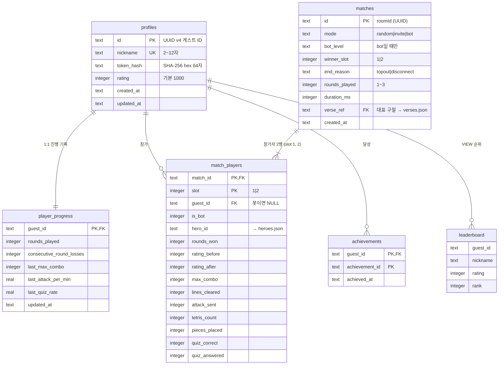
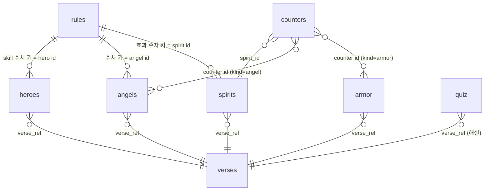

# ✉️ 서신 — 00.jerusalem-예루살렘 / TASK-000

> ⚠️ **파생 문서(Derived).** 이 서신은 원본이 아니다. 직접 수정 금지 — 원본을 고친 뒤 이 서신을 재생성하라.
> 원본: `bible-성경/01.requirement-hearing-들음/spec-tablet-명세서.md`, `bible-성경/02.architecture-foundation-기초/data-ark-법궤.md`, `bible-성경/02.architecture-foundation-기초/architecture-temple-성전설계.md` (§3 기술 스택·§5.3 파일 목록 — 스캐폴딩이 이 지역에 배정됨)
> 생성일: 2026-10-19 / 생성 기준: RTM 설계 변경 이력 최종 행 = 없음 (rtm-covenant-언약추적.md §5 — 정경화 이후 상류 변경 0건)
>
> **규격:** `statute-율법/04.development-repentance-회개/epistle-서신-template.md`
> **이 지역의 개발 계층:** 데이터 모델 & DB 마이그레이션 + 공용 콘텐츠 JSON·rules.json + 프로젝트 스캐폴딩/매니페스트 (task-wall 1단계)
> **발췌 원칙:** 아래 `## REQ 원문 발췌`·`## 설계 발췌`의 각 블록은 원본 파일에서 표 행·절을 **그대로 잘라 온 것**이다(요약·의역 0). 블록마다 `— 출처:`를 붙였다. 제목 단계(#)만 이 문서 구조에 맞춰 낮췄다.

## 지역 개요
- TASK-ID: TASK-000 (task-wall §2.0 행전 묶음 — 이 지역의 실행 단위는 아래 태스크)
- 지역: 00.jerusalem-예루살렘
- 이 지역 태스크: TASK-001(-1~-5), TASK-002, TASK-003, TASK-004, TASK-005, TASK-006, TASK-007, TASK-008, TASK-009 ← 상태·짝 배정은 task-wall 참조. 여기 복사하지 않는다.
- 선행 지역: 없음 (첫 지역)

## REQ 원문 발췌

### 상위 요구사항 (spec-tablet §4.1)

| ID | 요구사항 (req.md 서두 동사 보존) | 우선순위 | 하위 FR |
|:--|:---|:---:|:---|
| REQ-002 | 사용자는 게스트 닉네임으로 입장한다 | High | FR-012 |
| REQ-003 | 사용자는 위인 4명(다윗·솔로몬·베드로·바울) 중 한 명을 고른다 | High | FR-013~FR-017 |
| REQ-007 | 줄을 지우면 상대에게 쓰레기 줄과 악한 영(14종)이 공격으로 간다. 서버가 공격을 판정한다 | High | FR-024~FR-032 |
| REQ-008 | 사용자는 믿음 게이지로 위인 스킬과 천사 5종을 쓴다 | High | FR-033~FR-035 |
| REQ-009 | 사용자는 전신갑주 6종을 얻어 쓴다 | High | FR-036~FR-038 |
| REQ-011 | 말씀 대결(성경 퀴즈, 60문항 이상)이 있다 | High | FR-040~FR-043 |
| REQ-014 | 경기 결과(전적)가 저장되고 조회된다 | High | FR-068, FR-069 |
| REQ-015 | 랭킹(Elo)이 저장되고 조회된다 | High | FR-070, FR-071 |
| REQ-016 | 외부 서비스 키 없이 `npm install && npm run dev` 한 번으로 전부 동작해야 한다. Supabase는 환경변수가 있을 때만 쓰는 어댑터로 둔다 | High | FR-072~FR-074 |
| REQ-017 | 테스트: Vitest(단위) + Playwright(브라우저 2개 E2E) | High | FR-075~FR-077 |

— 출처: bible-성경/01/spec-tablet-명세서.md §4.1 REQ-002, REQ-003, REQ-007, REQ-008, REQ-009, REQ-011, REQ-014, REQ-015, REQ-016, REQ-017

### 기능 요구사항 (spec-tablet §4.2)

#### (spec-tablet §4.2) REQ-002 게스트 입장
| ID | 기능명 | 설명 | 우선순위 | req.md 근거 |
|:--|:---|:---|:---:|:---|
| FR-012 | 게스트 닉네임 입장 | 사용자가 닉네임을 입력해 입장한다. 서버가 닉네임을 검증(길이·허용 문자, 중복 거부 — profiles.nickname unique)하고 게스트 ID와 게스트 토큰을 발급한다. 닉네임·게스트 ID·토큰은 브라우저에 저장되어 재방문 시 다시 입력하지 않는다. 이후 모든 `join`은 이 토큰을 담는다 | High | 서두, A §4.3 join(token), §4.4, §4.6 |

#### (spec-tablet §4.2) REQ-003 위인 선택 (1차 4명)
| ID | 기능명 | 설명 | 우선순위 | req.md 근거 |
|:--|:---|:---|:---:|:---|
| FR-013 | 캐릭터 선택 화면 | 다윗·솔로몬·베드로·바울 4명을 코드로 그린 벡터 엠블럼, 스킬 이름·효과, KJV 근거 구절과 함께 보여 주고 사용자가 1명을 고른다. 4명 모두 처음부터 선택 가능 | High | 서두, A §3.1, §5.1 위인 |

#### (spec-tablet §4.2) REQ-009 전신갑주
| ID | 기능명 | 설명 | 우선순위 | req.md 근거 |
|:--|:---|:---|:---:|:---|
| FR-038 | 상성표 | 모든 방해 효과(악한 영 14종)에 대응하는 천사나 갑주가 1개 이상 있고, 상성표는 `content/` JSON으로 관리된다 | High | A §3.5 |

#### (spec-tablet §4.2) REQ-011 말씀 대결
| ID | 기능명 | 설명 | 우선순위 | req.md 근거 |
|:--|:---|:---|:---:|:---|
| FR-043 | 퀴즈 콘텐츠 | `content/quiz.json` 최소 60문항. 유형: 인물·사건·구절 빈칸 채우기. 난이도 3단계. 각 문항에 KJV 근거 구절·출처 | High | 서두, A §5.5(1) |

#### (spec-tablet §4.2) REQ-013 디자인 · 액션 · 사운드 · 재미 (첨부 A §5 전체)
| ID | 기능명 | 설명 | 우선순위 | req.md 근거 |
|:--|:---|:---|:---:|:---|
| FR-067 | 플레이어 진행 기록 | 서버가 게스트 ID별로 누적 판 수, 연속 패배 수, 직전 판 개인 기록, 업적 달성을 저장한다 (FR-047·FR-062·FR-065·FR-066의 데이터 원천) | High | 공관복음적 발견 S8 |

#### (spec-tablet §4.2) REQ-014 전적 · REQ-015 랭킹
| ID | 기능명 | 설명 | 우선순위 | req.md 근거 |
|:--|:---|:---|:---:|:---|
| FR-068 | 경기 결과 저장 | 경기 종료 시 서버(Worker/GameRoom)만 결과를 기록: 방 ID, 두 플레이어, 승자, 두 위인, 경기 시간(ms), 통계. 클라이언트는 직접 기록할 수 없다 | High | 서두, A §4.4 |
| FR-070 | Elo 레이팅 갱신 | 레이팅 기본값 1000. 사람 대 사람 경기 종료 시 서버가 Elo 공식으로 두 플레이어 레이팅을 갱신 | High | 서두, A §4.4, §5.5(3) |

#### (spec-tablet §4.2) REQ-016 로컬 실행 · REQ-017 테스트
| ID | 기능명 | 설명 | 우선순위 | req.md 근거 |
|:--|:---|:---|:---:|:---|
| FR-072 | 저장소 어댑터 자동 전환 | `.dev.vars`에 Supabase 키가 없으면 Durable Object 내장 SQLite(로컬 파일)에 저장. `SUPABASE_URL`, `SUPABASE_SERVICE_ROLE_KEY`가 설정되면 Supabase Postgres 어댑터로 자동 전환. 두 어댑터는 같은 저장 인터페이스(프로필·경기·랭킹) | High | 서두, A §4.4, §4.6 |
| FR-073 | 단일 명령 로컬 실행 | 저장소 루트에서 `npm install && npm run dev` 한 번으로 Vite 개발 서버와 `wrangler dev`(Workers + Durable Objects, 로그인 불필요)가 함께 뜨고, 브라우저 2개로 대전할 수 있다 | High | 서두, A §4.6 |
| FR-074 | 공용 게임 콘텐츠 | `content/` JSON(heroes, angels, spirits, verses, quiz, 상성표)을 클라이언트와 서버가 함께 쓴다. verses는 ref·kjv·ko 형식 | High | A §4.2, §4.5, §8 |
| FR-075 | 단위 테스트 (Vitest) | attack 계산(줄 수·콤보·B2B·T-Spin별 공격력과 소환 표), 엔진(회전 벽차기, 줄 삭제, 7-bag 분포) | High | 서두, A §7.2 |
| FR-076 | 콘텐츠 검사 스크립트 | `content/*.json`의 모든 캐릭터(위인·천사·악한 영)에 KJV 출처 구절이 있는지, 퀴즈 60문항 이상인지, 상성표가 14종을 모두 덮는지 검사 | High | A §7.2, §3.5 |
| FR-077 | E2E 테스트 (Playwright) | 브라우저 2개로 대전: A가 테트리스(4줄)를 지우면 B 화면에 쓰레기 4줄과 악한 영 연출이 나타나는지, B가 믿음의 방패·미가엘·베드로 스킬 등 방어 수단으로 막을 수 있는지 검증 | High | 서두, A §7.1, §7.2 |

— 출처: bible-성경/01/spec-tablet-명세서.md §4.2 FR-012, FR-013, FR-038, FR-043, FR-067, FR-068, FR-070, FR-072, FR-073, FR-074, FR-075, FR-076, FR-077

### 비기능 요구사항 (spec-tablet §5)

| ID | 분류 | 요구사항 | 측정 방법 | req.md 근거 |
|:--|:---|:---|:---|:---|
| NFR-004 | 보안(봉인의 율법 제1·2계명) | Supabase service role 키는 Worker 환경변수(`.dev.vars` / `wrangler secret`)에만 두고 클라이언트 번들에 절대 포함하지 않는다. 클라이언트에는 anon 공개 키만. `.dev.vars`는 git 제외 | 빌드 산출물 문자열 검사 | A §4.4 |
| NFR-007 | 유지보수 | 라이브러리는 개발 시점 최신 안정판으로 lockfile 고정, 출시 2주 미만 버전 회피 | package-lock.json 확인 | A §5.6 |
| NFR-008 | 개인정보(봉인의 율법 제4계명) | 수집 정보는 닉네임·게스트 ID·게스트 토큰·경기 기록뿐. 이메일·실명 등 수집 없음 | 저장 스키마 검사 | 서두 "게스트 닉네임" |

— 출처: bible-성경/01/spec-tablet-명세서.md §5 NFR-004, NFR-007, NFR-008

### 제약 조건 (spec-tablet §7)

| ID | 제약 | 근거 (req.md) |
|:--|:---|:---|
| C-003 | 게임 내 영어 구절은 KJV(1769) 원문 그대로. 한국어는 개역개정을 쓰지 않으며 KJV 직접 번역 문장을 쓴다. 모든 구절은 출처 장·절을 표기 | A §3 머리말, §8 |
| C-004 | 외부 서비스 키(Cloudflare 계정, Supabase URL/키)가 하나도 없어도 전부 동작해야 한다 | 서두 인프라, A §4.6 |
| C-005 | 기술 스택 고정: 프론트 Vite + 바닐라 JS(ES Modules) + PixiJS v8 + pixi-filters + GSAP + Tone.js + canvas-confetti + partysocket + @fontsource / 서버 Cloudflare Workers + Durable Objects(TypeScript, 로컬 `wrangler dev`) / DB 로컬 DO 내장 SQLite, Supabase(@supabase/supabase-js)는 선택 어댑터 / 테스트 Vitest + Playwright | 서두 기술 스택, A §4.2, §5.6 |
| C-010 | KJV 본문에 근거 없는 존재(예: 리릴/Lilith)를 등장시키지 않는다. 모든 캐릭터는 KJV 근거 구절을 함께 표시 | A §3 머리말, §3.4 주석 |
| C-011 | 연출은 무섭게 하되 고어·선정 표현을 하지 않는다 (전 연령) | A §3.5, §5.1 |
| C-012 | 소스 코드는 `fruit-열매/` 아래에 두고, 내부 구조는 첨부 A §4.5(client/, worker/, content/, supabase/)를 따른다 | A §4.5, §10 |
| C-013 | `backup/` 폴더와 그 하위는 git에 커밋하지 않고 공개하지 않는다 (CLAUDE.md 정책) | A §8 |

— 출처: bible-성경/01/spec-tablet-명세서.md §7 C-003, C-004, C-005, C-010, C-011, C-012, C-013

## 설계 발췌

### 3. 기술 스택

> P2-001 대조 기준: `hearing-들음/req.md` "기술 스택" 5줄 = spec-tablet C-005. 아래 표의 모든 행은 그 5줄 안에 있거나(✅ 원문), 원문 스택을 실행하기 위한 도구(⚙️ 보조)다. 원문에 없는 런타임 라이브러리는 0개다.

| 계층 | 기술 (고정 버전) | 출시일 | req.md 대조 | 선택 근거 |
|:---|:---|:---|:---:|:---|
| 빌드·개발 서버 | **Vite 8.3.2** | 2026-10-01 | ✅ "Vite" | 바닐라 ES Modules 그대로 번들, JSON import·프록시(ws) 내장 — 프레임워크 없이 화면 9개 처리 (FR-073, FR-078) |
| 클라이언트 언어 | 바닐라 JS (ES Modules) | — | ✅ | C-005. 빌드 도구 최소화 (req.md A §4.2) |
| 렌더링 | **pixi.js 8.22.0** | 2026-10-01 | ✅ "PixiJS v8" | WebGL/WebGPU 배치 렌더링으로 보드 2개 + 파티클 60fps (NFR-001, FR-048) |
| 그래픽 필터 | **pixi-filters 6.1.5** | 2025-11-29 | ✅ "pixi-filters" | Glow·Shockwave·Bloom·RGBSplit(색수차)·Adjustment(어둡게/회색) — FR-052, FR-053, FR-056 |
| 애니메이션 | **gsap 3.15.0** | 2026-04-13 | ✅ "GSAP" | 트윈 보간(FR-051)·흔들림·글자 연출·히트스톱 타임라인(FR-061) |
| 사운드 | **tone 15.1.22** (`latest` 채널) | 2025-04-27 | ✅ "Tone.js" | 음원 파일 없는 합성(C-007), Transport BPM으로 적응형 BGM(FR-059). 15.5.x는 `next` 채널(프리릴리스)이므로 제외 |
| 축하 효과 | **canvas-confetti 1.9.4** | 2025-10-25 | ✅ | 금빛 콘페티 (FR-056) |
| 실시간 통신 클라이언트 | **partysocket 1.3.0** | 2026-06-23 | ✅ | 브라우저 기본 WebSocket 래퍼 + 자동 재연결(로비만 사용 — OQ #18) (FR-008, C-006) |
| 폰트 | **@fontsource/cinzel 5.3.0**, **@fontsource/noto-serif-kr 5.3.0** | 2026-07-19 | ✅ "@fontsource" | 번들 포함 → 오프라인 표시 (FR-050, NFR-005) |
| 실시간 서버 | Cloudflare **Workers + Durable Objects** (TypeScript), **wrangler 4.147.0** (workerd 1.20261001.1) | 2026-10-02 | ✅ "Workers + Durable Objects (TypeScript), 로컬은 wrangler dev" | WebSocket Hibernation API(`ctx.acceptWebSocket`) + SQLite-backed DO(`new_sqlite_classes`, `ctx.storage.sql`) — 이 환경에서 로그인 없이 로컬 동작 검증됨 (REQ-016) |
| 서버 언어 | **typescript 7.0.2**, **@cloudflare/workers-types 5.20261004.1** | 2026-07-08 / 2026-10-04 | ✅ "TypeScript" | 타입 검사 전용 (번들은 wrangler 내장 esbuild) |
| DB (기본) | Durable Object 내장 **SQLite** | — | ✅ "로컬은 Durable Object 내장 SQLite" | 외부 키 0개, `.wrangler/state/` 로컬 파일에 영속 (C-004, FR-072) |
| DB (선택 어댑터) | **@supabase/supabase-js 2.117.2** | 2026-09-25 | ✅ "Supabase는 환경변수가 있을 때만 쓰는 어댑터" | 같은 `StorageAdapter` 인터페이스 구현. 키가 없으면 모듈을 생성하지 않음 (FR-072) |
| 단위 테스트 | **vitest 5.0.3** | 2026-09-30 | ✅ "Vitest(단위)" | Vite 8 피어 호환(`^8.0.0`), 순수 모듈(engine·attack·elo·validate) Node 실행 (FR-075) |
| E2E 테스트 | **@playwright/test 1.56.1** | 2025-10-17 | ✅ "Playwright(브라우저 2개 E2E)" | 이 환경에 설치된 `/opt/pw-browsers/chromium-1194`와 정확히 맞는 마지막 버전(1.57.0부터 chromium-1200). 브라우저 다운로드 없이 실행 — C-004·REQ-016 정신(외부 의존 0) 우선 (FR-077) |
| 실행 보조 | ⚙️ **concurrently 10.0.5** | 2026-08-15 | ⚙️ 보조 (원문 "한 번으로 전부" 실행 수단) | 루트 `npm run dev`가 Vite와 `wrangler dev`를 한 터미널에서 함께 띄움 (FR-073) |
| 런타임 | Node.js ≥ 22.12 (현 환경 22.22.0), npm 10 | — | ⚙️ | wrangler 4 `node >=22`, Vite 8 `^20.19 \|\| >=22.12` 요구 |

> **버전 고정 규칙 (NFR-007):** 위 버전은 2026-10-19 기준 npm 레지스트리 실조회로 고른 "출시 2주 이상(2026-10-05 이전) 최신 안정판"이다. `package.json`에는 `^` 없이 정확한 버전을 적고 `package-lock.json`으로 고정한다. 예외는 @playwright/test 1개(설치된 브라우저 리비전 정합 — 위 근거)뿐이다.
> **req.md 원문 대비 의도적 제외:** Cloudflare Pages(배포 — C-008 제외 범위), Supabase Auth(구글·카카오 — 제외 범위, 게스트 토큰으로 대체 — spec-tablet §9.7 K5).

— 출처: bible-성경/02/architecture-temple-성전설계.md §3 기술 스택

### 5.2 판단 결과

- **채택 구조:** HTTP 처리 / 렌더링 **분리** — 서버 `routes/`(HTTP 핸들러) · `services/`(비즈니스) · `storage/`(데이터), 클라이언트 `screens/`·`render/`·`fx/`(렌더링). 최상위는 req.md A §4.5의 `client/`, `worker/`, `content/`, `supabase/` 4개를 그대로 쓰는 **npm workspaces 모노레포**(C-012).
- **판단 근거:** CRUD 포함(체크 #1) + 화면 9개(체크 #2)로 분리 조건 충족. Workers 공식 컨벤션(`wrangler.toml` + `src/index.ts`)과 Vite 컨벤션(`index.html` 루트)을 따르고, 실시간 판정 로직(GameRoom)은 책임별 하위 모듈(`room/`)로 쪼갠다.
- **예상 최대 파일 줄 수: 280줄** — `client/js/screens/battle.js`(대전 화면 조립: 보드 2개·HUD·오버레이 배치 단일 책임). 300줄 경고선에 닿으면 HUD 부분을 `screens/battle-hud.js`로 분리한다. 그 밖의 파일은 250줄 이하로 설계했다(아래 트리의 예상 줄 수).
- **workspaces 구성:** 루트 `package.json`의 `"workspaces": ["client", "worker"]`. `content/`는 패키지가 아닌 데이터 폴더로, 양쪽이 상대 경로 JSON import로 읽는다(Vite `server.fs.allow: [".."]`, wrangler esbuild JSON 로더). `supabase/`는 SQL 마이그레이션 보관 폴더.
- **엔진 공유 방식:** req.md A §4.5가 엔진(`game.js`)을 `client/js/`에 두므로 그 위치를 지키되 `client/js/engine/`으로 책임 분할하고 DOM 비의존 순수 ES 모듈로 만든다. 서버 봇(ARCH-013)은 `worker/src/bot/`에서 이 파일들을 상대 경로로 import한다(의존 방향 worker → client/js/engine 단방향, 역방향 0). 엔진을 두 벌 만들지 않는다 — "두 주인을 섬기지 마라"(Matthew 6:24).

— 출처: bible-성경/02/architecture-temple-성전설계.md §5.2 판단 결과

### 5.3 파일 목록 (역할별 분리 — Phase 4 생성 대상, 지금은 생성하지 않음)

```
fruit-열매/
├── package.json                 # workspaces, scripts: dev / test / test:e2e / check:content (ARCH-017)
├── package-lock.json            # 버전 고정 (NFR-007)
├── .gitignore                   # node_modules, dist, .wrangler, .dev.vars, test-results, **/backup/ (C-013, NFR-004)
├── vitest.config.js             # projects: client · worker · content (ARCH-018)
├── playwright.config.js         # testDir client/e2e, webServer = npm run dev, chromium (ARCH-018)
├── content/                     # 공용 게임 데이터 (ARCH-016) — data-ark TBL-011~TBL-018
│   ├── heroes.json  angels.json  spirits.json  armor.json  counters.json
│   ├── verses.json  quiz.json  rules.json
│   └── check-content.mjs        # 콘텐츠 검사 스크립트 (FR-076) ~120줄
├── client/                      # Vite 프로젝트 (렌더링 계층)
│   ├── package.json  vite.config.js  index.html  style.css
│   ├── js/
│   │   ├── main.js              # 화면 라우터 ~90줄 (ARCH-001)
│   │   ├── content.js           # content JSON import·색인 ~60줄
│   │   ├── screens/             # 화면 9개 — 각 화면 렌더링만 (ARCH-001)
│   │   │   ├── entry.js  lobby.js  hero-select.js  waiting.js  battle.js(~280)
│   │   │   └── result.js  history.js  ranking.js  options.js       (각 80~180줄)
│   │   ├── engine/              # 순수 엔진 (ARCH-002) — 서버 봇 공유
│   │   │   ├── rng.js  bag.js  piece.js  srs.js  board.js(~200)  scoring.js
│   │   │   └── specials.js  gravity.js  index.js
│   │   ├── game/                # 로컬 플레이어 컨트롤러 (ARCH-003)
│   │   │   ├── local-player.js(~220)  apply-attack.js  apply-effect.js  board-codec.js
│   │   ├── render/              # PixiJS (ARCH-004): pixi-app.js board-view.js particles.js filters.js background.js
│   │   ├── fx/                  # GSAP·DOM (ARCH-005): overlay.js shake.js hitstop.js arrows.js confetti.js verse-card.js reactions.js
│   │   ├── audio/               # Tone.js (ARCH-006): sfx.js bgm.js mixer.js
│   │   ├── input/               # (ARCH-007): keyboard.js touch.js
│   │   ├── net/                 # (ARCH-008): api.js lobby-socket.js room-socket.js
│   │   └── store/               # (ARCH-008): guest.js(localStorage) settings.js(세션 메모리 — N-04 미승격)
│   ├── test/                    # Vitest: engine-srs / engine-board / engine-bag / board-codec
│   └── e2e/                     # Playwright: battle-two-browsers.spec.js
├── worker/                      # Cloudflare Worker (HTTP·판정·데이터 계층)
│   ├── package.json  wrangler.toml  tsconfig.json  .dev.vars.example(키 이름만, 값 없음)
│   ├── src/
│   │   ├── index.ts             # fetch 라우터 ~120줄 (ARCH-009)
│   │   ├── routes/              # HTTP 핸들러만: guests.ts matches.ts leaderboard.ts (ARCH-009)
│   │   ├── services/            # 비즈니스만: guest-service.ts history-service.ts ranking-service.ts elo.ts progress-service.ts (ARCH-014)
│   │   ├── storage/             # 데이터만: adapter.ts sqlite-adapter.ts(~200) supabase-adapter.ts migrations.ts (ARCH-014)
│   │   ├── matchmaker.ts        # DO ~240줄 (ARCH-010)
│   │   ├── game-room.ts         # DO 셸: 소켓 수명주기·메시지 분배 ~200줄 (ARCH-011)
│   │   ├── room/                # match-flow.ts player-state.ts effects.ts garbage.ts specials.ts quiz.ts results.ts (ARCH-011)
│   │   ├── attack.ts            # 공격력·소환 계산 ~150줄 (ARCH-012, req.md A §4.5 위치 그대로)
│   │   ├── bot/                 # bot-player.ts placement.ts (ARCH-013)
│   │   ├── protocol/            # messages.ts validate.ts rate-limit.ts (ARCH-015)
│   │   └── content.ts           # content JSON import·타입 (ARCH-016 소비)
│   └── test/                    # Vitest: attack / elo / validate / specials / garbage / effects-cap
└── supabase/
    └── migrations/0001_init.sql # Postgres 스키마 + RLS (ARCH-014, req.md A §4.5)
```

| 역할 (템플릿 4역할) | 파일 | 섞이면 ❌인 것 |
|:---|:---|:---|
| HTTP 핸들러 | `worker/src/index.ts`, `worker/src/routes/*.ts` | DB 쿼리, 비즈니스 규칙(Elo·검증 로직) |
| 화면 템플릿 | `client/js/screens/*.js`, `client/js/render/*`, `client/js/fx/*` | `fetch`/소켓 직접 호출(→ `net/` 경유), 판정 로직 |
| 서비스/비즈니스 | `worker/src/services/*.ts`, `worker/src/room/*.ts`, `worker/src/attack.ts` | HTTP 응답 생성, SQL 문자열 |
| 데이터/DB | `worker/src/storage/*.ts`, `supabase/migrations/0001_init.sql` | HTTP 처리, 게임 규칙 |

— 출처: bible-성경/02/architecture-temple-성전설계.md §5.3 파일 목록

### 1. 데이터 아키텍처 개요

| 항목 | 내용 |
|:---|:---|
| 데이터 계층 3분류 | ① **원장(Ledger) — 영속**: 프로필·경기·참가자·진행 기록·업적 (TBL-001~TBL-005) + 랭킹 뷰 (TBL-006) ② **콘텐츠 — 읽기 전용 정적 데이터**: `content/*.json` 8종 (TBL-011~TBL-018), 빌드 시 클라이언트·서버 번들 ③ **휘발 상태 — 비영속**: 대기열·초대 코드(소켓 첨부), 방 진행 상태(GameRoom 메모리) — §8 |
| DBMS (기본) | **SQLite** — Cloudflare Durable Object 내장(`ctx.storage.sql`), Matchmaker 인스턴스 `idFromName("global")` 1개에만 존재. 로컬 파일 위치 `fruit-열매/worker/.wrangler/state/v3/do/` (wrangler dev 기본 영속) |
| DBMS (선택 어댑터) | **PostgreSQL (Supabase)** — `SUPABASE_URL`과 `SUPABASE_SERVICE_ROLE_KEY`가 **둘 다** 있을 때만. 같은 5테이블 + 뷰, 스키마 원본 `supabase/migrations/0001_init.sql` |
| 접근 경로 | 원장은 오직 `StorageAdapter`(worker/src/storage/adapter.ts) 경유. 호출자는 Matchmaker 안의 services/ 모듈뿐. 클라이언트·GameRoom은 원장에 직접 접근하지 않는다 (GameRoom → Matchmaker RPC) |
| 스키마 전략 | 단일 스키마(SQLite main / Postgres `public`). 원장 테이블 5 + 뷰 1. 정규화 3NF — 닉네임은 profiles에만, 승패는 matches.winner_slot에만(참가자 행에 중복 저장 안 함), 랭킹 순위는 저장하지 않고 뷰로 계산 |
| 테이블 네이밍 | snake_case, 복수형 (`profiles`, `matches`, `match_players`, `achievements`). 1:1 확장 테이블은 의미 단위 이름(`player_progress`) |
| 컬럼 네이밍 | snake_case, FK는 `{참조 단수}_id` (`guest_id`, `match_id`) |
| 시간 표기 | SQLite: `TEXT` ISO-8601 UTC 밀리초 (`strftime('%Y-%m-%dT%H:%M:%fZ','now')`) / Postgres: `timestamptz`. 어댑터가 두 저장소 모두 ISO-8601 문자열로 반환 (architecture D-05) |
| ID 형식 | 게스트 ID·경기 ID = UUID v4 문자열(36자, `crypto.randomUUID()`). 경기 ID = GameRoom의 roomId |
| 콘텐츠 형식 | UTF-8 JSON, 최상위 배열(규칙 파일 rules.json만 객체). 영어 구절은 KJV 1769 원문, 한국어는 KJV 직접 번역 (C-003) |

— 출처: bible-성경/02/data-ark-법궤.md §1

### 2. ERD (엔티티 관계도)

#### 2.1 원장 (영속)



#### 2.2 콘텐츠 (읽기 전용 JSON — 참조 관계)



> 원장 ↔ 콘텐츠 참조(`match_players.hero_id` → heroes.json, `matches.verse_ref` → verses.json, `achievements.achievement_id` → rules.json `achievements`)는 저장소가 다르므로 DB FK가 아니라 **CHECK 열거 + 서비스 계층 검증**으로 강제한다 (§6.2).

— 출처: bible-성경/02/data-ark-법궤.md §2

### TBL-001: profiles (게스트 프로필)

> **목적:** 게스트 식별·인증(토큰 해시)·닉네임 유일성·레이팅의 단일 원천
> **연결 REQ:** REQ-002, REQ-015, FR-012, FR-018, FR-070, NFR-003, NFR-008

| # | 컬럼명 | 타입 (SQLite / Postgres) | NULL | PK | FK | Default | 설명 |
|:--|:---|:---|:---:|:---:|:---|:---|:---|
| 1 | id | TEXT / uuid | ❌ | ✅ | — | — (서비스가 `crypto.randomUUID()`) | 게스트 ID |
| 2 | nickname | TEXT / text | ❌ | — | — | — | 닉네임, trim 저장, 대소문자 무시 유일 |
| 3 | token_hash | TEXT / text | ❌ | — | — | — | 게스트 토큰 SHA-256 소문자 hex 64자 |
| 4 | rating | INTEGER / integer | ❌ | — | — | 1000 | Elo 레이팅 |
| 5 | created_at | TEXT / timestamptz | ❌ | — | — | 현재 UTC | 입장(생성) 일시 |
| 6 | updated_at | TEXT / timestamptz | ❌ | — | — | 현재 UTC | 레이팅 갱신 일시 |

**인덱스:**
| 인덱스명 | 컬럼 | 유형 | 사유 |
|:---|:---|:---|:---|
| idx_profiles_nickname | nickname COLLATE NOCASE (Postgres: `lower(nickname)`) | UNIQUE BTREE | 중복 닉네임 거부 (FR-012) |
| idx_profiles_token_hash | token_hash | UNIQUE BTREE | 토큰 검증 조회 (모든 REST·WS 인증) |
| idx_profiles_rating | rating DESC, created_at ASC | BTREE | 랭킹 상위 100 (FR-071), Elo 근접 매칭 시 레이팅 조회 |

**제약조건:**
- UNIQUE: nickname (대소문자 무시), token_hash
- CHECK: `length(id) = 36`, `nickname = trim(nickname)`, `length(trim(nickname)) BETWEEN 2 AND 12`, `length(token_hash) = 64`, `rating >= 0`
- 허용 문자 정규식 `^[가-힣A-Za-z0-9_]{2,12}$`은 서버 서비스 계층이 검사(SQLite는 기본 정규식 함수가 없음 — 방어 깊이 2층), DB는 길이·공백(3층)

— 출처: bible-성경/02/data-ark-법궤.md TBL-001

### TBL-002: matches (경기)

> **목적:** 끝난 대전 경기(사람 대 사람·봇) 1건의 결과. 연습 세션은 기록하지 않는다(상대 없음 — 전적 화면 대상 아님, 진행 기록은 TBL-004)
> **연결 REQ:** REQ-014, FR-009, FR-063, FR-068, FR-069

| # | 컬럼명 | 타입 (SQLite / Postgres) | NULL | PK | FK | Default | 설명 |
|:--|:---|:---|:---:|:---:|:---|:---|:---|
| 1 | id | TEXT / uuid | ❌ | ✅ | — | — (roomId) | 경기 ID = GameRoom 방 ID |
| 2 | mode | TEXT / text | ❌ | — | — | — | CODE-001: `random` · `invite` · `bot` |
| 3 | bot_level | TEXT / text | ✅ | — | — | NULL | CODE-002: `easy` · `normal` · `hard` (mode=bot일 때만) |
| 4 | winner_slot | INTEGER / smallint | ❌ | — | — | — | 승자 슬롯 1 또는 2 |
| 5 | end_reason | TEXT / text | ❌ | — | — | — | CODE-004: `topout` · `disconnect` |
| 6 | rounds_played | INTEGER / smallint | ❌ | — | — | — | 진행된 라운드 수 1~3 |
| 7 | duration_ms | INTEGER / integer | ❌ | — | — | — | 첫 `start` 카운트다운 종료부터 `matchEnd`까지 |
| 8 | verse_ref | TEXT / text | ❌ | — | verses.json `ref` (논리 참조) | — | 말씀 카드 대표 구절 (FR-063) |
| 9 | created_at | TEXT / timestamptz | ❌ | — | — | 현재 UTC | 경기 종료(기록) 일시 |

**인덱스:**
| 인덱스명 | 컬럼 | 유형 | 사유 |
|:---|:---|:---|:---|
| idx_matches_created_at | created_at DESC | BTREE | 전적 최신순 키셋 페이지(`before` 커서) |

**제약조건:**
- CHECK: `mode IN ('random','invite','bot')`, `bot_level IS NULL OR bot_level IN ('easy','normal','hard')`, `(mode = 'bot') = (bot_level IS NOT NULL)`, `winner_slot IN (1,2)`, `end_reason IN ('topout','disconnect')`, `rounds_played BETWEEN 1 AND 3`, `duration_ms >= 0`, `length(trim(verse_ref)) > 0`
- 무효 경기(양측 동시 이탈 UC-016 E1, 봇 처리 오류 UC-005 E2)는 행을 만들지 않는다

— 출처: bible-성경/02/data-ark-법궤.md TBL-002

### TBL-003: match_players (경기 참가자)

> **목적:** 경기당 정확히 2행 — 슬롯별 참가자·위인·라운드 승수·레이팅 전후·개인 통계 (FR-066 개인 기록과 FR-065 업적 판정의 원천)
> **연결 REQ:** REQ-014, REQ-015, FR-065, FR-066, FR-068, FR-069, FR-070

| # | 컬럼명 | 타입 (SQLite / Postgres) | NULL | PK | FK | Default | 설명 |
|:--|:---|:---|:---:|:---:|:---|:---|:---|
| 1 | match_id | TEXT / uuid | ❌ | ✅ | TBL-002.id (ON DELETE CASCADE) | — | 경기 |
| 2 | slot | INTEGER / smallint | ❌ | ✅ | — | — | 1 또는 2 |
| 3 | guest_id | TEXT / uuid | ✅ | — | TBL-001.id | NULL | 사람 참가자 (봇이면 NULL) |
| 4 | is_bot | INTEGER / boolean | ❌ | — | — | 0 / false | 봇 여부 |
| 5 | hero_id | TEXT / text | ❌ | — | heroes.json `id` (논리 참조) | — | CODE-003 위인 |
| 6 | rounds_won | INTEGER / smallint | ❌ | — | — | 0 | 이긴 라운드 수 0~2 |
| 7 | rating_before | INTEGER / integer | ✅ | — | — | NULL | 사람 대 사람일 때 경기 전 레이팅 |
| 8 | rating_after | INTEGER / integer | ✅ | — | — | NULL | 사람 대 사람일 때 경기 후 레이팅 |
| 9 | max_combo | INTEGER / integer | ❌ | — | — | 0 | 최대 콤보 |
| 10 | lines_cleared | INTEGER / integer | ❌ | — | — | 0 | 지운 줄 합계 |
| 11 | attack_sent | INTEGER / integer | ❌ | — | — | 0 | 상쇄 후 상대에게 보낸 쓰레기 줄 합계 |
| 12 | tetris_count | INTEGER / integer | ❌ | — | — | 0 | 테트리스(4줄) 횟수 — 업적 판정 |
| 13 | pieces_placed | INTEGER / integer | ❌ | — | — | 0 | 놓은 블록 수 |
| 14 | quiz_correct | INTEGER / integer | ❌ | — | — | 0 | 말씀 대결 정답(먼저 맞힘 여부와 무관, 정답 선택) 수 |
| 15 | quiz_answered | INTEGER / integer | ❌ | — | — | 0 | 말씀 대결 참여(1회 이상 선택) 수 |

**인덱스:**
| 인덱스명 | 컬럼 | 유형 | 사유 |
|:---|:---|:---|:---|
| idx_match_players_guest_id | guest_id, match_id | BTREE | 내 전적 조회 (FR-069) |

**제약조건:**
- PK: (match_id, slot)
- CHECK: `slot IN (1,2)`, `is_bot IN (0,1)`, `(is_bot = 1) = (guest_id IS NULL)`, `hero_id IN ('david','solomon','peter','paul')`, `rounds_won BETWEEN 0 AND 2`, `(rating_before IS NULL) = (rating_after IS NULL)`, 통계 컬럼 전부 `>= 0`, `quiz_correct <= quiz_answered`
- 서비스 규칙: 경기당 2행, 봇 행은 최대 1개, mode≠bot이면 is_bot=0 두 행 + rating 전후 필수

— 출처: bible-성경/02/data-ark-법궤.md TBL-003

### TBL-004: player_progress (플레이어 진행 기록)

> **목적:** 단계적 해금(FR-047)·은혜 보정(FR-062)·성장 수치(FR-066)의 계산 원천. 서버만 쓴다 (FR-067 "서버가 게스트 ID별로 저장")
> **연결 REQ:** REQ-012, REQ-013, FR-047, FR-062, FR-066, FR-067

| # | 컬럼명 | 타입 (SQLite / Postgres) | NULL | PK | FK | Default | 설명 |
|:--|:---|:---|:---:|:---:|:---|:---|:---|
| 1 | guest_id | TEXT / uuid | ❌ | ✅ | TBL-001.id (ON DELETE CASCADE) | — | 게스트 (프로필 생성과 같은 트랜잭션에서 생성) |
| 2 | rounds_played | INTEGER / integer | ❌ | — | — | 0 | 끝낸 라운드 누적 (대전·봇·연습 모두, 연습 세션 = 1판) |
| 3 | consecutive_round_losses | INTEGER / integer | ❌ | — | — | 0 | 연속으로 진 대전 라운드 수 (승리 라운드에서 0, 연습은 변화 없음) |
| 4 | last_max_combo | INTEGER / integer | ✅ | — | — | NULL | 직전 대전 경기 최대 콤보 (첫 경기 전 NULL) |
| 5 | last_attack_per_min | REAL / real | ✅ | — | — | NULL | 직전 대전 경기 분당 공격 |
| 6 | last_quiz_rate | REAL / real | ✅ | — | — | NULL | 직전 대전 경기 퀴즈 정답률 0~1 (참여 0회면 NULL) |
| 7 | updated_at | TEXT / timestamptz | ❌ | — | — | 현재 UTC | 갱신 일시 |

**인덱스:**
| 인덱스명 | 컬럼 | 유형 | 사유 |
|:---|:---|:---|:---|
| (PK) | guest_id | BTREE | 방 배정 시 진행 기록 1건 조회 (해금 단계·은혜) |

**제약조건:**
- CHECK: `rounds_played >= 0`, `consecutive_round_losses >= 0`, `last_max_combo IS NULL OR last_max_combo >= 0`, `last_attack_per_min IS NULL OR last_attack_per_min >= 0`, `last_quiz_rate IS NULL OR last_quiz_rate BETWEEN 0 AND 1`

— 출처: bible-성경/02/data-ark-법궤.md TBL-004

### TBL-005: achievements (업적)

> **목적:** 업적 달성 기록 — 이번 실행 정의 업적은 1종 "골리앗 사냥꾼"뿐 (OQ #14)
> **연결 REQ:** REQ-013, FR-065, FR-067

| # | 컬럼명 | 타입 (SQLite / Postgres) | NULL | PK | FK | Default | 설명 |
|:--|:---|:---|:---:|:---:|:---|:---|:---|
| 1 | guest_id | TEXT / uuid | ❌ | ✅ | TBL-001.id (ON DELETE CASCADE) | — | 달성자 |
| 2 | achievement_id | TEXT / text | ❌ | ✅ | rules.json `achievements` 키 (논리 참조) | — | CODE-005 |
| 3 | achieved_at | TEXT / timestamptz | ❌ | — | — | 현재 UTC | 최초 달성 일시 |

**제약조건:**
- PK: (guest_id, achievement_id) — 같은 업적 중복 달성 행 없음 (`INSERT ... ON CONFLICT DO NOTHING`)
- CHECK: `achievement_id IN ('goliath_hunter')`

— 출처: bible-성경/02/data-ark-법궤.md TBL-005

### TBL-006: leaderboard (랭킹 — VIEW)

> **목적:** 레이팅 순위. 순위를 저장하지 않고 계산한다(정규화 — 레이팅 1곳). req.md A §4.4 "leaderboard (VIEW)" 그대로
> **연결 REQ:** REQ-015, FR-071

| # | 컬럼명 | 타입 | NULL | PK | FK | Default | 설명 |
|:--|:---|:---|:---:|:---:|:---|:---|:---|
| 1 | guest_id | TEXT / uuid | ❌ | — | TBL-001.id | — | 내 행 강조·내 순위 조회용 (API 응답에는 노출하지 않음) |
| 2 | nickname | TEXT / text | ❌ | — | — | — | 닉네임 |
| 3 | rating | INTEGER / integer | ❌ | — | — | — | 레이팅 |
| 4 | rank | INTEGER / bigint | ❌ | — | — | — | `RANK() OVER (ORDER BY rating DESC)` — 동점 같은 순위 |

**정의:** `SELECT id AS guest_id, nickname, rating, RANK() OVER (ORDER BY rating DESC) AS rank FROM profiles` — 상위 100은 `ORDER BY rank, created_at LIMIT 100`(SQLite 3.25+ 윈도 함수, Postgres 동일)

— 출처: bible-성경/02/data-ark-법궤.md TBL-006

### TBL-011: heroes.json (위인 — 콘텐츠)

> **목적:** 캐릭터 선택 화면·스킬 연출·근거 구절 (1차 4명만 — C-008)
> **연결 REQ:** REQ-003, FR-013~FR-017, C-010

| # | 필드명 | 타입 | NULL | PK | FK | Default | 설명 |
|:--|:---|:---|:---:|:---:|:---|:---|:---|
| 1 | id | string | ❌ | ✅ | — | — | CODE-003 `david` · `solomon` · `peter` · `paul` |
| 2 | name_ko | string | ❌ | — | — | — | 다윗 · 솔로몬 · 베드로 · 바울 |
| 3 | name_en | string | ❌ | — | — | — | David · Solomon · Peter · Paul |
| 4 | skill_id | string | ❌ | — | rules.json `heroSkills` 키 | — | `sling_stone` · `understanding_heart` · `upon_this_rock` · `prison_doors_opened` |
| 5 | skill_name_ko | string | ❌ | — | — | — | 물맷돌 · 지혜로운 마음 · 이 반석 위에 · 옥문이 열리다 |
| 6 | skill_effect_ko | string | ❌ | — | — | — | FR-014~FR-017 효과 문장 그대로 |
| 7 | passive_ko | string | ✅ | — | — | null | 솔로몬만 "다음 블록 5개 미리보기" (OQ #3 — 나머지 null) |
| 8 | verse_ref | string | ❌ | — | TBL-016 `ref` | — | 1 Samuel 17:49 · 1 Kings 3:9 · Matthew 16:18 · Acts 16:26 |
| 9 | emblem | string | ❌ | — | — | — | 코드로 그린 벡터 엠블럼 키 (`sling` · `crown` · `rock_key` · `broken_chain`) — 렌더러가 Pixi Graphics로 그림 (C-007) |

— 출처: bible-성경/02/data-ark-법궤.md TBL-011

### TBL-012: angels.json (천사 — 콘텐츠)

> **목적:** 천사 5종 표시·연출·근거 / **연결 REQ:** REQ-008, FR-035, FR-049

| # | 필드명 | 타입 | NULL | PK | FK | Default | 설명 |
|:--|:---|:---|:---:|:---:|:---|:---|:---|
| 1 | id | string | ❌ | ✅ | — | — | CODE-011 `michael` · `gabriel` · `cherubim` · `seraphim` · `ministering_spirits` |
| 2 | name_ko / name_en | string | ❌ | — | — | — | 미가엘 / 가브리엘 / 그룹 / 스랍 / 섬기는 영들 |
| 3 | effect_ko | string | ❌ | — | — | — | FR-035 효과 문장 |
| 4 | verse_ref | string | ❌ | — | TBL-016 `ref` | — | Jude 1:9 · Luke 1:19 · Genesis 3:24 · Isaiah 6:6 · Hebrews 1:14 |
| 5 | visual | string | ❌ | — | — | — | 연출 키 `wings_light` · `herald_light` · `four_faces_wheels`(Ezek 10) · `six_wings`(Isa 6:2) · `small_lights` (FR-049) |

— 출처: bible-성경/02/data-ark-법궤.md TBL-012

### TBL-013: spirits.json (악한 영 — 콘텐츠)

> **목적:** 악한 영 14종 등급·효과·시간·근거 — 서버 소환 결정(attack.ts)과 클라이언트 연출이 같은 표를 읽는다 (FR-074 S9)
> **연결 REQ:** REQ-007, FR-026~FR-031, FR-049, C-010, C-011

| # | 필드명 | 타입 | NULL | PK | FK | Default | 설명 |
|:--|:---|:---|:---:|:---:|:---|:---|:---|
| 1 | id | string | ❌ | ✅ | — | — | 아래 확정표 |
| 2 | name_ko / name_en | string | ❌ | — | — | — | 표시 이름 |
| 3 | tier | integer | ❌ | — | — | — | 1~5, 보스 = 6 (CODE-006) |
| 4 | effect | string | ❌ | — | — | — | 효과 코드 (클라이언트 적용 함수 키) |
| 5 | category | string | ❌ | — | — | — | CODE-007 방해 분류 — 갑주 "무효" 대상 판정 |
| 6 | duration_ms | integer | ❌ | — | — | — | 시간형 효과 길이 (보드 상태형 = 0) |
| 7 | params | object | ❌ | — | — | {} | 효과 세부 수치 |
| 8 | verse_ref | string | ❌ | — | TBL-016 `ref` | — | KJV 근거 |

**확정표 (spec-tablet "악한 영 등급별 후보 목록" Phase 2 확정):**

| id | 이름 | tier | effect | category | duration_ms | params | verse_ref |
|:---|:---|:---:|:---|:---|:---:|:---|:---|
| unclean_spirit | 더러운 귀신 | 1 | darken | vision | 3000 | `{"opacity":0.3}` | Mark 1:23 |
| deaf_dumb_spirit | 귀먹고 말 못하게 하는 귀신 | 1 | mute_hide_next | sense | 5000 | `{}` | Mark 9:25 |
| legion | 군대 | 2 | shadow_swarm | vision | 4000 | `{"coverage":0.4}` | Mark 5:9 |
| lying_spirit | 거짓말하는 영 | 2 | fake_next_ghost | deception | 5000 | `{}` | 1 Kings 22:22 |
| divination_spirit | 점치는 귀신 | 2 | wrong_ghost | deception | 5000 | `{"offset":2}` | Acts 16:16 |
| beelzebub | 바알세불 | 3 | fly_swarm | vision | 5000 | `{"particles":240}` | Matthew 12:24 |
| prince_of_the_air | 공중 권세 잡은 자 | 3 | wind | speed | 5000 | `{"gravityMultiplier":2,"pushEveryMs":1200}` (밀림 방향 ±1은 서버가 `attack.params.pushDir`로 지정) | Ephesians 2:2 |
| prince_of_persia | 바사 왕국의 군주 | 3 | seal_angels | seal | 21000 | `{}` (6초 상한 예외 — FR-031) | Daniel 10:13 |
| abaddon | 아바돈 / 아볼루온 | 4 | gnaw_holes | board | 0 | `{"holes":4}` (위치 시드는 서버가 `attack.params.seed`로 지정) | Revelation 9:11 |
| jezebel | 이세벨의 영 | 4 | reverse_controls | control | 6000 | `{}` | Revelation 2:20 |
| wickedness | 악 (에바 속의 여인) | 4 | lead_row | board | 0 | `{"rows":1,"linesToClear":4}` | Zechariah 5:8 |
| babylon | 큰 음녀 바벨론 | 5 | drunken_blur | vision | 6000 | `{"blur":6,"waveAmplitude":8}` | Revelation 17:5 |
| satan_angel_of_light | 광명의 천사로 가장한 사탄 | 5 | false_angel | deception | 6000 | `{"disguiseMs":1500,"curse":"darken_hide_next","opacity":0.5}` | 2 Corinthians 11:14 |
| dragon | 루시퍼 / 용 / 옛 뱀 / 사탄 | 6 | blackout | vision | 4000 | `{"garbageMin":6}` (연속 B2B 테트리스 전용) | Revelation 12:9 |

> 시간형 효과는 전부 6,000ms 이하(봉인 21,000ms 예외), 보드 상태형(abaddon 구멍, wickedness 납 블록)은 시간 상한 대상이 아니다 (spec-tablet §9.7 K4). 연출은 실루엣·연기·파티클 중심, 고어·선정 표현 없음 (C-011).

— 출처: bible-성경/02/data-ark-법궤.md TBL-013

### TBL-014: armor.json (전신갑주 — 콘텐츠)

> **목적:** 갑주 6종 표시·효과 분류·근거 / **연결 REQ:** REQ-009, FR-036, FR-037

| # | 필드명 | 타입 | NULL | PK | FK | Default | 설명 |
|:--|:---|:---|:---:|:---:|:---|:---|:---|
| 1 | id | string | ❌ | ✅ | — | — | CODE-010 |
| 2 | name_ko / name_en | string | ❌ | — | — | — | 표시 이름 |
| 3 | effect_ko | string | ❌ | — | — | — | FR-037 효과 문장 |
| 4 | action | string | ❌ | — | — | — | `nullify`(해제 + 다음 1회 무효) · `reduce_next` · `block_next` · `reflect` |
| 5 | nullifies | string | ✅ | — | — | null | action=nullify일 때 대상 CODE-007 분류 목록 |
| 6 | verse_ref | string | ❌ | — | TBL-016 `ref` | — | Ephesians 6:14~17 |

| id | 이름 | action | nullifies | verse_ref |
|:---|:---|:---|:---|:---|
| belt_of_truth | 진리의 허리띠 | nullify | `["control","deception"]` (조작 반전·미혹) | Ephesians 6:14 |
| breastplate_of_righteousness | 의의 흉배 | reduce_next | null | Ephesians 6:14 |
| gospel_shoes | 평안의 복음의 신 | nullify | `["speed"]` (낙하 속도 증가) | Ephesians 6:15 |
| shield_of_faith | 믿음의 방패 | block_next | null | Ephesians 6:16 |
| helmet_of_salvation | 구원의 투구 | nullify | `["vision","sense"]` (암전·시야 방해) | Ephesians 6:17 |
| sword_of_the_spirit | 성령의 검 | reflect | null | Ephesians 6:17 |

— 출처: bible-성경/02/data-ark-법궤.md TBL-014

### TBL-015: counters.json (상성표 — 콘텐츠)

> **목적:** 모든 방해 효과(14종)에 대응 천사·갑주가 1개 이상 있음을 데이터로 보장 (FR-038, 콘텐츠 검사 FR-076 대상)
> **연결 REQ:** REQ-009, FR-038, FR-076

| # | 필드명 | 타입 | NULL | PK | FK | Default | 설명 |
|:--|:---|:---|:---:|:---:|:---|:---|:---|
| 1 | spirit_id | string | ❌ | ✅ | TBL-013 `id` | — | 악한 영 |
| 2 | counters | array of `{kind, id}` | ❌ | — | kind=angel → TBL-012, kind=armor → TBL-014 | — | 대응 수단 1개 이상 |

| spirit_id | counters |
|:---|:---|
| unclean_spirit | armor:helmet_of_salvation, angel:seraphim, armor:shield_of_faith |
| deaf_dumb_spirit | armor:helmet_of_salvation, angel:seraphim, armor:shield_of_faith |
| legion | armor:helmet_of_salvation, angel:cherubim, angel:seraphim, armor:shield_of_faith |
| lying_spirit | armor:belt_of_truth, angel:seraphim, armor:shield_of_faith |
| divination_spirit | armor:belt_of_truth, angel:seraphim, armor:shield_of_faith |
| beelzebub | armor:helmet_of_salvation, angel:seraphim, armor:shield_of_faith |
| prince_of_the_air | armor:gospel_shoes, angel:seraphim, armor:shield_of_faith |
| prince_of_persia | armor:shield_of_faith, armor:sword_of_the_spirit |
| abaddon | armor:shield_of_faith, armor:sword_of_the_spirit |
| jezebel | armor:belt_of_truth, angel:seraphim, armor:shield_of_faith |
| wickedness | angel:seraphim, armor:shield_of_faith, armor:sword_of_the_spirit |
| babylon | armor:helmet_of_salvation, angel:seraphim, armor:shield_of_faith |
| satan_angel_of_light | angel:michael, armor:belt_of_truth, angel:seraphim, armor:shield_of_faith |
| dragon | angel:michael, armor:helmet_of_salvation, armor:shield_of_faith |

> 봉인(prince_of_persia) 중에는 천사를 부를 수 없으므로 대응 수단을 갑주로만 둔다(FR-035 "봉인 중에는 소환 불가"와 정합).

— 출처: bible-성경/02/data-ark-법궤.md TBL-015

### TBL-016: verses.json (KJV 구절 — 콘텐츠)

> **목적:** 게임에 나오는 모든 구절의 단일 원천 `{ref, kjv, ko}` (req.md A §8) / **연결 REQ:** REQ-011, FR-043, FR-074, C-003

| # | 필드명 | 타입 | NULL | PK | FK | Default | 설명 |
|:--|:---|:---|:---:|:---:|:---|:---|:---|
| 1 | ref | string | ❌ | ✅ | — | — | 영어 책 이름 + 장:절 (예: `John 16:33`, 범위는 `Ephesians 6:13-17`) |
| 2 | kjv | string | ❌ | — | — | — | KJV 1769 원문 그대로 (C-003) |
| 3 | ko | string | ❌ | — | — | — | KJV 직접 번역 한국어 (개역개정·개역한글 미사용 — OQ #17) |
| 4 | ref_ko | string | ❌ | — | — | — | 한국어 출처 표기 (예: `요한복음 16:33`) |

> 필수 수록: 위인 4·천사 5·악한 영 14·갑주 근거 구절, John 16:33 · John 1:5 (예수님 이벤트), 2 Timothy 4:7 (승리), Ephesians 6:12 (컨셉), 퀴즈 해설 구절 전부. 콘텐츠 검사 스크립트가 모든 `verse_ref` 참조가 이 파일에 존재하는지 검사한다.

— 출처: bible-성경/02/data-ark-법궤.md TBL-016

### TBL-017: quiz.json (말씀 대결 문항 — 콘텐츠)

> **목적:** 말씀 대결 4지선다 문항 (최소 60) / **연결 REQ:** REQ-011, FR-041, FR-043, FR-022

| # | 필드명 | 타입 | NULL | PK | FK | Default | 설명 |
|:--|:---|:---|:---:|:---:|:---|:---|:---|
| 1 | id | string | ❌ | ✅ | — | — | `Q001` 형식 |
| 2 | type | string | ❌ | — | — | — | CODE-012 `person` · `event` · `verse_blank` |
| 3 | difficulty | integer | ❌ | — | — | — | 1 · 2 · 3 |
| 4 | question_ko | string | ❌ | — | — | — | 문제 (구절 빈칸형은 KJV 영어 원문에 `_____` 빈칸 + 한국어 번역 병기) |
| 5 | choices | array[4] of string | ❌ | — | — | — | 보기 4개 |
| 6 | answer | integer | ❌ | — | — | — | 정답 인덱스 0~3 (서버만 사용 — 클라이언트로 보내는 `quiz`에는 제외) |
| 7 | verse_ref | string | ❌ | — | TBL-016 `ref` | — | 해설 구절 |

**분량 규칙 (콘텐츠 검사 대상):** 전체 ≥ 60, 유형별 ≥ 15, 난이도별 ≥ 15, 모든 `choices` 길이 4·중복 없음, `answer` ∈ 0~3.

— 출처: bible-성경/02/data-ark-법궤.md TBL-017

### TBL-018: rules.json (규칙 수치 — 콘텐츠)

> **목적:** spec-tablet §4.2 머리말이 Phase 2에 위임한 **모든 수치의 단일 원천**. 서버 판정과 클라이언트 표시가 같은 값을 읽는다 — 화면·코드 하드코딩 금지
> **연결 REQ:** REQ-001, REQ-005, REQ-007~REQ-013, REQ-015, FR-004, FR-010, FR-019, FR-021~FR-047, FR-062, FR-064, FR-065, FR-070, NFR-003

| 키 (경로) | 값 | 단위 | 근거 / 해석 |
|:---|:---|:---|:---|
| `board.width` / `board.height` | 10 / 20 | 칸 | FR-001 |
| `board.dangerRows` | 4 | 줄 | OQ #7 위험선 = 상단 4줄, FR-055 |
| `board.preview` | 3 | 개 | 기본 다음 블록 미리보기 |
| `board.previewSolomon` / `board.previewGabriel` | 5 / 7 | 개 | FR-015 패시브, FR-035 가브리엘 |
| `net.stateHz` | 12 | 회/초 | FR-006 "초당 10~15회" 안 |
| `engine.lockDelayMs` | 500 | ms | 착지 후 고정까지 (FR-003) |
| `engine.dasMs` / `engine.arrMs` | 150 / 40 | ms | 좌우 키 누름 지속 반복 (FR-011) |
| `engine.softDropMultiplier` | 20 | 배 | 소프트 드롭 (FR-003) |
| `gravity.startMs` | 1000 | ms/줄 | FR-010 시작 낙하 간격 |
| `gravity.at120sMs` | 500 | ms/줄 | 0~120초 선형 감소 ("완만하게") |
| `gravity.accelEveryMs` / `gravity.accelFactor` / `gravity.minMs` | 15000 / 0.85 / 80 | ms / 배 / ms | 120초 이후 15초마다 ×0.85 ("2분 뒤부터 가속"), 하한 80ms |
| `scoring.lines` | `{1:100, 2:300, 3:500, 4:800}` | 점 | FR-004 |
| `scoring.tspin` | `{0:400, 1:800, 2:1200, 3:1600}` | 점 | FR-004 T-Spin |
| `scoring.b2bMultiplier` / `scoring.comboPer` | 1.5 / 50 | 배 / 점×콤보 | FR-004 |
| `scoring.softDropPerCell` / `scoring.hardDropPerCell` | 1 / 2 | 점 | FR-003 |
| `attack.lines` | `{1:0, 2:1, 3:2, 4:4}` | 줄 | FR-024, OQ #10 |
| `attack.tspinBonus` | `{1:2, 2:3, 3:3}` | 줄 | FR-024 "T-Spin → +1~3" |
| `attack.comboBonus` | `[{"from":1,"bonus":1},{"from":3,"bonus":2},{"from":5,"bonus":3}]` | 줄 | FR-024 "연속 콤보 → +1~3" (콤보 0 = 첫 삭제) |
| `attack.b2bBonus` | 1 | 줄 | FR-024 "백투백 테트리스 → 4 이상" (4+1=5) |
| `attack.jerichoBonus` | 1 | 줄 | FR-045 |
| `spiritTier.byLines` | `{1:1, 2:1, 3:2}` (1줄은 T-Spin일 때만 공격) | 등급 | FR-026 |
| `spiritTier.tetrisPool` | `["prince_of_the_air","abaddon"]` | — | FR-026 "4줄 → 무작위" |
| `spiritTier.tierUpTspin` / `spiritTier.tierUpComboFrom` | 1 / 3 | 등급 / 콤보 | FR-026 "T-Spin·연속 콤보 → 등급 상승" (4줄 + 콤보 3 이상 → 4등급 풀) |
| `spiritTier.b2bTetrisTiers` | `[4,5]` | 등급 | FR-026 백투백 테트리스 |
| `spiritTier.bossConsecutiveB2BTetris` | 2 | 회 | OQ #9 (B2B 테트리스 2회 연속 → dragon) |
| `gauge.max` | 100 | 점 | FR-033 |
| `gauge.perLine` / `gauge.tetrisBonus` / `gauge.tspinBonus` | 6 / 6 / 6 | 점 | FR-033 (테트리스 = 30) |
| `gauge.quizReward` / `gauge.manna` | 50 / 25 | 점 | FR-041 "+50%", FR-046 "+25%" (최대 100에서 멈춤 — UC-014 E2) |
| `heroSkills.sling_stone` | cost 50, cooldownMs 20000, blocks 3 | — | FR-014 |
| `heroSkills.understanding_heart` | cost 40, cooldownMs 20000, hintMs 10000 | — | FR-015 |
| `heroSkills.upon_this_rock` | cost 60, cooldownMs 30000, durationMs 10000 | — | FR-016 |
| `heroSkills.prison_doors_opened` | cost 60, cooldownMs 25000, rows 3 | — | FR-017 |
| `angels.michael` | cost 70, cooldownMs 30000, families `["dragon","satan_angel_of_light"]` | — | FR-035 "용·사탄 계열 1회 완전 상쇄" |
| `angels.gabriel` | cost 40, cooldownMs 20000, pieces 7 | — | FR-035 |
| `angels.cherubim` | cost 35, cooldownMs 12000, burnPending 2 | — | FR-035 (대기 공격 2줄) |
| `angels.seraphim` | cost 50, cooldownMs 20000 | — | FR-035 (걸린 저주 전부 해제) |
| `angels.ministering_spirits` | cost 20, cooldownMs 8000, removeRows 1 | — | FR-035 (보드의 쓰레기 줄 1줄) |
| `armor.spawnChancePerPiece` | 0.04 | 확률 | FR-036 (대전만 — 연습 없음, OQ #4) |
| `armor.breastplateReduce` | 2 | 줄 | FR-037 "쓰레기 줄 1회 경감" |
| `specials.wordIntervalMin` / `specials.wordIntervalMax` | 7 / 12 | 조각 | FR-044 |
| `specials.jericho` | base 0.03, perCombo 0.02, max 0.12, radius 1 (3×3) | 확률 | FR-045 |
| `specials.manna` | base 0.02, crisis 0.10, max 0.10 | 확률 | FR-046 (위기 = 위험선 진입) |
| `specials.unlockRounds` | `{"word":4, "jericho":5, "manna":5}` (1~3판 없음) | 판 | FR-047, OQ #12 |
| `specials.priority` | `["word","jericho","manna","armor"]` | — | 한 조각에 특수 칸 최대 1개 |
| `effects.maxDurationMs` / `effects.maxConcurrent` / `effects.reapplyCooldownMs` | 6000 / 2 / 1500 | ms / 개 / ms | FR-031 |
| `effects.sealMs` | 21000 | ms | FR-028 (상한 예외) |
| `garbage.delayMs` | 1000 | ms | 상쇄 창 (architecture §9.2) |
| `quiz.timeLimitMs` / `quiz.wrongLockMs` / `quiz.autoIntervalMs` / `quiz.resumeDelayMs` | 10000 / 3000 / 90000 / 2500 | ms | FR-040, FR-041, OQ #21 |
| `quiz.gaugeRewardChance` | 0.5 (나머지 0.5 = 무작위 갑주) | 확률 | OQ #13 서버 무작위 |
| `match.roundsToWin` / `match.countdownMs` / `match.nextRoundDelayMs` | 2 / 3000 / 4000 | 판 / ms / ms | FR-007 |
| `grace.lossStreakRounds` / `grace.garbageReduce` / `grace.gaugeMultiplier` | 3 / 1 / 1.15 | 판 / 줄 / 배 | FR-062 |
| `jesus.perMatch` / `jesus.garbageRemoveRatio` | 1 / 0.5 (내림) | 회 / 비율 | FR-039, OQ #20 (게이지 소모 없음) |
| `elo.base` / `elo.k` | 1000 / 32 | — | FR-070, OQ #19 |
| `invite.length` / `invite.alphabet` / `invite.ttlMs` | 6 / `ABCDEFGHJKLMNPQRSTUVWXYZ23456789` / 600000 | 자 / — / ms | FR-019, OQ #15 |
| `nickname.min` / `nickname.max` / `nickname.pattern` | 2 / 12 / `^[가-힣A-Za-z0-9_]{2,12}$` | 자 | FR-012, NFR-003 |
| `bot.easy` | moveIntervalMs 700, evalNoise 0.6, mistakeRate 0.25, quizAccuracy 0.40, quizDelayMs [5000, 9000] | — | FR-021, FR-022 |
| `bot.normal` | moveIntervalMs 400, evalNoise 0.25, mistakeRate 0.10, quizAccuracy 0.65, quizDelayMs [3500, 7000] | — | FR-021, FR-022 |
| `bot.hard` | moveIntervalMs 180, evalNoise 0.05, mistakeRate 0.02, quizAccuracy 0.85, quizDelayMs [2000, 5000] | — | FR-021, FR-022 |
| `rateLimit` | state 20/초, clear 10/초, skill·armor 5/초, answer 4/초, reaction 1/2초, 전체 40/초, maxMessageBytes 4096 | — | NFR-003 |
| `progressCheck.maxPiecesPerSecond` | 10 | 개/초 | FR-032 "초당 비정상 횟수" |
| `reactions` | `[{"id":"amen","emoji":"🙏","label_ko":"아멘"},{"id":"hallelujah","emoji":"🔥","label_ko":"할렐루야"},{"id":"angel","emoji":"😇","label_ko":"😇"}]` | — | FR-064, C-009 |
| `achievements.goliath_hunter` | heroId `david`, tetrisInMatch 5, name_ko "골리앗 사냥꾼" | — | FR-065 (한 경기 = 매치 또는 연습 세션 — OQ #1) |
| `verseCard` | 예수님 이벤트가 일어난 경기 → `John 16:33`, 아니면 승자 위인의 `verse_ref` | — | FR-063 대표 구절 |
| `victoryVerse` | `2 Timothy 4:7` | — | FR-007 승리 연출 |

— 출처: bible-성경/02/data-ark-법궤.md TBL-018

### 4. 공통 코드 정의

| CODE-ID | 코드 그룹 | 코드 | 값 / 의미 | 사용처 |
|:---|:---|:---|:---|:---|
| CODE-001 | 경기 모드 | random / invite / bot / practice | 랜덤 매칭 / 친구 초대 코드 / AI 봇 / 연습 (practice는 원장 matches에 저장하지 않음) | API-007 `mode`, TBL-002 |
| CODE-002 | 봇 난이도 | easy / normal / hard | 쉬움 / 보통 / 어려움 | API-007, TBL-002, TBL-018 `bot` |
| CODE-003 | 위인 | david / solomon / peter / paul | 다윗 / 솔로몬 / 베드로 / 바울 | API-007 `heroId`, TBL-003, TBL-011 |
| CODE-004 | 경기 종료 사유 | topout / disconnect | Top-out 2승 / 상대 이탈 | TBL-002, API-030 |
| CODE-005 | 업적 | goliath_hunter | 골리앗 사냥꾼 | TBL-005, API-030 |
| CODE-006 | 악한 영 등급 | 1 / 2 / 3 / 4 / 5 / 6 | 1~5등급, 6 = 보스 | TBL-013 |
| CODE-007 | 방해 분류 | vision / sense / deception / control / speed / seal / board | 시야 / 소리·미리보기 / 미혹 / 조작 반전 / 낙하 속도 / 천사 봉인 / 보드 상태 | TBL-013, TBL-014 `nullifies`, 스랍 해제 대상(seal 제외 전부) |
| CODE-008 | 효과 출처 | hero / angel / armor / jesus / special / grace | 위인 스킬 / 천사 / 갑주 / 예수님 이벤트 / 특수 블록 / 은혜 | API-023 `source` |
| CODE-009 | 보드 셀 코드 | 0~9 | 0 빈칸, 1 I, 2 O, 3 T, 4 S, 5 Z, 6 J, 7 L, 8 쓰레기, 9 납 블록 | API-012 `board` 200자 문자열 (행 우선, 위→아래) |
| CODE-010 | 전신갑주 | belt_of_truth / breastplate_of_righteousness / gospel_shoes / shield_of_faith / helmet_of_salvation / sword_of_the_spirit | 허리띠 / 흉배 / 신 / 방패 / 투구 / 검 | API-015, TBL-014 |
| CODE-011 | 천사 | michael / gabriel / cherubim / seraphim / ministering_spirits | 미가엘 / 가브리엘 / 그룹 / 스랍 / 섬기는 영들 | API-014, TBL-012 |
| CODE-012 | 퀴즈 유형 | person / event / verse_blank | 인물 / 사건 / 구절 빈칸 | TBL-017 |
| CODE-013 | 특수 칸 | word / jericho / manna / armor | 말씀 / 여리고 나팔 / 만나 / 전신갑주 | API-013 `specials.kind`, engine specials.js |
| CODE-014 | 리액션 | amen / hallelujah / angel | 🙏 / 🔥 / 😇 | API-017, API-028 |
| CODE-015 | 스킬 종류 | hero / angel | 위인 스킬 / 천사 소환 (spec-tablet §9.8 #10 — `skill` 메시지가 둘 다 나름) | API-014 `kind` |

> 에러 코드(SNAKE_CASE)는 [`api-gate-성문.md`](./api-gate-성문.md) §4에서 정의한다.

— 출처: bible-성경/02/data-ark-법궤.md §4 CODE-001~CODE-015

### 5. 인덱스 전략

| 주요 쿼리 패턴 | 빈도 | 사용 인덱스 | 비고 |
|:---|:---|:---|:---|
| 토큰 → 게스트 조회 (`WHERE token_hash = ?`) | 모든 REST 호출, 모든 `join`·`ready` | idx_profiles_token_hash (UNIQUE) | 메모리 LRU 캐시 1,000건 선행 (architecture §4) |
| 닉네임 중복 검사·삽입 | 게스트 생성 1회 | idx_profiles_nickname (UNIQUE NOCASE) | 동시 생성 경합은 Matchmaker 단일 스레드로 직렬화 + UNIQUE 위반을 NICKNAME_TAKEN으로 변환 |
| 랭킹 상위 100 (`ORDER BY rating DESC LIMIT 100`) | 랭킹 화면 | idx_profiles_rating | 메모리 5초 TTL 캐시, 경기 기록 시 무효화 |
| 내 순위 (`COUNT(*) WHERE rating > 내 rating` + 1) | 랭킹 화면 | idx_profiles_rating | 뷰 RANK와 같은 값 |
| 내 전적 최신순 (`match_players.guest_id = ?` 조인 matches, `created_at < before` `LIMIT 20`) | 전적 화면 | idx_match_players_guest_id + idx_matches_created_at | 상대 행은 같은 match_id의 다른 slot (PK) |
| 방 배정 시 진행 기록 (`player_progress WHERE guest_id = ?`) | 방 배정마다 | PK | 해금 단계·은혜 계산 |
| Elo 근접 매칭 | 대기열 | 인덱스 불필요 | 대기열은 메모리(소켓 첨부의 rating 사본) — DB 조회 없음 |

> 쓰기 경로(경기 기록)는 경기당 1회 트랜잭션: INSERT matches 1 + match_players 2 + UPDATE profiles ≤2 + UPSERT player_progress ≤2 + INSERT achievements ≤2.

— 출처: bible-성경/02/data-ark-법궤.md §5

### 6. 데이터 무결성 규칙

#### 6.1 DDL — SQLite (Durable Object `ctx.storage.sql`, 마이그레이션 v1)

```sql
CREATE TABLE IF NOT EXISTS profiles (
  id          TEXT    NOT NULL PRIMARY KEY CHECK (length(id) = 36),
  nickname    TEXT    NOT NULL COLLATE NOCASE
                      CHECK (nickname = trim(nickname) AND length(trim(nickname)) BETWEEN 2 AND 12),
  token_hash  TEXT    NOT NULL CHECK (length(token_hash) = 64),
  rating      INTEGER NOT NULL DEFAULT 1000 CHECK (rating >= 0),
  created_at  TEXT    NOT NULL DEFAULT (strftime('%Y-%m-%dT%H:%M:%fZ','now')),
  updated_at  TEXT    NOT NULL DEFAULT (strftime('%Y-%m-%dT%H:%M:%fZ','now'))
);
CREATE UNIQUE INDEX IF NOT EXISTS idx_profiles_nickname   ON profiles (nickname COLLATE NOCASE);
CREATE UNIQUE INDEX IF NOT EXISTS idx_profiles_token_hash ON profiles (token_hash);
CREATE INDEX        IF NOT EXISTS idx_profiles_rating     ON profiles (rating DESC, created_at ASC);

CREATE TABLE IF NOT EXISTS matches (
  id            TEXT    NOT NULL PRIMARY KEY CHECK (length(id) = 36),
  mode          TEXT    NOT NULL CHECK (mode IN ('random','invite','bot')),
  bot_level     TEXT             CHECK (bot_level IS NULL OR bot_level IN ('easy','normal','hard')),
  winner_slot   INTEGER NOT NULL CHECK (winner_slot IN (1,2)),
  end_reason    TEXT    NOT NULL CHECK (end_reason IN ('topout','disconnect')),
  rounds_played INTEGER NOT NULL CHECK (rounds_played BETWEEN 1 AND 3),
  duration_ms   INTEGER NOT NULL CHECK (duration_ms >= 0),
  verse_ref     TEXT    NOT NULL CHECK (length(trim(verse_ref)) > 0),
  created_at    TEXT    NOT NULL DEFAULT (strftime('%Y-%m-%dT%H:%M:%fZ','now')),
  CHECK ((mode = 'bot') = (bot_level IS NOT NULL))
);
CREATE INDEX IF NOT EXISTS idx_matches_created_at ON matches (created_at DESC);

CREATE TABLE IF NOT EXISTS match_players (
  match_id      TEXT    NOT NULL REFERENCES matches (id) ON DELETE CASCADE,
  slot          INTEGER NOT NULL CHECK (slot IN (1,2)),
  guest_id      TEXT             REFERENCES profiles (id),
  is_bot        INTEGER NOT NULL DEFAULT 0 CHECK (is_bot IN (0,1)),
  hero_id       TEXT    NOT NULL CHECK (hero_id IN ('david','solomon','peter','paul')),
  rounds_won    INTEGER NOT NULL DEFAULT 0 CHECK (rounds_won BETWEEN 0 AND 2),
  rating_before INTEGER,
  rating_after  INTEGER,
  max_combo     INTEGER NOT NULL DEFAULT 0 CHECK (max_combo >= 0),
  lines_cleared INTEGER NOT NULL DEFAULT 0 CHECK (lines_cleared >= 0),
  attack_sent   INTEGER NOT NULL DEFAULT 0 CHECK (attack_sent >= 0),
  tetris_count  INTEGER NOT NULL DEFAULT 0 CHECK (tetris_count >= 0),
  pieces_placed INTEGER NOT NULL DEFAULT 0 CHECK (pieces_placed >= 0),
  quiz_correct  INTEGER NOT NULL DEFAULT 0 CHECK (quiz_correct >= 0),
  quiz_answered INTEGER NOT NULL DEFAULT 0 CHECK (quiz_answered >= 0),
  PRIMARY KEY (match_id, slot),
  CHECK ((is_bot = 1) = (guest_id IS NULL)),
  CHECK ((rating_before IS NULL) = (rating_after IS NULL)),
  CHECK (quiz_correct <= quiz_answered)
);
CREATE INDEX IF NOT EXISTS idx_match_players_guest_id ON match_players (guest_id, match_id);

CREATE TABLE IF NOT EXISTS player_progress (
  guest_id                 TEXT    NOT NULL PRIMARY KEY REFERENCES profiles (id) ON DELETE CASCADE,
  rounds_played            INTEGER NOT NULL DEFAULT 0 CHECK (rounds_played >= 0),
  consecutive_round_losses INTEGER NOT NULL DEFAULT 0 CHECK (consecutive_round_losses >= 0),
  last_max_combo           INTEGER CHECK (last_max_combo IS NULL OR last_max_combo >= 0),
  last_attack_per_min      REAL    CHECK (last_attack_per_min IS NULL OR last_attack_per_min >= 0),
  last_quiz_rate           REAL    CHECK (last_quiz_rate IS NULL OR last_quiz_rate BETWEEN 0 AND 1),
  updated_at               TEXT    NOT NULL DEFAULT (strftime('%Y-%m-%dT%H:%M:%fZ','now'))
);

CREATE TABLE IF NOT EXISTS achievements (
  guest_id       TEXT NOT NULL REFERENCES profiles (id) ON DELETE CASCADE,
  achievement_id TEXT NOT NULL CHECK (achievement_id IN ('goliath_hunter')),
  achieved_at    TEXT NOT NULL DEFAULT (strftime('%Y-%m-%dT%H:%M:%fZ','now')),
  PRIMARY KEY (guest_id, achievement_id)
);

CREATE VIEW IF NOT EXISTS leaderboard AS
  SELECT id AS guest_id, nickname, rating,
         RANK() OVER (ORDER BY rating DESC) AS rank
  FROM profiles;
```

#### 6.2 무결성 규칙 요약

| 규칙 | 적용 위치 | 방어 층 |
|:---|:---|:---|
| 닉네임 빈값·공백·길이 | 클라이언트 `required`/`maxlength`/`pattern` → 서버 trim·정규식 → DB `CHECK` | 3중 (SKILL-02 방어 깊이) |
| 닉네임 중복 | 서버 사전 조회 → DB UNIQUE NOCASE | 2중 + DB 최종 |
| 경기 기록은 GameRoom만 | 외부 쓰기 엔드포인트 없음, Matchmaker RPC `recordMatch`만 (FR-068) | 구조 |
| 경기 기록 원자성 | SQLite `ctx.storage.transactionSync()` / Postgres 함수 `record_match(jsonb)` 1회 호출 | 트랜잭션 |
| 참가자 2행·봇 1행 이하 | 서비스 검증 + PK(match_id, slot) + CHECK(slot IN (1,2)) | 2중 |
| 원장 ↔ 콘텐츠 참조 (`hero_id`, `verse_ref`, `achievement_id`) | DB CHECK 열거(hero_id·achievement_id) + 서비스가 content 색인으로 존재 검증 (verse_ref) | 2중 (저장소가 달라 DB FK 불가 — 명시적 논리 참조) |
| 외래 키 | `match_players.match_id → matches.id`, `match_players.guest_id → profiles.id`, `player_progress.guest_id → profiles.id`, `achievements.guest_id → profiles.id` | DB FK (Phase 4 첫 원장 단위 테스트에서 FK 위반 INSERT 거부를 확인) |
| 콘텐츠 무결성 | `content/check-content.mjs`: 모든 캐릭터 `verse_ref` 존재, verses 3필드 비어 있지 않음, quiz ≥ 60·유형/난이도 분포, counters가 14종 전부·각 1개 이상, rules 키 전부 존재·heroes/angels id와 rules 키 일치 | 빌드 전 스크립트 (FR-076) |
| 개인정보 최소 | 이메일·실명·IP 컬럼 없음 (NFR-008) | 스키마 |

#### 6.3 Postgres(Supabase) 차이 — `supabase/migrations/0001_init.sql`

| 항목 | SQLite | Postgres |
|:---|:---|:---|
| ID 타입 | TEXT (CHECK 길이 36) | `uuid` |
| 시간 | TEXT ISO-8601 | `timestamptz DEFAULT now()` |
| 닉네임 유일 | `COLLATE NOCASE` | `CREATE UNIQUE INDEX ... ON profiles (lower(nickname))` |
| 불리언 | INTEGER 0/1 | `boolean` |
| 트랜잭션 | `transactionSync` | `record_match(payload jsonb)`, `create_guest(p_id uuid, p_nickname text, p_token_hash text)` SQL 함수 (supabase-js `rpc` 1회 호출로 원자 처리) |
| 접근 통제 | DO 내부 전용 | 5테이블 `ENABLE ROW LEVEL SECURITY`, anon·authenticated 정책 없음(전면 거부), service role만 접근 — Worker 전용 (NFR-004). 함수는 `SECURITY DEFINER` 아님(service role 권한으로 실행) |

— 출처: bible-성경/02/data-ark-법궤.md §6.1~§6.3

### 7. 마이그레이션 / 시드 전략

| 대상 | 전략 |
|:---|:---|
| DO SQLite 스키마 | Matchmaker 생성자에서 `ctx.blockConcurrencyWhile()` 안에 `storage/migrations.ts` 실행: `PRAGMA user_version` 확인 → 0이면 §6.1 DDL 실행 후 `user_version = 1`. 이후 변경은 `user_version` 증가 단계로만 추가 (기존 단계 수정 금지) |
| DO 클래스 선언 | `worker/wrangler.toml` `[[migrations]] tag = "v1"`, `new_sqlite_classes = ["Matchmaker", "GameRoom"]` (GameRoom은 SQL 테이블을 만들지 않고 KV `ctx.storage.put`만 사용) |
| Supabase 스키마 | `supabase/migrations/0001_init.sql`(§6.3)을 운영자가 Supabase CLI로 적용 — 실제 적용은 이번 실행 제외(C-008), 파일만 Phase 4에서 작성 |
| 시드 데이터 | 원장에는 시드 행 없음(모든 행은 플레이로 생성). 게임 데이터 시드 = `content/*.json` 8종 (Phase 4 작성, 콘텐츠 검사 통과 필수) |
| 로컬 초기화 | `fruit-열매/worker/.wrangler/state/` 삭제 = 원장 초기화 (개발자 수동, 문서화만) |
| 어댑터 전환 시 데이터 이전 | 하지 않음 — 두 저장소는 독립. 전환은 "새 저장소로 시작"을 뜻한다 (req.md A §4.6 "자동 전환"의 범위는 저장 경로 전환) |

— 출처: bible-성경/02/data-ark-법궤.md §7

### 8.3 클라이언트 브라우저 저장

| 키 | 값 | 보관 | 근거 |
|:---|:---|:---|:---|
| `swt.guest` (localStorage) | `{guestId, nickname, token}` | 영속 (재방문 시 재입력 없음) | FR-012, UC-001 |
| 옵션(연출 세기·음량) | 메모리 객체 | 세션 한정 — 저장하지 않음 (N-04 미승격) | FR-057, FR-060 |

— 출처: bible-성경/02/data-ark-법궤.md §8.3
