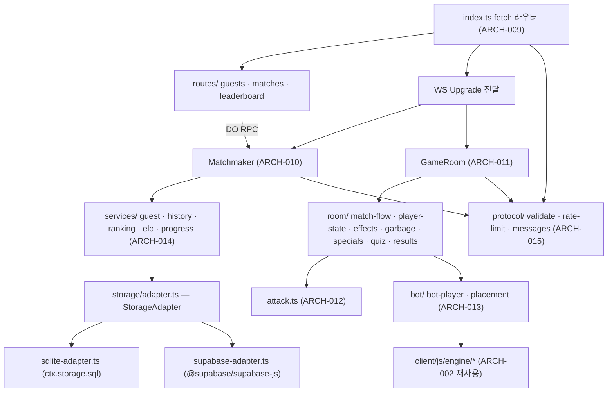

# ✉️ 서신 — 01.judaea-유대 / TASK-000

> ⚠️ **파생 문서(Derived).** 이 서신은 원본이 아니다. 직접 수정 금지 — 원본을 고친 뒤 이 서신을 재생성하라.
> 원본: `bible-성경/01.requirement-hearing-들음/spec-tablet-명세서.md`, `bible-성경/02.architecture-foundation-기초/data-ark-법궤.md`, `bible-성경/02.architecture-foundation-기초/architecture-temple-성전설계.md`, `bible-성경/02.architecture-foundation-기초/api-gate-성문.md` (판정 결과 페이로드)
> 생성일: 2026-10-19 / 생성 기준: RTM 설계 변경 이력 최종 행 = 2026-10-19 DCL-004 (rtm-covenant-언약추적.md §5 — DCL-001 data-ark §6.1 부록·§7, DCL-002 data-ark TBL-018 `rateLimit`, DCL-003 data-ark TBL-018 `gravity.accelAfterMs`·`ledger.*`, DCL-004 architecture ARCH-002·ARCH-013 착지 평가 위치 + data-ark TBL-018 `placement.weights`) · **재생성 2026-10-19 W-01** (W-00 재생성본은 DCL-003·DCL-004 추가로 무효 — acts-행전 README "서신은 무효가 된다")
>
> **규격:** `statute-율법/04.development-repentance-회개/epistle-서신-template.md`
> **이 지역의 개발 계층:** 핵심 비즈니스 로직 — 순수 엔진·서버 판정(공격·악한 영·게이지·스킬·천사·갑주·예수님·특수 칸·말씀 대결·경기 흐름)·AI 봇·원장 서비스 (task-wall 2단계)
> **발췌 원칙:** 아래 `## REQ 원문 발췌`·`## 설계 발췌`의 각 블록은 원본 파일에서 표 행·절을 **그대로 잘라 온 것**이다(요약·의역 0). 블록마다 `— 출처:`를 붙였다. 제목 단계(#)만 이 문서 구조에 맞춰 낮췄다.

## 지역 개요
- TASK-ID: TASK-000 (task-wall §2.0 행전 묶음 — 이 지역의 실행 단위는 아래 태스크)
- 지역: 01.judaea-유대
- 이 지역 태스크: TASK-010(-1~-4), TASK-011, TASK-012, TASK-013, TASK-014, TASK-015(-1, -2), TASK-016, TASK-017, TASK-018, TASK-019, TASK-020(-1~-3) ← 상태·짝 배정은 task-wall 참조. 여기 복사하지 않는다.
- 선행 지역: 00.jerusalem-예루살렘

## 선행 지역 확인
- 직전 지역: 00.jerusalem-예루살렘
- task-wall 확인: TASK-001-1~TASK-001-5, TASK-002~TASK-009 — 이 서신 생성 시점(2026-10-19, Phase 4 계획 완료 직후)의 상태는 전부 ⬜ 미착수다. 이 지역의 Doer·Witness는 **착수 직전에** `bible-성경/04.development-repentance-회개/task-wall-성벽.md`에서 위 태스크 전부 ✅ · 짝 검증 결과 ✅를 직접 확인한다(서신에 완료를 적지 않는다 — acts-행전 README 사용 규칙 3).
- history 이정표: `fruit-열매/history/` 에 "(Acts 6:7) 예루살렘 배치 완료" 이정표 줄이 있어야 착수한다.
- RTM: `/census-count`(UTIL-census) 실계수로 직전 지역 REQ 행 최신 여부를 확인한다.
- 무효 조건: 이 서신 생성 이후 RTM §5 설계 변경 이력에 새 행이 생겼으면 이 서신은 무효 — 재생성 후 착수한다.

## REQ 원문 발췌

### 상위 요구사항 (spec-tablet §4.1)

| ID | 요구사항 (req.md 서두 동사 보존) | 우선순위 | 하위 FR |
|:--|:---|:---:|:---|
| REQ-001 | 사용자가 브라우저에서 KJV 성경 기반 실시간 2인 대전 테트리스를 플레이한다 | High | FR-001~FR-011 |
| REQ-002 | 사용자는 게스트 닉네임으로 입장한다 | High | FR-012 |
| REQ-003 | 사용자는 위인 4명(다윗·솔로몬·베드로·바울) 중 한 명을 고른다 | High | FR-013~FR-017 |
| REQ-005 | 사용자는 AI 봇 대전(쉬움·보통·어려움)을 고를 수 있다 | High | FR-021, FR-022, FR-078 |
| REQ-006 | 사용자는 연습 모드를 고를 수 있다 | Mid | FR-023, FR-078 |
| REQ-007 | 줄을 지우면 상대에게 쓰레기 줄과 악한 영(14종)이 공격으로 간다. 서버가 공격을 판정한다 | High | FR-024~FR-032 |
| REQ-008 | 사용자는 믿음 게이지로 위인 스킬과 천사 5종을 쓴다 | High | FR-033~FR-035 |
| REQ-009 | 사용자는 전신갑주 6종을 얻어 쓴다 | High | FR-036~FR-038 |
| REQ-010 | 예수님 "세상을 이기었노라" 이벤트(첨부 A §3.2 원칙 그대로)가 경기당 1회 일어날 수 있다 | High | FR-039 |
| REQ-011 | 말씀 대결(성경 퀴즈, 60문항 이상)이 있다 | High | FR-040~FR-043 |
| REQ-012 | 특수 블록 3종(말씀·여리고 나팔·만나)이 있다 | High | FR-044~FR-047 |
| REQ-013 | 디자인·액션·사운드·재미 요구사항(첨부 A §5 전체)은 필수다. 첨부 B의 체크리스트를 충족해야 한다 | High | FR-048~FR-067 |
| REQ-014 | 경기 결과(전적)가 저장되고 조회된다 | High | FR-068, FR-069 |
| REQ-015 | 랭킹(Elo)이 저장되고 조회된다 | High | FR-070, FR-071 |

— 출처: bible-성경/01/spec-tablet-명세서.md §4.1 REQ-001, REQ-002, REQ-003, REQ-005, REQ-006, REQ-007, REQ-008, REQ-009, REQ-010, REQ-011, REQ-012, REQ-013, REQ-014, REQ-015

### 기능 요구사항 (spec-tablet §4.2)

#### (spec-tablet §4.2) REQ-001 실시간 2인 대전 테트리스
| ID | 기능명 | 설명 (측정 가능한 형태) | 우선순위 | req.md 근거 |
|:--|:---|:---|:---:|:---|
| FR-001 | 보드·테트로미노·7-bag | 10×20 보드, 7종 테트로미노. 시드 기반 7-bag 생성 — 같은 시드는 항상 같은 블록 순서를 만든다 | High | A §2.1 |
| FR-002 | SRS 회전 | SRS 회전 규칙과 벽차기(Wall Kick) 테이블 적용 (좌/우 회전) | High | A §2.1 |
| FR-003 | 이동·드롭·홀드·고스트 | 좌우 이동, 소프트 드롭, 하드 드롭, 홀드(교체 1회/낙하당), 고스트 피스 표시 | High | A §2.1 |
| FR-004 | 줄 삭제·판정·점수 | 가로줄 완성 시 삭제. 콤보 수, Back-to-Back, T-Spin 판정, 점수 계산 | High | A §1.2, §2.1 |
| FR-005 | 같은 시드 시작 | 대전 라운드 시작 시 서버가 `start` 메시지(시드, 카운트다운)를 두 플레이어에게 보내고, 두 플레이어는 같은 블록 순서로 시작한다 | High | A §2.1, §4.3 |
| FR-006 | 상대 보드 실시간 표시 | 클라이언트는 `state`(seq, 압축 보드, 활성 블록, 점수)를 초당 10~15회 보내고, 상대 화면에 `opponentState`로 표시된다 | High | A §4.3, §5.4 |
| FR-007 | 승리 조건 | 상대 블록이 천장에 닿으면(Top-out) 라운드 승리. 3판 2선승제. 경기 승리 시 KJV 구절과 승리 연출 (예: 2 Timothy 4:7) | High | A §2.4 |
| FR-009 | 상대 이탈 처리 | 대전 중 한 플레이어의 연결이 끊기면 서버가 이탈로 판정하고 남은 플레이어를 경기 승자로 `matchEnd`를 보내며, 이탈자는 패배로 전적에 기록된다 | High | 공관복음적 발견 S2 (§9.9) |
| FR-010 | 난이도 곡선 | 낙하 속도는 경기 시작 후 완만하게 오르고, 2분 뒤부터 가속한다 | High | A §5.5(3) |

#### (spec-tablet §4.2) REQ-002 게스트 입장
| ID | 기능명 | 설명 | 우선순위 | req.md 근거 |
|:--|:---|:---|:---:|:---|
| FR-012 | 게스트 닉네임 입장 | 사용자가 닉네임을 입력해 입장한다. 서버가 닉네임을 검증(길이·허용 문자, 중복 거부 — profiles.nickname unique)하고 게스트 ID와 게스트 토큰을 발급한다. 닉네임·게스트 ID·토큰은 브라우저에 저장되어 재방문 시 다시 입력하지 않는다. 이후 모든 `join`은 이 토큰을 담는다 | High | 서두, A §4.3 join(token), §4.4, §4.6 |

#### (spec-tablet §4.2) REQ-003 위인 선택 (1차 4명)
| ID | 기능명 | 설명 | 우선순위 | req.md 근거 |
|:--|:---|:---|:---:|:---|
| FR-014 | 다윗 — 물맷돌 | 상대 보드에서 가장 높은 열의 꼭대기 블록 3개를 파괴. 근거 1 Sam 17:49 | High | A §3.1 |
| FR-015 | 솔로몬 — 지혜로운 마음 | 패시브: 다음 블록 5개 미리보기. 스킬: 최적 착지 위치 힌트 10초. 근거 1 Kings 3:9 | High | A §3.1 |
| FR-016 | 베드로 — 이 반석 위에 | 10초 동안 쓰레기 줄 상승 무효. 근거 Matt 16:18 | High | A §3.1 |
| FR-017 | 바울 — 옥문이 열리다 | 지진 연출과 함께 맨 아래 쓰레기 줄 3줄 삭제. 근거 Acts 16:26 | High | A §3.1 |

#### (spec-tablet §4.2) REQ-004 · REQ-005 · REQ-006 모드
| ID | 기능명 | 설명 | 우선순위 | req.md 근거 |
|:--|:---|:---|:---:|:---|
| FR-018 | 랜덤 매칭 | Matchmaker가 대기열을 관리하고 레이팅(Elo) 차이가 작은 상대부터 짝지어 `matched`(방 ID, 상대 닉네임·위인)를 보낸다 | High | A §4.1, §4.3, §5.5(3) |
| FR-021 | AI 봇 대전 | 쉬움·보통·어려움 3단계 봇과 대전(3판 2선승). 난이도는 봇의 착지 판단 품질과 조작 속도로 구분된다. 봇 대전의 공격도 서버가 판정한다. 봇에게는 4명 중 위인 1명이 무작위 배정된다 | High | 서두, A §5.4, §5.5(3) |
| FR-022 | 봇의 말씀 대결 응답 | 봇 대전 중 말씀 대결이 열리면 봇이 난이도별 정답률·응답 시간으로 답하고, 서버가 사람과 같은 도착 순서 규칙으로 판정한다 | High | 공관복음적 발견 S7 |
| FR-023 | 연습 모드 | 혼자 플레이하며 위인 스킬을 익힌다. 상대·공격·말씀 대결이 없고, 믿음 게이지 충전과 위인 스킬 사용, 여리고 나팔·만나 블록(해금 단계에 따름)이 동작한다. Top-out 시 개인 기록을 보여 준다 | Mid | 서두, A §1.3 |

#### (spec-tablet §4.2) REQ-007 공격 (서버 판정)
| ID | 기능명 | 설명 | 우선순위 | req.md 근거 |
|:--|:---|:---|:---:|:---|
| FR-024 | 공격력 계산 | 서버(attack 모듈)가 clear(seq, lines, combo, b2b, tspin, pieceCount)로 공격력을 계산: 2줄→쓰레기 1, 3줄→2, 4줄(테트리스)→4, T-Spin·연속 콤보→+1~3, 백투백 테트리스→4 이상. 1줄은 공격력 0 | High | A §2.2, §4.3 |
| FR-025 | 쓰레기 줄 삽입·상쇄 | 서버가 `attack`(spiritId, garbage, holeColumn, duration)을 보내면 받는 보드 아래에 구멍 1칸(holeColumn)이 있는 쓰레기 줄이 올라온다. 내가 줄을 지우면 대기 중인 받을 공격이 먼저 줄어든다(상쇄) | High | A §1.2, §2.3, §4.3 |
| FR-026 | 악한 영 소환 결정 | 서버가 공격 등급에 따라 악한 영을 결정: 2줄→1등급, 3줄→2등급, 4줄→공중 권세 잡은 자/아바돈 중 무작위, T-Spin·연속 콤보→등급 상승, 백투백 테트리스→4~5등급(이세벨의 영·큰 음녀 바벨론 등), 연속 백투백 테트리스→보스(용). 보스를 제외한 13종 모두 대전에서 소환될 수 있다 | High | A §2.2, §3.4 |
| FR-027 | 악한 영 1~2등급 효과 | 더러운 귀신(보드 30% 어둡게 3초), 귀먹고 말 못하게 하는 귀신(효과음·경고음 끄기 + 다음 블록 미리보기 숨김 5초), 군대(그림자 떼 시야 가림 + 쓰레기 줄), 거짓말하는 영(가짜 다음 블록·가짜 고스트), 점치는 귀신(고스트 위치 틀리게 표시) | High | A §3.4 |
| FR-028 | 악한 영 3등급 효과 | 바알세불(파리 떼 파티클이 보드를 뒤덮음), 공중 권세 잡은 자(낙하 속도 2배 + 블록이 한쪽으로 밀림), 바사 왕국의 군주(21초 동안 천사 소환 봉인) | High | A §3.4 |
| FR-029 | 악한 영 4등급 효과 | 아바돈/아볼루온(황충이 쌓인 블록을 갉아 구멍 생성), 이세벨의 영(좌우 조작 반전 6초), 악(에바 속의 여인 — 4줄 동안 지워지지 않는 회색 납 블록 1줄) | High | A §3.4 |
| FR-030 | 악한 영 5등급·보스 효과 | 큰 음녀 바벨론(화면 일렁임·흐림 6초), 광명의 천사로 가장한 사탄(천사처럼 나타나 도와주는 척하다 저주로 바뀜), 루시퍼/용/옛 뱀/사탄(연속 백투백 테트리스 시에만: 완전 암전 + 쓰레기 줄 6) | High | A §3.4 |
| FR-031 | 방해 상한 규칙 | 시간형 효과는 최대 6초(봉인류 제외). 동시에 최대 2개. 같은 효과는 겹치지 않음. 효과 종료 후 1.5초 동안 같은 종류 재적용 없음. 상한을 넘는 영 효과는 적용되지 않으나 쓰레기 줄은 적용된다 | High | A §3.5, §5.5(3) |
| FR-032 | 서버 진행 검증 | 서버는 `seq` 번호와 `pieceCount`로 불가능한 진행(블록 수보다 많은 줄 삭제, seq 역행, 초당 비정상 횟수)을 거부한다. 스킬 쿨다운과 믿음 게이지는 서버가 관리한다 | High | A §4.3 서버 권한 |

#### (spec-tablet §4.2) REQ-008 믿음 게이지 · 위인 스킬 · 천사
| ID | 기능명 | 설명 | 우선순위 | req.md 근거 |
|:--|:---|:---|:---:|:---|
| FR-033 | 믿음 게이지 | 줄을 지울 때마다 믿음 게이지가 찬다. 게이지 값은 서버가 관리하고 화면에 표시된다 | High | A §2.3, §4.3 |
| FR-034 | 위인 스킬 발동 | 사용자가 스킬 키를 누르면 `skill`(skillId)을 보내고, 서버가 게이지·쿨다운을 검증한 뒤 발동하여 `effect`로 양측에 연출을 알린다. 게이지 부족·쿨다운 중이면 거부 피드백 | High | A §2.3, §4.3, §5.5(5) |
| FR-035 | 천사 5종 소환 | 사용자가 게이지를 써서 천사를 부른다: 미가엘(최상위 공격 — 용·사탄 계열 1회 완전 상쇄), 가브리엘(다음 7개 블록 순서 공개 + 착지 힌트), 그룹(들어오는 쓰레기 줄 2줄 태움), 스랍(걸린 저주 효과 — 반전, 납 블록 등 모두 해제), 섬기는 영들(쓰레기 줄 1줄 제거). 바사 왕국의 군주 봉인 중에는 소환 불가 | High | A §3.3, §3.4 |

#### (spec-tablet §4.2) REQ-009 전신갑주
| ID | 기능명 | 설명 | 우선순위 | req.md 근거 |
|:--|:---|:---|:---:|:---|
| FR-036 | 갑주 출현·획득 | 전신갑주 아이템이 보드에 무작위로 나타나고, 그 칸이 있는 줄을 지우면 획득하여 보유 목록에 표시된다 | High | A §2.3 |
| FR-037 | 갑주 6종 사용 | 사용자가 키로 사용: 진리의 허리띠(조작 반전·미혹 무효), 의의 흉배(쓰레기 줄 1회 경감), 평안의 복음의 신(낙하 속도 증가 무효), 믿음의 방패(다음 공격 1회 완전 차단), 구원의 투구(암전·시야 방해 무효), 성령의 검(받은 공격 1회를 상대에게 되돌림). 근거 Eph 6:14–17 | High | A §2.3, §5.5(5) |
| FR-038 | 상성표 | 모든 방해 효과(악한 영 14종)에 대응하는 천사나 갑주가 1개 이상 있고, 상성표는 `content/` JSON으로 관리된다 | High | A §3.5 |

#### (spec-tablet §4.2) REQ-010 예수님 이벤트
| ID | 기능명 | 설명 | 우선순위 | req.md 근거 |
|:--|:---|:---|:---:|:---|
| FR-039 | "세상을 이기었노라" 이벤트 | 믿음 게이지가 가득 찬 상태에서 위기(FR-055 위험선)에 처하면 서버가 경기당 1회 발동한다. 효과: 내 보드의 모든 저주와 암전 제거 + 쓰레기 줄 절반 제거. 표현: 얼굴 없이 빛과 실루엣, John 16:33·John 1:5 구절 표시. 선택 캐릭터가 아니며 피해·패배 대상으로 나오지 않는다 | High | 서두, A §3.2, §5.4 |

#### (spec-tablet §4.2) REQ-011 말씀 대결
| ID | 기능명 | 설명 | 우선순위 | req.md 근거 |
|:--|:---|:---|:---:|:---|
| FR-040 | 말씀 대결 발생 | 말씀 블록이 든 줄을 지우면 열린다. 아무도 못 지우면 마지막 말씀 대결(또는 라운드 시작) 후 90초마다 자동으로 열린다. 대전(사람·봇) 전용 | High | A §5.5(1) |
| FR-041 | 진행·판정·보상 | 두 플레이어 화면이 동시에 멈추고 KJV 기반 4지선다가 10초 제한으로 나온다. 서버가 도착 순서로 판정, 먼저 맞힌 사람이 보상(믿음 게이지 +50% 또는 무작위 전신갑주)을 받는다. 틀리면 3초 동안 다시 고를 수 없다. 정답 해설에 KJV 원문 구절과 출처 표시 | High | A §5.5(1) |
| FR-042 | 니어미스 연출 | 둘 다 맞혔는데 늦은 쪽에 도착 시간 차이를 "0.12초 차이!" 형식으로 크게 보여 준다 | High | A §5.5(1) |
| FR-043 | 퀴즈 콘텐츠 | `content/quiz.json` 최소 60문항. 유형: 인물·사건·구절 빈칸 채우기. 난이도 3단계. 각 문항에 KJV 근거 구절·출처 | High | 서두, A §5.5(1) |

#### (spec-tablet §4.2) REQ-012 특수 블록
| ID | 기능명 | 설명 | 우선순위 | req.md 근거 |
|:--|:---|:---|:---:|:---|
| FR-044 | 말씀 블록 | 블록 7~12개마다 무작위로 1개, 빛나는 칸이 박힌 블록이 나온다. 그 줄을 지우면 말씀 대결 | High | A §5.5(2) |
| FR-045 | 여리고 나팔 블록 | 낮은 확률(콤보 중 확률 상승). 지우면 주변 3×3 블록 폭파 + 공격력 +1 | High | A §5.5(2) |
| FR-046 | 만나 블록 | 위기 상황일수록 확률 상승. 지우면 믿음 게이지 +25% | High | A §5.5(2) |
| FR-047 | 단계적 해금 | 플레이어의 첫 3판은 특수 블록 없이 기본 규칙과 스킬만. 그 뒤 말씀 블록 → 여리고 나팔 블록 순서로 열린다. 등장 간격은 고정이 아닌 가변 확률 | High | A §5.5(2), §5.5(3) |

#### (spec-tablet §4.2) REQ-013 디자인 · 액션 · 사운드 · 재미 (첨부 A §5 전체)
| ID | 기능명 | 설명 | 우선순위 | req.md 근거 |
|:--|:---|:---|:---:|:---|
| FR-062 | 실력 보정 "은혜(Grace)" | 연속 3판 진 플레이어는 다음 판에서 받는 쓰레기 줄 −1, 믿음 게이지 충전 +15%. 화면에는 "은혜" 아이콘으로만 은은하게 표시 | High | A §5.5(3) |
| FR-063 | 말씀 카드 | 경기 결과 화면에 그 경기의 대표 구절 카드를 보여 주고, 이미지로 저장하거나 공유할 수 있다 | High | A §5.4 |
| FR-065 | 업적 | 업적 달성 판정·표시. 정의된 업적: "골리앗 사냥꾼 — 다윗으로 한 경기 테트리스 5회" | Mid | A §5.4 |
| FR-066 | 개인 기록·성장 수치 | 경기가 끝나면 개인 기록(최대 콤보, 분당 공격, 퀴즈 정답률)과 이전 판 대비 성장 수치를 보여 준다 | High | A §5.5(5) |
| FR-067 | 플레이어 진행 기록 | 서버가 게스트 ID별로 누적 판 수, 연속 패배 수, 직전 판 개인 기록, 업적 달성을 저장한다 (FR-047·FR-062·FR-065·FR-066의 데이터 원천) | High | 공관복음적 발견 S8 |

#### (spec-tablet §4.2) REQ-014 전적 · REQ-015 랭킹
| ID | 기능명 | 설명 | 우선순위 | req.md 근거 |
|:--|:---|:---|:---:|:---|
| FR-068 | 경기 결과 저장 | 경기 종료 시 서버(Worker/GameRoom)만 결과를 기록: 방 ID, 두 플레이어, 승자, 두 위인, 경기 시간(ms), 통계. 클라이언트는 직접 기록할 수 없다 | High | 서두, A §4.4 |
| FR-069 | 전적 조회 | 사용자가 전적 화면에서 자기 경기 기록(상대, 위인, 승패, 시간, 일시)을 최신순으로 조회한다 | High | 서두 "조회된다" |
| FR-070 | Elo 레이팅 갱신 | 레이팅 기본값 1000. 사람 대 사람 경기 종료 시 서버가 Elo 공식으로 두 플레이어 레이팅을 갱신 | High | 서두, A §4.4, §5.5(3) |
| FR-071 | 랭킹 조회 | 사용자가 랭킹 화면에서 레이팅 상위 100명(닉네임, 레이팅)과 자기 순위를 조회한다 | High | 서두, A §4.4 leaderboard |

#### (spec-tablet §4.2) REQ-016 로컬 실행 · REQ-017 테스트
| ID | 기능명 | 설명 | 우선순위 | req.md 근거 |
|:--|:---|:---|:---:|:---|
| FR-075 | 단위 테스트 (Vitest) | attack 계산(줄 수·콤보·B2B·T-Spin별 공격력과 소환 표), 엔진(회전 벽차기, 줄 삭제, 7-bag 분포) | High | 서두, A §7.2 |

— 출처: bible-성경/01/spec-tablet-명세서.md §4.2 FR-001, FR-002, FR-003, FR-004, FR-005, FR-006, FR-007, FR-009, FR-010, FR-012, FR-014, FR-015, FR-016, FR-017, FR-018, FR-021, FR-022, FR-023, FR-024, FR-025, FR-026, FR-027, FR-028, FR-029, FR-030, FR-031, FR-032, FR-033, FR-034, FR-035, FR-036, FR-037, FR-038, FR-039, FR-040, FR-041, FR-042, FR-043, FR-044, FR-045, FR-046, FR-047, FR-062, FR-063, FR-065, FR-066, FR-067, FR-068, FR-069, FR-070, FR-071, FR-075

### 비기능 요구사항 (spec-tablet §5)

| ID | 분류 | 요구사항 | 측정 방법 | req.md 근거 |
|:--|:---|:---|:---|:---|
| NFR-002 | 성능 | 공격 반영 지연 100ms 이하 (`clear` 송신 → 상대 `attack` 수신) | 로컬 두 브라우저 E2E에서 타임스탬프 차이 측정 | A §7.3 |
| NFR-003 | 보안(봉인의 율법 제7계명) | 서버는 모든 클라이언트 메시지를 스키마 검증하고, 게스트 토큰이 없거나 틀린 `join`을 거부하며, 닉네임 길이·문자를 제한하고, 비정상 빈도 메시지를 차단한다 | 단위 테스트: 잘못된 메시지·토큰 거부 | A §4.3 서버 권한, §4.6 |
| NFR-008 | 개인정보(봉인의 율법 제4계명) | 수집 정보는 닉네임·게스트 ID·게스트 토큰·경기 기록뿐. 이메일·실명 등 수집 없음 | 저장 스키마 검사 | 서두 "게스트 닉네임" |

— 출처: bible-성경/01/spec-tablet-명세서.md §5 NFR-002, NFR-003, NFR-008

### 제약 조건 (spec-tablet §7)

| ID | 제약 | 근거 (req.md) |
|:--|:---|:---|
| C-001 | 현금 결제·확률형 유료 아이템(가챠)을 넣지 않는다 — 앞으로도 영구히. 가변 보상은 "다음 판이 궁금해지는 정도"까지만 | A §5.5(2) 윤리 원칙, B §2 |
| C-002 | 예수님은 선택 캐릭터가 아니고, 피해를 받거나 지는 대상으로 나오지 않으며, 얼굴을 그리지 않고 빛과 실루엣으로만 표현하고, 경기당 1회 이벤트로만 쓴다 | 서두 "§3.2 원칙 그대로", A §3.2 |
| C-003 | 게임 내 영어 구절은 KJV(1769) 원문 그대로. 한국어는 개역개정을 쓰지 않으며 KJV 직접 번역 문장을 쓴다. 모든 구절은 출처 장·절을 표기 | A §3 머리말, §8 |

— 출처: bible-성경/01/spec-tablet-명세서.md §7 C-001, C-002, C-003

## 설계 발췌

### 2.3 서버 내부 계층



— 출처: bible-성경/02/architecture-temple-성전설계.md §2.3 (계층 규칙)

### 1. 컴포넌트 목록 (발췌 — ARCH-002 · ARCH-013, RTM §5 DCL-004 재각)

| ARCH-ID | 컴포넌트 | 위치 (`fruit-열매/`) | 책임 (단일) | 근거 REQ/FR |
|:---|:---|:---|:---|:---|
| ARCH-002 | 게임 엔진 (DOM 비의존 순수 모듈) | `client/js/engine/` | 10×20 보드, 7종 테트로미노, 시드 7-bag, SRS 벽차기, 홀드·고스트, 줄 삭제·콤보·B2B·T-Spin·점수, 낙하 속도 곡선, 특수 칸·갑주 칸 결정론적 배정, **최적 착지 평가(`placement.js` — 솔로몬·가브리엘 착지 힌트와 서버 봇 공용) [재각 2026-10-19 — RTM §5 DCL-004]** | FR-001~FR-004, FR-010, FR-015, FR-021, FR-035, FR-036, FR-044~FR-047 |
| ARCH-013 | AI 봇 | `worker/src/bot/` | GameRoom 안에서 ARCH-002 엔진 인스턴스를 구동: 엔진 착지 평가(ARCH-002 `placement.js`) 위에 난이도별 평가 노이즈·조작 속도·실수율 **[재각 2026-10-19 — RTM §5 DCL-004]**, 말씀 대결 정답률·응답 시간 | FR-021, FR-022 |

— 출처: bible-성경/02/architecture-temple-성전설계.md §1 ARCH-002, ARCH-013

### 9. 핵심 설계 결정 상세 (서버 권한 모델)

| # | 결정 | 내용 | 근거 |
|:--|:---|:---|:---|
| 9.1 | **보드 소유 = 클라이언트, 수치 소유 = 서버** | 각 클라이언트가 자기 엔진을 돌리고 `state`(초당 12회)와 `clear`만 보낸다(FR-006 "10~15회"). 서버는 보드를 시뮬레이션하지 않고(spec-tablet §9.5 해석 C 소거), 공격력·악한 영·게이지·쿨다운·효과 시간·말씀 대결·승패를 결정한다 | REQ-007, FR-032, req.md A §4.3 |
| 9.2 | **쓰레기 상승은 서버 타이머** | `attack` 도착 즉시 받는 쪽 `pending`에 쌓이고 경고 게이지가 차오른다. `garbageDelayMs`(1,000ms) 안에 받는 쪽이 줄을 지우면 서버가 먼저 상쇄한다. 만료 시 서버가 `garbage`로 상승을 지시한다. 베드로 스킬 10초 동안 만료된 상승은 무효로 버린다 | FR-016, FR-025, FR-053 |
| 9.3 | **특수 칸·갑주 칸 결정론적 배정 + 서버 재계산 검증** | `engine/specials.js`가 (시드, 조각 번호, 해금 단계, 콤보, 위기) → 특수 칸 종류·칸 위치를 결정한다. 같은 시드이므로 두 플레이어의 말씀 블록·갑주 칸은 같은 조각에 나온다(공정성). 서버는 `clear.specials`를 같은 함수로 재계산해 검증한다: 말씀·갑주 = 정확 일치, 여리고·만나 = 굴림값이 해당 블록 최대 확률 이하일 때만 인정(콤보·위기는 클라이언트 상태이므로 상한 검증) | FR-036, FR-044~FR-047, FR-032 |
| 9.4 | **AI 봇은 서버(GameRoom) 안에서 실행** | 봇은 ARCH-002 엔진 인스턴스를 GameRoom 메모리에서 구동하고, 봇의 줄 삭제는 사람의 `clear`와 같은 판정 경로(attack.ts)를 탄다. 봇 말씀 대결 응답 시간도 서버가 생성한다. **기각한 대안:** 클라이언트 봇(오프라인 가능·구현 단순) — Phase 1 정경 FR-021 "봇 대전의 공격도 서버가 판정", FR-022 "서버가 사람과 같은 도착 순서 규칙으로 판정", spec-tablet §9.11 "봇 응답 시간의 서버 측 생성", UC-005 E2 "봇 처리 중 서버 오류"와 모순. 오프라인 동작은 요구사항이 아님(NFR-005는 자산 오프라인) | FR-021, FR-022, UC-005 |
| 9.5 | **연습 모드도 GameRoom 1인 방** | 상대·공격·말씀 대결·천사·갑주를 끈 `mode:"practice"` 방. 게이지·쿨다운을 서버가 관리하고(FR-033), 세션 종료 시 서버가 진행 기록(누적 판 수 +1)을 쓴다 — 클라이언트 쓰기 API를 만들지 않는다(FR-068 "클라이언트는 직접 기록할 수 없다"와 같은 원칙) | FR-023, FR-067, OQ #4 |
| 9.6 | **게스트 토큰 = 서버 발급 무작위 불투명 토큰** | 32바이트 `crypto.getRandomValues` → base64url(43자). 원장에는 SHA-256 해시만 저장. 서명 비밀키가 필요 없으므로 키 0개 원칙과 양립 | FR-012, NFR-003, C-004, 봉인 제3계명 |
| 9.7 | **휴면(Hibernation) 안전 상태** | Matchmaker의 대기열·초대 코드는 소켓 첨부(`serializeAttachment`)에만 둔다 — 휴면 후 깨어나면 `ctx.getWebSockets()`로 재구성. GameRoom은 `setup` 설정을 `ctx.storage.put("config")`에 저장하고, 경기 진행 중에는 타이머(상승·말씀 대결·90초·봇 틱)가 살아 있어 인스턴스가 메모리에 유지된다. 경기 종료 후 상태를 지운다 | FR-018~FR-020, UC-003 E1 |
| 9.8 | **같은 시드, 라운드마다 새 시드** | 시드는 서버 `crypto.getRandomValues`로 라운드마다 생성(UC-015 4단계 "새 시드"). 7-bag·특수 칸 굴림은 시드에서 갈라진 독립 PRNG 스트림(mulberry32)으로 만든다 | FR-001, FR-005 |
| 9.9 | **낙하 속도 기준 시간 = 경기 시작 후 경과 시간** | spec-tablet §9.8 #1 "경기 = 매치"를 문자 그대로 적용. `start.matchElapsedMs`로 라운드가 바뀌어도 곡선이 이어진다. 연습은 세션 경과 시간 | FR-010 |
| 9.10 | **개인 기록 단위 = 경기(연습은 세션)** | FR-066 "경기가 끝나면 개인 기록 ... 이전 판 대비 성장 수치" — 표시 시점이 경기 종료이므로 비교 기준을 **직전 대전 경기의 기록**(player_progress.last_*)으로 한다. 연습은 UC-006 6단계대로 기록만 표시하고 성장 비교·덮어쓰기를 하지 않는다 | FR-066, FR-067 |

— 출처: bible-성경/02/architecture-temple-성전설계.md §9 (서버 권한 모델)

### 11. 아키텍처 결정 체인

> *"Which of you, intending to build a tower, sitteth not down first, and counteth the cost"* — Luke 14:28 (KJV)

| 결정 사항 | 근거 REQ-ID | 왜 이 선택인가 | 이 결정이 만드는 제약 | Phase 3/4 영향 |
|:--|:--|:--|:--|:--|
| D-01 Cloudflare Workers + DO 2종(Matchmaker, GameRoom), WebSocket Hibernation | REQ-001, REQ-004, C-005 | req.md 고정 스택, 방 1개 = 인스턴스 1개가 1:1 대전과 일치 | 세 번째 DO 금지(Phase 1 정경 2종) → 원장은 Matchmaker에 둠(D-04). DO 간 호출은 RPC | Phase 4: `wrangler.toml` `[[migrations]] new_sqlite_classes = ["Matchmaker","GameRoom"]` |
| D-02 npm workspaces 모노레포, 최상위 4폴더 (client/worker/content/supabase) | C-012, FR-073, FR-074 | req.md A §4.5 구조 보존 + 루트 단일 `npm install` | 공용 코드 패키지 폴더를 따로 만들지 않음 → 엔진은 client에, worker가 상대 import(D-12) | Phase 4: 루트 `package.json` workspaces, Vite `fs.allow` |
| D-03 단일 명령 실행 = concurrently + Vite 프록시 | REQ-016, FR-073, C-004 | 터미널 1개·명령 1개 요구(spec-tablet §9.7 K2). 프록시로 같은 출처 → CORS·환경변수 불필요 | 클라이언트는 상대 경로(`/api`, `/ws`)만 사용, 절대 URL 금지 | Phase 4: `dev` 스크립트, `vite.config.js` proxy `ws:true` |
| D-04 원장 SQLite를 Matchmaker DO가 호스팅 | FR-012, FR-018, FR-068, FR-070, FR-071 | 닉네임 전역 유일·전역 랭킹은 단일 인스턴스 필요, Matchmaker는 이미 전역 1개 + Elo 매칭에 레이팅 필요 | 모든 원장 접근은 Matchmaker RPC 경유. Matchmaker 클래스는 매칭만, 원장은 services/storage 모듈 | Phase 4: Worker REST 핸들러는 `env.MATCHMAKER.get(idFromName("global"))` RPC 호출 |
| D-05 StorageAdapter 인터페이스 + 구현 2종 | FR-072, REQ-016 | 키 유무 자동 전환을 한 인터페이스로 | 서비스 계층은 SQL을 모름. 두 구현이 같은 결과를 반환해야 함(정렬·시간 형식 ISO-8601 UTC) | Phase 4: `SUPABASE_URL && SUPABASE_SERVICE_ROLE_KEY` 둘 다 있을 때만 Supabase 생성 |
| D-06 게스트 토큰 = 무작위 불투명 + SHA-256 저장 | FR-012, NFR-003, C-004 | 서명 키 없이 위조 방지, 원장 유출 시에도 토큰 복원 불가 | 토큰 검증마다 원장 조회 필요 → 메모리 LRU 캐시 | Phase 3: 닉네임 화면·토큰 실패(UC-001 E3) 흐름 |
| D-07 보드 = 클라이언트, 수치·판정 = 서버 | REQ-007, FR-032, FR-033 | req.md A §4.3 "클라이언트는 지운 줄 정보만" + 서버 권한 | 서버는 `state` 보드 스냅샷으로 위기만 판정(예수님 이벤트·만나 상한). 효과 적용은 클라이언트가 하고 서버는 시간·상한만 관리 | Phase 3: HUD는 `status` 값만 표시(클라이언트 계산 금지) |
| D-08 쓰레기 상승 서버 타이머(1,000ms) + 상쇄 | FR-025, FR-016, FR-053 | 상쇄 창이 있어야 "받을 공격이 먼저 줄어든다"가 성립, 베드로 "상승 무효"를 서버가 판정 가능 | `garbage` 메시지 추가, 받는 쪽은 상승을 임의로 하지 않음 | Phase 3: 경고 게이지 = `pending` 표시 |
| D-09 특수·갑주 칸 결정론적 배정 + 서버 재계산 | FR-036, FR-044~FR-047, FR-032 | 같은 시드 공정성 + 서버 검증 가능 | 확률 수치는 `rules.json` 한 곳(TBL-018). 엔진 `specials.js`는 서버도 import | Phase 4: specials 단위 테스트(같은 입력 → 같은 배정) |
| D-10 AI 봇 서버 실행 | FR-021, FR-022, UC-005 | Phase 1 정경이 서버 판정·서버 응답 시간을 요구 (§9.4) | 봇 틱 타이머가 GameRoom을 깨워 둠, 봇은 스킬·천사·갑주 미사용(OQ #6) | Phase 3: 봇 대전 화면은 사람 대전과 동일 + 봇 이름·난이도 표시 |
| D-11 연습 모드 = GameRoom 1인 방 | FR-023, FR-033, FR-067 | 게이지 서버 관리 원칙 유지, 클라이언트 쓰기 API 불필요 | 연습도 서버 연결 필요(로컬 실행이므로 항상 가능) | Phase 3: 연습 화면 = 대전 화면에서 상대 보드 영역 제거 |
| D-12 엔진 = `client/js/engine/` 순수 ES 모듈, 서버 공유 | FR-001~FR-004, FR-021 | req.md A §4.5 엔진 위치 보존 + 엔진 이중 구현 금지 | 엔진 파일은 DOM·Pixi·`window` 사용 금지(테스트로 강제: Node 환경 Vitest) | Phase 4: worker tsconfig `allowJs`, 상대 import |
| D-13 PixiJS 단일 Application + DOM 오버레이 | FR-048~FR-056, NFR-001 | GPU 렌더(보드·파티클)와 텍스트·자막(DOM, 폰트 번들)을 분리해 60fps | 파티클은 오브젝트 풀(최대 600개), 필터는 효과 중에만 부착 | Phase 3: 레이어 순서(배경 → 보드 → 파티클 → DOM 오버레이) 고정 |
| D-14 Tone.js 합성 전용, 오디오는 첫 입력에서 시작 | FR-058~FR-060, C-007 | 음원 파일 금지, 브라우저 자동재생 정책(UC-020 E1) | 효과음 17종·BGM 2종 모두 코드 합성 | Phase 3: "소리를 켜려면 화면을 누르세요" 안내 위치 |
| D-15 콘텐츠 JSON 빌드 시 번들 | FR-074, NFR-005 | 런타임 네트워크 조회 0회 → 오프라인 자산 + 클라이언트·서버 동일 원천 | 콘텐츠 변경 = 재빌드. 콘텐츠 검사 스크립트가 CI 전 단계 | Phase 4: `content.js`/`content.ts` 단일 import 지점 |
| D-16 수기 메시지 검증기 + 토큰 버킷 속도 제한 | NFR-003, FR-032 | 원문 스택에 검증 라이브러리가 없으므로 추가 의존 없이 구현(스택 이탈 0) | 메시지마다 필드 타입·범위 표(api-gate) 1:1 구현 | Phase 4: validate 단위 테스트(잘못된 메시지·토큰 거부) |
| D-17 정확한 버전 고정 + Playwright 1.56.1 | NFR-007, REQ-017 | 2주 규칙 + 설치된 chromium-1194 정합 | Playwright 업그레이드 시 브라우저 리비전 동반 필요 | Phase 4/5: `PLAYWRIGHT_BROWSERS_PATH=/opt/pw-browsers` |
| D-18 낙하 곡선 기준 = 경기 경과 시간 | FR-010 | "경기 시작 후" 문자적 적용 (§9.9) | `start`에 `matchElapsedMs` 포함 | Phase 4: gravity.js 입력 = 경기 경과 ms |
| D-19 초대 코드 = 6자, 10분 만료, 소켓 첨부 보관 | FR-019, OQ #15 | Phase 1이 Phase 2에 형식 확정을 위임. 방장 소켓 수명 = 코드 수명(UC-004 E3) | 테이블 없음(휘발). 코드 문자 집합 32자(혼동 문자 I·O·0·1 제외) | Phase 3: 코드 표시·입력 칸 6자 |
| D-20 WS 메시지 공통 봉투 `{type, data}` / `{type:"error", error}` | FR-008, NFR-003 | REST 공통 응답 형식(api-gate 공통 규약)과 같은 "변하지 않는" 구조 | 모든 WS 메시지는 `type` 문자열로 분기 | Phase 4: protocol/messages.ts 상수 표 |

— 출처: bible-성경/02/architecture-temple-성전설계.md §11 D-01~D-20

### TBL-001: profiles (게스트 프로필)

> **목적:** 게스트 식별·인증(토큰 해시)·닉네임 유일성·레이팅의 단일 원천
> **연결 REQ:** REQ-002, REQ-015, FR-012, FR-018, FR-070, NFR-003, NFR-008

| # | 컬럼명 | 타입 (SQLite / Postgres) | NULL | PK | FK | Default | 설명 |
|:--|:---|:---|:---:|:---:|:---|:---|:---|
| 1 | id | TEXT / uuid | ❌ | ✅ | — | — (서비스가 `crypto.randomUUID()`) | 게스트 ID |
| 2 | nickname | TEXT / text | ❌ | — | — | — | 닉네임, trim 저장, 대소문자 무시 유일 |
| 3 | token_hash | TEXT / text | ❌ | — | — | — | 게스트 토큰 SHA-256 소문자 hex 64자 |
| 4 | rating | INTEGER / integer | ❌ | — | — | 1000 | Elo 레이팅 |
| 5 | created_at | TEXT / timestamptz | ❌ | — | — | 현재 UTC | 입장(생성) 일시 |
| 6 | updated_at | TEXT / timestamptz | ❌ | — | — | 현재 UTC | 레이팅 갱신 일시 |

**인덱스:**
| 인덱스명 | 컬럼 | 유형 | 사유 |
|:---|:---|:---|:---|
| idx_profiles_nickname | nickname COLLATE NOCASE (Postgres: `lower(nickname)`) | UNIQUE BTREE | 중복 닉네임 거부 (FR-012) |
| idx_profiles_token_hash | token_hash | UNIQUE BTREE | 토큰 검증 조회 (모든 REST·WS 인증) |
| idx_profiles_rating | rating DESC, created_at ASC | BTREE | 랭킹 상위 100 (FR-071), Elo 근접 매칭 시 레이팅 조회 |

**제약조건:**
- UNIQUE: nickname (대소문자 무시), token_hash
- CHECK: `length(id) = 36`, `nickname = trim(nickname)`, `length(trim(nickname)) BETWEEN 2 AND 12`, `length(token_hash) = 64`, `rating >= 0`
- 허용 문자 정규식 `^[가-힣A-Za-z0-9_]{2,12}$`은 서버 서비스 계층이 검사(SQLite는 기본 정규식 함수가 없음 — 방어 깊이 2층), DB는 길이·공백(3층)

— 출처: bible-성경/02/data-ark-법궤.md TBL-001

### TBL-002: matches (경기)

> **목적:** 끝난 대전 경기(사람 대 사람·봇) 1건의 결과. 연습 세션은 기록하지 않는다(상대 없음 — 전적 화면 대상 아님, 진행 기록은 TBL-004)
> **연결 REQ:** REQ-014, FR-009, FR-063, FR-068, FR-069

| # | 컬럼명 | 타입 (SQLite / Postgres) | NULL | PK | FK | Default | 설명 |
|:--|:---|:---|:---:|:---:|:---|:---|:---|
| 1 | id | TEXT / uuid | ❌ | ✅ | — | — (roomId) | 경기 ID = GameRoom 방 ID |
| 2 | mode | TEXT / text | ❌ | — | — | — | CODE-001: `random` · `invite` · `bot` |
| 3 | bot_level | TEXT / text | ✅ | — | — | NULL | CODE-002: `easy` · `normal` · `hard` (mode=bot일 때만) |
| 4 | winner_slot | INTEGER / smallint | ❌ | — | — | — | 승자 슬롯 1 또는 2 |
| 5 | end_reason | TEXT / text | ❌ | — | — | — | CODE-004: `topout` · `disconnect` |
| 6 | rounds_played | INTEGER / smallint | ❌ | — | — | — | 진행된 라운드 수 1~3 |
| 7 | duration_ms | INTEGER / integer | ❌ | — | — | — | 첫 `start` 카운트다운 종료부터 `matchEnd`까지 |
| 8 | verse_ref | TEXT / text | ❌ | — | verses.json `ref` (논리 참조) | — | 말씀 카드 대표 구절 (FR-063) |
| 9 | created_at | TEXT / timestamptz | ❌ | — | — | 현재 UTC | 경기 종료(기록) 일시 |

**인덱스:**
| 인덱스명 | 컬럼 | 유형 | 사유 |
|:---|:---|:---|:---|
| idx_matches_created_at | created_at DESC | BTREE | 전적 최신순 키셋 페이지(`before` 커서) |

**제약조건:**
- CHECK: `mode IN ('random','invite','bot')`, `bot_level IS NULL OR bot_level IN ('easy','normal','hard')`, `(mode = 'bot') = (bot_level IS NOT NULL)`, `winner_slot IN (1,2)`, `end_reason IN ('topout','disconnect')`, `rounds_played BETWEEN 1 AND 3`, `duration_ms >= 0`, `length(trim(verse_ref)) > 0`
- 무효 경기(양측 동시 이탈 UC-016 E1, 봇 처리 오류 UC-005 E2)는 행을 만들지 않는다

— 출처: bible-성경/02/data-ark-법궤.md TBL-002

### TBL-003: match_players (경기 참가자)

> **목적:** 경기당 정확히 2행 — 슬롯별 참가자·위인·라운드 승수·레이팅 전후·개인 통계 (FR-066 개인 기록과 FR-065 업적 판정의 원천)
> **연결 REQ:** REQ-014, REQ-015, FR-065, FR-066, FR-068, FR-069, FR-070

| # | 컬럼명 | 타입 (SQLite / Postgres) | NULL | PK | FK | Default | 설명 |
|:--|:---|:---|:---:|:---:|:---|:---|:---|
| 1 | match_id | TEXT / uuid | ❌ | ✅ | TBL-002.id (ON DELETE CASCADE) | — | 경기 |
| 2 | slot | INTEGER / smallint | ❌ | ✅ | — | — | 1 또는 2 |
| 3 | guest_id | TEXT / uuid | ✅ | — | TBL-001.id | NULL | 사람 참가자 (봇이면 NULL) |
| 4 | is_bot | INTEGER / boolean | ❌ | — | — | 0 / false | 봇 여부 |
| 5 | hero_id | TEXT / text | ❌ | — | heroes.json `id` (논리 참조) | — | CODE-003 위인 |
| 6 | rounds_won | INTEGER / smallint | ❌ | — | — | 0 | 이긴 라운드 수 0~2 |
| 7 | rating_before | INTEGER / integer | ✅ | — | — | NULL | 사람 대 사람일 때 경기 전 레이팅 |
| 8 | rating_after | INTEGER / integer | ✅ | — | — | NULL | 사람 대 사람일 때 경기 후 레이팅 |
| 9 | max_combo | INTEGER / integer | ❌ | — | — | 0 | 최대 콤보 |
| 10 | lines_cleared | INTEGER / integer | ❌ | — | — | 0 | 지운 줄 합계 |
| 11 | attack_sent | INTEGER / integer | ❌ | — | — | 0 | 상쇄 후 상대에게 보낸 쓰레기 줄 합계 |
| 12 | tetris_count | INTEGER / integer | ❌ | — | — | 0 | 테트리스(4줄) 횟수 — 업적 판정 |
| 13 | pieces_placed | INTEGER / integer | ❌ | — | — | 0 | 놓은 블록 수 |
| 14 | quiz_correct | INTEGER / integer | ❌ | — | — | 0 | 말씀 대결 정답(먼저 맞힘 여부와 무관, 정답 선택) 수 |
| 15 | quiz_answered | INTEGER / integer | ❌ | — | — | 0 | 말씀 대결 참여(1회 이상 선택) 수 |

**인덱스:**
| 인덱스명 | 컬럼 | 유형 | 사유 |
|:---|:---|:---|:---|
| idx_match_players_guest_id | guest_id, match_id | BTREE | 내 전적 조회 (FR-069) |

**제약조건:**
- PK: (match_id, slot)
- CHECK: `slot IN (1,2)`, `is_bot IN (0,1)`, `(is_bot = 1) = (guest_id IS NULL)`, `hero_id IN ('david','solomon','peter','paul')`, `rounds_won BETWEEN 0 AND 2`, `(rating_before IS NULL) = (rating_after IS NULL)`, 통계 컬럼 전부 `>= 0`, `quiz_correct <= quiz_answered`
- 서비스 규칙: 경기당 2행, 봇 행은 최대 1개, mode≠bot이면 is_bot=0 두 행 + rating 전후 필수

— 출처: bible-성경/02/data-ark-법궤.md TBL-003

### TBL-004: player_progress (플레이어 진행 기록)

> **목적:** 단계적 해금(FR-047)·은혜 보정(FR-062)·성장 수치(FR-066)의 계산 원천. 서버만 쓴다 (FR-067 "서버가 게스트 ID별로 저장")
> **연결 REQ:** REQ-012, REQ-013, FR-047, FR-062, FR-066, FR-067

| # | 컬럼명 | 타입 (SQLite / Postgres) | NULL | PK | FK | Default | 설명 |
|:--|:---|:---|:---:|:---:|:---|:---|:---|
| 1 | guest_id | TEXT / uuid | ❌ | ✅ | TBL-001.id (ON DELETE CASCADE) | — | 게스트 (프로필 생성과 같은 트랜잭션에서 생성) |
| 2 | rounds_played | INTEGER / integer | ❌ | — | — | 0 | 끝낸 라운드 누적 (대전·봇·연습 모두, 연습 세션 = 1판) |
| 3 | consecutive_round_losses | INTEGER / integer | ❌ | — | — | 0 | 연속으로 진 대전 라운드 수 (승리 라운드에서 0, 연습은 변화 없음) |
| 4 | last_max_combo | INTEGER / integer | ✅ | — | — | NULL | 직전 대전 경기 최대 콤보 (첫 경기 전 NULL) |
| 5 | last_attack_per_min | REAL / real | ✅ | — | — | NULL | 직전 대전 경기 분당 공격 |
| 6 | last_quiz_rate | REAL / real | ✅ | — | — | NULL | 직전 대전 경기 퀴즈 정답률 0~1 (참여 0회면 NULL) |
| 7 | updated_at | TEXT / timestamptz | ❌ | — | — | 현재 UTC | 갱신 일시 |

**인덱스:**
| 인덱스명 | 컬럼 | 유형 | 사유 |
|:---|:---|:---|:---|
| (PK) | guest_id | BTREE | 방 배정 시 진행 기록 1건 조회 (해금 단계·은혜) |

**제약조건:**
- CHECK: `rounds_played >= 0`, `consecutive_round_losses >= 0`, `last_max_combo IS NULL OR last_max_combo >= 0`, `last_attack_per_min IS NULL OR last_attack_per_min >= 0`, `last_quiz_rate IS NULL OR last_quiz_rate BETWEEN 0 AND 1`

— 출처: bible-성경/02/data-ark-법궤.md TBL-004

### TBL-005: achievements (업적)

> **목적:** 업적 달성 기록 — 이번 실행 정의 업적은 1종 "골리앗 사냥꾼"뿐 (OQ #14)
> **연결 REQ:** REQ-013, FR-065, FR-067

| # | 컬럼명 | 타입 (SQLite / Postgres) | NULL | PK | FK | Default | 설명 |
|:--|:---|:---|:---:|:---:|:---|:---|:---|
| 1 | guest_id | TEXT / uuid | ❌ | ✅ | TBL-001.id (ON DELETE CASCADE) | — | 달성자 |
| 2 | achievement_id | TEXT / text | ❌ | ✅ | rules.json `achievements` 키 (논리 참조) | — | CODE-005 |
| 3 | achieved_at | TEXT / timestamptz | ❌ | — | — | 현재 UTC | 최초 달성 일시 |

**제약조건:**
- PK: (guest_id, achievement_id) — 같은 업적 중복 달성 행 없음 (`INSERT ... ON CONFLICT DO NOTHING`)
- CHECK: `achievement_id IN ('goliath_hunter')`

— 출처: bible-성경/02/data-ark-법궤.md TBL-005

### TBL-013: spirits.json (악한 영 — 콘텐츠)

> **목적:** 악한 영 14종 등급·효과·시간·근거 — 서버 소환 결정(attack.ts)과 클라이언트 연출이 같은 표를 읽는다 (FR-074 S9)
> **연결 REQ:** REQ-007, FR-026~FR-031, FR-049, C-010, C-011

| # | 필드명 | 타입 | NULL | PK | FK | Default | 설명 |
|:--|:---|:---|:---:|:---:|:---|:---|:---|
| 1 | id | string | ❌ | ✅ | — | — | 아래 확정표 |
| 2 | name_ko / name_en | string | ❌ | — | — | — | 표시 이름 |
| 3 | tier | integer | ❌ | — | — | — | 1~5, 보스 = 6 (CODE-006) |
| 4 | effect | string | ❌ | — | — | — | 효과 코드 (클라이언트 적용 함수 키) |
| 5 | category | string | ❌ | — | — | — | CODE-007 방해 분류 — 갑주 "무효" 대상 판정 |
| 6 | duration_ms | integer | ❌ | — | — | — | 시간형 효과 길이 (보드 상태형 = 0) |
| 7 | params | object | ❌ | — | — | {} | 효과 세부 수치 |
| 8 | verse_ref | string | ❌ | — | TBL-016 `ref` | — | KJV 근거 |

**확정표 (spec-tablet "악한 영 등급별 후보 목록" Phase 2 확정):**

| id | 이름 | tier | effect | category | duration_ms | params | verse_ref |
|:---|:---|:---:|:---|:---|:---:|:---|:---|
| unclean_spirit | 더러운 귀신 | 1 | darken | vision | 3000 | `{"opacity":0.3}` | Mark 1:23 |
| deaf_dumb_spirit | 귀먹고 말 못하게 하는 귀신 | 1 | mute_hide_next | sense | 5000 | `{}` | Mark 9:25 |
| legion | 군대 | 2 | shadow_swarm | vision | 4000 | `{"coverage":0.4}` | Mark 5:9 |
| lying_spirit | 거짓말하는 영 | 2 | fake_next_ghost | deception | 5000 | `{}` | 1 Kings 22:22 |
| divination_spirit | 점치는 귀신 | 2 | wrong_ghost | deception | 5000 | `{"offset":2}` | Acts 16:16 |
| beelzebub | 바알세불 | 3 | fly_swarm | vision | 5000 | `{"particles":240}` | Matthew 12:24 |
| prince_of_the_air | 공중 권세 잡은 자 | 3 | wind | speed | 5000 | `{"gravityMultiplier":2,"pushEveryMs":1200}` (밀림 방향 ±1은 서버가 `attack.params.pushDir`로 지정) | Ephesians 2:2 |
| prince_of_persia | 바사 왕국의 군주 | 3 | seal_angels | seal | 21000 | `{}` (6초 상한 예외 — FR-031) | Daniel 10:13 |
| abaddon | 아바돈 / 아볼루온 | 4 | gnaw_holes | board | 0 | `{"holes":4}` (위치 시드는 서버가 `attack.params.seed`로 지정) | Revelation 9:11 |
| jezebel | 이세벨의 영 | 4 | reverse_controls | control | 6000 | `{}` | Revelation 2:20 |
| wickedness | 악 (에바 속의 여인) | 4 | lead_row | board | 0 | `{"rows":1,"linesToClear":4}` | Zechariah 5:8 |
| babylon | 큰 음녀 바벨론 | 5 | drunken_blur | vision | 6000 | `{"blur":6,"waveAmplitude":8}` | Revelation 17:5 |
| satan_angel_of_light | 광명의 천사로 가장한 사탄 | 5 | false_angel | deception | 6000 | `{"disguiseMs":1500,"curse":"darken_hide_next","opacity":0.5}` | 2 Corinthians 11:14 |
| dragon | 루시퍼 / 용 / 옛 뱀 / 사탄 | 6 | blackout | vision | 4000 | `{"garbageMin":6}` (연속 B2B 테트리스 전용) | Revelation 12:9 |

> 시간형 효과는 전부 6,000ms 이하(봉인 21,000ms 예외), 보드 상태형(abaddon 구멍, wickedness 납 블록)은 시간 상한 대상이 아니다 (spec-tablet §9.7 K4). 연출은 실루엣·연기·파티클 중심, 고어·선정 표현 없음 (C-011).

— 출처: bible-성경/02/data-ark-법궤.md TBL-013

### TBL-014: armor.json (전신갑주 — 콘텐츠)

> **목적:** 갑주 6종 표시·효과 분류·근거 / **연결 REQ:** REQ-009, FR-036, FR-037

| # | 필드명 | 타입 | NULL | PK | FK | Default | 설명 |
|:--|:---|:---|:---:|:---:|:---|:---|:---|
| 1 | id | string | ❌ | ✅ | — | — | CODE-010 |
| 2 | name_ko / name_en | string | ❌ | — | — | — | 표시 이름 |
| 3 | effect_ko | string | ❌ | — | — | — | FR-037 효과 문장 |
| 4 | action | string | ❌ | — | — | — | `nullify`(해제 + 다음 1회 무효) · `reduce_next` · `block_next` · `reflect` |
| 5 | nullifies | string | ✅ | — | — | null | action=nullify일 때 대상 CODE-007 분류 목록 |
| 6 | verse_ref | string | ❌ | — | TBL-016 `ref` | — | Ephesians 6:14~17 |

| id | 이름 | action | nullifies | verse_ref |
|:---|:---|:---|:---|:---|
| belt_of_truth | 진리의 허리띠 | nullify | `["control","deception"]` (조작 반전·미혹) | Ephesians 6:14 |
| breastplate_of_righteousness | 의의 흉배 | reduce_next | null | Ephesians 6:14 |
| gospel_shoes | 평안의 복음의 신 | nullify | `["speed"]` (낙하 속도 증가) | Ephesians 6:15 |
| shield_of_faith | 믿음의 방패 | block_next | null | Ephesians 6:16 |
| helmet_of_salvation | 구원의 투구 | nullify | `["vision","sense"]` (암전·시야 방해) | Ephesians 6:17 |
| sword_of_the_spirit | 성령의 검 | reflect | null | Ephesians 6:17 |

— 출처: bible-성경/02/data-ark-법궤.md TBL-014

### TBL-015: counters.json (상성표 — 콘텐츠)

> **목적:** 모든 방해 효과(14종)에 대응 천사·갑주가 1개 이상 있음을 데이터로 보장 (FR-038, 콘텐츠 검사 FR-076 대상)
> **연결 REQ:** REQ-009, FR-038, FR-076

| # | 필드명 | 타입 | NULL | PK | FK | Default | 설명 |
|:--|:---|:---|:---:|:---:|:---|:---|:---|
| 1 | spirit_id | string | ❌ | ✅ | TBL-013 `id` | — | 악한 영 |
| 2 | counters | array of `{kind, id}` | ❌ | — | kind=angel → TBL-012, kind=armor → TBL-014 | — | 대응 수단 1개 이상 |

| spirit_id | counters |
|:---|:---|
| unclean_spirit | armor:helmet_of_salvation, angel:seraphim, armor:shield_of_faith |
| deaf_dumb_spirit | armor:helmet_of_salvation, angel:seraphim, armor:shield_of_faith |
| legion | armor:helmet_of_salvation, angel:cherubim, angel:seraphim, armor:shield_of_faith |
| lying_spirit | armor:belt_of_truth, angel:seraphim, armor:shield_of_faith |
| divination_spirit | armor:belt_of_truth, angel:seraphim, armor:shield_of_faith |
| beelzebub | armor:helmet_of_salvation, angel:seraphim, armor:shield_of_faith |
| prince_of_the_air | armor:gospel_shoes, angel:seraphim, armor:shield_of_faith |
| prince_of_persia | armor:shield_of_faith, armor:sword_of_the_spirit |
| abaddon | armor:shield_of_faith, armor:sword_of_the_spirit |
| jezebel | armor:belt_of_truth, angel:seraphim, armor:shield_of_faith |
| wickedness | angel:seraphim, armor:shield_of_faith, armor:sword_of_the_spirit |
| babylon | armor:helmet_of_salvation, angel:seraphim, armor:shield_of_faith |
| satan_angel_of_light | angel:michael, armor:belt_of_truth, angel:seraphim, armor:shield_of_faith |
| dragon | angel:michael, armor:helmet_of_salvation, armor:shield_of_faith |

> 봉인(prince_of_persia) 중에는 천사를 부를 수 없으므로 대응 수단을 갑주로만 둔다(FR-035 "봉인 중에는 소환 불가"와 정합).

— 출처: bible-성경/02/data-ark-법궤.md TBL-015

### TBL-017: quiz.json (말씀 대결 문항 — 콘텐츠)

> **목적:** 말씀 대결 4지선다 문항 (최소 60) / **연결 REQ:** REQ-011, FR-041, FR-043, FR-022

| # | 필드명 | 타입 | NULL | PK | FK | Default | 설명 |
|:--|:---|:---|:---:|:---:|:---|:---|:---|
| 1 | id | string | ❌ | ✅ | — | — | `Q001` 형식 |
| 2 | type | string | ❌ | — | — | — | CODE-012 `person` · `event` · `verse_blank` |
| 3 | difficulty | integer | ❌ | — | — | — | 1 · 2 · 3 |
| 4 | question_ko | string | ❌ | — | — | — | 문제 (구절 빈칸형은 KJV 영어 원문에 `_____` 빈칸 + 한국어 번역 병기) |
| 5 | choices | array[4] of string | ❌ | — | — | — | 보기 4개 |
| 6 | answer | integer | ❌ | — | — | — | 정답 인덱스 0~3 (서버만 사용 — 클라이언트로 보내는 `quiz`에는 제외) |
| 7 | verse_ref | string | ❌ | — | TBL-016 `ref` | — | 해설 구절 |

**분량 규칙 (콘텐츠 검사 대상):** 전체 ≥ 60, 유형별 ≥ 15, 난이도별 ≥ 15, 모든 `choices` 길이 4·중복 없음, `answer` ∈ 0~3.

— 출처: bible-성경/02/data-ark-법궤.md TBL-017

### TBL-018: rules.json (규칙 수치 — 콘텐츠)

> **목적:** spec-tablet §4.2 머리말이 Phase 2에 위임한 **모든 수치의 단일 원천**. 서버 판정과 클라이언트 표시가 같은 값을 읽는다 — 화면·코드 하드코딩 금지
> **연결 REQ:** REQ-001, REQ-005, REQ-007~REQ-013, REQ-015, FR-004, FR-010, FR-019, FR-021~FR-047, FR-062, FR-064, FR-065, FR-070, NFR-003

| 키 (경로) | 값 | 단위 | 근거 / 해석 |
|:---|:---|:---|:---|
| `board.width` / `board.height` | 10 / 20 | 칸 | FR-001 |
| `board.dangerRows` | 4 | 줄 | OQ #7 위험선 = 상단 4줄, FR-055 |
| `board.preview` | 3 | 개 | 기본 다음 블록 미리보기 |
| `board.previewSolomon` / `board.previewGabriel` | 5 / 7 | 개 | FR-015 패시브, FR-035 가브리엘 |
| `net.stateHz` | 12 | 회/초 | FR-006 "초당 10~15회" 안 |
| `engine.lockDelayMs` | 500 | ms | 착지 후 고정까지 (FR-003) |
| `engine.dasMs` / `engine.arrMs` | 150 / 40 | ms | 좌우 키 누름 지속 반복 (FR-011) |
| `engine.softDropMultiplier` | 20 | 배 | 소프트 드롭 (FR-003) |
| `gravity.startMs` | 1000 | ms/줄 | FR-010 시작 낙하 간격 |
| `gravity.at120sMs` | 500 | ms/줄 | 0~120초 선형 감소 ("완만하게") |
| `gravity.accelEveryMs` / `gravity.accelFactor` / `gravity.minMs` | 15000 / 0.85 / 80 | ms / 배 / ms | 120초 이후 15초마다 ×0.85 ("2분 뒤부터 가속"), 하한 80ms |
| `gravity.accelAfterMs` | 120000 | ms | **[추가 2026-10-19 — RTM §5 DCL-003]** 선형 감소 구간 끝·가속 시작 시점 (FR-010 "2분 뒤부터") — 지금까지 키 이름 `at120sMs`에만 숨어 있던 값을 단일 원천으로 올림, 값 불변 |
| `scoring.lines` | `{1:100, 2:300, 3:500, 4:800}` | 점 | FR-004 |
| `scoring.tspin` | `{0:400, 1:800, 2:1200, 3:1600}` | 점 | FR-004 T-Spin |
| `scoring.b2bMultiplier` / `scoring.comboPer` | 1.5 / 50 | 배 / 점×콤보 | FR-004 |
| `scoring.softDropPerCell` / `scoring.hardDropPerCell` | 1 / 2 | 점 | FR-003 |
| `attack.lines` | `{1:0, 2:1, 3:2, 4:4}` | 줄 | FR-024, OQ #10 |
| `attack.tspinBonus` | `{1:2, 2:3, 3:3}` | 줄 | FR-024 "T-Spin → +1~3" |
| `attack.comboBonus` | `[{"from":1,"bonus":1},{"from":3,"bonus":2},{"from":5,"bonus":3}]` | 줄 | FR-024 "연속 콤보 → +1~3" (콤보 0 = 첫 삭제) |
| `attack.b2bBonus` | 1 | 줄 | FR-024 "백투백 테트리스 → 4 이상" (4+1=5) |
| `attack.jerichoBonus` | 1 | 줄 | FR-045 |
| `spiritTier.byLines` | `{1:1, 2:1, 3:2}` (1줄은 T-Spin일 때만 공격) | 등급 | FR-026 |
| `spiritTier.tetrisPool` | `["prince_of_the_air","abaddon"]` | — | FR-026 "4줄 → 무작위" |
| `spiritTier.tierUpTspin` / `spiritTier.tierUpComboFrom` | 1 / 3 | 등급 / 콤보 | FR-026 "T-Spin·연속 콤보 → 등급 상승" (4줄 + 콤보 3 이상 → 4등급 풀) |
| `spiritTier.b2bTetrisTiers` | `[4,5]` | 등급 | FR-026 백투백 테트리스 |
| `spiritTier.bossConsecutiveB2BTetris` | 2 | 회 | OQ #9 (B2B 테트리스 2회 연속 → dragon) |
| `gauge.max` | 100 | 점 | FR-033 |
| `gauge.perLine` / `gauge.tetrisBonus` / `gauge.tspinBonus` | 6 / 6 / 6 | 점 | FR-033 (테트리스 = 30) |
| `gauge.quizReward` / `gauge.manna` | 50 / 25 | 점 | FR-041 "+50%", FR-046 "+25%" (최대 100에서 멈춤 — UC-014 E2) |
| `heroSkills.sling_stone` | cost 50, cooldownMs 20000, blocks 3 | — | FR-014 |
| `heroSkills.understanding_heart` | cost 40, cooldownMs 20000, hintMs 10000 | — | FR-015 |
| `heroSkills.upon_this_rock` | cost 60, cooldownMs 30000, durationMs 10000 | — | FR-016 |
| `heroSkills.prison_doors_opened` | cost 60, cooldownMs 25000, rows 3 | — | FR-017 |
| `angels.michael` | cost 70, cooldownMs 30000, families `["dragon","satan_angel_of_light"]` | — | FR-035 "용·사탄 계열 1회 완전 상쇄" |
| `angels.gabriel` | cost 40, cooldownMs 20000, pieces 7 | — | FR-035 |
| `angels.cherubim` | cost 35, cooldownMs 12000, burnPending 2 | — | FR-035 (대기 공격 2줄) |
| `angels.seraphim` | cost 50, cooldownMs 20000 | — | FR-035 (걸린 저주 전부 해제) |
| `angels.ministering_spirits` | cost 20, cooldownMs 8000, removeRows 1 | — | FR-035 (보드의 쓰레기 줄 1줄) |
| `armor.spawnChancePerPiece` | 0.04 | 확률 | FR-036 (대전만 — 연습 없음, OQ #4) |
| `armor.breastplateReduce` | 2 | 줄 | FR-037 "쓰레기 줄 1회 경감" |
| `specials.wordIntervalMin` / `specials.wordIntervalMax` | 7 / 12 | 조각 | FR-044 |
| `specials.jericho` | base 0.03, perCombo 0.02, max 0.12, radius 1 (3×3) | 확률 | FR-045 |
| `specials.manna` | base 0.02, crisis 0.10, max 0.10 | 확률 | FR-046 (위기 = 위험선 진입) |
| `specials.unlockRounds` | `{"word":4, "jericho":5, "manna":5}` (1~3판 없음) | 판 | FR-047, OQ #12 |
| `specials.priority` | `["word","jericho","manna","armor"]` | — | 한 조각에 특수 칸 최대 1개 |
| `effects.maxDurationMs` / `effects.maxConcurrent` / `effects.reapplyCooldownMs` | 6000 / 2 / 1500 | ms / 개 / ms | FR-031 |
| `effects.sealMs` | 21000 | ms | FR-028 (상한 예외) |
| `garbage.delayMs` | 1000 | ms | 상쇄 창 (architecture §9.2) |
| `quiz.timeLimitMs` / `quiz.wrongLockMs` / `quiz.autoIntervalMs` / `quiz.resumeDelayMs` | 10000 / 3000 / 90000 / 2500 | ms | FR-040, FR-041, OQ #21 |
| `quiz.gaugeRewardChance` | 0.5 (나머지 0.5 = 무작위 갑주) | 확률 | OQ #13 서버 무작위 |
| `match.roundsToWin` / `match.countdownMs` / `match.nextRoundDelayMs` | 2 / 3000 / 4000 | 판 / ms / ms | FR-007 |
| `grace.lossStreakRounds` / `grace.garbageReduce` / `grace.gaugeMultiplier` | 3 / 1 / 1.15 | 판 / 줄 / 배 | FR-062 |
| `jesus.perMatch` / `jesus.garbageRemoveRatio` | 1 / 0.5 (내림) | 회 / 비율 | FR-039, OQ #20 (게이지 소모 없음) |
| `elo.base` / `elo.k` | 1000 / 32 | — | FR-070, OQ #19 |
| `invite.length` / `invite.alphabet` / `invite.ttlMs` | 6 / `ABCDEFGHJKLMNPQRSTUVWXYZ23456789` / 600000 | 자 / — / ms | FR-019, OQ #15 |
| `nickname.min` / `nickname.max` / `nickname.pattern` | 2 / 12 / `^[가-힣A-Za-z0-9_]{2,12}$` | 자 | FR-012, NFR-003 |
| `bot.easy` | moveIntervalMs 700, evalNoise 0.6, mistakeRate 0.25, quizAccuracy 0.40, quizDelayMs [5000, 9000] | — | FR-021, FR-022 |
| `bot.normal` | moveIntervalMs 400, evalNoise 0.25, mistakeRate 0.10, quizAccuracy 0.65, quizDelayMs [3500, 7000] | — | FR-021, FR-022 |
| `bot.hard` | moveIntervalMs 180, evalNoise 0.05, mistakeRate 0.02, quizAccuracy 0.85, quizDelayMs [2000, 5000] | — | FR-021, FR-022 |
| `placement.weights` | `{"aggregateHeight": -0.510066, "lines": 0.760666, "holes": -0.35663, "bumpiness": -0.184483}` | 가중치 | **[추가 2026-10-19 — RTM §5 DCL-004]** 착지 평가 점수 = Σ 가중치 × 특징(집계 높이·지운 줄·구멍·울퉁불퉁함). FR-015 솔로몬·FR-035 가브리엘 "최적 착지 위치 힌트" = 이 점수가 가장 큰 착지(`client/js/engine/placement.js`, 클라이언트 로컬 엔진). FR-021 봇은 같은 점수에 `bot.*`의 `evalNoise`·`mistakeRate`를 더한다(난이도 차이는 `bot.*`만). 값 = 01 지역 D-01 구현 상수(공개 휴리스틱) 그대로 이전 — 새 수치 발명 0 |
| `rateLimit` | ~~state 20/초, clear 10/초, skill·armor 5/초, answer 4/초, reaction 1/2초, 전체 40/초, maxMessageBytes 4096~~ **[재각 2026-10-19 — RTM §5 DCL-002]** state 20/초, clear 10/초, skill·armor 5/초, answer 4/초, reaction 1/2초, 전체 40/초, maxMessageBytes 4096, `totalViolationMs` 3000 (전체 한도 연속 초과 → `error RATE_LIMITED` 후 종료), `guestCreate` 5/60초 (REST 게스트 생성, 접속 주소별 — 메모리 계수만), `maxRestBodyBytes` 1024 (REST 본문 상한 → PAYLOAD_TOO_LARGE). 각 버킷은 `{tokens, perMs}` 형식 (예: reaction = `{tokens: 1, perMs: 2000}`) | — | NFR-003, api-gate §2 공통 규약 "메시지 크기"·"속도 제한" (재각 사유: api-gate §2에만 있던 수치 3개를 단일 원천인 이 표로 올림 — 이 표 머리말 "모든 수치의 단일 원천") |
| `progressCheck.maxPiecesPerSecond` | 10 | 개/초 | FR-032 "초당 비정상 횟수" |
| `ledger.tokenCacheSize` / `ledger.leaderboardCacheMs` / `ledger.leaderboardTop` / `ledger.historyPageDefault` / `ledger.historyPageMax` | 1000 / 5000 / 100 / 20 / 50 | 건 / ms / 명 / 건 / 건 | **[추가 2026-10-19 — RTM §5 DCL-003]** 원장 서비스 수치: 토큰 검증 LRU 1,000건(architecture §4 캐시 전략, 이 문서 §5), 랭킹 상위 캐시 5초 TTL(§5), 랭킹 상위 100명(FR-071), 전적 페이지 기본 20·최대 50(api-gate §2 페이징) — 다른 정경 문서에만 있던 값을 단일 원천으로 올림, 값 불변 |
| `reactions` | `[{"id":"amen","emoji":"🙏","label_ko":"아멘"},{"id":"hallelujah","emoji":"🔥","label_ko":"할렐루야"},{"id":"angel","emoji":"😇","label_ko":"😇"}]` | — | FR-064, C-009 |
| `achievements.goliath_hunter` | heroId `david`, tetrisInMatch 5, name_ko "골리앗 사냥꾼" | — | FR-065 (한 경기 = 매치 또는 연습 세션 — OQ #1) |
| `verseCard` | 예수님 이벤트가 일어난 경기 → `John 16:33`, 아니면 승자 위인의 `verse_ref` (JSON 형식: `{"jesusEventRef": "John 16:33", "default": "winnerHeroVerse"}` — 2026-10-19 W-00 형식 확정, 값 불변) | — | FR-063 대표 구절 |
| `victoryVerse` | `2 Timothy 4:7` | — | FR-007 승리 연출 |

— 출처: bible-성경/02/data-ark-법궤.md TBL-018

### 4. 공통 코드 정의

| CODE-ID | 코드 그룹 | 코드 | 값 / 의미 | 사용처 |
|:---|:---|:---|:---|:---|
| CODE-001 | 경기 모드 | random / invite / bot / practice | 랜덤 매칭 / 친구 초대 코드 / AI 봇 / 연습 (practice는 원장 matches에 저장하지 않음) | API-007 `mode`, TBL-002 |
| CODE-002 | 봇 난이도 | easy / normal / hard | 쉬움 / 보통 / 어려움 | API-007, TBL-002, TBL-018 `bot` |
| CODE-003 | 위인 | david / solomon / peter / paul | 다윗 / 솔로몬 / 베드로 / 바울 | API-007 `heroId`, TBL-003, TBL-011 |
| CODE-004 | 경기 종료 사유 | topout / disconnect | Top-out 2승 / 상대 이탈 | TBL-002, API-030 |
| CODE-005 | 업적 | goliath_hunter | 골리앗 사냥꾼 | TBL-005, API-030 |
| CODE-006 | 악한 영 등급 | 1 / 2 / 3 / 4 / 5 / 6 | 1~5등급, 6 = 보스 | TBL-013 |
| CODE-007 | 방해 분류 | vision / sense / deception / control / speed / seal / board | 시야 / 소리·미리보기 / 미혹 / 조작 반전 / 낙하 속도 / 천사 봉인 / 보드 상태 | TBL-013, TBL-014 `nullifies`, 스랍 해제 대상(seal 제외 전부) |
| CODE-008 | 효과 출처 | hero / angel / armor / jesus / special / grace | 위인 스킬 / 천사 / 갑주 / 예수님 이벤트 / 특수 블록 / 은혜 | API-023 `source` |
| CODE-009 | 보드 셀 코드 | 0~9 | 0 빈칸, 1 I, 2 O, 3 T, 4 S, 5 Z, 6 J, 7 L, 8 쓰레기, 9 납 블록 | API-012 `board` 200자 문자열 (행 우선, 위→아래) |
| CODE-010 | 전신갑주 | belt_of_truth / breastplate_of_righteousness / gospel_shoes / shield_of_faith / helmet_of_salvation / sword_of_the_spirit | 허리띠 / 흉배 / 신 / 방패 / 투구 / 검 | API-015, TBL-014 |
| CODE-011 | 천사 | michael / gabriel / cherubim / seraphim / ministering_spirits | 미가엘 / 가브리엘 / 그룹 / 스랍 / 섬기는 영들 | API-014, TBL-012 |
| CODE-012 | 퀴즈 유형 | person / event / verse_blank | 인물 / 사건 / 구절 빈칸 | TBL-017 |
| CODE-013 | 특수 칸 | word / jericho / manna / armor | 말씀 / 여리고 나팔 / 만나 / 전신갑주 | API-013 `specials.kind`, engine specials.js |
| CODE-014 | 리액션 | amen / hallelujah / angel | 🙏 / 🔥 / 😇 | API-017, API-028 |
| CODE-015 | 스킬 종류 | hero / angel | 위인 스킬 / 천사 소환 (spec-tablet §9.8 #10 — `skill` 메시지가 둘 다 나름) | API-014 `kind` |

> 에러 코드(SNAKE_CASE)는 [`api-gate-성문.md`](./api-gate-성문.md) §4에서 정의한다.

— 출처: bible-성경/02/data-ark-법궤.md §4

### 8.2 GameRoom 상태

| 구분 | 내용 | 보관 |
|:---|:---|:---|
| 방 설정 `config` | roomId, mode, botLevel, 슬롯별 {guestId, nickname, heroId, ticketHash, roundsPlayed(해금 단계), consecutiveRoundLosses(은혜)}, 생성 시각 | `ctx.storage.put("config")` — 휴면 후 `ready` 수신 시 복원, 경기 종료 시 `deleteAll()` |
| 라운드 상태 | round, wins[2], seed, matchStartedAt, quizTimer, lastQuizAt | 메모리 |
| 슬롯별 판정 상태 | gauge, cooldowns{id: until}, armors[], armed{shield, michael, breastplate, sword, nullify[분류]}, activeEffects[{spiritId, until}], lastEffectEndAt{spiritId: t}, sealedUntil, pending(대기 공격 줄 수, holeColumn, spiritId), peterUntil, lastSeq, lastPieceCount, totals(통계), b2bTetrisStreak, comboAtPiece, lastBoard(위기 판정), jesusUsed, grace | 메모리 |
| 봇 상태 | 엔진 인스턴스, 다음 행동 시각, 난이도 파라미터 | 메모리 |

— 출처: bible-성경/02/data-ark-법궤.md §8.2

### API-001: 게스트 닉네임 입장

| 항목 | 내용 |
|:---|:---|
| API-ID | API-001 |
| Method | POST |
| Endpoint | /api/guests |
| 설명 | 닉네임을 검증하고 게스트 ID·토큰을 발급, 프로필(레이팅 1000)과 진행 기록 생성 |
| 연결 REQ | REQ-002, FR-012, NFR-003, NFR-008 |
| 연결 UC | UC-001 |
| 인증 필요 | ❌ |
| 연결 TBL | TBL-001 (profiles), TBL-004 (player_progress) |

**요청(Request):**
| 파라미터 | 타입 | 필수 | 설명 | 검증 규칙 |
|:---|:---|:---:|:---|:---|
| nickname | String (Body) | ✅ | 닉네임 | trim 후 `^[가-힣A-Za-z0-9_]{2,12}$`, 대소문자 무시 중복 불가 |

**응답(Response) — 성공 (201):**
```json
{
  "success": true,
  "data": {
    "guestId": "6f1c2a9e-3b7d-4c51-9e2a-0d8f4b6a1c37",
    "nickname": "다윗의물맷돌",
    "token": "q8ZJ0v3Yb7rT1mXo2LkP9sW4nE6hD5cA0uGfR8yIzQw",
    "rating": 1000,
    "createdAt": "2026-10-19T14:30:00.000Z"
  }
}
```

**응답 — 실패 (4xx/5xx):**
```json
{
  "success": false,
  "error": { "code": "NICKNAME_TAKEN", "message": "이미 사용 중인 닉네임입니다." }
}
```

**비즈니스 에러:**
| 에러 코드 | HTTP | 설명 |
|:---|:---:|:---|
| BAD_REQUEST | 400 | JSON 파싱 실패·본문 없음 |
| NICKNAME_INVALID | 400 | 빈값·길이·허용 문자 위반 (UC-001 E1) |
| NICKNAME_TAKEN | 409 | 중복 닉네임 (UC-001 E2) |
| PAYLOAD_TOO_LARGE | 413 | 본문 1,024바이트 초과 |
| RATE_LIMITED | 429 | 분당 5회 초과 |
| STORAGE_UNAVAILABLE | 503 | 원장 저장 실패 (Supabase 연결 실패 포함 — UC-021 E2) |
| INTERNAL_ERROR | 500 | 그 밖의 서버 오류 |

— 출처: bible-성경/02/api-gate-성문.md API-001

### API-013: `clear` — 줄 삭제 (room ↑)

| 항목 | 내용 |
|:---|:---|
| API-ID | API-013 |
| Method | WS↑ |
| Endpoint | room `clear` (req.md A §4.3 `{ seq, lines, combo, b2b, tspin, pieceCount }` 보존 + specials) |
| 설명 | 진행 가능성 검증 → 게이지 충전 → 공격력 계산(attack.ts) → 내 대기 공격 상쇄 → 남은 공격을 상대 방어·은혜·상한 적용 후 전송 → 특수 칸 효과 |
| 연결 REQ | REQ-007, REQ-008, REQ-009, REQ-011, REQ-012, FR-004, FR-024~FR-026, FR-032, FR-033, FR-036, FR-040, FR-044~FR-046 |
| 연결 UC | UC-007 6단계, UC-008, UC-011, UC-013, UC-014 |
| 인증 필요 | ✅ |
| 연결 TBL | TBL-018 (attack·gauge·specials 수치), TBL-013 (악한 영) |

**요청(Request):**
| 파라미터 | 타입 | 필수 | 설명 | 검증 규칙 |
|:---|:---|:---:|:---|:---|
| seq | Integer | ✅ | 메시지 순번 | 직전 `clear`·`state`보다 큼 |
| lines | Integer | ✅ | 지운 줄 수 | 1~4 |
| combo | Integer | ✅ | 콤보 (0 = 첫 삭제) | 0 이상, 직전 clear의 combo+1 또는 0 |
| b2b | Boolean | ✅ | Back-to-Back 여부 | 직전 삭제가 테트리스/T-Spin일 때만 true |
| tspin | Boolean | ✅ | T-Spin 여부 | true이면 lines ≤ 3 |
| pieceCount | Integer | ✅ | 이 삭제를 만든 블록 번호 | 단조 증가, 초당 증가량 ≤ 10 |
| specials | Array | ✅ | 지운 줄에 있던 특수 칸 `[{kind, pieceIndex, armorId?}]` | 최대 4개, kind CODE-013, `engine/specials.js` 재계산과 일치(말씀·갑주 정확 일치, 여리고·만나 최대 확률 이하), 해금 단계 충족 |

**진행 불가능성 검사 (FR-032):** ① seq 역행 ② pieceCount 감소 또는 초당 10 초과 ③ 누적 지운 줄 × 10 > 누적 pieceCount × 4 + 받은 쓰레기 줄 × 9 + 납 블록 칸 (블록 수보다 많은 줄 삭제) ④ lines·tspin·b2b 조합 위반 → 하나라도 걸리면 거부.

**응답 — 성공:** 공격 발생 시 API-021 `attack`(양측) / 내 수치 변화 API-024 `status` / 특수 칸 API-023 `effect`(여리고·만나·갑주 획득) / 말씀 칸 API-026 `quiz`

**응답 — 실패:**
```json
{ "type": "reject", "data": { "action": "clear", "code": "CLEAR_REJECTED", "message": "진행 기록이 올바르지 않아 공격이 취소되었습니다.", "retryInMs": null } }
```
| 에러 코드 | 처리 | 설명 |
|:---|:---|:---|
| CLEAR_REJECTED | `reject` | 진행 불가능 — 공격 없음, 서버 로그 기록, 클라이언트 진행은 계속 (UC-007 E4, UC-008 E1) |
| NOT_ACTIVE | `reject` | 라운드 대기·말씀 대결 정지 중 |
| RATE_LIMITED | `reject` | clear 초당 10회 초과 |

— 출처: bible-성경/02/api-gate-성문.md API-013

### API-014: `skill` — 위인 스킬 / 천사 소환 (room ↑)

| 항목 | 내용 |
|:---|:---|
| API-ID | API-014 |
| Method | WS↑ |
| Endpoint | room `skill` (req.md A §4.3의 `skillId` 필드 보존 + kind) |
| 설명 | 서버가 게이지·쿨다운·봉인·모드를 검증하고 게이지를 차감한 뒤 효과 적용·통보 |
| 연결 REQ | REQ-003, REQ-008, FR-014~FR-017, FR-034, FR-035 |
| 연결 UC | UC-009, UC-010 |
| 인증 필요 | ✅ |
| 연결 TBL | TBL-011, TBL-012, TBL-018 (`heroSkills`, `angels`) |

**요청(Request):**
| 파라미터 | 타입 | 필수 | 설명 | 검증 규칙 |
|:---|:---|:---:|:---|:---|
| kind | String | ✅ | CODE-015 | `hero` · `angel` |
| skillId | String | ✅ | hero: 내 위인의 `skill_id` / angel: CODE-011 | 내 위인 스킬만 허용, 천사는 대전에서만 |

**응답 — 성공:** API-023 `effect`(양측) + API-024 `status`

**응답 — 실패:**
| 에러 코드 | 처리 | 설명 |
|:---|:---|:---|
| GAUGE_LOW | `reject` | 게이지 부족 — "믿음이 부족합니다" (UC-009 E1, UC-010 E2) |
| COOLDOWN | `reject` + `retryInMs` | 쿨다운 중 (UC-009 E2) |
| ANGEL_SEALED | `reject` + `retryInMs` | 바사 왕국의 군주 봉인 중 (UC-010 E1) |
| SKILL_INVALID | `reject` | 내 위인이 아닌 스킬·없는 천사 |
| MODE_FORBIDDEN | `reject` | 연습 모드에서 천사 (OQ #4) |
| NOT_ACTIVE | `reject` | 라운드 대기·말씀 대결 정지 중 (UC-009 E3) |

— 출처: bible-성경/02/api-gate-성문.md API-014

### API-015: `armor` — 전신갑주 사용 (room ↑)

| 항목 | 내용 |
|:---|:---|
| API-ID | API-015 |
| Method | WS↑ |
| Endpoint | room `armor` |
| 설명 | 보유 갑주 1개를 소모해 효과 적용 (nullify = 해당 분류 현재 효과 해제 + 다음 1회 무효 / 흉배 = 대기 또는 다음 공격 −2줄 / 방패 = 다음 공격 1회 완전 차단 / 검 = 대기 공격 1회 되돌림, 없으면 다음 1회 대기 — UC-011 E2) |
| 연결 REQ | REQ-009, FR-037 |
| 연결 UC | UC-011 |
| 인증 필요 | ✅ |
| 연결 TBL | TBL-014, TBL-018 (`armor`) |

**요청(Request):**
| 파라미터 | 타입 | 필수 | 설명 | 검증 규칙 |
|:---|:---|:---:|:---|:---|
| armorId | String | ✅ | CODE-010 | 보유 목록에 있어야 함 |

**응답 — 성공:** API-023 `effect`(source=armor, 양측) + API-024 `status` (+ 검이 되돌린 경우 API-021 `attack` reflected=true)

**응답 — 실패:**
| 에러 코드 | 처리 | 설명 |
|:---|:---|:---|
| NO_ARMOR | `reject` | 보유하지 않은 갑주 — "보유한 갑주가 없습니다" (UC-011 E1) |
| NOT_ACTIVE | `reject` | 라운드 대기·말씀 대결 정지 중 |
| MODE_FORBIDDEN | `reject` | 연습 모드 |

— 출처: bible-성경/02/api-gate-성문.md API-015

### API-016: `answer` — 말씀 대결 응답 (room ↑)

| 항목 | 내용 |
|:---|:---|
| API-ID | API-016 |
| Method | WS↑ |
| Endpoint | room `answer` |
| 설명 | 서버 도착 순서로 판정: 첫 정답 도착자가 승자. 오답은 3초 잠금 후 남은 시간 안에 재시도 가능 |
| 연결 REQ | REQ-011, FR-041 |
| 연결 UC | UC-013 4·5단계 |
| 인증 필요 | ✅ |
| 연결 TBL | TBL-017 (정답 — 서버만), TBL-003 (quiz_correct·quiz_answered 집계) |

**요청(Request):**
| 파라미터 | 타입 | 필수 | 설명 | 검증 규칙 |
|:---|:---|:---:|:---|:---|
| quizId | String | ✅ | 진행 중 문제 ID | 현재 문제와 일치 |
| choice | Integer | ✅ | 보기 인덱스 | 0~3 |

**응답 — 성공:** 판정 확정 시 API-027 `quizResult` (양측) + 보상 받은 쪽 API-024 `status`

**응답 — 실패:**
| 에러 코드 | 처리 | 설명 |
|:---|:---|:---|
| QUIZ_WRONG | `reject` + `retryInMs: 3000` | 오답 — 보기 잠금 (UC-013 E1) |
| QUIZ_LOCKED | `reject` + `retryInMs` | 잠금 시간 중 재선택 |
| QUIZ_CLOSED | `reject` | 10초 이후 도착·이미 판정됨·다른 문제 ID (UC-013 E3) |

— 출처: bible-성경/02/api-gate-성문.md API-016

### API-019: `start` — 라운드 시작 (room ↓)

| 항목 | 내용 |
|:---|:---|
| API-ID | API-019 |
| Method | WS↓ |
| Endpoint | room `start` (req.md A §4.3 `{ seed, countdown }` 보존 — `countdownMs`로 단위 명시) |
| 설명 | 라운드마다 새 시드를 양측에 같은 값으로. 해금 단계(두 플레이어 중 낮은 쪽 — OQ #12)·은혜·낙하 곡선 기준 시간 포함 |
| 연결 REQ | REQ-001, REQ-012, REQ-013, FR-005, FR-010, FR-047, FR-062 |
| 연결 UC | UC-003 6단계, UC-004 6단계, UC-005 3단계, UC-006 1단계, UC-015 4단계 |
| 인증 필요 | ✅ |
| 연결 TBL | TBL-004 (해금 단계·은혜 원천), TBL-018 |

**요청(Request) — 발생 조건:**
| 파라미터 | 타입 | 필수 | 설명 | 검증 규칙 |
|:---|:---|:---:|:---|:---|
| (트리거) | — | — | 모든 슬롯 `ready` / 직전 `roundEnd` 후 `nextRoundDelayMs` | — |

**응답(Response) — 페이로드:**
```json
{
  "type": "start",
  "data": {
    "protocol": 1, "mode": "random", "round": 1, "slot": 1,
    "seed": 2873310455, "countdownMs": 3000, "matchElapsedMs": 0,
    "stage": { "word": true, "jericho": false, "manna": false },
    "grace": false, "preview": 5
  }
}
```
| 필드 | 타입 | 설명 |
|:---|:---|:---|
| seed | Integer | uint32 — 7-bag·특수 칸 스트림 공통 원천 |
| matchElapsedMs | Integer | 낙하 곡선 기준 시간 (architecture D-18) |
| stage | Object | 이번 라운드에 열린 특수 블록 |
| grace | Boolean | 은혜 보정 적용 여부 (아이콘 표시) |
| preview | Integer | 다음 블록 미리보기 수 (솔로몬 5, 그 외 3) |

**비즈니스 에러:** 없음 (발신 전용).

— 출처: bible-성경/02/api-gate-성문.md API-019

### API-021: `attack` — 서버 판정 공격 (room ↓)

| 항목 | 내용 |
|:---|:---|
| API-ID | API-021 |
| Method | WS↓ |
| Endpoint | room `attack` (req.md A §4.3 `{ spiritId, garbage, holeColumn, duration }` 보존 + from·target·canceled·pending 등) |
| 설명 | 양측에 같은 내용 전송: 받는 쪽은 대기 공격·악한 영 효과 적용, 보낸 쪽은 빛의 화살·상쇄 충돌 연출 |
| 연결 REQ | REQ-007, REQ-013, FR-024~FR-031, FR-053, FR-054, FR-062, NFR-002 |
| 연결 UC | UC-008 |
| 인증 필요 | ✅ |
| 연결 TBL | TBL-013 (악한 영), TBL-016 (자막 구절), TBL-018 |

**요청(Request) — 발생 조건:**
| 파라미터 | 타입 | 필수 | 설명 | 검증 규칙 |
|:---|:---|:---:|:---|:---|
| (트리거) | — | — | 검증된 `clear`(사람) 또는 봇 줄 삭제에서 상쇄 후 공격 > 0, 또는 성령의 검 되돌림 | NFR-002: `clear` 수신 → `attack` 송신 처리 지연 100ms 이하 |

**응답(Response) — 페이로드:**
```json
{
  "type": "attack",
  "data": {
    "from": 1, "target": 2, "linesCleared": 4,
    "attackPower": 4, "canceled": 0, "garbage": 4,
    "blockedBy": null, "reflected": false,
    "spiritId": "abaddon", "duration": 0, "spiritApplied": true,
    "holeColumn": 6, "params": { "holes": 4, "seed": 918273 },
    "pending": 4, "verseRef": "Revelation 9:11"
  }
}
```
| 필드 | 타입 | 설명 |
|:---|:---|:---|
| attackPower / canceled / garbage | Integer | 계산 공격력 / 보낸 쪽 대기 공격과 상쇄된 양 / 상대에게 간 쓰레기 줄 (은혜 −1·흉배 −2 반영) |
| blockedBy | String \| null | `shield_of_faith` · `michael` — 완전 차단 시 garbage 0, spiritApplied false |
| spiritId | String \| null | 서버 결정 악한 영 (TBL-013) |
| spiritApplied | Boolean | 방해 상한(동시 2개·같은 효과·1.5초 재적용·nullify 무효)으로 효과만 빠졌으면 false — 쓰레기 줄은 적용 (FR-031, OQ #11) |
| duration | Integer | 효과 ms (상한 6,000 — 봉인 21,000) |
| holeColumn | Integer | 0~9, 이 공격 쓰레기 줄의 구멍 |
| params | Object | 효과 세부 (abaddon `seed`, prince_of_the_air `pushDir` ±1, wickedness `rows`) |
| pending | Integer | 받는 쪽 대기 공격 합계 |

**비즈니스 에러:** 없음 (발신 전용).

— 출처: bible-성경/02/api-gate-성문.md API-021

### API-022: `garbage` — 쓰레기 줄 상승 (room ↓)

| 항목 | 내용 |
|:---|:---|
| API-ID | API-022 |
| Method | WS↓ |
| Endpoint | room `garbage` |
| 설명 | 대기 공격이 `garbageDelayMs`(1,000ms) 동안 상쇄되지 않으면 서버가 상승을 지시. 베드로 스킬 중에는 `voided`로 무효 |
| 연결 REQ | REQ-007, REQ-003, FR-025, FR-016 |
| 연결 UC | UC-008 8단계, UC-009 (베드로) |
| 인증 필요 | ✅ |
| 연결 TBL | TBL-018 (`garbage.delayMs`) |

**요청(Request) — 발생 조건:**
| 파라미터 | 타입 | 필수 | 설명 | 검증 규칙 |
|:---|:---|:---:|:---|:---|
| (트리거) | — | — | 대기 공격 타이머 만료 | — |

**응답(Response) — 페이로드:**
```json
{ "type": "garbage", "data": { "target": 2, "rows": 3, "holeColumn": 6, "voided": 0, "pending": 0 } }
```
> 받는 쪽은 아래에서 구멍 1칸 쓰레기 `rows`줄을 올리고(활성 블록이 겹치면 위로 밀어 올림), wickedness 납 블록은 `attack.params.rows`만큼 함께 오른다.

**비즈니스 에러:** 없음 (발신 전용).

— 출처: bible-성경/02/api-gate-성문.md API-022

### API-023: `effect` — 발동 통보 (room ↓)

| 항목 | 내용 |
|:---|:---|
| API-ID | API-023 |
| Method | WS↓ |
| Endpoint | room `effect` |
| 설명 | 서버가 승인한 스킬·천사·갑주·예수님 이벤트·특수 블록·은혜 효과를 양측에 통보 (`target` 쪽 클라이언트가 자기 보드에 적용, 다른 쪽은 연출만) |
| 연결 REQ | REQ-003, REQ-008, REQ-009, REQ-010, REQ-012, REQ-013, FR-014~FR-017, FR-034~FR-039, FR-045, FR-046, FR-054, C-002 |
| 연결 UC | UC-009, UC-010, UC-011, UC-012, UC-014 |
| 인증 필요 | ✅ |
| 연결 TBL | TBL-011, TBL-012, TBL-014, TBL-016 |

**요청(Request) — 발생 조건:**
| 파라미터 | 타입 | 필수 | 설명 | 검증 규칙 |
|:---|:---|:---:|:---|:---|
| (트리거) | — | — | API-014·API-015 승인, 예수님 조건 충족(게이지 100 + 위기 + 경기 내 미사용), 특수 칸 검증 통과, 라운드 시작 시 은혜 | — |

**응답(Response) — 페이로드 예 (예수님 이벤트):**
```json
{ "type": "effect", "data": { "source": "jesus", "id": "overcome_the_world", "by": null, "target": 1, "params": { "removeCurses": true, "garbageRemoveRatio": 0.5 }, "verseRef": "John 16:33" } }
```

| source / id | target | params | 근거 |
|:---|:---|:---|:---|
| hero / sling_stone | 상대 | `{ "blocks": 3 }` | FR-014 |
| hero / understanding_heart | 자신 | `{ "hintMs": 10000 }` | FR-015 |
| hero / upon_this_rock | 자신 | `{ "durationMs": 10000 }` | FR-016 |
| hero / prison_doors_opened | 자신 | `{ "rows": 3 }` | FR-017 |
| angel / michael | 자신 | `{ "canceled": true }` 또는 `{ "armed": true }` | FR-035 |
| angel / gabriel | 자신 | `{ "pieces": 7 }` | FR-035 |
| angel / cherubim | 자신 | `{ "burned": 2 }` (대기 공격에서 실제 태운 수) | FR-035 |
| angel / seraphim | 자신 | `{ "cleared": ["jezebel","wickedness"] }` | FR-035 |
| angel / ministering_spirits | 자신 | `{ "rows": 1 }` | FR-035 |
| armor / (CODE-010) | 자신 | `{ "cleared": [...], "armed": true }` 등 action별 | FR-037 |
| jesus / overcome_the_world | 자신 | 위 예 | FR-039, C-002 (`by` = null — 플레이어가 소환하지 않음) |
| special / jericho · manna · armor_acquired | 자신 | `{ "attackBonus": 1 }` · `{ "gauge": 25 }` · `{ "armorId": "shield_of_faith" }` | FR-045, FR-046, FR-036 |
| grace / grace | 자신 | `{ "garbageReduce": 1, "gaugeMultiplier": 1.15 }` | FR-062 |

**비즈니스 에러:** 없음 (발신 전용).

— 출처: bible-성경/02/api-gate-성문.md API-023

### API-024: `status` — 서버 관리 수치 (room ↓)

| 항목 | 내용 |
|:---|:---|
| API-ID | API-024 |
| Method | WS↓ |
| Endpoint | room `status` |
| 설명 | 게이지·쿨다운·보유 갑주·준비된 방어·봉인·대기 공격·걸린 효과를 해당 플레이어에게만. 값이 바뀔 때마다 전송 (HUD의 유일한 원천) |
| 연결 REQ | REQ-008, REQ-009, REQ-010, REQ-013, FR-031, FR-033, FR-036, FR-062 |
| 연결 UC | UC-008, UC-009, UC-010, UC-011, UC-012 |
| 인증 필요 | ✅ |
| 연결 TBL | TBL-018 |

**요청(Request) — 발생 조건:**
| 파라미터 | 타입 | 필수 | 설명 | 검증 규칙 |
|:---|:---|:---:|:---|:---|
| (트리거) | — | — | 게이지·쿨다운·갑주·효과·대기 공격 변화 | — |

**응답(Response) — 페이로드:**
```json
{
  "type": "status",
  "data": {
    "gauge": 64, "gaugeMax": 100,
    "cooldowns": { "sling_stone": 8200, "cherubim": 0 },
    "armors": ["shield_of_faith"],
    "armed": ["michael"],
    "sealedMs": 0, "pending": 2,
    "effects": [{ "spiritId": "jezebel", "remainingMs": 3100 }],
    "grace": false, "jesusUsed": false
  }
}
```

**비즈니스 에러:** 없음 (발신 전용).

— 출처: bible-성경/02/api-gate-성문.md API-024

### API-026: `quiz` — 말씀 대결 문제 (room ↓)

| 항목 | 내용 |
|:---|:---|
| API-ID | API-026 |
| Method | WS↓ |
| Endpoint | room `quiz` |
| 설명 | 말씀 칸 삭제 또는 90초 경과 시 두 보드 정지 + 4지선다 (대전 전용). 정답 인덱스는 보내지 않는다 |
| 연결 REQ | REQ-011, FR-040, FR-041, FR-043 |
| 연결 UC | UC-013 2·3단계 |
| 인증 필요 | ✅ |
| 연결 TBL | TBL-017 |

**요청(Request) — 발생 조건:**
| 파라미터 | 타입 | 필수 | 설명 | 검증 규칙 |
|:---|:---|:---:|:---|:---|
| (트리거) | — | — | `clear.specials`에 검증된 word, 또는 라운드 시작·직전 대결 종료 후 90,000ms (OQ #21) | 연습 모드 제외 |

**응답(Response) — 페이로드:**
```json
{ "type": "quiz", "data": { "quizId": "Q017", "type": "verse_blank", "difficulty": 2, "question": "\"So then faith cometh by _____, and hearing by the word of God.\" — 빈칸에 들어갈 말은?", "choices": ["hearing", "seeing", "praying", "giving"], "timeLimitMs": 10000 } }
```
> 수신 즉시 클라이언트는 보드·입력·낙하를 멈춘다 ("동시에 멈추고" — FR-041).

**비즈니스 에러:** 없음 (발신 전용).

— 출처: bible-성경/02/api-gate-성문.md API-026

### API-027: `quizResult` — 말씀 대결 판정 (room ↓)

| 항목 | 내용 |
|:---|:---|
| API-ID | API-027 |
| Method | WS↓ |
| Endpoint | room `quizResult` |
| 설명 | 첫 정답 도착자 판정·보상(서버 무작위 50%: 게이지 +50 / 50%: 무작위 갑주)·해설 구절·니어미스 차이·재개 시각 |
| 연결 REQ | REQ-011, FR-041, FR-042, FR-022, C-003 |
| 연결 UC | UC-013 5~8단계, 5a |
| 인증 필요 | ✅ |
| 연결 TBL | TBL-017, TBL-016, TBL-003 |

**요청(Request) — 발생 조건:**
| 파라미터 | 타입 | 필수 | 설명 | 검증 규칙 |
|:---|:---|:---:|:---|:---|
| (트리거) | — | — | 첫 정답 도착, 또는 10초 만료(정답자 없음) | 둘 다 맞혔으면 늦은 쪽 도착을 판정 후 최대 10초 안에서 기다려 `gapMs` 계산 |

**응답(Response) — 페이로드 (늦게 맞힌 쪽):**
```json
{ "type": "quizResult", "data": { "quizId": "Q017", "correctIndex": 0, "winnerSlot": 1, "reward": { "kind": "gauge", "amount": 50 }, "verseRef": "Romans 10:17", "gapMs": 120, "resumeInMs": 2500 } }
```
| 필드 | 타입 | 설명 |
|:---|:---|:---|
| winnerSlot | Integer \| null | 정답자 없음이면 null, reward null (UC-013 5a) |
| reward | Object \| null | `{kind:"gauge", amount:50}` 또는 `{kind:"armor", armorId}` |
| gapMs | Integer \| null | 둘 다 맞혔을 때 늦은 쪽에게만 도착 차이 ms ("0.12초 차이!" — FR-042) |
| resumeInMs | Integer | 두 보드 동시 재개까지 (2,500ms) |

**비즈니스 에러:** 없음 (발신 전용).

— 출처: bible-성경/02/api-gate-성문.md API-027

### API-029: `roundEnd` — 라운드 종료 (room ↓)

| 항목 | 내용 |
|:---|:---|
| API-ID | API-029 |
| Method | WS↓ |
| Endpoint | room `roundEnd` |
| 설명 | 라운드 승자·누적 승수·다음 라운드까지 시간 (2승이면 null — 이어서 API-030) |
| 연결 REQ | REQ-001, FR-007, FR-056, FR-067 |
| 연결 UC | UC-015 2~4단계 |
| 인증 필요 | ✅ |
| 연결 TBL | TBL-004 (라운드 수·연속 패배는 경기 종료 기록 때 반영) |

**요청(Request) — 발생 조건:**
| 파라미터 | 타입 | 필수 | 설명 | 검증 규칙 |
|:---|:---|:---:|:---|:---|
| (트리거) | — | — | 대전 중 `topout` (봇 엔진 Top-out 포함) | 연습은 보내지 않고 바로 API-030 |

**응답(Response) — 페이로드:**
```json
{ "type": "roundEnd", "data": { "round": 2, "winnerSlot": 1, "wins": [2, 0], "reason": "topout", "nextRoundInMs": null } }
```

**비즈니스 에러:** 없음 (발신 전용).

— 출처: bible-성경/02/api-gate-성문.md API-029

### API-030: `matchEnd` — 경기 종료·결과 (room ↓)

| 항목 | 내용 |
|:---|:---|
| API-ID | API-030 |
| Method | WS↓ |
| Endpoint | room `matchEnd` |
| 설명 | 승패·사유·개인 기록·성장 수치·레이팅 변화·새 업적·말씀 카드 구절·저장 성공 여부. 서버가 원장 기록(Matchmaker RPC `recordMatch` / 연습 `recordPractice`) 후 전송 |
| 연결 REQ | REQ-001, REQ-006, REQ-013, REQ-014, REQ-015, FR-007, FR-009, FR-023, FR-056, FR-063, FR-065~FR-068, FR-070 |
| 연결 UC | UC-015 5~8단계, UC-016, UC-006 6단계 |
| 인증 필요 | ✅ |
| 연결 TBL | TBL-002, TBL-003, TBL-001 (Elo), TBL-004, TBL-005 |

**요청(Request) — 발생 조건:**
| 파라미터 | 타입 | 필수 | 설명 | 검증 규칙 |
|:---|:---|:---:|:---|:---|
| (트리거) | — | — | 한쪽 2승 / 대전 중 상대 소켓 종료(이탈 — 남은 쪽 승리, FR-009) / 연습 topout | 양측 모두 끊기면 무효 — 전송·기록 없음 (UC-016 E1) |

**응답(Response) — 페이로드 (사람 대 사람 승자):**
```json
{
  "type": "matchEnd",
  "data": {
    "mode": "random", "winnerSlot": 1, "reason": "topout", "wins": [2, 1],
    "durationMs": 312480, "verseRef": "1 Samuel 17:49", "victoryVerseRef": "2 Timothy 4:7",
    "you": {
      "slot": 1, "result": "win",
      "record": { "maxCombo": 7, "attackPerMin": 9.8, "quizRate": 0.67, "tetrisCount": 5, "linesCleared": 61, "playTimeMs": 312480 },
      "growth": { "maxCombo": 2, "attackPerMin": 1.4, "quizRate": 0.17 },
      "rating": { "before": 1000, "after": 1016 },
      "achievements": ["goliath_hunter"],
      "saved": true
    }
  }
}
```
| 필드 | 타입 | 설명 |
|:---|:---|:---|
| winnerSlot | Integer \| null | 연습은 null |
| reason | String | CODE-004 (연습은 `topout`) |
| verseRef | String | 말씀 카드 구절 (rules `verseCard`) |
| you.growth | Object \| null | 직전 대전 경기 대비 차이 (첫 경기·연습은 null — architecture §9.10) |
| you.rating | Object \| null | 사람 대 사람만 (봇·연습 null — OQ #5) |
| you.saved | Boolean | 원장 저장 실패 시 false → "기록 저장에 실패했습니다" (UC-015 E2) |

**비즈니스 에러:** 없음 (발신 전용). 전송 후 GameRoom은 소켓을 Close 1000(`match_end`)하고 상태를 지운다.

— 출처: bible-성경/02/api-gate-성문.md API-030

### 4.2 WebSocket `reject` 코드 (비치명 — 소켓 유지)

| 에러 코드 | 메시지 (한국어) | retryInMs | 사용 API |
|:---|:---|:---:|:---|
| CLEAR_REJECTED | 진행 기록이 올바르지 않아 공격이 취소되었습니다. | null | API-013 |
| NOT_ACTIVE | 지금은 사용할 수 없습니다. | null | API-013~API-015, API-018 |
| GAUGE_LOW | 믿음이 부족합니다. | null | API-014 |
| COOLDOWN | 아직 준비되지 않았습니다. | 남은 ms | API-014 |
| ANGEL_SEALED | 천사 소환이 봉인되었습니다. | 남은 ms | API-014 |
| SKILL_INVALID | 사용할 수 없는 스킬입니다. | null | API-014 |
| MODE_FORBIDDEN | 이 모드에서는 사용할 수 없습니다. | null | API-014, API-015, API-018 |
| NO_ARMOR | 보유한 갑주가 없습니다. | null | API-015 |
| QUIZ_WRONG | 틀렸습니다. 3초 뒤 다시 고를 수 있습니다. | 3000 | API-016 |
| QUIZ_LOCKED | 잠시 후 다시 고를 수 있습니다. | 남은 ms | API-016 |
| QUIZ_CLOSED | 말씀 대결이 끝났습니다. | null | API-016 |
| REACTION_INVALID | 보낼 수 없는 리액션입니다. | null | API-017 |
| RATE_LIMITED | 입력이 너무 빠릅니다. | 남은 ms | API-013~API-016 |

— 출처: bible-성경/02/api-gate-성문.md §4.2
