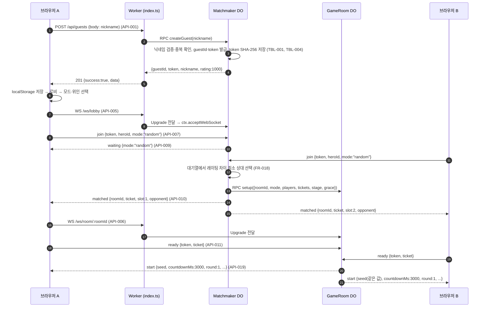
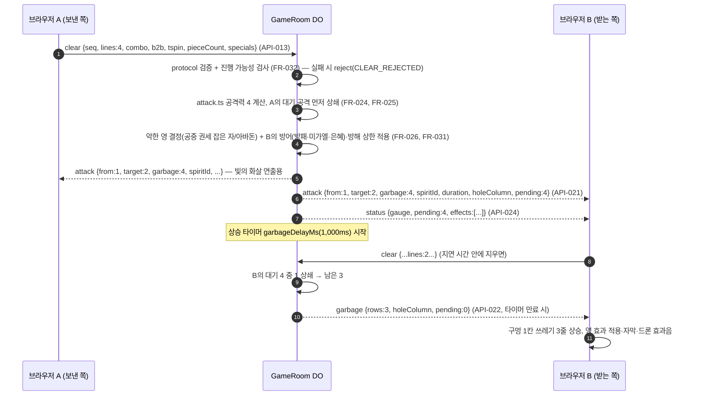
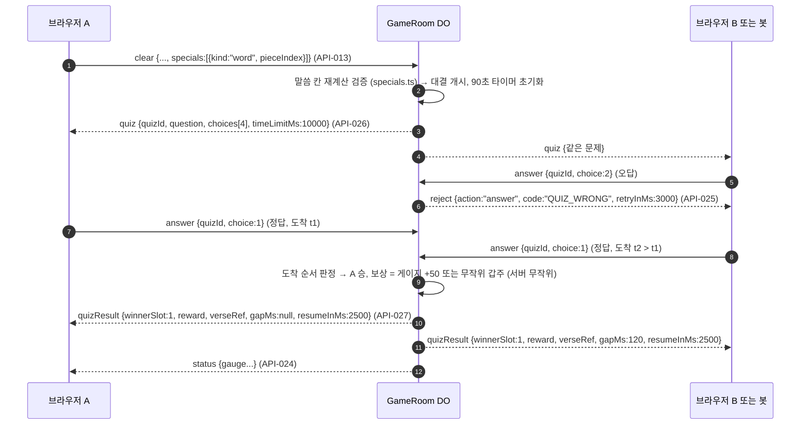
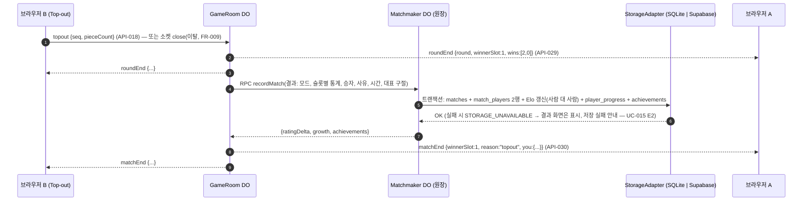

# ✉️ 서신 — 02.samaria-사마리아 / TASK-000

> ⚠️ **파생 문서(Derived).** 이 서신은 원본이 아니다. 직접 수정 금지 — 원본을 고친 뒤 이 서신을 재생성하라.
> 원본: `bible-성경/01.requirement-hearing-들음/spec-tablet-명세서.md`, `bible-성경/02.architecture-foundation-기초/api-gate-성문.md`, `bible-성경/02.architecture-foundation-기초/architecture-temple-성전설계.md` (§8 시퀀스·§10 보안), `bible-성경/02.architecture-foundation-기초/data-ark-법궤.md` (§8 휘발 상태)
> 생성일: 2026-10-19 / 생성 기준: RTM 설계 변경 이력 최종 행 = 2026-10-19 DCL-006 (rtm-covenant-언약추적.md §5 — DCL-001 data-ark §6.1 부록·§7, DCL-002 data-ark TBL-018 `rateLimit`, DCL-003 data-ark TBL-018 `gravity.accelAfterMs`·`ledger.*`, DCL-004 architecture ARCH-002·ARCH-013 착지 평가 위치 + data-ark TBL-018 `placement.weights`, DCL-005 data-ark TBL-018 `net.joinTimeoutMs`·`net.readyTimeoutMs`, DCL-006 data-ark TBL-018 `bot.*` 난이도 수치·`lineBias`·`biasMaxHeight`) · **재생성 2026-10-19 W-02** (W-01 재생성본은 DCL-005·DCL-006 추가로 무효 — acts-행전 README "서신은 무효가 된다")
>
> **규격:** `statute-율법/04.development-repentance-회개/epistle-서신-template.md`
> **이 지역의 개발 계층:** API 엔드포인트 (성문) — WS 프로토콜 검증·속도 제한, REST 핸들러, Matchmaker·GameRoom Durable Object, Worker 진입 라우터 (task-wall 3단계)
> **발췌 원칙:** 아래 `## REQ 원문 발췌`·`## 설계 발췌`의 각 블록은 원본 파일에서 표 행·절을 **그대로 잘라 온 것**이다(요약·의역 0). 블록마다 `— 출처:`를 붙였다. 제목 단계(#)만 이 문서 구조에 맞춰 낮췄다.

## 지역 개요
- TASK-ID: TASK-000 (task-wall §2.0 행전 묶음 — 이 지역의 실행 단위는 아래 태스크)
- 지역: 02.samaria-사마리아
- 이 지역 태스크: TASK-030, TASK-031, TASK-032, TASK-033, TASK-034 ← 상태·짝 배정은 task-wall 참조. 여기 복사하지 않는다.
- 선행 지역: 01.judaea-유대

## 선행 지역 확인
- 직전 지역: 01.judaea-유대
- task-wall 확인: TASK-010-1~TASK-010-4, TASK-011~TASK-014, TASK-015-1, TASK-015-2, TASK-016~TASK-019, TASK-020-1~TASK-020-3 — 이 서신 생성 시점(2026-10-19, Phase 4 계획 완료 직후)의 상태는 전부 ⬜ 미착수다. 이 지역의 Doer·Witness는 **착수 직전에** `bible-성경/04.development-repentance-회개/task-wall-성벽.md`에서 위 태스크 전부 ✅ · 짝 검증 결과 ✅를 직접 확인한다(서신에 완료를 적지 않는다 — acts-행전 README 사용 규칙 3).
- history 이정표: `fruit-열매/history/` 에 "(Acts 9:31) 유대 배치 완료" 이정표 줄이 있어야 착수한다.
- RTM: `/census-count`(UTIL-census) 실계수로 직전 지역 REQ 행 최신 여부를 확인한다.
- 무효 조건: 이 서신 생성 이후 RTM §5 설계 변경 이력에 새 행이 생겼으면 이 서신은 무효 — 재생성 후 착수한다.

## REQ 원문 발췌

### 상위 요구사항 (spec-tablet §4.1)

| ID | 요구사항 (req.md 서두 동사 보존) | 우선순위 | 하위 FR |
|:--|:---|:---:|:---|
| REQ-001 | 사용자가 브라우저에서 KJV 성경 기반 실시간 2인 대전 테트리스를 플레이한다 | High | FR-001~FR-011 |
| REQ-002 | 사용자는 게스트 닉네임으로 입장한다 | High | FR-012 |
| REQ-004 | 사용자는 대전 모드(사람 대 사람, 랜덤 매칭 + 친구 초대 코드)를 고를 수 있다 | High | FR-018~FR-020, FR-078 |
| REQ-005 | 사용자는 AI 봇 대전(쉬움·보통·어려움)을 고를 수 있다 | High | FR-021, FR-022, FR-078 |
| REQ-006 | 사용자는 연습 모드를 고를 수 있다 | Mid | FR-023, FR-078 |
| REQ-007 | 줄을 지우면 상대에게 쓰레기 줄과 악한 영(14종)이 공격으로 간다. 서버가 공격을 판정한다 | High | FR-024~FR-032 |
| REQ-014 | 경기 결과(전적)가 저장되고 조회된다 | High | FR-068, FR-069 |
| REQ-015 | 랭킹(Elo)이 저장되고 조회된다 | High | FR-070, FR-071 |
| REQ-016 | 외부 서비스 키 없이 `npm install && npm run dev` 한 번으로 전부 동작해야 한다. Supabase는 환경변수가 있을 때만 쓰는 어댑터로 둔다 | High | FR-072~FR-074 |

— 출처: bible-성경/01/spec-tablet-명세서.md §4.1 REQ-001, REQ-002, REQ-004, REQ-005, REQ-006, REQ-007, REQ-014, REQ-015, REQ-016

### 기능 요구사항 (spec-tablet §4.2)

#### (spec-tablet §4.2) REQ-001 실시간 2인 대전 테트리스
| ID | 기능명 | 설명 (측정 가능한 형태) | 우선순위 | req.md 근거 |
|:--|:---|:---|:---:|:---|
| FR-005 | 같은 시드 시작 | 대전 라운드 시작 시 서버가 `start` 메시지(시드, 카운트다운)를 두 플레이어에게 보내고, 두 플레이어는 같은 블록 순서로 시작한다 | High | A §2.1, §4.3 |
| FR-006 | 상대 보드 실시간 표시 | 클라이언트는 `state`(seq, 압축 보드, 활성 블록, 점수)를 초당 10~15회 보내고, 상대 화면에 `opponentState`로 표시된다 | High | A §4.3, §5.4 |
| FR-008 | 실시간 통신 프로토콜 | 브라우저 기본 WebSocket(partysocket) 위 JSON 메시지. 클라이언트→서버: join, ready, state, clear, skill, topout. 서버→클라이언트: matched, start, opponentState, attack, effect, roundEnd, matchEnd | High | A §4.2, §4.3 |
| FR-009 | 상대 이탈 처리 | 대전 중 한 플레이어의 연결이 끊기면 서버가 이탈로 판정하고 남은 플레이어를 경기 승자로 `matchEnd`를 보내며, 이탈자는 패배로 전적에 기록된다 | High | 공관복음적 발견 S2 (§9.9) |

#### (spec-tablet §4.2) REQ-002 게스트 입장
| ID | 기능명 | 설명 | 우선순위 | req.md 근거 |
|:--|:---|:---|:---:|:---|
| FR-012 | 게스트 닉네임 입장 | 사용자가 닉네임을 입력해 입장한다. 서버가 닉네임을 검증(길이·허용 문자, 중복 거부 — profiles.nickname unique)하고 게스트 ID와 게스트 토큰을 발급한다. 닉네임·게스트 ID·토큰은 브라우저에 저장되어 재방문 시 다시 입력하지 않는다. 이후 모든 `join`은 이 토큰을 담는다 | High | 서두, A §4.3 join(token), §4.4, §4.6 |

#### (spec-tablet §4.2) REQ-004 · REQ-005 · REQ-006 모드
| ID | 기능명 | 설명 | 우선순위 | req.md 근거 |
|:--|:---|:---|:---:|:---|
| FR-018 | 랜덤 매칭 | Matchmaker가 대기열을 관리하고 레이팅(Elo) 차이가 작은 상대부터 짝지어 `matched`(방 ID, 상대 닉네임·위인)를 보낸다 | High | A §4.1, §4.3, §5.5(3) |
| FR-019 | 친구 초대 코드 | 사용자가 방을 만들면 서버가 초대 코드를 발급하고, 친구가 그 코드를 입력하면 같은 방(GameRoom)으로 입장한다. 잘못된·만료된·가득 찬 코드는 거부 메시지 | High | 서두, A §1.3, §4.3 join(roomCode) |
| FR-020 | 대기 취소·대기열 정리 | 사용자가 매칭 대기를 취소하거나 연결이 끊기면 대기열에서 제거되어, 없는 플레이어와 매칭되지 않는다 | High | 공관복음적 발견 S3 |
| FR-021 | AI 봇 대전 | 쉬움·보통·어려움 3단계 봇과 대전(3판 2선승). 난이도는 봇의 착지 판단 품질과 조작 속도로 구분된다. 봇 대전의 공격도 서버가 판정한다. 봇에게는 4명 중 위인 1명이 무작위 배정된다 | High | 서두, A §5.4, §5.5(3) |
| FR-022 | 봇의 말씀 대결 응답 | 봇 대전 중 말씀 대결이 열리면 봇이 난이도별 정답률·응답 시간으로 답하고, 서버가 사람과 같은 도착 순서 규칙으로 판정한다 | High | 공관복음적 발견 S7 |
| FR-023 | 연습 모드 | 혼자 플레이하며 위인 스킬을 익힌다. 상대·공격·말씀 대결이 없고, 믿음 게이지 충전과 위인 스킬 사용, 여리고 나팔·만나 블록(해금 단계에 따름)이 동작한다. Top-out 시 개인 기록을 보여 준다 | Mid | 서두, A §1.3 |

#### (spec-tablet §4.2) REQ-007 공격 (서버 판정)
| ID | 기능명 | 설명 | 우선순위 | req.md 근거 |
|:--|:---|:---|:---:|:---|
| FR-032 | 서버 진행 검증 | 서버는 `seq` 번호와 `pieceCount`로 불가능한 진행(블록 수보다 많은 줄 삭제, seq 역행, 초당 비정상 횟수)을 거부한다. 스킬 쿨다운과 믿음 게이지는 서버가 관리한다 | High | A §4.3 서버 권한 |

#### (spec-tablet §4.2) REQ-013 디자인 · 액션 · 사운드 · 재미 (첨부 A §5 전체)
| ID | 기능명 | 설명 | 우선순위 | req.md 근거 |
|:--|:---|:---|:---:|:---|
| FR-064 | 감정 표현 리액션 | 대전 중 짧은 리액션 3종(🙏 아멘, 🔥 할렐루야, 😇)을 보내 상대 화면에 표시. 채팅 없음 | High | A §5.4 |

#### (spec-tablet §4.2) REQ-014 전적 · REQ-015 랭킹
| ID | 기능명 | 설명 | 우선순위 | req.md 근거 |
|:--|:---|:---|:---:|:---|
| FR-068 | 경기 결과 저장 | 경기 종료 시 서버(Worker/GameRoom)만 결과를 기록: 방 ID, 두 플레이어, 승자, 두 위인, 경기 시간(ms), 통계. 클라이언트는 직접 기록할 수 없다 | High | 서두, A §4.4 |
| FR-069 | 전적 조회 | 사용자가 전적 화면에서 자기 경기 기록(상대, 위인, 승패, 시간, 일시)을 최신순으로 조회한다 | High | 서두 "조회된다" |
| FR-071 | 랭킹 조회 | 사용자가 랭킹 화면에서 레이팅 상위 100명(닉네임, 레이팅)과 자기 순위를 조회한다 | High | 서두, A §4.4 leaderboard |

#### (spec-tablet §4.2) REQ-016 로컬 실행 · REQ-017 테스트
| ID | 기능명 | 설명 | 우선순위 | req.md 근거 |
|:--|:---|:---|:---:|:---|
| FR-073 | 단일 명령 로컬 실행 | 저장소 루트에서 `npm install && npm run dev` 한 번으로 Vite 개발 서버와 `wrangler dev`(Workers + Durable Objects, 로그인 불필요)가 함께 뜨고, 브라우저 2개로 대전할 수 있다 | High | 서두, A §4.6 |

— 출처: bible-성경/01/spec-tablet-명세서.md §4.2 FR-005, FR-006, FR-008, FR-009, FR-012, FR-018, FR-019, FR-020, FR-021, FR-022, FR-023, FR-032, FR-064, FR-068, FR-069, FR-071, FR-073

### 비기능 요구사항 (spec-tablet §5)

| ID | 분류 | 요구사항 | 측정 방법 | req.md 근거 |
|:--|:---|:---|:---|:---|
| NFR-002 | 성능 | 공격 반영 지연 100ms 이하 (`clear` 송신 → 상대 `attack` 수신) | 로컬 두 브라우저 E2E에서 타임스탬프 차이 측정 | A §7.3 |
| NFR-003 | 보안(봉인의 율법 제7계명) | 서버는 모든 클라이언트 메시지를 스키마 검증하고, 게스트 토큰이 없거나 틀린 `join`을 거부하며, 닉네임 길이·문자를 제한하고, 비정상 빈도 메시지를 차단한다 | 단위 테스트: 잘못된 메시지·토큰 거부 | A §4.3 서버 권한, §4.6 |
| NFR-004 | 보안(봉인의 율법 제1·2계명) | Supabase service role 키는 Worker 환경변수(`.dev.vars` / `wrangler secret`)에만 두고 클라이언트 번들에 절대 포함하지 않는다. 클라이언트에는 anon 공개 키만. `.dev.vars`는 git 제외 | 빌드 산출물 문자열 검사 | A §4.4 |

— 출처: bible-성경/01/spec-tablet-명세서.md §5 NFR-002, NFR-003, NFR-004

### 제약 조건 (spec-tablet §7)

| ID | 제약 | 근거 (req.md) |
|:--|:---|:---|
| C-004 | 외부 서비스 키(Cloudflare 계정, Supabase URL/키)가 하나도 없어도 전부 동작해야 한다 | 서두 인프라, A §4.6 |
| C-006 | Socket.IO·Express를 쓰지 않는다 (브라우저 기본 WebSocket). 참고 소스의 server/는 이전하지 않는다 | A §4.2 |

— 출처: bible-성경/01/spec-tablet-명세서.md §7 C-004, C-006

## 설계 발췌

### 1. API 전체 목록

> Method 열: HTTP 메서드, 또는 WebSocket 메시지 방향(`WS↑` 클라이언트→서버, `WS↓` 서버→클라이언트). 엔드포인트 열의 `lobby`는 API-005 소켓, `room`은 API-006 소켓. FR-008이 정한 기본 메시지 13종은 이름·필드를 보존했고(★), 나머지는 괄호 안 FR이 요구하는 통로다.

| API-ID | Method | Endpoint / 메시지 | 설명 | 연결 REQ | 인증 |
|:---|:---|:---|:---|:---|:---:|
| API-001 | POST | `/api/guests` | 게스트 닉네임 입장 — 게스트 ID·토큰 발급 | REQ-002, FR-012 | ❌ |
| API-002 | GET | `/api/guests/me` | 저장된 토큰 확인·프로필 조회 (재방문) | REQ-002, FR-012 | ✅ |
| API-003 | GET | `/api/matches` | 내 전적 최신순 조회 | REQ-014, FR-069 | ✅ |
| API-004 | GET | `/api/leaderboard` | 랭킹 상위 100 + 내 순위 | REQ-015, FR-071 | ✅ |
| API-005 | GET (Upgrade) | `/ws/lobby` | Matchmaker WebSocket 연결 | REQ-004, FR-008 | ✅ (`join` 토큰) |
| API-006 | GET (Upgrade) | `/ws/room/:roomId` | GameRoom WebSocket 연결 | REQ-001, FR-008 | ✅ (`ready` 토큰 + 티켓) |
| API-007 | WS↑ | lobby `join` ★ | 랜덤 매칭·초대 코드 만들기/입장·봇 대전·연습 요청 | REQ-004, REQ-005, REQ-006, FR-018, FR-019, FR-021, FR-023 | ✅ |
| API-008 | WS↑ | lobby `cancel` | 매칭 대기·초대 대기 취소 (FR-020) | REQ-004, FR-020 | ✅ |
| API-009 | WS↓ | lobby `waiting` | 대기 상태 + 발급된 초대 코드 (FR-019) | REQ-004, FR-019 | ✅ |
| API-010 | WS↓ | lobby `matched` ★ | 방 배정 (roomId, 입장 티켓, 상대) | REQ-004, REQ-005, FR-018 | ✅ |
| API-011 | WS↑ | room `ready` ★ | 방 입장 인증 + 준비 완료 | REQ-001, FR-005, FR-008 | ✅ |
| API-012 | WS↑ | room `state` ★ | 내 보드 스냅샷 (초당 12회) | REQ-001, FR-006 | ✅ |
| API-013 | WS↑ | room `clear` ★ | 줄 삭제 정보 (공격 계산용) | REQ-007, FR-024, FR-032 | ✅ |
| API-014 | WS↑ | room `skill` ★ | 위인 스킬 / 천사 소환 | REQ-008, FR-034, FR-035 | ✅ |
| API-015 | WS↑ | room `armor` | 전신갑주 사용 (FR-037) | REQ-009, FR-037 | ✅ |
| API-016 | WS↑ | room `answer` | 말씀 대결 응답 (FR-041) | REQ-011, FR-041 | ✅ |
| API-017 | WS↑ | room `reaction` | 리액션 보내기 (FR-064) | REQ-013, FR-064 | ✅ |
| API-018 | WS↑ | room `topout` ★ | 게임 오버 (연습은 그만하기 포함) | REQ-001, FR-007, FR-023 | ✅ |
| API-019 | WS↓ | room `start` ★ | 라운드 시작 (같은 시드, 카운트다운) | REQ-001, FR-005 | ✅ |
| API-020 | WS↓ | room `opponentState` ★ | 상대 보드 스냅샷 | REQ-001, FR-006 | ✅ |
| API-021 | WS↓ | room `attack` ★ | 서버 판정 공격 (쓰레기 줄 + 악한 영) | REQ-007, FR-024~FR-031 | ✅ |
| API-022 | WS↓ | room `garbage` | 대기 공격의 쓰레기 줄 상승 지시 (FR-025) | REQ-007, FR-025, FR-016 | ✅ |
| API-023 | WS↓ | room `effect` ★ | 스킬·천사·갑주·예수님·특수 블록·은혜 발동 | REQ-008, REQ-009, REQ-010, REQ-012, FR-034~FR-039 | ✅ |
| API-024 | WS↓ | room `status` | 서버 관리 수치 (게이지·쿨다운·갑주·효과·대기 공격) (FR-033) | REQ-008, FR-033 | ✅ |
| API-025 | WS↓ | room `reject` | 행동 거부 피드백 (FR-034) | REQ-008, FR-034, FR-032 | ✅ |
| API-026 | WS↓ | room `quiz` | 말씀 대결 문제 (FR-041) | REQ-011, FR-040, FR-041 | ✅ |
| API-027 | WS↓ | room `quizResult` | 말씀 대결 판정·보상·해설·니어미스 (FR-041, FR-042) | REQ-011, FR-041, FR-042 | ✅ |
| API-028 | WS↓ | room `reaction` | 상대 리액션 표시 (FR-064) | REQ-013, FR-064 | ✅ |
| API-029 | WS↓ | room `roundEnd` ★ | 라운드 승패 | REQ-001, FR-007 | ✅ |
| API-030 | WS↓ | room `matchEnd` ★ | 경기 승패·개인 기록·성장·레이팅·업적 | REQ-001, REQ-014, REQ-015, FR-007, FR-009, FR-063, FR-065, FR-066 | ✅ |
| API-031 | WS↓ | lobby·room `error` | 치명 오류 후 소켓 종료 (NFR-003) | NFR-003 | — |

> 합계: HTTP 4 + WebSocket 엔드포인트 2 + WebSocket 메시지 25 = **31**.

— 출처: bible-성경/02/api-gate-성문.md §1

### 2. 공통 규약

| 항목 | 규격 |
|:---|:---|
| Base URL (브라우저 기준) | `http://localhost:5173` — 클라이언트는 상대 경로 `/api/...`, `/ws/...`만 쓴다. Vite 프록시가 `http://127.0.0.1:8787`(wrangler dev)로 전달 (`ws: true`) — architecture D-03 |
| 콘텐츠 타입 | REST: `application/json; charset=utf-8` / WebSocket: UTF-8 텍스트 프레임 1개 = JSON 1개 |
| 인증 방식 | REST: `Authorization: Bearer <guestToken>` / WebSocket: 브라우저가 헤더를 못 붙이므로 첫 메시지(`join`, `ready`) 본문의 `token` (§5) |
| REST 공통 응답 | `{"success": true, "data": ...}` / `{"success": false, "error": {"code": "SNAKE_CASE", "message": "한국어 메시지"}}` / 목록은 `meta` 추가 |
| WS 공통 봉투 | 정상: `{"type": "<메시지명>", "data": { ... }}` / 치명 오류: `{"type": "error", "error": {"code": "...", "message": "..."}}` 후 소켓 종료 (REST와 같은 `code`·`message` 구조 — "변하지 않는" 응답, Malachi 3:6) |
| 페이징 | 커서(키셋) 방식 — 무한 증가하는 전적에 OFFSET을 쓰지 않는다. 요청 `limit`(1~50, 기본 20) + `before`(ISO-8601, 이 시각보다 이전), 응답 `meta: {"size": n, "nextBefore": "ISO-8601" 또는 null}` |
| 시간 표기 | ISO-8601 UTC 문자열 (`2026-10-19T14:30:00.000Z`), 기간·남은 시간은 정수 ms |
| 메시지 크기 | WebSocket 프레임 최대 4,096바이트(rules.json `rateLimit.maxMessageBytes`), REST 본문 최대 1,024바이트 — 초과 시 BAD_MESSAGE / PAYLOAD_TOO_LARGE |
| 속도 제한 | 소켓별 토큰 버킷 (data-ark TBL-018 `rateLimit`): state 20/초, clear 10/초, skill·armor 5/초, answer 4/초, reaction 1/2초, 전체 40/초. 초과분: state·reaction은 조용히 버림(UC-017 E2), 나머지는 `reject RATE_LIMITED`, 전체 한도 3초 연속 초과 시 `error RATE_LIMITED` 후 종료. REST 게스트 생성은 접속 주소별 분당 5회(메모리 계수만, 저장 안 함) |
| 검증 원칙 | 서버는 모든 메시지를 `type`별 스키마로 검증(필수·타입·범위·열거·추가 필드 무시)하고 실패 시 공격·효과를 만들지 않는다 (NFR-003, ARCH-015) |
| 버전 | 프로토콜 버전 1 — `start`·`matched`에 `"protocol": 1` 포함 |

— 출처: bible-성경/02/api-gate-성문.md §2

### API-001: 게스트 닉네임 입장

| 항목 | 내용 |
|:---|:---|
| API-ID | API-001 |
| Method | POST |
| Endpoint | /api/guests |
| 설명 | 닉네임을 검증하고 게스트 ID·토큰을 발급, 프로필(레이팅 1000)과 진행 기록 생성 |
| 연결 REQ | REQ-002, FR-012, NFR-003, NFR-008 |
| 연결 UC | UC-001 |
| 인증 필요 | ❌ |
| 연결 TBL | TBL-001 (profiles), TBL-004 (player_progress) |

**요청(Request):**
| 파라미터 | 타입 | 필수 | 설명 | 검증 규칙 |
|:---|:---|:---:|:---|:---|
| nickname | String (Body) | ✅ | 닉네임 | trim 후 `^[가-힣A-Za-z0-9_]{2,12}$`, 대소문자 무시 중복 불가 |

**응답(Response) — 성공 (201):**
```json
{
  "success": true,
  "data": {
    "guestId": "6f1c2a9e-3b7d-4c51-9e2a-0d8f4b6a1c37",
    "nickname": "다윗의물맷돌",
    "token": "q8ZJ0v3Yb7rT1mXo2LkP9sW4nE6hD5cA0uGfR8yIzQw",
    "rating": 1000,
    "createdAt": "2026-10-19T14:30:00.000Z"
  }
}
```

**응답 — 실패 (4xx/5xx):**
```json
{
  "success": false,
  "error": { "code": "NICKNAME_TAKEN", "message": "이미 사용 중인 닉네임입니다." }
}
```

**비즈니스 에러:**
| 에러 코드 | HTTP | 설명 |
|:---|:---:|:---|
| BAD_REQUEST | 400 | JSON 파싱 실패·본문 없음 |
| NICKNAME_INVALID | 400 | 빈값·길이·허용 문자 위반 (UC-001 E1) |
| NICKNAME_TAKEN | 409 | 중복 닉네임 (UC-001 E2) |
| PAYLOAD_TOO_LARGE | 413 | 본문 1,024바이트 초과 |
| RATE_LIMITED | 429 | 분당 5회 초과 |
| STORAGE_UNAVAILABLE | 503 | 원장 저장 실패 (Supabase 연결 실패 포함 — UC-021 E2) |
| INTERNAL_ERROR | 500 | 그 밖의 서버 오류 |

— 출처: bible-성경/02/api-gate-성문.md API-001

### API-002: 토큰 확인·내 프로필

| 항목 | 내용 |
|:---|:---|
| API-ID | API-002 |
| Method | GET |
| Endpoint | /api/guests/me |
| 설명 | 브라우저에 저장된 토큰을 검증하고 프로필 반환 — 성공하면 닉네임 입력 없이 로비 (UC-001 1a) |
| 연결 REQ | REQ-002, FR-012 |
| 연결 UC | UC-001 |
| 인증 필요 | ✅ |
| 연결 TBL | TBL-001, TBL-004 |

**요청(Request):**
| 파라미터 | 타입 | 필수 | 설명 | 검증 규칙 |
|:---|:---|:---:|:---|:---|
| Authorization | String (Header) | ✅ | `Bearer <token>` | base64url 43자 |

**응답 — 성공 (200):**
```json
{
  "success": true,
  "data": { "guestId": "6f1c2a9e-3b7d-4c51-9e2a-0d8f4b6a1c37", "nickname": "다윗의물맷돌", "rating": 1016, "roundsPlayed": 7 }
}
```

**응답 — 실패:**
| 에러 코드 | HTTP | 설명 |
|:---|:---:|:---|
| UNAUTHORIZED | 401 | 토큰 없음·형식 오류·일치 프로필 없음 → 클라이언트는 `swt.guest`를 지우고 입장 화면 (UC-001 E3) |
| STORAGE_UNAVAILABLE | 503 | 원장 조회 실패 (UC-001 E4 재시도) |

— 출처: bible-성경/02/api-gate-성문.md API-002

### API-003: 내 전적 조회

| 항목 | 내용 |
|:---|:---|
| API-ID | API-003 |
| Method | GET |
| Endpoint | /api/matches |
| 설명 | 내 경기 기록을 최신순으로 (상대·위인·승패·시간·일시) |
| 연결 REQ | REQ-014, FR-069 |
| 연결 UC | UC-018 |
| 인증 필요 | ✅ |
| 연결 TBL | TBL-002 (matches), TBL-003 (match_players), TBL-001 (상대 닉네임) |

**요청(Request):**
| 파라미터 | 타입 | 필수 | 설명 | 검증 규칙 |
|:---|:---|:---:|:---|:---|
| Authorization | String (Header) | ✅ | Bearer 토큰 | API-002와 같음 |
| limit | Integer (Query) | ⬜ | 페이지 크기 | 기본 20, 1~50 |
| before | String (Query) | ⬜ | 이 시각 이전 기록 | ISO-8601 UTC |

**응답 — 성공 (200):**
```json
{
  "success": true,
  "data": [
    {
      "matchId": "b2d7c1e0-8a41-4f6b-9c3e-5a7d2f1e0b94",
      "mode": "random",
      "botLevel": null,
      "result": "win",
      "endReason": "topout",
      "durationMs": 312480,
      "playedAt": "2026-10-19T14:52:10.120Z",
      "me": { "heroId": "david", "roundsWon": 2, "ratingBefore": 1000, "ratingAfter": 1016 },
      "opponent": { "nickname": "바울의옥문", "isBot": false, "heroId": "paul", "roundsWon": 1 }
    },
    {
      "matchId": "0c9e4b2a-7d13-4e8f-a6b5-3f2d1c0e9a87",
      "mode": "bot",
      "botLevel": "normal",
      "result": "loss",
      "endReason": "topout",
      "durationMs": 201330,
      "playedAt": "2026-10-19T14:40:02.004Z",
      "me": { "heroId": "peter", "roundsWon": 0, "ratingBefore": null, "ratingAfter": null },
      "opponent": { "nickname": null, "isBot": true, "heroId": "solomon", "roundsWon": 2 }
    }
  ],
  "meta": { "size": 2, "nextBefore": null }
}
```

**응답 — 실패:**
| 에러 코드 | HTTP | 설명 |
|:---|:---:|:---|
| UNAUTHORIZED | 401 | 토큰 검증 실패 → UC-001 (UC-018 E2) |
| INVALID_QUERY | 400 | limit 범위·before 형식 위반 |
| STORAGE_UNAVAILABLE | 503 | 조회 실패 → "전적을 불러오지 못했습니다" + 재시도 (UC-018 E1) |

> 기록 0건이면 `data: []` (UC-018 4a 안내는 클라이언트). 봇 상대 표시 이름은 클라이언트가 "봇 (난이도)"로 만든다.

— 출처: bible-성경/02/api-gate-성문.md API-003

### API-004: 랭킹 조회

| 항목 | 내용 |
|:---|:---|
| API-ID | API-004 |
| Method | GET |
| Endpoint | /api/leaderboard |
| 설명 | 레이팅 상위 100명(닉네임·레이팅·순위)과 요청자의 순위 |
| 연결 REQ | REQ-015, FR-071 |
| 연결 UC | UC-019 |
| 인증 필요 | ✅ |
| 연결 TBL | TBL-006 (leaderboard VIEW), TBL-001 |

**요청(Request):**
| 파라미터 | 타입 | 필수 | 설명 | 검증 규칙 |
|:---|:---|:---:|:---|:---|
| Authorization | String (Header) | ✅ | Bearer 토큰 | API-002와 같음 |

**응답 — 성공 (200):**
```json
{
  "success": true,
  "data": {
    "top": [
      { "rank": 1, "nickname": "솔로몬의지혜", "rating": 1184, "isMe": false },
      { "rank": 2, "nickname": "다윗의물맷돌", "rating": 1016, "isMe": true }
    ],
    "me": { "rank": 2, "nickname": "다윗의물맷돌", "rating": 1016 }
  },
  "meta": { "size": 2, "nextBefore": null }
}
```

**응답 — 실패:**
| 에러 코드 | HTTP | 설명 |
|:---|:---:|:---|
| UNAUTHORIZED | 401 | 토큰 검증 실패 |
| STORAGE_UNAVAILABLE | 503 | 조회 실패 → 재시도 (UC-019 E1) |

> 내가 100위 밖이면 `top`에 내 행이 없고 `me`로 따로 표시 (UC-019 3a). 응답에 guestId를 넣지 않는다(봉인 제1계명).

— 출처: bible-성경/02/api-gate-성문.md API-004

### API-005: 로비 소켓 연결 (Matchmaker)

| 항목 | 내용 |
|:---|:---|
| API-ID | API-005 |
| Method | GET (`Upgrade: websocket`) |
| Endpoint | /ws/lobby |
| 설명 | Worker가 Origin 검사 후 Matchmaker(`idFromName("global")`)로 전달, DO가 `ctx.acceptWebSocket()` (Hibernation) |
| 연결 REQ | REQ-004, FR-008, C-006 |
| 연결 UC | UC-003, UC-004, UC-005, UC-006 |
| 인증 필요 | ✅ — 연결 후 5초 안에 `join`(토큰) 필수 |
| 연결 TBL | TBL-001 (토큰 검증, 레이팅) |

**요청(Request):**
| 파라미터 | 타입 | 필수 | 설명 | 검증 규칙 |
|:---|:---|:---:|:---|:---|
| Upgrade | Header | ✅ | `websocket` | 아니면 426 |
| Origin | Header | ✅ | 브라우저 출처 | `ALLOWED_ORIGINS` 목록 안 |

**응답 — 성공 (101 Switching Protocols):** 소켓 수립. 이후 메시지는 API-007~API-010, API-031.

**응답 — 실패:**
| 에러 코드 | HTTP / Close | 설명 |
|:---|:---:|:---|
| UPGRADE_REQUIRED | 426 | Upgrade 헤더 없음 |
| ORIGIN_FORBIDDEN | 403 | 허용되지 않은 출처 |
| AUTH_TIMEOUT | Close 4001 | 5초 안에 `join` 없음 |

— 출처: bible-성경/02/api-gate-성문.md API-005

### API-006: 방 소켓 연결 (GameRoom)

| 항목 | 내용 |
|:---|:---|
| API-ID | API-006 |
| Method | GET (`Upgrade: websocket`) |
| Endpoint | /ws/room/:roomId |
| 설명 | Worker가 roomId 형식 검사 후 GameRoom(`idFromName(roomId)`)으로 전달 |
| 연결 REQ | REQ-001, FR-008 |
| 연결 UC | UC-003, UC-004, UC-005, UC-006 |
| 인증 필요 | ✅ — 연결 후 10초 안에 `ready`(토큰 + 티켓) 필수 |
| 연결 TBL | 없음 (GameRoom 휘발 상태 — data-ark §8.2) |

**요청(Request):**
| 파라미터 | 타입 | 필수 | 설명 | 검증 규칙 |
|:---|:---|:---:|:---|:---|
| roomId | String (Path) | ✅ | `matched.roomId` | UUID v4 형식 (36자) |
| Upgrade / Origin | Header | ✅ | API-005와 같음 | API-005와 같음 |

**응답 — 성공 (101):** 이후 메시지는 API-011~API-031.

**응답 — 실패:**
| 에러 코드 | HTTP / Close | 설명 |
|:---|:---:|:---|
| UPGRADE_REQUIRED | 426 | Upgrade 헤더 없음 |
| ORIGIN_FORBIDDEN | 403 | 허용되지 않은 출처 |
| ROOM_NOT_FOUND | 404 / Close 4004 | 형식 오류(404) 또는 설정되지 않은 방(소켓 수립 후 `error` + 4004) |
| AUTH_TIMEOUT | Close 4001 | 10초 안에 `ready` 없음 |

— 출처: bible-성경/02/api-gate-성문.md API-006

### API-007: `join` — 매칭·초대·봇·연습 요청 (lobby ↑)

| 항목 | 내용 |
|:---|:---|
| API-ID | API-007 |
| Method | WS↑ |
| Endpoint | lobby `join` (req.md A §4.3 `{ token, heroId, roomCode? }` 보존 + mode·botLevel) |
| 설명 | 토큰 검증 후 모드별 처리: random → 대기열, invite(roomCode 없음) → 코드 발급, invite(roomCode 있음) → 코드 방 입장, bot·practice → 즉시 방 배정 |
| 연결 REQ | REQ-004, REQ-005, REQ-006, FR-013, FR-018, FR-019, FR-021, FR-023 |
| 연결 UC | UC-002, UC-003, UC-004, UC-005, UC-006 |
| 인증 필요 | ✅ |
| 연결 TBL | TBL-001 (토큰·레이팅), TBL-004 (해금 단계·은혜 — 방 설정에 전달) |

**요청(Request):**
| 파라미터 | 타입 | 필수 | 설명 | 검증 규칙 |
|:---|:---|:---:|:---|:---|
| token | String | ✅ | 게스트 토큰 | 원장 해시 일치 |
| heroId | String | ✅ | 선택 위인 | CODE-003 |
| mode | String | ✅ | CODE-001 | `random` · `invite` · `bot` · `practice` |
| roomCode | String | ⬜ | 친구 초대 코드 (입장 시) | mode=invite일 때만, 6자, `invite.alphabet` 문자만, 대문자 변환 후 비교 |
| botLevel | String | ⬜ | 봇 난이도 | mode=bot이면 필수, CODE-002 |

```json
{ "type": "join", "data": { "token": "q8ZJ0v3Yb7rT1mXo2LkP9sW4nE6hD5cA0uGfR8yIzQw", "heroId": "david", "mode": "invite", "roomCode": "K7QM2X" } }
```

**응답(Response) — 성공:** random·invite 생성 → API-009 `waiting` / 짝이 맺어지거나 invite 입장·bot·practice → API-010 `matched`

**응답 — 실패 (`error` 후 소켓 유지 여부):**
| 에러 코드 | 처리 | 설명 |
|:---|:---|:---|
| UNAUTHORIZED | `error` + Close 4001 | 토큰 검증 실패 → UC-001 (UC-003 E3) |
| BAD_MESSAGE | `error` + Close 4000 | 스키마 위반 |
| HERO_INVALID | `error` + Close 4000 | heroId가 4명 밖 (C-008) |
| MODE_INVALID | `error` + Close 4000 | mode·botLevel 조합 위반 |
| INVITE_NOT_FOUND | `error` + Close 4404 | 없는·만료된 코드 (UC-004 E1) |
| INVITE_FULL | `error` + Close 4409 | 이미 두 명이 들어간 코드 (UC-004 E2) |
| ALREADY_QUEUED | `error` + Close 4409 | 같은 게스트가 다른 로비 소켓으로 이미 대기 중 |
| STORAGE_UNAVAILABLE | `error` + Close 1011 | 원장 조회 실패 |

— 출처: bible-성경/02/api-gate-성문.md API-007

### API-008: `cancel` — 대기 취소 (lobby ↑)

| 항목 | 내용 |
|:---|:---|
| API-ID | API-008 |
| Method | WS↑ |
| Endpoint | lobby `cancel` |
| 설명 | 대기열에서 제거하거나(랜덤) 초대 코드를 무효화(방장)한 뒤 서버가 Close 1000(`cancelled`) |
| 연결 REQ | REQ-004, FR-020 |
| 연결 UC | UC-003 2a, UC-004 2a |
| 인증 필요 | ✅ (`join` 이후에만 유효) |
| 연결 TBL | 없음 (소켓 첨부 — data-ark §8.1) |

**요청(Request):**
| 파라미터 | 타입 | 필수 | 설명 | 검증 규칙 |
|:---|:---|:---:|:---|:---|
| (없음) | — | — | `{"type":"cancel","data":{}}` | `join` 전이면 무시 |

**응답 — 성공:** Close 1000 reason `cancelled` — 클라이언트는 로비로 이동

**응답 — 실패:**
| 에러 코드 | 처리 | 설명 |
|:---|:---|:---|
| BAD_MESSAGE | `error` + Close 4000 | 스키마 위반 |

> 취소 메시지 없이 소켓이 닫혀도 같은 정리를 한다(`webSocketClose`) — 유령 매칭 방지 (UC-003 E1).

— 출처: bible-성경/02/api-gate-성문.md API-008

### API-009: `waiting` — 대기 상태 (lobby ↓)

| 항목 | 내용 |
|:---|:---|
| API-ID | API-009 |
| Method | WS↓ |
| Endpoint | lobby `waiting` |
| 설명 | 랜덤 매칭 대기 시작 또는 초대 코드 발급 알림 |
| 연결 REQ | REQ-004, FR-018, FR-019 |
| 연결 UC | UC-003 2단계, UC-004 2단계 |
| 인증 필요 | ✅ |
| 연결 TBL | 없음 (소켓 첨부) |

**요청(Request) — 발생 조건:**
| 파라미터 | 타입 | 필수 | 설명 | 검증 규칙 |
|:---|:---|:---:|:---|:---|
| (트리거) | — | — | `join` mode=random, 또는 mode=invite + roomCode 없음 | — |

**응답(Response) — 페이로드:**
```json
{ "type": "waiting", "data": { "mode": "invite", "inviteCode": "K7QM2X", "inviteExpiresAt": "2026-10-19T14:40:00.000Z" } }
```
| 필드 | 타입 | 설명 |
|:---|:---|:---|
| mode | String | `random` · `invite` |
| inviteCode | String \| null | invite 방장일 때 6자 코드 |
| inviteExpiresAt | String \| null | 발급 + 10분 |

**비즈니스 에러:** 없음 (발신 전용 메시지). 코드 만료 시 서버가 `error INVITE_EXPIRED` + Close 4408.

— 출처: bible-성경/02/api-gate-성문.md API-009

### API-010: `matched` — 방 배정 (lobby ↓)

| 항목 | 내용 |
|:---|:---|
| API-ID | API-010 |
| Method | WS↓ |
| Endpoint | lobby `matched` (req.md A §4.3 `{ roomId, opponent: { nickname, heroId } }` 보존 + ticket·slot·mode) |
| 설명 | Matchmaker가 GameRoom `setup` RPC 완료 후 각 플레이어에게 방·입장 티켓을 알리고 Close 1000(`matched`) |
| 연결 REQ | REQ-004, REQ-005, REQ-006, FR-018, FR-019, FR-021, FR-023 |
| 연결 UC | UC-003 4단계, UC-004 6단계, UC-005 3단계, UC-006 |
| 인증 필요 | ✅ |
| 연결 TBL | TBL-001 (상대 닉네임·레이팅), TBL-004 (방 설정의 해금 단계·은혜) |

**요청(Request) — 발생 조건:**
| 파라미터 | 타입 | 필수 | 설명 | 검증 규칙 |
|:---|:---|:---:|:---|:---|
| (트리거) | — | — | 대기열 짝짓기(레이팅 차이 최소, 1명뿐이면 그 사람 — UC-003 3a) / 초대 코드 입장 / bot·practice 요청 | — |

**응답(Response) — 페이로드:**
```json
{
  "type": "matched",
  "data": {
    "protocol": 1,
    "roomId": "b2d7c1e0-8a41-4f6b-9c3e-5a7d2f1e0b94",
    "ticket": "Xr4mT9pL2vQ8cN1sB6hZ0kWy",
    "slot": 1,
    "mode": "bot",
    "opponent": { "nickname": null, "heroId": "solomon", "rating": null, "isBot": true, "botLevel": "hard" }
  }
}
```
| 필드 | 타입 | 설명 |
|:---|:---|:---|
| roomId | String | UUID — API-006 경로 |
| ticket | String | 1회용 입장 티켓 (24자 무작위, 방 설정에는 SHA-256만) |
| slot | Integer | 1 또는 2 |
| opponent | Object \| null | 연습이면 null. 봇은 위인 무작위 배정 (FR-021) |

**비즈니스 에러:** 없음 (발신 전용). GameRoom 설정 실패 시 `error MATCH_SETUP_FAILED` + Close 1011, 대기열 복귀 없음(클라이언트가 재요청).

— 출처: bible-성경/02/api-gate-성문.md API-010

### API-011: `ready` — 방 입장 인증·준비 (room ↑)

| 항목 | 내용 |
|:---|:---|
| API-ID | API-011 |
| Method | WS↑ |
| Endpoint | room `ready` |
| 설명 | 토큰·티켓 검증 후 슬롯에 소켓 연결. 대전은 두 슬롯(봇 슬롯은 즉시) 준비되면, 연습은 바로 `start` |
| 연결 REQ | REQ-001, FR-005, FR-008 |
| 연결 UC | UC-003 5단계, UC-004 6단계 |
| 인증 필요 | ✅ |
| 연결 TBL | TBL-001 (토큰 검증 — Matchmaker RPC) |

**요청(Request):**
| 파라미터 | 타입 | 필수 | 설명 | 검증 규칙 |
|:---|:---|:---:|:---|:---|
| token | String | ✅ | 게스트 토큰 | 방 설정 guestId와 일치 |
| ticket | String | ✅ | `matched.ticket` | SHA-256 일치, 1회용 |

**응답 — 성공:** API-019 `start` (양측)

**응답 — 실패:**
| 에러 코드 | 처리 | 설명 |
|:---|:---|:---|
| UNAUTHORIZED | `error` + Close 4001 | 토큰 불일치 |
| TICKET_INVALID | `error` + Close 4003 | 티켓 불일치·재사용 |
| ROOM_NOT_FOUND | `error` + Close 4004 | 설정 없는 방 |
| OPPONENT_LEFT | `error` + Close 4410 | 상대가 `ready` 전에 끊김 → 클라이언트는 매칭 대기로 복귀 (UC-003 E2), 방 폐기 |

— 출처: bible-성경/02/api-gate-성문.md API-011

### API-012: `state` — 내 보드 스냅샷 (room ↑)

| 항목 | 내용 |
|:---|:---|
| API-ID | API-012 |
| Method | WS↑ |
| Endpoint | room `state` (req.md A §4.3 `{ seq, board(압축), active, score }` 보존) |
| 설명 | 초당 12회(rules `net.stateHz`) 상대 화면 표시용 스냅샷. 서버는 위기(위험선 진입) 판정에만 쓰고(예수님 이벤트 FR-039, 만나 확률 상한 FR-046), 상대에게 API-020으로 중계 |
| 연결 REQ | REQ-001, REQ-010, FR-006, FR-039, FR-055 |
| 연결 UC | UC-007 7단계, UC-012 |
| 인증 필요 | ✅ (`ready` 이후) |
| 연결 TBL | 없음 (휘발) |

**요청(Request):**
| 파라미터 | 타입 | 필수 | 설명 | 검증 규칙 |
|:---|:---|:---:|:---|:---|
| seq | Integer | ✅ | 메시지 순번 | 직전 값보다 큼 (아니면 버림) |
| board | String | ✅ | 200자 셀 코드 (CODE-009) | 정확히 200자, `[0-9]`만 |
| active | Object \| null | ✅ | `{type, x, y, rot}` | type ∈ IOTSZJL, x −2~11, y −2~21, rot 0~3 |
| hold | String \| null | ✅ | 홀드 블록 | IOTSZJL 또는 null |
| score | Integer | ✅ | 점수 | 0 이상 |
| combo | Integer | ✅ | 현재 콤보 | −1 이상 (−1 = 콤보 없음) |
| pieceCount | Integer | ✅ | 놓은 블록 수 | 단조 증가 |

**응답 — 성공:** 응답 없음 (상대에게 API-020, 위기 + 게이지 가득이면 API-023 `effect source=jesus`)

**응답 — 실패:** 스키마 위반·속도 초과는 조용히 버림 (전체 한도 지속 초과만 API-031). 버린 횟수는 서버 로그에 기록.

— 출처: bible-성경/02/api-gate-성문.md API-012

### API-013: `clear` — 줄 삭제 (room ↑)

| 항목 | 내용 |
|:---|:---|
| API-ID | API-013 |
| Method | WS↑ |
| Endpoint | room `clear` (req.md A §4.3 `{ seq, lines, combo, b2b, tspin, pieceCount }` 보존 + specials) |
| 설명 | 진행 가능성 검증 → 게이지 충전 → 공격력 계산(attack.ts) → 내 대기 공격 상쇄 → 남은 공격을 상대 방어·은혜·상한 적용 후 전송 → 특수 칸 효과 |
| 연결 REQ | REQ-007, REQ-008, REQ-009, REQ-011, REQ-012, FR-004, FR-024~FR-026, FR-032, FR-033, FR-036, FR-040, FR-044~FR-046 |
| 연결 UC | UC-007 6단계, UC-008, UC-011, UC-013, UC-014 |
| 인증 필요 | ✅ |
| 연결 TBL | TBL-018 (attack·gauge·specials 수치), TBL-013 (악한 영) |

**요청(Request):**
| 파라미터 | 타입 | 필수 | 설명 | 검증 규칙 |
|:---|:---|:---:|:---|:---|
| seq | Integer | ✅ | 메시지 순번 | 직전 `clear`·`state`보다 큼 |
| lines | Integer | ✅ | 지운 줄 수 | 1~4 |
| combo | Integer | ✅ | 콤보 (0 = 첫 삭제) | 0 이상, 직전 clear의 combo+1 또는 0 |
| b2b | Boolean | ✅ | Back-to-Back 여부 | 직전 삭제가 테트리스/T-Spin일 때만 true |
| tspin | Boolean | ✅ | T-Spin 여부 | true이면 lines ≤ 3 |
| pieceCount | Integer | ✅ | 이 삭제를 만든 블록 번호 | 단조 증가, 초당 증가량 ≤ 10 |
| specials | Array | ✅ | 지운 줄에 있던 특수 칸 `[{kind, pieceIndex, armorId?}]` | 최대 4개, kind CODE-013, `engine/specials.js` 재계산과 일치(말씀·갑주 정확 일치, 여리고·만나 최대 확률 이하), 해금 단계 충족 |

**진행 불가능성 검사 (FR-032):** ① seq 역행 ② pieceCount 감소 또는 초당 10 초과 ③ 누적 지운 줄 × 10 > 누적 pieceCount × 4 + 받은 쓰레기 줄 × 9 + 납 블록 칸 (블록 수보다 많은 줄 삭제) ④ lines·tspin·b2b 조합 위반 → 하나라도 걸리면 거부.

**응답 — 성공:** 공격 발생 시 API-021 `attack`(양측) / 내 수치 변화 API-024 `status` / 특수 칸 API-023 `effect`(여리고·만나·갑주 획득) / 말씀 칸 API-026 `quiz`

**응답 — 실패:**
```json
{ "type": "reject", "data": { "action": "clear", "code": "CLEAR_REJECTED", "message": "진행 기록이 올바르지 않아 공격이 취소되었습니다.", "retryInMs": null } }
```
| 에러 코드 | 처리 | 설명 |
|:---|:---|:---|
| CLEAR_REJECTED | `reject` | 진행 불가능 — 공격 없음, 서버 로그 기록, 클라이언트 진행은 계속 (UC-007 E4, UC-008 E1) |
| NOT_ACTIVE | `reject` | 라운드 대기·말씀 대결 정지 중 |
| RATE_LIMITED | `reject` | clear 초당 10회 초과 |

— 출처: bible-성경/02/api-gate-성문.md API-013

### API-014: `skill` — 위인 스킬 / 천사 소환 (room ↑)

| 항목 | 내용 |
|:---|:---|
| API-ID | API-014 |
| Method | WS↑ |
| Endpoint | room `skill` (req.md A §4.3의 `skillId` 필드 보존 + kind) |
| 설명 | 서버가 게이지·쿨다운·봉인·모드를 검증하고 게이지를 차감한 뒤 효과 적용·통보 |
| 연결 REQ | REQ-003, REQ-008, FR-014~FR-017, FR-034, FR-035 |
| 연결 UC | UC-009, UC-010 |
| 인증 필요 | ✅ |
| 연결 TBL | TBL-011, TBL-012, TBL-018 (`heroSkills`, `angels`) |

**요청(Request):**
| 파라미터 | 타입 | 필수 | 설명 | 검증 규칙 |
|:---|:---|:---:|:---|:---|
| kind | String | ✅ | CODE-015 | `hero` · `angel` |
| skillId | String | ✅ | hero: 내 위인의 `skill_id` / angel: CODE-011 | 내 위인 스킬만 허용, 천사는 대전에서만 |

**응답 — 성공:** API-023 `effect`(양측) + API-024 `status`

**응답 — 실패:**
| 에러 코드 | 처리 | 설명 |
|:---|:---|:---|
| GAUGE_LOW | `reject` | 게이지 부족 — "믿음이 부족합니다" (UC-009 E1, UC-010 E2) |
| COOLDOWN | `reject` + `retryInMs` | 쿨다운 중 (UC-009 E2) |
| ANGEL_SEALED | `reject` + `retryInMs` | 바사 왕국의 군주 봉인 중 (UC-010 E1) |
| SKILL_INVALID | `reject` | 내 위인이 아닌 스킬·없는 천사 |
| MODE_FORBIDDEN | `reject` | 연습 모드에서 천사 (OQ #4) |
| NOT_ACTIVE | `reject` | 라운드 대기·말씀 대결 정지 중 (UC-009 E3) |

— 출처: bible-성경/02/api-gate-성문.md API-014

### API-015: `armor` — 전신갑주 사용 (room ↑)

| 항목 | 내용 |
|:---|:---|
| API-ID | API-015 |
| Method | WS↑ |
| Endpoint | room `armor` |
| 설명 | 보유 갑주 1개를 소모해 효과 적용 (nullify = 해당 분류 현재 효과 해제 + 다음 1회 무효 / 흉배 = 대기 또는 다음 공격 −2줄 / 방패 = 다음 공격 1회 완전 차단 / 검 = 대기 공격 1회 되돌림, 없으면 다음 1회 대기 — UC-011 E2) |
| 연결 REQ | REQ-009, FR-037 |
| 연결 UC | UC-011 |
| 인증 필요 | ✅ |
| 연결 TBL | TBL-014, TBL-018 (`armor`) |

**요청(Request):**
| 파라미터 | 타입 | 필수 | 설명 | 검증 규칙 |
|:---|:---|:---:|:---|:---|
| armorId | String | ✅ | CODE-010 | 보유 목록에 있어야 함 |

**응답 — 성공:** API-023 `effect`(source=armor, 양측) + API-024 `status` (+ 검이 되돌린 경우 API-021 `attack` reflected=true)

**응답 — 실패:**
| 에러 코드 | 처리 | 설명 |
|:---|:---|:---|
| NO_ARMOR | `reject` | 보유하지 않은 갑주 — "보유한 갑주가 없습니다" (UC-011 E1) |
| NOT_ACTIVE | `reject` | 라운드 대기·말씀 대결 정지 중 |
| MODE_FORBIDDEN | `reject` | 연습 모드 |

— 출처: bible-성경/02/api-gate-성문.md API-015

### API-016: `answer` — 말씀 대결 응답 (room ↑)

| 항목 | 내용 |
|:---|:---|
| API-ID | API-016 |
| Method | WS↑ |
| Endpoint | room `answer` |
| 설명 | 서버 도착 순서로 판정: 첫 정답 도착자가 승자. 오답은 3초 잠금 후 남은 시간 안에 재시도 가능 |
| 연결 REQ | REQ-011, FR-041 |
| 연결 UC | UC-013 4·5단계 |
| 인증 필요 | ✅ |
| 연결 TBL | TBL-017 (정답 — 서버만), TBL-003 (quiz_correct·quiz_answered 집계) |

**요청(Request):**
| 파라미터 | 타입 | 필수 | 설명 | 검증 규칙 |
|:---|:---|:---:|:---|:---|
| quizId | String | ✅ | 진행 중 문제 ID | 현재 문제와 일치 |
| choice | Integer | ✅ | 보기 인덱스 | 0~3 |

**응답 — 성공:** 판정 확정 시 API-027 `quizResult` (양측) + 보상 받은 쪽 API-024 `status`

**응답 — 실패:**
| 에러 코드 | 처리 | 설명 |
|:---|:---|:---|
| QUIZ_WRONG | `reject` + `retryInMs: 3000` | 오답 — 보기 잠금 (UC-013 E1) |
| QUIZ_LOCKED | `reject` + `retryInMs` | 잠금 시간 중 재선택 |
| QUIZ_CLOSED | `reject` | 10초 이후 도착·이미 판정됨·다른 문제 ID (UC-013 E3) |

— 출처: bible-성경/02/api-gate-성문.md API-016

### API-017: `reaction` — 리액션 보내기 (room ↑)

| 항목 | 내용 |
|:---|:---|
| API-ID | API-017 |
| Method | WS↑ |
| Endpoint | room `reaction` |
| 설명 | 정의된 3종만 상대에게 중계 (자유 텍스트 없음 — C-009). 봇 대전·연습에서는 중계하지 않음 (UC-017 1a) |
| 연결 REQ | REQ-013, FR-064, C-009 |
| 연결 UC | UC-017 |
| 인증 필요 | ✅ |
| 연결 TBL | TBL-018 (`reactions`) |

**요청(Request):**
| 파라미터 | 타입 | 필수 | 설명 | 검증 규칙 |
|:---|:---|:---:|:---|:---|
| reactionId | String | ✅ | CODE-014 | `amen` · `hallelujah` · `angel` |

**응답 — 성공:** 상대에게 API-028

**응답 — 실패:**
| 에러 코드 | 처리 | 설명 |
|:---|:---|:---|
| REACTION_INVALID | `reject` | 정의되지 않은 종류·텍스트 (UC-017 E1) |
| (속도 초과) | 조용히 버림 | 2초에 1회 초과분 (UC-017 E2) |

— 출처: bible-성경/02/api-gate-성문.md API-017

### API-018: `topout` — 게임 오버 (room ↑)

| 항목 | 내용 |
|:---|:---|
| API-ID | API-018 |
| Method | WS↑ |
| Endpoint | room `topout` |
| 설명 | 대전: 보낸 쪽 라운드 패배 → 상대 라운드 승리. 연습: 세션 종료(voluntary=true는 "그만하기") |
| 연결 REQ | REQ-001, REQ-006, FR-007, FR-023 |
| 연결 UC | UC-015 1단계, UC-006 6단계·6a, UC-007 E3 |
| 인증 필요 | ✅ |
| 연결 TBL | TBL-002, TBL-003, TBL-004 (경기 종료 시 기록 — API-030) |

**요청(Request):**
| 파라미터 | 타입 | 필수 | 설명 | 검증 규칙 |
|:---|:---|:---:|:---|:---|
| seq | Integer | ✅ | 순번 | 증가 |
| pieceCount | Integer | ✅ | 놓은 블록 수 | 단조 증가 |
| voluntary | Boolean | ✅ | 스스로 그만둠 | 연습에서만 true 허용 |

**응답 — 성공:** API-029 `roundEnd` → (2승 또는 연습) API-030 `matchEnd`. 같은 처리 단위에서 양측 topout이면 먼저 도착한 쪽이 패배 (UC-015 E1).

**응답 — 실패:**
| 에러 코드 | 처리 | 설명 |
|:---|:---|:---|
| NOT_ACTIVE | `reject` | 라운드 진행 중이 아님 (중복 topout) |
| MODE_FORBIDDEN | `reject` | 대전에서 voluntary=true |

— 출처: bible-성경/02/api-gate-성문.md API-018

### API-019: `start` — 라운드 시작 (room ↓)

| 항목 | 내용 |
|:---|:---|
| API-ID | API-019 |
| Method | WS↓ |
| Endpoint | room `start` (req.md A §4.3 `{ seed, countdown }` 보존 — `countdownMs`로 단위 명시) |
| 설명 | 라운드마다 새 시드를 양측에 같은 값으로. 해금 단계(두 플레이어 중 낮은 쪽 — OQ #12)·은혜·낙하 곡선 기준 시간 포함 |
| 연결 REQ | REQ-001, REQ-012, REQ-013, FR-005, FR-010, FR-047, FR-062 |
| 연결 UC | UC-003 6단계, UC-004 6단계, UC-005 3단계, UC-006 1단계, UC-015 4단계 |
| 인증 필요 | ✅ |
| 연결 TBL | TBL-004 (해금 단계·은혜 원천), TBL-018 |

**요청(Request) — 발생 조건:**
| 파라미터 | 타입 | 필수 | 설명 | 검증 규칙 |
|:---|:---|:---:|:---|:---|
| (트리거) | — | — | 모든 슬롯 `ready` / 직전 `roundEnd` 후 `nextRoundDelayMs` | — |

**응답(Response) — 페이로드:**
```json
{
  "type": "start",
  "data": {
    "protocol": 1, "mode": "random", "round": 1, "slot": 1,
    "seed": 2873310455, "countdownMs": 3000, "matchElapsedMs": 0,
    "stage": { "word": true, "jericho": false, "manna": false },
    "grace": false, "preview": 5
  }
}
```
| 필드 | 타입 | 설명 |
|:---|:---|:---|
| seed | Integer | uint32 — 7-bag·특수 칸 스트림 공통 원천 |
| matchElapsedMs | Integer | 낙하 곡선 기준 시간 (architecture D-18) |
| stage | Object | 이번 라운드에 열린 특수 블록 |
| grace | Boolean | 은혜 보정 적용 여부 (아이콘 표시) |
| preview | Integer | 다음 블록 미리보기 수 (솔로몬 5, 그 외 3) |

**비즈니스 에러:** 없음 (발신 전용).

— 출처: bible-성경/02/api-gate-성문.md API-019

### API-020: `opponentState` — 상대 보드 (room ↓)

| 항목 | 내용 |
|:---|:---|
| API-ID | API-020 |
| Method | WS↓ |
| Endpoint | room `opponentState` |
| 설명 | 상대 `state`를 검증 후 그대로 중계(사람) 또는 봇 엔진 스냅샷(봇)을 같은 주기로 전송 |
| 연결 REQ | REQ-001, FR-006, FR-021 |
| 연결 UC | UC-007 7단계, UC-005 |
| 인증 필요 | ✅ |
| 연결 TBL | 없음 (휘발) |

**요청(Request) — 발생 조건:**
| 파라미터 | 타입 | 필수 | 설명 | 검증 규칙 |
|:---|:---|:---:|:---|:---|
| (트리거) | — | — | 상대 API-012 수신 / 봇 틱 (초당 12회) | — |

**응답(Response) — 페이로드:**
```json
{ "type": "opponentState", "data": { "slot": 2, "seq": 412, "board": "0000000000...(200자)", "active": { "type": "T", "x": 4, "y": 1, "rot": 0 }, "hold": "I", "score": 12800, "combo": 2, "pending": 3 } }
```
> `pending`은 서버가 아는 상대의 대기 공격 줄 수(보는 재미 — 상대 경고 게이지). 상대의 `next`는 보내지 않는다.

**비즈니스 에러:** 없음 (발신 전용).

— 출처: bible-성경/02/api-gate-성문.md API-020

### API-021: `attack` — 서버 판정 공격 (room ↓)

| 항목 | 내용 |
|:---|:---|
| API-ID | API-021 |
| Method | WS↓ |
| Endpoint | room `attack` (req.md A §4.3 `{ spiritId, garbage, holeColumn, duration }` 보존 + from·target·canceled·pending 등) |
| 설명 | 양측에 같은 내용 전송: 받는 쪽은 대기 공격·악한 영 효과 적용, 보낸 쪽은 빛의 화살·상쇄 충돌 연출 |
| 연결 REQ | REQ-007, REQ-013, FR-024~FR-031, FR-053, FR-054, FR-062, NFR-002 |
| 연결 UC | UC-008 |
| 인증 필요 | ✅ |
| 연결 TBL | TBL-013 (악한 영), TBL-016 (자막 구절), TBL-018 |

**요청(Request) — 발생 조건:**
| 파라미터 | 타입 | 필수 | 설명 | 검증 규칙 |
|:---|:---|:---:|:---|:---|
| (트리거) | — | — | 검증된 `clear`(사람) 또는 봇 줄 삭제에서 상쇄 후 공격 > 0, 또는 성령의 검 되돌림 | NFR-002: `clear` 수신 → `attack` 송신 처리 지연 100ms 이하 |

**응답(Response) — 페이로드:**
```json
{
  "type": "attack",
  "data": {
    "from": 1, "target": 2, "linesCleared": 4,
    "attackPower": 4, "canceled": 0, "garbage": 4,
    "blockedBy": null, "reflected": false,
    "spiritId": "abaddon", "duration": 0, "spiritApplied": true,
    "holeColumn": 6, "params": { "holes": 4, "seed": 918273 },
    "pending": 4, "verseRef": "Revelation 9:11"
  }
}
```
| 필드 | 타입 | 설명 |
|:---|:---|:---|
| attackPower / canceled / garbage | Integer | 계산 공격력 / 보낸 쪽 대기 공격과 상쇄된 양 / 상대에게 간 쓰레기 줄 (은혜 −1·흉배 −2 반영) |
| blockedBy | String \| null | `shield_of_faith` · `michael` — 완전 차단 시 garbage 0, spiritApplied false |
| spiritId | String \| null | 서버 결정 악한 영 (TBL-013) |
| spiritApplied | Boolean | 방해 상한(동시 2개·같은 효과·1.5초 재적용·nullify 무효)으로 효과만 빠졌으면 false — 쓰레기 줄은 적용 (FR-031, OQ #11) |
| duration | Integer | 효과 ms (상한 6,000 — 봉인 21,000) |
| holeColumn | Integer | 0~9, 이 공격 쓰레기 줄의 구멍 |
| params | Object | 효과 세부 (abaddon `seed`, prince_of_the_air `pushDir` ±1, wickedness `rows`) |
| pending | Integer | 받는 쪽 대기 공격 합계 |

**비즈니스 에러:** 없음 (발신 전용).

— 출처: bible-성경/02/api-gate-성문.md API-021

### API-022: `garbage` — 쓰레기 줄 상승 (room ↓)

| 항목 | 내용 |
|:---|:---|
| API-ID | API-022 |
| Method | WS↓ |
| Endpoint | room `garbage` |
| 설명 | 대기 공격이 `garbageDelayMs`(1,000ms) 동안 상쇄되지 않으면 서버가 상승을 지시. 베드로 스킬 중에는 `voided`로 무효 |
| 연결 REQ | REQ-007, REQ-003, FR-025, FR-016 |
| 연결 UC | UC-008 8단계, UC-009 (베드로) |
| 인증 필요 | ✅ |
| 연결 TBL | TBL-018 (`garbage.delayMs`) |

**요청(Request) — 발생 조건:**
| 파라미터 | 타입 | 필수 | 설명 | 검증 규칙 |
|:---|:---|:---:|:---|:---|
| (트리거) | — | — | 대기 공격 타이머 만료 | — |

**응답(Response) — 페이로드:**
```json
{ "type": "garbage", "data": { "target": 2, "rows": 3, "holeColumn": 6, "voided": 0, "pending": 0 } }
```
> 받는 쪽은 아래에서 구멍 1칸 쓰레기 `rows`줄을 올리고(활성 블록이 겹치면 위로 밀어 올림), wickedness 납 블록은 `attack.params.rows`만큼 함께 오른다.

**비즈니스 에러:** 없음 (발신 전용).

— 출처: bible-성경/02/api-gate-성문.md API-022

### API-023: `effect` — 발동 통보 (room ↓)

| 항목 | 내용 |
|:---|:---|
| API-ID | API-023 |
| Method | WS↓ |
| Endpoint | room `effect` |
| 설명 | 서버가 승인한 스킬·천사·갑주·예수님 이벤트·특수 블록·은혜 효과를 양측에 통보 (`target` 쪽 클라이언트가 자기 보드에 적용, 다른 쪽은 연출만) |
| 연결 REQ | REQ-003, REQ-008, REQ-009, REQ-010, REQ-012, REQ-013, FR-014~FR-017, FR-034~FR-039, FR-045, FR-046, FR-054, C-002 |
| 연결 UC | UC-009, UC-010, UC-011, UC-012, UC-014 |
| 인증 필요 | ✅ |
| 연결 TBL | TBL-011, TBL-012, TBL-014, TBL-016 |

**요청(Request) — 발생 조건:**
| 파라미터 | 타입 | 필수 | 설명 | 검증 규칙 |
|:---|:---|:---:|:---|:---|
| (트리거) | — | — | API-014·API-015 승인, 예수님 조건 충족(게이지 100 + 위기 + 경기 내 미사용), 특수 칸 검증 통과, 라운드 시작 시 은혜 | — |

**응답(Response) — 페이로드 예 (예수님 이벤트):**
```json
{ "type": "effect", "data": { "source": "jesus", "id": "overcome_the_world", "by": null, "target": 1, "params": { "removeCurses": true, "garbageRemoveRatio": 0.5 }, "verseRef": "John 16:33" } }
```

| source / id | target | params | 근거 |
|:---|:---|:---|:---|
| hero / sling_stone | 상대 | `{ "blocks": 3 }` | FR-014 |
| hero / understanding_heart | 자신 | `{ "hintMs": 10000 }` | FR-015 |
| hero / upon_this_rock | 자신 | `{ "durationMs": 10000 }` | FR-016 |
| hero / prison_doors_opened | 자신 | `{ "rows": 3 }` | FR-017 |
| angel / michael | 자신 | `{ "canceled": true }` 또는 `{ "armed": true }` | FR-035 |
| angel / gabriel | 자신 | `{ "pieces": 7 }` | FR-035 |
| angel / cherubim | 자신 | `{ "burned": 2 }` (대기 공격에서 실제 태운 수) | FR-035 |
| angel / seraphim | 자신 | `{ "cleared": ["jezebel","wickedness"] }` | FR-035 |
| angel / ministering_spirits | 자신 | `{ "rows": 1 }` | FR-035 |
| armor / (CODE-010) | 자신 | `{ "cleared": [...], "armed": true }` 등 action별 | FR-037 |
| jesus / overcome_the_world | 자신 | 위 예 | FR-039, C-002 (`by` = null — 플레이어가 소환하지 않음) |
| special / jericho · manna · armor_acquired | 자신 | `{ "attackBonus": 1 }` · `{ "gauge": 25 }` · `{ "armorId": "shield_of_faith" }` | FR-045, FR-046, FR-036 |
| grace / grace | 자신 | `{ "garbageReduce": 1, "gaugeMultiplier": 1.15 }` | FR-062 |

**비즈니스 에러:** 없음 (발신 전용).

— 출처: bible-성경/02/api-gate-성문.md API-023

### API-024: `status` — 서버 관리 수치 (room ↓)

| 항목 | 내용 |
|:---|:---|
| API-ID | API-024 |
| Method | WS↓ |
| Endpoint | room `status` |
| 설명 | 게이지·쿨다운·보유 갑주·준비된 방어·봉인·대기 공격·걸린 효과를 해당 플레이어에게만. 값이 바뀔 때마다 전송 (HUD의 유일한 원천) |
| 연결 REQ | REQ-008, REQ-009, REQ-010, REQ-013, FR-031, FR-033, FR-036, FR-062 |
| 연결 UC | UC-008, UC-009, UC-010, UC-011, UC-012 |
| 인증 필요 | ✅ |
| 연결 TBL | TBL-018 |

**요청(Request) — 발생 조건:**
| 파라미터 | 타입 | 필수 | 설명 | 검증 규칙 |
|:---|:---|:---:|:---|:---|
| (트리거) | — | — | 게이지·쿨다운·갑주·효과·대기 공격 변화 | — |

**응답(Response) — 페이로드:**
```json
{
  "type": "status",
  "data": {
    "gauge": 64, "gaugeMax": 100,
    "cooldowns": { "sling_stone": 8200, "cherubim": 0 },
    "armors": ["shield_of_faith"],
    "armed": ["michael"],
    "sealedMs": 0, "pending": 2,
    "effects": [{ "spiritId": "jezebel", "remainingMs": 3100 }],
    "grace": false, "jesusUsed": false
  }
}
```

**비즈니스 에러:** 없음 (발신 전용).

— 출처: bible-성경/02/api-gate-성문.md API-024

### API-025: `reject` — 행동 거부 (room ↓)

| 항목 | 내용 |
|:---|:---|
| API-ID | API-025 |
| Method | WS↓ |
| Endpoint | room `reject` |
| 설명 | 비치명적 거부 피드백 — 소켓 유지 |
| 연결 REQ | REQ-008, REQ-009, REQ-011, FR-032, FR-034, FR-041 |
| 연결 UC | UC-007 E4, UC-009 E1·E2, UC-010 E1·E2, UC-011 E1, UC-013 E1·E3, UC-017 E1 |
| 인증 필요 | ✅ |
| 연결 TBL | 없음 |

**요청(Request) — 발생 조건:**
| 파라미터 | 타입 | 필수 | 설명 | 검증 규칙 |
|:---|:---|:---:|:---|:---|
| (트리거) | — | — | API-013~API-018 검증 실패 | — |

**응답(Response) — 페이로드:**
```json
{ "type": "reject", "data": { "action": "skill", "code": "COOLDOWN", "message": "아직 준비되지 않았습니다.", "retryInMs": 8200 } }
```

**비즈니스 에러:** `code` 목록은 §4.2.

— 출처: bible-성경/02/api-gate-성문.md API-025

### API-026: `quiz` — 말씀 대결 문제 (room ↓)

| 항목 | 내용 |
|:---|:---|
| API-ID | API-026 |
| Method | WS↓ |
| Endpoint | room `quiz` |
| 설명 | 말씀 칸 삭제 또는 90초 경과 시 두 보드 정지 + 4지선다 (대전 전용). 정답 인덱스는 보내지 않는다 |
| 연결 REQ | REQ-011, FR-040, FR-041, FR-043 |
| 연결 UC | UC-013 2·3단계 |
| 인증 필요 | ✅ |
| 연결 TBL | TBL-017 |

**요청(Request) — 발생 조건:**
| 파라미터 | 타입 | 필수 | 설명 | 검증 규칙 |
|:---|:---|:---:|:---|:---|
| (트리거) | — | — | `clear.specials`에 검증된 word, 또는 라운드 시작·직전 대결 종료 후 90,000ms (OQ #21) | 연습 모드 제외 |

**응답(Response) — 페이로드:**
```json
{ "type": "quiz", "data": { "quizId": "Q017", "type": "verse_blank", "difficulty": 2, "question": "\"So then faith cometh by _____, and hearing by the word of God.\" — 빈칸에 들어갈 말은?", "choices": ["hearing", "seeing", "praying", "giving"], "timeLimitMs": 10000 } }
```
> 수신 즉시 클라이언트는 보드·입력·낙하를 멈춘다 ("동시에 멈추고" — FR-041).

**비즈니스 에러:** 없음 (발신 전용).

— 출처: bible-성경/02/api-gate-성문.md API-026

### API-027: `quizResult` — 말씀 대결 판정 (room ↓)

| 항목 | 내용 |
|:---|:---|
| API-ID | API-027 |
| Method | WS↓ |
| Endpoint | room `quizResult` |
| 설명 | 첫 정답 도착자 판정·보상(서버 무작위 50%: 게이지 +50 / 50%: 무작위 갑주)·해설 구절·니어미스 차이·재개 시각 |
| 연결 REQ | REQ-011, FR-041, FR-042, FR-022, C-003 |
| 연결 UC | UC-013 5~8단계, 5a |
| 인증 필요 | ✅ |
| 연결 TBL | TBL-017, TBL-016, TBL-003 |

**요청(Request) — 발생 조건:**
| 파라미터 | 타입 | 필수 | 설명 | 검증 규칙 |
|:---|:---|:---:|:---|:---|
| (트리거) | — | — | 첫 정답 도착, 또는 10초 만료(정답자 없음) | 둘 다 맞혔으면 늦은 쪽 도착을 판정 후 최대 10초 안에서 기다려 `gapMs` 계산 |

**응답(Response) — 페이로드 (늦게 맞힌 쪽):**
```json
{ "type": "quizResult", "data": { "quizId": "Q017", "correctIndex": 0, "winnerSlot": 1, "reward": { "kind": "gauge", "amount": 50 }, "verseRef": "Romans 10:17", "gapMs": 120, "resumeInMs": 2500 } }
```
| 필드 | 타입 | 설명 |
|:---|:---|:---|
| winnerSlot | Integer \| null | 정답자 없음이면 null, reward null (UC-013 5a) |
| reward | Object \| null | `{kind:"gauge", amount:50}` 또는 `{kind:"armor", armorId}` |
| gapMs | Integer \| null | 둘 다 맞혔을 때 늦은 쪽에게만 도착 차이 ms ("0.12초 차이!" — FR-042) |
| resumeInMs | Integer | 두 보드 동시 재개까지 (2,500ms) |

**비즈니스 에러:** 없음 (발신 전용).

— 출처: bible-성경/02/api-gate-성문.md API-027

### API-028: `reaction` — 상대 리액션 (room ↓)

| 항목 | 내용 |
|:---|:---|
| API-ID | API-028 |
| Method | WS↓ |
| Endpoint | room `reaction` |
| 설명 | 상대가 보낸 리액션을 내 화면의 상대 보드 근처에 잠깐 표시 |
| 연결 REQ | REQ-013, FR-064 |
| 연결 UC | UC-017 3단계 |
| 인증 필요 | ✅ |
| 연결 TBL | TBL-018 (`reactions`) |

**요청(Request) — 발생 조건:**
| 파라미터 | 타입 | 필수 | 설명 | 검증 규칙 |
|:---|:---|:---:|:---|:---|
| (트리거) | — | — | 상대의 검증된 API-017 (사람 대 사람만) | — |

**응답(Response) — 페이로드:**
```json
{ "type": "reaction", "data": { "from": 2, "reactionId": "hallelujah" } }
```

**비즈니스 에러:** 없음 (발신 전용).

— 출처: bible-성경/02/api-gate-성문.md API-028

### API-029: `roundEnd` — 라운드 종료 (room ↓)

| 항목 | 내용 |
|:---|:---|
| API-ID | API-029 |
| Method | WS↓ |
| Endpoint | room `roundEnd` |
| 설명 | 라운드 승자·누적 승수·다음 라운드까지 시간 (2승이면 null — 이어서 API-030) |
| 연결 REQ | REQ-001, FR-007, FR-056, FR-067 |
| 연결 UC | UC-015 2~4단계 |
| 인증 필요 | ✅ |
| 연결 TBL | TBL-004 (라운드 수·연속 패배는 경기 종료 기록 때 반영) |

**요청(Request) — 발생 조건:**
| 파라미터 | 타입 | 필수 | 설명 | 검증 규칙 |
|:---|:---|:---:|:---|:---|
| (트리거) | — | — | 대전 중 `topout` (봇 엔진 Top-out 포함) | 연습은 보내지 않고 바로 API-030 |

**응답(Response) — 페이로드:**
```json
{ "type": "roundEnd", "data": { "round": 2, "winnerSlot": 1, "wins": [2, 0], "reason": "topout", "nextRoundInMs": null } }
```

**비즈니스 에러:** 없음 (발신 전용).

— 출처: bible-성경/02/api-gate-성문.md API-029

### API-030: `matchEnd` — 경기 종료·결과 (room ↓)

| 항목 | 내용 |
|:---|:---|
| API-ID | API-030 |
| Method | WS↓ |
| Endpoint | room `matchEnd` |
| 설명 | 승패·사유·개인 기록·성장 수치·레이팅 변화·새 업적·말씀 카드 구절·저장 성공 여부. 서버가 원장 기록(Matchmaker RPC `recordMatch` / 연습 `recordPractice`) 후 전송 |
| 연결 REQ | REQ-001, REQ-006, REQ-013, REQ-014, REQ-015, FR-007, FR-009, FR-023, FR-056, FR-063, FR-065~FR-068, FR-070 |
| 연결 UC | UC-015 5~8단계, UC-016, UC-006 6단계 |
| 인증 필요 | ✅ |
| 연결 TBL | TBL-002, TBL-003, TBL-001 (Elo), TBL-004, TBL-005 |

**요청(Request) — 발생 조건:**
| 파라미터 | 타입 | 필수 | 설명 | 검증 규칙 |
|:---|:---|:---:|:---|:---|
| (트리거) | — | — | 한쪽 2승 / 대전 중 상대 소켓 종료(이탈 — 남은 쪽 승리, FR-009) / 연습 topout | 양측 모두 끊기면 무효 — 전송·기록 없음 (UC-016 E1) |

**응답(Response) — 페이로드 (사람 대 사람 승자):**
```json
{
  "type": "matchEnd",
  "data": {
    "mode": "random", "winnerSlot": 1, "reason": "topout", "wins": [2, 1],
    "durationMs": 312480, "verseRef": "1 Samuel 17:49", "victoryVerseRef": "2 Timothy 4:7",
    "you": {
      "slot": 1, "result": "win",
      "record": { "maxCombo": 7, "attackPerMin": 9.8, "quizRate": 0.67, "tetrisCount": 5, "linesCleared": 61, "playTimeMs": 312480 },
      "growth": { "maxCombo": 2, "attackPerMin": 1.4, "quizRate": 0.17 },
      "rating": { "before": 1000, "after": 1016 },
      "achievements": ["goliath_hunter"],
      "saved": true
    }
  }
}
```
| 필드 | 타입 | 설명 |
|:---|:---|:---|
| winnerSlot | Integer \| null | 연습은 null |
| reason | String | CODE-004 (연습은 `topout`) |
| verseRef | String | 말씀 카드 구절 (rules `verseCard`) |
| you.growth | Object \| null | 직전 대전 경기 대비 차이 (첫 경기·연습은 null — architecture §9.10) |
| you.rating | Object \| null | 사람 대 사람만 (봇·연습 null — OQ #5) |
| you.saved | Boolean | 원장 저장 실패 시 false → "기록 저장에 실패했습니다" (UC-015 E2) |

**비즈니스 에러:** 없음 (발신 전용). 전송 후 GameRoom은 소켓을 Close 1000(`match_end`)하고 상태를 지운다.

— 출처: bible-성경/02/api-gate-성문.md API-030

### API-031: `error` — 치명 오류 (lobby·room ↓)

| 항목 | 내용 |
|:---|:---|
| API-ID | API-031 |
| Method | WS↓ |
| Endpoint | lobby·room `error` |
| 설명 | 복구 불가 오류 통보 직후 지정 Close 코드로 소켓 종료 |
| 연결 REQ | NFR-003, REQ-005 (UC-005 E2) |
| 연결 UC | UC-003 E3, UC-004 E1·E2, UC-005 E2, UC-021 E2 |
| 인증 필요 | — |
| 연결 TBL | 없음 |

**요청(Request) — 발생 조건:**
| 파라미터 | 타입 | 필수 | 설명 | 검증 규칙 |
|:---|:---|:---:|:---|:---|
| (트리거) | — | — | 인증 실패, 스키마 위반, 지속 속도 초과, 방 없음, 봇 처리 오류(경기 무효), 원장 실패 | — |

**응답(Response) — 페이로드:**
```json
{ "type": "error", "error": { "code": "MATCH_ABORTED", "message": "경기를 계속할 수 없습니다." } }
```

**비즈니스 에러:** §4.3 Close 코드 표.

— 출처: bible-성경/02/api-gate-성문.md API-031

### 4. 에러 코드 정의

#### 4.1 REST (HTTP)

| 에러 코드 | HTTP | 메시지 (한국어) | 사용 API |
|:---|:---:|:---|:---|
| BAD_REQUEST | 400 | 요청 형식이 올바르지 않습니다. | API-001 |
| NICKNAME_INVALID | 400 | 닉네임 규칙(2~12자, 한글·영문·숫자·_)을 확인하세요. | API-001 |
| INVALID_QUERY | 400 | 조회 조건이 올바르지 않습니다. | API-003 |
| UNAUTHORIZED | 401 | 입장 정보가 올바르지 않습니다. | API-002~API-004 |
| ORIGIN_FORBIDDEN | 403 | 허용되지 않은 접속 경로입니다. | API-001~API-006 |
| NOT_FOUND | 404 | 요청한 경로가 없습니다. | 정의되지 않은 경로 |
| ROOM_NOT_FOUND | 404 | 방을 찾을 수 없습니다. | API-006 |
| NICKNAME_TAKEN | 409 | 이미 사용 중인 닉네임입니다. | API-001 |
| PAYLOAD_TOO_LARGE | 413 | 요청이 너무 큽니다. | API-001 |
| UPGRADE_REQUIRED | 426 | WebSocket 연결이 필요합니다. | API-005, API-006 |
| RATE_LIMITED | 429 | 요청이 너무 잦습니다. 잠시 후 다시 시도하세요. | API-001 |
| INTERNAL_ERROR | 500 | 서버 오류가 발생했습니다. | 전체 |
| STORAGE_UNAVAILABLE | 503 | 기록 저장소에 연결할 수 없습니다. 잠시 후 다시 시도하세요. | API-001~API-004 |

#### 4.2 WebSocket `reject` 코드 (비치명 — 소켓 유지)

| 에러 코드 | 메시지 (한국어) | retryInMs | 사용 API |
|:---|:---|:---:|:---|
| CLEAR_REJECTED | 진행 기록이 올바르지 않아 공격이 취소되었습니다. | null | API-013 |
| NOT_ACTIVE | 지금은 사용할 수 없습니다. | null | API-013~API-015, API-018 |
| GAUGE_LOW | 믿음이 부족합니다. | null | API-014 |
| COOLDOWN | 아직 준비되지 않았습니다. | 남은 ms | API-014 |
| ANGEL_SEALED | 천사 소환이 봉인되었습니다. | 남은 ms | API-014 |
| SKILL_INVALID | 사용할 수 없는 스킬입니다. | null | API-014 |
| MODE_FORBIDDEN | 이 모드에서는 사용할 수 없습니다. | null | API-014, API-015, API-018 |
| NO_ARMOR | 보유한 갑주가 없습니다. | null | API-015 |
| QUIZ_WRONG | 틀렸습니다. 3초 뒤 다시 고를 수 있습니다. | 3000 | API-016 |
| QUIZ_LOCKED | 잠시 후 다시 고를 수 있습니다. | 남은 ms | API-016 |
| QUIZ_CLOSED | 말씀 대결이 끝났습니다. | null | API-016 |
| REACTION_INVALID | 보낼 수 없는 리액션입니다. | null | API-017 |
| RATE_LIMITED | 입력이 너무 빠릅니다. | 남은 ms | API-013~API-016 |

#### 4.3 WebSocket `error` 코드 + Close 코드 (치명 — 소켓 종료)

| 에러 코드 | Close | 메시지 (한국어) | 사용 |
|:---|:---:|:---|:---|
| BAD_MESSAGE | 4000 | 메시지 형식이 올바르지 않습니다. | lobby·room 전체 |
| HERO_INVALID | 4000 | 선택할 수 없는 위인입니다. | API-007 |
| MODE_INVALID | 4000 | 선택할 수 없는 모드입니다. | API-007 |
| UNAUTHORIZED | 4001 | 입장 정보가 올바르지 않습니다. | API-007, API-011 |
| AUTH_TIMEOUT | 4001 | 연결 인증 시간이 지났습니다. | API-005, API-006 |
| TICKET_INVALID | 4003 | 방 입장 권한이 없습니다. | API-011 |
| ROOM_NOT_FOUND | 4004 | 방을 찾을 수 없습니다. | API-006, API-011 |
| INVITE_NOT_FOUND | 4404 | 초대 코드를 찾을 수 없습니다. | API-007 |
| INVITE_EXPIRED | 4408 | 초대 코드가 만료되었습니다. | API-009 이후 |
| INVITE_FULL | 4409 | 이미 가득 찬 방입니다. | API-007 |
| ALREADY_QUEUED | 4409 | 이미 다른 창에서 대기 중입니다. | API-007 |
| OPPONENT_LEFT | 4410 | 상대가 나갔습니다. | API-011 (시작 전 이탈) |
| RATE_LIMITED | 4429 | 요청이 너무 잦아 연결을 종료합니다. | lobby·room 전체 |
| MATCH_SETUP_FAILED | 1011 | 방을 준비하지 못했습니다. 다시 시도하세요. | API-010 |
| MATCH_ABORTED | 1011 | 경기를 계속할 수 없습니다. | room (봇 처리 오류 — UC-005 E2, 전적 미기록) |
| STORAGE_UNAVAILABLE | 1011 | 기록 저장소에 연결할 수 없습니다. | API-007 |
| (정상 종료) | 1000 | `cancelled` · `matched` · `match_end` | API-008, API-010, API-030 |

— 출처: bible-성경/02/api-gate-성문.md §4

### 5. 인증/인가 규격 (봉인의 율법 제4·7계명 연동)

| 항목 | 규격 | 근거 |
|:---|:---|:---|
| 신원 모델 | 계정·비밀번호·이메일 없음. 게스트 = (guestId, nickname, token) — 최소 수집 (봉인 제4계명) | FR-012, NFR-008 |
| 토큰 발급 | API-001에서 서버가 `crypto.getRandomValues(32바이트)` → base64url 43자. 응답으로 1회만 원문 전달 | FR-012 |
| 토큰 저장 | 서버: SHA-256 hex만 (TBL-001 `token_hash`). 클라이언트: `localStorage` `swt.guest` | 봉인 제3계명 |
| 토큰 전달 | REST: `Authorization: Bearer` 헤더 / WS: `join.token`, `ready.token` (URL 쿼리에 넣지 않음 — 로그 노출 방지) | 봉인 제1계명 |
| 토큰 검증 | Matchmaker 원장 조회(LRU 캐시) — 상수 시간 비교, 실패 응답은 원인 구분 없이 UNAUTHORIZED | NFR-003 |
| 토큰 만료 | 만료 없음(게스트 정체성 유지 — 재방문 재입력 없음). 브라우저 데이터 삭제 시 새 게스트로 시작 (spec-tablet §9.11 라운드 3) | FR-012 |
| 방 입장 인가 | Matchmaker가 슬롯별 1회용 티켓(24자) 발급 → GameRoom `setup`에 SHA-256 전달 → `ready`에서 토큰 guestId + 티켓 동시 일치해야 슬롯 연결. 사용 후 폐기 | FR-008, 봉인 제7계명 |
| 서버 권한 (인가 범위) | 클라이언트가 결정할 수 있는 것: 자기 보드 조작과 `state`·`clear` 보고뿐. 공격력·악한 영·게이지·쿨다운·봉인·효과 시간·말씀 대결 판정·승패·기록은 서버만 (FR-032, REQ-007) | 봉인 제7계명 |
| 기록 쓰기 권한 | 원장 쓰기 = Matchmaker 내부 services/만. 외부에서 호출 가능한 쓰기 = API-001(자기 프로필 생성)뿐. 경기 기록은 GameRoom → Matchmaker RPC만 (FR-068 "클라이언트는 직접 기록할 수 없다") | 봉인 제7계명 |
| 비밀값 | `SUPABASE_URL`, `SUPABASE_SERVICE_ROLE_KEY` — Worker 환경(`.dev.vars` / `wrangler secret`)에만, 클라이언트 번들 0개 (빌드 산출물 문자열 검사로 확인 — NFR-004 측정 방법) | 봉인 제2계명 |
| Origin 검사 | 모든 `/api/*`, `/ws/*` 요청의 Origin이 `ALLOWED_ORIGINS`(wrangler `[vars]`, 기본 `http://localhost:5173,http://127.0.0.1:5173`)에 있어야 함. Origin 없는 비브라우저 요청(테스트 도구)은 REST만 허용 | NFR-003 |
| 입력 검증 | §2 검증 원칙 + 각 API 요청 표의 검증 규칙을 `worker/src/protocol/validate.ts`에 1:1 구현, 단위 테스트로 잘못된 메시지·토큰 거부 확인 (NFR-003 측정 방법) | NFR-003 |
| 보안 로그 | 구조화 로그 1줄: `{"evt":"auth_fail"|"reject"|"rate_limited"|"storage_fail"|"guest_created","gid":"앞 8자","code":"..."}` — 토큰·티켓·닉네임 원문 미기록 | 봉인 제1·8계명 |

— 출처: bible-성경/02/api-gate-성문.md §5

### 8. 시퀀스 다이어그램

#### 8.1 게스트 입장 → 랜덤 매칭 → 라운드 시작 (UC-001, UC-002, UC-003)



#### 8.2 줄 삭제 → 서버 판정 공격 → 쓰레기 상승 (UC-007, UC-008)



#### 8.3 말씀 대결 (UC-013)



#### 8.4 경기 종료 → 기록 (UC-015, UC-016)



— 출처: bible-성경/02/architecture-temple-성전설계.md §8.1~§8.4

### 10. 보안 아키텍처 (봉인의 율법 연동)

> 원본: `statute-율법/04.development-repentance-회개/security-seal-봉인.md`. 템플릿 검증 규칙 "제2·3·7계명 최소 준수"를 포함해 10계명 전부를 대응시킨다.

| 봉인 계명 | 적용 | 근거 |
|:---|:---|:---|
| 제1계명: 노출하지 말라 | 서버 로그에는 guestId 앞 8자와 이벤트 종류만. 토큰·토큰 해시·티켓은 로그·응답 본문(발급 응답 제외)에 쓰지 않는다. 랭킹·전적 응답에 guestId를 넣지 않고 닉네임만 노출 | NFR-003, NFR-008 |
| 제2계명: 코드에 넣지 말라 | Supabase `SUPABASE_URL`·`SUPABASE_SERVICE_ROLE_KEY`는 `worker/.dev.vars`(로컬) / `wrangler secret`(운영)에만. `.dev.vars`는 `.gitignore`. 저장소에는 값 없는 `.dev.vars.example`만. 클라이언트 번들에는 Supabase 키가 **하나도** 없다(클라이언트는 Supabase에 직접 접속하지 않음 — req.md "anon 키만"보다 엄격) | NFR-004, C-004 |
| 제3계명: 암호화하라 | 게스트 토큰은 SHA-256 해시로만 저장. 전송: 로컬 실행판은 localhost(http/ws) 루프백 통신이며, 운영 경로(다음 단계)는 Cloudflare 기본 HTTPS/WSS | FR-012 |
| 제4계명: 최소만 취하라 | 수집 = 닉네임·게스트 ID·토큰 해시·경기 기록·진행 기록뿐. 이메일·실명·IP 저장 없음 | NFR-008 |
| 제5계명: 동의 없이 취하지 말라 | 수집 항목은 사용자가 직접 입력한 닉네임뿐이며, 닉네임 입장 화면에 "닉네임은 랭킹에 공개됩니다" 안내를 둔다(문구 배치는 Phase 3) | FR-012, FR-071 |
| 제6계명: 외부에 넘기지 말라 | 제3자 분석·광고 SDK 없음. Supabase는 운영자가 직접 환경변수로 연결한 자기 소유 저장소일 때만 사용 | FR-072 |
| 제7계명: 접근을 통제하라 | REST 조회는 `Authorization: Bearer <token>` 필수(API-002~API-004). WS는 `join`/`ready`에 토큰 + GameRoom 입장 티켓(Matchmaker가 발급, 1회용) 필수. 경기 기록 쓰기는 GameRoom → Matchmaker RPC만 가능(외부 엔드포인트 없음). Supabase 모드에서 테이블 RLS를 켜고 anon 정책을 두지 않음(service role만 접근). Origin 허용 목록(`ALLOWED_ORIGINS`, 기본 `http://localhost:5173,http://127.0.0.1:5173`) | NFR-003, FR-068 |
| 제8계명: 기록하라 | Worker 구조화 로그(`console.log` JSON 1줄): 게스트 생성, 토큰 검증 실패, 메시지 거부(코드), 속도 제한 초과, 저장 실패. wrangler dev 콘솔에 출력 | UC-007 E4, UC-015 E2 |
| 제9계명: 유출을 대비하라 | 원장이 유출돼도 토큰 원문은 복원 불가(해시). Supabase 키 유출 시 대응 = Supabase에서 service role 키 재발급 → `wrangler secret put` 교체(운영 단계 절차) | NFR-004 |
| 제10계명: 탐하지 말라 | 수집 데이터는 매칭·전적·랭킹·진행 보정 용도로만 사용. 분석·추적 코드 없음 | NFR-008 |

**입력 방어 3중 (SKILL-02 방어 깊이):** ① 클라이언트 — 닉네임 입력 `required`·`maxlength=12`·`pattern` (ARCH-001) ② 서버 — trim 후 정규식 `^[가-힣A-Za-z0-9_]{2,12}$`, 모든 WS 메시지 스키마 검증·크기 상한 4KB·속도 제한 (ARCH-015) ③ DB — `NOT NULL` + `CHECK(length(trim(nickname)) BETWEEN 2 AND 12)` 등 (data-ark §6).

— 출처: bible-성경/02/architecture-temple-성전설계.md §10

### TBL-018: rules.json (규칙 수치 — 콘텐츠) — 발췌: 02 성문이 읽는 행 (속도 제한·진행 검증·원장 페이지·랭킹·초대·닉네임·리액션·소켓 기한·봇 난이도)

> **목적:** spec-tablet §4.2 머리말이 Phase 2에 위임한 **모든 수치의 단일 원천**. 서버 판정과 클라이언트 표시가 같은 값을 읽는다 — 화면·코드 하드코딩 금지
> **연결 REQ:** REQ-001, REQ-005, REQ-007~REQ-013, REQ-015, FR-004, FR-010, FR-019, FR-021~FR-047, FR-062, FR-064, FR-065, FR-070, NFR-003

| 키 (경로) | 값 | 단위 | 근거 / 해석 |
|:---|:---|:---|:---|
| `invite.length` / `invite.alphabet` / `invite.ttlMs` | 6 / `ABCDEFGHJKLMNPQRSTUVWXYZ23456789` / 600000 | 자 / — / ms | FR-019, OQ #15 |
| `nickname.min` / `nickname.max` / `nickname.pattern` | 2 / 12 / `^[가-힣A-Za-z0-9_]{2,12}$` | 자 | FR-012, NFR-003 |
| `rateLimit` | ~~state 20/초, clear 10/초, skill·armor 5/초, answer 4/초, reaction 1/2초, 전체 40/초, maxMessageBytes 4096~~ **[재각 2026-10-19 — RTM §5 DCL-002]** state 20/초, clear 10/초, skill·armor 5/초, answer 4/초, reaction 1/2초, 전체 40/초, maxMessageBytes 4096, `totalViolationMs` 3000 (전체 한도 연속 초과 → `error RATE_LIMITED` 후 종료), `guestCreate` 5/60초 (REST 게스트 생성, 접속 주소별 — 메모리 계수만), `maxRestBodyBytes` 1024 (REST 본문 상한 → PAYLOAD_TOO_LARGE). 각 버킷은 `{tokens, perMs}` 형식 (예: reaction = `{tokens: 1, perMs: 2000}`) | — | NFR-003, api-gate §2 공통 규약 "메시지 크기"·"속도 제한" (재각 사유: api-gate §2에만 있던 수치 3개를 단일 원천인 이 표로 올림 — 이 표 머리말 "모든 수치의 단일 원천") |
| `progressCheck.maxPiecesPerSecond` | 10 | 개/초 | FR-032 "초당 비정상 횟수" |
| `ledger.tokenCacheSize` / `ledger.leaderboardCacheMs` / `ledger.leaderboardTop` / `ledger.historyPageDefault` / `ledger.historyPageMax` | 1000 / 5000 / 100 / 20 / 50 | 건 / ms / 명 / 건 / 건 | **[추가 2026-10-19 — RTM §5 DCL-003]** 원장 서비스 수치: 토큰 검증 LRU 1,000건(architecture §4 캐시 전략, 이 문서 §5), 랭킹 상위 캐시 5초 TTL(§5), 랭킹 상위 100명(FR-071), 전적 페이지 기본 20·최대 50(api-gate §2 페이징) — 다른 정경 문서에만 있던 값을 단일 원천으로 올림, 값 불변 |
| `reactions` | `[{"id":"amen","emoji":"🙏","label_ko":"아멘"},{"id":"hallelujah","emoji":"🔥","label_ko":"할렐루야"},{"id":"angel","emoji":"😇","label_ko":"😇"}]` | — | FR-064, C-009 |
| `net.stateHz` | 12 | 회/초 | FR-006 "초당 10~15회" 안 |
| `net.joinTimeoutMs` / `net.readyTimeoutMs` | 5000 / 10000 | ms | **[추가 2026-10-19 — RTM §5 DCL-005]** 로비 소켓 연결 후 `join` 기한(API-005)·방 소켓 연결 후 `ready` 기한(API-006) — 넘으면 `error AUTH_TIMEOUT` + Close 4001 (api-gate §4.3). api-gate에만 있던 값을 단일 원천으로 올림, 값 불변 |
| `bot.easy` | moveIntervalMs 700, ~~evalNoise 0.6, mistakeRate 0.25~~ **evalNoise 0.2, mistakeRate 0.10, lineBias [0, 0, 0, 0, 0], biasMaxHeight 0**, quizAccuracy 0.40, quizDelayMs [5000, 9000] | — | FR-021, FR-022 · **[개정 2026-10-19 — RTM §5 DCL-006]** |
| `bot.normal` | moveIntervalMs 400, ~~evalNoise 0.25, mistakeRate 0.10~~ **evalNoise 0.1, mistakeRate 0.04, lineBias [0, −3, 0, 2, 6], biasMaxHeight 12**, quizAccuracy 0.65, quizDelayMs [3500, 7000] | — | FR-021, FR-022 · **[개정 2026-10-19 — RTM §5 DCL-006]** |
| `bot.hard` | moveIntervalMs 180, evalNoise 0.05, mistakeRate 0.02, **lineBias [0, −6, −1, 4, 12], biasMaxHeight 12**, quizAccuracy 0.85, quizDelayMs [2000, 5000] | — | FR-021, FR-022 · **[개정 2026-10-19 — RTM §5 DCL-006]** `lineBias[n]` = n줄 삭제 착지에 더하는 봇 전용 점수 보정(`placement.weights` 점수 단위, 힌트 점수 불변), 가장 높은 열 > `biasMaxHeight`면 보정 0(생존 우선) |

— 출처: bible-성경/02/data-ark-법궤.md TBL-018 (rateLimit · progressCheck · ledger · invite · nickname · reactions · net · bot 행만 — 원문 그대로)

### 8.1 Matchmaker 소켓 첨부 (`ws.serializeAttachment`, 휴면 복원 가능)

| 필드 | 타입 | 설명 | 근거 |
|:---|:---|:---|:---|
| guestId | string | 토큰 검증 후 확정 | FR-012 |
| nickname | string | `matched.opponent` 표시용 | FR-018 |
| rating | integer | Elo 근접 매칭용 사본 | FR-018 |
| heroId | string | CODE-003 | FR-013 |
| mode | string | CODE-001 | FR-018~FR-023 |
| inviteCode | string \| null | 방장일 때 발급 코드 (6자) | FR-019 |
| inviteRoomId | string \| null | 코드에 묶인 roomId | FR-019, UC-004 2단계 |
| inviteExpiresAt | integer \| null | epoch ms (발급 + 600,000) | OQ #15 |
| queuedAt | integer | 대기 시작 epoch ms (동률 시 먼저 온 순) | FR-018 |

> 대기 취소(`cancel`)·소켓 종료 시 첨부와 함께 사라진다 → 유령 매칭 없음 (FR-020, UC-003 E1). 초대 코드는 방장 소켓이 닫히면 무효 (UC-004 E3).

— 출처: bible-성경/02/data-ark-법궤.md §8.1

### 8.2 GameRoom 상태

| 구분 | 내용 | 보관 |
|:---|:---|:---|
| 방 설정 `config` | roomId, mode, botLevel, 슬롯별 {guestId, nickname, heroId, ticketHash, roundsPlayed(해금 단계), consecutiveRoundLosses(은혜)}, 생성 시각 | `ctx.storage.put("config")` — 휴면 후 `ready` 수신 시 복원, 경기 종료 시 `deleteAll()` |
| 라운드 상태 | round, wins[2], seed, matchStartedAt, quizTimer, lastQuizAt | 메모리 |
| 슬롯별 판정 상태 | gauge, cooldowns{id: until}, armors[], armed{shield, michael, breastplate, sword, nullify[분류]}, activeEffects[{spiritId, until}], lastEffectEndAt{spiritId: t}, sealedUntil, pending(대기 공격 줄 수, holeColumn, spiritId), peterUntil, lastSeq, lastPieceCount, totals(통계), b2bTetrisStreak, comboAtPiece, lastBoard(위기 판정), jesusUsed, grace | 메모리 |
| 봇 상태 | 엔진 인스턴스, 다음 행동 시각, 난이도 파라미터 | 메모리 |

— 출처: bible-성경/02/data-ark-법궤.md §8.2
