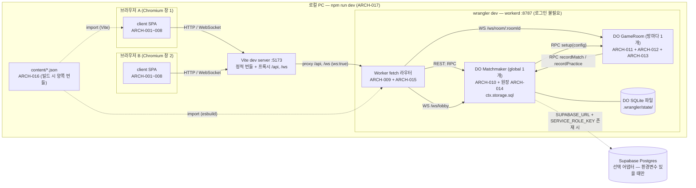
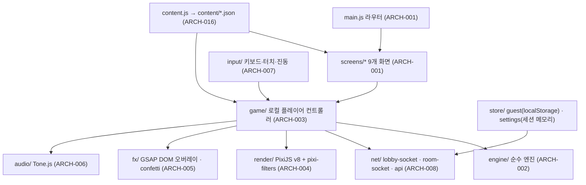
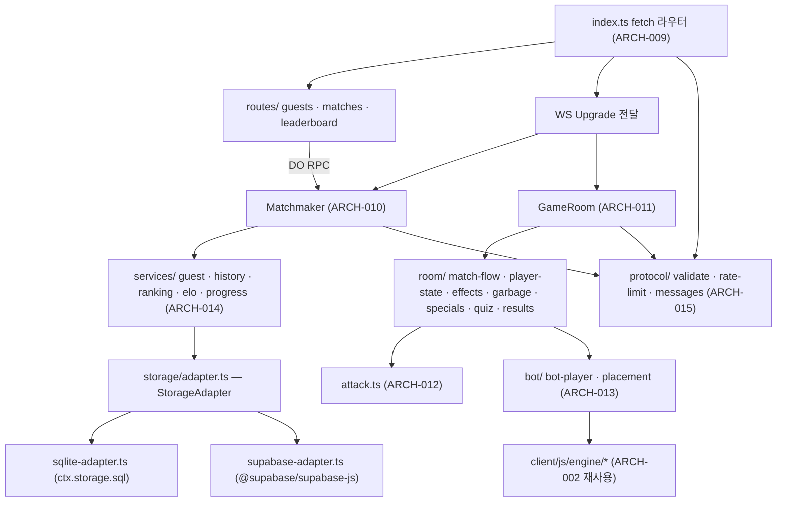
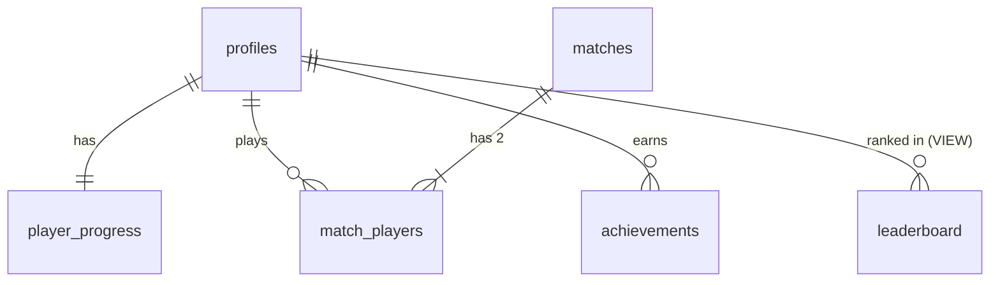
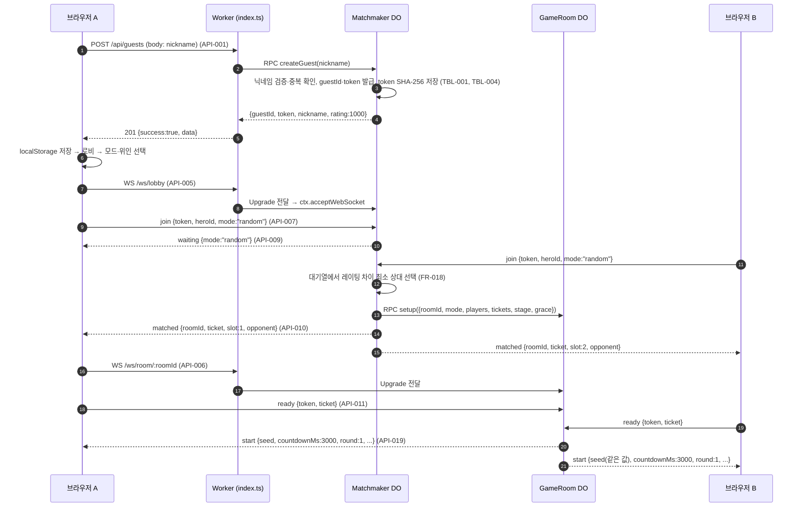
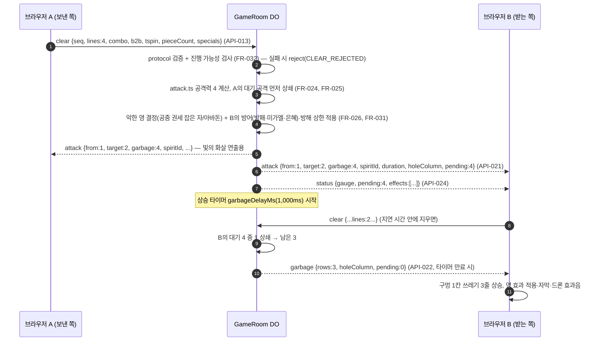
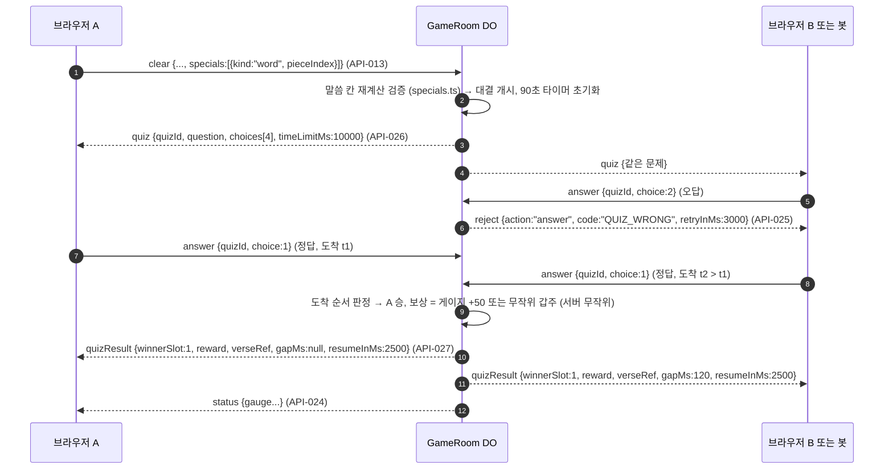
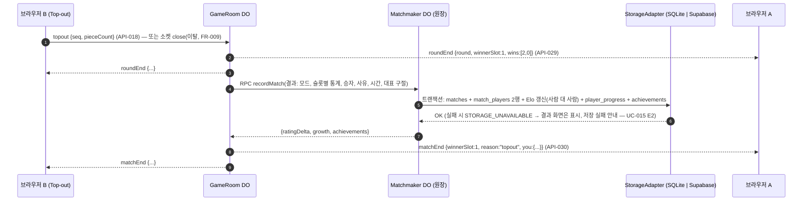

# 🏗️ 시스템 설계서 (Architecture Temple) — 영적 전쟁 테트리스

> *"Except the LORD build the house, they labour in vain that build it."* — Psalm 127:1 (KJV)
>
> **규격:** `statute-율법/02.architecture-foundation-기초/architecture-temple-성전설계-template.md`
> **참조 예시:** `parable-비유/02.architecture-foundation-기초/architecture-temple-성전설계-example.md`
> **근거 정경 (유일한 상류):** [`spec-tablet-명세서.md`](../01.requirement-hearing-들음/spec-tablet-명세서.md) · [`usecase-path-사용사례.md`](../01.requirement-hearing-들음/usecase-path-사용사례.md) · [`rtm-covenant-언약추적.md`](../01.requirement-hearing-들음/rtm-covenant-언약추적.md) · [`requirement-hearing-들음.md`](../01.requirement-hearing-들음/requirement-hearing-들음.md)
> **Phase 2 짝 산출물:** [`data-ark-법궤.md`](./data-ark-법궤.md) (ERD·DDL·콘텐츠 수치) · [`api-gate-성문.md`](./api-gate-성문.md) (REST + WebSocket 메시지 명세)
> **스택 대조 원본:** `hearing-들음/req.md` "기술 스택" 5줄 (P2-001 대조 전용)

---

## 1. 시스템 개요

| 항목 | 내용 |
|:---|:---|
| 시스템명 | 영적 전쟁 테트리스 (Spiritual Warfare Tetris) |
| 버전 | v1.0 — 1차 출시 로컬 동작판 |
| 아키텍트 | Adam (개발 에이전트, 수석 시스템 아키텍트 역할) |
| 프로젝트 유형 / TIER | 새하늘 새땅 + 참고자료 / TIER-3 (요한계시록 모드 — 완전 새 설계, 참고 소스 코드는 이전하지 않음 — C-006) |
| 설계 원칙 | ① 클라이언트는 **자기 보드**를 소유하고, 서버는 **수치와 판정**(공격력·악한 영·게이지·쿨다운·방해 상한·말씀 대결·승패·기록)을 소유한다 (REQ-007, FR-032) ② 외부 키 0개로 전부 동작 (REQ-016, C-004) ③ 콘텐츠는 한 원천(`content/*.json`)에서 클라이언트·서버가 함께 읽는다 (FR-074) |
| 실행 환경 | 로컬 PC 1대: Vite 개발 서버(:5173) + `wrangler dev`(workerd :8787) — 단일 명령 `npm install && npm run dev` (FR-073) |
| 상태 | **Canonized(정경화)** — 심판 관문 판정은 §12 |

### 1.1 아키텍처 컴포넌트 목록 (ARCH-ID)

| ARCH-ID | 컴포넌트 | 위치 (`fruit-열매/`) | 책임 (단일) | 근거 REQ/FR |
|:---|:---|:---|:---|:---|
| ARCH-001 | 클라이언트 셸·화면 라우터 | `client/js/main.js`, `client/js/screens/` | 화면 9개 전환과 화면별 DOM 구성 (닉네임 입장·로비·캐릭터 선택·매칭 대기/초대 코드·대전·결과·전적·랭킹·옵션) | FR-078, FR-013, FR-057, FR-060, FR-069, FR-071 |
| ARCH-002 | 게임 엔진 (DOM 비의존 순수 모듈) | `client/js/engine/` | 10×20 보드, 7종 테트로미노, 시드 7-bag, SRS 벽차기, 홀드·고스트, 줄 삭제·콤보·B2B·T-Spin·점수, 낙하 속도 곡선, 특수 칸·갑주 칸 결정론적 배정 | FR-001~FR-004, FR-010, FR-036, FR-044~FR-047 |
| ARCH-003 | 로컬 플레이어 컨트롤러 | `client/js/game/` | 입력→엔진→네트워크 연결, 서버가 보낸 공격·효과(쓰레기 상승, 악한 영 게임 효과, 스킬·천사·갑주·예수님 이벤트 결과)를 **내 보드**에 적용 | FR-005, FR-006, FR-014~FR-017, FR-025, FR-027~FR-030, FR-035, FR-037, FR-039 |
| ARCH-004 | 렌더러 | `client/js/render/` | PixiJS v8 단일 Application: 보드·블록(유리 질감·발광)·시차 배경·파티클(오브젝트 풀)·pixi-filters | FR-048, FR-049, FR-051, FR-052, FR-055, NFR-001 |
| ARCH-005 | 연출 오버레이 | `client/js/fx/` | GSAP 타임라인 + DOM 오버레이: 비네트·자막(영 이름·KJV 구절)·흔들림·히트스톱·빛의 화살·콘페티·말씀 카드 이미지 저장/공유·리액션 표시·니어미스 문구·은혜 아이콘 | FR-042, FR-053, FR-054, FR-056, FR-057, FR-061~FR-064 |
| ARCH-006 | 오디오 | `client/js/audio/` | Tone.js 합성 효과음 17종, 대기실·대전 적응형 BGM, 마스터/효과음/음악 믹서·음소거 | FR-058~FR-060, C-007 |
| ARCH-007 | 입력 | `client/js/input/` | 키보드 조작, 모바일 터치 스와이프·탭, `navigator.vibrate` 진동 | FR-011 |
| ARCH-008 | 클라이언트 네트워크·게스트 저장 | `client/js/net/`, `client/js/store/` | REST `fetch`, partysocket(로비·방 소켓 2종), 메시지 직렬화, 브라우저 저장(닉네임·게스트 ID·토큰) | FR-008, FR-012 |
| ARCH-009 | Worker 진입·HTTP 라우팅 | `worker/src/index.ts`, `worker/src/routes/` | REST 4종 처리(파라미터 파싱·상태코드), WebSocket Upgrade를 Matchmaker/GameRoom으로 전달, Origin 검사 | FR-008, FR-012, FR-069, FR-071, NFR-003 |
| ARCH-010 | Matchmaker Durable Object | `worker/src/matchmaker.ts` | 전역 단일 인스턴스(`idFromName("global")`): 랜덤 매칭 대기열(Elo 근접), 친구 초대 코드 발급·조회, 봇·연습 방 배정, GameRoom 설정 전달, **원장(Ledger) SQLite의 호스트** | FR-018~FR-021, FR-023 |
| ARCH-011 | GameRoom Durable Object | `worker/src/game-room.ts`, `worker/src/room/` | 방 1개 = 인스턴스 1개: 시드 배포, `clear` 검증, 공격 상쇄·대기열·상승 타이머, 방해 상한, 게이지·쿨다운·봉인, 스킬·천사·갑주·예수님 이벤트, 특수 칸 검증, 말씀 대결 진행·판정, 라운드·경기·이탈 판정, 결과 기록 요청 | FR-005~FR-009, FR-023, FR-025, FR-027~FR-041, FR-062, FR-064, FR-065, FR-068 |
| ARCH-012 | 공격 판정 모듈 | `worker/src/attack.ts` | 순수 함수: (lines, combo, b2b, tspin, jericho, 연속 B2B) → 공격력·악한 영 등급·후보 목록 | FR-024, FR-026, NFR-002 |
| ARCH-013 | AI 봇 | `worker/src/bot/` | GameRoom 안에서 ARCH-002 엔진 인스턴스를 구동: 난이도별 착지 평가·조작 속도·실수율, 말씀 대결 정답률·응답 시간 | FR-021, FR-022 |
| ARCH-014 | 원장 서비스 + 저장소 어댑터 | `worker/src/services/`, `worker/src/storage/`, `supabase/migrations/` | 게스트 발급·토큰 검증, 경기 기록, Elo 갱신, 진행 기록, 업적, 전적·랭킹 조회. `StorageAdapter` 인터페이스 1개 + 구현 2종(DO SQLite / Supabase) | FR-012, FR-047, FR-062, FR-065~FR-072, NFR-004, NFR-008 |
| ARCH-015 | 프로토콜 검증·속도 제한 | `worker/src/protocol/` | 모든 수신 메시지 스키마 검증(수기 검증기), 크기 상한, 소켓별 토큰 버킷 속도 제한, 진행 불가능성 검사 | NFR-003, FR-032 |
| ARCH-016 | 공용 게임 콘텐츠 | `content/` | heroes·angels·spirits·armor·counters·verses·quiz·rules JSON 8종 + 콘텐츠 검사 스크립트 | FR-038, FR-043, FR-074, FR-076, C-003, C-010 |
| ARCH-017 | 개발 실행 오케스트레이션 | 루트 `package.json`, `client/vite.config.js`, `worker/wrangler.toml`, `.gitignore` | npm workspaces, 단일 `npm run dev`(Vite + wrangler dev 동시 기동), Vite 프록시(`/api`, `/ws` → :8787), DO 마이그레이션 선언, 키 파일 git 제외 | FR-073, NFR-007, C-004, C-012, C-013 |
| ARCH-018 | 테스트 하네스 | `vitest.config.js`, `playwright.config.js`, `client/test/`, `worker/test/`, `client/e2e/` | Vitest 프로젝트 3종(client 엔진·worker 판정·content 검사), Playwright Chromium 2컨텍스트 대전 E2E | FR-075~FR-077 |

---

## 2. 아키텍처 다이어그램

### 2.1 전체 구성 (로컬 실행 — 이번 실행 범위)



### 2.2 클라이언트 내부 계층



> 의존 방향은 위→아래 단방향이다. `engine/`은 DOM·PixiJS·네트워크를 import하지 않는다 — 이 제약 덕분에 ARCH-013(서버 봇)이 같은 파일을 그대로 쓴다.

### 2.3 서버 내부 계층



---

## 3. 기술 스택

> P2-001 대조 기준: `hearing-들음/req.md` "기술 스택" 5줄 = spec-tablet C-005. 아래 표의 모든 행은 그 5줄 안에 있거나(✅ 원문), 원문 스택을 실행하기 위한 도구(⚙️ 보조)다. 원문에 없는 런타임 라이브러리는 0개다.

| 계층 | 기술 (고정 버전) | 출시일 | req.md 대조 | 선택 근거 |
|:---|:---|:---|:---:|:---|
| 빌드·개발 서버 | **Vite 8.3.2** | 2026-10-01 | ✅ "Vite" | 바닐라 ES Modules 그대로 번들, JSON import·프록시(ws) 내장 — 프레임워크 없이 화면 9개 처리 (FR-073, FR-078) |
| 클라이언트 언어 | 바닐라 JS (ES Modules) | — | ✅ | C-005. 빌드 도구 최소화 (req.md A §4.2) |
| 렌더링 | **pixi.js 8.22.0** | 2026-10-01 | ✅ "PixiJS v8" | WebGL/WebGPU 배치 렌더링으로 보드 2개 + 파티클 60fps (NFR-001, FR-048) |
| 그래픽 필터 | **pixi-filters 6.1.5** | 2025-11-29 | ✅ "pixi-filters" | Glow·Shockwave·Bloom·RGBSplit(색수차)·Adjustment(어둡게/회색) — FR-052, FR-053, FR-056 |
| 애니메이션 | **gsap 3.15.0** | 2026-04-13 | ✅ "GSAP" | 트윈 보간(FR-051)·흔들림·글자 연출·히트스톱 타임라인(FR-061) |
| 사운드 | **tone 15.1.22** (`latest` 채널) | 2025-04-27 | ✅ "Tone.js" | 음원 파일 없는 합성(C-007), Transport BPM으로 적응형 BGM(FR-059). 15.5.x는 `next` 채널(프리릴리스)이므로 제외 |
| 축하 효과 | **canvas-confetti 1.9.4** | 2025-10-25 | ✅ | 금빛 콘페티 (FR-056) |
| 실시간 통신 클라이언트 | **partysocket 1.3.0** | 2026-06-23 | ✅ | 브라우저 기본 WebSocket 래퍼 + 자동 재연결(로비만 사용 — OQ #18) (FR-008, C-006) |
| 폰트 | **@fontsource/cinzel 5.3.0**, **@fontsource/noto-serif-kr 5.3.0** | 2026-07-19 | ✅ "@fontsource" | 번들 포함 → 오프라인 표시 (FR-050, NFR-005) |
| 실시간 서버 | Cloudflare **Workers + Durable Objects** (TypeScript), **wrangler 4.147.0** (workerd 1.20261001.1) | 2026-10-02 | ✅ "Workers + Durable Objects (TypeScript), 로컬은 wrangler dev" | WebSocket Hibernation API(`ctx.acceptWebSocket`) + SQLite-backed DO(`new_sqlite_classes`, `ctx.storage.sql`) — 이 환경에서 로그인 없이 로컬 동작 검증됨 (REQ-016) |
| 서버 언어 | **typescript 7.0.2**, **@cloudflare/workers-types 5.20261004.1** | 2026-07-08 / 2026-10-04 | ✅ "TypeScript" | 타입 검사 전용 (번들은 wrangler 내장 esbuild) |
| DB (기본) | Durable Object 내장 **SQLite** | — | ✅ "로컬은 Durable Object 내장 SQLite" | 외부 키 0개, `.wrangler/state/` 로컬 파일에 영속 (C-004, FR-072) |
| DB (선택 어댑터) | **@supabase/supabase-js 2.117.2** | 2026-09-25 | ✅ "Supabase는 환경변수가 있을 때만 쓰는 어댑터" | 같은 `StorageAdapter` 인터페이스 구현. 키가 없으면 모듈을 생성하지 않음 (FR-072) |
| 단위 테스트 | **vitest 5.0.3** | 2026-09-30 | ✅ "Vitest(단위)" | Vite 8 피어 호환(`^8.0.0`), 순수 모듈(engine·attack·elo·validate) Node 실행 (FR-075) |
| E2E 테스트 | **@playwright/test 1.56.1** | 2025-10-17 | ✅ "Playwright(브라우저 2개 E2E)" | 이 환경에 설치된 `/opt/pw-browsers/chromium-1194`와 정확히 맞는 마지막 버전(1.57.0부터 chromium-1200). 브라우저 다운로드 없이 실행 — C-004·REQ-016 정신(외부 의존 0) 우선 (FR-077) |
| 실행 보조 | ⚙️ **concurrently 10.0.5** | 2026-08-15 | ⚙️ 보조 (원문 "한 번으로 전부" 실행 수단) | 루트 `npm run dev`가 Vite와 `wrangler dev`를 한 터미널에서 함께 띄움 (FR-073) |
| 런타임 | Node.js ≥ 22.12 (현 환경 22.22.0), npm 10 | — | ⚙️ | wrangler 4 `node >=22`, Vite 8 `^20.19 \|\| >=22.12` 요구 |

> **버전 고정 규칙 (NFR-007):** 위 버전은 2026-10-19 기준 npm 레지스트리 실조회로 고른 "출시 2주 이상(2026-10-05 이전) 최신 안정판"이다. `package.json`에는 `^` 없이 정확한 버전을 적고 `package-lock.json`으로 고정한다. 예외는 @playwright/test 1개(설치된 브라우저 리비전 정합 — 위 근거)뿐이다.
> **req.md 원문 대비 의도적 제외:** Cloudflare Pages(배포 — C-008 제외 범위), Supabase Auth(구글·카카오 — 제외 범위, 게스트 토큰으로 대체 — spec-tablet §9.7 K5).

---

## 4. 인프라 · 클라우드 설계

> SKILL-02 "인프라/클라우드 환경 설계" 필수 항목. 이번 실행은 req.md 서두 "인프라: 로컬 PC"이며 실제 클라우드 배포는 제외 범위(C-008)다. 따라서 **운영 경로는 코드 이식성만 보장**하고 배포 작업은 하지 않는다.

| 항목 | 이번 실행 (Development — 로컬) | Staging / Production (이번 실행 제외 — 키가 생기면 진행하는 다음 단계) | 근거 |
|:---|:---|:---|:---|
| 서버 구성 | 로컬 단일 PC: Vite :5173 + workerd :8787 (wrangler dev). 클라이언트는 Vite 프록시로 같은 출처(`/api`, `/ws`) 사용 → CORS 없음 | 같은 Worker 코드를 `wrangler deploy`, 정적 번들은 Cloudflare Pages. 코드 변경 없이 환경변수만 다름 | REQ-016, FR-073, C-004, C-008 |
| DB 서버 | DO 내장 SQLite (Matchmaker 인스턴스 1개, 파일 `.wrangler/state/v3/do/`) — 별도 DB 프로세스 없음 | Supabase Postgres (어댑터 자동 전환), 스키마는 `supabase/migrations/0001_init.sql` | FR-072, req.md A §4.6 |
| 캐시 전략 | ① 토큰→게스트 검증 결과: Matchmaker 메모리 LRU 1,000건 (DO 재기동 시 소멸, 원장이 원천) ② 랭킹 상위 100: Matchmaker 메모리 5초 TTL, 경기 기록 시 즉시 무효화 ③ 콘텐츠 JSON: 빌드 시 번들 포함 → 런타임 조회 0회 ④ 대기열·초대 코드: 소켓 첨부(`serializeAttachment`) — 휴면 후 `ctx.getWebSockets()`로 복원 | 동일 (Supabase 왕복을 ①② 캐시가 줄임) | FR-018, FR-019, FR-071, NFR-002 |
| 영속 범위 | 영속: 프로필·경기·경기 참가자·진행 기록·업적 (data-ark TBL-001~TBL-005). 휘발: 대기열·초대 코드·방 진행 상태(라운드·게이지·효과) | 동일 | FR-068, FR-072 |
| 배포 환경 | 없음 (로컬 실행판) | Staging = 별도 Worker 이름 + 개발용 Supabase 프로젝트, Production = 운영 Worker + 운영 Supabase. 비밀값은 `wrangler secret put` | C-008, NFR-004 |
| 클라우드 선택 근거 | 로컬에서도 운영과 같은 런타임(workerd)·같은 DO API가 돌기 때문에 "로컬 = 운영의 축소판"이 성립 — 별도 로컬용 서버(Express 등)를 만들 필요가 없음 (C-006) | Durable Object = 방 1개당 인스턴스 1개 모델이 1:1 실시간 대전과 일치, SQLite DO는 무료 플랜 사용 가능 (req.md A §4.7) | REQ-001, C-005 |
| 포트 충돌 (UC-021 E1) | Vite `strictPort: true`, wrangler `--port 8787` 고정 → 충돌 시 즉시 실패하며 로그에 포트 번호 출력 | 해당 없음 | UC-021 E1 |

---

## 5. 폴더 구조 판단

### 5.1 판단 체크리스트

| # | 질문 | 답변 | 결과 |
|:--|:---|:---|:---|
| 1 | CRUD가 포함되어 있는가? | ✅ YES (부분) — 게스트 프로필 Create(API-001), 전적·랭킹 Read(API-003·API-004), 경기 기록 Create(서버 내부). 사용자 Update/Delete는 없음 | **CRUD 강제 분리 적용** — HTTP 핸들러 / 화면 / 서비스 / 데이터 4역할을 별도 파일로 |
| 2 | 화면 수는 몇 개인가? | 9개 (닉네임 입장·로비·캐릭터 선택·매칭 대기/초대 코드·대전·결과·전적·랭킹·옵션 — FR-078) | 4개 이상 → 분리 |
| 3 | 한 파일에 HTTP 처리 + 렌더링이 섞이는가? | ❌ 구조적으로 불가 — 서버는 JSON만 응답하고, 렌더링은 전부 클라이언트(`screens/`, `render/`)가 한다 | 분리 확정 |
| 4 | 한 도메인 CRUD 엔드포인트 5개 이상인가? (SKILL-02 기준표) | ❌ REST는 도메인 3개에 총 4개 | 기준표상 통합 허용이나, #1·#2가 분리를 강제하므로 분리 |
| 5 | 프레임워크가 MVC를 강제하는가? | ❌ (바닐라 JS + Workers) | 공식 컨벤션: Workers는 `src/index.ts` 진입 + 기능 모듈, Vite는 `index.html` + `src`(여기서는 req.md A §4.5의 `js/`) |

### 5.2 판단 결과

- **채택 구조:** HTTP 처리 / 렌더링 **분리** — 서버 `routes/`(HTTP 핸들러) · `services/`(비즈니스) · `storage/`(데이터), 클라이언트 `screens/`·`render/`·`fx/`(렌더링). 최상위는 req.md A §4.5의 `client/`, `worker/`, `content/`, `supabase/` 4개를 그대로 쓰는 **npm workspaces 모노레포**(C-012).
- **판단 근거:** CRUD 포함(체크 #1) + 화면 9개(체크 #2)로 분리 조건 충족. Workers 공식 컨벤션(`wrangler.toml` + `src/index.ts`)과 Vite 컨벤션(`index.html` 루트)을 따르고, 실시간 판정 로직(GameRoom)은 책임별 하위 모듈(`room/`)로 쪼갠다.
- **예상 최대 파일 줄 수: 280줄** — `client/js/screens/battle.js`(대전 화면 조립: 보드 2개·HUD·오버레이 배치 단일 책임). 300줄 경고선에 닿으면 HUD 부분을 `screens/battle-hud.js`로 분리한다. 그 밖의 파일은 250줄 이하로 설계했다(아래 트리의 예상 줄 수).
- **workspaces 구성:** 루트 `package.json`의 `"workspaces": ["client", "worker"]`. `content/`는 패키지가 아닌 데이터 폴더로, 양쪽이 상대 경로 JSON import로 읽는다(Vite `server.fs.allow: [".."]`, wrangler esbuild JSON 로더). `supabase/`는 SQL 마이그레이션 보관 폴더.
- **엔진 공유 방식:** req.md A §4.5가 엔진(`game.js`)을 `client/js/`에 두므로 그 위치를 지키되 `client/js/engine/`으로 책임 분할하고 DOM 비의존 순수 ES 모듈로 만든다. 서버 봇(ARCH-013)은 `worker/src/bot/`에서 이 파일들을 상대 경로로 import한다(의존 방향 worker → client/js/engine 단방향, 역방향 0). 엔진을 두 벌 만들지 않는다 — "두 주인을 섬기지 마라"(Matthew 6:24).

### 5.3 파일 목록 (역할별 분리 — Phase 4 생성 대상, 지금은 생성하지 않음)

```
fruit-열매/
├── package.json                 # workspaces, scripts: dev / test / test:e2e / check:content (ARCH-017)
├── package-lock.json            # 버전 고정 (NFR-007)
├── .gitignore                   # node_modules, dist, .wrangler, .dev.vars, test-results, **/backup/ (C-013, NFR-004)
├── vitest.config.js             # projects: client · worker · content (ARCH-018)
├── playwright.config.js         # testDir client/e2e, webServer = npm run dev, chromium (ARCH-018)
├── content/                     # 공용 게임 데이터 (ARCH-016) — data-ark TBL-011~TBL-018
│   ├── heroes.json  angels.json  spirits.json  armor.json  counters.json
│   ├── verses.json  quiz.json  rules.json
│   └── check-content.mjs        # 콘텐츠 검사 스크립트 (FR-076) ~120줄
├── client/                      # Vite 프로젝트 (렌더링 계층)
│   ├── package.json  vite.config.js  index.html  style.css
│   ├── js/
│   │   ├── main.js              # 화면 라우터 ~90줄 (ARCH-001)
│   │   ├── content.js           # content JSON import·색인 ~60줄
│   │   ├── screens/             # 화면 9개 — 각 화면 렌더링만 (ARCH-001)
│   │   │   ├── entry.js  lobby.js  hero-select.js  waiting.js  battle.js(~280)
│   │   │   └── result.js  history.js  ranking.js  options.js       (각 80~180줄)
│   │   ├── engine/              # 순수 엔진 (ARCH-002) — 서버 봇 공유
│   │   │   ├── rng.js  bag.js  piece.js  srs.js  board.js(~200)  scoring.js
│   │   │   └── specials.js  gravity.js  index.js
│   │   ├── game/                # 로컬 플레이어 컨트롤러 (ARCH-003)
│   │   │   ├── local-player.js(~220)  apply-attack.js  apply-effect.js  board-codec.js
│   │   ├── render/              # PixiJS (ARCH-004): pixi-app.js board-view.js particles.js filters.js background.js
│   │   ├── fx/                  # GSAP·DOM (ARCH-005): overlay.js shake.js hitstop.js arrows.js confetti.js verse-card.js reactions.js
│   │   ├── audio/               # Tone.js (ARCH-006): sfx.js bgm.js mixer.js
│   │   ├── input/               # (ARCH-007): keyboard.js touch.js
│   │   ├── net/                 # (ARCH-008): api.js lobby-socket.js room-socket.js
│   │   └── store/               # (ARCH-008): guest.js(localStorage) settings.js(세션 메모리 — N-04 미승격)
│   ├── test/                    # Vitest: engine-srs / engine-board / engine-bag / board-codec
│   └── e2e/                     # Playwright: battle-two-browsers.spec.js
├── worker/                      # Cloudflare Worker (HTTP·판정·데이터 계층)
│   ├── package.json  wrangler.toml  tsconfig.json  .dev.vars.example(키 이름만, 값 없음)
│   ├── src/
│   │   ├── index.ts             # fetch 라우터 ~120줄 (ARCH-009)
│   │   ├── routes/              # HTTP 핸들러만: guests.ts matches.ts leaderboard.ts (ARCH-009)
│   │   ├── services/            # 비즈니스만: guest-service.ts history-service.ts ranking-service.ts elo.ts progress-service.ts (ARCH-014)
│   │   ├── storage/             # 데이터만: adapter.ts sqlite-adapter.ts(~200) supabase-adapter.ts migrations.ts (ARCH-014)
│   │   ├── matchmaker.ts        # DO ~240줄 (ARCH-010)
│   │   ├── game-room.ts         # DO 셸: 소켓 수명주기·메시지 분배 ~200줄 (ARCH-011)
│   │   ├── room/                # match-flow.ts player-state.ts effects.ts garbage.ts specials.ts quiz.ts results.ts (ARCH-011)
│   │   ├── attack.ts            # 공격력·소환 계산 ~150줄 (ARCH-012, req.md A §4.5 위치 그대로)
│   │   ├── bot/                 # bot-player.ts placement.ts (ARCH-013)
│   │   ├── protocol/            # messages.ts validate.ts rate-limit.ts (ARCH-015)
│   │   └── content.ts           # content JSON import·타입 (ARCH-016 소비)
│   └── test/                    # Vitest: attack / elo / validate / specials / garbage / effects-cap
└── supabase/
    └── migrations/0001_init.sql # Postgres 스키마 + RLS (ARCH-014, req.md A §4.5)
```

| 역할 (템플릿 4역할) | 파일 | 섞이면 ❌인 것 |
|:---|:---|:---|
| HTTP 핸들러 | `worker/src/index.ts`, `worker/src/routes/*.ts` | DB 쿼리, 비즈니스 규칙(Elo·검증 로직) |
| 화면 템플릿 | `client/js/screens/*.js`, `client/js/render/*`, `client/js/fx/*` | `fetch`/소켓 직접 호출(→ `net/` 경유), 판정 로직 |
| 서비스/비즈니스 | `worker/src/services/*.ts`, `worker/src/room/*.ts`, `worker/src/attack.ts` | HTTP 응답 생성, SQL 문자열 |
| 데이터/DB | `worker/src/storage/*.ts`, `supabase/migrations/0001_init.sql` | HTTP 처리, 게임 규칙 |

---

## 6. 데이터 아키텍처 (ERD 요약)

> 상세 테이블 정의·DDL·인덱스·공통 코드·콘텐츠 수치는 [`data-ark-법궤.md`](./data-ark-법궤.md).



| TBL-ID | 이름 | 저장소 | 목적 | 근거 |
|:---|:---|:---|:---|:---|
| TBL-001 | profiles | 원장 (SQLite / Supabase) | 게스트 ID·닉네임·토큰 해시·레이팅 | FR-012, FR-070 |
| TBL-002 | matches | 원장 | 경기 1건 (방 ID, 모드, 승자 슬롯, 사유, 시간, 대표 구절) | FR-068 |
| TBL-003 | match_players | 원장 | 경기별 참가자 2행 (위인, 승리 라운드, 레이팅 전후, 개인 통계) | FR-068, FR-066, FR-070 |
| TBL-004 | player_progress | 원장 | 누적 판 수, 연속 패배 판 수, 직전 경기 개인 기록 | FR-067, FR-047, FR-062 |
| TBL-005 | achievements | 원장 | 업적 달성 | FR-065 |
| TBL-006 | leaderboard (VIEW) | 원장 | 레이팅 순위 | FR-071 |
| TBL-011~TBL-018 | content/*.json 8종 | 저장소 번들 (읽기 전용) | 위인·천사·악한 영·갑주·상성표·구절·퀴즈·규칙 수치 | FR-074 |

**원장(Ledger) 위치 결정:** DO SQLite는 인스턴스마다 따로 있으므로, 닉네임 전역 중복 거부(FR-012)와 전역 랭킹(FR-071)은 **인스턴스 1개**가 원천이어야 한다. Phase 1이 DO를 Matchmaker·GameRoom 2종으로 정경화했으므로(spec-tablet §0) 세 번째 DO를 만들지 않고, 이미 전역 단일 인스턴스이며 Elo 매칭(FR-018)에 레이팅을 읽어야 하는 **Matchmaker가 원장 SQLite를 호스팅**한다. 코드 책임은 `services/`·`storage/` 모듈로 분리해 Matchmaker 클래스 파일에는 매칭만 남긴다.

---

## 7. API 명세 (요약)

> 상세 요청/응답·에러 코드는 [`api-gate-성문.md`](./api-gate-성문.md). REST 4개 + WebSocket 엔드포인트 2개 + WebSocket 메시지 25종 = API-ID 31개.

| 구분 | API-ID | 이름 | 관련 REQ |
|:---|:---|:---|:---|
| REST | API-001 `POST /api/guests` · API-002 `GET /api/guests/me` · API-003 `GET /api/matches` · API-004 `GET /api/leaderboard` | 게스트 입장·토큰 확인·전적·랭킹 | REQ-002, REQ-014, REQ-015 |
| WS 엔드포인트 | API-005 `GET /ws/lobby` · API-006 `GET /ws/room/:roomId` | Matchmaker·GameRoom 연결 | REQ-001, REQ-004 |
| 로비 ↑ | API-007 `join` · API-008 `cancel` | 매칭·초대 코드·봇·연습 요청, 대기 취소 | REQ-004~REQ-006 |
| 로비 ↓ | API-009 `waiting` · API-010 `matched` | 대기 상태(초대 코드), 방 배정 | REQ-004, REQ-005 |
| 방 ↑ | API-011 `ready` · API-012 `state` · API-013 `clear` · API-014 `skill` · API-015 `armor` · API-016 `answer` · API-017 `reaction` · API-018 `topout` | FR-008 기본 6종 + 갑주·말씀 대결 응답·리액션 | REQ-001, REQ-007~REQ-011, REQ-013 |
| 방 ↓ | API-019 `start` · API-020 `opponentState` · API-021 `attack` · API-022 `garbage` · API-023 `effect` · API-024 `status` · API-025 `reject` · API-026 `quiz` · API-027 `quizResult` · API-028 `reaction` · API-029 `roundEnd` · API-030 `matchEnd` | FR-008 기본 7종 + 상승·상태·거부·퀴즈·리액션 | REQ-001, REQ-007~REQ-015 |
| 공통 ↓ | API-031 `error` | 두 소켓 공통 치명 오류 | NFR-003 |

> FR-008이 나열한 기본 메시지 13종(`join, ready, state, clear, skill, topout` / `matched, start, opponentState, attack, effect, roundEnd, matchEnd`)은 이름·필드를 그대로 보존했다. 추가된 12종은 각각 Phase 1 FR이 요구하는 통로다: `cancel`(FR-020), `waiting`(FR-019), `armor`(FR-037), `answer`·`quiz`·`quizResult`(FR-041), `reaction` ↑↓(FR-064), `garbage`(FR-025 상승), `status`(FR-033 "게이지 값은 서버가 관리하고 화면에 표시"), `reject`(FR-034 "거부 피드백"), `error`(NFR-003).

---

## 8. 시퀀스 다이어그램

### 8.1 게스트 입장 → 랜덤 매칭 → 라운드 시작 (UC-001, UC-002, UC-003)



### 8.2 줄 삭제 → 서버 판정 공격 → 쓰레기 상승 (UC-007, UC-008)



### 8.3 말씀 대결 (UC-013)



### 8.4 경기 종료 → 기록 (UC-015, UC-016)



---

## 9. 핵심 설계 결정 상세 (서버 권한 모델)

| # | 결정 | 내용 | 근거 |
|:--|:---|:---|:---|
| 9.1 | **보드 소유 = 클라이언트, 수치 소유 = 서버** | 각 클라이언트가 자기 엔진을 돌리고 `state`(초당 12회)와 `clear`만 보낸다(FR-006 "10~15회"). 서버는 보드를 시뮬레이션하지 않고(spec-tablet §9.5 해석 C 소거), 공격력·악한 영·게이지·쿨다운·효과 시간·말씀 대결·승패를 결정한다 | REQ-007, FR-032, req.md A §4.3 |
| 9.2 | **쓰레기 상승은 서버 타이머** | `attack` 도착 즉시 받는 쪽 `pending`에 쌓이고 경고 게이지가 차오른다. `garbageDelayMs`(1,000ms) 안에 받는 쪽이 줄을 지우면 서버가 먼저 상쇄한다. 만료 시 서버가 `garbage`로 상승을 지시한다. 베드로 스킬 10초 동안 만료된 상승은 무효로 버린다 | FR-016, FR-025, FR-053 |
| 9.3 | **특수 칸·갑주 칸 결정론적 배정 + 서버 재계산 검증** | `engine/specials.js`가 (시드, 조각 번호, 해금 단계, 콤보, 위기) → 특수 칸 종류·칸 위치를 결정한다. 같은 시드이므로 두 플레이어의 말씀 블록·갑주 칸은 같은 조각에 나온다(공정성). 서버는 `clear.specials`를 같은 함수로 재계산해 검증한다: 말씀·갑주 = 정확 일치, 여리고·만나 = 굴림값이 해당 블록 최대 확률 이하일 때만 인정(콤보·위기는 클라이언트 상태이므로 상한 검증) | FR-036, FR-044~FR-047, FR-032 |
| 9.4 | **AI 봇은 서버(GameRoom) 안에서 실행** | 봇은 ARCH-002 엔진 인스턴스를 GameRoom 메모리에서 구동하고, 봇의 줄 삭제는 사람의 `clear`와 같은 판정 경로(attack.ts)를 탄다. 봇 말씀 대결 응답 시간도 서버가 생성한다. **기각한 대안:** 클라이언트 봇(오프라인 가능·구현 단순) — Phase 1 정경 FR-021 "봇 대전의 공격도 서버가 판정", FR-022 "서버가 사람과 같은 도착 순서 규칙으로 판정", spec-tablet §9.11 "봇 응답 시간의 서버 측 생성", UC-005 E2 "봇 처리 중 서버 오류"와 모순. 오프라인 동작은 요구사항이 아님(NFR-005는 자산 오프라인) | FR-021, FR-022, UC-005 |
| 9.5 | **연습 모드도 GameRoom 1인 방** | 상대·공격·말씀 대결·천사·갑주를 끈 `mode:"practice"` 방. 게이지·쿨다운을 서버가 관리하고(FR-033), 세션 종료 시 서버가 진행 기록(누적 판 수 +1)을 쓴다 — 클라이언트 쓰기 API를 만들지 않는다(FR-068 "클라이언트는 직접 기록할 수 없다"와 같은 원칙) | FR-023, FR-067, OQ #4 |
| 9.6 | **게스트 토큰 = 서버 발급 무작위 불투명 토큰** | 32바이트 `crypto.getRandomValues` → base64url(43자). 원장에는 SHA-256 해시만 저장. 서명 비밀키가 필요 없으므로 키 0개 원칙과 양립 | FR-012, NFR-003, C-004, 봉인 제3계명 |
| 9.7 | **휴면(Hibernation) 안전 상태** | Matchmaker의 대기열·초대 코드는 소켓 첨부(`serializeAttachment`)에만 둔다 — 휴면 후 깨어나면 `ctx.getWebSockets()`로 재구성. GameRoom은 `setup` 설정을 `ctx.storage.put("config")`에 저장하고, 경기 진행 중에는 타이머(상승·말씀 대결·90초·봇 틱)가 살아 있어 인스턴스가 메모리에 유지된다. 경기 종료 후 상태를 지운다 | FR-018~FR-020, UC-003 E1 |
| 9.8 | **같은 시드, 라운드마다 새 시드** | 시드는 서버 `crypto.getRandomValues`로 라운드마다 생성(UC-015 4단계 "새 시드"). 7-bag·특수 칸 굴림은 시드에서 갈라진 독립 PRNG 스트림(mulberry32)으로 만든다 | FR-001, FR-005 |
| 9.9 | **낙하 속도 기준 시간 = 경기 시작 후 경과 시간** | spec-tablet §9.8 #1 "경기 = 매치"를 문자 그대로 적용. `start.matchElapsedMs`로 라운드가 바뀌어도 곡선이 이어진다. 연습은 세션 경과 시간 | FR-010 |
| 9.10 | **개인 기록 단위 = 경기(연습은 세션)** | FR-066 "경기가 끝나면 개인 기록 ... 이전 판 대비 성장 수치" — 표시 시점이 경기 종료이므로 비교 기준을 **직전 대전 경기의 기록**(player_progress.last_*)으로 한다. 연습은 UC-006 6단계대로 기록만 표시하고 성장 비교·덮어쓰기를 하지 않는다 | FR-066, FR-067 |

---

## 10. 보안 아키텍처 (봉인의 율법 연동)

> 원본: `statute-율법/04.development-repentance-회개/security-seal-봉인.md`. 템플릿 검증 규칙 "제2·3·7계명 최소 준수"를 포함해 10계명 전부를 대응시킨다.

| 봉인 계명 | 적용 | 근거 |
|:---|:---|:---|
| 제1계명: 노출하지 말라 | 서버 로그에는 guestId 앞 8자와 이벤트 종류만. 토큰·토큰 해시·티켓은 로그·응답 본문(발급 응답 제외)에 쓰지 않는다. 랭킹·전적 응답에 guestId를 넣지 않고 닉네임만 노출 | NFR-003, NFR-008 |
| 제2계명: 코드에 넣지 말라 | Supabase `SUPABASE_URL`·`SUPABASE_SERVICE_ROLE_KEY`는 `worker/.dev.vars`(로컬) / `wrangler secret`(운영)에만. `.dev.vars`는 `.gitignore`. 저장소에는 값 없는 `.dev.vars.example`만. 클라이언트 번들에는 Supabase 키가 **하나도** 없다(클라이언트는 Supabase에 직접 접속하지 않음 — req.md "anon 키만"보다 엄격) | NFR-004, C-004 |
| 제3계명: 암호화하라 | 게스트 토큰은 SHA-256 해시로만 저장. 전송: 로컬 실행판은 localhost(http/ws) 루프백 통신이며, 운영 경로(다음 단계)는 Cloudflare 기본 HTTPS/WSS | FR-012 |
| 제4계명: 최소만 취하라 | 수집 = 닉네임·게스트 ID·토큰 해시·경기 기록·진행 기록뿐. 이메일·실명·IP 저장 없음 | NFR-008 |
| 제5계명: 동의 없이 취하지 말라 | 수집 항목은 사용자가 직접 입력한 닉네임뿐이며, 닉네임 입장 화면에 "닉네임은 랭킹에 공개됩니다" 안내를 둔다(문구 배치는 Phase 3) | FR-012, FR-071 |
| 제6계명: 외부에 넘기지 말라 | 제3자 분석·광고 SDK 없음. Supabase는 운영자가 직접 환경변수로 연결한 자기 소유 저장소일 때만 사용 | FR-072 |
| 제7계명: 접근을 통제하라 | REST 조회는 `Authorization: Bearer <token>` 필수(API-002~API-004). WS는 `join`/`ready`에 토큰 + GameRoom 입장 티켓(Matchmaker가 발급, 1회용) 필수. 경기 기록 쓰기는 GameRoom → Matchmaker RPC만 가능(외부 엔드포인트 없음). Supabase 모드에서 테이블 RLS를 켜고 anon 정책을 두지 않음(service role만 접근). Origin 허용 목록(`ALLOWED_ORIGINS`, 기본 `http://localhost:5173,http://127.0.0.1:5173`) | NFR-003, FR-068 |
| 제8계명: 기록하라 | Worker 구조화 로그(`console.log` JSON 1줄): 게스트 생성, 토큰 검증 실패, 메시지 거부(코드), 속도 제한 초과, 저장 실패. wrangler dev 콘솔에 출력 | UC-007 E4, UC-015 E2 |
| 제9계명: 유출을 대비하라 | 원장이 유출돼도 토큰 원문은 복원 불가(해시). Supabase 키 유출 시 대응 = Supabase에서 service role 키 재발급 → `wrangler secret put` 교체(운영 단계 절차) | NFR-004 |
| 제10계명: 탐하지 말라 | 수집 데이터는 매칭·전적·랭킹·진행 보정 용도로만 사용. 분석·추적 코드 없음 | NFR-008 |

**입력 방어 3중 (SKILL-02 방어 깊이):** ① 클라이언트 — 닉네임 입력 `required`·`maxlength=12`·`pattern` (ARCH-001) ② 서버 — trim 후 정규식 `^[가-힣A-Za-z0-9_]{2,12}$`, 모든 WS 메시지 스키마 검증·크기 상한 4KB·속도 제한 (ARCH-015) ③ DB — `NOT NULL` + `CHECK(length(trim(nickname)) BETWEEN 2 AND 12)` 등 (data-ark §6).

---

## 11. 아키텍처 결정 체인

> *"Which of you, intending to build a tower, sitteth not down first, and counteth the cost"* — Luke 14:28 (KJV)

| 결정 사항 | 근거 REQ-ID | 왜 이 선택인가 | 이 결정이 만드는 제약 | Phase 3/4 영향 |
|:--|:--|:--|:--|:--|
| D-01 Cloudflare Workers + DO 2종(Matchmaker, GameRoom), WebSocket Hibernation | REQ-001, REQ-004, C-005 | req.md 고정 스택, 방 1개 = 인스턴스 1개가 1:1 대전과 일치 | 세 번째 DO 금지(Phase 1 정경 2종) → 원장은 Matchmaker에 둠(D-04). DO 간 호출은 RPC | Phase 4: `wrangler.toml` `[[migrations]] new_sqlite_classes = ["Matchmaker","GameRoom"]` |
| D-02 npm workspaces 모노레포, 최상위 4폴더 (client/worker/content/supabase) | C-012, FR-073, FR-074 | req.md A §4.5 구조 보존 + 루트 단일 `npm install` | 공용 코드 패키지 폴더를 따로 만들지 않음 → 엔진은 client에, worker가 상대 import(D-12) | Phase 4: 루트 `package.json` workspaces, Vite `fs.allow` |
| D-03 단일 명령 실행 = concurrently + Vite 프록시 | REQ-016, FR-073, C-004 | 터미널 1개·명령 1개 요구(spec-tablet §9.7 K2). 프록시로 같은 출처 → CORS·환경변수 불필요 | 클라이언트는 상대 경로(`/api`, `/ws`)만 사용, 절대 URL 금지 | Phase 4: `dev` 스크립트, `vite.config.js` proxy `ws:true` |
| D-04 원장 SQLite를 Matchmaker DO가 호스팅 | FR-012, FR-018, FR-068, FR-070, FR-071 | 닉네임 전역 유일·전역 랭킹은 단일 인스턴스 필요, Matchmaker는 이미 전역 1개 + Elo 매칭에 레이팅 필요 | 모든 원장 접근은 Matchmaker RPC 경유. Matchmaker 클래스는 매칭만, 원장은 services/storage 모듈 | Phase 4: Worker REST 핸들러는 `env.MATCHMAKER.get(idFromName("global"))` RPC 호출 |
| D-05 StorageAdapter 인터페이스 + 구현 2종 | FR-072, REQ-016 | 키 유무 자동 전환을 한 인터페이스로 | 서비스 계층은 SQL을 모름. 두 구현이 같은 결과를 반환해야 함(정렬·시간 형식 ISO-8601 UTC) | Phase 4: `SUPABASE_URL && SUPABASE_SERVICE_ROLE_KEY` 둘 다 있을 때만 Supabase 생성 |
| D-06 게스트 토큰 = 무작위 불투명 + SHA-256 저장 | FR-012, NFR-003, C-004 | 서명 키 없이 위조 방지, 원장 유출 시에도 토큰 복원 불가 | 토큰 검증마다 원장 조회 필요 → 메모리 LRU 캐시 | Phase 3: 닉네임 화면·토큰 실패(UC-001 E3) 흐름 |
| D-07 보드 = 클라이언트, 수치·판정 = 서버 | REQ-007, FR-032, FR-033 | req.md A §4.3 "클라이언트는 지운 줄 정보만" + 서버 권한 | 서버는 `state` 보드 스냅샷으로 위기만 판정(예수님 이벤트·만나 상한). 효과 적용은 클라이언트가 하고 서버는 시간·상한만 관리 | Phase 3: HUD는 `status` 값만 표시(클라이언트 계산 금지) |
| D-08 쓰레기 상승 서버 타이머(1,000ms) + 상쇄 | FR-025, FR-016, FR-053 | 상쇄 창이 있어야 "받을 공격이 먼저 줄어든다"가 성립, 베드로 "상승 무효"를 서버가 판정 가능 | `garbage` 메시지 추가, 받는 쪽은 상승을 임의로 하지 않음 | Phase 3: 경고 게이지 = `pending` 표시 |
| D-09 특수·갑주 칸 결정론적 배정 + 서버 재계산 | FR-036, FR-044~FR-047, FR-032 | 같은 시드 공정성 + 서버 검증 가능 | 확률 수치는 `rules.json` 한 곳(TBL-018). 엔진 `specials.js`는 서버도 import | Phase 4: specials 단위 테스트(같은 입력 → 같은 배정) |
| D-10 AI 봇 서버 실행 | FR-021, FR-022, UC-005 | Phase 1 정경이 서버 판정·서버 응답 시간을 요구 (§9.4) | 봇 틱 타이머가 GameRoom을 깨워 둠, 봇은 스킬·천사·갑주 미사용(OQ #6) | Phase 3: 봇 대전 화면은 사람 대전과 동일 + 봇 이름·난이도 표시 |
| D-11 연습 모드 = GameRoom 1인 방 | FR-023, FR-033, FR-067 | 게이지 서버 관리 원칙 유지, 클라이언트 쓰기 API 불필요 | 연습도 서버 연결 필요(로컬 실행이므로 항상 가능) | Phase 3: 연습 화면 = 대전 화면에서 상대 보드 영역 제거 |
| D-12 엔진 = `client/js/engine/` 순수 ES 모듈, 서버 공유 | FR-001~FR-004, FR-021 | req.md A §4.5 엔진 위치 보존 + 엔진 이중 구현 금지 | 엔진 파일은 DOM·Pixi·`window` 사용 금지(테스트로 강제: Node 환경 Vitest) | Phase 4: worker tsconfig `allowJs`, 상대 import |
| D-13 PixiJS 단일 Application + DOM 오버레이 | FR-048~FR-056, NFR-001 | GPU 렌더(보드·파티클)와 텍스트·자막(DOM, 폰트 번들)을 분리해 60fps | 파티클은 오브젝트 풀(최대 600개), 필터는 효과 중에만 부착 | Phase 3: 레이어 순서(배경 → 보드 → 파티클 → DOM 오버레이) 고정 |
| D-14 Tone.js 합성 전용, 오디오는 첫 입력에서 시작 | FR-058~FR-060, C-007 | 음원 파일 금지, 브라우저 자동재생 정책(UC-020 E1) | 효과음 17종·BGM 2종 모두 코드 합성 | Phase 3: "소리를 켜려면 화면을 누르세요" 안내 위치 |
| D-15 콘텐츠 JSON 빌드 시 번들 | FR-074, NFR-005 | 런타임 네트워크 조회 0회 → 오프라인 자산 + 클라이언트·서버 동일 원천 | 콘텐츠 변경 = 재빌드. 콘텐츠 검사 스크립트가 CI 전 단계 | Phase 4: `content.js`/`content.ts` 단일 import 지점 |
| D-16 수기 메시지 검증기 + 토큰 버킷 속도 제한 | NFR-003, FR-032 | 원문 스택에 검증 라이브러리가 없으므로 추가 의존 없이 구현(스택 이탈 0) | 메시지마다 필드 타입·범위 표(api-gate) 1:1 구현 | Phase 4: validate 단위 테스트(잘못된 메시지·토큰 거부) |
| D-17 정확한 버전 고정 + Playwright 1.56.1 | NFR-007, REQ-017 | 2주 규칙 + 설치된 chromium-1194 정합 | Playwright 업그레이드 시 브라우저 리비전 동반 필요 | Phase 4/5: `PLAYWRIGHT_BROWSERS_PATH=/opt/pw-browsers` |
| D-18 낙하 곡선 기준 = 경기 경과 시간 | FR-010 | "경기 시작 후" 문자적 적용 (§9.9) | `start`에 `matchElapsedMs` 포함 | Phase 4: gravity.js 입력 = 경기 경과 ms |
| D-19 초대 코드 = 6자, 10분 만료, 소켓 첨부 보관 | FR-019, OQ #15 | Phase 1이 Phase 2에 형식 확정을 위임. 방장 소켓 수명 = 코드 수명(UC-004 E3) | 테이블 없음(휘발). 코드 문자 집합 32자(혼동 문자 I·O·0·1 제외) | Phase 3: 코드 표시·입력 칸 6자 |
| D-20 WS 메시지 공통 봉투 `{type, data}` / `{type:"error", error}` | FR-008, NFR-003 | REST 공통 응답 형식(api-gate 공통 규약)과 같은 "변하지 않는" 구조 | 모든 WS 메시지는 `type` 문자열로 분기 | Phase 4: protocol/messages.ts 상수 표 |

---

## 12. ⚖️ 심판 관문 판정 (Gate Judgment — Phase 2)

> *"For we must all appear before the judgment seat of Christ."* — 2 Corinthians 5:10 (KJV)
> 판정일: 2026-10-19 · 판정 대상: `bible-성경/02.architecture-foundation-기초/` 3개 파일 + RTM 갱신 · 각 항목 개별 판정 후 총평 (제8계명)

### 12.1 범용 심판 (G-001 ~ G-008)

| # | 체크 항목 | 판정 근거 | 판정 |
|:--|:--|:--|:--:|
| G-001 | 템플릿 형식·필수 섹션 준수 | 성전설계: 시스템 개요(§1)·다이어그램(§2)·기술 스택(§3)·폴더 구조 판단(§5, 체크리스트+판단 결과+파일 목록)·ERD(§6)·API(§7)·시퀀스(§8, 4개)·보안(§10) 8섹션 + SKILL-02 추가 요구(인프라 §4, 결정 체인 §11). 법궤: 개요·ERD·테이블 정의서·공통 코드·인덱스·무결성·마이그레이션/시드 7섹션. 성문: 전체 목록·공통 규약·상세·에러 코드·인증/인가 5섹션. ID 접두어 ARCH-/API-/TBL-/CODE- 준수 | ✅ |
| G-002 | `bible-성경/` 해당 디렉토리 정경화 | 3개 파일 모두 `bible-성경/02.architecture-foundation-기초/`에 저장 (언약책 §4) | ✅ |
| G-003 | `statute-율법/` 원본 미수정 | `git status --porcelain -- statute-율법 parable-비유 book-경전 .skill hearing-들음` 결과 0줄. 변경은 `bible-성경/`과 `fruit-열매/history/2026-10-19.md`에만 | ✅ |
| G-004 | 이전 Phase 산출물 근거 | 모든 ARCH(§1.1)·결정(§11)·TBL(법궤)·API(성문)에 REQ/FR/NFR/C/UC/OQ 근거 열 존재. RTM 116행 전부 ARCH/API/TBL 열 연결 | ✅ |
| G-005 | 설계에 없는 임의 내용 추가 없음 | 추가 메시지 12종은 각각 Phase 1 FR 근거 명시(§7). NICE-TO-HAVE N-01~N-06 미반영(키 재설정·재접속 복귀·튜토리얼·옵션 저장·퀴즈 중복 방지·저장 모드 표시 — 설계에 넣지 않음). 제외 범위(스토리·위인 11명·로그인·배포) 미설계. 런타임 의존성은 req.md 스택만(보조 도구 concurrently 1개는 FR-073 실행 수단으로 근거 명시) | ✅ |
| G-006 | 플레이스홀더 없음 | 3개 파일 + RTM 대상 작업 미완 표식(영문 약어 2종)·미확정 표기·템플릿 중괄호 자리표시자 검색 0건 (JSON·Mermaid의 구조 괄호는 실제 내용) | ✅ |
| G-007 | 각 섹션 실질 내용 | 빈 표 0건 — ARCH 18행, 결정 체인 20행, TBL 14개 정의, API 31개 상세, 에러 코드 표, 콘텐츠 수치 표 | ✅ |
| G-008 | 교차 참조 유효성 | 상대 링크 `../01.requirement-hearing-들음/*.md` 4종, `./data-ark-법궤.md`, `./api-gate-성문.md`, 인용 경로(statute-율법/02 템플릿 3종, parable-비유/02 예시 3종, `statute-율법/04.development-repentance-회개/security-seal-봉인.md`, `hearing-들음/req.md`, `.skill/tools-도구/census-count-언약계수.py`) 실존 확인 | ✅ |

### 12.2 Phase 2 전용 심판 (P2-001 ~ P2-004)

| # | 체크 항목 | 판정 근거 | 판정 |
|:--|:--|:--|:--:|
| P2-001 | 기술 스택 = req.md 스택 | req.md 5줄 대조(§3 "req.md 대조" 열): 프론트 9개 항목(Vite·바닐라 JS·PixiJS v8·pixi-filters·GSAP·Tone.js·canvas-confetti·partysocket·@fontsource) ✅, 서버 Workers + DO(TypeScript)·wrangler dev ✅, DB DO SQLite + Supabase 선택 어댑터 ✅, 테스트 Vitest + Playwright ✅, 인프라 로컬 PC·키 0개 ✅. 원문 외 런타임 라이브러리 0개 | ✅ |
| P2-002 | ERD가 Phase 1 데이터 항목 전부 수용 | 법궤 §3.0 "Phase 1 데이터 항목 수용 대조표" — 데이터 항목 35건 전부 테이블·컬럼(또는 콘텐츠 JSON 필드·휘발 상태)에 매핑, 미수용 0건 | ✅ |
| P2-003 | 폴더 구조 판단 근거 명시 | §5 — 체크리스트 5문항, 채택 구조·판단 근거·예상 최대 줄 수(280줄, 300줄 초과 시 분리 규칙)·workspaces·엔진 공유 방식·역할별 파일 목록 | ✅ |
| P2-004 | `fruit-열매/` 소스코드 미생성 | `fruit-열매/`에는 `.gitkeep`과 `history/`만 존재. 이번 Phase의 `fruit-열매/` 쓰기는 `history/2026-10-19.md` 로그 추가뿐 (제5계명) | ✅ |

### 12.3 언약 계수 (UTIL-census)

`python .skill/tools-도구/census-count-언약계수.py bible-성경/01.requirement-hearing-들음 --phase 2 --log` → **✅ IRONCLAD** (exit 0, 2026-10-19 14:44:47 UTC) — 실계수 116 (🔄 116 / ⬜ 0), 문서 기재값 5항목 일치, spec-tablet ID 116개 전부 등재, ARCH-ID·API-ID·TBL-ID 미기재 0건. 상세는 [`rtm-covenant-언약추적.md`](../01.requirement-hearing-들음/rtm-covenant-언약추적.md) §6.

### 12.4 최종 판정

| 구분 | ✅ | ❌ |
|:---|:---:|:---:|
| 범용 심판 G-001~G-008 | 8 | 0 |
| Phase 2 전용 P2-001~P2-004 | 4 | 0 |
| 합계 (12항목) | 12 | 0 |

> ## ⚖️ 최종 판정: **IRONCLAD** — 범용 + Phase 전용 전 항목 ✅
> 회개(수정) 이력은 `fruit-열매/history/2026-10-19.md`에 기록한다.

---

## 13. Phase 3 인계 (언약책 §5 이동의 규례 — TIER-3)

TIER-3이므로 Phase 3(질서 — UI/UX 설계)은 새 세션 또는 새 서브에이전트로 시작한다. 인계물: ① `.skill/covenant-book-언약책.md` ② `.skill/SKILL-03_order-질서.md` + 해당 statute-율법·parable-비유 ③ `bible-성경/01`·`bible-성경/02` 정경 산출물 전체.

Phase 3이 반드시 받아야 할 정경 결정:
1. **화면 9개와 데이터 원천:** 닉네임 입장(API-001·API-002) · 로비 · 캐릭터 선택(heroes.json TBL-011) · 매칭 대기/초대 코드(API-009 `waiting.code`) · 대전(API-019~API-030) · 결과(API-030 `matchEnd`) · 전적(API-003) · 랭킹(API-004) · 옵션(세션 메모리 — N-04 미승격이므로 저장하지 않음).
2. **HUD 값은 전부 서버 `status`(API-024)에서 온다:** 믿음 게이지(0~100), 스킬·천사 쿨다운, 보유 갑주, 봉인 남은 시간, 받을 공격(`pending` = 경고 게이지), 걸린 효과(최대 2개), 은혜 아이콘, 예수님 이벤트 사용 여부.
3. **거부 피드백 코드(API-025 `reject.code`)별 문구:** GAUGE_LOW("믿음이 부족합니다"), COOLDOWN(남은 시간), ANGEL_SEALED("천사 소환이 봉인되었습니다" + 남은 시간), NO_ARMOR("보유한 갑주가 없습니다"), QUIZ_WRONG(3초 잠금 표시).
4. **연습 화면 = 대전 화면에서 상대 보드·말씀 대결·천사·갑주 UI 제거**, 봇 대전 = 사람 대전과 같은 화면 + 상대 이름 "봇 (난이도)".
5. **키 배치(기본값 1벌)는 Phase 3이 정한다** — 이동·회전(좌/우)·소프트/하드 드롭·홀드·위인 스킬·천사 5종·갑주 6종·리액션 3종. 키 재설정 UI는 만들지 않는다(N-01 미승격).
6. **레이어 순서**(D-13)와 연출 세기 옵션 항목(흔들림 켜기/끄기, 섬광 세기, 마스터·효과음·음악 음량, 음소거 — UC-020).
7. **수치는 `rules.json`(법궤 TBL-018)이 원천:** 쿨다운·비용 표시값을 화면에 하드코딩하지 않는다.
