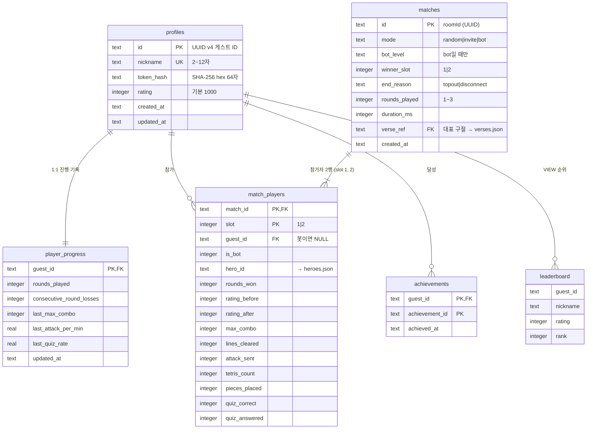
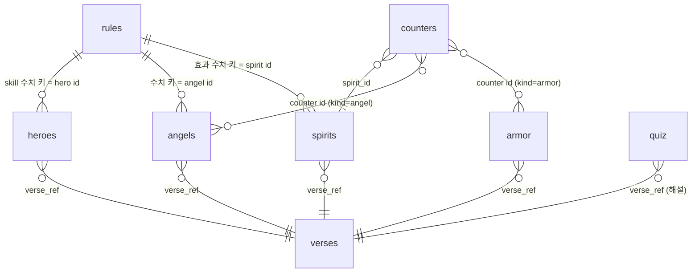

# 🏛️ 데이터 설계서 (Data Ark) — 영적 전쟁 테트리스

> *"And thou shalt make an ark of shittim wood ... And thou shalt put into the ark the testimony which I shall give thee."* — Exodus 25:10,16 (KJV)
>
> **규격:** `statute-율법/02.architecture-foundation-기초/data-ark-법궤-template.md`
> **참조 예시:** `parable-비유/02.architecture-foundation-기초/data-ark-법궤-example.md`
> **근거 정경:** [`spec-tablet-명세서.md`](../01.requirement-hearing-들음/spec-tablet-명세서.md) · [`usecase-path-사용사례.md`](../01.requirement-hearing-들음/usecase-path-사용사례.md)
> **짝 산출물:** [`architecture-temple-성전설계.md`](./architecture-temple-성전설계.md) (원장 위치·어댑터 결정 §6, §11 D-04·D-05) · [`api-gate-성문.md`](./api-gate-성문.md)

---

## 1. 데이터 아키텍처 개요

| 항목 | 내용 |
|:---|:---|
| 데이터 계층 3분류 | ① **원장(Ledger) — 영속**: 프로필·경기·참가자·진행 기록·업적 (TBL-001~TBL-005) + 랭킹 뷰 (TBL-006) ② **콘텐츠 — 읽기 전용 정적 데이터**: `content/*.json` 8종 (TBL-011~TBL-018), 빌드 시 클라이언트·서버 번들 ③ **휘발 상태 — 비영속**: 대기열·초대 코드(소켓 첨부), 방 진행 상태(GameRoom 메모리) — §8 |
| DBMS (기본) | **SQLite** — Cloudflare Durable Object 내장(`ctx.storage.sql`), Matchmaker 인스턴스 `idFromName("global")` 1개에만 존재. 로컬 파일 위치 `fruit-열매/worker/.wrangler/state/v3/do/` (wrangler dev 기본 영속) |
| DBMS (선택 어댑터) | **PostgreSQL (Supabase)** — `SUPABASE_URL`과 `SUPABASE_SERVICE_ROLE_KEY`가 **둘 다** 있을 때만. 같은 5테이블 + 뷰, 스키마 원본 `supabase/migrations/0001_init.sql` |
| 접근 경로 | 원장은 오직 `StorageAdapter`(worker/src/storage/adapter.ts) 경유. 호출자는 Matchmaker 안의 services/ 모듈뿐. 클라이언트·GameRoom은 원장에 직접 접근하지 않는다 (GameRoom → Matchmaker RPC) |
| 스키마 전략 | 단일 스키마(SQLite main / Postgres `public`). 원장 테이블 5 + 뷰 1. 정규화 3NF — 닉네임은 profiles에만, 승패는 matches.winner_slot에만(참가자 행에 중복 저장 안 함), 랭킹 순위는 저장하지 않고 뷰로 계산 |
| 테이블 네이밍 | snake_case, 복수형 (`profiles`, `matches`, `match_players`, `achievements`). 1:1 확장 테이블은 의미 단위 이름(`player_progress`) |
| 컬럼 네이밍 | snake_case, FK는 `{참조 단수}_id` (`guest_id`, `match_id`) |
| 시간 표기 | SQLite: `TEXT` ISO-8601 UTC 밀리초 (`strftime('%Y-%m-%dT%H:%M:%fZ','now')`) / Postgres: `timestamptz`. 어댑터가 두 저장소 모두 ISO-8601 문자열로 반환 (architecture D-05) |
| ID 형식 | 게스트 ID·경기 ID = UUID v4 문자열(36자, `crypto.randomUUID()`). 경기 ID = GameRoom의 roomId |
| 콘텐츠 형식 | UTF-8 JSON, 최상위 배열(규칙 파일 rules.json만 객체). 영어 구절은 KJV 1769 원문, 한국어는 KJV 직접 번역 (C-003) |

---

## 2. ERD (엔티티 관계도)

### 2.1 원장 (영속)



### 2.2 콘텐츠 (읽기 전용 JSON — 참조 관계)



> 원장 ↔ 콘텐츠 참조(`match_players.hero_id` → heroes.json, `matches.verse_ref` → verses.json, `achievements.achievement_id` → rules.json `achievements`)는 저장소가 다르므로 DB FK가 아니라 **CHECK 열거 + 서비스 계층 검증**으로 강제한다 (§6.2).

---

## 3. 테이블 정의서

### 3.0 Phase 1 데이터 항목 수용 대조표 (P2-002)

| # | Phase 1 데이터 항목 | 출처 | 수용 위치 |
|:--|:---|:---|:---|
| 1 | 닉네임 (길이·허용 문자, 중복 거부) | FR-012, NFR-003 | TBL-001 `profiles.nickname` (UNIQUE NOCASE, CHECK) |
| 2 | 게스트 ID | FR-012, S1 | TBL-001 `profiles.id` |
| 3 | 게스트 토큰 | FR-012, NFR-003 | TBL-001 `profiles.token_hash` (원문은 브라우저에만) |
| 4 | 브라우저 저장 (닉네임·게스트 ID·토큰) | FR-012, UC-001 | 클라이언트 `localStorage` 키 `swt.guest` = `{guestId, nickname, token}` (원장 아님 — §8.3) |
| 5 | 레이팅 기본값 1000 | FR-070 | TBL-001 `profiles.rating DEFAULT 1000` |
| 6 | 방 ID | FR-068 | TBL-002 `matches.id` |
| 7 | 두 플레이어 | FR-068 | TBL-003 `match_players` (slot 1, 2) `.guest_id` |
| 8 | 승자 | FR-068 | TBL-002 `matches.winner_slot` |
| 9 | 두 위인 | FR-068 | TBL-003 `match_players.hero_id` |
| 10 | 경기 시간(ms) | FR-068 | TBL-002 `matches.duration_ms` |
| 11 | 통계 (경기 기록용) | FR-068, A §4.3 matchEnd | TBL-003 `max_combo, lines_cleared, attack_sent, tetris_count, pieces_placed, quiz_correct, quiz_answered`, TBL-002 `rounds_played` |
| 12 | 일시 | FR-069 | TBL-002 `matches.created_at` |
| 13 | 상대 (사람 닉네임 / 봇·난이도) | FR-069, UC-018 | TBL-003 `is_bot` + TBL-001 `nickname`(조인) / TBL-002 `bot_level` |
| 14 | 이탈 판정 (이탈자 패배) | FR-009, UC-016 | TBL-002 `end_reason = 'disconnect'`, `winner_slot` = 남은 쪽 |
| 15 | 경기 모드 (사람 랜덤·초대·봇) | FR-018, FR-019, FR-021 | TBL-002 `matches.mode` |
| 16 | Elo 갱신 결과 (전후 레이팅) | FR-070, UC-015 8단계 "레이팅 변화" | TBL-003 `rating_before`, `rating_after` + TBL-001 `rating` |
| 17 | 랭킹 상위 100 + 내 순위 | FR-071 | TBL-006 `leaderboard` 뷰 (`rank`) |
| 18 | 누적 판 수 (모든 모드) | FR-067, FR-047, OQ #12 | TBL-004 `rounds_played` |
| 19 | 연속 패배 판 수 | FR-062, FR-067 | TBL-004 `consecutive_round_losses` |
| 20 | 직전 판(경기) 개인 기록 | FR-066, FR-067 | TBL-004 `last_max_combo`, `last_attack_per_min`, `last_quiz_rate` |
| 21 | 개인 기록 (최대 콤보·분당 공격·퀴즈 정답률) | FR-066 | TBL-003 `max_combo`, `attack_sent`÷(`duration_ms`/60000), `quiz_correct`÷`quiz_answered` |
| 22 | 업적 달성 | FR-065, FR-067 | TBL-005 `achievements` |
| 23 | 말씀 카드 대표 구절 | FR-063 | TBL-002 `matches.verse_ref` (규칙 §3.18 `verseCard`) |
| 24 | 위인 4명 (스킬 이름·효과·근거 구절·패시브) | FR-013~FR-017 | TBL-011 heroes.json + TBL-018 `heroSkills` 수치 |
| 25 | 천사 5종 | FR-035 | TBL-012 angels.json + TBL-018 `angels` 수치 |
| 26 | 악한 영 14종 (등급·효과·시간) | FR-026~FR-030 | TBL-013 spirits.json (§3.13 확정표) |
| 27 | 전신갑주 6종 | FR-036, FR-037 | TBL-014 armor.json + TBL-018 `armor` 수치 |
| 28 | 상성표 | FR-038 | TBL-015 counters.json |
| 29 | 구절 `{ref, kjv, ko}` | FR-074, C-003, A §8 | TBL-016 verses.json |
| 30 | 퀴즈 60문항 이상 (유형·난이도 3단계·근거 구절) | FR-043 | TBL-017 quiz.json |
| 31 | 수치 (게이지 비용·쿨다운·확률·속도·Elo K·초대 코드 형식·방해 상한) | spec-tablet §4.2 머리말 "수치는 Phase 2에서 확정", OQ #15, #19 | TBL-018 rules.json (§3.18) |
| 32 | 리액션 3종 (🙏 아멘, 🔥 할렐루야, 😇) | FR-064 | TBL-018 `reactions` |
| 33 | 랜덤 매칭 대기열 | FR-018, FR-020 | 휘발 — Matchmaker 소켓 첨부 (§8.1) |
| 34 | 친구 초대 코드 | FR-019 | 휘발 — 방장 소켓 첨부 (§8.1) |
| 35 | 방 진행 상태 (믿음 게이지·쿨다운·걸린 효과·봉인·대기 공격·보유 갑주·예수님 이벤트 사용·은혜·말씀 대결) | FR-031, FR-033, FR-034, FR-039, FR-041, FR-062 | 휘발 — GameRoom 메모리 + `ctx.storage` config (§8.2) |

> 판정: Phase 1 데이터 항목 **35건 전부 수용**, 미수용 0건. 원장 테이블은 영속이 필요한 항목(1~3, 5~23)만 담고, 경기 중에만 의미 있는 항목(33~35)은 의도적으로 휘발 상태로 둔다(정상 종료·이탈 시 결과만 원장으로).

### TBL-001: profiles (게스트 프로필)

> **목적:** 게스트 식별·인증(토큰 해시)·닉네임 유일성·레이팅의 단일 원천
> **연결 REQ:** REQ-002, REQ-015, FR-012, FR-018, FR-070, NFR-003, NFR-008

| # | 컬럼명 | 타입 (SQLite / Postgres) | NULL | PK | FK | Default | 설명 |
|:--|:---|:---|:---:|:---:|:---|:---|:---|
| 1 | id | TEXT / uuid | ❌ | ✅ | — | — (서비스가 `crypto.randomUUID()`) | 게스트 ID |
| 2 | nickname | TEXT / text | ❌ | — | — | — | 닉네임, trim 저장, 대소문자 무시 유일 |
| 3 | token_hash | TEXT / text | ❌ | — | — | — | 게스트 토큰 SHA-256 소문자 hex 64자 |
| 4 | rating | INTEGER / integer | ❌ | — | — | 1000 | Elo 레이팅 |
| 5 | created_at | TEXT / timestamptz | ❌ | — | — | 현재 UTC | 입장(생성) 일시 |
| 6 | updated_at | TEXT / timestamptz | ❌ | — | — | 현재 UTC | 레이팅 갱신 일시 |

**인덱스:**
| 인덱스명 | 컬럼 | 유형 | 사유 |
|:---|:---|:---|:---|
| idx_profiles_nickname | nickname COLLATE NOCASE (Postgres: `lower(nickname)`) | UNIQUE BTREE | 중복 닉네임 거부 (FR-012) |
| idx_profiles_token_hash | token_hash | UNIQUE BTREE | 토큰 검증 조회 (모든 REST·WS 인증) |
| idx_profiles_rating | rating DESC, created_at ASC | BTREE | 랭킹 상위 100 (FR-071), Elo 근접 매칭 시 레이팅 조회 |

**제약조건:**
- UNIQUE: nickname (대소문자 무시), token_hash
- CHECK: `length(id) = 36`, `nickname = trim(nickname)`, `length(trim(nickname)) BETWEEN 2 AND 12`, `length(token_hash) = 64`, `rating >= 0`
- 허용 문자 정규식 `^[가-힣A-Za-z0-9_]{2,12}$`은 서버 서비스 계층이 검사(SQLite는 기본 정규식 함수가 없음 — 방어 깊이 2층), DB는 길이·공백(3층)

### TBL-002: matches (경기)

> **목적:** 끝난 대전 경기(사람 대 사람·봇) 1건의 결과. 연습 세션은 기록하지 않는다(상대 없음 — 전적 화면 대상 아님, 진행 기록은 TBL-004)
> **연결 REQ:** REQ-014, FR-009, FR-063, FR-068, FR-069

| # | 컬럼명 | 타입 (SQLite / Postgres) | NULL | PK | FK | Default | 설명 |
|:--|:---|:---|:---:|:---:|:---|:---|:---|
| 1 | id | TEXT / uuid | ❌ | ✅ | — | — (roomId) | 경기 ID = GameRoom 방 ID |
| 2 | mode | TEXT / text | ❌ | — | — | — | CODE-001: `random` · `invite` · `bot` |
| 3 | bot_level | TEXT / text | ✅ | — | — | NULL | CODE-002: `easy` · `normal` · `hard` (mode=bot일 때만) |
| 4 | winner_slot | INTEGER / smallint | ❌ | — | — | — | 승자 슬롯 1 또는 2 |
| 5 | end_reason | TEXT / text | ❌ | — | — | — | CODE-004: `topout` · `disconnect` |
| 6 | rounds_played | INTEGER / smallint | ❌ | — | — | — | 진행된 라운드 수 1~3 |
| 7 | duration_ms | INTEGER / integer | ❌ | — | — | — | 첫 `start` 카운트다운 종료부터 `matchEnd`까지 |
| 8 | verse_ref | TEXT / text | ❌ | — | verses.json `ref` (논리 참조) | — | 말씀 카드 대표 구절 (FR-063) |
| 9 | created_at | TEXT / timestamptz | ❌ | — | — | 현재 UTC | 경기 종료(기록) 일시 |

**인덱스:**
| 인덱스명 | 컬럼 | 유형 | 사유 |
|:---|:---|:---|:---|
| idx_matches_created_at | created_at DESC | BTREE | 전적 최신순 키셋 페이지(`before` 커서) |

**제약조건:**
- CHECK: `mode IN ('random','invite','bot')`, `bot_level IS NULL OR bot_level IN ('easy','normal','hard')`, `(mode = 'bot') = (bot_level IS NOT NULL)`, `winner_slot IN (1,2)`, `end_reason IN ('topout','disconnect')`, `rounds_played BETWEEN 1 AND 3`, `duration_ms >= 0`, `length(trim(verse_ref)) > 0`
- 무효 경기(양측 동시 이탈 UC-016 E1, 봇 처리 오류 UC-005 E2)는 행을 만들지 않는다

### TBL-003: match_players (경기 참가자)

> **목적:** 경기당 정확히 2행 — 슬롯별 참가자·위인·라운드 승수·레이팅 전후·개인 통계 (FR-066 개인 기록과 FR-065 업적 판정의 원천)
> **연결 REQ:** REQ-014, REQ-015, FR-065, FR-066, FR-068, FR-069, FR-070

| # | 컬럼명 | 타입 (SQLite / Postgres) | NULL | PK | FK | Default | 설명 |
|:--|:---|:---|:---:|:---:|:---|:---|:---|
| 1 | match_id | TEXT / uuid | ❌ | ✅ | TBL-002.id (ON DELETE CASCADE) | — | 경기 |
| 2 | slot | INTEGER / smallint | ❌ | ✅ | — | — | 1 또는 2 |
| 3 | guest_id | TEXT / uuid | ✅ | — | TBL-001.id | NULL | 사람 참가자 (봇이면 NULL) |
| 4 | is_bot | INTEGER / boolean | ❌ | — | — | 0 / false | 봇 여부 |
| 5 | hero_id | TEXT / text | ❌ | — | heroes.json `id` (논리 참조) | — | CODE-003 위인 |
| 6 | rounds_won | INTEGER / smallint | ❌ | — | — | 0 | 이긴 라운드 수 0~2 |
| 7 | rating_before | INTEGER / integer | ✅ | — | — | NULL | 사람 대 사람일 때 경기 전 레이팅 |
| 8 | rating_after | INTEGER / integer | ✅ | — | — | NULL | 사람 대 사람일 때 경기 후 레이팅 |
| 9 | max_combo | INTEGER / integer | ❌ | — | — | 0 | 최대 콤보 |
| 10 | lines_cleared | INTEGER / integer | ❌ | — | — | 0 | 지운 줄 합계 |
| 11 | attack_sent | INTEGER / integer | ❌ | — | — | 0 | 상쇄 후 상대에게 보낸 쓰레기 줄 합계 |
| 12 | tetris_count | INTEGER / integer | ❌ | — | — | 0 | 테트리스(4줄) 횟수 — 업적 판정 |
| 13 | pieces_placed | INTEGER / integer | ❌ | — | — | 0 | 놓은 블록 수 |
| 14 | quiz_correct | INTEGER / integer | ❌ | — | — | 0 | 말씀 대결 정답(먼저 맞힘 여부와 무관, 정답 선택) 수 |
| 15 | quiz_answered | INTEGER / integer | ❌ | — | — | 0 | 말씀 대결 참여(1회 이상 선택) 수 |

**인덱스:**
| 인덱스명 | 컬럼 | 유형 | 사유 |
|:---|:---|:---|:---|
| idx_match_players_guest_id | guest_id, match_id | BTREE | 내 전적 조회 (FR-069) |

**제약조건:**
- PK: (match_id, slot)
- CHECK: `slot IN (1,2)`, `is_bot IN (0,1)`, `(is_bot = 1) = (guest_id IS NULL)`, `hero_id IN ('david','solomon','peter','paul')`, `rounds_won BETWEEN 0 AND 2`, `(rating_before IS NULL) = (rating_after IS NULL)`, 통계 컬럼 전부 `>= 0`, `quiz_correct <= quiz_answered`
- 서비스 규칙: 경기당 2행, 봇 행은 최대 1개, mode≠bot이면 is_bot=0 두 행 + rating 전후 필수

### TBL-004: player_progress (플레이어 진행 기록)

> **목적:** 단계적 해금(FR-047)·은혜 보정(FR-062)·성장 수치(FR-066)의 계산 원천. 서버만 쓴다 (FR-067 "서버가 게스트 ID별로 저장")
> **연결 REQ:** REQ-012, REQ-013, FR-047, FR-062, FR-066, FR-067

| # | 컬럼명 | 타입 (SQLite / Postgres) | NULL | PK | FK | Default | 설명 |
|:--|:---|:---|:---:|:---:|:---|:---|:---|
| 1 | guest_id | TEXT / uuid | ❌ | ✅ | TBL-001.id (ON DELETE CASCADE) | — | 게스트 (프로필 생성과 같은 트랜잭션에서 생성) |
| 2 | rounds_played | INTEGER / integer | ❌ | — | — | 0 | 끝낸 라운드 누적 (대전·봇·연습 모두, 연습 세션 = 1판) |
| 3 | consecutive_round_losses | INTEGER / integer | ❌ | — | — | 0 | 연속으로 진 대전 라운드 수 (승리 라운드에서 0, 연습은 변화 없음) |
| 4 | last_max_combo | INTEGER / integer | ✅ | — | — | NULL | 직전 대전 경기 최대 콤보 (첫 경기 전 NULL) |
| 5 | last_attack_per_min | REAL / real | ✅ | — | — | NULL | 직전 대전 경기 분당 공격 |
| 6 | last_quiz_rate | REAL / real | ✅ | — | — | NULL | 직전 대전 경기 퀴즈 정답률 0~1 (참여 0회면 NULL) |
| 7 | updated_at | TEXT / timestamptz | ❌ | — | — | 현재 UTC | 갱신 일시 |

**인덱스:**
| 인덱스명 | 컬럼 | 유형 | 사유 |
|:---|:---|:---|:---|
| (PK) | guest_id | BTREE | 방 배정 시 진행 기록 1건 조회 (해금 단계·은혜) |

**제약조건:**
- CHECK: `rounds_played >= 0`, `consecutive_round_losses >= 0`, `last_max_combo IS NULL OR last_max_combo >= 0`, `last_attack_per_min IS NULL OR last_attack_per_min >= 0`, `last_quiz_rate IS NULL OR last_quiz_rate BETWEEN 0 AND 1`

### TBL-005: achievements (업적)

> **목적:** 업적 달성 기록 — 이번 실행 정의 업적은 1종 "골리앗 사냥꾼"뿐 (OQ #14)
> **연결 REQ:** REQ-013, FR-065, FR-067

| # | 컬럼명 | 타입 (SQLite / Postgres) | NULL | PK | FK | Default | 설명 |
|:--|:---|:---|:---:|:---:|:---|:---|:---|
| 1 | guest_id | TEXT / uuid | ❌ | ✅ | TBL-001.id (ON DELETE CASCADE) | — | 달성자 |
| 2 | achievement_id | TEXT / text | ❌ | ✅ | rules.json `achievements` 키 (논리 참조) | — | CODE-005 |
| 3 | achieved_at | TEXT / timestamptz | ❌ | — | — | 현재 UTC | 최초 달성 일시 |

**제약조건:**
- PK: (guest_id, achievement_id) — 같은 업적 중복 달성 행 없음 (`INSERT ... ON CONFLICT DO NOTHING`)
- CHECK: `achievement_id IN ('goliath_hunter')`

### TBL-006: leaderboard (랭킹 — VIEW)

> **목적:** 레이팅 순위. 순위를 저장하지 않고 계산한다(정규화 — 레이팅 1곳). req.md A §4.4 "leaderboard (VIEW)" 그대로
> **연결 REQ:** REQ-015, FR-071

| # | 컬럼명 | 타입 | NULL | PK | FK | Default | 설명 |
|:--|:---|:---|:---:|:---:|:---|:---|:---|
| 1 | guest_id | TEXT / uuid | ❌ | — | TBL-001.id | — | 내 행 강조·내 순위 조회용 (API 응답에는 노출하지 않음) |
| 2 | nickname | TEXT / text | ❌ | — | — | — | 닉네임 |
| 3 | rating | INTEGER / integer | ❌ | — | — | — | 레이팅 |
| 4 | rank | INTEGER / bigint | ❌ | — | — | — | `RANK() OVER (ORDER BY rating DESC)` — 동점 같은 순위 |

**정의:** `SELECT id AS guest_id, nickname, rating, RANK() OVER (ORDER BY rating DESC) AS rank FROM profiles` — 상위 100은 `ORDER BY rank, created_at LIMIT 100`(SQLite 3.25+ 윈도 함수, Postgres 동일)

### TBL-011: heroes.json (위인 — 콘텐츠)

> **목적:** 캐릭터 선택 화면·스킬 연출·근거 구절 (1차 4명만 — C-008)
> **연결 REQ:** REQ-003, FR-013~FR-017, C-010

| # | 필드명 | 타입 | NULL | PK | FK | Default | 설명 |
|:--|:---|:---|:---:|:---:|:---|:---|:---|
| 1 | id | string | ❌ | ✅ | — | — | CODE-003 `david` · `solomon` · `peter` · `paul` |
| 2 | name_ko | string | ❌ | — | — | — | 다윗 · 솔로몬 · 베드로 · 바울 |
| 3 | name_en | string | ❌ | — | — | — | David · Solomon · Peter · Paul |
| 4 | skill_id | string | ❌ | — | rules.json `heroSkills` 키 | — | `sling_stone` · `understanding_heart` · `upon_this_rock` · `prison_doors_opened` |
| 5 | skill_name_ko | string | ❌ | — | — | — | 물맷돌 · 지혜로운 마음 · 이 반석 위에 · 옥문이 열리다 |
| 6 | skill_effect_ko | string | ❌ | — | — | — | FR-014~FR-017 효과 문장 그대로 |
| 7 | passive_ko | string | ✅ | — | — | null | 솔로몬만 "다음 블록 5개 미리보기" (OQ #3 — 나머지 null) |
| 8 | verse_ref | string | ❌ | — | TBL-016 `ref` | — | 1 Samuel 17:49 · 1 Kings 3:9 · Matthew 16:18 · Acts 16:26 |
| 9 | emblem | string | ❌ | — | — | — | 코드로 그린 벡터 엠블럼 키 (`sling` · `crown` · `rock_key` · `broken_chain`) — 렌더러가 Pixi Graphics로 그림 (C-007) |

### TBL-012: angels.json (천사 — 콘텐츠)

> **목적:** 천사 5종 표시·연출·근거 / **연결 REQ:** REQ-008, FR-035, FR-049

| # | 필드명 | 타입 | NULL | PK | FK | Default | 설명 |
|:--|:---|:---|:---:|:---:|:---|:---|:---|
| 1 | id | string | ❌ | ✅ | — | — | CODE-011 `michael` · `gabriel` · `cherubim` · `seraphim` · `ministering_spirits` |
| 2 | name_ko / name_en | string | ❌ | — | — | — | 미가엘 / 가브리엘 / 그룹 / 스랍 / 섬기는 영들 |
| 3 | effect_ko | string | ❌ | — | — | — | FR-035 효과 문장 |
| 4 | verse_ref | string | ❌ | — | TBL-016 `ref` | — | Jude 1:9 · Luke 1:19 · Genesis 3:24 · Isaiah 6:6 · Hebrews 1:14 |
| 5 | visual | string | ❌ | — | — | — | 연출 키 `wings_light` · `herald_light` · `four_faces_wheels`(Ezek 10) · `six_wings`(Isa 6:2) · `small_lights` (FR-049) |

### TBL-013: spirits.json (악한 영 — 콘텐츠)

> **목적:** 악한 영 14종 등급·효과·시간·근거 — 서버 소환 결정(attack.ts)과 클라이언트 연출이 같은 표를 읽는다 (FR-074 S9)
> **연결 REQ:** REQ-007, FR-026~FR-031, FR-049, C-010, C-011

| # | 필드명 | 타입 | NULL | PK | FK | Default | 설명 |
|:--|:---|:---|:---:|:---:|:---|:---|:---|
| 1 | id | string | ❌ | ✅ | — | — | 아래 확정표 |
| 2 | name_ko / name_en | string | ❌ | — | — | — | 표시 이름 |
| 3 | tier | integer | ❌ | — | — | — | 1~5, 보스 = 6 (CODE-006) |
| 4 | effect | string | ❌ | — | — | — | 효과 코드 (클라이언트 적용 함수 키) |
| 5 | category | string | ❌ | — | — | — | CODE-007 방해 분류 — 갑주 "무효" 대상 판정 |
| 6 | duration_ms | integer | ❌ | — | — | — | 시간형 효과 길이 (보드 상태형 = 0) |
| 7 | params | object | ❌ | — | — | {} | 효과 세부 수치 |
| 8 | verse_ref | string | ❌ | — | TBL-016 `ref` | — | KJV 근거 |

**확정표 (spec-tablet "악한 영 등급별 후보 목록" Phase 2 확정):**

| id | 이름 | tier | effect | category | duration_ms | params | verse_ref |
|:---|:---|:---:|:---|:---|:---:|:---|:---|
| unclean_spirit | 더러운 귀신 | 1 | darken | vision | 3000 | `{"opacity":0.3}` | Mark 1:23 |
| deaf_dumb_spirit | 귀먹고 말 못하게 하는 귀신 | 1 | mute_hide_next | sense | 5000 | `{}` | Mark 9:25 |
| legion | 군대 | 2 | shadow_swarm | vision | 4000 | `{"coverage":0.4}` | Mark 5:9 |
| lying_spirit | 거짓말하는 영 | 2 | fake_next_ghost | deception | 5000 | `{}` | 1 Kings 22:22 |
| divination_spirit | 점치는 귀신 | 2 | wrong_ghost | deception | 5000 | `{"offset":2}` | Acts 16:16 |
| beelzebub | 바알세불 | 3 | fly_swarm | vision | 5000 | `{"particles":240}` | Matthew 12:24 |
| prince_of_the_air | 공중 권세 잡은 자 | 3 | wind | speed | 5000 | `{"gravityMultiplier":2,"pushEveryMs":1200}` (밀림 방향 ±1은 서버가 `attack.params.pushDir`로 지정) | Ephesians 2:2 |
| prince_of_persia | 바사 왕국의 군주 | 3 | seal_angels | seal | 21000 | `{}` (6초 상한 예외 — FR-031) | Daniel 10:13 |
| abaddon | 아바돈 / 아볼루온 | 4 | gnaw_holes | board | 0 | `{"holes":4}` (위치 시드는 서버가 `attack.params.seed`로 지정) | Revelation 9:11 |
| jezebel | 이세벨의 영 | 4 | reverse_controls | control | 6000 | `{}` | Revelation 2:20 |
| wickedness | 악 (에바 속의 여인) | 4 | lead_row | board | 0 | `{"rows":1,"linesToClear":4}` | Zechariah 5:8 |
| babylon | 큰 음녀 바벨론 | 5 | drunken_blur | vision | 6000 | `{"blur":6,"waveAmplitude":8}` | Revelation 17:5 |
| satan_angel_of_light | 광명의 천사로 가장한 사탄 | 5 | false_angel | deception | 6000 | `{"disguiseMs":1500,"curse":"darken_hide_next","opacity":0.5}` | 2 Corinthians 11:14 |
| dragon | 루시퍼 / 용 / 옛 뱀 / 사탄 | 6 | blackout | vision | 4000 | `{"garbageMin":6}` (연속 B2B 테트리스 전용) | Revelation 12:9 |

> 시간형 효과는 전부 6,000ms 이하(봉인 21,000ms 예외), 보드 상태형(abaddon 구멍, wickedness 납 블록)은 시간 상한 대상이 아니다 (spec-tablet §9.7 K4). 연출은 실루엣·연기·파티클 중심, 고어·선정 표현 없음 (C-011).

### TBL-014: armor.json (전신갑주 — 콘텐츠)

> **목적:** 갑주 6종 표시·효과 분류·근거 / **연결 REQ:** REQ-009, FR-036, FR-037

| # | 필드명 | 타입 | NULL | PK | FK | Default | 설명 |
|:--|:---|:---|:---:|:---:|:---|:---|:---|
| 1 | id | string | ❌ | ✅ | — | — | CODE-010 |
| 2 | name_ko / name_en | string | ❌ | — | — | — | 표시 이름 |
| 3 | effect_ko | string | ❌ | — | — | — | FR-037 효과 문장 |
| 4 | action | string | ❌ | — | — | — | `nullify`(해제 + 다음 1회 무효) · `reduce_next` · `block_next` · `reflect` |
| 5 | nullifies | string | ✅ | — | — | null | action=nullify일 때 대상 CODE-007 분류 목록 |
| 6 | verse_ref | string | ❌ | — | TBL-016 `ref` | — | Ephesians 6:14~17 |

| id | 이름 | action | nullifies | verse_ref |
|:---|:---|:---|:---|:---|
| belt_of_truth | 진리의 허리띠 | nullify | `["control","deception"]` (조작 반전·미혹) | Ephesians 6:14 |
| breastplate_of_righteousness | 의의 흉배 | reduce_next | null | Ephesians 6:14 |
| gospel_shoes | 평안의 복음의 신 | nullify | `["speed"]` (낙하 속도 증가) | Ephesians 6:15 |
| shield_of_faith | 믿음의 방패 | block_next | null | Ephesians 6:16 |
| helmet_of_salvation | 구원의 투구 | nullify | `["vision","sense"]` (암전·시야 방해) | Ephesians 6:17 |
| sword_of_the_spirit | 성령의 검 | reflect | null | Ephesians 6:17 |

### TBL-015: counters.json (상성표 — 콘텐츠)

> **목적:** 모든 방해 효과(14종)에 대응 천사·갑주가 1개 이상 있음을 데이터로 보장 (FR-038, 콘텐츠 검사 FR-076 대상)
> **연결 REQ:** REQ-009, FR-038, FR-076

| # | 필드명 | 타입 | NULL | PK | FK | Default | 설명 |
|:--|:---|:---|:---:|:---:|:---|:---|:---|
| 1 | spirit_id | string | ❌ | ✅ | TBL-013 `id` | — | 악한 영 |
| 2 | counters | array of `{kind, id}` | ❌ | — | kind=angel → TBL-012, kind=armor → TBL-014 | — | 대응 수단 1개 이상 |

| spirit_id | counters |
|:---|:---|
| unclean_spirit | armor:helmet_of_salvation, angel:seraphim, armor:shield_of_faith |
| deaf_dumb_spirit | armor:helmet_of_salvation, angel:seraphim, armor:shield_of_faith |
| legion | armor:helmet_of_salvation, angel:cherubim, angel:seraphim, armor:shield_of_faith |
| lying_spirit | armor:belt_of_truth, angel:seraphim, armor:shield_of_faith |
| divination_spirit | armor:belt_of_truth, angel:seraphim, armor:shield_of_faith |
| beelzebub | armor:helmet_of_salvation, angel:seraphim, armor:shield_of_faith |
| prince_of_the_air | armor:gospel_shoes, angel:seraphim, armor:shield_of_faith |
| prince_of_persia | armor:shield_of_faith, armor:sword_of_the_spirit |
| abaddon | armor:shield_of_faith, armor:sword_of_the_spirit |
| jezebel | armor:belt_of_truth, angel:seraphim, armor:shield_of_faith |
| wickedness | angel:seraphim, armor:shield_of_faith, armor:sword_of_the_spirit |
| babylon | armor:helmet_of_salvation, angel:seraphim, armor:shield_of_faith |
| satan_angel_of_light | angel:michael, armor:belt_of_truth, angel:seraphim, armor:shield_of_faith |
| dragon | angel:michael, armor:helmet_of_salvation, armor:shield_of_faith |

> 봉인(prince_of_persia) 중에는 천사를 부를 수 없으므로 대응 수단을 갑주로만 둔다(FR-035 "봉인 중에는 소환 불가"와 정합).

### TBL-016: verses.json (KJV 구절 — 콘텐츠)

> **목적:** 게임에 나오는 모든 구절의 단일 원천 `{ref, kjv, ko}` (req.md A §8) / **연결 REQ:** REQ-011, FR-043, FR-074, C-003

| # | 필드명 | 타입 | NULL | PK | FK | Default | 설명 |
|:--|:---|:---|:---:|:---:|:---|:---|:---|
| 1 | ref | string | ❌ | ✅ | — | — | 영어 책 이름 + 장:절 (예: `John 16:33`, 범위는 `Ephesians 6:13-17`) |
| 2 | kjv | string | ❌ | — | — | — | KJV 1769 원문 그대로 (C-003) |
| 3 | ko | string | ❌ | — | — | — | KJV 직접 번역 한국어 (개역개정·개역한글 미사용 — OQ #17) |
| 4 | ref_ko | string | ❌ | — | — | — | 한국어 출처 표기 (예: `요한복음 16:33`) |

> 필수 수록: 위인 4·천사 5·악한 영 14·갑주 근거 구절, John 16:33 · John 1:5 (예수님 이벤트), 2 Timothy 4:7 (승리), Ephesians 6:12 (컨셉), 퀴즈 해설 구절 전부. 콘텐츠 검사 스크립트가 모든 `verse_ref` 참조가 이 파일에 존재하는지 검사한다.

### TBL-017: quiz.json (말씀 대결 문항 — 콘텐츠)

> **목적:** 말씀 대결 4지선다 문항 (최소 60) / **연결 REQ:** REQ-011, FR-041, FR-043, FR-022

| # | 필드명 | 타입 | NULL | PK | FK | Default | 설명 |
|:--|:---|:---|:---:|:---:|:---|:---|:---|
| 1 | id | string | ❌ | ✅ | — | — | `Q001` 형식 |
| 2 | type | string | ❌ | — | — | — | CODE-012 `person` · `event` · `verse_blank` |
| 3 | difficulty | integer | ❌ | — | — | — | 1 · 2 · 3 |
| 4 | question_ko | string | ❌ | — | — | — | 문제 (구절 빈칸형은 KJV 영어 원문에 `_____` 빈칸 + 한국어 번역 병기) |
| 5 | choices | array[4] of string | ❌ | — | — | — | 보기 4개 |
| 6 | answer | integer | ❌ | — | — | — | 정답 인덱스 0~3 (서버만 사용 — 클라이언트로 보내는 `quiz`에는 제외) |
| 7 | verse_ref | string | ❌ | — | TBL-016 `ref` | — | 해설 구절 |

**분량 규칙 (콘텐츠 검사 대상):** 전체 ≥ 60, 유형별 ≥ 15, 난이도별 ≥ 15, 모든 `choices` 길이 4·중복 없음, `answer` ∈ 0~3.

### TBL-018: rules.json (규칙 수치 — 콘텐츠)

> **목적:** spec-tablet §4.2 머리말이 Phase 2에 위임한 **모든 수치의 단일 원천**. 서버 판정과 클라이언트 표시가 같은 값을 읽는다 — 화면·코드 하드코딩 금지
> **연결 REQ:** REQ-001, REQ-005, REQ-007~REQ-013, REQ-015, FR-004, FR-010, FR-019, FR-021~FR-047, FR-062, FR-064, FR-065, FR-070, NFR-003

| 키 (경로) | 값 | 단위 | 근거 / 해석 |
|:---|:---|:---|:---|
| `board.width` / `board.height` | 10 / 20 | 칸 | FR-001 |
| `board.dangerRows` | 4 | 줄 | OQ #7 위험선 = 상단 4줄, FR-055 |
| `board.preview` | 3 | 개 | 기본 다음 블록 미리보기 |
| `board.previewSolomon` / `board.previewGabriel` | 5 / 7 | 개 | FR-015 패시브, FR-035 가브리엘 |
| `net.stateHz` | 12 | 회/초 | FR-006 "초당 10~15회" 안 |
| `engine.lockDelayMs` | 500 | ms | 착지 후 고정까지 (FR-003) |
| `engine.dasMs` / `engine.arrMs` | 150 / 40 | ms | 좌우 키 누름 지속 반복 (FR-011) |
| `engine.softDropMultiplier` | 20 | 배 | 소프트 드롭 (FR-003) |
| `gravity.startMs` | 1000 | ms/줄 | FR-010 시작 낙하 간격 |
| `gravity.at120sMs` | 500 | ms/줄 | 0~120초 선형 감소 ("완만하게") |
| `gravity.accelEveryMs` / `gravity.accelFactor` / `gravity.minMs` | 15000 / 0.85 / 80 | ms / 배 / ms | 120초 이후 15초마다 ×0.85 ("2분 뒤부터 가속"), 하한 80ms |
| `gravity.accelAfterMs` | 120000 | ms | **[추가 2026-10-19 — RTM §5 DCL-003]** 선형 감소 구간 끝·가속 시작 시점 (FR-010 "2분 뒤부터") — 지금까지 키 이름 `at120sMs`에만 숨어 있던 값을 단일 원천으로 올림, 값 불변 |
| `scoring.lines` | `{1:100, 2:300, 3:500, 4:800}` | 점 | FR-004 |
| `scoring.tspin` | `{0:400, 1:800, 2:1200, 3:1600}` | 점 | FR-004 T-Spin |
| `scoring.b2bMultiplier` / `scoring.comboPer` | 1.5 / 50 | 배 / 점×콤보 | FR-004 |
| `scoring.softDropPerCell` / `scoring.hardDropPerCell` | 1 / 2 | 점 | FR-003 |
| `attack.lines` | `{1:0, 2:1, 3:2, 4:4}` | 줄 | FR-024, OQ #10 |
| `attack.tspinBonus` | `{1:2, 2:3, 3:3}` | 줄 | FR-024 "T-Spin → +1~3" |
| `attack.comboBonus` | `[{"from":1,"bonus":1},{"from":3,"bonus":2},{"from":5,"bonus":3}]` | 줄 | FR-024 "연속 콤보 → +1~3" (콤보 0 = 첫 삭제) |
| `attack.b2bBonus` | 1 | 줄 | FR-024 "백투백 테트리스 → 4 이상" (4+1=5) |
| `attack.jerichoBonus` | 1 | 줄 | FR-045 |
| `spiritTier.byLines` | `{1:1, 2:1, 3:2}` (1줄은 T-Spin일 때만 공격) | 등급 | FR-026 |
| `spiritTier.tetrisPool` | `["prince_of_the_air","abaddon"]` | — | FR-026 "4줄 → 무작위" |
| `spiritTier.tierUpTspin` / `spiritTier.tierUpComboFrom` | 1 / 3 | 등급 / 콤보 | FR-026 "T-Spin·연속 콤보 → 등급 상승" (4줄 + 콤보 3 이상 → 4등급 풀) |
| `spiritTier.b2bTetrisTiers` | `[4,5]` | 등급 | FR-026 백투백 테트리스 |
| `spiritTier.bossConsecutiveB2BTetris` | 2 | 회 | OQ #9 (B2B 테트리스 2회 연속 → dragon) |
| `gauge.max` | 100 | 점 | FR-033 |
| `gauge.perLine` / `gauge.tetrisBonus` / `gauge.tspinBonus` | 6 / 6 / 6 | 점 | FR-033 (테트리스 = 30) |
| `gauge.quizReward` / `gauge.manna` | 50 / 25 | 점 | FR-041 "+50%", FR-046 "+25%" (최대 100에서 멈춤 — UC-014 E2) |
| `heroSkills.sling_stone` | cost 50, cooldownMs 20000, blocks 3 | — | FR-014 |
| `heroSkills.understanding_heart` | cost 40, cooldownMs 20000, hintMs 10000 | — | FR-015 |
| `heroSkills.upon_this_rock` | cost 60, cooldownMs 30000, durationMs 10000 | — | FR-016 |
| `heroSkills.prison_doors_opened` | cost 60, cooldownMs 25000, rows 3 | — | FR-017 |
| `angels.michael` | cost 70, cooldownMs 30000, families `["dragon","satan_angel_of_light"]` | — | FR-035 "용·사탄 계열 1회 완전 상쇄" |
| `angels.gabriel` | cost 40, cooldownMs 20000, pieces 7 | — | FR-035 |
| `angels.cherubim` | cost 35, cooldownMs 12000, burnPending 2 | — | FR-035 (대기 공격 2줄) |
| `angels.seraphim` | cost 50, cooldownMs 20000 | — | FR-035 (걸린 저주 전부 해제) |
| `angels.ministering_spirits` | cost 20, cooldownMs 8000, removeRows 1 | — | FR-035 (보드의 쓰레기 줄 1줄) |
| `armor.spawnChancePerPiece` | 0.04 | 확률 | FR-036 (대전만 — 연습 없음, OQ #4) |
| `armor.breastplateReduce` | 2 | 줄 | FR-037 "쓰레기 줄 1회 경감" |
| `specials.wordIntervalMin` / `specials.wordIntervalMax` | 7 / 12 | 조각 | FR-044 |
| `specials.jericho` | base 0.03, perCombo 0.02, max 0.12, radius 1 (3×3) | 확률 | FR-045 |
| `specials.manna` | base 0.02, crisis 0.10, max 0.10 | 확률 | FR-046 (위기 = 위험선 진입) |
| `specials.unlockRounds` | `{"word":4, "jericho":5, "manna":5}` (1~3판 없음) | 판 | FR-047, OQ #12 |
| `specials.priority` | `["word","jericho","manna","armor"]` | — | 한 조각에 특수 칸 최대 1개 |
| `effects.maxDurationMs` / `effects.maxConcurrent` / `effects.reapplyCooldownMs` | 6000 / 2 / 1500 | ms / 개 / ms | FR-031 |
| `effects.sealMs` | 21000 | ms | FR-028 (상한 예외) |
| `garbage.delayMs` | 1000 | ms | 상쇄 창 (architecture §9.2) |
| `quiz.timeLimitMs` / `quiz.wrongLockMs` / `quiz.autoIntervalMs` / `quiz.resumeDelayMs` | 10000 / 3000 / 90000 / 2500 | ms | FR-040, FR-041, OQ #21 |
| `quiz.gaugeRewardChance` | 0.5 (나머지 0.5 = 무작위 갑주) | 확률 | OQ #13 서버 무작위 |
| `match.roundsToWin` / `match.countdownMs` / `match.nextRoundDelayMs` | 2 / 3000 / 4000 | 판 / ms / ms | FR-007 |
| `grace.lossStreakRounds` / `grace.garbageReduce` / `grace.gaugeMultiplier` | 3 / 1 / 1.15 | 판 / 줄 / 배 | FR-062 |
| `jesus.perMatch` / `jesus.garbageRemoveRatio` | 1 / 0.5 (내림) | 회 / 비율 | FR-039, OQ #20 (게이지 소모 없음) |
| `elo.base` / `elo.k` | 1000 / 32 | — | FR-070, OQ #19 |
| `invite.length` / `invite.alphabet` / `invite.ttlMs` | 6 / `ABCDEFGHJKLMNPQRSTUVWXYZ23456789` / 600000 | 자 / — / ms | FR-019, OQ #15 |
| `nickname.min` / `nickname.max` / `nickname.pattern` | 2 / 12 / `^[가-힣A-Za-z0-9_]{2,12}$` | 자 | FR-012, NFR-003 |
| `bot.easy` | moveIntervalMs 700, evalNoise 0.6, mistakeRate 0.25, quizAccuracy 0.40, quizDelayMs [5000, 9000] | — | FR-021, FR-022 |
| `bot.normal` | moveIntervalMs 400, evalNoise 0.25, mistakeRate 0.10, quizAccuracy 0.65, quizDelayMs [3500, 7000] | — | FR-021, FR-022 |
| `bot.hard` | moveIntervalMs 180, evalNoise 0.05, mistakeRate 0.02, quizAccuracy 0.85, quizDelayMs [2000, 5000] | — | FR-021, FR-022 |
| `rateLimit` | ~~state 20/초, clear 10/초, skill·armor 5/초, answer 4/초, reaction 1/2초, 전체 40/초, maxMessageBytes 4096~~ **[재각 2026-10-19 — RTM §5 DCL-002]** state 20/초, clear 10/초, skill·armor 5/초, answer 4/초, reaction 1/2초, 전체 40/초, maxMessageBytes 4096, `totalViolationMs` 3000 (전체 한도 연속 초과 → `error RATE_LIMITED` 후 종료), `guestCreate` 5/60초 (REST 게스트 생성, 접속 주소별 — 메모리 계수만), `maxRestBodyBytes` 1024 (REST 본문 상한 → PAYLOAD_TOO_LARGE). 각 버킷은 `{tokens, perMs}` 형식 (예: reaction = `{tokens: 1, perMs: 2000}`) | — | NFR-003, api-gate §2 공통 규약 "메시지 크기"·"속도 제한" (재각 사유: api-gate §2에만 있던 수치 3개를 단일 원천인 이 표로 올림 — 이 표 머리말 "모든 수치의 단일 원천") |
| `progressCheck.maxPiecesPerSecond` | 10 | 개/초 | FR-032 "초당 비정상 횟수" |
| `ledger.tokenCacheSize` / `ledger.leaderboardCacheMs` / `ledger.leaderboardTop` / `ledger.historyPageDefault` / `ledger.historyPageMax` | 1000 / 5000 / 100 / 20 / 50 | 건 / ms / 명 / 건 / 건 | **[추가 2026-10-19 — RTM §5 DCL-003]** 원장 서비스 수치: 토큰 검증 LRU 1,000건(architecture §4 캐시 전략, 이 문서 §5), 랭킹 상위 캐시 5초 TTL(§5), 랭킹 상위 100명(FR-071), 전적 페이지 기본 20·최대 50(api-gate §2 페이징) — 다른 정경 문서에만 있던 값을 단일 원천으로 올림, 값 불변 |
| `reactions` | `[{"id":"amen","emoji":"🙏","label_ko":"아멘"},{"id":"hallelujah","emoji":"🔥","label_ko":"할렐루야"},{"id":"angel","emoji":"😇","label_ko":"😇"}]` | — | FR-064, C-009 |
| `achievements.goliath_hunter` | heroId `david`, tetrisInMatch 5, name_ko "골리앗 사냥꾼" | — | FR-065 (한 경기 = 매치 또는 연습 세션 — OQ #1) |
| `verseCard` | 예수님 이벤트가 일어난 경기 → `John 16:33`, 아니면 승자 위인의 `verse_ref` (JSON 형식: `{"jesusEventRef": "John 16:33", "default": "winnerHeroVerse"}` — 2026-10-19 W-00 형식 확정, 값 불변) | — | FR-063 대표 구절 |
| `victoryVerse` | `2 Timothy 4:7` | — | FR-007 승리 연출 |

---

## 4. 공통 코드 정의

| CODE-ID | 코드 그룹 | 코드 | 값 / 의미 | 사용처 |
|:---|:---|:---|:---|:---|
| CODE-001 | 경기 모드 | random / invite / bot / practice | 랜덤 매칭 / 친구 초대 코드 / AI 봇 / 연습 (practice는 원장 matches에 저장하지 않음) | API-007 `mode`, TBL-002 |
| CODE-002 | 봇 난이도 | easy / normal / hard | 쉬움 / 보통 / 어려움 | API-007, TBL-002, TBL-018 `bot` |
| CODE-003 | 위인 | david / solomon / peter / paul | 다윗 / 솔로몬 / 베드로 / 바울 | API-007 `heroId`, TBL-003, TBL-011 |
| CODE-004 | 경기 종료 사유 | topout / disconnect | Top-out 2승 / 상대 이탈 | TBL-002, API-030 |
| CODE-005 | 업적 | goliath_hunter | 골리앗 사냥꾼 | TBL-005, API-030 |
| CODE-006 | 악한 영 등급 | 1 / 2 / 3 / 4 / 5 / 6 | 1~5등급, 6 = 보스 | TBL-013 |
| CODE-007 | 방해 분류 | vision / sense / deception / control / speed / seal / board | 시야 / 소리·미리보기 / 미혹 / 조작 반전 / 낙하 속도 / 천사 봉인 / 보드 상태 | TBL-013, TBL-014 `nullifies`, 스랍 해제 대상(seal 제외 전부) |
| CODE-008 | 효과 출처 | hero / angel / armor / jesus / special / grace | 위인 스킬 / 천사 / 갑주 / 예수님 이벤트 / 특수 블록 / 은혜 | API-023 `source` |
| CODE-009 | 보드 셀 코드 | 0~9 | 0 빈칸, 1 I, 2 O, 3 T, 4 S, 5 Z, 6 J, 7 L, 8 쓰레기, 9 납 블록 | API-012 `board` 200자 문자열 (행 우선, 위→아래) |
| CODE-010 | 전신갑주 | belt_of_truth / breastplate_of_righteousness / gospel_shoes / shield_of_faith / helmet_of_salvation / sword_of_the_spirit | 허리띠 / 흉배 / 신 / 방패 / 투구 / 검 | API-015, TBL-014 |
| CODE-011 | 천사 | michael / gabriel / cherubim / seraphim / ministering_spirits | 미가엘 / 가브리엘 / 그룹 / 스랍 / 섬기는 영들 | API-014, TBL-012 |
| CODE-012 | 퀴즈 유형 | person / event / verse_blank | 인물 / 사건 / 구절 빈칸 | TBL-017 |
| CODE-013 | 특수 칸 | word / jericho / manna / armor | 말씀 / 여리고 나팔 / 만나 / 전신갑주 | API-013 `specials.kind`, engine specials.js |
| CODE-014 | 리액션 | amen / hallelujah / angel | 🙏 / 🔥 / 😇 | API-017, API-028 |
| CODE-015 | 스킬 종류 | hero / angel | 위인 스킬 / 천사 소환 (spec-tablet §9.8 #10 — `skill` 메시지가 둘 다 나름) | API-014 `kind` |

> 에러 코드(SNAKE_CASE)는 [`api-gate-성문.md`](./api-gate-성문.md) §4에서 정의한다.

---

## 5. 인덱스 전략

| 주요 쿼리 패턴 | 빈도 | 사용 인덱스 | 비고 |
|:---|:---|:---|:---|
| 토큰 → 게스트 조회 (`WHERE token_hash = ?`) | 모든 REST 호출, 모든 `join`·`ready` | idx_profiles_token_hash (UNIQUE) | 메모리 LRU 캐시 1,000건 선행 (architecture §4) |
| 닉네임 중복 검사·삽입 | 게스트 생성 1회 | idx_profiles_nickname (UNIQUE NOCASE) | 동시 생성 경합은 Matchmaker 단일 스레드로 직렬화 + UNIQUE 위반을 NICKNAME_TAKEN으로 변환 |
| 랭킹 상위 100 (`ORDER BY rating DESC LIMIT 100`) | 랭킹 화면 | idx_profiles_rating | 메모리 5초 TTL 캐시, 경기 기록 시 무효화 |
| 내 순위 (`COUNT(*) WHERE rating > 내 rating` + 1) | 랭킹 화면 | idx_profiles_rating | 뷰 RANK와 같은 값 |
| 내 전적 최신순 (`match_players.guest_id = ?` 조인 matches, `created_at < before` `LIMIT 20`) | 전적 화면 | idx_match_players_guest_id + idx_matches_created_at | 상대 행은 같은 match_id의 다른 slot (PK) |
| 방 배정 시 진행 기록 (`player_progress WHERE guest_id = ?`) | 방 배정마다 | PK | 해금 단계·은혜 계산 |
| Elo 근접 매칭 | 대기열 | 인덱스 불필요 | 대기열은 메모리(소켓 첨부의 rating 사본) — DB 조회 없음 |

> 쓰기 경로(경기 기록)는 경기당 1회 트랜잭션: INSERT matches 1 + match_players 2 + UPDATE profiles ≤2 + UPSERT player_progress ≤2 + INSERT achievements ≤2.

---

## 6. 데이터 무결성 규칙

### 6.1 DDL — SQLite (Durable Object `ctx.storage.sql`, 마이그레이션 v1)

```sql
CREATE TABLE IF NOT EXISTS profiles (
  id          TEXT    NOT NULL PRIMARY KEY CHECK (length(id) = 36),
  nickname    TEXT    NOT NULL COLLATE NOCASE
                      CHECK (nickname = trim(nickname) AND length(trim(nickname)) BETWEEN 2 AND 12),
  token_hash  TEXT    NOT NULL CHECK (length(token_hash) = 64),
  rating      INTEGER NOT NULL DEFAULT 1000 CHECK (rating >= 0),
  created_at  TEXT    NOT NULL DEFAULT (strftime('%Y-%m-%dT%H:%M:%fZ','now')),
  updated_at  TEXT    NOT NULL DEFAULT (strftime('%Y-%m-%dT%H:%M:%fZ','now'))
);
CREATE UNIQUE INDEX IF NOT EXISTS idx_profiles_nickname   ON profiles (nickname COLLATE NOCASE);
CREATE UNIQUE INDEX IF NOT EXISTS idx_profiles_token_hash ON profiles (token_hash);
CREATE INDEX        IF NOT EXISTS idx_profiles_rating     ON profiles (rating DESC, created_at ASC);

CREATE TABLE IF NOT EXISTS matches (
  id            TEXT    NOT NULL PRIMARY KEY CHECK (length(id) = 36),
  mode          TEXT    NOT NULL CHECK (mode IN ('random','invite','bot')),
  bot_level     TEXT             CHECK (bot_level IS NULL OR bot_level IN ('easy','normal','hard')),
  winner_slot   INTEGER NOT NULL CHECK (winner_slot IN (1,2)),
  end_reason    TEXT    NOT NULL CHECK (end_reason IN ('topout','disconnect')),
  rounds_played INTEGER NOT NULL CHECK (rounds_played BETWEEN 1 AND 3),
  duration_ms   INTEGER NOT NULL CHECK (duration_ms >= 0),
  verse_ref     TEXT    NOT NULL CHECK (length(trim(verse_ref)) > 0),
  created_at    TEXT    NOT NULL DEFAULT (strftime('%Y-%m-%dT%H:%M:%fZ','now')),
  CHECK ((mode = 'bot') = (bot_level IS NOT NULL))
);
CREATE INDEX IF NOT EXISTS idx_matches_created_at ON matches (created_at DESC);

CREATE TABLE IF NOT EXISTS match_players (
  match_id      TEXT    NOT NULL REFERENCES matches (id) ON DELETE CASCADE,
  slot          INTEGER NOT NULL CHECK (slot IN (1,2)),
  guest_id      TEXT             REFERENCES profiles (id),
  is_bot        INTEGER NOT NULL DEFAULT 0 CHECK (is_bot IN (0,1)),
  hero_id       TEXT    NOT NULL CHECK (hero_id IN ('david','solomon','peter','paul')),
  rounds_won    INTEGER NOT NULL DEFAULT 0 CHECK (rounds_won BETWEEN 0 AND 2),
  rating_before INTEGER,
  rating_after  INTEGER,
  max_combo     INTEGER NOT NULL DEFAULT 0 CHECK (max_combo >= 0),
  lines_cleared INTEGER NOT NULL DEFAULT 0 CHECK (lines_cleared >= 0),
  attack_sent   INTEGER NOT NULL DEFAULT 0 CHECK (attack_sent >= 0),
  tetris_count  INTEGER NOT NULL DEFAULT 0 CHECK (tetris_count >= 0),
  pieces_placed INTEGER NOT NULL DEFAULT 0 CHECK (pieces_placed >= 0),
  quiz_correct  INTEGER NOT NULL DEFAULT 0 CHECK (quiz_correct >= 0),
  quiz_answered INTEGER NOT NULL DEFAULT 0 CHECK (quiz_answered >= 0),
  PRIMARY KEY (match_id, slot),
  CHECK ((is_bot = 1) = (guest_id IS NULL)),
  CHECK ((rating_before IS NULL) = (rating_after IS NULL)),
  CHECK (quiz_correct <= quiz_answered)
);
CREATE INDEX IF NOT EXISTS idx_match_players_guest_id ON match_players (guest_id, match_id);

CREATE TABLE IF NOT EXISTS player_progress (
  guest_id                 TEXT    NOT NULL PRIMARY KEY REFERENCES profiles (id) ON DELETE CASCADE,
  rounds_played            INTEGER NOT NULL DEFAULT 0 CHECK (rounds_played >= 0),
  consecutive_round_losses INTEGER NOT NULL DEFAULT 0 CHECK (consecutive_round_losses >= 0),
  last_max_combo           INTEGER CHECK (last_max_combo IS NULL OR last_max_combo >= 0),
  last_attack_per_min      REAL    CHECK (last_attack_per_min IS NULL OR last_attack_per_min >= 0),
  last_quiz_rate           REAL    CHECK (last_quiz_rate IS NULL OR last_quiz_rate BETWEEN 0 AND 1),
  updated_at               TEXT    NOT NULL DEFAULT (strftime('%Y-%m-%dT%H:%M:%fZ','now'))
);

CREATE TABLE IF NOT EXISTS achievements (
  guest_id       TEXT NOT NULL REFERENCES profiles (id) ON DELETE CASCADE,
  achievement_id TEXT NOT NULL CHECK (achievement_id IN ('goliath_hunter')),
  achieved_at    TEXT NOT NULL DEFAULT (strftime('%Y-%m-%dT%H:%M:%fZ','now')),
  PRIMARY KEY (guest_id, achievement_id)
);

CREATE VIEW IF NOT EXISTS leaderboard AS
  SELECT id AS guest_id, nickname, rating,
         RANK() OVER (ORDER BY rating DESC) AS rank
  FROM profiles;
```

**§6.1 부록 — 마이그레이션 단계 기록 표 (재각 2026-10-19 — RTM §5 DCL-001, §7 참조):** 원장 테이블이 아니라 스키마 단계 번호 1개만 담는 단일 행 메타 표다. 개인정보 0(NFR-008 무영향), Supabase(§6.3)에는 만들지 않는다(Supabase CLI가 마이그레이션 이력을 관리).

```sql
CREATE TABLE IF NOT EXISTS schema_meta (
  id      INTEGER NOT NULL PRIMARY KEY CHECK (id = 1),
  version INTEGER NOT NULL CHECK (version >= 0)
);
```

### 6.2 무결성 규칙 요약

| 규칙 | 적용 위치 | 방어 층 |
|:---|:---|:---|
| 닉네임 빈값·공백·길이 | 클라이언트 `required`/`maxlength`/`pattern` → 서버 trim·정규식 → DB `CHECK` | 3중 (SKILL-02 방어 깊이) |
| 닉네임 중복 | 서버 사전 조회 → DB UNIQUE NOCASE | 2중 + DB 최종 |
| 경기 기록은 GameRoom만 | 외부 쓰기 엔드포인트 없음, Matchmaker RPC `recordMatch`만 (FR-068) | 구조 |
| 경기 기록 원자성 | SQLite `ctx.storage.transactionSync()` / Postgres 함수 `record_match(jsonb)` 1회 호출 | 트랜잭션 |
| 참가자 2행·봇 1행 이하 | 서비스 검증 + PK(match_id, slot) + CHECK(slot IN (1,2)) | 2중 |
| 원장 ↔ 콘텐츠 참조 (`hero_id`, `verse_ref`, `achievement_id`) | DB CHECK 열거(hero_id·achievement_id) + 서비스가 content 색인으로 존재 검증 (verse_ref) | 2중 (저장소가 달라 DB FK 불가 — 명시적 논리 참조) |
| 외래 키 | `match_players.match_id → matches.id`, `match_players.guest_id → profiles.id`, `player_progress.guest_id → profiles.id`, `achievements.guest_id → profiles.id` | DB FK (Phase 4 첫 원장 단위 테스트에서 FK 위반 INSERT 거부를 확인) |
| 콘텐츠 무결성 | `content/check-content.mjs`: 모든 캐릭터 `verse_ref` 존재, verses 3필드 비어 있지 않음, quiz ≥ 60·유형/난이도 분포, counters가 14종 전부·각 1개 이상, rules 키 전부 존재·heroes/angels id와 rules 키 일치 | 빌드 전 스크립트 (FR-076) |
| 개인정보 최소 | 이메일·실명·IP 컬럼 없음 (NFR-008) | 스키마 |

### 6.3 Postgres(Supabase) 차이 — `supabase/migrations/0001_init.sql`

| 항목 | SQLite | Postgres |
|:---|:---|:---|
| ID 타입 | TEXT (CHECK 길이 36) | `uuid` |
| 시간 | TEXT ISO-8601 | `timestamptz DEFAULT now()` |
| 닉네임 유일 | `COLLATE NOCASE` | `CREATE UNIQUE INDEX ... ON profiles (lower(nickname))` |
| 불리언 | INTEGER 0/1 | `boolean` |
| 트랜잭션 | `transactionSync` | `record_match(payload jsonb)`, `create_guest(p_id uuid, p_nickname text, p_token_hash text)` SQL 함수 (supabase-js `rpc` 1회 호출로 원자 처리) |
| 접근 통제 | DO 내부 전용 | 5테이블 `ENABLE ROW LEVEL SECURITY`, anon·authenticated 정책 없음(전면 거부), service role만 접근 — Worker 전용 (NFR-004). 함수는 `SECURITY DEFINER` 아님(service role 권한으로 실행) |

---

## 7. 마이그레이션 / 시드 전략

| 대상 | 전략 |
|:---|:---|
| DO SQLite 스키마 | ~~Matchmaker 생성자에서 `ctx.blockConcurrencyWhile()` 안에 `storage/migrations.ts` 실행: `PRAGMA user_version` 확인 → 0이면 §6.1 DDL 실행 후 `user_version = 1`. 이후 변경은 `user_version` 증가 단계로만 추가 (기존 단계 수정 금지)~~ **[재각 2026-10-19 — RTM §5 DCL-001]** Matchmaker 생성자에서 `ctx.blockConcurrencyWhile()` 안에 `storage/migrations.ts` 실행: ① `CREATE TABLE IF NOT EXISTS schema_meta (id INTEGER NOT NULL PRIMARY KEY CHECK (id = 1), version INTEGER NOT NULL CHECK (version >= 0))` (§6.1 부록) ② `SELECT version FROM schema_meta WHERE id = 1` — 행이 없으면 0 ③ 현재 버전보다 큰 단계마다 `ctx.storage.transactionSync()` 안에서 그 단계 DDL 실행 + `INSERT ... ON CONFLICT(id) DO UPDATE SET version = 단계 번호` (단계 1 = §6.1 DDL). 이후 변경은 단계 번호 증가로만 추가 (기존 단계 수정 금지). 개정 사유: Durable Object SQL API는 PRAGMA를 허용 목록으로 제한하며 `PRAGMA user_version`(읽기·쓰기 모두)이 `not authorized: SQLITE_AUTH`로 거부됨 — wrangler 4.147.0 / workerd 1.20261001.1 실측 (task-wall A-03) |
| DO 클래스 선언 | `worker/wrangler.toml` `[[migrations]] tag = "v1"`, `new_sqlite_classes = ["Matchmaker", "GameRoom"]` (GameRoom은 SQL 테이블을 만들지 않고 KV `ctx.storage.put`만 사용) |
| Supabase 스키마 | `supabase/migrations/0001_init.sql`(§6.3)을 운영자가 Supabase CLI로 적용 — 실제 적용은 이번 실행 제외(C-008), 파일만 Phase 4에서 작성 |
| 시드 데이터 | 원장에는 시드 행 없음(모든 행은 플레이로 생성). 게임 데이터 시드 = `content/*.json` 8종 (Phase 4 작성, 콘텐츠 검사 통과 필수) |
| 로컬 초기화 | `fruit-열매/worker/.wrangler/state/` 삭제 = 원장 초기화 (개발자 수동, 문서화만) |
| 어댑터 전환 시 데이터 이전 | 하지 않음 — 두 저장소는 독립. 전환은 "새 저장소로 시작"을 뜻한다 (req.md A §4.6 "자동 전환"의 범위는 저장 경로 전환) |

---

## 8. 휘발 상태 (비영속 — 원장 밖)

### 8.1 Matchmaker 소켓 첨부 (`ws.serializeAttachment`, 휴면 복원 가능)

| 필드 | 타입 | 설명 | 근거 |
|:---|:---|:---|:---|
| guestId | string | 토큰 검증 후 확정 | FR-012 |
| nickname | string | `matched.opponent` 표시용 | FR-018 |
| rating | integer | Elo 근접 매칭용 사본 | FR-018 |
| heroId | string | CODE-003 | FR-013 |
| mode | string | CODE-001 | FR-018~FR-023 |
| inviteCode | string \| null | 방장일 때 발급 코드 (6자) | FR-019 |
| inviteRoomId | string \| null | 코드에 묶인 roomId | FR-019, UC-004 2단계 |
| inviteExpiresAt | integer \| null | epoch ms (발급 + 600,000) | OQ #15 |
| queuedAt | integer | 대기 시작 epoch ms (동률 시 먼저 온 순) | FR-018 |

> 대기 취소(`cancel`)·소켓 종료 시 첨부와 함께 사라진다 → 유령 매칭 없음 (FR-020, UC-003 E1). 초대 코드는 방장 소켓이 닫히면 무효 (UC-004 E3).

### 8.2 GameRoom 상태

| 구분 | 내용 | 보관 |
|:---|:---|:---|
| 방 설정 `config` | roomId, mode, botLevel, 슬롯별 {guestId, nickname, heroId, ticketHash, roundsPlayed(해금 단계), consecutiveRoundLosses(은혜)}, 생성 시각 | `ctx.storage.put("config")` — 휴면 후 `ready` 수신 시 복원, 경기 종료 시 `deleteAll()` |
| 라운드 상태 | round, wins[2], seed, matchStartedAt, quizTimer, lastQuizAt | 메모리 |
| 슬롯별 판정 상태 | gauge, cooldowns{id: until}, armors[], armed{shield, michael, breastplate, sword, nullify[분류]}, activeEffects[{spiritId, until}], lastEffectEndAt{spiritId: t}, sealedUntil, pending(대기 공격 줄 수, holeColumn, spiritId), peterUntil, lastSeq, lastPieceCount, totals(통계), b2bTetrisStreak, comboAtPiece, lastBoard(위기 판정), jesusUsed, grace | 메모리 |
| 봇 상태 | 엔진 인스턴스, 다음 행동 시각, 난이도 파라미터 | 메모리 |

### 8.3 클라이언트 브라우저 저장

| 키 | 값 | 보관 | 근거 |
|:---|:---|:---|:---|
| `swt.guest` (localStorage) | `{guestId, nickname, token}` | 영속 (재방문 시 재입력 없음) | FR-012, UC-001 |
| 옵션(연출 세기·음량) | 메모리 객체 | 세션 한정 — 저장하지 않음 (N-04 미승격) | FR-057, FR-060 |
