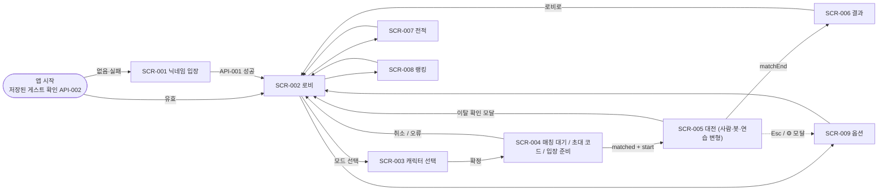

# 🎨 디자인 명세서 (Design Vision) — 영적 전쟁 테트리스

> *"And God made two great lights; the greater light to rule the day, and the lesser light to rule the night: he made the stars also."* — Genesis 1:16 (KJV)
>
> **규격:** `statute-율법/03.design-order-질서/design-vision-디자인명세-template.md` (필수 6섹션: 디자인 개요 · 디자인 시스템 · 와이어프레임 · 인터랙션 디자인 · 반응형 디자인 · 접근성)
> **참조 예시:** `parable-비유/03.design-order-질서/design-vision-디자인명세-example.md`
> **근거 정경 (유일한 상류):** [`spec-tablet-명세서.md`](../01.requirement-hearing-들음/spec-tablet-명세서.md) · [`usecase-path-사용사례.md`](../01.requirement-hearing-들음/usecase-path-사용사례.md) · [`rtm-covenant-언약추적.md`](../01.requirement-hearing-들음/rtm-covenant-언약추적.md) · [`architecture-temple-성전설계.md`](../02.architecture-foundation-기초/architecture-temple-성전설계.md) · [`api-gate-성문.md`](../02.architecture-foundation-기초/api-gate-성문.md) · [`data-ark-법궤.md`](../02.architecture-foundation-기초/data-ark-법궤.md)
> **Phase 3 짝 산출물:** [`screen-vision-화면설계.md`](./screen-vision-화면설계.md) (화면 목록 SCR-001~SCR-009 · 화면별 컴포넌트·인터랙션·상태 · 라우팅 가드 · UC-화면 중복 해체 검증 · 심판 관문 판정)

---

## 1. 디자인 개요

| 항목 | 내용 |
|:---|:---|
| 프로젝트명 | 영적 전쟁 테트리스 (Spiritual Warfare Tetris) |
| 버전 | v1.0 — 1차 출시 로컬 동작판 디자인 |
| 디자이너 | Adam (개발 에이전트, 수석 UX 디자이너 역할 — SKILL-03 전신갑주) |
| 상태 | **Canonized(정경화)** — 심판 관문 판정은 `screen-vision-화면설계.md` §8 |
| 톤 | "어둠 속에 비치는 빛" — 다크 판타지 바탕 위에 금빛·흰빛 네온 (FR-048). 무섭게 하되 고어·선정 없음 (C-011) |
| 렌더링 스택 (C-005 고정) | PixiJS 8.22.0 + pixi-filters 6.1.5 (보드·블록·파티클·필터) / GSAP 3.15.0 (모든 트윈·타임라인) / DOM 오버레이 (모든 글자·HUD 버튼·모달 — architecture D-13) / Tone.js 15.1.22 (모든 소리 — 음원 파일 0개, C-007) / canvas-confetti 1.9.4 (승리 콘페티) / @fontsource Cinzel·Noto Serif KR (FR-050) |
| 그래픽 원칙 | 이미지 파일 0개 (C-007). 블록·엠블럼·천사·악한 영·예수님 실루엣은 Pixi `Graphics`로 그리고, 자주 쓰는 모양은 시작 시 `renderer.generateTexture`로 텍스처로 구워 재사용한다 (NFR-001). DOM 아이콘은 인라인 SVG 경로로 그린다 |
| 수치 원칙 | 게임 수치(비용·쿨다운·지속 시간·확률·미리보기 수)는 화면에 하드코딩하지 않는다. 서버 판정 수치는 API-024 `status`(HUD의 유일한 원천), 정적 표시값은 `content/rules.json`(TBL-018)에서 읽는다. 보드에서 파생되는 값(점수·콤보·홀드·다음 블록)만 로컬 엔진이 원천이다 (architecture D-07) |
| 설계 원칙 | ① **야곱의 우물** — 목마른 순간의 정보(받을 공격·게이지·쿨다운)는 보드 바로 옆, 시선 이동 0~1회 거리 ② **게슈탈트** — 근접(내 보드 + 내 HUD 묶음 / 상대 묶음 분리), 유사(같은 종류 버튼 = 같은 모양), 연속(빛의 화살이 보낸 쪽→받는 쪽으로 이어짐) ③ **동시 피드백** — 시각 + 청각 + 히트스톱 + 진동을 같은 프레임에 (FR-061, 첨부 B 체크리스트) ④ **손실 상한 존중** — 방해 연출도 6초·동시 2개 상한 안에서만 (FR-031) |

### 1.1 Phase 3 설계 결정 (⚡ 자동 모드 — 결정과 근거 기록)

| # | 결정 | 근거 (정경) |
|:--|:---|:---|
| D3-01 | 산출물 파일명은 SKILL-03 §산출물 표를 따라 `design-vision-디자인명세.md` + `screen-vision-화면설계.md`로 한다. 규격은 실존하는 `statute-율법/03.design-order-질서/screen-vision-환상-template.md`를 적용한다 (SKILL-03 표의 `-화면설계-template.md`는 같은 규격의 다른 표기) | SKILL-03 순차 생산 표·산출물 표, SKILL-04 태깅 `@bible-성경/03/screen-vision-화면설계.md` |
| D3-02 | 와이어프레임(WF-ID)은 이 문서 §3에 한 번만 그린다. `screen-vision-화면설계.md`는 WF-ID를 참조하고 컴포넌트·인터랙션·상태를 정의한다 (출처 하나 — 제3계명) | statute 디자인명세 §3 "와이어프레임", 화면설계 §2 "레이아웃·컴포넌트·인터랙션" |
| D3-03 | 대전 화면은 가상 해상도 2벌로 그린다: 가로형 1280×720, 세로형 720×1280. 캔버스와 DOM 오버레이를 같은 배율로 맞춤 확대(letterbox)한다 | FR-011(데스크톱·모바일), NFR-001 |
| D3-04 | 모든 글자(콜아웃 "TETRIS", 자막, 숫자, 퀴즈)는 DOM 오버레이로 그린다. Pixi는 그래픽만 그린다 | architecture D-13, FR-050 (폰트 번들) |
| D3-05 | 7종 블록 색 = 성막 재료 7가지: Exodus 26:1의 세마포·청색·자색·홍색 + 같은 장의 은(26:19)·금(26:29)·놋(26:37). FR-048이 명시한 다섯 색(금·은·청·자·홍)을 모두 포함하고, 7종을 채우는 두 색도 같은 장의 성막 재료에서만 골랐다 | FR-048, C-010 정신(근거 없는 것 금지) |
| D3-06 | 기본 키 배치 1벌을 이 문서 §4.3에서 확정한다. 키 재설정 화면은 만들지 않는다 | architecture §13-5, N-01 미승격 |
| D3-07 | 옵션 화면은 화면 1개(SCR-009)이며, 대전 중에는 같은 컴포넌트를 모달로 연다. 연습 모드는 Esc가 일시정지 메뉴(계속·옵션·그만하기)를 연다 | UC-020 전제 "로비 또는 대전 중 일시 메뉴", UC-006 6a |
| D3-08 | 연출 세기 옵션은 UC-020 목록 그대로: 흔들림(켜기/끄기), 섬광 세기(강·중·약 3단), 마스터·효과음·음악 음량(0~100), 음소거. 첫 진입 기본값은 OS의 `prefers-reduced-motion`이 `reduce`이면 흔들림 끔·섬광 약, 아니면 흔들림 켬·섬광 강. 값은 저장하지 않는다 (세션 메모리) | FR-057, FR-060, UC-020, N-04 미승격 |
| D3-09 | 방해 효과의 **가림 정도(coverage·opacity·blur 값)는 연출 세기 옵션과 무관하게 rules/spirits 수치 그대로** 유지하고, 옵션은 흔들림·섬광·움직임 속도만 줄인다 — 옵션이 대전 공정성을 바꾸지 않게 한다 | FR-031, FR-057, data-ark TBL-013 params |
| D3-10 | 진동(`navigator.vibrate`)은 터치 입력이 감지된 기기에서만 울리고, "흔들림 끄기"이면 함께 끈다 (물리적 흔들림의 같은 갈래) | FR-011 "진동 피드백", FR-057 |
| D3-11 | 보조 효과음 AUX-01~AUX-15는 FR-058 17종 밖의 소리이며, 각각 다른 FR(심장박동 FR-055, 말씀 대결 FR-041/042, 특수 블록 FR-045/046 등)의 "청각 피드백" 요구로만 둔다 (§4.7.3) | FR-055, FR-041, FR-042, FR-061, 첨부 B "시각+청각 동시 피드백" |
| D3-12 | 해시 라우팅(`#/entry` 등)을 쓴다 — 정적 Vite 번들에 서버 측 경로 폴백이 필요 없다 | architecture D-03 (Vite 프록시는 `/api`, `/ws`만) |
| D3-13 | 대전 화면 이탈(뒤로 가기·로비 이동) 시 확인 모달을 띄운다: "경기를 나가면 패배로 기록됩니다". 확인하면 방 소켓을 닫는다(서버가 이탈 판정 — FR-009). 별도의 기권 메시지는 만들지 않는다 | FR-009, UC-016, api-gate (기권 메시지 없음) |
| D3-14 | 터치 기기 + 짧은 변 600 CSS px 미만(휴대폰)에서는 대전 화면이 세로형만 지원한다. 가로로 돌리면 "기기를 세로로 돌려 주세요" 안내를 덮어 띄운다 (터치 목표 44px 확보 — §6) | FR-011, WCAG 2.5.5 |
| D3-15 | 시작 신호 문구는 "STAND!" — *"that ye may be able to withstand in the evil day, and having done all, to stand."* (Ephesians 6:13) | FR-058 카운트다운, REQ-009 근거 구절 |

---

## 2. 디자인 시스템

### 2.1 색상 토큰 — 바탕·글자·상태

> 모든 색은 CSS 사용자 속성(`--c-*`)과 Pixi 16진수(`0x…`)로 같은 값을 쓴다. 대비는 WCAG 2.1 상대 휘도 공식으로 계산했다 (§6.2).

| 토큰 | HEX | 용도 |
|:---|:---|:---|
| `--c-abyss` | #07060D | 앱 최하단 배경, 버튼 위 글자(금 버튼) |
| `--c-deep` | #0E0B1A | 입력칸·모달 배경 |
| `--c-board` | #0A0814 | 보드 바닥 |
| `--c-grid` | #1C1830 | 보드 격자선 (1px, 투명도 0.6) |
| `--c-panel` | #161226 | 카드·패널 |
| `--c-elevated` | #1F1936 | 토스트·떠 있는 패널·목록 줄 강조 |
| `--c-line` | #3A3058 | 테두리 1px, 비활성 버튼 바탕 |
| `--c-text` | #F4EFE3 | 본문 글자 (양피지 흰색) |
| `--c-text-2` | #B9B0CC | 보조 글자 |
| `--c-text-3` | #9C93B3 | 약한 글자·힌트 (최소 대비 5.79:1) |
| `--c-gold-700` | #A97B1F | 금 그라데이션 어두운 끝, 테두리 |
| `--c-gold-500` | #E8B84A | 주 강조색(Primary), 금 테두리·게이지 |
| `--c-gold-300` | #F6D98B | 금 밝은 끝, 강조 글자, 포커스 고리 |
| `--c-holy` | #FFF8E7 | 거룩한 흰빛 — 빛기둥·예수님 실루엣·섬광 |
| `--c-heaven` | #7FD3FF | 하늘빛 — 되돌림(성령의 검)·정보 상태 |
| `--c-grace` | #5FD39A | 성장 수치 +, 레이팅 상승 |
| `--c-danger` | #E5484D | 위험선 맥동·공격 받음 섬광 (그래픽) |
| `--c-danger-text` | #FF6B6F | 위험·오류 글자 (대비 6.06~7.01:1) |
| `--c-evil` | #8E2A5A | 악한 영 강조 (진홍-보라) |
| `--c-evil-glow` | #5B1A3F | 악한 영 발광·테두리 |
| `--c-smoke` | #1A1424 | 연기·어둠 안개 |
| `--c-sky-top` / `--c-sky-mid` / `--c-sky-bottom` | #0B0A1F / #15102E / #1C1238 | 시차 배경 하늘 그라데이션 |
| `--c-wrath` | #2A0A14 | 공격 받음·위기 시 배경이 물드는 붉은 어둠 |

**금 그라데이션 (`--g-gold`)**: `linear-gradient(180deg, #F6D98B 0%, #E8B84A 55%, #A97B1F 100%)` — 주 버튼, "TETRIS" 글자, 게이지 채움.
**거룩한 그라데이션 (`--g-holy`)**: `radial-gradient(circle, #FFFFFF 0%, #FFF8E7 35%, rgba(255,248,231,0) 70%)` — 빛기둥 단면, 빛 폭발.

### 2.2 테트로미노 7색 — 성막 재료 (FR-048, D3-05)

| 블록 (CODE-009) | 재료 | KJV 근거 | 바탕 HEX | 밝은 면 | 어두운 면 | 각인 문양 (투명도 0.18) | 보드 바닥 대비 |
|:---|:---|:---|:---|:---|:---|:---|:---:|
| I (1) | 청색 (blue) | Exodus 26:1 "fine twined linen, and blue, and purple, and scarlet" | #3D7BFF | #8FB0FF | #1E4AB3 | 가로줄 3개 | 5.18:1 |
| O (2) | 금 (gold) | Exodus 26:29 "thou shalt overlay the boards with gold" | #F2C14E | #FFE29A | #A9801F | 마름모 1개 | 11.83:1 |
| T (3) | 자색 (purple) | Exodus 26:1 | #9B4DFF | #C79BFF | #5E2A9E | 위쪽 V자(셰브론) | 4.63:1 |
| S (4) | 은 (silver) | Exodus 26:19 "forty sockets of silver" | #A9B4C4 | #E3E8EF | #6B7484 | 사선 2개 | 9.47:1 |
| Z (5) | 홍색 (scarlet) | Exodus 26:1 | #E8304A | #FF7A8A | #8F1526 | 지그재그 1개 | 4.68:1 |
| J (6) | 세마포 (fine twined linen) | Exodus 26:1 | #EFE6D0 | #FFFFFF | #B3A787 | 2×2 짠 무늬 | 15.98:1 |
| L (7) | 놋 (brass) | Exodus 26:37 "thou shalt cast five sockets of brass" | #D2873A | #F2B26E | #8A5420 | 작은 고리 | 6.87:1 |

> 비슷한 밝기의 청·자·홍(I·T·Z)은 각인 문양이 서로 달라 색각 이상 사용자도 구분된다 (§6.6). 모든 블록은 보드 바닥 대비 3:1 이상 (WCAG 1.4.11 그래픽 대비).

### 2.3 보드 셀·특수 칸 색

| 셀 | 바탕 | 테두리·장식 | 발광 | 근거 |
|:---|:---|:---|:---|:---|
| 빈 칸 | #0A0814 | 격자선 #1C1830 (0.6) | 없음 | FR-001 |
| 쓰레기 줄 (CODE-009 8) | #6A6480 (대비 3.54:1) | 윗변 1px #8A83A0, 돌 반점 3개 #4E4862 | 없음. 구멍 칸은 비우고 그 열 바닥에 #3A3058 세로 띠(0.35) | FR-025 |
| 납 블록 (CODE-009 9, 악) | #9A9AA2 (대비 7.11:1) | 네 모서리 리벳 점 2px #5C5C63, 사선 빗금 #7E7E86, 줄 오른쪽 끝에 남은 줄 수 배지 | 없음 (무겁고 차가움) | FR-029 |
| 고스트 | 블록 밝은 면 색 채움 투명도 0.12 | 블록 밝은 면 색 2px 외곽선 투명도 0.55 | 없음 | FR-003 |
| 착지 힌트 (솔로몬·가브리엘) | 채움 없음 | #F6D98B 2px 점선 (6px 선 / 4px 틈), 투명도 0.85↔0.5 맥동 1.2초 | 금 GLW-special | FR-015, FR-035 |
| 말씀 칸 (word) | 원래 블록 색 + 중앙에 #FFF8E7 두루마리 문양(가로선 3개, 양끝 말림) | — | #F6D98B GLW-special, 투명도 0.8↔1.0 맥동 1.4초 sine | FR-044 |
| 여리고 나팔 칸 (jericho) | 원래 블록 색 + #D2873A 나팔 문양(가는 관 + 넓어지는 나팔꽃) | 셀 테두리 놋 #F2B26E 1px | #F2B26E GLW-special | FR-045 |
| 만나 칸 (manna) | 원래 블록 색 + 흰 둥근 웨이퍼 문양(지름 60%, 점 6개) — *"it was like coriander seed, white"* (Exodus 16:31) | — | #FFF8E7 GLW-special (약하게, outerStrength 1.5) | FR-046 |
| 갑주 칸 (armor) | 원래 블록 색 + 은빛 갑주 실루엣 문양(해당 갑주 아이콘 축소, §2.13.4) | #DCE8FF 1px | #DCE8FF GLW-special, 맥동 1.2초 | FR-036 |

> 한 조각에 특수 칸은 최대 1개 (rules `specials.priority`). 특수 칸 문양은 다음 블록 미리보기에도 같은 모양으로 축소 표시한다.

### 2.4 존재별 색

| 대상 | 주색 | 보조색 | 발광 | 근거 |
|:---|:---|:---|:---|:---|
| 다윗 엠블럼 | 메달 바탕 #1B2A5C (청색 계열) | 금 고리 #E8B84A, 돌 #A9B4C4 | GLW-gold | FR-013, FR-049 |
| 솔로몬 엠블럼 | #2A1550 (자색 계열) | 금 왕관 #F2C14E, 보석 #E8304A·#3D7BFF | GLW-gold | 〃 |
| 베드로 엠블럼 | #26303A (돌 계열) | 바위 #6B7484, 열쇠 금 #F2C14E·은 #E3E8EF | GLW-gold | 〃 |
| 바울 엠블럼 | #3A1512 (홍색 어둠) | 쇠사슬 #A9B4C4, 옥문 창살 #5C5C63 | GLW-gold | 〃 |
| 천사 공통 | #FFF8E7 | #F6D98B | GLW-holy | FR-049 |
| 미가엘 | #DCE8FF (강철빛) | #F6D98B | GLW-holy | 〃 |
| 스랍 | #FFB347 (불꽃) | #FFF8E7 | #FFB347 GLW-holy | Isaiah 6:6 |
| 그룹 | #FF8A3D (화염) | #F6D98B | GLW-holy | Genesis 3:24 |
| 악한 영 공통 | #1A1424 (연기) | #8E2A5A 가장자리 | GLW-evil | FR-049, C-011 |
| 예수님 실루엣 | #FFF8E7 단색 빛 (세부 묘사 없음) | 후광 #FFFFFF | Bloom 2.0 | C-002 |

### 2.5 발광(Glow) 토큰

| 토큰 | 구현 | 수치 | 쓰임 |
|:---|:---|:---|:---|
| GLW-idle | 블록 텍스처에 구운 바깥 번짐 (generateTexture 시 블러 처리된 사각형을 아래에 깔기) | 번짐 6px, 블록 바탕색, 투명도 0.35 | 모든 일반 블록 (실시간 필터 없음 — NFR-001) |
| GLW-special | pixi-filters `GlowFilter` | distance 10, outerStrength 2.5, innerStrength 0.3, quality 0.25, color = 표의 발광색 | 특수 칸, 착지 힌트 |
| GLW-gold | `GlowFilter` | distance 16, outerStrength 4, innerStrength 0.5, quality 0.25, color 0xE8B84A | T-Spin·B2B 순간, 스킬 준비 버튼(캔버스 측), 엠블럼 |
| GLW-holy | `GlowFilter` + `AdvancedBloomFilter` | Glow distance 24, outerStrength 5, color 0xFFF8E7 / Bloom threshold 0.45, bloomScale 1.4, brightness 1.1, blur 8 | 천사·스킬 빛기둥, 예수님 이벤트(bloomScale 2.0) |
| GLW-evil | `GlowFilter` | distance 14, outerStrength 3, color 0x8E2A5A | 악한 영 실루엣 가장자리 |
| CSS 발광 | `text-shadow` / `box-shadow` | gold-sm `0 0 8px rgba(232,184,74,.45)` · gold-md `0 0 16px rgba(232,184,74,.55)` · gold-lg `0 0 32px rgba(246,217,139,.65)` · holy `0 0 48px rgba(255,248,231,.8)` · danger `0 0 16px rgba(229,72,77,.6)` | DOM 글자·버튼 |

### 2.6 타이포그래피 (FR-050)

| 항목 | 규격 |
|:---|:---|
| 폰트 번들 | `@fontsource/cinzel` 400·700·900 (영어 구절·제목·숫자·콜아웃), `@fontsource/noto-serif-kr` 400·700·900 (한국어 전부). 외부 CDN 0개 — 오프라인 표시 (NFR-005) |
| 로딩 | 앱 시작 시 `document.fonts.load()`로 위 6개 굵기를 미리 불러오고 `document.fonts.ready` 후 첫 화면을 보인다 (글꼴 깜빡임 방지) |
| 글꼴 스택 | 한국어 UI: `"Noto Serif KR", serif` / 영어·숫자 표시: `"Cinzel", "Noto Serif KR", serif` / KJV 원문: `"Cinzel", serif` + `lang="en"` |
| 단위 | DOM 메뉴 화면은 `rem` (기준 16px) — 브라우저 글자 확대 200%까지 깨지지 않음. 대전 화면은 가상 해상도 px (배율과 함께 확대) |

| 토큰 | 글꼴·굵기 | 크기 / 줄높이 | 자간 | 쓰임 |
|:---|:---|:---|:---|:---|
| type.countdown | Cinzel 900 | 160px / 1.0 | 0 | 3·2·1 |
| type.callout-xl | Cinzel 900 | 112px / 1.0 | 0.02em | "TETRIS", "VICTORY" |
| type.callout-l | Cinzel 900 | 72px / 1.0 | 0.02em | "T-SPIN DOUBLE", 니어미스 "0.12초" 숫자, "STAND!" |
| type.callout-m | Cinzel 700 | 44px / 1.1 | 0.04em | "n COMBO", "BACK-TO-BACK"(28px 변형) |
| type.callout-ko | Noto Serif KR 900 | 56px / 1.1 | 0 | "아깝다!", "연습 종료" |
| type.h1 | Noto Serif KR 700 | 40px / 1.2 | 0 | 화면 제목 (모바일 32px) |
| type.h2 | Noto Serif KR 700 | 28px / 1.3 | 0 | 카드 제목 (모바일 24px) |
| type.h3 | Noto Serif KR 700 | 20px / 1.4 | 0 | 소제목, 자막의 영 이름(22px) |
| type.body-lg | Noto Serif KR 400 | 18px / 1.6 | 0 | 퀴즈 문제, 효과 설명 |
| type.body | Noto Serif KR 400 | 16px / 1.6 | 0 | 본문, 버튼 |
| type.caption | Noto Serif KR 400 | 14px / 1.5 | 0 | 보조 설명, HUD 라벨 |
| type.micro | Noto Serif KR 700 | 12px / 1.3 | 0.02em | 키 힌트 배지 (필수 정보에 쓰지 않음) |
| type.verse-en | Cinzel 400 | 18px / 1.6 | 0.02em | KJV 원문 |
| type.verse-ko | Noto Serif KR 400 | 17px / 1.7 | 0 | KJV 직접 번역 (C-003) |
| type.verse-ref | Cinzel 700 + Noto Serif KR 700 | 14px / 1.4 | 0.06em | 출처 "John 16:33 · 요한복음 16:33" |
| type.number-hud | Cinzel 700 | 22px / 1.0, `font-variant-numeric: tabular-nums` | 0 | 점수·시간·쿨다운 초 |

> **구절 표기 규칙 (C-003):** 구절은 항상 3줄 — ① KJV 원문(type.verse-en) ② 한국어 직접 번역(type.verse-ko) ③ 출처(type.verse-ref). 글은 전부 `verses.json`(TBL-016)의 `kjv`·`ko`·`ref`·`ref_ko`에서 읽는다.

### 2.7 간격 · 그리드 · 모서리

| 항목 | 규격 |
|:---|:---|
| 간격 (4px 기반) | space-1 4 · space-2 8 · space-3 12 · space-4 16 · space-5 24 · space-6 32 · space-7 48 · space-8 64 (px) |
| 메뉴 화면 그리드 | Desktop(≥1024): 12열, 거터 24, 바깥 여백 48, 최대 폭 1120 / Tablet(768~1023): 8열, 거터 16, 여백 32 / Mobile(<768): 4열, 거터 12, 여백 16 |
| 대전 화면 그리드 | 가상 해상도 고정 좌표 (§3.5 좌표표). 내 보드 칸 30px(가로형)·32px(세로형), 상대 보드 칸 22px(가로형)·12px(세로형) |
| 모서리 반경 | r-xs 3 (보드 칸) · r-sm 6 (칩·배지) · r-md 8 (버튼·입력칸) · r-lg 12 (카드·패널) · r-xl 20 (모달) · r-full 999 (원형 버튼·알약) |
| 터치 목표 | 최소 44×44 CSS px (WCAG 2.5.5), 버튼 사이 최소 8px |
| 그림자 | 카드 `0 8px 24px rgba(0,0,0,.45)` / 모달 `0 24px 64px rgba(0,0,0,.6)` |

### 2.8 Z-레이어

**Pixi 스테이지 (`sortableChildren`, zIndex 오름차순 — architecture D-13 "배경 → 보드 → 파티클 → DOM" 순서 안의 세분):**

| zIndex | 레이어 | 내용 |
|:---:|:---|:---|
| 0 | BackgroundLayer | 시차 배경 4층 (§2.12) |
| 10 | BoardFrameLayer | 보드 테두리·격자·위험선 |
| 20 | BoardCellLayer | 고정 블록·쓰레기·납 (내 보드, 상대 보드) |
| 25 | GuideLayer | 고스트·착지 힌트 |
| 30 | ActivePieceLayer | 움직이는 블록·회전 잔상 |
| 40 | BoardFxLayer | 줄 섬광·낙하 궤적·충격파 기준점 |
| 50 | ParticleLayer | `ParticleContainer` 1개 (풀 최대 600 — D-13) |
| 60 | SpiritLayer | 어둠 안개·그림자 떼·파리 떼·메뚜기·바람줄·용 실루엣 |
| 70 | ProjectileLayer | 빛의 화살·물맷돌·충돌 섬광 |
| 80 | HolyLayer | 빛기둥·천사·위인 스킬 빛·예수님 실루엣 (투사체보다 위 — 실루엣에 어떤 공격도 닿지 않게 그려짐, C-002) |
| 90 | ScreenFxLayer | 비네트·전체 화면 섬광 |

**DOM 오버레이 (`z-index`):** 캔버스 0 · HUD 100 · 콜아웃 글자 200 · 자막 250 · 퀴즈 모달 300 · 옵션·일시정지·확인 모달 400 · 토스트 500 · 오디오 시작 안내 600 · 세로 회전 안내 700 · 화면 전환 장막 800.

### 2.9 모션 토큰 (GSAP 3.15)

| 토큰 | 값 | 쓰임 |
|:---|:---|:---|
| dur.instant | 60ms | 이동 보간, 버튼 눌림 |
| dur.fast | 120ms | 회전 잔상, 줄 붕괴, 작은 팝 |
| dur.base | 200ms | 화면 요소 등장, 모달 닫힘 |
| dur.slow | 360ms | 화면 전환, 빛의 화살 비행 |
| dur.epic | 800ms | 큰 콜아웃 유지, 승리 섬광 |
| dur.cine | 1600ms | 천사 연출 전체, 패배 무너짐 |
| ease.out | `power2.out` | 등장·이동 |
| ease.in | `power2.in` | 퇴장·흡수 |
| ease.inOut | `sine.inOut` | 맥동·호흡 |
| ease.pop | `back.out(1.7)` | 버튼·배지·리액션 팝 |
| ease.snap | `expo.out` | 콜아웃 쾅 등장, 빛기둥 내리꽂힘 |
| ease.slam | `power4.in` | 하드 드롭 늘어남, 물맷돌 |
| ease.spring | `elastic.out(1, 0.45)` | 니어미스 숫자, 업적 인장 |
| ease.linear | `none` | 쿨다운 원형 닦임, 타이머 막대 |

> 감소 모드(움직임 줄이기 — `prefers-reduced-motion` 또는 흔들림 끔)에서 ease.spring·ease.pop은 ease.out으로 바꾸고, 크기 변화(scale)는 1.0±0.05 안으로 줄인다.

### 2.10 흔들림 · 히트스톱 · 섬광 · 파티클 · 진동 토큰

**흔들림 (SHK)** — 대상 컨테이너의 x·y를 25ms마다 무작위 오프셋으로 옮기고 진폭을 `(1 − t/길이)²`로 줄인다. 대상: "보드" = 해당 보드 컨테이너, "화면" = 스테이지 루트(+DOM 오버레이 루트 같은 값).

| 토큰 | 진폭 | 길이 | 회전 | 대상 기본값 |
|:---|:---:|:---:|:---:|:---|
| SHK-1 | 2px | 80ms | 0 | 보드 |
| SHK-2 | 4px | 140ms | 0 | 보드 |
| SHK-3 | 7px | 220ms | ±0.3° | 보드 |
| SHK-4 | 12px | 360ms | ±0.5° | 화면 |
| SHK-5 | 18px (진동수 18Hz 저주파) | 700ms | ±0.8° | 화면 (지진·용) |

**히트스톱 (HS)** — 엔진 틱(낙하·고정 지연)과 Pixi 애니메이션 시간을 멈추고(`ticker.speed = 0`) 섬광 한 장면만 그린다. 네트워크 송수신은 멈추지 않는다. FR-061 범위 0.05~0.1초 안.

| 토큰 | 길이 | 쓰임 |
|:---|:---:|:---|
| HS-1 | 50ms | 콤보 3~4 |
| HS-2 | 66ms | 콤보 5~6, T-Spin |
| HS-3 | 80ms | 테트리스 (FR-052 "0.08초") |
| HS-4 | 100ms | 콤보 7 이상, 백투백 |

> 한 프레임에 여러 히트스톱이 겹치면 가장 긴 것 하나만 적용한다.

**섬광 (FL)** — 덮개 사각형(흰색 또는 지정색)의 투명도를 올렸다 내린다. 실제 투명도 = 표 값 × 섬광 세기 배율(강 1.0 · 중 0.6 · 약 0.25). 모든 설정에서 전체 화면 섬광은 1초에 3회를 넘지 않는다(WCAG 2.3.1 — 4번째부터 대기열에서 버림). "약"에서 FL-3·FL-4는 화면 가장자리 발광(두께 24px)으로 바꾼다.

| 토큰 | 최대 투명도 | 올림 / 내림 | 범위 |
|:---|:---:|:---|:---|
| FL-1 | 0.85 | 30ms / 120ms | 줄·블록 칸 |
| FL-2 | 0.45 | 40ms / 240ms | 보드 1개 |
| FL-3 | 0.6 | 40ms / 260ms | 보드 + 주변 (금빛 #E8B84A) |
| FL-4 | 0.85 | 80ms / 900ms | 화면 전체 (흰빛 #FFF8E7) |

**파티클 (PT)** — 모두 `ParticleContainer` 한 개의 풀(최대 600개)에서 꺼낸다. 풀이 차면 우선순위가 낮은 것부터 회수: ① 게임 정보 파티클(악한 영 가림 — 파리 떼·그림자 떼·메뚜기) ② 삭제 파편 ③ 장식(먼지·불꽃·깃털·배경 빛 입자). 감소 모드: ②③ 개수 ×0.5, ①은 개수 유지(D3-09)·움직임 속도 ×0.5.

| 토큰 | 개수 | 수명 | 속도 | 크기 | 기타 |
|:---|:---:|:---:|:---|:---|:---|
| PT-dust | 6 (호출마다 지정 가능) | 220ms | 40~90px/s | 2~3px | 블록 밝은 면 색, 투명도 1→0 |
| PT-shard | 지운 칸마다 4 (테트리스 6) | 520~760ms | 180~420px/s 방사 | 4~8px 사각 조각 | 중력 900px/s², 회전 ±720°/s, 블록 바탕색 |
| PT-spark | 12~40 | 400ms | 120~300px/s | 2px 점 + 4px 꼬리 | #F6D98B→#E8B84A, 가산 혼합(add) |
| PT-smoke | 30 | 1400~2000ms | 위로 20~40px/s | 24~48px 흐린 원 | #1A1424, 투명도 0.5→0, 크기 1→1.6 |
| PT-feather | 18 | 1600ms | 아래로 30px/s + 좌우 흔들림 ±12px(0.8Hz) | 6×14px 깃털 (타원 + 중심선) | #FFF8E7 |
| PT-ember | 20 | 900ms | 위로 60~120px/s | 3px | #FFB347→#FF8A3D |
| PT-flake | 24 | 1000ms | 위로 80px/s, 게이지 쪽으로 휘어짐 | 3px 원 | #FFF8E7 (만나) |
| PT-mote | 배경 24 + 80 | 무한(순환) | 위로 4~20px/s | 1~3px | #FFF8E7 투명도 0.2~0.6 |
| PT-fly | 240 (`spirits.beelzebub.params.particles`) | 효과 시간 | 60~140px/s 브라운 운동 | 2~3px | #120C18, 투명도 0.9 |
| PT-locust | 30 | 900ms | 목표 칸으로 유도 | 6×4px 셰브론 | #2B2416 |

**진동 (HP)** — `navigator.vibrate(패턴)`. 터치 입력이 한 번이라도 있었던 세션에서만, 흔들림 켬일 때만 (D3-10).

| 토큰 | 패턴 (ms) | 쓰임 |
|:---|:---|:---|
| HP-tap | 10 | 카운트다운 박자, 리액션 |
| HP-light | 15 | 하드 드롭, 1줄 삭제, 만나 |
| HP-mid | 25 | 2~3줄, 스킬, 갑주, 쓰레기 상승 |
| HP-heavy | [30, 40, 60] | 테트리스, 여리고, B2B |
| HP-hit | [40, 30, 40] | 공격 받음 |
| HP-dread | [80, 60, 80] | 악한 영 등장 |
| HP-boss | [120, 60, 120, 60, 200] | 용 |
| HP-holy | [20, 40, 20, 40, 60] | 천사, 예수님 이벤트, 말씀 대결 승리 |
| HP-win | [50, 50, 120] | 경기 승리 |
| HP-lose | 200 | 경기 패배 |

### 2.11 블록 렌더링 규격 (유리 질감 — FR-048)

| 단계 | 그리기 (Pixi Graphics → `generateTexture`, 칸 크기별 1회) |
|:---|:---|
| ① 바깥 번짐 | 칸보다 6px 큰 사각형, 바탕색, 블러 4, 투명도 0.35 (GLW-idle) |
| ② 몸체 | 칸 − 2px 정사각형, 반경 3, 바탕색 채움 |
| ③ 유리 그라데이션 | 몸체 위에 대각선 그라데이션: 왼쪽 위 밝은 면 색 투명도 0.55 → 중앙 0 → 오른쪽 아래 어두운 면 색 투명도 0.6 |
| ④ 하이라이트 | 윗변 안쪽 1px 선 #FFFFFF 투명도 0.55, 왼쪽 위 모서리 반사점(지름 칸의 18%, #FFFFFF 0.4) |
| ⑤ 각인 | §2.2 문양, 어두운 면 색, 투명도 0.18 |
| ⑥ 테두리 | 안쪽 1px 어두운 면 색 투명도 0.8 |

> 텍스처 세트: 칸 30·32·22·12px × (블록 7 + 쓰레기 + 납) = 36장. 특수 칸 문양은 별도 덮개 텍스처 4종 × 4크기. 실시간 필터를 블록마다 붙이지 않는다 (NFR-001).

**보드 프레임:** 바깥 3px 금 테두리(`--g-gold` 세로 그라데이션), 안쪽 그림자 12px rgba(0,0,0,0.6), 바닥 #0A0814, 격자 1px #1C1830(0.6). **위험선:** 위에서 `rules.board.dangerRows`(4)번째 줄 아래 경계에 #FF6B6F 2px 점선(8/6), 평소 투명도 0.15, 위기 때 0.6.

### 2.12 시차(Parallax) 배경 규격 (FR-048)

| 층 | 내용 | 움직임 | 반응 |
|:---|:---|:---|:---|
| P0 하늘 | 세로 그라데이션 `--c-sky-top` → `--c-sky-mid`(55%) → `--c-sky-bottom` | 고정 | 공격 받음·위기 시 `ColorMatrixFilter`로 `--c-wrath` 쪽 물듦: 비율 = min(받을 공격 줄 수 / 8, 1) × 0.6 (위기 중이면 +0.2, 최대 0.8), 300ms 보간 |
| P1 먼 빛 | PT-mote 80개 (1~2px) | 위로 4px/s, 좌우 사인 흔들림 | 콤보 중 밝기 +5%/콤보 (최대 +30%) — FR-061 "배경 빛 고조" |
| P2 구름 띠 | 흐린 타원 묶음 3장(가로 900~1400px, 블러 24, #2A2050 투명도 0.35) | 왼쪽으로 6px/s · 12px/s 두 겹 | 공격 받음 시 #3A0F1E 쪽으로 물듦 (P0와 같은 비율) |
| P3 빛살 | 화면 위에서 비스듬히 내려오는 빛줄기 2개 (폭 120px, `--g-holy` 단면, 투명도 0.08) | 좌우 ±3° 진자 12초 주기 | 천사·스킬 순간 투명도 0.25로 0.5초 |
| P4 가까운 빛 | PT-mote 24개 (2~3px) | 위로 20px/s | 감소 모드에서 정지 (투명도만 맥동) |

> 메뉴 화면(SCR-001~004, 006~009)은 P0·P1·P2를 CSS 그라데이션 + 작은 캔버스 없이 DOM 배경으로 그린다(배경 전용 Pixi Application을 띄우지 않음): `body` 배경 = P0 그라데이션, 구름 = 흐린 `radial-gradient` 2겹 CSS 애니메이션(60초 주기, 감소 모드 정지).

### 2.13 코드로 그린 그래픽 — 엠블럼·천사·악한 영·갑주·예수님 (C-007, FR-049)

> 모든 좌표는 128×128 상자 기준(가운데 64,64). 렌더러가 Pixi `Graphics`로 그리고 크기별로 텍스처를 굽는다(48·64·96·128px). DOM 버튼 안의 같은 그림은 같은 좌표의 인라인 SVG로 그린다.

#### 2.13.1 위인 엠블럼 4종 (heroes.json `emblem` 키 — FR-013)

| 키 | 위인 | 구성 (128 상자) |
|:---|:---|:---|
| `sling` | 다윗 (1 Samuel 17:49) | ① 원형 메달: 반지름 58 원, 바탕 #1B2A5C, 금 테두리 4px #E8B84A, 안쪽 1px 고리 #F6D98B(반지름 52) ② 물매: 위쪽 두 점 (40,30)·(88,30)에서 시작하는 두 줄(3px #EFE6D0)이 2차 베지어로 아래 가운데 주머니(타원 중심 64,82, 24×14, #D2873A)에 모임 ③ 주머니 위 돌: 원 (64,76) 반지름 8, #A9B4C4, 하이라이트 점 ④ 아래 호를 따라 작은 돌 5개(반지름 3, #A9B4C4) — *"chose him five smooth stones"* (1 Samuel 17:40) |
| `crown` | 솔로몬 (1 Kings 3:9) | ① 메달 바탕 #2A1550, 금 테두리 ② 왕관: 밑변 (30,78)~(98,78) 높이 10 띠 + 위로 솟은 뾰족 5개(꼭짓점 y 34·42·30·42·34), #F2C14E 채움, #A9801F 외곽선 2px ③ 뾰족 끝마다 구슬(반지름 4, #FFE29A) ④ 띠 위 보석 3개: 홍 #E8304A(가운데, 반지름 5), 청 #3D7BFF(양옆, 반지름 4) ⑤ 왕관 아래 작은 마음 모양(하트 18×16, #F6D98B, 투명도 0.9) — "understanding heart" |
| `rock_key` | 베드로 (Matthew 16:18) | ① 메달 바탕 #26303A, 금 테두리 ② 바위: 불규칙 다각형 7점 (24,96)(30,70)(48,56)(70,58)(92,66)(104,90)(96,100), #6B7484 채움, 위쪽 면 #A9B4C4 밝은 띠 ③ 바위 위에 교차한 열쇠 2개(각 길이 64, 45°·135°): 둥근 손잡이(고리 반지름 7) + 자루 4px + 이 2개, 하나는 금 #F2C14E, 하나는 은 #E3E8EF |
| `broken_chain` | 바울 (Acts 16:26) | ① 메달 바탕 #3A1512, 금 테두리 ② 배경 옥문 창살: 세로 막대 3개(x 44·64·84, 폭 6, #5C5C63, 투명도 0.7) ③ 앞쪽 사슬 고리 3개(타원 22×14, 테두리 4px #A9B4C4)를 가로로 연결, 가운데 고리는 위쪽이 6px 벌어진 채 끊김 ④ 끊어진 틈에서 불꽃 점 6개(#F6D98B, 반지름 1.5~2.5) |

#### 2.13.2 천사 5종 (angels.json `visual` 키 — FR-049)

| 키 | 천사 | 구성 (빛기둥 위 192×192 상자에 등장) |
|:---|:---|:---|
| `wings_light` | 미가엘 (Jude 1:9) | 좌우 날개 한 쌍: 각 날개는 깃털 6장(길이 40~90의 끝이 둥근 사다리꼴, 위→아래로 짧아짐), #DCE8FF→#FFF8E7 세로 그라데이션 / 날개 사이 세로 빛의 검(폭 8, 길이 120, 끝 뾰족, #FFFFFF, 손잡이 가로대 28) / GLW-holy |
| `herald_light` | 가브리엘 (Luke 1:19) | 날개 한 쌍(미가엘보다 작게, 깃털 5장) + 오른쪽 위로 뻗은 나팔 모양 빛(좁은 관 → 넓어지는 원뿔, 길이 90, #F6D98B→투명) + 원뿔 앞 동심원 소리 고리 2개 |
| `four_faces_wheels` | 그룹 (Genesis 3:24, Ezekiel 10) | 두 겹 바퀴: 바깥 고리 반지름 60·안쪽 고리 반지름 40 (테두리 4px #F6D98B), 각 고리에 "눈" 점 12개(반지름 3, #FFF8E7 — *"full of eyes round about"* Ezekiel 10:12), 바깥은 시계 방향·안쪽은 반시계 방향 1회전/초 / 네 방향(위·오른쪽·아래·왼쪽)에 네 얼굴을 상징하는 단순 문양 4개: 그룹(작은 날개 2장)·사람(빈 원)·사자(8갈래 갈기 별)·독수리(펼친 날개 V) — 얼굴 묘사 없이 기호로만 / 바퀴 둘레 화염 PT-ember 20 (#FF8A3D) |
| `six_wings` | 스랍 (Isaiah 6:2, 6:6) | 여섯 날개: 위 한 쌍은 가운데를 덮듯 안쪽으로 접힘, 아래 한 쌍은 아래를 덮음, 가운데 한 쌍은 크게 펼침 (깃털 각 5장, #FFB347→#FFF8E7) / 가운데 숯불: 지름 18 원, #FF8A3D 핵 + #FFB347 번짐, 0.6초 주기 깜빡임 투명도 0.8↔1 / 날개 끝 PT-ember |
| `small_lights` | 섬기는 영들 (Hebrews 1:14) | 작은 빛 구슬 12개(반지름 4~7, #FFF8E7 + 번짐 10px)가 원을 이루어 천천히 돌다가(반지름 50, 0.3회전/초) 아래로 내려감 |

#### 2.13.3 악한 영 14종 (spirits.json — FR-049, C-010, C-011)

> 공통: 실루엣·연기 중심 반투명. 채움 #1A1424 투명도 0.75~0.9, 가장자리 GLW-evil. 얼굴·피·상처·신체 훼손 묘사 없음 (C-011). 등장 위치는 받는 쪽 보드 위쪽 중앙(가로 너비 = 보드 폭), 1.2초 동안 보였다가 연기로 흩어지고 효과 연출(§4.6.4)만 남는다.

| id | 실루엣 (등장 1.2초) | 효과 연출 요소 (지속) |
|:---|:---|:---|
| unclean_spirit | 아래로 늘어진 연기 덩어리(베지어 물방울 모양 3겹) | 보드 전체 어둠 안개 덮개 |
| deaf_dumb_spirit | 귀를 가린 두 손 모양의 연기(둥근 손바닥 2개, 손가락 표현 없이 덩어리) | 다음 블록 칸 잡음 덮개 + 귀 막힘 기호(귀 곡선 + 사선) |
| legion | 겹친 그림자 사람 형상 7개(머리 원 + 몸통 물방울, 높이 30~50) | 그림자 떼 60개 |
| lying_spirit | 서로 꼬인 **두 갈래 연기 리본** (가운데에서 X자로 엇갈림) | 보라 일렁임이 있는 가짜 다음 블록·가짜 고스트 |
| divination_spirit | 연기 속 수정구(원 반지름 22, #2A2433, 안쪽 소용돌이선) | 2칸 어긋난 고스트 |
| beelzebub | 날개 달린 큰 벌레 실루엣(타원 몸 + 반투명 날개 4장) | 파리 떼 PT-fly |
| prince_of_the_air | 소용돌이 바람 연기(나선 3겹) | 가로 바람줄 40개 |
| prince_of_persia | 그림자 왕관을 쓴 망토 실루엣(왕관 뾰족 5 + 넓은 망토 사다리꼴) | 천사 버튼 사슬 덮개 + 21초 고리 |
| abaddon | 메뚜기 떼 구름(셰브론 30개가 뭉친 타원) — Revelation 9:3 | 메뚜기 PT-locust |
| jezebel | 비틀린 왕관과 긴 머리 실루엣(얼굴 없이 뒷모습) | 보드 테두리 꼬임 맥동 + "⇄ 반전" 칩 |
| wickedness | 에바(뚜껑 있는 둥근 바구니, 폭 70)와 납 뚜껑 원판(#9A9AA2) — 사람 형상은 그리지 않음 | 납 블록 줄 |
| babylon | 금잔 실루엣(#A9801F 가장자리, 안은 #1A1424) — Revelation 17:4 | 흐림 + 물결 일렁임 |
| satan_angel_of_light | 처음 1.5초(`disguiseMs`)는 천사 `wings_light`와 같은 모양 단, 색이 차가운 #CFE3FF + 음정이 어긋난 화음 → 날개에 금이 가는 선(8개, 150ms에 그려짐) → #3B0F2E/#8E2A5A로 반전 | 어둠(0.5) + 다음 블록 숨김 |
| dragon | 화면을 가로지르는 거대한 뱀 몸통(S자 베지어, 길이 900px, 두께 40→8) + 일곱 머리를 뜻하는 뾰족 윤곽 7개(Revelation 12:3), 채움 #120008, 가장자리 #8E2A5A 2px 역광 | 보드 완전 암전 |

#### 2.13.4 전신갑주 아이콘 6종 (armor.json — 48px 기준, FR-037)

| id | 아이콘 | 색 |
|:---|:---|:---|
| belt_of_truth | 가로 띠(40×10, 모서리 둥금) + 가운데 사각 버클 | #F2C14E 띠, #FFE29A 버클 |
| breastplate_of_righteousness | 가슴판(위 넓고 아래 좁은 방패꼴 32×36) + 가운데 세로선·가로 비늘선 3줄 | #A9B4C4, 선 #6B7484 |
| gospel_shoes | 샌들 옆모습(밑창 곡선 + 끈 3줄) | #D2873A, 끈 #F2B26E |
| shield_of_faith | 둥근 방패(반지름 18) + 안쪽 고리 + 가운데 볼록점 | #E8B84A, 안쪽 #A9801F |
| helmet_of_salvation | 투구(반원 돔 + 볼가리개 + 위 볏 3갈래) | #E3E8EF, 볏 #E8304A |
| sword_of_the_spirit | 세로 검(날 4×30 뾰족 끝, 가로대 18, 손잡이 4×8) | 날 #DCE8FF, 가로대 #F2C14E |

#### 2.13.5 예수님 "세상을 이기었노라" 빛 실루엣 (C-002, FR-039)

| 규칙 | 규격 |
|:---|:---|
| 금지 | 얼굴(눈·코·입·윤곽선·그림자로 표현되는 이목구비 포함)을 **절대 그리지 않는다**. 상처·고통·패배 장면 없음. 선택·조종 가능한 캐릭터로 보이지 않게 HUD·버튼에 아이콘을 두지 않는다 |
| 형태 | 서 있는 형상을 순수한 빛으로만: ① 옷자락 = 위 폭 60 · 아래 폭 140 · 높이 300의 둥근 사다리꼴 ② 머리 자리 = 반지름 26 원형 빛(단색 #FFF8E7, 가장자리 번짐만, 안쪽 무늬·명암 없음) ③ 팔 = 몸 양옆으로 살짝 벌린 가는 호 2개(두께 14, 끝 둥금) ④ 뒤쪽 후광 = 가는 빛살 24개(길이 80~160, #FFFFFF 투명도 0.3) |
| 채움 | 전부 #FFF8E7 단색 + `AdvancedBloomFilter` bloomScale 2.0 — 세부가 보이지 않는 역광 실루엣. 최대 투명도 0.55(내 보드 위에 겹쳐도 블록이 보이게) |
| 위치 | 이벤트를 받은 플레이어의 보드 가운데 위. 상대 화면에는 상대 보드 크기에 맞춰 같은 형상을 축소해 보인다 |
| 겹침 | HolyLayer(80)가 ProjectileLayer(70)보다 위이며, 이벤트 3.9초 동안 그 보드로 오는 빛의 화살 연출은 그리지 않는다(게임 효과는 그대로 적용). 실루엣에 어떤 투사체·파티클·악한 영 그래픽도 닿지 않는다 |

#### 2.13.6 기타 기호

| 기호 | 구성 | 쓰임 |
|:---|:---|:---|
| 은혜 아이콘 | 비둘기 옆모습 실루엣 20×16 (몸 타원 + 날개 곡선), #F6D98B 투명도 0.7, 글자 없음 | FR-062 "은혜 아이콘으로만 은은하게" |
| 예수님 이벤트 사용 표시 | 지름 10 별빛 점(#FFF8E7 투명도 0.35)이 게이지 아래에 사용 후에만 나타남, 접근성 이름 "이번 경기에서 세상을 이기었노라 이벤트가 일어났습니다" | status.jesusUsed |
| 리액션 3종 | `rules.reactions`의 `emoji`(🙏·🔥·😇)를 글자로 표시(시스템 이모지 글꼴 — 로컬 OS 내장, 외부 자원 아님) + 금 원형 테두리 | FR-064 |
| 빛 별 문양 | 지름 64, 가운데 #FFF8E7 원(반지름 8) + 길고 짧은 빛살 8갈래(길이 32·20 번갈아, 두께 3→0), GLW-holy | 말씀 카드에서 구절이 John 16:33일 때 엠블럼 자리 |
| 업적 인장 | 지름 96 금 밀랍 인장(가장자리 물결 12갈래, #A9801F→#E8B84A) + 가운데 해당 위인 엠블럼 축소 | FR-065 |
| UI 아이콘 | 톱니(옵션)·뒤로(화살표)·잠금(자물쇠)·사슬(봉인)·소리(스피커)·음소거(스피커 + 사선)·저장(아래 화살표 + 받침)·공유(점 3개 연결) — 24px 인라인 SVG, 선 2px `currentColor` | 메뉴·HUD |

---

## 3. 와이어프레임

> 화면 9개(FR-078, architecture §13-1) 전부를 데스크톱·모바일로 그린다. 화면별 컴포넌트 표·인터랙션·연결 API·로딩/빈/오류 상태는 [`screen-vision-화면설계.md`](./screen-vision-화면설계.md) §2가 WF-ID로 이 절을 참조한다. 표기: `[ 버튼 ]`, `( 입력칸 )`, `▣` 엠블럼, `░` 보드, `▮` 게이지 막대, `⟨키⟩` 키 힌트 배지.

### 3.0 화면 흐름 (FR-078)



### 3.1 WF-001 — SCR-001 닉네임 입장

**데스크톱 (≥1024)**
```
┌──────────────────────────────────────────────────────────────────────────────┐
│                         (시차 배경: 하늘·구름·빛 입자)                          │
│                                                                              │
│                      SPIRITUAL WARFARE TETRIS   ← Cinzel 700 20px #F6D98B     │
│                          영적 전쟁 테트리스      ← type.h1 48px              │
│        ────────────────────── ✦ ──────────────────────                       │
│      "For we wrestle not against flesh and blood, ... in high places."       │
│      우리의 씨름은 혈과 육에 대한 것이 아니라 ... (KJV 직접 번역)              │
│                         Ephesians 6:12 · 에베소서 6:12                        │
│                                                                              │
│                 ┌────────────── 카드 480×auto ──────────────┐                 │
│                 │ 닉네임                                     │                 │
│                 │ ( 다윗의물맷돌                         )  │ ← 52px 입력칸    │
│                 │ 2~12자 · 한글·영문·숫자·_                  │ ← 도움말 14px    │
│                 │ ⚠ 이미 사용 중인 닉네임입니다.  (오류 시)  │ ← #FF6B6F       │
│                 │ ⓘ 닉네임은 랭킹에 공개됩니다.             │ ← 봉인 제5계명   │
│                 │            [   입장하기   ]               │ ← 주 버튼 48px  │
│                 └────────────────────────────────────────────┘                 │
│                                                                              │
│                    🔈 소리를 켜려면 화면을 누르세요 (오디오 시작 전 토스트)        │
└──────────────────────────────────────────────────────────────────────────────┘
```
**모바일 (<768, 세로)**
```
┌────────────────────────────┐
│ SPIRITUAL WARFARE TETRIS   │
│ 영적 전쟁 테트리스 (32px)   │
│ ─────── ✦ ───────          │
│ "For we wrestle not ..."   │
│ 우리의 씨름은 ...           │
│ Ephesians 6:12             │
│ ┌────────────────────────┐ │
│ │ 닉네임                  │ │
│ │ ( 다윗의물맷돌        ) │ │
│ │ 2~12자 · 한글·영문·숫자·_│ │
│ │ ⓘ 닉네임은 랭킹에 공개  │ │
│ │ [      입장하기       ] │ │ ← 전체 폭, 높이 52
│ └────────────────────────┘ │
│ (가상 키보드가 올라오면 카드 │
│  가 입력칸 위치까지 스크롤) │
└────────────────────────────┘
```
**부팅 확인 중 상태:** 가운데 금빛 7점 원형 회전 표시(§3.4의 대기 표시와 같은 컴포넌트) + "입장 정보를 확인하는 중…" — API-002 응답까지.

### 3.2 WF-002 — SCR-002 로비

**데스크톱**
```
┌──────────────────────────────────────────────────────────────────────────────┐
│ ▣ 다윗의물맷돌 · 레이팅 1016                    [ 전적 ] [ 랭킹 ] [ ⚙ 옵션 ]  │ ← 상단 64px
├──────────────────────────────────────────────────────────────────────────────┤
│  평강하라, 다윗의물맷돌                              ← type.h2                 │
│  어떤 싸움을 하시겠습니까?                           ← type.body #B9B0CC        │
│ ┌─────────────────┐┌─────────────────┐┌─────────────────┐┌─────────────────┐ │
│ │ ⚔ 대전           ││ ✉ 친구 초대      ││ ⚙ AI 봇 대전     ││ ✦ 연습          │ │
│ │ 랜덤 매칭        ││ 초대 코드        ││ 난이도:          ││ 혼자 위인 스킬을 │ │
│ │ 레이팅이 비슷한  ││ [ 방 만들기  ]   ││ (쉬움|보통|어려움)││ 익힙니다         │ │
│ │ 상대를 찾습니다  ││ [ 코드로 입장 ]  ││ 3판 2선승        ││                  │ │
│ │ 3판 2선승        ││                  ││ [ 봇과 싸우기 ]  ││ [ 연습하기 ]     │ │
│ │ [ 상대 찾기 ]    ││                  ││                  ││                  │ │
│ └─────────────────┘└─────────────────┘└─────────────────┘└─────────────────┘ │
│   카드 4개: 각 256×300, 간격 24, 키보드 ←→ 로 카드 이동, Enter = 카드의 주 버튼 │
│                                                                              │
│   "And take ... the sword of the Spirit, which is the word of God:" — Eph 6:17 │
└──────────────────────────────────────────────────────────────────────────────┘
```
**모바일**
```
┌────────────────────────────┐
│ ▣ 다윗의물맷돌 1016   [⚙] │
├────────────────────────────┤
│ 평강하라, 다윗의물맷돌      │
│ ┌────────────────────────┐ │
│ │ ⚔ 대전 · 랜덤 매칭      │ │
│ │ [     상대 찾기      ]  │ │
│ ├────────────────────────┤ │
│ │ ✉ 친구 초대 코드        │ │
│ │ [방 만들기][코드로 입장]│ │
│ ├────────────────────────┤ │
│ │ ⚙ AI 봇 대전            │ │
│ │ (쉬움 | 보통 | 어려움)  │ │
│ │ [     봇과 싸우기    ]  │ │
│ ├────────────────────────┤ │
│ │ ✦ 연습  [ 연습하기 ]    │ │
│ └────────────────────────┘ │
│ [  전적  ]   [  랭킹  ]    │ ← 하단 고정 바 64px
└────────────────────────────┘
```
> 봇 난이도 세그먼트 기본 선택 = 보통. 하단 구절 띠는 성령의 검 근거 구절 Ephesians 6:17(armor.json `verse_ref` — verses.json 필수 수록)을 verses.json에서 읽어 3줄 표기 규칙(§2.6)으로 보인다 (모바일은 숨김).

### 3.3 WF-003 — SCR-003 캐릭터 선택

**데스크톱**
```
┌──────────────────────────────────────────────────────────────────────────────┐
│ [ ← 뒤로 ]          위인을 고르십시오          모드: AI 봇 대전 · 보통           │
├──────────────────────────────────────────────────────────────────────────────┤
│ ┌──────────────┐ ┌──────────────┐ ┌──────────────┐ ┌──────────────┐          │
│ │    ▣ 128px   │ │    ▣ 128px   │ │    ▣ 128px   │ │    ▣ 128px   │  카드     │
│ │  다윗 DAVID  │ │ 솔로몬 SOLOMON│ │ 베드로 PETER │ │  바울 PAUL   │  260×440  │
│ │ ── 스킬 ──   │ │ ── 스킬 ──   │ │ ── 스킬 ──   │ │ ── 스킬 ──   │           │
│ │ 물맷돌       │ │ 지혜로운 마음│ │ 이 반석 위에 │ │ 옥문이 열리다│           │
│ │ 상대 보드에서│ │ 최적 착지    │ │ 10초 동안    │ │ 지진과 함께  │  효과문장  │
│ │ 가장 높은 열…│ │ 위치 힌트…   │ │ 쓰레기 줄…   │ │ 맨 아래…     │  = heroes │
│ │ 믿음 50·20초 │ │ 믿음 40·20초 │ │ 믿음 60·30초 │ │ 믿음 60·25초 │  rules값  │
│ │              │ │ 패시브: 다음 │ │              │ │              │           │
│ │              │ │ 블록 5개     │ │              │ │              │           │
│ │ "...smote the│ │ "Give ... an │ │ "...upon this│ │ "...all the  │  KJV      │
│ │ Philistine…" │ │ understanding│ │ rock I will…"│ │ doors were…" │           │
│ │ 1 Samuel     │ │ 1 Kings 3:9  │ │ Matthew 16:18│ │ Acts 16:26   │           │
│ └──────────────┘ └──────────────┘ └──────────────┘ └──────────────┘          │
│   선택 카드: 2px 금 테두리 + gold-md 발광 + 엠블럼 1.08배, 나머지 투명도 0.7     │
│                                              [ 이 위인으로 싸우기 ] (비활성→활성)│
└──────────────────────────────────────────────────────────────────────────────┘
```
**모바일 (2×2 격자 → 선택 시 아래 상세 시트)**
```
┌────────────────────────────┐
│ [←]  위인을 고르십시오      │
├─────────────┬──────────────┤
│  ▣ 다윗     │  ▣ 솔로몬    │ ← 각 칸 정사각, 엠블럼 72
│  물맷돌     │  지혜로운 마음│
├─────────────┼──────────────┤
│  ▣ 베드로   │  ▣ 바울      │
│  이 반석 위에│  옥문이 열리다│
├─────────────┴──────────────┤
│ 상세 시트 (선택한 위인):     │
│ 효과 문장 · 믿음 비용·쿨다운 │
│ 패시브(솔로몬만) · KJV·번역  │
│ ·출처                        │
│ [   이 위인으로 싸우기   ]   │ ← 하단 고정 52px
└────────────────────────────┘
```
> 비용·쿨다운 숫자는 `rules.heroSkills[skill_id].cost`·`cooldownMs`(초로 표시)에서, 문장은 heroes.json `skill_effect_ko`·`passive_ko`에서, 구절은 `verse_ref` → verses.json에서 읽는다.

### 3.4 WF-004 — SCR-004 매칭 대기 / 초대 코드 / 입장 준비 (변형 5)

**(a) 랜덤 매칭 대기 — 데스크톱·모바일 공통 세로 배치 (가운데 정렬, 최대 폭 560)**
```
┌──────────────────────────────────────────┐
│                 ✦  ·  ✦                  │
│             ✦         ✦     ← 7점 원형 회전 표시 (지름 120, 1.6초/회전,      │
│              ✦  ·  ✦           점마다 블록 7색, 감소 모드: 회전 대신 순차 밝아짐)│
│                                          │
│          상대를 찾는 중…   00:17          │ ← 경과 시간 (클라이언트 계산)
│          ▣ 다윗 · 레이팅 1016             │
│                                          │
│              [   취소   ]                 │ ← API-008 cancel
└──────────────────────────────────────────┘
```
**(b) 초대 — 방장 (코드 발급)**
```
┌──────────────────────────────────────────┐
│          친구에게 이 코드를 알려 주세요     │
│      ┌──┐┌──┐┌──┐┌──┐┌──┐┌──┐            │
│      │K ││7 ││Q ││M ││2 ││X │  ← 칸 64×80, Cinzel 700 48px, 글자 선택 가능 │
│      └──┘└──┘└──┘└──┘└──┘└──┘     (user-select: all — 복사는 OS 기능)      │
│          코드 만료까지 09:42              │ ← inviteExpiresAt − 현재
│          친구를 기다리는 중… (7점 표시)     │
│              [   취소   ]                 │
└──────────────────────────────────────────┘
```
**(c) 초대 — 코드로 입장**
```
┌──────────────────────────────────────────┐
│             초대 코드를 입력하세요          │
│      ┌──┐┌──┐┌──┐┌──┐┌──┐┌──┐            │ ← 6칸 입력 (한 칸 1자, 자동 대문자,
│      │K ││7 ││Q ││  ││  ││  │              허용 문자 외 입력 무시, 붙여넣기 6자 분배)
│      └──┘└──┘└──┘└──┘└──┘└──┘            │
│   ⚠ 초대 코드를 찾을 수 없습니다. (오류 시) │
│      [   입장하기   ]  [  취소  ]          │ ← 6자 채워지면 입장하기 활성
└──────────────────────────────────────────┘
```
**(d) 봇·연습 입장 준비** — (a)와 같은 배치, 문구 "전장을 준비하는 중…", 취소 버튼 없음(보통 1초 미만).

**(e) 상대 발견 연출 (matched 수신 → start까지, 최소 1,200ms)**
```
┌──────────────────────────────────────────────────────────────┐
│     ▣ 128 다윗                VS               ▣ 128 바울      │
│     다윗의물맷돌         (금빛 번개 획)          바울의옥문      │
│     레이팅 1016                                 레이팅 1002     │
│                      (봇이면 "봇 (어려움)", 레이팅 칸 없음)      │
└──────────────────────────────────────────────────────────────┘
```
> 모바일은 (e)를 세로로: 위 상대, 가운데 VS, 아래 나. 연습은 (e) 없이 바로 대전 화면.

### 3.5 WF-005 — SCR-005 대전 화면

#### 3.5.1 가로형 1280×720 (데스크톱·태블릿 가로) — 사람 대 사람

```
 x:0    24         264 272 296                 596 602  626      726 736     876 886                       1256 1280
 ┌──────────────────────────────────────────────────────────────────────────────────────────────────────────┐ y0
 │ 랜덤 매칭 · ROUND 2  ●●○                 ⏱ 02:31 (경기 시간)                      상대 ●○○    [⚙] │
 ├──────────────────────────────────────────────────────────────────────────────────────────────────────────┤ y56
 │ ┌ 홀드 HOLD ───────┐ ▮ ┌──────────────────────┐ ▐ ┌ NEXT ──┐            ┌ ▣48 바울의옥문 · 1002 ────┐│ y72
 │ │      [T]          │ ▮ │░░░░░░░░░░░░░░░░░░░░░░│ ▐ │ [S]    │            └────────────────────────────┘│
 │ └───────────────────┘ ▮ │░░ (자막: 영 이름·KJV)░│ ▐ ├────────┤   ┌hold┐  ┌──────────────────┐ ▐      │ y140
 │ ┌ ▣ 물맷돌 ⟨A⟩ ─────┐ ▮ │░░░░░░░░░░░░░░░░░░░░░░│ ▐ │ [Z]    │   │ I  │  │░░░ 상대 보드 ░░░░│ ▐      │
 │ │ 믿음 50 · 쿨 8.2초 │ ▮ │─ ─ ─ 위험선(4줄) ─ ─ │ ▐ │ [L]    │   └────┘  │░░ 칸 22px ░░░░░░│ ▐      │
 │ └───────────────────┘ ▮ │░░░░░░░░░░░░░░░░░░░░░░│ ▐ │ [O]    │   점수     │░░ 220×440 ░░░░░░│ ▐      │
 │ ┌ 천사 ─────────────┐ ▮ │░░░ 내 보드 ░░░░░░░░░░│ ▐ │ [I]    │   12800    │░░░░░░░░░░░░░░░░░│ ▐      │
 │ │[미가엘][가브리엘][그룹]│ ▮ │░░░ 칸 30px ░░░░░░░░░░│ ▐ │ (가브리엘│  콤보 2    │░░░░░░░░░░░░░░░░░│ ▐      │
 │ │ ⟨1⟩    ⟨2⟩    ⟨3⟩ │ ▮ │░░░ 300×600 ░░░░░░░░░░│ ▐ │  중 7칸)│            │░░░░░░░░░░░░░░░░░│ ▐      │
 │ │[스랍]  [섬기는 영들]│ ▮ │░░░░░░░░░░░░░░░░░░░░░░│ ▐ ├────────┤   ✕ 충돌점  └──────────────────┘        │ y580
 │ │ ⟨4⟩    ⟨5⟩        │ ▮ │░░░░░░░░░░░░░░░░░░░░░░│ ▐ │ 점수    │  (806,330)  [칩: 이세벨 3.1초]            │ y592
 │ └───────────────────┘ ▮ │░░░░░░░░░░░░░░░░░░░░░░│ ▐ │ 24500  │             [칩: 군대 1.0초]               │
 │ ┌ 전신갑주 ─────────┐ ▮ │░░░░░░░░░░░░░░░░░░░░░░│ ▐ │ 줄 31  │   [🙏⟨8⟩]                                │ y520~
 │ │[띠][흉배][신]      │ ▮ │░░░░░░░░░░░░░░░░░░░░░░│ ▐ │ 콤보 3 │   [🔥⟨9⟩]                                │
 │ │[방패×2][투구][검]  │ ▮ │░░░░░░░░░░░░░░░░░░░░░░│ ▐ │        │   [😇⟨0⟩]                                │
 │ │ ⟨Q⟩⟨W⟩⟨E⟩⟨R⟩⟨T⟩⟨Y⟩│ ▮ │░░░░░░░░░░░░░░░░░░░░░░│ ▐ │        │                                           │
 │ └───────────────────┘ ▮ │░░░░░░░░░░░░░░░░░░░░░░│ ▐ │        │                                           │
 │ [칩: 이세벨 ⇄ 3.1초] [칩: …]  ▮ │░░░░░░░░░░░░░░░░░░░░░░│ ▐ └────────┘                                           │
 │ 준비: 🛡 ⚔  · 🕊(은혜) · ✦     ▮ └──────────────────────┘ ▐                                                       │ y684
 └──────────────────────────────────────────────────────────────────────────────────────────────────────────┘ y720
   ▮ = 믿음 게이지(세로 16×600, 아래→위로 참)   ▐ = 받을 공격 막대(12×600, 아래→위, 줄마다 30px 붉은 칸)
```

**가로형 좌표표 (가상 px, 왼쪽 위 원점)**

| 요소 | x | y | 폭×높이 | 비고 |
|:---|:---:|:---:|:---:|:---|
| 상단 바 | 0 | 0 | 1280×56 | 모드·라운드·내 승수 / 경기 시간 / 상대 승수 / ⚙(1216,8, 40×40 — 데스크톱 전용 크기, 터치 시 56×56) |
| 홀드 상자 | 24 | 72 | 240×96 | 블록 가운데 정렬, 홀드 불가(같은 낙하 중 사용) 시 투명도 0.4 |
| 위인 스킬 버튼 | 24 | 180 | 240×88 | 엠블럼 64 + 스킬명 + 비용 + 쿨다운 원형 닦임 + ⟨A⟩ |
| 천사 버튼 5 | 24 | 280 | 240×128 | 라벨 16 + 3개(76×52) / 2개(76×52), 간격 6 |
| 갑주 슬롯 6 | 24 | 420 | 240×124 | 라벨 16 + 3×2 (76×50), 보유 수 배지 "×2" |
| 걸린 효과 칩 2 | 24 | 556 | 240×64 | 칩 240×28, 남은 시간 막대 |
| 준비된 방어·은혜·사용 표시 | 24 | 628 | 240×40 | status.armed 아이콘들, 비둘기, 별빛 점 |
| 믿음 게이지 | 272 | 84 | 16×600 | 비용 눈금(위인 스킬 비용 높이에 금 가로선 2px) |
| 내 보드 | 296 | 84 | 300×600 | 칸 30, 10×20 |
| 받을 공격 막대 | 602 | 84 | 12×600 | 줄당 30px |
| 다음 블록 | 626 | 84 | 100×412 | 첫 칸 100×72, 이후 100×52 × (preview−1), 최대 7 |
| 점수·줄·콤보 | 626 | 520 | 100×164 | type.number-hud |
| 가운데 통로 | 736 | 56 | 140×664 | 충돌점 (806,330), 리액션 버튼 3개 56×56 (778, 520/584/648) |
| 상대 머리글 | 886 | 72 | 370×56 | 엠블럼 48 + 닉네임(또는 "봇 (난이도)") + 레이팅 |
| 상대 홀드 | 890 | 140 | 50×50 | opponentState.hold |
| 상대 점수·콤보 | 890 | 200 | 50×100 | 작은 글자 14px |
| 상대 보드 | 946 | 140 | 220×440 | 칸 22 |
| 상대 받을 공격 막대 | 1172 | 140 | 8×440 | opponentState.pending |
| 상대 걸린 효과 칩 | 946 | 592 | 220×56 | 내가 보낸 영 이름 + 남은 시간 (attack.duration 기준 클라이언트 계산) |
| 내 자막 영역 | 296 | 92 | 300×120 | 영·천사·스킬 이름 + 구절 3줄 |
| 콜아웃 기준점 | 446 | 384 | — | 내 보드 가운데 |

#### 3.5.2 세로형 720×1280 (휴대폰) — 사람 대 사람

```
 x:0  16   112 116 136                       456 460 480    560 584        704 720
 ┌──────────────────────────────────────────────────────────────────────────┐ y0
 │ ●●○ R2           ⏱ 02:31              ●○○                    [ ⚙ 84 ]  │
 ├──────────────────────────────────────────────────────────────────────────┤ y88
 │ ┌홀드┐ ▮ ┌──────────────────────┐ ▐ ┌NEXT┐  ┌상대 보드┐▐               │ y96
 │ │ T  │ ▮ │░░░░░░░░░░░░░░░░░░░░░░│ ▐ │ S  │  │░ 칸12 ░│▐               │
 │ └────┘ ▮ │░░ 자막 영역 ░░░░░░░░░│ ▐ │ Z  │  │░120×240│▐               │
 │        ▮ │─ ─ 위험선 ─ ─ ─ ─ ─ ─│ ▐ │ L  │  │░░░░░░░░│▐               │
 │        ▮ │░░░ 내 보드 ░░░░░░░░░░│ ▐ │ O  │  └────────┘                │ y336
 │        ▮ │░░░ 칸 32px ░░░░░░░░░░│ ▐ │ I  │  ▣ 바울의옥문 1002          │ y344
 │        ▮ │░░░ 320×640 ░░░░░░░░░░│ ▐ └────┘  [칩: 이세벨]               │ y408
 │        ▮ │░░░░░░░░░░░░░░░░░░░░░░│ ▐  점수 24500 · 줄 31 · 콤보 3      │ y470
 │        ▮ │░░░░░░░░░░░░░░░░░░░░░░│ ▐                                    │
 │        ▮ └──────────────────────┘ ▐                                    │ y736
 │ [칩: 이세벨 ⇄ 3.1초] [칩: 군대]          준비: 🛡 ⚔ · 🕊 · ✦          │ y744~792
 ├──────────────────────────────────────────────────────────────────────────┤ y800
 │ ┌ ▣ 물맷돌 ┐ [미가엘][가브리엘][ 그룹 ][ 스랍 ][섬기는영들]  ← 100×84 ×5  │
 │ │ 믿음 50  │                                                            │
 │ │ 152×176  │ [ 띠 ][흉배][ 신 ][방패][투구][ 검 ]          ← 82×84 ×6   │ y892
 │ └──────────┘                                                            │ y976
 ├──────────────────────────────────────────────────────────────────────────┤ y992
 │  제스처 패드 584×272                                         [🙏 84]   │
 │   ← 끌기 → 이동 · 탭 회전(왼쪽 반=반시계, 오른쪽 반=시계)      [🔥 84]   │
 │   ↓ 빠르게 튕기기 = 하드 드롭 · 천천히 끌기 = 소프트 드롭       [😇 84]   │
 │   ↑ 튕기기 = 홀드   (안내 글자 투명도 0.35, 첫 10초 후 0.15)              │
 └──────────────────────────────────────────────────────────────────────────┘ y1280
```

**세로형 좌표표**

| 요소 | x | y | 폭×높이 | 비고 |
|:---|:---:|:---:|:---:|:---|
| 상단 바 | 0 | 0 | 720×88 | ⚙ (632,2) 84×84 |
| 홀드 | 16 | 96 | 96×80 | |
| 믿음 게이지 | 116 | 96 | 12×640 | |
| 내 보드 | 136 | 96 | 320×640 | 칸 32 |
| 받을 공격 막대 | 460 | 96 | 10×640 | 줄당 32px |
| 다음 블록 | 480 | 96 | 80×336 | 첫 칸 80×64, 이후 80×44 |
| 상대 보드 | 584 | 96 | 120×240 | 칸 12, 받을 공격 막대 (706,96) 6×240 |
| 상대 머리글 | 576 | 344 | 136×56 | 엠블럼 32 + 닉네임 말줄임 + 레이팅 |
| 상대 걸린 효과 칩 | 576 | 408 | 136×48 | |
| 점수·줄·콤보 | 480 | 470 | 232×120 | |
| 걸린 효과 칩 / 준비·은혜 | 16 / 464 | 744 | 440×48 / 248×48 | |
| 위인 스킬 버튼 | 16 | 800 | 152×176 | |
| 천사 버튼 5 | 176 | 800 | 100×84 ×5 (간격 8) | |
| 갑주 버튼 6 | 176 | 892 | 82×84 ×6 (간격 6) | |
| 제스처 패드 | 16 | 992 | 584×272 | 내 보드 영역(136,96,320,640)도 제스처 영역에 포함 |
| 리액션 버튼 3 | 616 | 992 | 84×84 (간격 8) | |

> 세로형 배율 예: 390×844 CSS 화면 → 배율 0.5417 → 84 가상 px = 45.5 CSS px (터치 목표 44 이상).

#### 3.5.3 봇 대전 변형

사람 대 사람과 같은 배치. 차이: 상대 머리글 = "봇 (쉬움|보통|어려움)" + 무작위 배정 위인 엠블럼, 레이팅 칸 없음. 리액션 버튼은 그대로 있고 누르면 내 화면에만 표시(UC-017 1a).

#### 3.5.4 연습 변형 (상대 보드·말씀 대결·천사·갑주 제거 — architecture §13-4)

**가로형**
```
┌──────────────────────────────────────────────────────────────────────────────┐
│ 연습 · ▣ 다윗                     ⏱ 04:12                        [ ❚❚ 일시정지 ] │
├──────────────────────────────────────────────────────────────────────────────┤
│               ┌홀드┐  ▮ ┌──────────────────────┐ ┌NEXT┐   ┌ 개인 기록 ───────┐ │
│               │ T  │  ▮ │░░░░░░░░░░░░░░░░░░░░░░│ │ S  │   │ 줄 48            │ │
│               └────┘  ▮ │░░░ 내 보드 300×600 ░░│ │ Z  │   │ 최대 콤보 6       │ │
│  ┌▣ 물맷돌 ⟨A⟩┐      ▮ │░░░ (x 490~790) ░░░░░│ │ …  │   │ 분당 공격 8.4     │ │
│  │ 믿음 50     │      ▮ │░░░░░░░░░░░░░░░░░░░░░░│ └────┘   │ 테트리스 3        │ │
│  └─────────────┘      ▮ └──────────────────────┘          │ 점수 31200        │ │
│                                                          └───────────────────┘ │
└──────────────────────────────────────────────────────────────────────────────┘
```
좌표: 홀드 (370,84) 96×80 · 스킬 버튼 (250,180) 216×88 · 게이지 (466,84) 16×600 · 보드 (490,84) 300×600 · 다음 (800,84) 100×412 · 개인 기록 패널 (920,84) 300×260. 받을 공격 막대·천사·갑주·리액션·상대 영역 없음. 플레이 중 개인 기록 패널의 "분당 공격"은 로컬 엔진이 `rules.attack` 표로 환산한 표시 전용 값(UC-006 6단계 "분당 공격력 환산")이고, 결과 화면의 값은 서버가 보낸 `matchEnd.you.record`를 쓴다.

**세로형:** §3.5.2에서 상대 영역 자리에 개인 기록 패널(480,96, 232×240), 행동 영역은 위인 스킬 버튼만(16,800, 688×120 가운데 엠블럼), 리액션 없음, 제스처 패드 (16,936) 688×328.

#### 3.5.5 대전 중 덧씌움(Overlay)

**(a) 카운트다운 (start → countdownMs)** — 내 보드 가운데 "3 → 2 → 1 → STAND!" (§4.6.12 M-01), 보드는 블록 없이 프레임만 밝게.

**(b) 말씀 대결 모달 (가로형 680×440 at (300,140) / 세로형 680×720 at (20,280))**
```
┌──────────────────────── 말씀 대결 ─────────────────────────┐
│  ◔ 7  (10초 원형 타이머, 지름 56)               유형: 구절 빈칸 · ★★ │
│                                                             │
│  "So then faith cometh by _____, and hearing by the word    │ ← type.verse-en
│   of God." — 빈칸에 들어갈 말은?                              │ ← type.body-lg
│                                                             │
│  ┌──────────────────────┐  ┌──────────────────────┐         │
│  │ ⟨1⟩ hearing          │  │ ⟨2⟩ seeing           │         │ ← 보기 2×2, 각 300×64
│  └──────────────────────┘  └──────────────────────┘         │   (세로형 1열 4줄 640×72)
│  ┌──────────────────────┐  ┌──────────────────────┐         │
│  │ ⟨3⟩ praying          │  │ ⟨4⟩ giving           │         │
│  └──────────────────────┘  └──────────────────────┘         │
│  ▓▓▓▓▓▓▓░░░ 오답 잠금 2.1초 (오답 시에만)                     │
└─────────────────────────────────────────────────────────────┘
 판정 후 같은 모달 하단이 해설로 바뀜:
│  ✦ 말씀의 승리!  (+50 믿음)   또는  상대가 먼저 맞혔습니다      │
│        0.12초 차이!  (니어미스 — 늦게 맞힌 쪽에만, 72px)        │
│  "So then faith cometh by hearing, ..."                     │
│  그러므로 믿음은 들음에서 나고 ... (KJV 직접 번역)             │
│  Romans 10:17 · 로마서 10:17                                 │
│  ▓▓▓▓▓▓▓▓░░ 곧 재개 (resumeInMs 2,500ms 막대)                 │
```

**(c) 옵션 모달 (대전 중)** — SCR-009 컴포넌트를 r-xl 모달(가로형 560×520 가운데 / 세로형 680×900)로 띄움. 상단 경고 줄: "대전은 멈추지 않습니다" (#FF6B6F 14px). [닫기 ⟨Esc⟩] / [경기 나가기] → 확인 모달(D3-13).

**(d) 일시정지 메뉴 (연습 전용, 로컬 엔진 정지 — 서버 쿨다운 시계는 계속 흐름)**
```
┌──────── 일시정지 ────────┐
│  [ 계속하기 ⟨Esc⟩ ]      │
│  [ 옵션 ]                │
│  [ 그만하기 ]            │ → topout voluntary=true (API-018) → 결과
└──────────────────────────┘
```

**(e) 이탈 확인 모달 (D3-13)** — "경기를 나가면 패배로 기록됩니다. 나가시겠습니까?" [머무르기(기본 포커스)] [나가기].

**(f) 세로 회전 안내 (D3-14)** — 전체 덮개 #07060D 0.92 + 휴대폰 회전 아이콘 + "기기를 세로로 돌려 주세요".

**(g) 연결 끊김 / 경기 중단 모달** — "연결이 끊어졌습니다" 또는 `error.message`(예: MATCH_ABORTED "경기를 계속할 수 없습니다.") + [로비로].

### 3.6 WF-006 — SCR-006 결과

**데스크톱**
```
┌──────────────────────────────────────────────────────────────────────────────┐
│                         VICTORY   (또는 DEFEAT / 연습 종료)    ← 96px         │
│              2 : 1  ·  5분 12초  ·  사유: Top-out (또는 "상대가 나갔습니다")    │
│  "I have fought a good fight, I have finished my course, I have kept the     │
│   faith."  — 2 Timothy 4:7  (승리 시에만, victoryVerseRef)                     │
├─────────────────────────────────┬────────────────────────────────────────────┤
│ ┌───────── 말씀 카드 (4:5) ────┐│  개인 기록                    지난 경기 대비 │
│ │ ▣ 다윗 엠블럼 96              ││  최대 콤보      7              ▲ 2         │
│ │ "...and the stone sunk into   ││  분당 공격      9.8            ▲ 1.4       │
│ │  his forehead; and he fell    ││  퀴즈 정답률    67%            ▲ 17%p      │
│ │  upon his face to the earth." ││  테트리스       5                           │
│ │ ... 한국어 직접 번역 ...      ││  지운 줄        61                          │
│ │ 1 Samuel 17:49 · 사무엘상     ││  플레이 시간    5:12                        │
│ │ ✦ 영적 전쟁 테트리스          ││─────────────────────────────────────────── │
│ └───────────────────────────────┘│  레이팅  1000 → 1016  (+16)  ← 숫자 오름     │
│ [ 이미지 저장 ]  [ 공유 ]         │  🏅 업적 달성 — 골리앗 사냥꾼 (인장 연출)    │
│ (공유는 기기 지원 시에만 보임)     │  ⚠ 기록 저장에 실패했습니다 (saved=false)    │
├─────────────────────────────────┴────────────────────────────────────────────┤
│                               [   로비로   ]                                  │
└──────────────────────────────────────────────────────────────────────────────┘
```
**모바일:** 한 열 — 제목 → 점수 줄 → 승리 구절 → 말씀 카드(폭 100%) → [이미지 저장][공유] → 개인 기록 표 → 레이팅·업적·저장 실패 안내 → [로비로](하단 고정).
> 연습 결과: 제목 "연습 종료", 승패·레이팅·성장 칸 없음(growth·rating null), 개인 기록(최대 콤보·분당 공격·플레이 시간·지운 줄·테트리스)과 말씀 카드만.

### 3.7 WF-007 — SCR-007 전적

**데스크톱**
```
┌──────────────────────────────────────────────────────────────────────────────┐
│ [ ← 로비 ]                         전적                                       │
├──────┬──────────────────────┬─────────────┬────────┬──────────┬──────┬────────┤
│ 결과 │ 상대                  │ 위인 (나 vs 상대)│ 라운드 │ 레이팅    │ 시간  │ 일시    │
├──────┼──────────────────────┼─────────────┼────────┼──────────┼──────┼────────┤
│ [승] │ 바울의옥문            │ ▣다윗 vs ▣바울 │ 2 : 1  │ +16 1016 │ 5:12 │ 10.19 14:52│
│ [패] │ 봇 (보통)             │ ▣베드로 vs ▣솔로몬│ 0 : 2│  —       │ 3:21 │ 10.19 14:40│
│ [승] │ 상대가 나감 · 요셉123  │ …           │ 1 : 0  │ +14 1000 │ 1:05 │ …      │
├──────┴──────────────────────┴─────────────┴────────┴──────────┴──────┴────────┤
│                              [ 더 보기 ]  (meta.nextBefore 있을 때)            │
└──────────────────────────────────────────────────────────────────────────────┘
```
**모바일 (카드 목록)**
```
┌────────────────────────────┐
│ [←]  전적                  │
├────────────────────────────┤
│ [승] 바울의옥문     2 : 1   │
│ ▣다윗 vs ▣바울  +16 · 5:12 │
│ 2026.10.19 14:52           │
├────────────────────────────┤
│ [패] 봇 (보통)      0 : 2   │
│ ▣베드로 vs ▣솔로몬 · 3:21  │
├────────────────────────────┤
│        [ 더 보기 ]         │
└────────────────────────────┘
```
**빈 상태:** 가운데 비어 있는 두루마리 선그림 + "아직 경기 기록이 없습니다" + [대전하러 가기 → 로비].

### 3.8 WF-008 — SCR-008 랭킹

**데스크톱 (최대 폭 720 가운데)**
```
┌──────────────────────────────────────────────────┐
│ [ ← 로비 ]              랭킹 (레이팅 상위 100)      │
├──────┬────────────────────────────┬──────────────┤
│ 순위 │ 닉네임                      │ 레이팅        │
├──────┼────────────────────────────┼──────────────┤
│ 🥇 1 │ 솔로몬의지혜                │ 1184         │ ← 1위 금 #F2C14E
│ 🥈 2 │ 다윗의물맷돌  (나)           │ 1016         │ ← 내 행: 금 2px 테두리 + #1F1936
│ 🥉 3 │ …                          │ …            │ ← 2위 은 #A9B4C4, 3위 놋 #D2873A
│  …   │                            │              │
├──────┴────────────────────────────┴──────────────┤
│ 내 순위: 214위 · 다윗의물맷돌 · 1003  (100위 밖일 때 하단 고정 줄) │
└──────────────────────────────────────────────────┘
```
> 순위 메달은 성막 재료 색(금·은·놋)의 원형 배지(지름 28)에 숫자를 쓴 코드 그래픽이다 (이모지 아님). **모바일:** 같은 표 3열, 닉네임 말줄임, 하단 고정 줄 높이 56.

### 3.9 WF-009 — SCR-009 옵션 (화면 / 대전 중 모달 공용 — D3-07)

```
┌──────────────────────────────────────────────┐
│ [ ← 뒤로 ]               옵션                 │
├──────────────────────────────────────────────┤
│ 소리                                          │
│  마스터    ●━━━━━━━━━━━━━━○─────  80          │ ← range 0~100 step 5
│  효과음    ●━━━━━━━━━━━━━━○─────  80          │
│  음악      ●━━━━━━━━━○──────────  60          │
│  음소거    [  끔 | 켬  ]                       │ ← 토글
│ 연출 (광과민성 배려)                            │
│  화면 흔들림   [ 켬 | 끔 ]                      │
│  섬광 세기     [ 강 | 중 | 약 ]                 │
│  ⓘ 설정은 이번 접속 동안만 유지됩니다.           │ ← N-04 미승격 안내
└──────────────────────────────────────────────┘
```
> 모바일: 같은 순서 한 열, 슬라이더 손잡이 44×44 터치 영역. 값을 바꾸는 즉시 반영하고(UC-020 4단계) 바꾼 순간 효과음 SFX-01을 새 음량으로 1회 들려준다(효과음·마스터 슬라이더만).

---

## 4. 인터랙션 디자인

### 4.1 화면 전환

| 전환 | 연출 (GSAP) | 소리 | 감소 모드 |
|:---|:---|:---|:---|
| 메뉴 ↔ 메뉴 (SCR-001·002·003·007·008·009) | 나가는 화면 투명도 1→0 + y 0→−12px, 120ms `power2.in` → 들어오는 화면 투명도 0→1 + y 12→0px, 200ms `power2.out` | AUX-14 (버튼을 눌러 이동할 때만) | y 이동 없이 투명도만 |
| 캐릭터 선택 → 매칭 대기 | 선택한 엠블럼이 화면 가운데로 360ms `power2.inOut` 이동, 나머지 카드 투명도 0 | AUX-14 | 투명도만 |
| 매칭 대기 → 대전 | (e) 상대 발견 연출 1,200ms → 금빛 장막(z 800, `--g-holy` 가로 띠)이 위에서 아래로 덮었다 걷힘 360ms + 360ms | SFX-13 짧은 화음(michael 화음, 0.6초) | 장막 대신 투명도 교차 300ms |
| 대전 → 결과 | 승리: M-04 연출(2,500ms) 후 / 패배: M-05(2,000ms) 후 / 이탈 승리: M-06(1,800ms) 후 / 연습: M-07(1,600ms) 후 → 투명도 교차 400ms | 결과 화면에서 BGM-1 2초 페이드 인 | 같은 시간, 흔들림·섬광 없음 |
| 모달 열기 / 닫기 | 배경막 rgba(7,6,13,0.7) + `backdrop-filter: blur(6px)` 투명도 0→1 200ms / 상자 scale 0.94→1 + 투명도 260ms `back.out(1.4)` / 닫기 160ms `power2.in` | 열기 AUX-14 | scale 고정 |
| 토스트 | 데스크톱 아래 가운데·모바일 위 가운데, y 16px 미끄러져 들어옴 200ms, 2,400ms 유지(오류는 4,000ms), 160ms 사라짐. 동시에 최대 2개 쌓임 | 없음 (거부 토스트는 AUX-11) | 미끄러짐 없이 투명도 |

### 4.2 공통 컴포넌트 상태

| 컴포넌트 | 기본 | 호버 (fine pointer) | 포커스 (키보드) | 눌림 | 비활성 | 로딩 |
|:---|:---|:---|:---|:---|:---|:---|
| 주 버튼 | `--g-gold` 바탕, 글자 #07060D 16px 700, 높이 48(모바일 52), r-md, 좌우 패딩 24 | 밝기 1.08 + gold-md 발광 | 2px #F6D98B 고리 + 2px 간격(outline-offset) | scale 0.97, 60ms | 바탕 #3A3058, 글자 #9C93B3, 커서 기본, `aria-disabled="true"` | 글자 자리에 7점 회전 표시(지름 20), 폭 고정 |
| 보조 버튼 | 투명 바탕, 1px #E8B84A 테두리, 글자 #F6D98B | 바탕 rgba(232,184,74,0.1) | 위와 같음 | scale 0.97 | 테두리·글자 #3A3058 / #9C93B3 | 위와 같음 |
| 모드 카드 | #161226, 1px #3A3058, r-lg | 테두리 #A97B1F, y −2px | 고리 + 테두리 #E8B84A | — | — | — |
| 위인 카드 | 위와 같음, 투명도 0.85 | 투명도 1 | 고리 | 선택: 2px #E8B84A + gold-md + 엠블럼 1.08배 (`aria-pressed="true"`) | — | — |
| 입력칸 | #0E0B1A, 1px #3A3058, 높이 52, 글자 20px | 테두리 #6B5A2A | 테두리 #E8B84A + 고리 | — | — | — |
| 입력칸 오류 | 테두리 #FF6B6F, 아래 오류 문장 14px #FF6B6F (`aria-describedby`로 연결), 칸 좌우 흔들림 6px 2회 200ms | | | | | |
| 세그먼트 (난이도·흔들림·섬광) | 칸 높이 44, 선택 칸 `--g-gold` 바탕·#07060D 글자 | 비선택 칸 밝기 | 고리 | — | — | — |
| 슬라이더 | 트랙 4px #3A3058, 채움 #E8B84A, 손잡이 20px 원(터치 영역 44) | 손잡이 gold-sm | 고리 | — | — | — |
| HUD 행동 버튼 (스킬·천사·갑주) | §4.4 상태 표 | 이름·효과 말풍선(300ms 지연) | 고리 | scale 0.94, 60ms | 투명도 0.4 + 잠금/사슬 아이콘 | — |

**키보드 탐색 (메뉴 화면):** Tab/Shift+Tab 순서 = 위→아래, 왼쪽→오른쪽 읽기 순서. 카드 묶음(로비 모드 4·위인 4)은 하나의 `role="radiogroup"` 또는 버튼 묶음으로 ←/→(모바일 격자는 ↑/↓ 포함)로 이동, Enter·Space로 선택. Esc = 뒤로(로비가 아닌 메뉴 화면) / 모달 닫기. 화면 전환 후 포커스는 그 화면 제목(h1, `tabindex="-1"`)으로 옮긴다.

### 4.3 입력 — 기본 키 배치와 터치 (FR-011, architecture §13-5, D3-06)

> 키는 `KeyboardEvent.code`(물리 키 위치)로 판정한다 — 한글 입력 상태(IME)에서도 같은 키가 동작한다. 대전 화면에서 화살표·Space·숫자 키의 브라우저 기본 동작(스크롤 등)을 막는다(`preventDefault`). 이동·소프트 드롭 외의 키는 `event.repeat`를 무시한다.

| 동작 | 기본 키 (`code`) | 보조 키 | 반복 규칙 | 근거 |
|:---|:---|:---|:---|:---|
| 왼쪽 이동 | `ArrowLeft` | — | 누른 즉시 1칸 → `rules.engine.dasMs`(150ms) 후 `arrMs`(40ms)마다 1칸 | FR-003, FR-011 |
| 오른쪽 이동 | `ArrowRight` | — | 같음 (마지막에 누른 방향 우선) | 〃 |
| 소프트 드롭 | `ArrowDown` | — | 누르는 동안 낙하 속도 × `rules.engine.softDropMultiplier`(20) | FR-003 |
| 하드 드롭 | `Space` | — | 반복 없음 | FR-003 |
| 시계 방향 회전 | `ArrowUp` | `KeyX` | 반복 없음 | FR-002 |
| 반시계 방향 회전 | `KeyZ` | `ControlLeft` | 반복 없음 | FR-002 |
| 홀드 | `KeyC` | `ShiftLeft` | 낙하당 1회 | FR-003 |
| 위인 스킬 | `KeyA` | — | — | FR-034 |
| 천사: 미가엘 / 가브리엘 / 그룹 / 스랍 / 섬기는 영들 | `Digit1` / `Digit2` / `Digit3` / `Digit4` / `Digit5` | `Numpad1`~`Numpad5` | — | FR-035 |
| 갑주: 진리의 허리띠 / 의의 흉배 / 평안의 복음의 신 / 믿음의 방패 / 구원의 투구 / 성령의 검 | `KeyQ` / `KeyW` / `KeyE` / `KeyR` / `KeyT` / `KeyY` (Ephesians 6:14~17 순서) | — | — | FR-037 |
| 리액션: 🙏 아멘 / 🔥 할렐루야 / 😇 | `Digit8` / `Digit9` / `Digit0` | — | — | FR-064 |
| 말씀 대결 보기 1~4 | `Digit1`~`Digit4` | `Numpad1`~`Numpad4` | 퀴즈 모달이 열린 동안만 (천사 키보다 우선, 천사 키 비활성) | FR-041 |
| 옵션 모달 (대전) / 일시정지 (연습) | `Escape` | — | — | UC-020, UC-006 6a |

> 키 힌트 배지(type.micro, ⟨A⟩ 등)를 각 HUD 버튼 오른쪽 아래에 표시한다(fine pointer 장치에서만, 터치 장치에서는 숨김). 천사·갑주는 연습 모드에서 숨기므로 키도 동작하지 않는다(서버도 MODE_FORBIDDEN).

**터치 조작 (세로형 — 제스처 영역 = 내 보드 + 제스처 패드):**

| 제스처 | 판정 (CSS px 기준) | 동작 | 진동 |
|:---|:---|:---|:---|
| 가로 끌기 | 손가락이 처음 닿은 x에서 28px 이동할 때마다 | 그 방향 1칸 이동 (손가락을 따라 연속) | 없음 |
| 아래로 천천히 끌기 | 세로 속도 < 1.1px/ms, 28px마다 | 소프트 드롭 1칸 | 없음 |
| 아래로 튕기기 | 손을 뗄 때 세로 속도 ≥ 1.1px/ms 그리고 아래로 60px 이상 | 하드 드롭 | HP-light |
| 위로 튕기기 | 위로 속도 ≥ 1.0px/ms 그리고 60px 이상 | 홀드 | HP-tap |
| 탭 | 200ms 미만, 이동 10px 미만 | 영역의 오른쪽 절반 = 시계 방향 회전, 왼쪽 절반 = 반시계 방향 회전 | 없음 |
| 행동 버튼 탭 | 버튼 영역 안 `pointerup` | 스킬·천사·갑주·리액션 사용 | 각 이벤트 진동 |
| 행동 버튼 길게 누르기 | 500ms | 사용하지 않고 이름·효과·비용 말풍선만 표시 | HP-tap |

> 한 손가락이 판정 중이면 다른 손가락의 제스처는 무시한다(행동 버튼은 별도 포인터로 동시 사용 가능). 제스처 영역에는 `touch-action: none`을 준다(브라우저 스크롤·확대 방지). 가로형 태블릿은 §3.5.1 배치에서 같은 제스처를 내 보드 영역에 적용한다.

### 4.4 HUD 데이터 바인딩 (architecture §13-2·§13-7, D-07)

| HUD 요소 | 표시 값 | 원천 | 갱신 규칙 |
|:---|:---|:---|:---|
| 믿음 게이지 | `gauge` / `gaugeMax` 비율 (숫자는 말풍선·스크린리더용) | API-024 `status` | 수신 즉시 300ms `power2.out` 보간. 증가는 금 입자가 아래에서 올라감, 감소는 위에서 사라짐 |
| 게이지 비용 눈금 | 내 위인 스킬 비용 높이의 금 가로선 | `rules.heroSkills[내 skill_id].cost` | 정적 |
| 위인 스킬 버튼 상태 | 준비(게이지 ≥ 비용 그리고 쿨다운 0) / 게이지 부족 / 쿨다운 n.n초 | `status.gauge` + `rules` 비용 + `status.cooldowns[skill_id]` | 쿨다운 ms는 수신 시각 기준으로 화면에서만 줄여 표시(원형 닦임 `none` ease), 다음 `status`가 오면 그 값으로 덮어씀 |
| 천사 버튼 5 상태 | 준비 / 부족 / 쿨다운 / 봉인(사슬 + 남은 초) | `status.gauge` + `rules.angels[id].cost` + `status.cooldowns[id]` + `status.sealedMs` | 같음 |
| 갑주 슬롯 6 | 보유(밝음, 같은 id 개수 배지) / 미보유(투명도 0.25) | `status.armors` | 수신 즉시 |
| 준비된 방어 표시 | 방패·미가엘·흉배·검·무효(허리띠·신·투구) 작은 아이콘 | `status.armed` | 수신 즉시 |
| 받을 공격 막대 | 줄 수만큼 아래부터 붉은 칸 | `status.pending` (그리고 `attack.pending`·`garbage.pending`이 먼저 오면 그 값) | 증가 200ms `power2.out`, 맥동 `sine.inOut` 400ms yoyo |
| 걸린 효과 칩 (최대 2) | 영 이름 + 남은 시간 막대 | `status.effects[]` (`spiritId`, `remainingMs`) | 남은 시간은 화면에서 줄여 표시, `status`로 보정 |
| 은혜 비둘기 | 표시 / 숨김 | `start.grace`, `status.grace` | 페이드 800ms |
| 예수님 이벤트 사용 별빛 | 사용 후에만 표시 | `status.jesusUsed` | 이벤트 연출 종료 후 페이드 인 |
| 다음 블록 칸 수 | `start.preview`(솔로몬 5, 그 외 3) / 가브리엘 효과 중 `effect.params.pieces`(7) | API-019, API-023 | 가브리엘: 효과 수신 시 7칸으로 늘어나고(칸마다 60ms 간격 팝) 그 시점부터 블록 7개가 나올 때까지 유지 |
| 점수·줄·콤보·홀드·다음 블록 | 로컬 엔진 값 | 엔진 (D-07) | 매 프레임 |
| 라운드 승수 | ● 채움 | `roundEnd.wins`, `start.round` | 라운드 종료 연출 때 |
| 경기 시간 | mm:ss | `start.matchElapsedMs` + 로컬 시계 | 1초마다 (말씀 대결 정지 중에도 흐름 — 서버 기준 경과 시간) |
| 상대 정보 | 닉네임 / "봇 (난이도)", 위인 엠블럼, 레이팅 | `matched.opponent` | 입장 시 1회 |
| 상대 보드·홀드·점수·콤보·받을 공격 | 스냅샷 | API-020 `opponentState` | 수신마다 그리기(80ms 교차 없이 즉시 — 지연 최소) |

> 금지: 클라이언트가 게이지·쿨다운·봉인·받을 공격을 스스로 계산해 표시하는 것(서버 값을 받기 전 예측 표시 포함). 유일한 예외는 "서버가 준 남은 ms를 화면에서 줄여 보이는 것"이다.

**HUD 행동 버튼 상태 그림:**

| 상태 | 시각 | 소리 |
|:---|:---|:---|
| 준비 | 테두리 #E8B84A 2px + gold-md 발광 1.6초 `sine.inOut` 맥동, 아이콘 밝기 1.0 | 준비가 된 순간 1회 AUX-12 (−6dB 낮춤) |
| 게이지 부족 | 아이콘 투명도 0.55, 비용 숫자 #9C93B3 | — |
| 쿨다운 | 아이콘 위 반시계 방향 원형 닦임(#07060D 0.65), 가운데 남은 초(소수 1자리, type.number-hud 18px) | — |
| 봉인 (천사) | 사슬 덮개 + 자물쇠 + 남은 초, 버튼 전체 채도 0 | — |
| 숨김 (연습의 천사·갑주) | 렌더하지 않음 | — |

### 4.5 거부·오류 피드백 (API-025 `reject.code`, architecture §13-3)

| code | 보이는 문장 (api-gate §4.2 메시지 그대로) | 위치 | 시각 | 소리 · 진동 |
|:---|:---|:---|:---|:---|
| GAUGE_LOW | 믿음이 부족합니다. | 누른 버튼 위 말풍선 1,200ms + 스크린리더 알림 | 믿음 게이지 좌우 3px 흔들림 200ms + 게이지 테두리 #FF6B6F 섬광 1회 | AUX-11 · [20] |
| COOLDOWN | 아직 준비되지 않았습니다. + "n.n초" (`retryInMs`) | 같음 | 버튼 원형 닦임 테두리 흰빛 섬광 | AUX-11 · [20] |
| ANGEL_SEALED | 천사 소환이 봉인되었습니다. + 남은 초 | 천사 묶음 위 | 사슬 덮개 맥동 2회 | AUX-11 + 사슬 소리(SFX-12 봉인 강조음) · [20] |
| NO_ARMOR | 보유한 갑주가 없습니다. | 해당 갑주 슬롯 위 | 슬롯 테두리 #FF6B6F 섬광 | AUX-11 · [20] |
| SKILL_INVALID | 사용할 수 없는 스킬입니다. | 토스트 | — | AUX-11 |
| MODE_FORBIDDEN | 이 모드에서는 사용할 수 없습니다. | 토스트 | — | AUX-11 |
| NOT_ACTIVE | 지금은 사용할 수 없습니다. | 누른 버튼 위 말풍선 | — | 소리 없음 (카운트다운·말씀 대결 중 흔한 입력) |
| QUIZ_WRONG | 틀렸습니다. 3초 뒤 다시 고를 수 있습니다. | 퀴즈 모달 안 | §4.6.9 Q-03 | AUX-04 · [60] |
| QUIZ_LOCKED | 잠시 후 다시 고를 수 있습니다. | 퀴즈 모달 잠금 막대 위 | 잠금 막대 깜빡임 | AUX-11 |
| QUIZ_CLOSED | 말씀 대결이 끝났습니다. | 퀴즈 모달 | — | 없음 |
| REACTION_INVALID | 보낼 수 없는 리액션입니다. | 토스트 | — | 없음 |
| RATE_LIMITED | 입력이 너무 빠릅니다. | 토스트 (3초에 1회만 표시) | — | 없음 |
| CLEAR_REJECTED | 진행 기록이 올바르지 않아 공격이 취소되었습니다. | 토스트 | 내 보드 쪽 빛의 화살 연출 없음 | 없음 (UC-007 E4 — 진행은 계속) |

**치명 오류 (API-031 `error`, Close 코드):** 대전·대기 화면 위 모달(§3.5.5 g)에 `error.message`를 그대로 보이고 [로비로] 1개 버튼. 예외: `OPPONENT_LEFT`(시작 전 상대 이탈) → 토스트 "상대가 나갔습니다" 후 랜덤 매칭이면 자동으로 다시 대기(SCR-004 a), 초대·봇이면 로비 / `UNAUTHORIZED` → `swt.guest` 삭제 후 SCR-001 (UC-003 E3) / `AUTH_TIMEOUT` → 모달 후 로비(게스트 정보 유지) / `INVITE_*`·`ALREADY_QUEUED` → SCR-004 (c)·(b)의 오류 문장 칸.

### 4.6 이벤트별 타격감(Juice) 명세 — 시각 · 모션 · 소리 · 진동 · 감소 모드

> 열 설명: **트리거** = 이 연출을 시작하는 원천(로컬 엔진 이벤트 또는 서버 메시지). **시각** = Pixi 레이어(§2.8 zIndex)·필터·파티클 토큰 또는 DOM 요소. **모션** = GSAP 트윈(토큰 §2.9~2.10). **소리** = §4.7의 SFX/AUX ID. **감소 모드** = 흔들림 끔 / 섬광 약 / `prefers-reduced-motion`일 때의 대체 동작(섬광 배율은 §2.10 FL이 자동 적용 — 여기에는 추가 규칙만 적는다).
> **동시성 규칙 (FR-061):** 한 이벤트의 시각·소리·히트스톱·진동은 같은 `requestAnimationFrame` 콜백 안에서 시작한다. 소리는 `Tone.now()` 즉시 재생(스케줄 지연 0), 히트스톱은 그 프레임부터.

#### 4.6.1 조작 (FR-051, UC-007)

| ID | 이벤트 · 트리거 | 시각 | 모션 | 소리 | 진동 | 감소 모드 |
|:---|:---|:---|:---|:---|:---|:---|
| J-01 | 이동 성공 (엔진 move) | ActivePieceLayer(30) | 이전 칸 → 새 칸 x 보간 60ms `power2.out` (dur.instant) | SFX-01 | — | 보간 0ms (즉시) |
| J-01b | 이동 막힘 (벽·블록) | 같음 | 막힌 방향으로 3px 밀렸다 돌아옴 80ms `power2.out` yoyo | SFX-01 (피치 −5반음, −6dB) | — | 밀림 없음 |
| J-02 | 회전 성공 (SRS) | 회전 잔상: 이전 회전 상태의 블록 스프라이트 복사본 투명도 0.45 → 0, scale 1→1.06 (GuideLayer 위 ActivePieceLayer) / 벽차기 사용 시 PT-dust 4개 차인 쪽 | 새 상태 컨테이너 rotation ±12°(회전 방향 반대) → 0, 90ms `back.out(2)` / 잔상 120ms `power2.out` | SFX-02 (시계: 오르는 글라이드, 반시계: 내리는 글라이드, 벽차기 +2반음) | — | 잔상·회전 보간 없음 |
| J-03 | 회전 실패 (모든 벽차기 막힘, UC-007 E1) | 블록 테두리 #9C93B3 섬광 1회 | rotation ±4° 2번 왕복 100ms | SFX-02 실패음 | — | 흔들기 없음 |
| J-04 | 소프트 드롭 1칸 | BoardFxLayer: 블록 위 2칸 길이 꼬리(블록 밝은 면 색 투명도 0.2→0) | 꼬리 120ms 소멸 | SFX-03 (60ms에 1회까지) | — | 꼬리 없음 |
| J-05 | 하드 드롭 | ① 낙하 궤적: 시작 위치~착지 위치 사이 블록 폭의 세로 빛줄기(블록 밝은 면 색 → 투명, 위로 갈수록 옅음) 투명도 0.7 ② 착지점 `ShockwaveFilter`(보드 컨테이너, center = 착지 블록 아래 가운데, amplitude 18, wavelength 90, speed 520, brightness 1.15, radius 260) ③ PT-dust 10 (착지 블록 아래 모서리에서 좌우로) | 궤적 투명도 0.7→0, 220ms `power2.out` / 블록 scaleY 1.15→1 80ms `ease.slam` 후 `back.out(3)` / 충격파 time 0→0.5s / SHK-2 (첫 오프셋 아래 +4px) | SFX-04 (착지음 SFX-05는 생략) | HP-light | 충격파 amplitude 6, 궤적 투명도 0.35, 흔들림 없음 |
| J-06 | 착지·고정 (lock, 하드 드롭 아님) | 고정된 칸 FL-1 흰 섬광 | 칸 scaleY 0.92→1, 80ms `back.out(2)` | SFX-05 | — | 찌그러짐 없음 |
| J-07 | 홀드 | 홀드 상자 금 테두리 맥동 1회 (#E8B84A 0→1→0) | 활성 블록이 홀드 상자로 scale 1→0.5·이동 160ms `power2.in` / 교체 블록 생성 위치에서 투명도 0.3→1 80ms | SFX-06 | — | 날아가기 없이 즉시 교체 |
| J-07b | 홀드 거부 (같은 낙하 중 2회, UC-007 E2) | 홀드 상자 투명도 0.4 유지 | 상자 x ±3px 100ms | SFX-06 (−12dB, 피치 −7반음) | — | 흔들기 없음 |
| J-08 | 새 블록 등장 | 다음 블록 칸이 한 칸씩 위로 | 다음 목록 y 이동 120ms `power2.out` / 새 블록 투명도 0.3→1 80ms | — | — | 즉시 |

#### 4.6.2 줄 삭제 · 콤보 · T-Spin · 백투백 (FR-052, FR-061)

| ID | 이벤트 · 트리거 | 시각 | 모션 | 소리 | 진동 | 감소 모드 |
|:---|:---|:---|:---|:---|:---|:---|
| C-01 | 1줄 삭제 (엔진 clear lines=1) | 지울 줄 덮개 FL-1(흰색) → 칸마다 PT-shard 4 (40개) | 섬광 70ms 유지 후 80ms 소멸 → 위쪽 줄들 내려옴 120ms `power2.in` + 마지막 4px `back.out(3)` 60ms | SFX-07 (1줄) | HP-light | 파편 ×0.5 |
| C-02 | 2줄 삭제 | C-01 + 파편 80 | C-01 + SHK-1 | SFX-07 (2줄) | HP-mid | 파편 ×0.5, 흔들림 없음 |
| C-03 | 3줄 삭제 | C-01 + 파편 120 + PT-spark 12 | C-01 + SHK-2 | SFX-07 (3줄) | HP-mid | 같음 |
| C-04 | 테트리스 (4줄) | t=0: 4줄 덮개 투명도 1.0 흰색 + HS-3 정지 / t=80ms: PT-shard 칸마다 6 (240), 스테이지 `ShockwaveFilter`(center = 4줄 가운데, amplitude 30, wavelength 140, speed 700, radius 420), 보드 `AdvancedBloomFilter`(threshold 0.5, bloomScale 1.6) 300ms, `RGBSplitFilter`(red [−4,0], green [0,0], blue [4,0]) 150ms / DOM 콜아웃 "TETRIS"(type.callout-xl, `--g-gold` 글자 채움, 6px #3A2A08 외곽선, gold-lg 발광) 내 보드 가운데 | HS-3 80ms → 콜아웃 scale 2.4·투명도 0 → 1·1, 180ms `expo.out`, 500ms 유지 중 ±2px 떨림(30Hz), 퇴장 scale 1.2·투명도 0, 300ms `power2.in` / SHK-4 / 줄 붕괴 C-01과 같음 | SFX-07 (4줄) | HP-heavy | 색수차 없음, 충격파 amplitude 10, 흔들림 없음, 콜아웃 투명도만 200ms 등장 |
| C-05 | 콤보 단계 1 (combo 1~2) | 콜아웃 "n COMBO"(type.callout-m 36px, #FFF8E7) 내 보드 오른쪽 위 | 팝 160ms `back.out(1.7)`, 700ms 뒤 투명도 0 200ms | SFX-08 (콤보 반음 상승) | — | 팝 없음 |
| C-06 | 콤보 단계 2 (combo 3~4) | 44px #F6D98B + PT-spark 16 + 보드 테두리 금 맥동 1회 / 배경 P1 밝기 +10% | HS-1 50ms + SHK-1, 글자 ±1px 떨림 | SFX-08 + BGM 하이햇 열림(§4.7.4) | HP-tap | 떨림·흔들림 없음 |
| C-07 | 콤보 단계 3 (combo 5~6) | 52px #E8B84A + `GlowFilter` 대신 DOM gold-md 발광 + PT-spark 28 / 배경 +20% | HS-2 66ms + SHK-2, ±2px 떨림 | SFX-08 (+ 옥타브 겹침) | HP-mid | 같음 |
| C-08 | 콤보 단계 4 (combo ≥ 7) | 64px #FFFFFF + gold-lg 발광 + 글자 색수차 그림자(text-shadow −2px 0 #E8304A, 2px 0 #3D7BFF) + PT-spark 40 + 보드 둘레 빛 고리 확산 / 배경 +30% / 콤보가 끊길 때까지 보드 테두리 연속 맥동(0.5초 주기) | HS-4 100ms + SHK-3, ±3px 떨림 | SFX-08 (+ 반짝임 MetalSynth) | HP-heavy | 색수차·떨림·흔들림 없음 |
| C-09 | 콤보 끊김 | 콤보 글자 소멸, 배경 밝기 원래대로 | 600ms `power2.out` | — | — | 같음 |
| C-10 | T-Spin (clear tspin=true, lines 1~3) | 보드 덮개 FL-3(금 #E8B84A) + T 블록 칸 `GlowFilter`(GLW-gold) 300ms + 금 PT-spark 32 나선 / 콜아웃 "T-SPIN SINGLE·DOUBLE·TRIPLE"(type.callout-l, `--g-gold`) | HS-2 66ms + SHK-2, 콜아웃 scale 1.8→1 160ms `expo.out`, 600ms 유지 | SFX-09 | [25, 30, 25] | 나선 대신 방사, 흔들림 없음 |
| C-11 | 백투백 (clear b2b=true — 테트리스 또는 T-Spin) | 주 콜아웃 위에 "BACK-TO-BACK"(Cinzel 700 28px, #F6D98B, 자간 0.12em) + FL-3 + 두 번째 충격파 고리(120ms 뒤, amplitude 20) | 히트스톱은 HS-4 100ms로 올림 / 띠 글자 x −40px→0 200ms `power2.out` | SFX-09 B2B 합창 찌르기 겹침 | HP-heavy | 두 번째 고리 없음 |
| C-12 | "아깝다!" 니어미스 — 콤보 끊김형 (FR-061) | 판정: combo ≥ 3이 끊기는 고정 순간, 보드에 "한 칸만 빈 줄"(10칸 중 9칸 찬 줄)이 3줄 이상 있으면 발동 → 그 줄들 외곽선 #FF6B6F 2px 강조 600ms / 콜아웃 "아깝다!"(type.callout-ko, #FF6B6F, 흰 외곽선 3px) | rotation ±3° 2번 왕복 300ms, 900ms 유지 후 소멸 | AUX-06 | [30, 30, 30] | 회전 없음 |
| C-13 | "아깝다!" 니어미스 — 1칸 차이 패배형 (FR-061) | 판정: Top-out 순간 새 블록 생성 위치가 고정 블록과 정확히 1칸만 겹치면 발동 → 겹친 칸을 #FF6B6F 맥동으로 강조 / 같은 콜아웃 | 강조 600ms 후 M-03 시작 | AUX-06 | [30, 30, 30] | 같음 |

#### 4.6.3 공격 보내기 · 받기 · 상쇄 (FR-053, UC-008)

| ID | 이벤트 · 트리거 | 시각 | 모션 | 소리 | 진동 | 감소 모드 |
|:---|:---|:---|:---|:---|:---|:---|
| A-01 | 공격 발사 (API-021 `attack`, from = 나, garbage > 0) | ProjectileLayer(70): "빛의 화살" — 길이 64·두께 10(공격력 1당 +2, 최대 18)의 끝이 뾰족한 빛창, 가운데 #FFFFFF → 가장자리 #F6D98B, GLW-gold, 꼬리 PT-spark 프레임당 3 / 화살 수 = min(garbage, 6) | 내 보드 위 가운데 → 상대 보드 위 가운데, 2차 베지어(정점 = 두 점 가운데에서 120px 위), 320ms `power2.in`, 화살마다 40ms 간격 / 도착 시 상대 보드에 붉은 FL-2 + 작은 충격파(amplitude 8) | SFX-10 (발사) + 도착 시 SFX-11 −10dB | HP-tap | 꼬리 입자 ×0.5 |
| A-02 | 공격 받음 (API-021 `attack`, target = 나) | 내 보드 FL-2 붉은색 #E5484D / 받을 공격 막대 새 칸이 아래에서 자람 / 막대 위를 흰 선이 `rules.garbage.delayMs`(1,000ms) 동안 위→아래로 훑음(상승까지 남은 시간의 시각화) / 배경 P0·P2 붉은 어둠 물듦(§2.12) / 화살은 상대 보드에서 내 보드로 날아옴(A-01과 같은 그림, 색 #8E2A5A→#E5484D) | SHK-3 (보드) / 막대 칸 200ms `power2.out` 후 `sine.inOut` 400ms yoyo 맥동 | SFX-11 | HP-hit | 흔들림 없음, 맥동 대신 고정 밝기 |
| A-03 | 내 줄 삭제로 대기 공격 상쇄 (`attack.canceled` > 0 또는 `status.pending` 감소) | 받을 공격 막대에서 상쇄된 칸이 위에서부터 금 PT-spark 8개씩으로 부서짐 / 막대 옆 "−n 상쇄"(type.caption 700, #F6D98B) | 칸마다 160ms, 40ms 간격 / 글자 y −16px 600ms 후 소멸 | SFX-10 상쇄 핑 | HP-tap | 부서짐 대신 투명도 |
| A-04 | 양측 공격 가운데 충돌 상쇄 (FR-053 — 내 `attack`의 canceled > 0) | 내 화살(금)이 가운데 통로 충돌점(가로형 806,330 / 세로형 내 보드 위 가운데와 상대 보드 사이 가운데)으로, 상쇄된 양만큼 상대 쪽 어두운 화살(#8E2A5A)이 마주 날아와 충돌 → 충돌점 `ShockwaveFilter`(amplitude 20, radius 200) + 흰·금 PT-spark 40 + 빛 고리 확산(반지름 0→90, 투명도 1→0) / 남은 공격(garbage > 0)의 화살만 충돌 후 계속 상대에게 | 두 화살 240ms `power2.in`으로 만남 → 충돌 고리 300ms `expo.out` / SHK-2 (화면) | AUX-15 | HP-mid | 충격파 amplitude 8, 흔들림 없음 |
| A-05 | 쓰레기 줄 상승 (API-022 `garbage`, rows > 0) | 보드 내용 전체가 rows×칸 높이만큼 위로, 아래에서 쓰레기 줄(§2.3, 구멍 열 표시) 나타남, 바닥 PT-dust 20 / 받을 공격 막대 해당 칸 소멸 | 위로 140ms `power2.out` + 4px 넘침 후 복귀 60ms / SHK-2 | SFX-05 쓰레기 변형 × rows (40ms 간격, 최대 4번) | HP-mid | 넘침 없음, 흔들림 없음 |
| A-05b | 상승 무효 (garbage `voided` > 0 — 베드로 반석) | 보드 아래 반석 띠(§4.6.7 H-03)에 쓰레기 줄 그림자가 부딪혀 회색 먼지로 부서짐 + "무효"(type.h3, #A9B4C4) | 부서짐 300ms | SFX-14 베드로 층의 바위 타격만 (−10dB) | HP-tap | 먼지 ×0.5 |
| A-06 | 방어 완전 차단 (`attack.blockedBy` = shield_of_faith 또는 michael) | 받는 쪽: 내 보드 앞에 방패 아이콘(§2.13.4, 96px) 또는 미가엘 빛의 검이 나타나 화살을 막고 화살이 금 불꽃으로 흩어짐 + "차단"(type.h2, #F6D98B) / 보낸 쪽: 상대 보드 앞에서 같은 그림 축소 | 방패 등장 scale 0.6→1 160ms `back.out(2)`, 400ms 유지, 소멸 200ms / SHK-1 | AUX-13 | HP-mid | 흔들림 없음 |
| A-07 | 되돌림 (`attack.reflected` = true — 성령의 검) | 화살 색 #7FD3FF + 검 모양 꼬리, 내 보드 → 상대 보드로 되돌아감 + "되돌림"(type.h3, #7FD3FF) | 베지어 반대 방향 320ms `power2.in` | SFX-10 되돌림 변형 | HP-mid | 꼬리 입자 ×0.5 |
| A-08 | 은혜 경감 (FR-062) | 연출 없음 — 쓰레기 줄 수만 적게 보임 (은혜는 비둘기 아이콘으로만, §4.6.11 D-03) | — | — | — | — |

#### 4.6.4 악한 영 14종 (FR-027~FR-030, FR-049, FR-054)

**공통 등장 연출 (받는 쪽, `attack.spiritId` ≠ null 그리고 `spiritApplied` = true):**

| 요소 | 규격 |
|:---|:---|
| 비네트 | ScreenFxLayer(90): 내 보드 둘레와 화면 가장자리에 `radial-gradient`형 어둠(#07060D, 중앙 투명 → 가장자리 투명도 0.7). 등장 300ms `power2.out`, 시간형은 효과 끝까지 0.45로 유지, 보드 상태형은 1,200ms 뒤 500ms 소멸 |
| 실루엣 | SpiritLayer(60): §2.13.3 실루엣이 보드 위쪽에서 투명도 0→0.85 300ms, 1,200ms 유지, 연기 PT-smoke 30으로 흩어짐 600ms |
| 연기 | PT-smoke 30, 보드 아래 모서리 두 곳에서 위로 |
| 자막 | DOM 자막 영역(내 보드 위쪽): ① 영 이름 type.h3 22px #F4EFE3 + 등급 표시(점 1~5, 보스는 왕관형 표시) ② KJV 원문 ③ 직접 번역 ④ 출처 — spirits.json `verse_ref` → verses.json. 등장 y −12→0 240ms `power2.out`, 2,400ms 유지, 300ms 소멸 |
| 소리 | SFX-12 (등급별 드론) |
| 진동 | HP-dread (용은 HP-boss) |
| 효과 칩 | HUD 걸린 효과 칩에 추가(§4.4) |
| 보낸 쪽 화면 | 상대 보드 위에 같은 실루엣을 상대 보드 크기로 축소해 800ms 표시 + 상대 효과 칩 추가. 소리는 SFX-12를 −14dB로 |
| `spiritApplied` = false | 실루엣·비네트 없이 자막 영역에 영 이름 + "효과 상한 — 쓰레기 줄만 적용"(type.caption #9C93B3) 1,200ms, SFX-12 0.4초로 짧게 |
| 감소 모드 | 실루엣 이동 없음(제자리 페이드), 연기 ×0.5, 비네트 유지 |

| ID | 악한 영 (effect · duration) | 효과 연출 (지속 동안) | 모션 | 소리 추가 | 감소 모드 (가림 정도는 유지 — D3-09) |
|:---|:---|:---|:---|:---|:---|
| S-01 | 더러운 귀신 unclean_spirit (darken · 3,000ms) | SpiritLayer: 내 보드 크기 #1A1424 덮개, 투명도 = `params.opacity`(0.3), 위에 느린 안개 무늬(흐린 원 6개 드리프트) | 등장 200ms, 소멸 400ms, 안개 8px/s 이동 | — | 안개 이동 정지 |
| S-02 | 귀먹고 말 못하게 하는 귀신 deaf_dumb_spirit (mute_hide_next · 5,000ms) | 다음 블록 칸 전체를 회색 잡음 덮개(#2A2433 바탕 + 1px 점 무작위, 8fps 갱신)로 가리고 가운데 귀 막힘 기호 / 효과음 버스와 경고음(심장박동 AUX-01·퀴즈 째깍 AUX-03) 음소거 — 배경음악은 유지 | 덮개 등장 160ms | `spiritMute` 노드 −∞dB로 80ms 램프, 끝날 때 200ms 복귀 | 잡음 갱신 2fps |
| S-03 | 군대 legion (shadow_swarm · 4,000ms) | 그림자 형상 60개(물방울 10×26, #0D0A14 투명도 0.85)가 무리 지어 움직이며 보드 면적의 `params.coverage`(40%)를 덮음 — 무리 중심이 보드 위 1/3~2/3 높이를 위아래로 오감 | 무리 이동 속도 60px/s, 개체 흔들림 ±6px | 드론에 낮은 웅성거림(브라운 잡음 −26dB) | 이동 속도 30px/s |
| S-04 | 거짓말하는 영 lying_spirit (fake_next_ghost · 5,000ms) | 다음 블록 칸에 실제와 다른 무작위 블록을 보이고(보라 #9B4DFF 투명도 0.15 물결 덧칠), 고스트를 실제 착지와 다른 무작위 열에 그림 | 물결 2초 주기 | — | 물결 정지 |
| S-05 | 점치는 귀신 divination_spirit (wrong_ghost · 5,000ms) | 고스트를 `params.offset`(2)칸 옆에 그림 (벽에서 먼 쪽, 보드 밖으로 나가면 반대쪽) | — | — | 같음 |
| S-06 | 바알세불 beelzebub (fly_swarm · 5,000ms) | PT-fly `params.particles`(240)개 브라운 운동으로 보드 위를 덮음 | 속도 60~140px/s | AM 윙윙거림(§4.7.2 SFX-12 파리 층) | 속도 ×0.5 (개수 유지) |
| S-07 | 공중 권세 잡은 자 prince_of_the_air (wind · 5,000ms) | 가로 바람줄 40개(1px × 40~90px, #CFC6E8 투명도 0.35)가 `attack.params.pushDir` 방향으로 흐름 / `pushEveryMs`(1,200ms)마다 블록이 한 칸 밀리는 순간 돌풍 덮개(바람줄 밝기 2배 100ms) / 낙하 속도 ×`gravityMultiplier`(2)는 엔진이 적용 | 바람줄 900px/s, 밀림 블록 x 보간 80ms | 밀릴 때마다 SFX-10 휙 소리(−18dB, 0.12초) | 바람줄 속도 ×0.5 |
| S-08 | 바사 왕국의 군주 prince_of_persia (seal_angels · 21,000ms) | 천사 버튼 5개에 사슬 덮개(사슬 고리 선 #5C5C63) + 자물쇠 + 묶음 둘레 21초 원형 카운트다운(`status.sealedMs`) / 등장 때 그림자 왕관 실루엣 | 사슬이 양쪽에서 감기는 그리기 300ms | 쇠사슬 소리(MetalSynth, §4.7.2) | 감기는 그리기 대신 투명도 |
| S-09 | 아바돈 abaddon (gnaw_holes · 보드 상태형) | PT-locust 30이 보드 위에서 목표 칸 `params.holes`(4)개로 날아가 갉음 → 목표 칸 PT-dust 8로 부서져 빈칸이 됨 (위치는 `attack.params.seed`로 엔진이 결정) | 메뚜기 비행 600ms, 칸 부서짐 150ms씩 60ms 간격, 전체 900ms | 갉는 소리 4번(잡음 대역 통과 2.5kHz, 30ms) | 메뚜기 ×0.5, 부서짐은 그대로 |
| S-10 | 이세벨의 영 jezebel (reverse_controls · 6,000ms) | 보드 테두리가 #8E2A5A ↔ #9B4DFF 그라데이션으로 꼬이며 회전(0.5회전/초) / HUD 칩 "⇄ 반전" + 남은 시간 | 테두리 그라데이션 각도 회전 | — | 회전 정지(색만 표시) |
| S-11 | 악 (에바 속의 여인) wickedness (lead_row · 보드 상태형) | 납 블록 줄 `params.rows`(1)줄이 아래에서 올라옴(§2.3 납 칸, 구멍 없음) + 줄 오른쪽 끝 배지 "납 4"(남은 `linesToClear` — 내가 줄을 지울 때마다 1씩 줄임) / 에바 실루엣 | 상승 200ms `power2.out` + SHK-3 | 무거운 쿵(MembraneSynth C1 −6dB) | 흔들림 없음 |
| S-12 | 큰 음녀 바벨론 babylon (drunken_blur · 6,000ms) | 내 보드 컨테이너에 `BlurFilter` strength = `params.blur`(6) + `DisplacementFilter`(사인 물결 텍스처, 진폭 `params.waveAmplitude` 8px, 파장 120px) + `ColorMatrixFilter` 색상 +20° / 금잔 실루엣 | 물결 2주기/초 | — | 물결 1주기/초 (진폭·흐림 유지) |
| S-13 | 광명의 천사로 가장한 사탄 satan_angel_of_light (false_angel · 6,000ms) | 0~`disguiseMs`(1,500ms): 천사 공통 연출(§4.6.5)과 같은 빛기둥·날개, 단 색 #CFE3FF, 자막은 띄우지 않음 / 1,500ms: 날개에 금이 감 → `RGBSplitFilter` 6px 200ms → 색 반전(#3B0F2E/#8E2A5A) → 진짜 자막(이름 + 2 Corinthians 11:14) / 남은 4,500ms: 어둠 덮개 투명도 `params.opacity`(0.5) + 다음 블록 숨김(S-02와 같은 덮개, 소리는 끄지 않음) | 금 그리기 150ms, 반전 120ms | SFX-13을 +30센트 어긋나게 → 1,500ms에 세 온음 아래로 미끄러져 SFX-12 등급 5 드론으로 | 색수차 없이 바로 반전 |
| S-14 | 루시퍼 / 용 / 옛 뱀 / 사탄 dragon (blackout · 4,000ms, 연속 B2B 테트리스 전용) | 스테이지 `AdjustmentFilter` brightness 1→0.4 300ms / 내 보드 #000000 투명도 1.0 완전 암전 4,000ms / 용 실루엣(§2.13.3)이 두 보드 뒤를 오른쪽→왼쪽으로 가로지름 / 자막 "루시퍼 / 용 / 옛 뱀 / 사탄" + Revelation 12:9 / 쓰레기 줄(`params.garbageMin` 6 이상)은 A-02·A-05로 | 용 이동 2,000ms `sine.inOut` / SHK-5 (화면) / 끝날 때 어둠이 아래→위로 걷힘 400ms | SFX-12 보스 + 배경음악 0.3초 정지 후 위기 층 강제 4초 · 진동 HP-boss | 흔들림 없음, 용은 고정 위치 페이드 인·아웃 |
| S-END | 시간형 효과 종료 (`status.effects`에서 사라짐) | 덮개·필터 해제, 칩 소멸 | 400ms `power2.out` | — | 같음 |

#### 4.6.5 천사 5종 (FR-035, FR-049, FR-054, UC-010)

**공통 (API-023 `effect` source=angel, target=나):** HolyLayer(80)에 빛기둥 — 폭 160, 화면 위 → 내 보드 위까지, 가운데 #FFFFFF → 가장자리 투명(`--g-holy` 단면), GLW-holy. scaleY 0→1 220ms `expo.out`(dur.fast+), 600ms 유지, 500ms 소멸. 기둥 위에 §2.13.2 천사 그림(192 상자) 투명도 0→1 300ms, 기둥과 함께 소멸. PT-feather 18. 배경 P3 빛살 투명도 0.25 500ms. 자막: 천사 이름(type.h3 #F6D98B) + angels.json `verse_ref` 구절 3줄, 2,000ms. 소리 SFX-13(천사별 화음). 진동 HP-holy. 게이지 감소는 §4.4. 상대 화면: 상대 보드 위 같은 빛기둥 축소(폭 110) + SFX-13 −12dB. **감소 모드:** 기둥이 자라는 대신 투명도 페이드, 깃털 ×0.5.

| ID | 천사 · effect.params | 고유 연출 | 모션 |
|:---|:---|:---|:---|
| G-01 | 미가엘 michael — `canceled: true` (대기 중인 용·사탄 계열 공격 즉시 상쇄) 또는 `armed: true` (다음 1회 대비) | canceled: 빛의 검이 받을 공격 막대와 보드를 가로로 베는 흰 선(두께 6, 길이 보드 폭+40) + FL-2 흰색 + 해당 효과 칩 소멸 / armed: 준비된 방어 표시에 작은 검 아이콘이 보드 둘레를 1회 돌고 자리 잡음 | 베기 120ms `expo.out` / 궤도 600ms |
| G-02 | 가브리엘 gabriel — `pieces: 7` | 나팔 빛 원뿔에서 금빛 고리가 다음 블록 칸으로 날아가 칸이 7개로 늘어남(§4.4) + 다음 블록 7개 동안 착지 힌트(§2.3 금 점선)를 매 블록에 표시 | 칸 팝 60ms 간격 `back.out(1.7)` |
| G-03 | 그룹 cherubim — `burned: n` | 바퀴(§2.13.2)가 받을 공격 막대 위에서 돌고, 막대 위쪽 n칸이 주황 불길(#FF8A3D)로 타서 사라짐 + PT-ember 20 | 칸마다 400ms 타기, 80ms 간격 |
| G-04 | 스랍 seraphim — `cleared: [spiritId…]` | 숯불이 보드로 내려와 걸린 효과 칩·덮개·필터가 주황 불티로 흩어짐, 납 블록 줄은 주황으로 달아올랐다 녹아 사라짐 | 칩·덮개 300ms, 납 줄 400ms (아래→위) |
| G-05 | 섬기는 영들 ministering_spirits — `rows: 1` | 작은 빛 구슬 12개가 맨 아래 쓰레기 줄로 내려가 줄을 들어 올리며 빛 입자로 녹임 | 구슬 하강 400ms, 줄 소멸 300ms, 보드 내림 120ms |

#### 4.6.6 전신갑주 6종 (FR-036, FR-037, UC-011)

**공통 사용 (API-023 `effect` source=armor):** 해당 슬롯 아이콘이 내 보드 위쪽 가운데로 날아가 96px로 커짐(200ms `power2.out`), GLW-holy 금빛, 600ms 유지 후 아래 연출로 이어지고 소멸(200ms). 자막: 갑주 이름 + armor.json `verse_ref`(Ephesians 6:14~17) 3줄 1,600ms. 소리 AUX-13(방패·투구·검) / AUX-09(띠·흉배·신). 진동 HP-mid. 슬롯 수 감소 팝. 상대 화면: 상대 보드 위 아이콘만 48px로 600ms.

| ID | 갑주 · action | 고유 연출 |
|:---|:---|:---|
| R-01 | 진리의 허리띠 belt_of_truth · nullify [control, deception] | 금 띠 고리(타원 테두리 4px #F2C14E)가 보드를 감싸며 닫힘(300ms) → 이세벨·거짓·점치는 귀신·가장한 사탄의 덮개·칩이 금빛으로 녹음 / 준비된 방어 표시에 띠 아이콘 |
| R-02 | 의의 흉배 breastplate_of_righteousness · reduce_next | 가슴판 아이콘이 받을 공격 막대 앞에 붙음 / 실제 경감 순간(다음 `attack`의 garbage 감소) 막대 옆 "−`rules.armor.breastplateReduce`"(−2) 글자 |
| R-03 | 평안의 복음의 신 gospel_shoes · nullify [speed] | 바람줄이 멈추고 흩어짐(300ms), 블록 아래 짧은 금 발자국 2개 / 준비 표시 |
| R-04 | 믿음의 방패 shield_of_faith · block_next | 방패가 보드 앞에 반투명(0.35)으로 남아 다음 공격까지 유지(준비 표시 겸) / 막을 때 A-06 |
| R-05 | 구원의 투구 helmet_of_salvation · nullify [vision, sense] | 위→아래로 빛 띠가 훑으며(400ms) 어둠·잡음·파리 떼·흐림·암전이 걷힘, 소리 음소거(S-02)도 풀림 / 준비 표시 |
| R-06 | 성령의 검 sword_of_the_spirit · reflect | 대기 공격이 있으면 즉시 A-07 되돌림, 없으면 검 아이콘이 보드 둘레를 돌며 대기(준비 표시) → 다음 공격 때 A-07 |
| R-07 | 갑주 획득 (`effect` source=special id=armor_acquired, 또는 `quizResult.reward.kind` = armor) | 갑주 칸이 있던 줄 위치에서 금 PT-spark 24 폭발 → 갑주 아이콘이 해당 슬롯으로 베지어 비행 450ms `power2.inOut` → 슬롯 scale 1.3→1 `back.out(2)` + "전신갑주: 믿음의 방패"(type.caption 700 #F6D98B) 1,200ms / 소리 AUX-09 / 진동 HP-mid / 감소 모드: 비행 대신 슬롯에서 페이드 인 |

#### 4.6.7 위인 스킬 4종 (FR-014~FR-017, FR-054, UC-009)

**공통 (API-023 `effect` source=hero):** 게이지가 금 입자로 스킬 버튼 쪽으로 빨려 들어가며 줄어듦(300ms). HolyLayer 빛기둥(천사와 같은 규격, 폭 140) + PT-feather 12 + 자막(스킬 이름 type.h3 + heroes.json `verse_ref` 구절 3줄, 2,000ms) + 위인 엠블럼 96px이 기둥 안에서 빛남(GLW-gold). 소리 SFX-14(공통 층 + 위인 층) + 성가 화음. 진동 HP-mid(바울은 아래). 상대 화면: 상대 보드 위 같은 연출 축소, 소리 −12dB. 감소 모드: 기둥 페이드, 깃털 ×0.5, 흔들림 없음.

| ID | 위인 · 스킬 · params | 고유 연출 | 모션 |
|:---|:---|:---|:---|
| H-01 | 다윗 · 물맷돌 sling_stone · `blocks: 3` (target = 상대) | 내 엠블럼 둘레를 금 고리 궤적이 2바퀴 돎(물매 휘두르기) → 돌(원 반지름 6, #A9B4C4, 움직임 흐림)이 상대 보드의 가장 높은 열 꼭대기로 날아감 → 꼭대기 블록 3개가 PT-shard로 부서지고 금 간 선 4개 + 상대 보드 SHK-2 / 받는 쪽은 같은 연출을 자기 보드에서 보고, 블록 제거는 받는 쪽 클라이언트가 적용 | 휘두르기 300ms → 돌 비행 360ms `ease.slam` → 충돌 |
| H-02 | 솔로몬 · 지혜로운 마음 understanding_heart · `hintMs: 10000` | 왕관 엠블럼이 보드 위에서 빛나고, `hintMs` 동안 매 블록의 최적 착지 위치에 금 점선 힌트(§2.3) / 스킬 버튼에 10초 원형 진행 | 힌트 맥동 1.2초 |
| H-03 | 베드로 · 이 반석 위에 upon_this_rock · `durationMs: 10000` | 보드 아래에 반석 띠(높이 24, #6B7484 바탕 + 위쪽 #F2C14E 2px 선 + 돌결 3줄)가 솟아오름, 띠 위 남은 초 / 상승 무효 순간 A-05b | 솟음 200ms `back.out(2)`, 끝날 때 가라앉음 300ms |
| H-04 | 바울 · 옥문이 열리다 prison_doors_opened · `rows: 3` | 지진: SHK-5 (화면, FR-017 "지진 연출") + 끊어진 사슬 엠블럼이 부서짐 → 맨 아래 쓰레기 줄 최대 3줄에 금이 가고(갈라진 선) 보드 아래로 떨어져 사라짐 + 먼지 PT-dust 30 | 지진 700ms, 줄 금 200ms → 낙하 500ms `power2.in` / 진동 [60, 40, 60, 40, 120] |
| H-05 | 스킬 준비 완료 (게이지 ≥ 비용, 쿨다운 0) | §4.4 준비 상태 | AUX-12 1회 |
| H-06 | 게이지 가득 (gauge = gaugeMax) | 게이지 막대 전체 흰·금 섬광(FL-1 범위) + PT-spark 12 + 막대 꼭대기 별빛 | 400ms / AUX-12 (+5반음) |

#### 4.6.8 예수님 "세상을 이기었노라" 이벤트 (FR-039, C-002, UC-012)

> 트리거: API-023 `effect` source=jesus, id=overcome_the_world, `by` = null. 플레이어가 부르지 않으며 HUD에 버튼이 없다. 게임은 멈추지 않는다(실시간 대전). 전체 3,900ms.

| 시간 | 시각 | 모션 | 소리 |
|:---|:---|:---|:---|
| 0 ~ 300ms | 스테이지(HolyLayer 제외) `AdjustmentFilter` brightness 1→0.25 | 300ms `power2.inOut` | 배경음악 −18dB 300ms 램프 / AUX-07 시작 (a 1.0s) |
| 300 ~ 900ms | 화면 위 가운데에서 한 줄기 빛: 폭 220 세로 빛기둥 + `GodrayFilter`(angle 90 아래 방향, gain 0.6, lacunarity 2.5, parallel true, alpha 0.8) — HolyLayer만 / §2.13.5 빛 실루엣이 내 보드 가운데 위에 투명도 0→0.55 | 600ms `power2.out` | |
| 900 ~ 1,600ms | 빛 띠(높이 48, #FFF8E7 0.8)가 보드 위→아래로 훑음: 지나간 자리의 어둠 덮개·악한 영 칩·필터·납 블록이 빛 입자로 녹아 사라지고, 쓰레기 줄 절반(`params.garbageRemoveRatio` 0.5, 내림)이 위로 빛 입자(PT-flake 24/줄)가 되어 올라감 | 띠 700ms `none` / 줄 소멸 60ms 간격 | |
| 900 ~ 3,300ms | DOM 자막(z 250, 내 보드 위쪽이 아닌 가운데 통로·상단 바 아래 넓은 영역 — 보드 칸을 가리지 않음): ① *"be of good cheer; I have overcome the world."* — John 16:33 (Cinzel 26px #FFF8E7) + 직접 번역(type.verse-ko 22px) ② *"And the light shineth in darkness; and the darkness comprehended it not."* — John 1:5 (18px) + 번역. 글은 verses.json | 줄마다 투명도 0→1 400ms, 600ms 간격 | |
| 3,300 ~ 3,900ms | 실루엣·빛기둥 소멸, 밝기 1.0 복귀 | 600ms `power2.inOut` | 배경음악 1,500ms에 걸쳐 원래 음량 |

| 항목 | 규격 |
|:---|:---|
| 진동 | HP-holy |
| 상대 화면 | 상대 보드 위에 같은 빛기둥·실루엣을 상대 보드 크기로(투명도 0.45) 2,400ms + 상단 바 아래 짧은 자막 "세상을 이기었노라 — John 16:33". 상대 화면의 밝기는 낮추지 않는다 |
| 금지 (C-002) | 얼굴·이목구비 묘사, 실루엣에 닿는 투사체·파티클·악한 영 그래픽, 실루엣의 흔들림·찢김·어두워짐, 이벤트를 "아이템·스킬"처럼 보이는 버튼·아이콘 |
| 감소 모드 | 밝기는 0.5까지만 낮춤, `GodrayFilter` time 고정(빛살 흔들림 없음), 전체 화면 흰 섬광 없음 |
| 결과 화면 | 이 경기 말씀 카드 구절 = John 16:33 (rules `verseCard`) — 카드의 엠블럼 자리에는 §2.13.6 빛 별 문양만 그린다(실루엣 없음) |

#### 4.6.9 말씀 대결 (FR-040~FR-042, UC-013)

| ID | 이벤트 · 트리거 | 시각 | 모션 | 소리 | 진동 | 감소 모드 |
|:---|:---|:---|:---|:---|:---|:---|
| Q-00 | 말씀 칸 삭제 (내 `clear.specials`에 word) | 지운 줄의 말씀 칸에서 화면 가운데로 금빛 줄기(폭 6, GLW-holy) | 300ms `expo.out` | — | — | 줄기 대신 말씀 칸 섬광 |
| Q-01 | 말씀 대결 열림 (API-026 `quiz`) | 두 보드에 `AdjustmentFilter` saturation 0.3·brightness 0.55 (정지 표시), 입력·낙하 정지 / 퀴즈 모달(§3.5.5 b) / 원형 타이머 `timeLimitMs`(10,000) | 모달 scale 0.9→1·투명도 0→1 260ms `back.out(1.4)` / 보드 필터 200ms | AUX-02 + 배경음악 −12dB·저역 통과 800Hz 200ms | HP-mid | 모달 scale 없음 |
| Q-02 | 보기 선택 (API-016 `answer` 보냄) | 누른 보기 2px #E8B84A 테두리 + 오른쪽에 작은 7점 회전(응답 대기) | scale 0.96→1 80ms | AUX-14 | HP-tap | — |
| Q-03 | 오답 (API-025 QUIZ_WRONG, `retryInMs` 3,000) | 고른 보기 테두리 #FF6B6F + 바탕 rgba(229,72,77,0.15), 보기 4개 전체 투명도 0.5 + 모달 아래 잠금 막대(`retryInMs` 동안 줄어듦) | 고른 보기 x ±8px 4번 왕복 280ms / 막대 `none` | AUX-04 | [60] | 흔들기 없음 |
| Q-04 | 잠금 해제 | 보기 투명도 1, 테두리 흰 섬광 1회 | 120ms | — | — | — |
| Q-05 | 내가 승리 (API-027 `winnerSlot` = 나) | 정답 보기 `--g-gold` 바탕 + "말씀의 승리!"(type.h1 #F6D98B, gold-lg) + 보상 표시: gauge → "+50" 숫자가 믿음 게이지로 날아가 게이지가 참 / armor → R-07 비행 / PT-spark 40 | 문구 scale 1.4→1 220ms `expo.out` / 숫자 비행 450ms `power2.inOut` | AUX-05 | HP-holy | 비행 없이 페이드 |
| Q-06 | 상대 승리 | 정답 보기 금 테두리만 + "상대가 먼저 맞혔습니다"(type.h2 #B9B0CC) | 투명도 200ms | AUX-02 (−10dB, 단음) | — | — |
| Q-07 | 니어미스 (`gapMs` ≠ null — 늦게 맞힌 쪽에만, FR-042) | "0.12초 차이!": 숫자 = `gapMs`÷1000 소수 2자리(type.callout-l Cinzel 72px, #FF6B6F→#F6D98B 가로 그라데이션) + "차이!"(type.callout-ko 40px) 모달 가운데 위 | scale 0.4→1 600ms `elastic.out(1, 0.45)`, ±2px 떨림 800ms / SHK-1 | AUX-06 | [30, 30, 30] | 탄성 없이 200ms 페이드, 떨림 없음 |
| Q-08 | 정답자 없음 (`winnerSlot` = null, UC-013 5a) | 정답 보기 금 테두리 + "아무도 맞히지 못했습니다"(type.h2 #9C93B3) | 200ms | AUX-04 (−8dB) | — | — |
| Q-09 | 해설 · 재개 대기 | 모달 아래쪽이 해설로 바뀜: `verseRef` 구절 3줄 + 재개 막대(`resumeInMs` 2,500ms) "곧 재개" / 마지막 3초 째깍 없음 | 해설 투명도 200ms | — | — | — |
| Q-10 | 재개 | 모달 닫힘, 보드 필터 해제 | 모달 200ms `power2.in`, 필터 200ms | 배경음악 원래대로 400ms | — | — |
| Q-11 | 남은 시간 3초 | 원형 타이머 #FF6B6F, 숫자 맥동 | 1초 주기 scale 1.1→1 | AUX-03 매초 | — | 맥동 없음 |

#### 4.6.10 특수 블록 (FR-044~FR-047, UC-014)

| ID | 이벤트 · 트리거 | 시각 | 모션 | 소리 | 진동 | 감소 모드 |
|:---|:---|:---|:---|:---|:---|:---|
| X-01 | 특수 칸 등장 (엔진 specials 배정 — 다음 블록 칸에 보일 때부터) | §2.3 문양·발광, 다음 블록 칸에도 축소 표시 | 말씀 1.4초·갑주 1.2초 맥동 | — | — | 맥동 없음 (발광 고정) |
| X-02 | 말씀 칸 삭제 | Q-00 → Q-01 (서버 `quiz` 도착 시) | | | | |
| X-03 | 여리고 나팔 칸 삭제 (`effect` source=special id=jericho, `attackBonus` 1) | 나팔 칸 위치에서 동심원 소리 고리 3개(반지름 0→120, #F2B26E 테두리 3px) + `rules.specials.jericho.radius`(1) → 3×3 칸 PT-shard 폭파 + "+1 여리고"(type.h3 #F2B26E) | 고리 400ms 120ms 간격 / 폭파 / SHK-3 | AUX-08 | HP-heavy | 고리 1개, 흔들림 없음 |
| X-04 | 만나 칸 삭제 (`effect` id=manna, `gauge` 25) | 만나 칸에서 흰 PT-flake 24가 믿음 게이지로 휘어 올라감 + "+25 만나"(type.h3 #FFF8E7) | 입자 1,000ms | AUX-09 | HP-light | 입자 ×0.5 |
| X-05 | 갑주 칸 삭제 | R-07 | | | | |
| X-06 | 단계 해금 첫 등장 (`start.stage`가 처음 true가 된 라운드의 카운트다운) | 카운트다운 아래 한 줄 "새 축복: 말씀 블록" / "새 축복: 여리고 나팔·만나"(type.h3 #F6D98B) 2,000ms | 투명도 300ms | AUX-12 | — | — |

#### 4.6.11 위기 · 은혜 (FR-055, FR-059, FR-062)

| ID | 이벤트 · 트리거 | 시각 | 모션 | 소리 | 진동 | 감소 모드 |
|:---|:---|:---|:---|:---|:---|:---|
| D-01 | 위기 진입 (로컬 엔진: 고정 블록이 위에서 `rules.board.dangerRows`(4)줄 안에 들어옴) | 보드 테두리 #E5484D 3px 맥동(투명도 0.35↔0.9), 위험선 점선 투명도 0.6, 화면 가장자리 붉은 비네트 0.25, 배경 붉은 어둠 +0.2 | 맥동 주기 = 심장박동 간격: 900ms, 블록이 위 2줄 안이면 650ms (`sine.inOut`) | AUX-01 반복 + 배경음악 위기 층·템포 상승(§4.7.4) | 진입 순간 [20, 100, 30] 1회 | 맥동 대신 고정 붉은 테두리 0.7 |
| D-02 | 위기 해제 (위 4줄에서 블록이 사라짐) | 위 요소 소멸 | 600ms | AUX-01 정지 + 위기 층 해제 | — | — |
| D-03 | 은혜 적용 (`start.grace` true 또는 `effect` source=grace) | 게이지 아래 비둘기 아이콘(§2.13.6) 투명도 0→0.7 — 글자·소리 없음 (FR-062 "은은하게") | 800ms `power2.out` | — | — | 같음 |

#### 4.6.12 카운트다운 · 라운드 · 경기 (FR-007, FR-056, FR-058)

| ID | 이벤트 · 트리거 | 시각 | 모션 | 소리 | 진동 | 감소 모드 |
|:---|:---|:---|:---|:---|:---|:---|
| M-01 | 카운트다운 (API-019 `start`, `countdownMs` 3,000) | 내 보드 가운데 "3", "2", "1"(type.countdown, #FFF8E7 + holy 발광) 각 `countdownMs`÷3 간격 → 0ms에 "STAND!"(type.callout-l `--g-gold`, D3-15) + 보드 프레임 금빛이 위→아래로 켜짐 / 라운드 2·3이면 숫자 위에 "ROUND n"(type.h2) | 숫자마다 scale 1.8→1·투명도 0→1 160ms `expo.out`, 850ms에 200ms 소멸 / STAND scale 0.6→1.1→1 300ms | SFX-15 (숫자 3번 + 시작 화음) | 숫자마다 HP-tap | scale 1.0 고정, 투명도만 |
| M-02 | 라운드 승리 (API-029 `roundEnd`, winnerSlot = 나) | 내 보드 흰·금 원형 빛 터짐(투명도 0.6→0) + 상단 바 내 승수 ●가 금빛으로 채워짐 + "ROUND n — 승리"(type.h1) / 상대 보드 M-03 축소판 / 다음 라운드까지 `nextRoundInMs` 막대 "다음 판까지 4초" | 빛 500ms / ● `back.out(2)` 300ms | SFX-16 앞 3음만(0.6초) | HP-mid | 빛 투명도 0.3 |
| M-03 | 라운드 패배 (roundEnd, 상대 승리) | 내 보드 `AdjustmentFilter` saturation 1→0·brightness 1→0.7 ("회색으로 굳음") → 칸마다 아래로 떨어지며 ±15° 회전·투명도 0 ("무너짐"), PT-dust 20 / C-13 니어미스가 있으면 그 뒤 | 굳음 400ms → 칸마다 900ms `power2.in`, 무작위 지연 0~300ms / SHK-2 | SFX-17 앞 2음(0.7초) | [120] | 떨어짐 대신 투명도 0 페이드 600ms, 흔들림 없음 |
| M-04 | 경기 승리 (API-030 `matchEnd`, result win) | 화면 전체 FL-4 흰빛 터짐 + `AdvancedBloomFilter` 600ms / canvas-confetti 3회: ① 왼쪽 아래(origin x 0.1, y 0.7, angle 60) ② 오른쪽 아래(x 0.9, angle 120) 250ms 뒤 ③ 가운데(x 0.5, y 0.6, spread 160) 500ms 뒤 — 공통 particleCount 160, spread 100, startVelocity 55, ticks 260, gravity 1, scalar 1.1, colors [#E8B84A, #F6D98B, #FFF8E7, #D2873A], shapes [square, circle], `disableForReducedMotion` false(감소 모드는 개수로 제어) / "VICTORY"(type.callout-xl `--g-gold`) + 아래 `victoryVerseRef`(2 Timothy 4:7) 구절 3줄 | 글자 scale 1.6→1 300ms `expo.out`, 2,500ms 뒤 결과 화면 | 배경음악 1,000ms 페이드 아웃 → SFX-16 | HP-win | 콘페티 각 60개·①②만, 흰빛 터짐 없음(가장자리 발광) |
| M-05 | 경기 패배 (matchEnd, result loss) | M-03을 1,400ms로 느리게 + "DEFEAT"(Cinzel 900 72px #B9B0CC — 붉은색 쓰지 않음, 담담하게) | 2,000ms 뒤 결과 화면 | 배경음악 페이드 아웃 → SFX-17 | HP-lose | M-03 감소 모드와 같음 |
| M-06 | 상대 이탈 승리 (matchEnd reason=disconnect) | 상대 보드가 재처럼 회색으로 바래며 투명도 0.2 + "상대가 나갔습니다"(type.h2) 800ms → M-04 (콘페티 ①②만) | 1,800ms 뒤 결과 화면 | SFX-16 | HP-win | 같음 |
| M-07 | 연습 종료 (matchEnd mode=practice — Top-out 또는 그만하기) | M-03 + "연습 종료"(type.callout-ko #F4EFE3) | 1,600ms 뒤 결과 화면 | SFX-17 앞 2음 (−6dB) | [120] | M-03 감소 모드 |

#### 4.6.13 리액션 · 업적 · 기타

| ID | 이벤트 · 트리거 | 시각 | 모션 | 소리 | 진동 | 감소 모드 |
|:---|:---|:---|:---|:---|:---|:---|
| RX-01 | 리액션 보내기 (API-017) | 누른 버튼 팝 + 내 보드 오른쪽 위에 같은 이모지 작은 말풍선(60%) 800ms (봇 대전은 이것만 — UC-017 1a) | scale 0→1 `back.out(2)` 160ms | AUX-10 | HP-tap | 팝 없음 |
| RX-02 | 리액션 받기 (API-028) | 상대 보드 위쪽에 이모지 말풍선(48px, 금 원형 테두리) | scale 0→1.2→1 220ms `back.out(2)`, 위로 40px 1,400ms 떠오르며 마지막 300ms 투명도 0 | AUX-10 (−6dB) | — | 떠오름 없이 1,400ms 표시 |
| AC-01 | 업적 달성 (결과 화면, `matchEnd.you.achievements`에 새 id) | 업적 인장(§2.13.6)이 위에서 떨어져 찍힘 + 충격파 고리 + "업적 달성 — 골리앗 사냥꾼"(`rules.achievements[id].name_ko`) + canvas-confetti 40개 | 인장 scale 1.6→1 400ms `elastic.out(1, 0.45)` | AUX-12 | HP-mid | 탄성 없이 페이드 |
| RT-01 | 레이팅 변화 (결과 화면) | before → after 숫자 올라감/내려감 + "(+16)" #5FD39A / "(−16)" #FF6B6F | 900ms `power2.out` 숫자 보간 | 올라갈 때 AUX-05 (−10dB) | — | 보간 없이 최종값 |
| GR-01 | 성장 수치 (결과 화면 growth) | ▲ #5FD39A / ▼ #FF6B6F + 수치, 차례로 등장 | 행마다 120ms 간격 투명도 | — | — | 동시 등장 |
| SV-01 | 저장 실패 (`you.saved` = false) | 결과 화면 경고 띠 #1F1936 + 왼쪽 4px #FF6B6F + "기록 저장에 실패했습니다" | 200ms | AUX-11 | — | — |
| UI-01 | 메뉴 버튼 누름 | §4.2 눌림 | 60ms | AUX-14 | 터치 시 HP-tap | — |

### 4.7 사운드 디자인 (FR-058~FR-060, C-007 — Tone.js 15.1.22 합성 전용, 음원 파일 0개)

#### 4.7.1 버스(믹서) 구조와 오디오 시작

```
 SFX 악기들 ─► spiritMute(Tone.Volume) ─► sfxBus(Tone.Volume) ─┐
 경고음(AUX-01·AUX-03) ─► spiritMute ─────────────────────────┤
 BGM 층들 ─► musicFilter(Tone.Filter lowpass 20kHz) ─► musicBus ┼─► master(Tone.Volume) ─► Compressor ─► Limiter ─► Tone.Destination
 공용 Reverb 2개(짧은 2.8s / 긴 4.5s, 각 send) ─────────────────┘
```

| 노드 | 설정 |
|:---|:---|
| master | 기본 80 / Compressor threshold −18dB, ratio 3, attack 0.01s, release 0.2s / Limiter −1dB |
| sfxBus | 기본 80 |
| musicBus | 기본 60 |
| 음량 변환 | 슬라이더 값 v(0~100) → dB = v가 0이면 −∞, 아니면 40·log10(v/100) (제곱 법칙 — 귀에 고르게 들림). 변경은 `rampTo(값, 0.05)` (UC-020 "즉시 반영") |
| 음소거 | `Tone.Destination.mute = true/false` — 슬라이더 값은 보존, 해제 시 이전 음량 복원 (UC-020 3a) |
| spiritMute | 귀먹고 말 못하게 하는 귀신(S-02) 동안 −∞dB (80ms 램프), 끝나면 0dB (200ms). 배경음악은 통과 |
| musicFilter | 말씀 대결 중 800Hz (200ms 램프), 재개 시 20kHz (400ms) |
| 동시 발음 제한 | SFX-01·SFX-03 2음, SFX-07 4음, SFX-11 3음, SFX-12 3음(초과 시 가장 오래된 음 release), 그 밖 PolySynth `maxPolyphony` 8 |
| 오디오 시작 (UC-020 E1, D-14) | 브라우저 정책상 첫 사용자 입력 전에는 소리를 낼 수 없다. 첫 `pointerdown`·`keydown`·`touchend`(어느 화면이든)에서 `Tone.start()`를 호출하고 BGM-1을 2초 페이드 인한다. 그 전까지 화면 위쪽 가운데에 토스트 "🔈 소리를 켜려면 화면을 누르세요"(z 600, 사라지지 않음) — 시작되면 200ms 소멸 |
| 악기 생성 시점 | `Tone.start()` 직후 SFX 악기·BGM 층을 한 번 만들어 재사용(재생마다 새로 만들지 않음). 대전 화면을 떠나면 BGM-2 층의 Transport 이벤트만 정리 |

#### 4.7.2 효과음 17종 — FR-058 목록 1:1 (SFX-01~SFX-17)

> 표기: 엔벨로프 = attack / decay / sustain / release(초). 음량은 sfxBus 기준 dB. "→"는 시간에 따른 변화(`rampTo`·`exponentialRampTo`).

| ID | FR-058 항목 | Tone.js 악기 · 옵션 | 음·피치 | 엔벨로프 | 길이 | 효과 · 음량 |
|:---|:---|:---|:---|:---|:---|:---|
| SFX-01 | 이동 | `Synth` oscillator triangle | E6 / F6 번갈아 (매 이동), 막힘 변형 −5반음 | 0.001 / 0.035 / 0 / 0.02 | 40ms | 고역 통과 600Hz · −24dB |
| SFX-02 | 회전 | `Synth` oscillator square | 시계: A5→E6 45ms 글라이드 / 반시계: E6→A5 / 벽차기 +2반음 / 실패: C4 단음 30ms | 0.002 / 0.06 / 0 / 0.03 | 60ms | 저역 통과 3,500Hz · −22dB (실패 −26dB) |
| SFX-03 | 소프트 드롭 | `NoiseSynth` noise pink | (잡음) | 0.001 / 0.025 / 0 / 0.01 | 25ms (60ms에 1회까지) | 저역 통과 1,400Hz · −30dB |
| SFX-04 | 하드 드롭 | 층 A `MembraneSynth` pitchDecay 0.05, octaves 6 / 층 B `NoiseSynth` white → `Filter` bandpass Q 1.2, 주파수 4,000→500Hz 0.12s | A: C1 / B: 잡음 휙 | A: 0.001 / 0.32 / 0 / 0.08, B: 0.001 / 0.12 / 0 / 0.02 | 330ms | A −8dB, B −16dB |
| SFX-05 | 착지 | `MembraneSynth` pitchDecay 0.02, octaves 2 | G2 (쓰레기 상승 변형 D2, 40ms 간격 rows번) | 0.001 / 0.11 / 0 / 0.05 | 120ms | −18dB (쓰레기 −14dB) |
| SFX-06 | 홀드 | `FMSynth` harmonicity 3, modulationIndex 8 | E5 → 50ms 뒤 B5 (거부 변형: −7반음, −12dB) | 0.003 / 0.1 / 0 / 0.05 | 160ms | 짧은 Reverb send 0.15 · −20dB |
| SFX-07 | 1~4줄 삭제 (줄 수마다 다른 음) | `PolySynth(FMSynth)` harmonicity 2, modulationIndex 6 | 1줄 [C5] / 2줄 [C5, G5] / 3줄 [C5, E5, G5] / 4줄 [C5, E5, G5, C6] + 4줄만 `MembraneSynth` C1 쿵(−6dB) + `NoiseSynth` white 솟음(0.01 / 0.6) / 콤보 중이면 전체를 (combo) 반음 올림, 최대 +12 | 0.005 / 0.25×줄 수 / 0.2 / 0.4 | 220 / 300 / 420 / 900ms | 짧은 Reverb send 0.35 · −12 / −10 / −8 / −6dB |
| SFX-08 | 콤보 상승음 | `Synth` oscillator sine | 근음 D5 + (combo−1)반음(최대 +12), 45ms 뒤 그 위 완전5도 / combo ≥ 5: 옥타브 위 겹침 / combo ≥ 7: `MetalSynth` frequency 1200, harmonicity 5.1, envelope decay 0.2 반짝임(−26dB) | 0.002 / 0.12 / 0 / 0.08 | 160ms | `FeedbackDelay` 0.08s, feedback 0.2, wet 0.2 · −16dB |
| SFX-09 | T-Spin | `FMSynth` harmonicity 3.01, modulationIndex 14 (종) + `PolySynth(Synth triangle)` 반짝임 / B2B 변형: `PolySynth(Synth fatsine count 3 spread 30)` 합창 찌르기 [A4, C#5, E5] (0.02 / 0.3 / 0.4 / 0.6, −12dB) | 종 A5 + 반짝임 E6·A6 30ms 아르페지오 | 0.001 / 0.6 / 0 / 0.8 | 900ms | 긴 Reverb send 0.4 · −10dB |
| SFX-10 | 공격 발사 | `NoiseSynth` white → `Filter` bandpass 500→7,000Hz 0.25s (휙) + `Synth` sawtooth 글라이드 C4→C6 0.22s → 저역 통과 5,000Hz / 상쇄 핑 변형: `MetalSynth` frequency 880, harmonicity 5.1, modulationIndex 16, resonance 3000, octaves 1.5, decay 0.18 (−18dB) / 되돌림 변형: C6→C4→C6 / 바람 밀림 변형: 잡음만 0.12s | 위와 같음 | 잡음 0.005 / 0.25 / 0 / 0.05, 톱니 0.005 / 0.2 / 0 / 0.05 | 280ms | 잡음 −16dB, 톱니 −20dB |
| SFX-11 | 공격 받음 | `MembraneSynth` pitchDecay 0.08, octaves 4 + `NoiseSynth` brown → `Distortion` 0.5 → 저역 통과 900Hz | C1 쿵 + 바스러짐 | 막: 0.001 / 0.25 / 0 / 0.1, 잡음: 0.001 / 0.18 / 0 / 0.05 | 260ms | 막 −6dB, 잡음 −12dB |
| SFX-12 | 악한 영 등장 (저음 드론) | `FatOscillator` sawtooth count 3 spread 35 → `Filter` lowpass 280Hz Q 4 (컷오프를 `LFO` 0.4Hz ±120Hz로 흔듦) → `AmplitudeEnvelope` | 등급 1 [D2] / 2 [D2, A1] / 3 [D2, G#1 (삼전음)] / 4 [D1, D2, G#1] / 5 [D1, D2, G#1] + `NoiseSynth` brown 쉿(−24dB) / 보스(용) A1→E1 1.5s 하강 + `Distortion` 0.4 + 잡음 / 파리 층: `AMOscillator` 180Hz, 변조 30Hz(−26dB, 효과 시간 동안) / 봉인 층: `MetalSynth` frequency 200, decay 0.4 쇠사슬 2회 | 0.35 / 0.3 / 0.8 / 1.0 (보스 release 2.2) | 1.2s 유지 + release | −14dB(등급 1) → −8dB(보스), 등급마다 +1.5dB |
| SFX-13 | 천사 등장 (합창 화음) | `PolySynth(Synth)` oscillator fatsine count 4 spread 24 → `Chorus` 4Hz, delay 2.5ms, depth 0.5 → 긴 Reverb send 0.5 | 미가엘 [D4, F#4, A4, D5] + `FMSynth` D5 나팔 강세 / 가브리엘 [E4, G#4, B4, E5] + 전령 팡파르 E5→B5 / 그룹 [F4, A4, C5, F5] + `AutoFilter` 6Hz 바퀴 소리 / 스랍 [G4, B4, D5, G5]를 0.25s 간격 3번("Holy, holy, holy" — Isaiah 6:3) / 섬기는 영들 [A3, C#4, E4, A4] (−18dB) | 0.25 / 0.4 / 0.7 / 1.6 | 1.6s | −12dB |
| SFX-14 | 스킬 발동 | 공통 층: `Synth` sine C5→C6 0.15s(−18dB) + 성가 화음 `PolySynth` fatsine [C4, E4, G4] (0.1 / 0.3 / 0.6 / 1.2, −16dB) / 다윗 층: 잡음 휙 2번(bandpass 1~3kHz, 0.15s) + 충돌 `MembraneSynth` E2(−10dB) / 솔로몬 층: `PluckSynth` attackNoise 1, dampening 4000, resonance 0.9 — [C5, E5, G5, B5, D6, F#6] 35ms 간격 수금 글리산도(−14dB) / 베드로 층: `MembraneSynth` C1 octaves 3(−6dB) + `PolySynth` fatsine [C3, G3, C4] (0.05 / 0.5 / 0.5 / 1.0, −14dB) / 바울 층: `NoiseSynth` brown → 저역 통과 140Hz (0.2 / 0.9 / 0.4 / 0.6) 땅울림(−8dB) + `MetalSynth` frequency 300, harmonicity 3.1, modulationIndex 20, decay 0.3 사슬 끊김 2번(0.4s·0.7s, −16dB) | 위와 같음 | 위와 같음 | 1.2~1.6s | 위와 같음 |
| SFX-15 | 카운트다운 | `Synth` square → 저역 통과 2,500Hz / 시작: `PolySynth(Synth fatsawtooth count 3 spread 20)` | 숫자 A4 0.11s × 3 / STAND [A4, C#5, E5, A5] | 숫자 0.002 / 0.1 / 0 / 0.02, 시작 0.005 / 0.3 / 0.3 / 0.5 | 숫자 110ms, 시작 800ms | 숫자 −16dB, 시작 −10dB |
| SFX-16 | 승리 팡파르 | `PolySynth(Synth fatsawtooth count 3 spread 20)` → 저역 통과 3,200Hz → 긴 Reverb send 0.35 + 팀파니 `MembraneSynth` C2·G1 | 120BPM: G4(8분) C5(8분) E5(8분) G5(4분) → 셋잇단 [C5, E5, G5] 16분 → 화음 [C4, E4, G4, C5, E5] 1.6s / 팀파니 1·3박 | 0.01 / 0.2 / 0.6 / 1.2 | 3.2s | −8dB (라운드 승리 M-02는 앞 3음 0.6s) |
| SFX-17 | 패배 | `Synth` triangle → `Vibrato` 5Hz depth 0.1 + 드론 `FatOscillator` sawtooth A1 → 저역 통과 300Hz (0.5 / 0 / 1 / 1.5, −20dB) | E4(0.35s) → C4(0.35s) → A3(0.9s) | 0.02 / 0.3 / 0.5 / 0.6 | 2.2s | −12dB (라운드 패배 M-03은 앞 2음 0.7s) |

#### 4.7.3 보조 효과음 AUX-01~AUX-15 (D3-11 — 각 근거 FR의 청각 피드백)

| ID | 이름 | 근거 | Tone.js 조립 | 음·엔벨로프·길이 | 음량 |
|:---|:---|:---|:---|:---|:---|
| AUX-01 | 심장박동 | FR-055 "심장박동 효과음" | `MembraneSynth` pitchDecay 0.03, octaves 2.5 | "쿵"(F1) → 140ms 뒤 "쿵"(C2), 각 0.001 / 0.18 / 0 / 0.05, 간격 900ms(위 2줄이면 650ms) — `Tone.Loop` | −10dB (spiritMute 경유) |
| AUX-02 | 말씀 대결 종 | FR-041 "동시에 멈추고" | `FMSynth` harmonicity 3.5, modulationIndex 10 | [G5, C6] 0.001 / 1.6 / 0 / 0.8, 긴 Reverb 0.4 | −10dB |
| AUX-03 | 퀴즈 째깍 | FR-041 "10초 제한" | `Synth` square | C7 0 / 0.02 / 0 / 0.01, 마지막 3초 매초 | −28dB (spiritMute 경유) |
| AUX-04 | 오답 버즈 | FR-041 "틀리면 3초 동안" | `Synth` sawtooth → 저역 통과 900Hz | E2→D#2 0.25s, 0.005 / 0.25 / 0 / 0.05 | −14dB |
| AUX-05 | 말씀 승리 아르페지오 | FR-041 "보상" | `Synth` triangle | [C5, E5, G5, C6] 60ms 간격, 각 0.002 / 0.2 / 0 / 0.1 | −14dB |
| AUX-06 | 니어미스 스팅 | FR-042, FR-061 "아깝다" | `PolySynth(Synth fatsine)` + `NoiseSynth` white 역방향 심벌(0.4 / 0.01, 고역 통과 3kHz, −22dB) | [B4, C5] 단2도 0.005 / 0.5 / 0 / 0.3 | −12dB |
| AUX-07 | 빛의 화음 | FR-039 연출 (예수님 이벤트) | `PolySynth(Synth fatsine count 5 spread 18)` + `NoiseSynth` pink → 고역 통과 6kHz 반짝임(1.5 / 0 / 1 / 2, −30dB) + 긴 Reverb send 0.6 | [C3, G3, C4, E4, G4, C5] 1.0 / 0.5 / 0.9 / 2.8, 3.6s | −10dB |
| AUX-08 | 여리고 나팔 | FR-045 | `Synth` fatsawtooth count 2 spread 10 → `Filter` lowpass 800→3,500Hz 0.05s + `MembraneSynth` G1 | G3(0.12) G3(0.12) C4(0.4), 0.01 / 0.1 / 0.7 / 0.2 | −10dB |
| AUX-09 | 만나·갑주 차임 | FR-046, FR-036 | `Synth` sine + 짧은 Reverb 0.3 | [E6, B6] 70ms 간격, 0.001 / 0.3 / 0 / 0.2 | −16dB |
| AUX-10 | 리액션 팝 | FR-064 | `Synth` sine | 600→1,200Hz 0.06s, 0.001 / 0.06 / 0 / 0.02 | −20dB |
| AUX-11 | 거부 블립 | FR-034 "거부 피드백" | `Synth` square → 저역 통과 2,000Hz | D4→A3 0.08s, 0.001 / 0.08 / 0 / 0.02 | −20dB |
| AUX-12 | 준비·업적 차임 | FR-034(쿨다운 종료), FR-065 | `FMSynth` harmonicity 3, modulationIndex 6 | [C6, G6] 50ms 간격, 0.001 / 0.8 / 0 / 0.4 | −16dB |
| AUX-13 | 방패 울림 | FR-037 | `MetalSynth` frequency 520, harmonicity 5.1, modulationIndex 24, resonance 4000, octaves 1.2 | 0.001 / 0.6 / 0 / 0.3 | −14dB |
| AUX-14 | 메뉴 확인 | FR-078 화면 흐름 | `Synth` triangle | G5 0 / 0.04 / 0 / 0.02 | −26dB |
| AUX-15 | 공격 충돌 | FR-053 "부딪혀 상쇄" | `MetalSynth` frequency 300, harmonicity 4.1, modulationIndex 30, decay 0.5 + `MembraneSynth` G1 | 0.001 / 0.5 / 0 / 0.2 | 각 −10dB |

#### 4.7.4 배경음악 — 적응형 (FR-059)

| 항목 | BGM-1 대기실 | BGM-2 대전 |
|:---|:---|:---|
| 쓰는 화면 | SCR-001~004, 006~009 | SCR-005 (사람·봇·연습 모두) |
| 템포 · 박자 · 조 | 72 BPM · 4/4 · D 도리안 | 기본 112 BPM · 4/4 · D 단조(에올리안), 마지막 마디 A장조(화성 단음계 딸림) |
| 진행 (8마디 반복) | Dm9 (D3 F3 A3 C4 E4) 2마디 → B♭maj7 (B♭2 D3 F3 A3) 2 → Gm9 (G2 B♭2 D3 F3 A3) 2 → A7sus4 (A2 D3 E3 G3) 2 | Dm 2 → B♭ 2 → C 2 → A 2 |
| 층 1 | 패드: `PolySynth(Synth fatsine count 3 spread 20)` 1.5 / 1 / 0.8 / 3, 긴 Reverb send 0.6, −22dB | 패드: `PolySynth(Synth fatsawtooth count 3 spread 15)` → 저역 통과 1,200Hz, 0.4 / 0.5 / 0.8 / 1.5, −24dB |
| 층 2 | 아르페지오: `PluckSynth` 8분음표, 화음 구성음 위아래 반복(`Tone.Pattern` upDown, 2옥타브), 연주 확률 0.8, −26dB | 베이스: `MonoSynth` sawtooth, filter Q 2, filterEnvelope baseFrequency 120 octaves 2.5, 8분음표 근음 펄스(D2·B♭1·C2·A1), −16dB |
| 층 3 | 종: `FMSynth` 2마디마다 화음의 9음 1개(0.01 / 2 / 0 / 2), −28dB | 북: 킥 `MembraneSynth` C1 16분 격자 0·4·8·10·12번째 / 스네어 `NoiseSynth` white 0.001 / 0.15 → 저역 통과 5kHz, 4·12번째 / 하이햇 `MetalSynth` frequency 200·harmonicity 5.1·decay 0.05·고역 통과 8kHz 16분음표 −32dB |
| 층 4 | — | 리드 동기: `FMSynth` 종소리, 2마디 동기 D5 F5 E5 D5 / A4 − C5 D5 (8분·4분), 1~2·5~6마디, −22dB |
| 위기 층 (층 5) | — | 위기 진입(D-01): `Transport.bpm.rampTo(132, 2)` + 톰 `MembraneSynth` G1/D2 마디 끝 16분 채움 + 현 오스티나토 `Synth` sawtooth → 저역 통과 1,800Hz 16분음표 D4/E♭4(♭2 긴장) −24dB + 패드 저역 통과 1,200→2,400Hz / 해제(D-02): `rampTo(112, 4)`, 층 5는 2초 페이드 아웃 |
| 콤보 반응 (FR-061) | — | combo ≥ 3: 하이햇에 엇박 열린 하이햇 추가 / combo ≥ 5: 리드 저역 통과 열림 + 옥타브 겹침 / 콤보 끊김: 1마디 안에 원래대로 |
| 말씀 대결 | — | musicBus −12dB + musicFilter 800Hz (Q-01), 재개 시 복귀 (Q-10) |
| 악한 영 | — | 등급 4 이상 등장: musicBus −6dB 1.5초 (드론이 들리게) / 용: 0.3초 정지 후 위기 층 강제 4초 |
| 예수님 이벤트 | — | musicBus −18dB 3.6초 (§4.6.8) |
| 라운드 종료 | — | 층 3·4 0.5초 정지, 라운드 승패 짧은 음(M-02·M-03), 다음 카운트다운의 STAND에서 다시 시작 |
| 경기 종료 | — | 1,000ms 페이드 아웃 → SFX-16/17 → 결과 화면에서 BGM-1 2초 페이드 인 |
| 감소 모드 | 영향 없음 (소리는 음량 옵션으로만 조절) | 같음 |

### 4.8 동기화 · 우선순위 규칙

| 규칙 | 내용 |
|:---|:---|
| 같은 프레임 | 한 이벤트의 시각·소리·히트스톱·진동은 같은 rAF 콜백에서 시작 (FR-061) |
| 서버 메시지 → 연출 | 게임 효과(쓰레기 대기·영 효과·게이지)는 메시지를 받은 즉시 적용하고, 연출(화살 비행 등)은 그와 병렬로 그린다 — 연출이 게임 반영을 늦추지 않는다 (NFR-002) |
| 콜아웃 큐 | 내 보드 가운데 큰 글자는 동시에 1개. 우선순위 TETRIS = T-SPIN > BACK-TO-BACK 띠(주 콜아웃에 붙음) > 아깝다! > COMBO. 낮은 것이 표시 중이면 즉시 교체, 높은 것이 표시 중이면 낮은 것은 오른쪽 위 작은 글자(COMBO 위치)로 |
| 자막 큐 | 자막 영역은 동시에 1개. 순서 = 예수님 > 악한 영 > 천사 > 위인 스킬 > 갑주. 진행 중 자막보다 높은 것이 오면 120ms 교차, 같거나 낮으면 대기열(최대 2개, 넘치면 가장 오래된 대기 버림) |
| 흔들림 합성 | 동시에 여러 SHK가 오면 진폭은 큰 값, 길이는 남은 시간이 긴 값 하나로 |
| 섬광 제한 | 전체 화면 섬광(FL-4)·보드 섬광(FL-2·FL-3) 합쳐 1초에 3회 이하 (WCAG 2.3.1) — 넘는 요청은 버림 |
| 파티클 | §2.10 풀 우선순위 |
| 소리 겹침 | §4.7.1 동시 발음 제한 / 같은 SFX가 30ms 안에 다시 오면 두 번째는 생략(SFX-07 제외) |

### 4.9 성능 예산 (NFR-001 — 중급 모바일 60fps)

| 항목 | 예산 · 규칙 |
|:---|:---|
| Pixi Application | 1개 (D-13), `resolution = min(devicePixelRatio, 2)`, `antialias: true`, 배경 투명 아님(#07060D), `autoDensity: true` |
| 블록 텍스처 | 시작 시 36장 + 특수 덮개 16장 굽기 (§2.11) — 블록당 실시간 필터 0개 |
| 동시 필터 | 무거운 필터(Shockwave·AdvancedBloom·Blur·Displacement·Godray·RGBSplit) 동시 3개까지. 넘으면 가장 오래된 장식용 필터 먼저 해제 (게임 정보용 — S-12 흐림 — 은 해제하지 않음) |
| 파티클 | 풀 600 (D-13), `ParticleContainer` 동적 속성 position·rotation·alpha |
| DOM 오버레이 | 트윈은 `transform`·`opacity`만 (레이아웃 재계산 없음), 콜아웃·자막 요소는 미리 만들어 재사용 |
| 자동 품질 조절 | 프레임 시간이 20ms를 넘는 프레임이 60프레임 연속이면 "가벼운 그리기": 파티클 풀 300, Bloom 끔, Glow는 구운 텍스처만, 배경 P4 정지. 30초 동안 16.7ms 이하가 유지되면 복귀 (옵션이 아닌 내부 동작 — NFR-001 측정 기준 유지 장치) |
| 상대 보드 | `opponentState` 수신(초당 12회) 때만 다시 그림 — 칸 스프라이트 200개 재사용, 바뀐 칸만 텍스처 교체 |

---

## 5. 반응형 디자인

### 5.1 브레이크포인트 (메뉴 화면 — DOM)

| 디바이스 | 너비 (CSS px) | 레이아웃 변경 |
|:---|:---:|:---|
| Mobile | 0 ~ 767 | 4열 그리드, 여백 16. 카드 1열 세로 쌓기, 주 버튼 전체 폭(높이 52), 로비 하단 고정 바(전적·랭킹), 위인 2×2 격자 + 상세 시트, 전적은 카드 목록, 결과는 한 열 |
| Tablet | 768 ~ 1023 | 8열, 여백 32. 로비 모드 카드 2×2, 위인 카드 2×2(상세 포함), 전적 표(위인 열 숨김), 결과 2열(카드 / 기록) |
| Desktop | 1024 이상 | 12열, 여백 48, 최대 폭 1120 가운데. 로비 카드 4개 가로, 위인 카드 4개 가로, 전적 7열 표, 결과 2열 |

### 5.2 대전 화면 배치 선택 (가상 해상도 — D3-03)

| 조건 (위에서부터 처음 맞는 것) | 배치 | 입력 |
|:---|:---|:---|
| 터치 기기(`pointer: coarse`) 그리고 짧은 변 < 600 CSS px 그리고 가로 방향 | 세로 회전 안내 덮개(§3.5.5 f) — 아래에서는 세로형이 계속 그려짐 | — |
| 터치 기기 그리고 짧은 변 < 600 | 세로형 720×1280 (§3.5.2) | 제스처 + 행동 버튼 |
| 화면 비율(가로/세로) ≥ 1.0 | 가로형 1280×720 (§3.5.1) | 키보드 (터치가 감지되면 내 보드 제스처 + 버튼 탭도 동작) |
| 그 밖 (세로로 긴 데스크톱 창·세로 태블릿) | 세로형 720×1280 | 키보드 + (터치면) 제스처. 키보드만 쓰는 장치면 제스처 패드 자리에 키 안내표를 그림 |

| 규칙 | 내용 |
|:---|:---|
| 배율 | `scale = min(창 너비 / 가상 너비, 창 높이 / 가상 높이)`, 가운데 정렬, 남는 여백은 `--c-abyss` + P0 그라데이션 연장 |
| 캔버스·DOM 정렬 | DOM 오버레이 루트를 가상 해상도 크기로 만들고 `transform: scale(배율)`, 캔버스와 같은 원점 — 모든 좌표표가 둘 다에 그대로 쓰임 |
| 크기 변경 | `resize`·`orientationchange`에서 배율 재계산(150ms 디바운스), 배치 종류가 바뀌면 HUD 컨테이너를 다시 배치(게임 상태 유지) |
| 안전 영역 | `env(safe-area-inset-*)`만큼 바깥 여백 추가 (노치·홈 표시줄) |
| 최소 크기 | 가로형 배율 < 0.55(예: 704×396 미만)면 세로형으로, 세로형 배율 < 0.45면 "창을 키워 주세요" 안내 |
| 터치 목표 검증 | 세로형 버튼 최소 84 가상 px → 배율 0.5417(390px 폭)에서 45.5 CSS px. 가로형 태블릿(1024×768, 배율 0.8)에서 천사·갑주 버튼 76×50 → 60.8×40 CSS px — 터치 기기의 가로형은 천사·갑주 버튼 높이를 56으로 늘리고(천사 묶음 +8, 갑주 묶음 +12) 그 아래 칩·준비 표시를 20px 내린다(패널 끝 y 704 이내) — 56×0.8 = 44.8 CSS px |

### 5.3 화면별 반응형 요약

| 화면 | Mobile | Tablet | Desktop |
|:---|:---|:---|:---|
| SCR-001 입장 | 카드 전체 폭, 구절 3줄 축소(16px) | 카드 480 가운데 | 같음 |
| SCR-002 로비 | 카드 1열, 하단 고정 바, 구절 띠 숨김 | 카드 2×2 | 카드 4개 가로 |
| SCR-003 위인 | 2×2 + 상세 시트 | 2×2 카드(상세 포함) | 4개 가로 |
| SCR-004 대기 | 코드 칸 44×56 | 64×80 | 64×80 |
| SCR-005 대전 | 세로형 | 가로형(가로) / 세로형(세로) | 가로형 |
| SCR-006 결과 | 1열 | 2열 | 2열 |
| SCR-007 전적 | 카드 목록 | 표 5열(위인·일시 숨김 → 행 펼침) | 표 7열 |
| SCR-008 랭킹 | 표 3열 + 하단 고정 줄 | 같음(폭 720) | 같음 |
| SCR-009 옵션 | 1열 | 폭 560 가운데 | 같음 |

---

## 6. 접근성 (WCAG 2.1 AA)

### 6.1 원칙

| 기준 | 적용 |
|:---|:---|
| 1.1.1 대체 텍스트 | 엠블럼·아이콘 SVG는 `role="img"` + `aria-label`(예: "다윗 엠블럼 — 물맷돌"). 장식(배경·파티클)은 `aria-hidden="true"`. 캔버스는 `aria-hidden="true"`이고 게임 정보는 §6.4 알림으로 전달 |
| 1.3.1 정보와 관계 | 표(전적·랭킹)는 `<table>` + `<th scope>`, 옵션은 `<fieldset>`·`<legend>`, 세그먼트는 `role="radiogroup"` |
| 1.4.1 색만으로 전달 금지 | 승/패는 글자 배지 "승"·"패" 동반, 위험선은 점선 + 심장박동 소리, 블록은 각인 문양, 쿨다운은 숫자 동반, 성장은 ▲▼ 기호 동반 |
| 1.4.3 글자 대비 | §6.2 — 모든 글자 4.5:1 이상 (큰 글자 3:1 이상) |
| 1.4.11 그래픽 대비 | 블록·쓰레기·납·버튼 테두리·포커스 고리 3:1 이상 (§2.2, §2.3) |
| 1.4.4 / 1.4.10 확대·리플로 | 메뉴 화면 `rem` 단위, 200% 확대·320px 폭에서 가로 스크롤 없이 한 열 |
| 2.1.1 키보드 | 모든 메뉴·모달·결과 동작이 키보드로 가능, 대전 조작은 §4.3 키 배치 전부 키보드 |
| 2.1.2 키보드 갇힘 없음 | 모달은 포커스를 모달 안에 순환(Tab 갇힘 의도)하되 Esc로 항상 닫힘(이탈 확인 모달은 "머무르기"로) |
| 2.2.1 시간 조절 | 말씀 대결 10초·초대 코드 10분은 대전 규칙(실시간 경쟁)의 본질적 제한(2.2.1 예외 "실시간 이벤트") — 남은 시간을 숫자·막대·소리로 미리 알린다 |
| 2.3.1 섬광 | 1초에 3회 이하 (§4.8), 섬광 세기 옵션(강·중·약), 큰 붉은 섬광 영역은 보드 크기 이하 |
| 2.4.3 / 2.4.7 포커스 | 순서 = 읽기 순서, 고리 2px #F6D98B + 2px 간격(바탕 대비 13.25:1), 화면 전환 후 제목으로 포커스 |
| 2.5.5 목표 크기 | 44×44 CSS px 이상 (§5.2 검증) |
| 3.1.1 / 3.1.2 언어 | `<html lang="ko">`, KJV 원문 요소는 `lang="en"` |
| 3.3.1 / 3.3.3 오류 | 닉네임·초대 코드 오류 문장을 칸 바로 아래 글자로 + `aria-invalid="true"` + `aria-describedby` |
| 4.1.3 상태 메시지 | 토스트·거부 피드백 `role="status"`(`aria-live="polite"`), 말씀 대결 문제·치명 오류 `role="alert"` |

### 6.2 대비 검증표 (상대 휘도 공식 계산값)

| 글자 / 그래픽 | 바탕 | 대비 | 판정 (AA) |
|:---|:---|:---:|:---:|
| #F4EFE3 본문 | #07060D | 17.58:1 | ✅ |
| #F4EFE3 본문 | #161226 패널 | 15.93:1 | ✅ |
| #F4EFE3 본문 | #1F1936 떠 있는 패널 | 14.64:1 | ✅ |
| #B9B0CC 보조 | #161226 | 8.83:1 | ✅ |
| #9C93B3 약한 글자 | #1F1936 | 5.79:1 | ✅ |
| #9C93B3 약한 글자 | #0E0B1A | 6.69:1 | ✅ |
| #E8B84A 금 글자 | #161226 | 9.91:1 | ✅ |
| #F6D98B 밝은 금 | #0E0B1A | 14.07:1 | ✅ |
| #07060D 주 버튼 글자 | #E8B84A 버튼 | 10.94:1 | ✅ |
| #FF6B6F 오류 글자 | #161226 | 6.60:1 | ✅ |
| #FF6B6F 오류 글자 | #1F1936 | 6.06:1 | ✅ |
| #5FD39A 성장 + | #1F1936 | 9.01:1 | ✅ |
| #7FD3FF 하늘빛 | #161226 | 11.03:1 | ✅ |
| #F4EFE3 글자 | #8E2A5A 악한 영 칩 | 6.96:1 | ✅ |
| 포커스 고리 #F6D98B | #07060D | 14.62:1 | ✅ (3:1 이상) |
| 블록 최저(I #3D7BFF·T #9B4DFF·Z #E8304A) | 보드 #0A0814 | 5.18 / 4.63 / 4.68:1 | ✅ (3:1 이상) |
| 쓰레기 #6A6480 / 납 #9A9AA2 | 보드 #0A0814 | 3.54 / 7.11:1 | ✅ (3:1 이상) |

> #E5484D(공격 받음 섬광·위기 테두리)는 그래픽 전용이며 글자에는 쓰지 않는다(패널 위 4.67:1 — 글자는 #FF6B6F 사용).

### 6.3 움직임 · 섬광 줄이기 (FR-057)

| 설정 | 영향 |
|:---|:---|
| 화면 흔들림 끔 | 모든 SHK = 0, 진동 끔(D3-10), 콜아웃 떨림 없음 |
| 섬광 세기 강·중·약 | FL 배율 1.0 / 0.6 / 0.25, "약"은 전체 화면 섬광을 가장자리 발광으로 (§2.10) |
| `prefers-reduced-motion: reduce` | 첫 진입 기본값을 흔들림 끔·섬광 약으로(D3-08) + §4.6 각 표의 "감소 모드" 열 적용 + 배경 P4·메뉴 구름 정지 + 7점 회전 표시를 순차 밝아짐으로 |
| 공정성 (D3-09) | 어떤 설정에서도 방해 효과의 가림 정도(coverage·opacity·blur·암전)는 그대로 |

### 6.4 스크린리더 · 게임 정보 알림

| 대상 | 방법 |
|:---|:---|
| 메뉴 화면 | 일반 HTML 의미 구조 — 모든 기능 사용 가능 |
| 대전 화면 | 캔버스 대신 숨긴 알림 영역 2개: `aria-live="polite"`(라운드 시작 "라운드 2 시작", 받은 공격 "공격 4줄 — 아바돈", 효과 해제, 갑주 획득, 스킬 준비) / `aria-live="assertive"`(말씀 대결 문제와 보기, 위기 진입, 라운드·경기 결과). HUD 버튼은 실제 `<button>`이며 `aria-label`에 이름·상태(예: "미가엘, 믿음 70 필요, 쿨다운 12초") |
| 알림 빈도 | polite 알림은 1초에 1개로 묶음(넘치면 합침 "공격 2회 — 6줄") |
| 말씀 대결 | 보기 4개는 `<button>`(1~4 키 안내 포함), 판정 결과·니어미스 문구를 assertive로 |

### 6.5 키보드 포커스 순서 (대전 화면 — Tab으로 HUD 버튼 접근 시)

옵션(⚙) → 위인 스킬 → 천사 1~5 → 갑주 1~6 → 리액션 3. 게임 조작 키는 포커스 위치와 무관하게 항상 동작(포커스가 입력칸이 아닌 한).

### 6.6 색각 이상 배려

블록 7색은 각인 문양이 모두 다르고(§2.2), 특수 칸은 문양이 있으며, 승패·성장·오류는 글자·기호를 함께 쓴다. 공격(붉은 섬광)은 흔들림·막대·소리를 함께 낸다.

---

## 7. 첨부 B 체크리스트 — 디자인 충족 장치 (NFR-006)

| 체크 항목 (spec-tablet §6 매핑) | Phase 3 디자인 장치 |
|:---|:---|
| 몰입 채널 밸런싱 | 콤보 단계 C-05~C-08 고조, 위기 BGM 템포 상승, 은혜 비둘기(은은하게 — D-03) |
| 예측 불가능한 보상 (결제 없이) | 특수 칸 문양·발광 X-01, 말씀 대결 보상 비행 Q-05, 갑주 획득 R-07 — 상점·결제 화면 없음 (C-001) |
| 시각 + 청각 + 히트스톱 동시 피드백 | §4.6 전 표(같은 프레임 규칙 §4.8) + HS-1~HS-4 + SFX/AUX |
| 스스로 선택 | 위인 카드 선택 WF-003, 스킬·천사·갑주 수동 버튼과 키 §4.3, 준비 상태 표시 §4.4 |
| Hard / Easy / Serious / People Fun | 콤보·T-Spin 연출 / 악한 영·천사 연출 §4.6.4~4.6.5 / 말씀 대결 모달 §4.6.9 / 상대 보드·리액션·충돌 상쇄 A-04 |
| 패턴의 주기적 갱신 | 위인 4·악한 영 14 실루엣, 특수 블록 단계 해금 안내 X-06 |
| 손실 연출의 상한 | 걸린 효과 칩 최대 2개·남은 시간 막대, 효과 상한 자막 ("효과 상한 — 쓰레기 줄만 적용") |
| Octalysis 다수 충족 | 의미(구절 3줄 표기·말씀 카드), 성취(업적 인장 AC-01), 사회(랭킹 메달), 희소성(특수 칸 발광), 미지(퀴즈), 손실 회피(받을 공격 막대·위기 맥동) |
