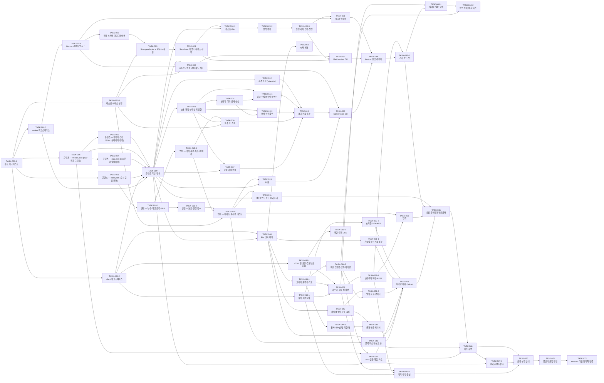

# 🧱 개발 태스크 전략 (Task Wall) — 영적 전쟁 테트리스

> *"So built we the wall; and all the wall was joined together unto the half thereof: for the people had a mind to work."* — Nehemiah 4:6 (KJV)
>
> **규격:** `statute-율법/04.development-repentance-회개/task-wall-성벽-template.md`
> **참조 예시:** `parable-비유/04.development-repentance-회개/task-wall-성벽-example.md`
> **근거 정경:** [`spec-tablet-명세서.md`](../01.requirement-hearing-들음/spec-tablet-명세서.md) · [`rtm-covenant-언약추적.md`](../01.requirement-hearing-들음/rtm-covenant-언약추적.md) · [`architecture-temple-성전설계.md`](../02.architecture-foundation-기초/architecture-temple-성전설계.md) · [`data-ark-법궤.md`](../02.architecture-foundation-기초/data-ark-법궤.md) · [`api-gate-성문.md`](../02.architecture-foundation-기초/api-gate-성문.md) · [`design-vision-디자인명세.md`](../03.design-order-질서/design-vision-디자인명세.md) · [`screen-vision-화면설계.md`](../03.design-order-질서/screen-vision-화면설계.md)
> **짝 산출물:** [`devguide-commandment-개발계명.md`](./devguide-commandment-개발계명.md) (코딩 계명·계층 분리 결정·버전 고정)
> **작성일:** 2026-10-19 · **작성:** Adam (Phase 4 계획 에이전트 — SKILL-04 0~1단계) · **TIER-3 / ⚡ 자동 모드**
> **이 문서의 지위:** 태스크 상태·지역 배정·Doer/Witness·짝 검증 결과의 **유일한 원본(SSOT)** — `acts-행전/README.md` 단일 원본 표. 이 계획 단계에서는 소스 코드를 한 줄도 만들지 않았다 (`fruit-열매/`에는 `history/`·`.gitkeep`만 존재).

---

## 0. 0단계 — 코딩 전 이상 징후 스캔 (SKILL-04, Proverbs 18:13)

> *"He that answereth a matter before he heareth it, it is folly and shame unto him."* — Proverbs 18:13 (KJV)
> 질문: "왜 이 부분만 다른가?" — 발견된 것은 먼저 결정 체인(architecture §11 D-01~D-20, design-vision §1.1 D3-01~D3-15)에서 확인했다.

| # | 이상 징후 (왜 이 부분만 다른가) | 결정 체인 확인 | Phase 4 조치 (이 성벽에 반영한 것) |
|:--|:---|:---|:---|
| A-01 | **GameRoom(ARCH-011) 한 컴포넌트에 FR 약 30건** — 다른 ARCH의 3~6배. architecture §5.3은 `room/` 7파일로만 예고 | D-07(보드=클라, 판정=서버), D-08, D-09, D-10이 모두 GameRoom 안에서 만난다 — 의도된 집중 | 책임별 13파일로 나눔: DO 셸(`game-room.ts`)·수신 핸들러(`room/handlers.ts`)·송신(`room/outbox.ts`) = 02.사마리아, 판정 논리 10파일(`player-state`·`effects`·`garbage`·`hero-skills`·`jesus`·`angels`·`armor`·`specials`·`quiz`·`match-flow`·`results`) = 01.유대. 판정 모듈은 `cloudflare:workers`를 import하지 않고 `RoomContext`(send·now·schedule·rules·content)를 주입받는다 → Node Vitest로 시험 가능 |
| A-02 | **엔진만 workspace 경계를 넘는다** — `worker/`(TS)가 `client/js/engine/`(JS)를 상대 경로 import | D-12(엔진 이중 구현 금지), D-02(공용 패키지 폴더 없음) | 엔진 9파일은 DOM·Pixi·`window`·타이머·JSON import 금지, **rules는 인자로 주입**(TASK-010). `worker/tsconfig.json` `allowJs`. 순수성은 `client/test/engine-purity.test.js`(Node 환경)로 강제. 서버 import 경로는 `worker/src/** → ../../client/js/engine/index.js`(깊이에 맞춘 상대 경로) 단방향 |
| A-03 | **DO SQLite `PRAGMA user_version`** — data-ark §7 마이그레이션 단계 판정. Durable Object SQL API는 PRAGMA를 허용 목록으로 제한하므로 `user_version`이 거부될 가능성이 있다 (이 계획 단계에서는 패키지 설치 금지로 실측 불가) | data-ark §7 원문 유지 (미검증 상태로 설계를 바꾸지 않는다 — 제3계명) | TASK-002 Doer가 첫 `wrangler dev` 기동 때 실측한다. 거부(`not authorized`)되면 **두 번째 돌판 규칙**: RTM §5 설계 변경 이력에 행 추가 → data-ark §7을 "단일 행 표 `schema_meta(version)`" 방식으로 개정 → Witness 확정 후 구현. 실측·결과는 `fruit-열매/history/`에 기록 **[실측 결과 2026-10-19 D-00]** `PRAGMA user_version` 읽기·쓰기 모두 `not authorized: SQLITE_AUTH` → 두 번째 돌판 절차 수행: RTM §5 DCL-001 행 추가, data-ark §7 재각 + §6.1 부록 `schema_meta(id=1, version)`, migrations.ts는 개정 spec대로 구현 → **W-00 승인 2026-10-19** (독립 재실측으로 SQLITE_AUTH 재현 — RTM §5 DCL-001 ✅) |
| A-04 | **원장 FK 단위 테스트(data-ark §6.2 "Phase 4 첫 원장 단위 테스트")를 Node Vitest에서** — workerd 밖에는 `ctx.storage.sql`이 없다 | D-05(어댑터 인터페이스), architecture §3 Node ≥ 22.12 | `sqlite-adapter.ts`는 SqlStorage 부분 집합(`exec(...).toArray()/one()`, `transactionSync`)만 쓴다. 테스트 전용 `worker/test/helpers/sql-storage-fake.ts`가 Node 22 내장 `node:sqlite`로 같은 부분 집합을 모사 (런타임 의존 추가 0) |
| A-05 | **E2E(FR-077) 결정성** — 시드는 서버 무작위인데 "A가 테트리스를 지우면"을 실제 입력으로 만들어야 함. 방어 검증(B의 베드로 스킬)도 게이지 60이 필요 | 별도 테스트 훅은 정경에 없음 (P4-002 — 만들지 않는다) | Phase 5에서 Playwright가 `start` 프레임(API-019 `seed`)을 WebSocket 이벤트로 읽고, Node에서 같은 엔진(`engine/index.js`)·봇 배치 평가(`worker/src/bot/placement.ts`)로 입력 순서를 계획한다. 이를 위해 Phase 4는 **엔진과 `placement.ts`가 Node에서 import 가능**해야 한다(TASK-010·TASK-019 완료 조건). 운영 코드에 테스트 전용 분기 0 |
| A-06 | **두 의존성만 "최신"이 아니다** — @playwright/test 1.56.1, tone 15.1.22 | D-17(설치된 chromium-1194 정합), §3(tone `next` 채널 제외) | 위반 아님 — 버전 고정표 그대로(devguide §1.2). `PLAYWRIGHT_BROWSERS_PATH=/opt/pw-browsers` 안내는 README(TASK-070) |
| A-07 | **콘텐츠 JSON 줄 수** — verses·quiz를 일반 들여쓰기로 쓰면 quiz.json만 600줄+ (500줄 규칙 위반) | data-ark §1 "UTF-8 JSON, 최상위 배열" — 형식만 정함 | `verses.json`·`quiz.json`은 **배열 원소 1개 = 1줄**(한 줄 JSON 객체). 나머지 JSON은 2칸 들여쓰기 |
| A-08 | **대전 화면 한 파일 280줄 예고**(architecture §5.2) — 컴포넌트 20종 + 덧씌움 10종 | §5.2 "300줄 경고선에 닿으면 HUD를 `screens/battle-hud.js`로 분리" | 처음부터 3파일: `battle.js`(조립) · `battle-hud.js`(HUD) · `battle-overlays.js`(모달류) |
| A-09 | **KJV 원문은 할루시네이션 고위험 지대** (C-003 "원문 그대로") — 구절 1개 오타 = 정경 위반 | C-003, C-010, data-ark TBL-016 | TASK-006 Doer는 **글자 단위로 확실히 아는 KJV 1769 원문만** 쓴다. 필수 31구절은 반드시 수록, 퀴즈 해설 구절은 verses.json에 실린 구절 안에서만 고른다. W-00은 구절마다 원문 대조 판정을 history에 남긴다. 한국어 `ko`는 KJV 직접 번역(개역개정·개역한글 문장 사용 금지 — OQ #17) |
| A-10 | **architecture §5.3 트리에 없는 파일명이 생긴다** (`log.ts`, `env.ts`, `select-storage.ts`, `lobby/pairing.ts`, `room/handlers·outbox·hero-skills·jesus·angels·armor.ts`, `game/apply-spirit.js`·`server-events.js`, `art/*`, `render/layout·block-textures·quality·spirit-fx·holy-fx.js`, `fx/flash·juice*.js`, `audio/aux-sfx.js`, `styles/*.css`, `screens/shell·battle-hud·battle-overlays.js`, `store/session.js`, `scripts/check-ports.mjs`, `README.md`) | SKILL-04 "책임 2개+ → 분리", architecture §5.2 분리 규칙 | **새 기능이 아니라 기존 ARCH 컴포넌트의 책임 분할**이다(P4-002 할루시네이션 아님). 파일 ↔ ARCH-ID 대응은 devguide §2.2에 1:1로 기록 |
| A-11 | **UC-021 E1 "충돌 포트와 해결 방법 출력"** — architecture §4는 strictPort 실패(포트 번호 출력)까지만 | UC-021 E1 원문 | `scripts/check-ports.mjs`를 `predev`로 두어 5173·8787 점유 시 포트·해결 방법을 출력 후 종료 (TASK-001-1) |
| A-12 | **연습 모드도 서버 연결** — 혼자 플레이인데 GameRoom 1인 방 | D-11, architecture §9.5 | 클라이언트 연습 전용 경로를 만들지 않는다. 연습도 `clear` 전송(게이지), 천사·갑주는 `MODE_FORBIDDEN` |

> 이상 징후 12건 모두 정경 결정 체인 안에서 해소되었다. 정경 본문 변경은 0건(RTM §5 설계 변경 이력 행 추가 없음). A-03만 실측 결과에 따라 두 번째 돌판 절차가 열릴 수 있다.

---

## 1. 구현 순서 전략 (느헤미야의 성벽 재건 순서 + 행전 지역)

```
1단계: 기반 — 프로젝트 스캐폴딩 + 원장(DB) + 콘텐츠 JSON + rules.json      → 00.jerusalem-예루살렘
  ↓   (기초가 없으면 성벽을 세울 수 없다 — 모든 수치는 rules.json 한 곳)
2단계: 핵심 — 순수 엔진 · 판정(attack·영·천사·갑주·스킬·퀴즈·특수 칸) · 봇 · 원장 서비스 → 01.judaea-유대
  ↓   (성벽의 본체 — DOM·HTTP·소켓을 모르는 순수 논리)
3단계: 성문 — WS 프로토콜 검증 · REST 핸들러 · Matchmaker/GameRoom DO · Worker 진입 → 02.samaria-사마리아
  ↓   ("he must needs go through Samaria" — John 4:4)
4단계: 외벽 — 렌더 코어(03-A) → 오디오·타격감(03-B) → 화면·HUD·네트워크(03-C)      → 03.uttermost-땅끝
  ↓
5단계: 봉인 — 봉인의 율법 10계명 점검 (03-D)                                         → 03.uttermost-땅끝
  ↓
6단계: 파수꾼 — 로컬 실행 안내 · Phase 4 마감 동기화 검증 (03-D)                     → 03.uttermost-땅끝
```

### 1.1 행전 지역 실행 순서와 그룹 (언약책 §5.1)

| 순서 | 지역 / 그룹 | 개발 계층 | TASK 범위 | Doer | Witness | 지역 완료 이정표 (history) |
|:---:|:---|:---|:---|:---:|:---:|:---|
| 1 | 00.jerusalem-예루살렘 | 스캐폴딩·원장·콘텐츠·rules | TASK-001~TASK-009 | D-00 | W-00 | Acts 6:7 |
| 2 | 01.judaea-유대 | 핵심 논리 (엔진·판정·봇·서비스) | TASK-010~TASK-020 | D-01 | W-01 | Acts 9:31 |
| 3 | 02.samaria-사마리아 | 성문 (프로토콜·REST·DO·진입) | TASK-030~TASK-034 | D-02 | W-02 | Acts 12:24 |
| 4-A | 03.uttermost-땅끝 · **03-A 렌더 코어** | Pixi 코어·보드·파티클·필터·배경·코드 그래픽·존재 연출 | TASK-040~TASK-045 | D-03A | W-03A | (그룹 완료 한 줄) |
| 4-B | 03.uttermost-땅끝 · **03-B 오디오·타격감** | Tone.js 오디오·연출 원소·DOM 연출·Juice 지휘 | TASK-050~TASK-053 | D-03B | W-03B | (그룹 완료 한 줄) |
| 4-C | 03.uttermost-땅끝 · **03-C 화면·HUD·네트워크** | 셸·스타일·라우터·저장·소켓·입력·화면 9개·컨트롤러 | TASK-060~TASK-067 | D-03C | W-03C | (그룹 완료 한 줄) |
| 4-D | 03.uttermost-땅끝 · **03-D 봉인·실행** | README·봉인 점검·마감 동기화 검증·RTM | TASK-070~TASK-072 | D-03D | W-03D | Acts 19:20 |

> **03 그룹 순서의 근거:** 03-C의 컨트롤러(TASK-065)·대전 화면(TASK-066)이 03-A의 보드 뷰와 03-B의 Juice 디스패처를 import하므로 렌더 → 타격감 → 화면 순서로 쌓는다. 03-B의 `fx/*`는 DOM 컨테이너를 **주입받아** 자기 요소를 만들기 때문에 화면 파일보다 먼저 존재할 수 있다.
> **서신(인계 발췌본):** `acts-행전/TASK-000/` 아래 지역 폴더 4개(`00.jerusalem-예루살렘`·`01.judaea-유대`·`02.samaria-사마리아`·`03.uttermost-땅끝`)의 `epistle-서신.md` — TASK-000은 아래 §2.0의 상위 묶음 행이다(README "task-wall의 TASK-ID 재사용"). 03 그룹 4개는 같은 `03.uttermost-땅끝` 서신 하나를 읽는다.

---

## 2. 태스크 분할표

> **열 규칙:** `지역` 열이 지역 배정의 유일한 원본이다. `생성 파일` 경로는 `fruit-열매/` 기준(03-D의 두 점검 산출물만 `bible-성경/04/`). `예상 줄수`는 생성 파일 순서대로. 상위 L 행은 파일을 갖지 않고 서브 태스크 행이 실제 실행 단위다. `Doer`·`Witness`는 서로 다른 에이전트여야 하며, 둘을 띄울 수 없으면 Witness 칸을 `(Self-adv)`로 바꾸고 Phase 6 Self-adversarial Fallback으로 대체한다.
> **상태 범례:** ⬜ 미착수 · 🔄 진행중 · 🔁 회개중 · ✅ 완료(코드 리뷰 + 봉인 점검 통과) · ❌ 차단. `짝 검증 결과`는 Witness 판정(⬜ 미판정 / ✅ 일치 / 🔁 불일치→즉시 정화 루프).

### 2.0 상위 묶음 (행전 TASK-ID)

| TASK-ID | 성벽 구간 | 지역 | 설명 | 연결 REQ | 생성 파일 | 선행 | 규모 | 상태 |
|:---|:---|:---|:---|:---|:---|:---|:---:|:---:|
| TASK-000 | Phase 4 성벽 전체 (행전 묶음) | 00 → 01 → 02 → 03 | `acts-행전/TASK-000/` 서신 4통의 TASK-ID. 아래 75행(실행 단위 64개)의 합 — 직접 생성 파일 없음 | REQ-001~REQ-017 (전 116 ID — RTM §8) | — (TASK-001~TASK-072의 합) | — | L | ⬜ |

### 2.1 00.jerusalem-예루살렘 — 기반 (스캐폴딩·원장·콘텐츠)

| TASK-ID | 성벽 구간 | 지역 | 설명 | 연결 REQ | 연결 API/TBL/SCR | 생성 파일 | 파일 책임 | 예상 줄수 | 선행 | 규모 | 상태 | Doer | Witness | 짝 검증 결과 |
|:---|:---|:---|:---|:---|:---|:---|:---|:---:|:---|:---:|:---:|:---:|:---:|:---:|
| TASK-001 | 프로젝트 스캐폴딩 (전체) | 00.예루살렘 | npm workspaces 모노레포 골격·매니페스트·실행/테스트 명령 등록 — 서브 태스크 5개의 합 | REQ-016, REQ-017 | ARCH-017, ARCH-018 | — (서브 태스크 합 — L 분할표) | — | — | — | L | ✅ | D-00 | W-00 | ✅ |
| TASK-001-1 | 루트 매니페스트 | 00.예루살렘 | workspaces·scripts(dev/predev/test/test:e2e/check:content)·버전 고정·포트 사전 점검 | REQ-016, FR-073, NFR-007, C-005, C-012, C-013 | ARCH-017 | `package.json`<br>`.gitignore`<br>`scripts/check-ports.mjs` | 설정·실행 보조만 | 40 · 20 · 60 | — | S | ✅ | D-00 | W-00 | ✅ |
| TASK-001-2 | client 워크스페이스 | 00.예루살렘 | Vite 8 프로젝트 매니페스트·프록시(/api, /ws ws:true)·strictPort·fs.allow | REQ-016, FR-073, NFR-007, C-005 | ARCH-017, D-03 | `client/package.json`<br>`client/vite.config.js` | 설정만 | 30 · 40 | TASK-001-1 | S | ✅ | D-00 | W-00 | ✅ |
| TASK-001-3 | worker 워크스페이스 | 00.예루살렘 | wrangler 4.147.0 매니페스트·DO 바인딩·마이그레이션 v1 선언·TS 설정·키 이름 예시 | REQ-016, FR-072, FR-073, NFR-004, NFR-007, C-004, C-005 | ARCH-017, D-01, D-05 | `worker/package.json`<br>`worker/wrangler.toml`<br>`worker/tsconfig.json`<br>`worker/.dev.vars.example` | 설정만 | 25 · 30 · 25 · 6 | TASK-001-1 | M | ✅ | D-00 | W-00 | ✅ |
| TASK-001-4 | Worker 공용 타입·로그 | 00.예루살렘 | Env 바인딩 타입, 구조화 JSON 1줄 로그(guestId 앞 8자만) | REQ-016, NFR-003, NFR-004, NFR-008 | ARCH-009, ARCH-014, architecture §10 제1·8계명 | `worker/src/env.ts`<br>`worker/src/log.ts` | 공용 유틸만 | 30 · 50 | TASK-001-3 | S | ✅ | D-00 | W-00 | ✅ |
| TASK-001-5 | 테스트 하네스 설정 | 00.예루살렘 | Vitest projects 3종(client·worker·content) + Playwright 설정 — `npm test` 한 줄 등록의 실행 대상 | REQ-017, FR-075, FR-077 | ARCH-018, D-17 | `vitest.config.js`<br>`playwright.config.js` | 설정만 | 35 · 35 | TASK-001-1 | S | ✅ | D-00 | W-00 | ✅ |
| TASK-002 | 원장 스키마·마이그레이션 | 00.예루살렘 | DO SQLite DDL v1 실행기 + Supabase Postgres 스키마(RLS·함수) | REQ-014~REQ-016, FR-067, FR-068, FR-070, FR-072, NFR-008 | TBL-001~TBL-006, data-ark §6.1·§6.3·§7 | `worker/src/storage/migrations.ts`<br>`supabase/migrations/0001_init.sql` | 데이터/DB만 | 120 · 190 | TASK-001-4 | S | ✅ | D-00 | W-00 | ✅ |
| TASK-003 | StorageAdapter + SQLite 구현 | 00.예루살렘 | 저장 인터페이스와 DO SQLite 구현, Node 원장 단위 테스트(FK·CHECK 거부) | REQ-014~REQ-016, FR-012, FR-067~FR-072 | TBL-001~TBL-006, data-ark §5·§6.2, D-05 | `worker/src/storage/adapter.ts`<br>`worker/src/storage/sqlite-adapter.ts`<br>`worker/test/helpers/sql-storage-fake.ts`<br>`worker/test/ledger-fk.test.ts` | 데이터/DB만 | 110 · 240 · 70 · 90 | TASK-002, TASK-001-5 | M | ✅ | D-00 | W-00 | ✅ |
| TASK-004 | Supabase 어댑터·저장소 선택 | 00.예루살렘 | 환경변수 2개가 모두 있을 때만 Supabase 구현 생성, 아니면 SQLite | REQ-016, FR-072, NFR-004, C-004 | TBL-001~TBL-006, data-ark §6.3, D-05 | `worker/src/storage/supabase-adapter.ts`<br>`worker/src/storage/select-storage.ts` | 데이터/DB만 | 200 · 40 | TASK-003 | S | ✅ | D-00 | W-00 | ✅ |
| TASK-005 | 콘텐츠 — 캐릭터·상성 JSON (실데이터 전량) | 00.예루살렘 | 위인 4·천사 5·악한 영 14·전신갑주 6·상성표 14행을 data-ark 확정표 그대로 **완전한 실데이터**로 작성 | REQ-003, REQ-007~REQ-009, FR-013~FR-017, FR-026~FR-030, FR-035, FR-037, FR-038, FR-074, C-010, C-011 | TBL-011~TBL-015, CODE-003·006·007·010·011 | `content/heroes.json`<br>`content/angels.json`<br>`content/spirits.json`<br>`content/armor.json`<br>`content/counters.json` | 콘텐츠 데이터만 | 60 · 50 · 200 · 60 · 75 | TASK-006 | M | ✅ | D-00 | W-00 | ✅ |
| TASK-006 | 콘텐츠 — verses.json (KJV 원문 그대로) | 00.예루살렘 | 필수 31구절 + 퀴즈 해설 구절 전부, `{ref, kjv, ko, ref_ko}`, 한 원소 = 한 줄 | REQ-011, FR-043, FR-074, C-003, C-010 | TBL-016 | `content/verses.json` | 콘텐츠 데이터만 | 90 | TASK-001-1 | S | ✅ | D-00 | W-00 | ✅ |
| TASK-007 | 콘텐츠 — quiz.json (≥60문항 실데이터) | 00.예루살렘 | 4지선다 66문항 권장(유형 3×22, 난이도 3×22), 근거 구절은 verses.json 안에서만, 한 원소 = 한 줄 | REQ-011, FR-041, FR-043, C-003 | TBL-017, CODE-012 | `content/quiz.json` | 콘텐츠 데이터만 | 75 | TASK-006 | S | ✅ | D-00 | W-00 | ✅ |
| TASK-008 | 콘텐츠 — rules.json (수치 단일 원천) | 00.예루살렘 | data-ark §3.18 표의 모든 키·값을 그대로 (화면·코드 하드코딩 금지의 원천) | REQ-001, REQ-005, REQ-007, REQ-008, REQ-010, REQ-012, REQ-013, REQ-015, FR-004, FR-010, FR-019, FR-031, FR-062, FR-064, FR-065, FR-070, NFR-003, C-001 | TBL-018 | `content/rules.json` | 콘텐츠 데이터만 | 210 | TASK-001-1 | S | ✅ | D-00 | W-00 | ✅ |
| TASK-009 | 콘텐츠 색인·검사 | 00.예루살렘 | 클라이언트·서버 단일 import 지점 + 콘텐츠 검사 스크립트(FR-076) | REQ-016, REQ-017, FR-038, FR-074, FR-076, C-010 | TBL-011~TBL-018, data-ark §6.2 콘텐츠 무결성, D-15 | `content/check-content.mjs`<br>`client/js/content.js`<br>`worker/src/content.ts` | 콘텐츠 접근만 | 150 · 70 · 90 | TASK-005, TASK-006, TASK-007, TASK-008, TASK-001-2, TASK-001-3 | S | ✅ | D-00 | W-00 | ✅ |

> **콘텐츠 태스크(TASK-005~TASK-008) 특별 계명 — "실데이터 전량, 자리표시 0":** heroes 4 · angels 5 · spirits 14 · armor 6 · counters 14행 · verses(필수 31구절 + 퀴즈 해설 구절 전부) · quiz ≥ 60문항(권장 66: `person`·`event`·`verse_blank` 각 22, 난이도 1·2·3 각 22, 보기 4개 중복 없음, `answer` 0~3, `verse_ref`는 verses.json 안) · rules.json(data-ark §3.18의 **모든** 키). 수치·id·효과 문장은 data-ark 확정표와 spec-tablet FR 문장을 **그대로** 옮긴다. "예시 몇 개만", "나머지 생략", 빈 문자열, 작업 미완 표식 금지 — `check-content.mjs`(TASK-009)가 통과해야 ✅.
> **verses.json 필수 31구절:** 1 Samuel 17:49 · 1 Kings 3:9 · Matthew 16:18 · Acts 16:26 (위인) / Jude 1:9 · Luke 1:19 · Genesis 3:24 · Isaiah 6:6 · Hebrews 1:14 (천사) / Mark 1:23 · Mark 9:25 · Mark 5:9 · 1 Kings 22:22 · Acts 16:16 · Matthew 12:24 · Ephesians 2:2 · Daniel 10:13 · Revelation 9:11 · Revelation 2:20 · Zechariah 5:8 · Revelation 17:5 · 2 Corinthians 11:14 · Revelation 12:9 (악한 영) / Ephesians 6:14 · Ephesians 6:15 · Ephesians 6:16 · Ephesians 6:17 (갑주) / John 16:33 · John 1:5 (예수님 이벤트) · 2 Timothy 4:7 (승리 — `victoryVerse`) · Ephesians 6:12 (입장 화면). `ref`는 영어 책 이름 + 장:절(예 `Jude 1:9`), `ref_ko`는 한국어 책 이름(예 `유다서 1:9`).

### 2.2 01.judaea-유대 — 핵심 논리 (엔진·판정·봇·서비스)

| TASK-ID | 성벽 구간 | 지역 | 설명 | 연결 REQ | 연결 API/TBL/SCR | 생성 파일 | 파일 책임 | 예상 줄수 | 선행 | 규모 | 상태 | Doer | Witness | 짝 검증 결과 |
|:---|:---|:---|:---|:---|:---|:---|:---|:---:|:---|:---:|:---:|:---:|:---:|:---:|
| TASK-010 | 순수 게임 엔진 (전체) | 01.유대 | DOM·Pixi·네트워크·window 비의존 ES 모듈 — 서버 봇이 같은 파일을 import (D-12). 서브 4개 | REQ-001, REQ-009, REQ-012 | ARCH-002, TBL-018 | — (서브 태스크 합 — L 분할표) | — | — | TASK-008 | L | ✅ | D-01 | W-01 | ✅ |
| TASK-010-1 | 엔진 — 난수·가방·조각·SRS | 01.유대 | 시드 PRNG(mulberry32)·독립 스트림 분기·7-bag·7종 테트로미노·SRS 벽차기 | REQ-001, FR-001, FR-002, FR-005 | ARCH-002, D-09, architecture §9.8 | `client/js/engine/rng.js`<br>`client/js/engine/bag.js`<br>`client/js/engine/piece.js`<br>`client/js/engine/srs.js` | 순수 논리만 | 45 · 50 · 90 · 90 | TASK-008 | M | ✅ | D-01 | W-01 | ✅ |
| TASK-010-2 | 엔진 — 보드·판정·점수 | 01.유대 | 10×20 보드 연산(충돌·고정·삭제·쓰레기·납·구멍·위험선)과 T-Spin·콤보·B2B·점수 | REQ-001, FR-003, FR-004, FR-025, FR-029, FR-055 | ARCH-002, TBL-018 `scoring`·`board` | `client/js/engine/board.js`<br>`client/js/engine/scoring.js` | 순수 논리만 | 220 · 130 | TASK-010-1 | S | ✅ | D-01 | W-01 | ✅ |
| TASK-010-3 | 엔진 — 낙하 곡선·특수 칸 배정 | 01.유대 | 경기 경과 ms → 낙하 간격, (시드·조각 번호·해금 단계·콤보·위기) → 특수/갑주 칸 결정론적 배정 + 서버 검증용 최대 확률 | REQ-009, REQ-012, FR-010, FR-036, FR-044~FR-047 | ARCH-002, D-09, D-18, TBL-018 `gravity`·`specials`·`armor` | `client/js/engine/gravity.js`<br>`client/js/engine/specials.js` | 순수 논리만 | 40 · 150 | TASK-010-1 | S | ✅ | D-01 | W-01 | ✅ |
| TASK-010-4 | 엔진 — 퍼사드·순수성 테스트 | 01.유대 | Engine 상태기(스폰·이동·회전·홀드·드롭·고스트·잠금 지연·tick·이벤트 배열·스냅샷) + Node 환경 import 테스트 | REQ-001, FR-001, FR-003, FR-004, FR-010, FR-075 | ARCH-002, D-12 | `client/js/engine/index.js`<br>`client/test/engine-purity.test.js` | 순수 논리만 | 240 · 50 | TASK-010-2, TASK-010-3, TASK-001-5 | S | ✅ | D-01 | W-01 | ✅ |
| TASK-011 | 클라이언트 보드 효과 논리 | 01.유대 | 서버 판정 결과(attack·garbage·effect)를 **내 엔진 상태**에 적용하는 순수 함수 + 보드 코덱 | REQ-003, REQ-007~REQ-010, REQ-012, FR-006, FR-014~FR-017, FR-025, FR-027~FR-031, FR-035, FR-037, FR-039, FR-045, FR-046, FR-062 | ARCH-003, API-012, API-020~API-023, TBL-013·TBL-014, CODE-009 | `client/js/game/board-codec.js`<br>`client/js/game/apply-attack.js`<br>`client/js/game/apply-spirit.js`<br>`client/js/game/apply-effect.js` | 순수 논리만 | 70 · 150 · 230 · 220 | TASK-010-4, TASK-009 | M | ✅ | D-01 | W-01 | ✅ |
| TASK-012 | 공격 판정 (attack.ts) | 01.유대 | (lines, combo, b2b, tspin, jericho, 연속 B2B) → 공격력·악한 영 등급·후보 — 순수 함수 | REQ-007, FR-024, FR-026, NFR-002 | ARCH-012, TBL-013, TBL-018 `attack`·`spiritTier` | `worker/src/attack.ts` | 비즈니스만 | 160 | TASK-009 | S | ✅ | D-01 | W-01 | ✅ |
| TASK-013 | 슬롯 판정 상태·방해 상한 | 01.유대 | 게이지(은혜 배율)·쿨다운·보유 갑주·armed·status 스냅샷 + FR-031 상한 규칙 | REQ-007, REQ-008, REQ-013, FR-028, FR-031, FR-033, FR-062 | ARCH-011, API-024, TBL-018 `gauge`·`effects`, data-ark §8.2 | `worker/src/room/player-state.ts`<br>`worker/src/room/effects.ts` | 비즈니스만 | 200 · 190 | TASK-009 | S | ✅ | D-01 | W-01 | ✅ |
| TASK-014 | 쓰레기 대기·상쇄·상승 | 01.유대 | 대기 공격 큐·상쇄·1,000ms 상승 타이머·베드로 무효·은혜 −1·흉배 −2 | REQ-007, FR-016, FR-025, FR-062 | ARCH-011, API-021, API-022, TBL-018 `garbage`·`grace`·`armor` | `worker/src/room/garbage.ts` | 비즈니스만 | 170 | TASK-013 | S | ✅ | D-01 | W-01 | ✅ |
| TASK-015 | 능력 판정 (전체) | 01.유대 | 위인 스킬·예수님 이벤트·천사·전신갑주 서버 판정 — 서브 2개 | REQ-003, REQ-008~REQ-010 | ARCH-011, API-014, API-015, API-023 | — (서브 태스크 합 — L 분할표) | — | — | TASK-013, TASK-014 | L | ✅ | D-01 | W-01 | ✅ |
| TASK-015-1 | 위인 스킬·예수님 이벤트 | 01.유대 | 게이지·쿨다운 검증 후 4스킬 효과 결정, 예수님 이벤트(게이지 100 + 위기 + 경기당 1회) 발동 | REQ-003, REQ-008, REQ-010, FR-014~FR-017, FR-034, FR-039, C-002 | API-014, API-023, API-025, TBL-011, TBL-018 `heroSkills`·`jesus` | `worker/src/room/hero-skills.ts`<br>`worker/src/room/jesus.ts` | 비즈니스만 | 170 · 90 | TASK-013, TASK-014 | S | ✅ | D-01 | W-01 | ✅ |
| TASK-015-2 | 천사·전신갑주 | 01.유대 | 천사 5종(봉인 검사·MODE_FORBIDDEN) + 갑주 6종(nullify·reduce_next·block_next·reflect) | REQ-008, REQ-009, FR-035~FR-038 | API-014, API-015, API-023, API-025, TBL-012, TBL-014, TBL-015, TBL-018 `angels`·`armor` | `worker/src/room/angels.ts`<br>`worker/src/room/armor.ts` | 비즈니스만 | 170 · 170 | TASK-013, TASK-014 | S | ✅ | D-01 | W-01 | ✅ |
| TASK-016 | 특수 칸 검증 | 01.유대 | `clear.specials`를 engine/specials.js로 재계산 검증, 여리고 +1·만나 +25·갑주 획득·말씀→대결 트리거 | REQ-009, REQ-012, FR-032, FR-036, FR-044~FR-047, C-001 | API-013, API-023, TBL-018 `specials`, D-09 | `worker/src/room/specials.ts`<br>`worker/test/specials.test.ts` | 비즈니스만 | 160 · 80 | TASK-010-3, TASK-013, TASK-001-5 | S | ✅ | D-01 | W-01 | ✅ |
| TASK-017 | 말씀 대결 판정 | 01.유대 | 출제·10초·오답 3초 잠금·도착순 판정·보상(50% 게이지 / 50% 갑주)·니어미스 gapMs·90초 자동·재개 지연 | REQ-011, FR-022, FR-040~FR-043 | ARCH-011, API-016, API-026, API-027, TBL-016, TBL-017, TBL-018 `quiz` | `worker/src/room/quiz.ts` | 비즈니스만 | 230 | TASK-013, TASK-009 | S | ✅ | D-01 | W-01 | ✅ |
| TASK-018 | 경기 흐름·결과 | 01.유대 | 준비→시드·카운트다운→라운드→3판 2선승→경기 종료·이탈·연습 세션, 결과 집계·대표 구절·기록 페이로드 | REQ-001, REQ-006, REQ-013, REQ-014, FR-005, FR-007, FR-009, FR-023, FR-063, FR-065, FR-066, FR-068 | ARCH-011, API-019, API-029, API-030, TBL-002, TBL-003, TBL-018 `match`·`verseCard` | `worker/src/room/match-flow.ts`<br>`worker/src/room/results.ts` | 비즈니스만 | 250 · 170 | TASK-012, TASK-015-1, TASK-015-2, TASK-016, TASK-017 | M | ✅ | D-01 | W-01 | ✅ |
| TASK-019 | AI 봇 (+ 착지 평가 엔진 공용 — RTM §5 DCL-004) | 01.유대 | GameRoom 안에서 엔진 인스턴스 구동, 난이도별 착지 평가·조작 속도·실수율·퀴즈 정답률/지연. **[W-01 2026-10-19 DCL-004]** 착지 후보 열거·평가는 엔진 `placement.js`(솔로몬·가브리엘 힌트 공용), 봇은 노이즈·실수율만. **[W-02 2026-10-19 DCL-006]** 봇 전용 줄 수 보정 `lineBias`·`biasMaxHeight`(어려움 = 줄을 모아 지워 공격) | REQ-005, FR-021, FR-022, FR-015, FR-035 | ARCH-013, ARCH-002, TBL-018 `bot`·`placement`, D-10, D-12 | `worker/src/bot/placement.ts`<br>`worker/src/bot/bot-player.ts`<br>`client/js/engine/placement.js` | 비즈니스만 (placement.js = 순수 논리만) | 200 · 210 · 80 | TASK-010-4, TASK-009 | M | ✅ | D-01 | W-01 | ✅ |
| TASK-020 | 원장 서비스 (전체) | 01.유대 | 게스트·Elo·전적·랭킹·진행 기록 비즈니스 — 서브 3개 | REQ-002, REQ-013~REQ-015 | ARCH-014 | — (서브 태스크 합 — L 분할표) | — | — | TASK-004, TASK-009 | L | ✅ | D-01 | W-01 | ✅ |
| TASK-020-1 | 게스트·Elo | 01.유대 | 닉네임 검증(trim·정규식·중복)·guestId/토큰 발급·SHA-256·LRU 1,000 토큰 검증 + Elo K=32 | REQ-002, REQ-015, FR-012, FR-018, FR-070, NFR-003, NFR-008 | API-001, API-002, TBL-001, TBL-004, TBL-018 `nickname`·`elo`, D-06 | `worker/src/services/guest-service.ts`<br>`worker/src/services/elo.ts` | 비즈니스만 | 150 · 40 | TASK-004, TASK-009 | S | ✅ | D-01 | W-01 | ✅ |
| TASK-020-2 | 전적·랭킹 | 01.유대 | 경기 기록 검증(2행·봇 1행 이하·verse_ref 존재)·전적 키셋 페이지·상위 100(5초 TTL)·내 순위 | REQ-014, REQ-015, FR-068~FR-071 | API-003, API-004, TBL-002, TBL-003, TBL-006 | `worker/src/services/history-service.ts`<br>`worker/src/services/ranking-service.ts` | 비즈니스만 | 150 · 90 | TASK-020-1 | S | ✅ | D-01 | W-01 | ✅ |
| TASK-020-3 | 진행 기록·업적·성장 | 01.유대 | 누적 판 수·연속 패배·직전 경기 기록·성장 수치·업적 goliath_hunter·해금 단계·은혜 판정 | REQ-012, REQ-013, FR-047, FR-062, FR-065~FR-067 | TBL-004, TBL-005, TBL-018 `achievements`·`grace`·`specials.unlockRounds`, architecture §9.10 | `worker/src/services/progress-service.ts` | 비즈니스만 | 180 | TASK-020-2 | S | ✅ | D-01 | W-01 | ✅ |

### 2.3 02.samaria-사마리아 — 성문 (프로토콜·REST·Durable Object·진입)

| TASK-ID | 성벽 구간 | 지역 | 설명 | 연결 REQ | 연결 API/TBL/SCR | 생성 파일 | 파일 책임 | 예상 줄수 | 선행 | 규모 | 상태 | Doer | Witness | 짝 검증 결과 |
|:---|:---|:---|:---|:---|:---|:---|:---|:---:|:---|:---:|:---:|:---:|:---:|:---:|
| TASK-030 | WS 프로토콜 검증·속도 제한 | 02.사마리아 | 메시지 상수 표·`type`별 수기 스키마 검증·4KB 상한·소켓별 토큰 버킷 + 검증 단위 테스트 | REQ-001, REQ-007, FR-008, FR-032, NFR-003, C-006 | ARCH-015, API-005~API-031, api-gate §2·§4, TBL-018 `rateLimit`, D-16, D-20 | `worker/src/protocol/messages.ts`<br>`worker/src/protocol/validate.ts`<br>`worker/src/protocol/rate-limit.ts`<br>`worker/test/validate.test.ts` | 프로토콜만 | 130 · 270 · 100 · 120 | TASK-009, TASK-001-4, TASK-001-5 | M | ✅ | D-02 | W-02 | ✅ |
| TASK-031 | REST 핸들러 | 02.사마리아 | API-001~API-004 — 파라미터 파싱·Bearer·본문 1,024B·상태코드·Matchmaker RPC 호출, 핸들러마다 try/catch | REQ-002, REQ-014, REQ-015, FR-012, FR-069, FR-071, NFR-003 | ARCH-009, API-001~API-004, api-gate §4.1·§5 | `worker/src/routes/respond.ts`<br>`worker/src/routes/guests.ts`<br>`worker/src/routes/matches.ts`<br>`worker/src/routes/leaderboard.ts` | HTTP 처리만 | 80 · 110 · 80 · 60 | TASK-020-3, TASK-001-4 | M | ✅ | D-02 | W-02 | ✅ |
| TASK-032 | Matchmaker DO | 02.사마리아 | 전역 1개: 원장 마이그레이션·로비 소켓(Hibernation)·join/cancel·RPC 파사드(원장 서비스 위임)·Elo 근접 짝짓기·초대 코드·티켓 | REQ-002, REQ-004~REQ-006, REQ-014, REQ-015, FR-008, FR-018~FR-021, FR-023, FR-068 | ARCH-010, API-005, API-007~API-010, API-031, data-ark §8.1, D-04, D-19 | `worker/src/matchmaker.ts`<br>`worker/src/lobby/pairing.ts`<br>`worker/src/lobby/lobby-flow.ts` **[D-02 분할]** | WS 처리 + 매칭만 | 240 · 200 · 280 (matchmaker 실측 165) | TASK-030, TASK-020-3, TASK-004 | M | ✅ | D-02 | W-02 | ✅ |
| TASK-033 | GameRoom DO | 02.사마리아 | 방 1개: setup RPC·config 저장·방 소켓 수락(티켓)·메시지 → room/* 위임·타이머·기록 RPC·소켓 종료=이탈 | REQ-001, REQ-005, REQ-007~REQ-009, REQ-011, REQ-013, FR-005, FR-006, FR-008, FR-009, FR-032, FR-064, NFR-002, NFR-003 | ARCH-011, API-006, API-011~API-031, data-ark §8.2, D-07, D-08 | `worker/src/game-room.ts`<br>`worker/src/room/handlers.ts`<br>`worker/src/room/outbox.ts`<br>`worker/src/room/bot-driver.ts` **[W-02 분할]** | WS 처리만 (bot-driver = 봇 구동만) | 210 · 260 · 70 · 90 (실측 331 · 289 · 88 · 88) | TASK-030, TASK-018, TASK-019 | M | ✅ | D-02 | W-02 | ✅ |
| TASK-034 | Worker 진입 라우터 | 02.사마리아 | fetch 라우팅·Origin 허용 목록·WS Upgrade 전달·404·전역 오류·`export default` + DO 클래스 export | REQ-016, FR-008, FR-073, NFR-003, C-006 | ARCH-009, API-001~API-006, D-03 | `worker/src/index.ts` | HTTP 처리만 | 130 | TASK-031, TASK-032, TASK-033 | S | ✅ | D-02 | W-02 | ✅ |

### 2.4 03.uttermost-땅끝 — 외벽·봉인·파수꾼 (그룹 03-A → 03-B → 03-C → 03-D)

| TASK-ID | 성벽 구간 | 지역 | 설명 | 연결 REQ | 연결 API/TBL/SCR | 생성 파일 | 파일 책임 | 예상 줄수 | 선행 | 규모 | 상태 | Doer | Witness | 짝 검증 결과 |
|:---|:---|:---|:---|:---|:---|:---|:---|:---:|:---|:---:|:---:|:---:|:---:|:---:|
| TASK-040 | [03-A] Pixi 코어·배치 | 03.땅끝 | Application 1개·zIndex 레이어 11개·rAF, 가상 해상도 2벌 letterbox·DOM 오버레이 같은 배율 | REQ-013, FR-011, FR-048, NFR-001 | ARCH-004, SCR-005, design-vision §2.8·§5.2, D3-03, D3-14 | `client/js/render/pixi-app.js`<br>`client/js/render/layout.js` | 렌더링만 | 150 · 130 | TASK-001-2, TASK-009 | S | ⬜ | D-03A | W-03A | ⬜ |
| TASK-041 | [03-A] 블록 텍스처·보드 뷰 | 03.땅끝 | 유리 질감 블록 36장 + 특수 덮개 16장 굽기, 내/상대 보드 그리기(고스트·힌트·특수 칸·위험선·바뀐 칸만 갱신) | REQ-001, REQ-013, FR-001, FR-003, FR-006, FR-048, FR-051, FR-055 | ARCH-004, API-020, SCR-005, design-vision §2.2~§2.3·§2.11 | `client/js/render/block-textures.js`<br>`client/js/render/board-view.js` | 렌더링만 | 180 · 260 | TASK-040, TASK-010-4 | S | ⬜ | D-03A | W-03A | ⬜ |
| TASK-042 | [03-A] 파티클·필터·자동 품질 | 03.땅끝 | 풀 600 파티클, 무거운 필터 동시 3개 관리, 프레임 시간 기반 가벼운 그리기 | REQ-013, FR-052, FR-053, FR-056, NFR-001 | ARCH-004, design-vision §2.10·§4.9, D-13 | `client/js/render/particles.js`<br>`client/js/render/filters.js`<br>`client/js/render/quality.js` | 렌더링만 | 220 · 170 · 80 | TASK-040 | M | ⬜ | D-03A | W-03A | ⬜ |
| TASK-043 | [03-A] 시차 배경 | 03.땅끝 | 4층 시차 배경·공격 받음 붉게·위기 어둡게 | REQ-013, FR-048, FR-053, FR-055 | ARCH-004, design-vision §2.12 | `client/js/render/background.js` | 렌더링만 | 180 | TASK-040 | S | ⬜ | D-03A | W-03A | ⬜ |
| TASK-044 | [03-A] 코드 그래픽 (전체) | 03.땅끝 | 엠블럼·천사·악한 영·갑주·예수님 빛·기호를 128 상자 좌표 데이터로, Pixi·SVG 두 출력 — 서브 3개 | REQ-003, REQ-013, FR-013, FR-049, C-007, C-011 | design-vision §2.13 | — (서브 태스크 합 — L 분할표) | — | — | TASK-040 | L | ⬜ | D-03A | W-03A | ⬜ |
| TASK-044-1 | [03-A] 그래픽 출력기·기호 | 03.땅끝 | 그리기 명령 → Pixi Graphics(크기별 텍스처) / 인라인 SVG, 은혜 비둘기·별빛·빛 별·업적 인장·UI 아이콘 8 | REQ-013, FR-049, FR-062, FR-065, C-007 | design-vision §2.13 머리말·§2.13.6 | `client/js/art/to-pixi.js`<br>`client/js/art/to-svg.js`<br>`client/js/art/shapes-ui.js` | 렌더링만 | 90 · 70 · 170 | TASK-040 | S | ⬜ | D-03A | W-03A | ⬜ |
| TASK-044-2 | [03-A] 위인 엠블럼·갑주 아이콘 | 03.땅끝 | 엠블럼 4종(sling·crown·rock_key·broken_chain) + 갑주 6종 아이콘 | REQ-003, REQ-009, FR-013, FR-037, FR-049 | TBL-011 `emblem`, TBL-014, design-vision §2.13.1·§2.13.4 | `client/js/art/shapes-heroes-armor.js` | 렌더링만 | 240 | TASK-044-1 | S | ⬜ | D-03A | W-03A | ⬜ |
| TASK-044-3 | [03-A] 천사·예수님 빛·악한 영 | 03.땅끝 | 천사 5종(visual 키)·예수님 빛 실루엣(얼굴 없음)·악한 영 14종 실루엣 | REQ-007, REQ-008, REQ-010, FR-035, FR-039, FR-049, C-002, C-010, C-011 | TBL-012 `visual`, TBL-013, design-vision §2.13.2·§2.13.3·§2.13.5 | `client/js/art/shapes-angels.js`<br>`client/js/art/shapes-spirits.js` | 렌더링만 | 220 · 280 | TASK-044-1 | S | ⬜ | D-03A | W-03A | ⬜ |
| TASK-045 | [03-A] 존재 연출 레이어 | 03.땅끝 | SpiritLayer(14종 시각 효과)·HolyLayer(빛기둥·천사·위인 스킬 빛·예수님 실루엣 — 실루엣에 닿는 그래픽 0) | REQ-007, REQ-008, REQ-010, REQ-013, FR-027~FR-030, FR-039, FR-049, FR-054, C-002, C-011 | design-vision §2.8 z60·z80, §4.6.4·§4.6.5·§4.6.8, D3-09 | `client/js/render/spirit-fx.js`<br>`client/js/render/holy-fx.js` | 렌더링만 | 260 · 240 | TASK-042, TASK-044-3 | S | ⬜ | D-03A | W-03A | ⬜ |
| TASK-050 | [03-B] 오디오 (전체) | 03.땅끝 | Tone.js 합성 전용 — 버스·BGM 2·SFX 17·AUX 15. 서브 2개 | REQ-013, FR-058~FR-060, NFR-005, C-007 | ARCH-006, design-vision §4.7 | — (서브 태스크 합 — L 분할표) | — | — | TASK-001-2 | L | ⬜ | D-03B | W-03B | ⬜ |
| TASK-050-1 | [03-B] 믹서·배경음악 | 03.땅끝 | 마스터/효과음/음악 버스·음소거·첫 입력 시작, 대기실 BGM-1·대전 BGM-2(위기 적응형) | REQ-013, FR-055, FR-059, FR-060, C-007 | design-vision §4.7.1·§4.7.4, D-14 | `client/js/audio/mixer.js`<br>`client/js/audio/bgm.js` | 오디오만 | 120 · 230 | TASK-001-2 | S | ⬜ | D-03B | W-03B | ⬜ |
| TASK-050-2 | [03-B] 효과음 SFX·AUX | 03.땅끝 | SFX-01~17(FR-058 1:1)·AUX-01~15 합성 레시피·동시 발음 제한·30ms 중복 생략 | REQ-013, FR-055, FR-058, FR-061, C-007 | design-vision §4.7.2·§4.7.3·§4.8 | `client/js/audio/sfx.js`<br>`client/js/audio/aux-sfx.js` | 오디오만 | 260 · 220 | TASK-050-1 | S | ⬜ | D-03B | W-03B | ⬜ |
| TASK-051 | [03-B] 연출 원소 (전체) | 03.땅끝 | 흔들림·히트스톱·섬광·빛의 화살·콘페티 — 서브 2개 | REQ-013, FR-052, FR-053, FR-056, FR-061 | ARCH-005, design-vision §2.10 | — (서브 태스크 합 — L 분할표) | — | — | TASK-040, TASK-042 | L | ⬜ | D-03B | W-03B | ⬜ |
| TASK-051-1 | [03-B] 흔들림·히트스톱·섬광 | 03.땅끝 | SHK 합성 규칙·히트스톱 0.05~0.1초·FL 토큰과 1초 3회 제한(WCAG 2.3.1) | REQ-013, FR-051, FR-052, FR-057, FR-061 | design-vision §2.10·§4.8·§6.3 | `client/js/fx/shake.js`<br>`client/js/fx/hitstop.js`<br>`client/js/fx/flash.js` | 연출만 | 90 · 60 · 90 | TASK-040 | S | ⬜ | D-03B | W-03B | ⬜ |
| TASK-051-2 | [03-B] 빛의 화살·콘페티 | 03.땅끝 | 공격 투사체·물맷돌·가운데 상쇄 충돌, 금빛 콘페티 3회 | REQ-007, REQ-013, FR-014, FR-053, FR-056 | design-vision §4.6.3·§4.6.12 | `client/js/fx/arrows.js`<br>`client/js/fx/confetti.js` | 연출만 | 190 · 60 | TASK-042, TASK-044-2 | S | ⬜ | D-03B | W-03B | ⬜ |
| TASK-052 | [03-B] DOM 연출·말씀 카드 | 03.땅끝 | 콜아웃 큐·자막 큐(영 이름·KJV 3줄)·니어미스·은혜 아이콘, 리액션 말풍선, 말씀 카드 이미지 저장/공유 | REQ-011, REQ-013, FR-042, FR-054, FR-061~FR-064, C-003, C-009 | ARCH-005, API-027, API-028, TBL-016, design-vision §4.8·§2.6 | `client/js/fx/overlay.js`<br>`client/js/fx/reactions.js`<br>`client/js/fx/verse-card.js` | 연출만 | 250 · 80 · 190 | TASK-044-2, TASK-006, TASK-009 | M | ⬜ | D-03B | W-03B | ⬜ |
| TASK-053 | [03-B] 타격감 지휘 (Juice) | 03.땅끝 | 이벤트 ID(J·C·A·S·G·R·H·Q·X·D·M·RX·AC·RT·GR·SV·UI) → 시각·소리·히트스톱·진동을 같은 rAF에서 — 감소 모드 반영 | REQ-013, FR-051~FR-056, FR-061, NFR-006 | ARCH-005, design-vision §4.6 전체·§4.8 | `client/js/fx/juice.js`<br>`client/js/fx/juice-table-core.js`<br>`client/js/fx/juice-table-powers.js` | 연출 지휘만 | 150 · 260 · 280 | TASK-050-2, TASK-051-1, TASK-051-2, TASK-052, TASK-045, TASK-041 | M | ⬜ | D-03B | W-03B | ⬜ |
| TASK-060 | [03-C] 앱 셸·스타일 (전체) | 03.땅끝 | index.html·디자인 토큰·컴포넌트·화면·대전 CSS — 서브 2개 | REQ-013, FR-048, FR-050 | design-vision §2·§5·§6 | — (서브 태스크 합 — L 분할표) | — | — | TASK-001-2 | L | ⬜ | D-03C | W-03C | ⬜ |
| TASK-060-1 | [03-C] HTML 셸·토큰·컴포넌트 CSS | 03.땅끝 | DOM 루트·레이어 컨테이너, 색 토큰 23·타이포 15·간격·z-레이어, 버튼·입력·모달·토스트 상태 | REQ-013, FR-048, FR-050, FR-078 | design-vision §2.1~§2.9·§4.2, screen-vision 공통 셸 | `client/index.html`<br>`client/style.css`<br>`client/styles/tokens.css`<br>`client/styles/components.css` | 스타일만 | 60 · 15 · 160 · 250 | TASK-001-2 | M | ⬜ | D-03C | W-03C | ⬜ |
| TASK-060-2 | [03-C] 화면·대전 CSS | 03.땅끝 | 메뉴 화면 8개 반응형 스타일, 대전 HUD·오버레이 스타일(가상 해상도 좌표) | REQ-013, FR-011, FR-048, FR-057 | design-vision §3·§5·§6, screen-vision §4·§5 | `client/styles/screens.css`<br>`client/styles/battle.css` | 스타일만 | 280 · 260 | TASK-060-1 | S | ⬜ | D-03C | W-03C | ⬜ |
| TASK-061 | [03-C] 라우터·공통 셸·세션 | 03.땅끝 | 해시 라우팅·가드, 배경·오디오 시작 안내·토스트·장막·라이브 영역, SessionStore, 폰트 번들 import | REQ-002, REQ-013, FR-050, FR-078, NFR-005 | ARCH-001, screen-vision 공통 셸·§3 라우팅 가드, D3-12 | `client/js/main.js`<br>`client/js/screens/shell.js`<br>`client/js/store/session.js` | 화면 템플릿만 | 130 · 170 · 100 | TASK-060-1, TASK-044-1, TASK-050-1 | S | ⬜ | D-03C | W-03C | ⬜ |
| TASK-062 | [03-C] 저장·네트워크 (전체) | 03.땅끝 | 브라우저 저장·REST·로비/방 소켓 — 서브 2개 | REQ-002, REQ-004, FR-008, FR-012 | ARCH-008 | — (서브 태스크 합 — L 분할표) | — | — | TASK-061, TASK-034 | L | ⬜ | D-03C | W-03C | ⬜ |
| TASK-062-1 | [03-C] 브라우저 저장·REST | 03.땅끝 | `swt.guest` localStorage, 옵션 세션 메모리(prefers-reduced-motion 기본값), REST fetch 4종 | REQ-002, REQ-014, REQ-015, FR-012, FR-057, FR-060, FR-069, FR-071 | API-001~API-004, data-ark §8.3, D3-08 | `client/js/store/guest.js`<br>`client/js/store/settings.js`<br>`client/js/net/api.js` | 네트워크/저장만 | 50 · 70 · 100 | TASK-061 | S | ⬜ | D-03C | W-03C | ⬜ |
| TASK-062-2 | [03-C] 로비·방 소켓 | 03.땅끝 | partysocket 로비 소켓(자동 재연결), 기본 WebSocket 방 소켓(재연결 없음), 봉투 직렬화 | REQ-001, REQ-004~REQ-006, FR-008, FR-020, C-006 | API-005~API-031, D-20 | `client/js/net/lobby-socket.js`<br>`client/js/net/room-socket.js` | 네트워크만 | 120 · 130 | TASK-062-1, TASK-034 | S | ⬜ | D-03C | W-03C | ⬜ |
| TASK-063 | [03-C] 입력 | 03.땅끝 | KeyboardEvent.code 기본 키 배치·DAS/ARR, 터치 스와이프·탭 판정·진동 | REQ-001, FR-003, FR-011, FR-057 | ARCH-007, design-vision §4.3, TBL-018 `engine.dasMs`·`arrMs`, D3-06, D3-10 | `client/js/input/keyboard.js`<br>`client/js/input/touch.js` | 입력만 | 170 · 190 | TASK-010-4, TASK-062-1 | S | ⬜ | D-03C | W-03C | ⬜ |
| TASK-064 | [03-C] 메뉴 화면 (전체) | 03.땅끝 | SCR-001~SCR-004 — 서브 2개 | REQ-002~REQ-006 | SCR-001~SCR-004 | — (서브 태스크 합 — L 분할표) | — | — | TASK-061, TASK-062-2 | L | ⬜ | D-03C | W-03C | ⬜ |
| TASK-064-1 | [03-C] 닉네임 입장·로비 | 03.땅끝 | SCR-001 닉네임 입력·검증·입장(공개 안내), SCR-002 모드 선택·봇 난이도·초대 코드 입력·전적/랭킹/옵션 진입 | REQ-002, REQ-004~REQ-006, FR-012, FR-019, FR-078, NFR-003 | SCR-001, SCR-002, API-001, API-002 | `client/js/screens/entry.js`<br>`client/js/screens/lobby.js` | 화면 템플릿만 | 150 · 170 | TASK-061, TASK-062-2 | S | ⬜ | D-03C | W-03C | ⬜ |
| TASK-064-2 | [03-C] 위인 선택·매칭 대기 | 03.땅끝 | SCR-003 위인 카드 4장(엠블럼 SVG·스킬·구절 3줄), SCR-004 변형 5(대기·초대 코드·입장 준비·취소) | REQ-003~REQ-006, FR-013, FR-018~FR-021, FR-023 | SCR-003, SCR-004, API-005, API-007~API-010 | `client/js/screens/hero-select.js`<br>`client/js/screens/waiting.js` | 화면 템플릿만 | 160 · 190 | TASK-064-1, TASK-044-2 | S | ⬜ | D-03C | W-03C | ⬜ |
| TASK-065 | [03-C] 로컬 플레이어 컨트롤러 | 03.땅끝 | 입력→엔진→`state`(12Hz)·`clear`·`topout` 송신, 서버 메시지 → apply-* + juice 이벤트 | REQ-001, REQ-007~REQ-012, FR-005, FR-006, FR-008, FR-034, NFR-002 | ARCH-003, API-011~API-031, design-vision §4.8 서버 메시지 → 연출 | `client/js/game/local-player.js`<br>`client/js/game/server-events.js` | 컨트롤러만 | 240 · 220 | TASK-011, TASK-062-2, TASK-063, TASK-053 | M | ⬜ | D-03C | W-03C | ⬜ |
| TASK-066 | [03-C] 대전 화면 | 03.땅끝 | SCR-005 조립(보드 2·HUD·덧씌움) — 사람·봇·연습 변형, HUD는 `status`만 | REQ-001, REQ-005~REQ-013, FR-006, FR-007, FR-009, FR-023, FR-033, FR-034, FR-040~FR-042, FR-064, FR-078, C-009 | SCR-005, API-006, API-011~API-031, design-vision §3.5·§4.4·§4.5, D3-13 | `client/js/screens/battle.js`<br>`client/js/screens/battle-hud.js`<br>`client/js/screens/battle-overlays.js` | 화면 템플릿만 | 230 · 260 · 270 | TASK-065, TASK-041, TASK-052 | M | ⬜ | D-03C | W-03C | ⬜ |
| TASK-067 | [03-C] 결과·기록 화면 (전체) | 03.땅끝 | SCR-006~SCR-009 — 서브 2개 | REQ-013~REQ-015 | SCR-006~SCR-009 | — (서브 태스크 합 — L 분할표) | — | — | TASK-066 | L | ⬜ | D-03C | W-03C | ⬜ |
| TASK-067-1 | [03-C] 결과 (말씀 카드) | 03.땅끝 | SCR-006 승패·라운드·개인 기록·성장·레이팅 변화·업적·저장 실패 띠·말씀 카드 저장/공유 | REQ-001, REQ-013~REQ-015, FR-007, FR-056, FR-063, FR-065, FR-066, FR-070, FR-078 | SCR-006, API-030 | `client/js/screens/result.js` | 화면 템플릿만 | 210 | TASK-066, TASK-052 | S | ⬜ | D-03C | W-03C | ⬜ |
| TASK-067-2 | [03-C] 전적·랭킹·옵션 | 03.땅끝 | SCR-007 전적 키셋 더보기, SCR-008 상위 100 + 내 순위, SCR-009 옵션(화면/대전 중 모달 공용) | REQ-013~REQ-015, FR-057, FR-060, FR-069, FR-071, FR-078 | SCR-007, SCR-008, SCR-009, API-003, API-004, D3-07, D3-08 | `client/js/screens/history.js`<br>`client/js/screens/ranking.js`<br>`client/js/screens/options.js` | 화면 템플릿만 | 130 · 120 · 170 | TASK-061, TASK-062-1, TASK-050-1 | S | ⬜ | D-03C | W-03C | ⬜ |
| TASK-070 | [03-D] 로컬 실행 안내 | 03.땅끝 | 설치·`npm run dev`·포트·원장 초기화·Supabase 전환·테스트 명령·브라우저 경로 문서화 | REQ-016, REQ-017, FR-072, FR-073, C-004 | UC-021, data-ark §7 로컬 초기화, D-17 | `README.md` | 문서만 | 120 | TASK-066, TASK-067-1, TASK-067-2 | S | ⬜ | D-03D | W-03D | ⬜ |
| TASK-071 | [03-D] 봉인의 율법 점검 | 03.땅끝 | 10계명 전수 점검(키 하드코딩 0·로그 개인정보 0·클라이언트 번들 Supabase 문자열 0·토큰 해시만·RLS·Origin·속도 제한·C-002) + 위반 즉시 수정 | REQ-016, NFR-003, NFR-004, NFR-008, C-001, C-002 | statute security-seal-봉인, architecture §10 | `bible-성경/04/security-seal-봉인.md` | 점검 산출물만 | 90 | TASK-070 | S | ⬜ | D-03D | W-03D | ⬜ |
| TASK-072 | [03-D] Phase 4 마감 동기화 검증 | 03.땅끝 | 9열매 설계-코드 동기화 검증, RTM 코드 모듈 열 채움, `census --phase 4`, devguide §4 현황 갱신, 제외 범위 미구현 확인 | REQ-017, NFR-006, C-008 | statute sync-fruit-열매검증-template, UTIL-census | `bible-성경/04/sync-fruit-열매검증.md` | 점검 산출물만 | 110 | TASK-071 | S | ⬜ | D-03D | W-03D | ⬜ |

---

## 3. 생성 파일 목록 — 파일마다 단일 책임 한 줄 (SKILL-04 필수 2)

### 3.1 00.jerusalem-예루살렘 (32개)

| # | 생성 파일 (`fruit-열매/` 기준) | TASK-ID | 단일 책임 (한 줄) | 예상 줄수 |
|:--|:---|:---|:---|:---:|
| 1 | `package.json` | TASK-001-1 | workspaces [client, worker] + scripts + 루트 devDependencies(concurrently·vitest·@playwright/test) 정확 버전 선언만 | 40 |
| 2 | `.gitignore` | TASK-001-1 | node_modules·dist·.wrangler·.dev.vars·test-results·playwright-report·**/backup/ 제외 규칙만 (C-013, NFR-004) | 20 |
| 3 | `scripts/check-ports.mjs` | TASK-001-1 | 5173·8787 포트 점유 검사 후 충돌 포트·해결 방법 출력만 (UC-021 E1, `predev`) | 60 |
| 4 | `client/package.json` | TASK-001-2 | 클라이언트 런타임 의존성 9종 정확 버전 + `dev` 스크립트 선언만 | 30 |
| 5 | `client/vite.config.js` | TASK-001-2 | Vite 개발 서버 설정만 (포트 5173 strictPort, 프록시 `/api`·`/ws`→127.0.0.1:8787, `server.fs.allow: ['..']`) | 40 |
| 6 | `worker/package.json` | TASK-001-3 | 서버 의존성(wrangler·typescript·workers-types·supabase-js) 정확 버전 + `dev` 스크립트 선언만 | 25 |
| 7 | `worker/wrangler.toml` | TASK-001-3 | Worker 진입·compatibility_date·DO 바인딩 2종·`[[migrations]] v1 new_sqlite_classes`·`ALLOWED_ORIGINS` 변수 선언만 | 30 |
| 8 | `worker/tsconfig.json` | TASK-001-3 | TS 컴파일 옵션만 (strict, allowJs, resolveJsonModule, workers-types) | 25 |
| 9 | `worker/.dev.vars.example` | TASK-001-3 | Supabase 키 **이름만** 안내 (값 없음 — 봉인 제2계명) | 6 |
| 10 | `worker/src/env.ts` | TASK-001-4 | Env 인터페이스(MATCHMAKER·GAME_ROOM 네임스페이스, ALLOWED_ORIGINS, SUPABASE_URL?, SUPABASE_SERVICE_ROLE_KEY?) 타입 정의만 | 30 |
| 11 | `worker/src/log.ts` | TASK-001-4 | 구조화 로그 1줄 출력만 — 토큰·해시·티켓 필드 차단, guestId 8자 절단 | 50 |
| 12 | `vitest.config.js` | TASK-001-5 | Vitest `test.projects` 3종(client `client/test/**`, worker `worker/test/**`, content) Node 환경 설정만 | 35 |
| 13 | `playwright.config.js` | TASK-001-5 | Playwright 설정만 (testDir `client/e2e`, chromium, webServer=`npm run dev`, baseURL :5173) | 35 |
| 14 | `worker/src/storage/migrations.ts` | TASK-002 | §6.1 DDL 문자열 + `user_version` 단계 실행기만 (A-03 비상 절차 포함) | 120 |
| 15 | `supabase/migrations/0001_init.sql` | TASK-002 | Postgres 5테이블·인덱스·leaderboard 뷰·RLS 전면 거부·`create_guest`·`record_match` 함수 정의만 | 190 |
| 16 | `worker/src/storage/adapter.ts` | TASK-003 | `StorageAdapter` 인터페이스·행 타입(ISO-8601 UTC 문자열 반환 규약) 정의만 | 110 |
| 17 | `worker/src/storage/sqlite-adapter.ts` | TASK-003 | `ctx.storage.sql` 쿼리·`transactionSync` 원자 기록 구현만 (SQL은 이 파일에만) | 240 |
| 18 | `worker/test/helpers/sql-storage-fake.ts` | TASK-003 | 테스트 전용: `node:sqlite` 위에 SqlStorage 부분 집합(exec·toArray·one·transactionSync) 모사만 | 70 |
| 19 | `worker/test/ledger-fk.test.ts` | TASK-003 | 원장 DDL 적용 후 FK·CHECK 위반 INSERT 거부 확인 단위 테스트만 (data-ark §6.2) | 90 |
| 20 | `worker/src/storage/supabase-adapter.ts` | TASK-004 | @supabase/supabase-js로 같은 인터페이스 구현만 (`rpc('record_match')`·`rpc('create_guest')`) | 200 |
| 21 | `worker/src/storage/select-storage.ts` | TASK-004 | Env 키 유무로 어댑터 1개를 고르는 팩토리만 | 40 |
| 22 | `content/heroes.json` | TASK-005 | 위인 4명 전 필드(id·이름·skill_id·스킬명·효과 문장·passive_ko·verse_ref·emblem)만 | 60 |
| 23 | `content/angels.json` | TASK-005 | 천사 5종 전 필드(id·이름·effect_ko·verse_ref·visual)만 | 50 |
| 24 | `content/spirits.json` | TASK-005 | 악한 영 14종 전 필드(tier·effect·category·duration_ms·params·verse_ref) — 확정표 수치 그대로만 | 200 |
| 25 | `content/armor.json` | TASK-005 | 전신갑주 6종 전 필드(action·nullifies·effect_ko·verse_ref)만 | 60 |
| 26 | `content/counters.json` | TASK-005 | 악한 영 14종 × 대응 수단 목록(TBL-015 표 그대로)만 | 75 |
| 27 | `content/verses.json` | TASK-006 | KJV 1769 원문 + 직접 번역 + 출처 구절 목록만 (확실히 아는 원문만 — A-09) | 90 |
| 28 | `content/quiz.json` | TASK-007 | 말씀 대결 문항(id·type·difficulty·question_ko·choices 4·answer·verse_ref)만 | 75 |
| 29 | `content/rules.json` | TASK-008 | board·net·engine·gravity·scoring·attack·spiritTier·gauge·heroSkills·angels·armor·specials·effects·garbage·quiz·match·grace·jesus·elo·invite·nickname·bot·rateLimit·progressCheck·reactions·achievements·verseCard·victoryVerse 수치만 | 210 |
| 30 | `content/check-content.mjs` | TASK-009 | 콘텐츠 무결성 검사(verse_ref 존재·3필드·quiz 분포·counters 14종·rules 키 일치)·실패 시 exit 1만 | 150 |
| 31 | `client/js/content.js` | TASK-009 | content JSON 7종 import(quiz.json 제외 — 정답 `answer`는 서버만 사용, 문제는 API-026 `quiz`로 수신: TBL-017·FR-032. D-00 2026-10-19 갱신) + id 색인(Map) 제공만 — 클라이언트 단일 import 지점 | 70 |
| 32 | `worker/src/content.ts` | TASK-009 | content JSON 8종 import + 타입 + id 색인 제공만 — 서버 단일 import 지점 | 90 |

### 3.2 01.judaea-유대 (35개 — #35는 W-01 DCL-004 추가)

| # | 생성 파일 (`fruit-열매/` 기준) | TASK-ID | 단일 책임 (한 줄) | 예상 줄수 |
|:--|:---|:---|:---|:---:|
| 1 | `client/js/engine/rng.js` | TASK-010-1 | mulberry32 + 시드에서 갈라진 독립 스트림 생성만 | 45 |
| 2 | `client/js/engine/bag.js` | TASK-010-1 | 시드 7-bag 블록 순서 생성만 | 50 |
| 3 | `client/js/engine/piece.js` | TASK-010-1 | 7종 모양·회전 상태·스폰 위치·셀 코드(CODE-009) 정의만 | 90 |
| 4 | `client/js/engine/srs.js` | TASK-010-1 | SRS 벽차기 표(JLSTZ·I) + 회전 시도 판정만 | 90 |
| 5 | `client/js/engine/board.js` | TASK-010-2 | 보드 격자 연산만 (충돌·고정·줄 삭제·구멍 쓰레기 삽입·납 블록 줄·구멍 뚫기·밀어올림·위험선 판정) | 220 |
| 6 | `client/js/engine/scoring.js` | TASK-010-2 | T-Spin(3코너)·콤보·B2B 판정 + 점수 계산만 | 130 |
| 7 | `client/js/engine/gravity.js` | TASK-010-3 | 경기 경과 ms → 줄당 낙하 간격 계산만 | 40 |
| 8 | `client/js/engine/specials.js` | TASK-010-3 | 특수·갑주 칸 결정론적 배정 + 종류별 최대 확률 함수만 (서버 재계산 공용) | 150 |
| 9 | `client/js/engine/index.js` | TASK-010-4 | Engine 퍼사드만 — 입력 명령 → 상태 전이 → 이벤트 배열 반환 (rules는 인자로 주입) | 240 |
| 10 | `client/test/engine-purity.test.js` | TASK-010-4 | 엔진 9파일 Node import·DOM 전역 미사용·같은 시드 같은 순서 확인 단위 테스트만 (D-12) | 50 |
| 11 | `client/js/game/board-codec.js` | TASK-011 | 보드 ↔ 200자 문자열(CODE-009) 인코딩/디코딩만 | 70 |
| 12 | `client/js/game/apply-attack.js` | TASK-011 | `attack`·`garbage` → 대기 공격·쓰레기 상승·납 블록·아바돈 구멍 적용만 | 150 |
| 13 | `client/js/game/apply-spirit.js` | TASK-011 | 악한 영 14종 저주 상태 모델(반전·바람·가짜 다음/고스트·미리보기 숨김·음소거·가림 수치·봉인 표시) 적용·만료만 | 230 |
| 14 | `client/js/game/apply-effect.js` | TASK-011 | `effect` source별(hero·angel·armor·jesus·special·grace) 내 보드/저주 상태 변경만 | 220 |
| 15 | `worker/src/attack.ts` | TASK-012 | 공격력·악한 영 등급·소환 후보 계산 순수 함수만 | 160 |
| 16 | `worker/src/room/player-state.ts` | TASK-013 | 슬롯별 판정 상태 생성·게이지 증감·쿨다운·보유 갑주·`status` 페이로드 조립만 | 200 |
| 17 | `worker/src/room/effects.ts` | TASK-013 | 악한 영 효과 적용 가능 판정(6초·동시 2·같은 효과·1.5초·nullify)·봉인 21초·만료만 | 190 |
| 18 | `worker/src/room/garbage.ts` | TASK-014 | 대기 공격 상쇄·감경·상승 시점 결정 논리만 (타이머는 주입된 schedule로) | 170 |
| 19 | `worker/src/room/hero-skills.ts` | TASK-015-1 | 위인 스킬 4종 검증(GAUGE_LOW·COOLDOWN·SKILL_INVALID)·효과 결정만 | 170 |
| 20 | `worker/src/room/jesus.ts` | TASK-015-1 | 예수님 이벤트 조건 판정·효과(저주·암전 제거 + 쓰레기 절반 내림 제거)만 — `by: null` | 90 |
| 21 | `worker/src/room/angels.ts` | TASK-015-2 | 천사 5종 검증·효과(미가엘 상쇄/대기·가브리엘 7개·그룹 2줄·스랍 해제·섬기는 영들 1줄)만 | 170 |
| 22 | `worker/src/room/armor.ts` | TASK-015-2 | 갑주 6종 소모·action별 효과·검 되돌림 대기만 | 170 |
| 23 | `worker/src/room/specials.ts` | TASK-016 | 특수 칸 재계산 검증·효과 결정만 (해금 단계 포함) | 160 |
| 24 | `worker/test/specials.test.ts` | TASK-016 | 같은 입력 → 같은 배정, 위조 specials 거부 단위 테스트만 (D-09) | 80 |
| 25 | `worker/src/room/quiz.ts` | TASK-017 | 말씀 대결 수명주기·판정·보상 결정만 (봇 응답은 주입된 콜백) | 230 |
| 26 | `worker/src/room/match-flow.ts` | TASK-018 | 라운드·경기 상태 전이(시작·승패·다음 라운드·이탈·무효·연습)만 | 250 |
| 27 | `worker/src/room/results.ts` | TASK-018 | 슬롯 통계 집계·`recordMatch`/`recordPractice` 페이로드·`matchEnd` 페이로드 조립만 | 170 |
| 28 | `worker/src/bot/placement.ts` | TASK-019 | ~~착지 후보 열거·평가(높이·구멍·줄)·evalNoise 적용만~~ **[W-01 DCL-004]** 엔진 착지 점수(#35)에 evalNoise·mistakeRate 적용만 **[W-02 DCL-006]** + 줄 수 보정(lineBias, biasMaxHeight 이하에서만) | 200 → 60 (실측 76) |
| 29 | `worker/src/bot/bot-player.ts` | TASK-019 | 봇 행동 루프(moveInterval·mistakeRate)·줄 삭제 결과 보고·퀴즈 응답 시각 생성만 | 210 |
| 30 | `worker/src/services/guest-service.ts` | TASK-020-1 | 게스트 생성·토큰 해시·토큰 검증(LRU 캐시)만 | 150 |
| 31 | `worker/src/services/elo.ts` | TASK-020-1 | Elo 기대 승률·갱신 순수 함수만 | 40 |
| 32 | `worker/src/services/history-service.ts` | TASK-020-2 | 경기 기록 검증·저장 위임·전적 페이지 조립만 | 150 |
| 33 | `worker/src/services/ranking-service.ts` | TASK-020-2 | 랭킹 상위 100 캐시·무효화·내 순위만 | 90 |
| 34 | `worker/src/services/progress-service.ts` | TASK-020-3 | 진행 기록 갱신·성장 수치·업적 판정·해금 단계·은혜 여부 계산만 | 180 |
| 35 | `client/js/engine/placement.js` | TASK-019 | 착지 후보 열거·보드 평가(rules.placement.weights)·최적 착지 선택만 — 솔로몬·가브리엘 힌트와 서버 봇 공용 순수 엔진 (RTM §5 DCL-004) | 80 |

### 3.3 02.samaria-사마리아 (16개 — #10-1은 D-02, #13-1은 W-02 300줄 분할로 추가)

| # | 생성 파일 (`fruit-열매/` 기준) | TASK-ID | 단일 책임 (한 줄) | 예상 줄수 |
|:--|:---|:---|:---|:---:|
| 1 | `worker/src/protocol/messages.ts` | TASK-030 | 메시지 이름 상수·봉투 `{type,data}`/`{type:'error',error}` 생성·에러 코드 상수만 | 130 |
| 2 | `worker/src/protocol/validate.ts` | TASK-030 | 수신 메시지 10종 필드 타입·범위·열거 검증만 (추가 필드 무시) | 270 |
| 3 | `worker/src/protocol/rate-limit.ts` | TASK-030 | 소켓별 종류별·전체 토큰 버킷과 3초 연속 초과 판정만 | 100 |
| 4 | `worker/test/validate.test.ts` | TASK-030 | 잘못된 메시지·토큰 없는 join/ready 거부 단위 테스트만 (D-16, NFR-003) | 120 |
| 5 | `worker/src/routes/respond.ts` | TASK-031 | JSON 봉투 응답·Bearer 파싱·본문 크기 제한·접속 주소별 분당 5회 계수만 | 80 |
| 6 | `worker/src/routes/guests.ts` | TASK-031 | POST /api/guests, GET /api/guests/me HTTP 처리만 | 110 |
| 7 | `worker/src/routes/matches.ts` | TASK-031 | GET /api/matches HTTP 처리(limit·before 파싱)만 | 80 |
| 8 | `worker/src/routes/leaderboard.ts` | TASK-031 | GET /api/leaderboard HTTP 처리만 | 60 |
| 9 | `worker/src/matchmaker.ts` | TASK-032 | Matchmaker DO 셸만 — 생성자 마이그레이션·로비 소켓 수명주기·메시지 분기·RPC 메서드(서비스 위임), 핸들러마다 try/catch | 240 |
| 10 | `worker/src/lobby/pairing.ts` | TASK-032 | 대기열 Elo 근접 짝짓기·초대 코드 발급/조회/만료·입장 티켓·방 설정(config) 조립만 | 200 |
| 10-1 | `worker/src/lobby/lobby-flow.ts` | TASK-032 | 로비 소켓 1개 수명주기(join 기한·join·cancel·종료 정리)와 방 배정 순서(setup RPC → matched → Close)만 — **[D-02 2026-10-19 분할]** matchmaker.ts 구현 실측 401줄(로비 흐름 + 원장 RPC 파사드 두 책임) → §4.2 "300줄 넘으면 분할" 규칙. matchmaker.ts는 DO 셸·RPC 파사드만(165줄). 새 기능·메시지·수치 0 (책임 분할 — devguide §2.2 L-15) | 280 |
| 11 | `worker/src/game-room.ts` | TASK-033 | GameRoom DO 셸만 — setup/config·소켓 수명주기·타이머 등록·Matchmaker 기록 RPC | 210 |
| 12 | `worker/src/room/handlers.ts` | TASK-033 | 수신 메시지 8종(ready·state·clear·skill·armor·answer·reaction·topout) → room/* 호출, 핸들러마다 try/catch → reject/error | 260 |
| 13 | `worker/src/room/outbox.ts` | TASK-033 | 슬롯별·양측 전송과 봉투 직렬화만 | 70 |
| 13-1 | `worker/src/room/bot-driver.ts` | TASK-033 | 봇 엔진 구동만 — 틱 루프(1000/net.stateHz)·봇 줄 삭제 → 사람과 같은 `applyClear`·판정 결과(attack·garbage·effect) → 봇 엔진 전달 — **[W-02 2026-10-19 분할]** game-room.ts 실측 357줄 = DO 셸 + 봇 구동(두 책임) → §4.2 "300줄 넘으면 분할". handlers.ts의 `botTick`도 이리로(handlers = 수신 메시지 8종 + 공용 applyClear만) | 90 |
| 14 | `worker/src/index.ts` | TASK-034 | 요청 경로 분기·Origin 검사·Upgrade 전달·전역 오류 응답만 + `export default { fetch }`·`export { Matchmaker, GameRoom }` | 130 |

### 3.4 03.uttermost-땅끝 (63개)

| # | 생성 파일 (`fruit-열매/` 기준) | TASK-ID | 단일 책임 (한 줄) | 예상 줄수 |
|:--|:---|:---|:---|:---:|
| 1 | `client/js/render/pixi-app.js` | TASK-040 | Pixi Application 생성·레이어 컨테이너·틱 등록만 | 150 |
| 2 | `client/js/render/layout.js` | TASK-040 | 가로형 1280×720 / 세로형 720×1280 선택·배율 계산·캔버스/DOM 동기화만 | 130 |
| 3 | `client/js/render/block-textures.js` | TASK-041 | 블록·특수 칸 텍스처 굽기만 | 180 |
| 4 | `client/js/render/board-view.js` | TASK-041 | 보드 1개 그리기(고정 칸·활성·고스트·힌트·위험선)만 — 내/상대 공용 | 260 |
| 5 | `client/js/render/particles.js` | TASK-042 | 파티클 풀·프리셋(PT-*) 방출만 | 220 |
| 6 | `client/js/render/filters.js` | TASK-042 | pixi-filters 부착·해제·동시 3개 상한만 | 170 |
| 7 | `client/js/render/quality.js` | TASK-042 | 프레임 시간 감시·가벼운 그리기 전환/복귀만 | 80 |
| 8 | `client/js/render/background.js` | TASK-043 | 대전 시차 배경 4층 그리기·색조 전환만 | 180 |
| 9 | `client/js/art/to-pixi.js` | TASK-044-1 | 그리기 명령 → Pixi Graphics·텍스처 굽기(48·64·96·128)만 | 90 |
| 10 | `client/js/art/to-svg.js` | TASK-044-1 | 그리기 명령 → 인라인 SVG 문자열만 | 70 |
| 11 | `client/js/art/shapes-ui.js` | TASK-044-1 | 기타 기호·UI 아이콘 그리기 명령 데이터만 | 170 |
| 12 | `client/js/art/shapes-heroes-armor.js` | TASK-044-2 | 엠블럼 4·갑주 6 그리기 명령 데이터만 | 240 |
| 13 | `client/js/art/shapes-angels.js` | TASK-044-3 | 천사 5 + 예수님 빛 실루엣 그리기 명령 데이터만 | 220 |
| 14 | `client/js/art/shapes-spirits.js` | TASK-044-3 | 악한 영 14 실루엣 그리기 명령 데이터만 (고어·선정 없음) | 280 |
| 15 | `client/js/render/spirit-fx.js` | TASK-045 | 악한 영 시각 효과 생성·갱신·제거만 (가림 수치는 spirits.json 그대로 — D3-09) | 260 |
| 16 | `client/js/render/holy-fx.js` | TASK-045 | 빛기둥·천사 등장·위인 스킬 빛·예수님 실루엣 그리기만 | 240 |
| 17 | `client/js/audio/mixer.js` | TASK-050-1 | 오디오 시작·버스 음량·음소거 관리만 | 120 |
| 18 | `client/js/audio/bgm.js` | TASK-050-1 | BGM-1·BGM-2 합성·Transport 템포·위기 층 전환만 | 230 |
| 19 | `client/js/audio/sfx.js` | TASK-050-2 | SFX-01~SFX-17 합성·재생만 | 260 |
| 20 | `client/js/audio/aux-sfx.js` | TASK-050-2 | AUX-01~AUX-15 합성·재생만 | 220 |
| 21 | `client/js/fx/shake.js` | TASK-051-1 | 화면 흔들림 요청 합성·적용만 (흔들림 끄기 반영) | 90 |
| 22 | `client/js/fx/hitstop.js` | TASK-051-1 | 히트스톱 프레임 정지 요청만 | 60 |
| 23 | `client/js/fx/flash.js` | TASK-051-1 | 보드/전체 섬광·세기 배율·1초 3회 제한만 | 90 |
| 24 | `client/js/fx/arrows.js` | TASK-051-2 | ProjectileLayer 투사체 비행·충돌 섬광 트윈만 | 190 |
| 25 | `client/js/fx/confetti.js` | TASK-051-2 | canvas-confetti 금빛 발사만 | 60 |
| 26 | `client/js/fx/overlay.js` | TASK-052 | DOM 콜아웃·자막 요소 생성·우선순위 큐·표시만 | 250 |
| 27 | `client/js/fx/reactions.js` | TASK-052 | 리액션 말풍선 표시만 | 80 |
| 28 | `client/js/fx/verse-card.js` | TASK-052 | 말씀 카드 캔버스 그리기·PNG 저장·`navigator.share` 공유만 | 190 |
| 29 | `client/js/fx/juice.js` | TASK-053 | 이벤트 디스패처·같은 프레임 시작·감소 모드 분기만 | 150 |
| 30 | `client/js/fx/juice-table-core.js` | TASK-053 | J·C·A·D·M 이벤트 행(시각·모션·소리·진동·감소) 정의만 | 260 |
| 31 | `client/js/fx/juice-table-powers.js` | TASK-053 | S·G·R·H·X·Q·RX·AC·RT·GR·SV·UI 이벤트 행 정의만 | 280 |
| 32 | `client/index.html` | TASK-060-1 | 앱 루트·캔버스/HUD/오버레이 컨테이너·메타만 | 60 |
| 33 | `client/style.css` | TASK-060-1 | 스타일 진입점 — styles/*.css `@import`만 | 15 |
| 34 | `client/styles/tokens.css` | TASK-060-1 | CSS 사용자 정의 속성(색·글꼴·간격·모션·z) 선언만 | 160 |
| 35 | `client/styles/components.css` | TASK-060-1 | 공통 컴포넌트(버튼·입력·카드·모달·토스트·장막) 스타일만 | 250 |
| 36 | `client/styles/screens.css` | TASK-060-2 | SCR-001~004·006~009 레이아웃·브레이크포인트 스타일만 | 280 |
| 37 | `client/styles/battle.css` | TASK-060-2 | SCR-005 HUD·덧씌움 레이아웃·감소 모드 스타일만 | 260 |
| 38 | `client/js/main.js` | TASK-061 | 해시 라우터·가드·화면 전환·@fontsource import만 | 130 |
| 39 | `client/js/screens/shell.js` | TASK-061 | 공통 셸 DOM 컴포넌트(배경·오디오 안내·토스트·장막·라이브 영역)만 | 170 |
| 40 | `client/js/store/session.js` | TASK-061 | 메모리 SessionStore(프로필·흐름·대전 세션·마지막 matchEnd·옵션 값)만 | 100 |
| 41 | `client/js/store/guest.js` | TASK-062-1 | localStorage `swt.guest` 읽기·쓰기·삭제만 (try/catch) | 50 |
| 42 | `client/js/store/settings.js` | TASK-062-1 | 옵션 값 세션 메모리 보관·기본값 계산만 (저장 안 함 — N-04) | 70 |
| 43 | `client/js/net/api.js` | TASK-062-1 | REST 4종 fetch·Bearer·공통 응답 해석만 (상대 경로만) | 100 |
| 44 | `client/js/net/lobby-socket.js` | TASK-062-2 | 로비 소켓 연결·join/cancel 송신·waiting/matched/error 수신 콜백만 | 120 |
| 45 | `client/js/net/room-socket.js` | TASK-062-2 | 방 소켓 연결·송신 8종·수신 13종 콜백 분배만 | 130 |
| 46 | `client/js/input/keyboard.js` | TASK-063 | 키 → 게임 명령 변환·DAS/ARR 반복만 | 170 |
| 47 | `client/js/input/touch.js` | TASK-063 | 터치 제스처 → 게임 명령 변환·`navigator.vibrate` 호출만 | 190 |
| 48 | `client/js/screens/entry.js` | TASK-064-1 | SCR-001 DOM 구성·이벤트 연결만 | 150 |
| 49 | `client/js/screens/lobby.js` | TASK-064-1 | SCR-002 DOM 구성·이벤트 연결만 | 170 |
| 50 | `client/js/screens/hero-select.js` | TASK-064-2 | SCR-003 DOM 구성·선택 이벤트만 | 160 |
| 51 | `client/js/screens/waiting.js` | TASK-064-2 | SCR-004 DOM 구성·로비 소켓 이벤트 표시만 | 190 |
| 52 | `client/js/game/local-player.js` | TASK-065 | 엔진 루프·입력 적용·`state`/`clear`/`topout` 송신만 | 240 |
| 53 | `client/js/game/server-events.js` | TASK-065 | 방 소켓 수신 메시지 → apply-* 호출·juice 이벤트 발행만 | 220 |
| 54 | `client/js/screens/battle.js` | TASK-066 | SCR-005 화면 조립·변형 분기·수명주기만 | 230 |
| 55 | `client/js/screens/battle-hud.js` | TASK-066 | HUD DOM(게이지·스킬·천사·갑주·효과 칩·대기 공격·리액션 버튼) 구성·`status` 바인딩만 | 260 |
| 56 | `client/js/screens/battle-overlays.js` | TASK-066 | 퀴즈 모달·일시정지·이탈 확인·회전 안내·치명 오류 모달 DOM만 | 270 |
| 57 | `client/js/screens/result.js` | TASK-067-1 | SCR-006 DOM 구성·결과 연출 이벤트 발행만 | 210 |
| 58 | `client/js/screens/history.js` | TASK-067-2 | SCR-007 DOM 구성·페이지 요청만 | 130 |
| 59 | `client/js/screens/ranking.js` | TASK-067-2 | SCR-008 DOM 구성만 | 120 |
| 60 | `client/js/screens/options.js` | TASK-067-2 | SCR-009 옵션 컴포넌트(화면·모달 공용) 구성·값 반영만 | 170 |
| 61 | `README.md` | TASK-070 | 로컬 실행·초기화·어댑터 전환·테스트 명령 안내 문서만 | 120 |
| 62 | `bible-성경/04/security-seal-봉인.md` | TASK-071 | 봉인 10계명 점검 결과 산출물만 (parable 예시 형식) | 90 |
| 63 | `bible-성경/04/sync-fruit-열매검증.md` | TASK-072 | 9열매 동기화 검증 결과 산출물만 | 110 |

> 합계 143개 = 소스·설정·테스트·문서 141개(`fruit-열매/`) + Phase 4 점검 산출물 2개(`bible-성경/04/`). `package-lock.json`은 TASK-001 Doer가 `npm install`로 **생성**(손으로 쓰지 않음 — NFR-007 고정 장치)하므로 표에 넣지 않는다. 계획에 없는 파일은 만들지 않는다(SKILL-04 2단계) — 필요해지면 먼저 이 표를 고치고 Witness 확인을 받는다.
> **Phase 5(광야)로 넘기는 테스트:** architecture §5.3이 나열한 나머지 테스트 — `client/test/engine-srs·engine-board·engine-bag·board-codec`, `worker/test/attack·elo·garbage·effects-cap`, HTTP 통합, `client/e2e/battle-two-browsers.spec.js` — 는 SKILL-05 1겹에서 작성한다. Phase 4는 architecture §11이 Phase 4에 지정한 테스트(D-09 specials, D-12 엔진 순수성, D-16 validate, data-ark §6.2 원장 FK)만 만든다 → `npm test`가 Phase 4 안에서 이미 실행 대상을 갖는다.

---

## 4. 파일 분리 검증 (줄 수 가이드 — Phase 2 판정 재검토)

### 4.1 역할 침범 검증 (4역할 — parable 예시 형식)

| 파일 묶음 | 역할 | 다른 역할 침범? | 판정 |
|:---|:---|:---:|:---|
| `worker/src/index.ts`, `worker/src/routes/*.ts`, `worker/src/room/handlers.ts`, `worker/src/matchmaker.ts`(소켓·RPC 분기), `worker/src/game-room.ts` | HTTP/WS 처리 | ❌ 없음 — SQL 문자열 0, 판정 계산 0 (services·room/* 호출만) | ✅ 단일 책임 |
| `client/js/screens/*.js`, `client/js/render/*.js`, `client/js/fx/*.js`, `client/js/art/*.js`, `client/styles/*.css` | 화면/렌더링 | ❌ 없음 — `fetch`·소켓 직접 호출 0 (`net/` 경유), 판정 0 (HUD는 `status`만) | ✅ 단일 책임 |
| `worker/src/services/*.ts`, `worker/src/room/*.ts`(handlers·outbox 제외), `worker/src/attack.ts`, `worker/src/bot/*.ts`, `client/js/engine/*.js`, `client/js/game/apply-*.js` | 서비스/비즈니스 | ❌ 없음 — HTTP 응답 생성 0, SQL 0, DOM 0 | ✅ 단일 책임 |
| `worker/src/storage/*.ts`, `supabase/migrations/0001_init.sql` | 데이터/DB | ❌ 없음 — HTTP 0, 게임 규칙 0 | ✅ 단일 책임 |

> `(추가)`로 같은 파일에 여러 태스크를 쌓는 행: **0건** (§3 표에서 파일 중복 0 — 스크립트 대조).

### 4.2 300줄 근접(250줄 이상) 파일의 단일 책임 근거 — 300줄 초과 0개, 500줄 초과 0개

| 파일 | TASK | 예상 | 단일 책임 근거 (분리하지 않는 이유) |
|:---|:---|:---:|:---|
| `client/js/engine/index.js` | TASK-010-4 | 240 → **실측 354 [D-01 2026-10-19 기재]** | Engine 퍼사드 단일 책임(입력 명령·시간 → 상태 전이 → 이벤트 배열). 300줄 초과분은 서버 판정 결과를 내 보드에 적용하는 얇은 위임 메서드 12개(applyGarbage·addLeadRows·removeLeadRows·punchHoles·removeTopBlocks·removeGarbageRows·nudge·setGravityMultiplier·setPreviewCount·getGhost·getNext·snapshot — 각 3~8줄, 계산은 board.js) — 퍼사드에서 빼면 클라이언트(apply-*.js)와 서버 봇(bot-player.ts)이 board.js를 직접 다뤄 D-12 "엔진 진입점 하나"가 깨진다. 500줄 미만, 책임 혼재 없음 → SKILL-04 "단일 책임이면 근거 기재 후 통과" 경로. W-01 판정 대상 (분할 요구 시 `engine/effects-api.js` 같은 서브 태스크로 task-wall §3 갱신 후 분리) **[W-01 판정 2026-10-19 — 통과, 분리 안 함]** 실측 356줄(placement re-export 2줄 포함). 메서드 전부가 Engine 한 상태(board·active·hold·leadLinesLeft·crisis·topOut)의 전이이고 계산은 board.js·scoring.js·specials.js·gravity.js·placement.js에 위임됨 — 책임 혼재 없음. 위임 메서드를 떼면 활성 블록 밀어올림(liftActive)·위기 갱신·Top-out 판정이 두 파일에 걸쳐 같은 상태를 고치게 되어 오히려 응집이 깨진다. 500줄 미만 |
| `worker/src/room/match-flow.ts` | TASK-018 | 250 | 라운드·경기 상태 전이(시작·승패·다음 라운드·이탈·무효·연습)만 |
| `worker/src/protocol/validate.ts` | TASK-030 | 270 | 수신 메시지 10종 필드 타입·범위·열거 검증만 (추가 필드 무시) |
| `worker/src/room/handlers.ts` | TASK-033 | 260 → 306 → **실측 289 [W-02 2026-10-19 판정]** | 수신 메시지 8종(ready·state·clear·skill·armor·answer·reaction·topout) → room/* 호출, 핸들러마다 try/catch → reject/error + 사람·봇 공용 `applyClear`(W-01 인계 합성 순서 ①~⑨). W-02 판정: D-02 306줄 중 `botTick`(봇 구동)은 다른 책임 → `room/bot-driver.ts`(#13-1)로 분리, 남은 289줄은 단일 책임 |
| `worker/src/game-room.ts` | TASK-033 | 210 → 357 → **실측 331 [W-02 2026-10-19 판정]** | W-02 판정: D-02 357줄 = DO 셸 + 봇 구동(틱 루프·toBot) 두 책임 → 봇 구동을 `room/bot-driver.ts`(#13-1)로 분리. 남은 331줄은 DO 셸 단일 책임(setup RPC·소켓 수락·수신 파이프라인 봉투→인증→속도 제한→핸들러·종료=이탈·RoomContext·match-flow 훅·방 수준 ready 기한(UC-003 E2)·경기 종료 정리) — 각 부분이 DO 인스턴스 필드(소켓·타이머·config·송신함)를 공유해 더 떼면 상태가 두 파일에 걸린다. 판정 계산 0, 500줄 미만 → SKILL-04 "단일 책임이면 근거 기재 후 통과" |
| `client/js/render/board-view.js` | TASK-041 | 260 | 보드 1개 그리기(고정 칸·활성·고스트·힌트·위험선)만 — 내/상대 공용 |
| `client/js/art/shapes-spirits.js` | TASK-044-3 | 280 | 악한 영 14 실루엣 그리기 명령 데이터만 (고어·선정 없음) |
| `client/js/render/spirit-fx.js` | TASK-045 | 260 | 악한 영 시각 효과 생성·갱신·제거만 (가림 수치는 spirits.json 그대로 — D3-09) |
| `client/js/audio/sfx.js` | TASK-050-2 | 260 | SFX-01~SFX-17 합성·재생만 |
| `client/js/fx/overlay.js` | TASK-052 | 250 | DOM 콜아웃·자막 요소 생성·우선순위 큐·표시만 |
| `client/js/fx/juice-table-core.js` | TASK-053 | 260 | J·C·A·D·M 이벤트 행(시각·모션·소리·진동·감소) 정의만 |
| `client/js/fx/juice-table-powers.js` | TASK-053 | 280 | S·G·R·H·X·Q·RX·AC·RT·GR·SV·UI 이벤트 행 정의만 |
| `client/styles/components.css` | TASK-060-1 | 250 | 공통 컴포넌트(버튼·입력·카드·모달·토스트·장막) 스타일만 |
| `client/styles/screens.css` | TASK-060-2 | 280 | SCR-001~004·006~009 레이아웃·브레이크포인트 스타일만 |
| `client/styles/battle.css` | TASK-060-2 | 260 | SCR-005 HUD·덧씌움 레이아웃·감소 모드 스타일만 |
| `client/js/screens/battle-hud.js` | TASK-066 | 260 | HUD DOM(게이지·스킬·천사·갑주·효과 칩·대기 공격·리액션 버튼) 구성·`status` 바인딩만 |
| `client/js/screens/battle-overlays.js` | TASK-066 | 270 | 퀴즈 모달·일시정지·이탈 확인·회전 안내·치명 오류 모달 DOM만 |

> 근거 공통: 위 파일은 모두 **한 가지 표(목록)를 1:1로 구현**하는 파일이다 — 메시지 10종 검증표(api-gate §3), 핸들러 8종, 악한 영 14종, SFX 17종, 이벤트 행 50~58개, 화면 8개 스타일. 표의 행을 다른 파일로 흩으면 "한 표 = 한 파일" 대조(Witness·Phase 5)가 깨진다. 구현 중 300줄을 넘으면 Doer는 즉시 멈추고 이 표를 고쳐 서브 태스크로 분할한다(500줄+ 무조건 분할).

---

## 5. L 규모 서브 태스크 분할 (Nehemiah 3:11-12)

### TASK-001 서브 태스크 (L 규모 분할)

| TASK-ID | 서브 태스크 | 설명 | 생성 파일 | 상태 |
|:---|:---|:---|:---|:---:|
| TASK-001 | 전체: 프로젝트 스캐폴딩 | npm workspaces 모노레포 골격·매니페스트·실행/테스트 명령 등록 — 서브 태스크 5개의 합 | — | ✅ |
| TASK-001-1 | 루트 매니페스트 | workspaces·scripts(dev/predev/test/test:e2e/check:content)·버전 고정·포트 사전 점검 | `package.json` · `.gitignore` · `scripts/check-ports.mjs` | ✅ |
| TASK-001-2 | client 워크스페이스 | Vite 8 프로젝트 매니페스트·프록시(/api, /ws ws:true)·strictPort·fs.allow | `client/package.json` · `client/vite.config.js` | ✅ |
| TASK-001-3 | worker 워크스페이스 | wrangler 4.147.0 매니페스트·DO 바인딩·마이그레이션 v1 선언·TS 설정·키 이름 예시 | `worker/package.json` · `worker/wrangler.toml` · `worker/tsconfig.json` · `worker/.dev.vars.example` | ✅ |
| TASK-001-4 | Worker 공용 타입·로그 | Env 바인딩 타입, 구조화 JSON 1줄 로그(guestId 앞 8자만) | `worker/src/env.ts` · `worker/src/log.ts` | ✅ |
| TASK-001-5 | 테스트 하네스 설정 | Vitest projects 3종(client·worker·content) + Playwright 설정 — `npm test` 한 줄 등록의 실행 대상 | `vitest.config.js` · `playwright.config.js` | ✅ |

### TASK-010 서브 태스크 (L 규모 분할)

| TASK-ID | 서브 태스크 | 설명 | 생성 파일 | 상태 |
|:---|:---|:---|:---|:---:|
| TASK-010 | 전체: 순수 게임 엔진 | DOM·Pixi·네트워크·window 비의존 ES 모듈 — 서버 봇이 같은 파일을 import (D-12). 서브 4개 | — | ✅ |
| TASK-010-1 | 엔진 — 난수·가방·조각·SRS | 시드 PRNG(mulberry32)·독립 스트림 분기·7-bag·7종 테트로미노·SRS 벽차기 | `client/js/engine/rng.js` · `client/js/engine/bag.js` · `client/js/engine/piece.js` · `client/js/engine/srs.js` | ✅ |
| TASK-010-2 | 엔진 — 보드·판정·점수 | 10×20 보드 연산(충돌·고정·삭제·쓰레기·납·구멍·위험선)과 T-Spin·콤보·B2B·점수 | `client/js/engine/board.js` · `client/js/engine/scoring.js` | ✅ |
| TASK-010-3 | 엔진 — 낙하 곡선·특수 칸 배정 | 경기 경과 ms → 낙하 간격, (시드·조각 번호·해금 단계·콤보·위기) → 특수/갑주 칸 결정론적 배정 + 서버 검증용 최대 확률 | `client/js/engine/gravity.js` · `client/js/engine/specials.js` | ✅ |
| TASK-010-4 | 엔진 — 퍼사드·순수성 테스트 | Engine 상태기(스폰·이동·회전·홀드·드롭·고스트·잠금 지연·tick·이벤트 배열·스냅샷) + Node 환경 import 테스트 | `client/js/engine/index.js` · `client/test/engine-purity.test.js` | ✅ |

### TASK-015 서브 태스크 (L 규모 분할)

| TASK-ID | 서브 태스크 | 설명 | 생성 파일 | 상태 |
|:---|:---|:---|:---|:---:|
| TASK-015 | 전체: 능력 판정 | 위인 스킬·예수님 이벤트·천사·전신갑주 서버 판정 — 서브 2개 | — | ✅ |
| TASK-015-1 | 위인 스킬·예수님 이벤트 | 게이지·쿨다운 검증 후 4스킬 효과 결정, 예수님 이벤트(게이지 100 + 위기 + 경기당 1회) 발동 | `worker/src/room/hero-skills.ts` · `worker/src/room/jesus.ts` | ✅ |
| TASK-015-2 | 천사·전신갑주 | 천사 5종(봉인 검사·MODE_FORBIDDEN) + 갑주 6종(nullify·reduce_next·block_next·reflect) | `worker/src/room/angels.ts` · `worker/src/room/armor.ts` | ✅ |

### TASK-020 서브 태스크 (L 규모 분할)

| TASK-ID | 서브 태스크 | 설명 | 생성 파일 | 상태 |
|:---|:---|:---|:---|:---:|
| TASK-020 | 전체: 원장 서비스 | 게스트·Elo·전적·랭킹·진행 기록 비즈니스 — 서브 3개 | — | ✅ |
| TASK-020-1 | 게스트·Elo | 닉네임 검증(trim·정규식·중복)·guestId/토큰 발급·SHA-256·LRU 1,000 토큰 검증 + Elo K=32 | `worker/src/services/guest-service.ts` · `worker/src/services/elo.ts` | ✅ |
| TASK-020-2 | 전적·랭킹 | 경기 기록 검증(2행·봇 1행 이하·verse_ref 존재)·전적 키셋 페이지·상위 100(5초 TTL)·내 순위 | `worker/src/services/history-service.ts` · `worker/src/services/ranking-service.ts` | ✅ |
| TASK-020-3 | 진행 기록·업적·성장 | 누적 판 수·연속 패배·직전 경기 기록·성장 수치·업적 goliath_hunter·해금 단계·은혜 판정 | `worker/src/services/progress-service.ts` | ✅ |

### TASK-044 서브 태스크 (L 규모 분할)

| TASK-ID | 서브 태스크 | 설명 | 생성 파일 | 상태 |
|:---|:---|:---|:---|:---:|
| TASK-044 | 전체: 코드 그래픽 | 엠블럼·천사·악한 영·갑주·예수님 빛·기호를 128 상자 좌표 데이터로, Pixi·SVG 두 출력 — 서브 3개 | — | ⬜ |
| TASK-044-1 | 그래픽 출력기·기호 | 그리기 명령 → Pixi Graphics(크기별 텍스처) / 인라인 SVG, 은혜 비둘기·별빛·빛 별·업적 인장·UI 아이콘 8 | `client/js/art/to-pixi.js` · `client/js/art/to-svg.js` · `client/js/art/shapes-ui.js` | ⬜ |
| TASK-044-2 | 위인 엠블럼·갑주 아이콘 | 엠블럼 4종(sling·crown·rock_key·broken_chain) + 갑주 6종 아이콘 | `client/js/art/shapes-heroes-armor.js` | ⬜ |
| TASK-044-3 | 천사·예수님 빛·악한 영 | 천사 5종(visual 키)·예수님 빛 실루엣(얼굴 없음)·악한 영 14종 실루엣 | `client/js/art/shapes-angels.js` · `client/js/art/shapes-spirits.js` | ⬜ |

### TASK-050 서브 태스크 (L 규모 분할)

| TASK-ID | 서브 태스크 | 설명 | 생성 파일 | 상태 |
|:---|:---|:---|:---|:---:|
| TASK-050 | 전체: 오디오 | Tone.js 합성 전용 — 버스·BGM 2·SFX 17·AUX 15. 서브 2개 | — | ⬜ |
| TASK-050-1 | 믹서·배경음악 | 마스터/효과음/음악 버스·음소거·첫 입력 시작, 대기실 BGM-1·대전 BGM-2(위기 적응형) | `client/js/audio/mixer.js` · `client/js/audio/bgm.js` | ⬜ |
| TASK-050-2 | 효과음 SFX·AUX | SFX-01~17(FR-058 1:1)·AUX-01~15 합성 레시피·동시 발음 제한·30ms 중복 생략 | `client/js/audio/sfx.js` · `client/js/audio/aux-sfx.js` | ⬜ |

### TASK-051 서브 태스크 (L 규모 분할)

| TASK-ID | 서브 태스크 | 설명 | 생성 파일 | 상태 |
|:---|:---|:---|:---|:---:|
| TASK-051 | 전체: 연출 원소 | 흔들림·히트스톱·섬광·빛의 화살·콘페티 — 서브 2개 | — | ⬜ |
| TASK-051-1 | 흔들림·히트스톱·섬광 | SHK 합성 규칙·히트스톱 0.05~0.1초·FL 토큰과 1초 3회 제한(WCAG 2.3.1) | `client/js/fx/shake.js` · `client/js/fx/hitstop.js` · `client/js/fx/flash.js` | ⬜ |
| TASK-051-2 | 빛의 화살·콘페티 | 공격 투사체·물맷돌·가운데 상쇄 충돌, 금빛 콘페티 3회 | `client/js/fx/arrows.js` · `client/js/fx/confetti.js` | ⬜ |

### TASK-060 서브 태스크 (L 규모 분할)

| TASK-ID | 서브 태스크 | 설명 | 생성 파일 | 상태 |
|:---|:---|:---|:---|:---:|
| TASK-060 | 전체: 앱 셸·스타일 | index.html·디자인 토큰·컴포넌트·화면·대전 CSS — 서브 2개 | — | ⬜ |
| TASK-060-1 | HTML 셸·토큰·컴포넌트 CSS | DOM 루트·레이어 컨테이너, 색 토큰 23·타이포 15·간격·z-레이어, 버튼·입력·모달·토스트 상태 | `client/index.html` · `client/style.css` · `client/styles/tokens.css` · `client/styles/components.css` | ⬜ |
| TASK-060-2 | 화면·대전 CSS | 메뉴 화면 8개 반응형 스타일, 대전 HUD·오버레이 스타일(가상 해상도 좌표) | `client/styles/screens.css` · `client/styles/battle.css` | ⬜ |

### TASK-062 서브 태스크 (L 규모 분할)

| TASK-ID | 서브 태스크 | 설명 | 생성 파일 | 상태 |
|:---|:---|:---|:---|:---:|
| TASK-062 | 전체: 저장·네트워크 | 브라우저 저장·REST·로비/방 소켓 — 서브 2개 | — | ⬜ |
| TASK-062-1 | 브라우저 저장·REST | `swt.guest` localStorage, 옵션 세션 메모리(prefers-reduced-motion 기본값), REST fetch 4종 | `client/js/store/guest.js` · `client/js/store/settings.js` · `client/js/net/api.js` | ⬜ |
| TASK-062-2 | 로비·방 소켓 | partysocket 로비 소켓(자동 재연결), 기본 WebSocket 방 소켓(재연결 없음), 봉투 직렬화 | `client/js/net/lobby-socket.js` · `client/js/net/room-socket.js` | ⬜ |

### TASK-064 서브 태스크 (L 규모 분할)

| TASK-ID | 서브 태스크 | 설명 | 생성 파일 | 상태 |
|:---|:---|:---|:---|:---:|
| TASK-064 | 전체: 메뉴 화면 | SCR-001~SCR-004 — 서브 2개 | — | ⬜ |
| TASK-064-1 | 닉네임 입장·로비 | SCR-001 닉네임 입력·검증·입장(공개 안내), SCR-002 모드 선택·봇 난이도·초대 코드 입력·전적/랭킹/옵션 진입 | `client/js/screens/entry.js` · `client/js/screens/lobby.js` | ⬜ |
| TASK-064-2 | 위인 선택·매칭 대기 | SCR-003 위인 카드 4장(엠블럼 SVG·스킬·구절 3줄), SCR-004 변형 5(대기·초대 코드·입장 준비·취소) | `client/js/screens/hero-select.js` · `client/js/screens/waiting.js` | ⬜ |

### TASK-067 서브 태스크 (L 규모 분할)

| TASK-ID | 서브 태스크 | 설명 | 생성 파일 | 상태 |
|:---|:---|:---|:---|:---:|
| TASK-067 | 전체: 결과·기록 화면 | SCR-006~SCR-009 — 서브 2개 | — | ⬜ |
| TASK-067-1 | 결과 (말씀 카드) | SCR-006 승패·라운드·개인 기록·성장·레이팅 변화·업적·저장 실패 띠·말씀 카드 저장/공유 | `client/js/screens/result.js` | ⬜ |
| TASK-067-2 | 전적·랭킹·옵션 | SCR-007 전적 키셋 더보기, SCR-008 상위 100 + 내 순위, SCR-009 옵션(화면/대전 중 모달 공용) | `client/js/screens/history.js` · `client/js/screens/ranking.js` · `client/js/screens/options.js` | ⬜ |


> L 규모 상위 행 11개 전부 분할 완료(P4-005). 서브 태스크와 L 아닌 태스크는 모두 S(파일 1~2개) 또는 M(파일 3~5개, 함수 10개 이하).

---

## 6. 태스크 의존성 맵 (실행 단위 64개, 순환 0 — 스크립트 위상 정렬 검사)



> 상위 L 행의 선행은 그 서브 태스크 전부로 펼쳐 그렸다. 지역 경계(00 → 01 → 02 → 03)는 위 화살표보다 강한 규칙이다 — 한 지역의 모든 태스크가 ✅·짝 검증 ✅가 되기 전에 다음 지역을 시작하지 않는다 (언약책 §5.1).

---

## 7. 현재 진행 상태

> 기준 시각: 2026-10-19 (Phase 4 계획 완료 시점). 상태 변경은 이 표와 §2 표에서만 한다.

| 지역 · 그룹 | 태스크 행 (상위 L 포함) | 실행 단위 (생성 파일 보유) | 생성 파일 | ⬜ | 🔄 | 🔁 | ✅ | ❌ | Doer / Witness |
|:---|:---:|:---:|:---:|:---:|:---:|:---:|:---:|:---:|:---|
| 00.예루살렘 | 14 | 13 | 32 | 0 | 0 | 0 | 14 | 0 | D-00 / W-00 |
| 01.유대 | 20 | 17 | 35 | 0 | 0 | 0 | 20 | 0 | D-01 / W-01 |
| 02.사마리아 | 5 | 5 | 16 | 0 | 0 | 0 | 5 | 0 | D-02 / W-02 |
| 03.땅끝 — 03-A 렌더 코어 | 9 | 8 | 16 | 9 | 0 | 0 | 0 | 0 | D-03A / W-03A |
| 03.땅끝 — 03-B 오디오·타격감 | 8 | 6 | 15 | 8 | 0 | 0 | 0 | 0 | D-03B / W-03B |
| 03.땅끝 — 03-C 화면·HUD·네트워크 | 16 | 12 | 29 | 16 | 0 | 0 | 0 | 0 | D-03C / W-03C |
| 03.땅끝 — 03-D 봉인·실행 | 3 | 3 | 3 | 3 | 0 | 0 | 0 | 0 | D-03D / W-03D |
| **합계** | **75** | **64** | **146** | **36** | 0 | 0 | 39 | 0 | — |

| 항목 | 값 |
|:---|:---|
| 현재 지역 | 00.jerusalem-예루살렘 **완료** — D-00 구현 · W-00 짝 검증 2026-10-19: 14행 ✅ / 짝 검증 ✅ (즉시 정화 루프 기록: `fruit-열매/history/2026-10-19.md`). RTM §5 DCL-001 승인 · DCL-002(TBL-018 rateLimit 수치 3개) 추가, 서신 4통 재생성(생성 기준 = DCL-002). 다음: 01.judaea-유대 D-01·W-01 — 인계물 = 언약책 + SKILL-04 + 01 서신 **[D-01 갱신 2026-10-19]** 01.judaea-유대 Doer 구현 완료 — 20행 ⬜→🔄 (W-01 짝 검증 대기, ✅는 Witness 판정 후). RTM §5 DCL-003(TBL-018 gravity.accelAfterMs·ledger 수치 6개) 🔄 W-01 확정 대기 → 서신 01·02·03 재생성 필요 **[W-01 갱신 2026-10-19]** 01.judaea-유대 **완료** — W-01 짝 검증: 20행 ✅ / 짝 검증 ✅ (즉시 정화 루프 기록: `fruit-열매/history/2026-10-19.md`). RTM §5 DCL-003 승인 · DCL-004(착지 평가 = 엔진 `placement.js` + TBL-018 `placement.weights`) 추가, 서신 01·02·03 재생성(생성 기준 = DCL-004). 다음: 02.samaria-사마리아 D-02·W-02 — 인계물 = 언약책 + SKILL-04 + 02 서신 **[D-02 갱신 2026-10-19]** 02.samaria-사마리아 Doer 구현 완료 — 5행 ⬜→🔄 (W-02 짝 검증 대기, ✅는 Witness 판정 후). RTM §5 DCL-005(TBL-018 `net.joinTimeoutMs`·`net.readyTimeoutMs`) 🔄 W-02 확정 대기 → 서신 02·03 재생성 필요. 파일 1개 분할 추가(`lobby/lobby-flow.ts`, §3.3 #10-1) **[W-02 갱신 2026-10-19]** 02.samaria-사마리아 **완료** — W-02 짝 검증: 5행 🔄→✅ / 짝 검증 ✅. 즉시 정화(1회차 해소) 4건: ① 거부된 `clear`가 콤보·b2b 기억을 바꿔 다음 위조 clear가 통과하던 결함 ② FR-032 초당 검사가 `state` 없는 봇의 정직한 진행을 거부(봇이 줄을 모아 지우면 모든 clear 거부) → 경과 시간 비율로 정정 ③ `/ws/room/%..` 디코딩 예외 500 → 404 ④ 청크 본문 상한 스트리밍 검사·종료 시 미인증 소켓 정리. game-room 분할(`room/bot-driver.ts`, §3.3 #13-1). RTM §5 DCL-005 승인, DCL-006(봇 난이도 수치 — 어려움 봇 공격 설계) 추가·승인. 서신 02·03 재생성(생성 기준 DCL-006). 다음: 03.uttermost-땅끝 03-A D-03A·W-03A |
| 즉시 정화 루프 기록 위치 | `fruit-열매/history/YYYY-MM-DD.md` (Witness 발견 → Doer 수정, 지역 안 2회 초과 시 SKILL-05 회개 루프) |
| RTM 태스크 연결 | `rtm-covenant-언약추적.md` §8 (116 ID → TASK-ID) — 코드 모듈 열은 TASK-072에서 채움 |

---

## 8. Doer 에이전트가 반드시 알아야 할 것 (인계 요점)

1. **부트스트랩 순서:** TASK-001-1 → 001-2·001-3 → `fruit-열매/`에서 `npm install` 1회(→ `package-lock.json` 생성·고정) → 001-4·001-5. `npm install`은 루트에서만 한다(workspaces). 버전은 devguide §1.2 고정표 그대로, `^`·`~` 금지.
2. **실행 명령 (FR-073):** 루트 `npm run dev` = `predev`(`node scripts/check-ports.mjs`) → `concurrently -k -n client,worker "npm run dev -w client" "npm run dev -w worker"`. client = `vite --port 5173 --strictPort`, worker = `wrangler dev --port 8787 --ip 127.0.0.1`. 브라우저는 `http://localhost:5173`, 클라이언트 코드는 상대 경로 `/api`·`/ws`만(Vite 프록시 `ws:true`).
3. **테스트 명령 (SKILL-04 매니페스트 필수):** 루트 `npm test` = `vitest run` — `vitest.config.js`의 `test.projects` 3종(client·worker·content)을 한 번에 실행. `npm run check:content` = `node content/check-content.mjs`. `npm run test:e2e` = `playwright test`(Phase 5에서 spec 작성, `PLAYWRIGHT_BROWSERS_PATH=/opt/pw-browsers`).
4. **공유 엔진 import 경로:** 엔진 진입점은 `fruit-열매/client/js/engine/index.js` 하나. 서버는 `worker/src/bot/*.ts`·`worker/src/room/specials.ts`에서 상대 경로(`../../../client/js/engine/index.js`, `../../../client/js/engine/specials.js`)로만 import. 엔진은 rules 객체를 인자로 받는다(엔진 안에서 JSON import 금지).
5. **콘텐츠 단일 import 지점:** 클라이언트 `client/js/content.js`, 서버 `worker/src/content.ts` — 다른 파일은 JSON을 직접 import하지 않는다. 수치 하드코딩 금지(rules.json이 원천, design-vision §4.4).
6. **DO 규약:** `worker/wrangler.toml`의 `[[migrations]] tag = "v1"`, `new_sqlite_classes = ["Matchmaker", "GameRoom"]`. Matchmaker는 `idFromName("global")` 1개, 원장은 Matchmaker 안 services/storage 경유. GameRoom ↔ Matchmaker는 RPC(`setup`, `recordMatch`, `recordPractice`). `cloudflare:workers` import는 `matchmaker.ts`·`game-room.ts`·`index.ts` 세 파일만.
7. **오류 처리:** 모든 REST 라우트와 모든 WS 핸들러는 개별 try/catch (devguide §3.3). 전역 오류 처리기만으로는 불합격(P4-004).
8. **콘텐츠는 완전한 실데이터**(§2.1 특별 계명). KJV는 확실히 아는 원문만(A-09).
9. **연출 ID·소리 ID 상수명**은 design-vision 그대로(J-01, C-05, SFX-07, AUX-01, BGM-2 …) — RTM·Phase 5 대조용(screen-vision §9-6).
10. **예수님 이벤트 금지 사항**(C-002): 얼굴 없음, 실루엣에 닿는 그래픽 없음, 버튼·아이콘 없음, `effect.by = null`.

---

## 9. 정경화 조건 (template)

- [x] 모든 REQ가 최소 1개 TASK에 연결됨 — 116 ID(REQ 17 · FR 78 · NFR 8 · C 13) 전부, 미연결 0 (RTM §8, 스크립트 대조)
- [x] L 규모 태스크 전부 서브 태스크로 분할됨 — 11개 (TASK-000 행전 묶음 제외)
- [x] 의존성 맵에 순환(Cycle) 없음 — 위상 정렬 검사 통과
- [x] 각 태스크에 연결 REQ, API, TBL(·SCR) 명시
- [x] RTM에 태스크 ↔ REQ 연결 반영 — `rtm-covenant-언약추적.md` §8
- [x] 생성 파일 컬럼 전 태스크 기재, 파일마다 단일 책임 한 줄(§3), 500줄 초과 예상 0 · 300줄 초과 예상 0
- [x] `지역` 열 + Doer/Witness 짝 배정 전 행 기재 (TIER-3 필수)
- [x] test 명령 매니페스트 등록 계획 — 루트 `package.json` `"test": "vitest run"` (TASK-001-1)

> ⚖️ 판정: 이 성벽 계획은 정경화 조건 8항목을 충족한다. 다음 행동: 00.jerusalem-예루살렘 Doer(D-00)·Witness(W-00) 서브에이전트 착수 — 인계물은 언약책 + SKILL-04 + 00 서신 + 이 task-wall + devguide.
